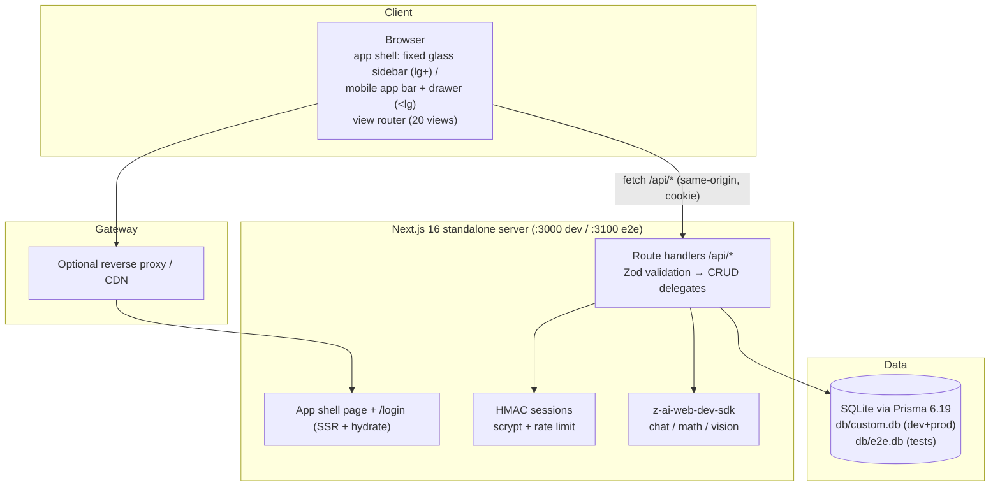
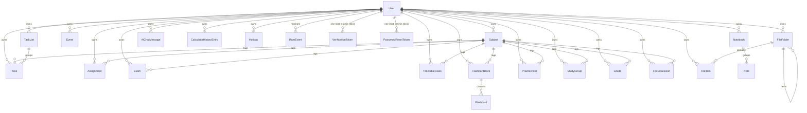

# StudyFlow (Omni-Study) — Master Project Architecture Document (PAD) v1.3.63

**Classification:** Internal Engineering Reference
**Status:** DEFINITIVE, PRODUCTION-LOCKED BLUEPRINT
**Companion Documents:** `README.md` (user-facing), `AGENTS.md` (agent quick-reference), `CLAUDE.md` (agent operating conventions), `docs/Tailwind-V4-Validation-Report.md` (parity trap log)
**Last Updated:** 2026-11-07
**Audience:** Senior Engineers, Tech Leads, DevOps, Onboarding Engineers, and AI Coding Agents
**Rule:** Every architectural decision in this document traces to a specific rationale. Nothing is here "because it's popular."

---

#### Revision Block — v1.3.63 (Session-155 / Batch DD, Cycle 105)

- `[SR]` Current test census anchor (the v1.2.0 convention, re-anchored): **1594/1594 Vitest unit** (48 files — the S155 additions: db-path +4 [the S155/DD1 module-anchor percent-decode family in the INTEGRATION form — the spaced-fixture leg (the S150 B-I3 class's behavioral proof: the real module copied into a repo whose path carries a space, imported through its own percent-encoded import.meta.url, resolution landing inside the fixture through the real candidateRoots), the non-ASCII leg (a repo at "café"), the plain-ASCII identity leg (the regression guard for the common case), the mutated-copy malformed-URL leg (the URIError guard: the anchor skipped, the CWD fallback, never a throw)]; script-conventions +2 [the S155/DD1 census pair — the DIRECT fileURLToPath call form (the import + the inline `const self =` shape + the marker, pinning the measured-design record: a helper-wrapped form is opaque to Turbopack's file tracer and grew the standalone output 144M → 699M) + the raw-pathform negative census (the assignment-anchored `= new URL(import.meta.url).pathname` shape — the DC4 call-not-comment precedent)]). The e2e census UNCHANGED at 616 (the 5-chunk cold map 152+189+91+95+89 — no e2e legs by design, the CV1 runtime-split precedent: the decode is wire-invisible for every non-percent-encodable runner path, and the behavioral proof rides the integration legs + the live spaced-path probe + the full cert) — census 2210 green.
- `[SR]` **S155/DD1 — the db-path module-anchor percent-decode (the S150 B-I3 class, landed at its named db-path-family cycle; the L1+L2 answer).** `candidateRoots()`'s module anchor converts `import.meta.url` through `fileURLToPath` (NOT the raw `new URL(...).pathname` form): percent-DECODED, so a repo checked out under a spaced or non-ASCII path ("My Repo", "café") KEEPS its module anchor — the raw form kept "%20" and the existsSync self-check silently dropped the anchor, falling back to the CWD rule and breaking the documented "regardless of the process working directory" invariant (.env.example's own promise) for every percent-encodable checkout path; the conversion also carries Node's documented Windows drive-letter form (the value side of the module already supported drive letters — the anchor side now matches). **The measured-design record (the cycle's load-bearing finding): the DIRECT call form, not a helper seam** — Turbopack's file tracer statically evaluates `fileURLToPath(import.meta.url)` but NOT a wrapper function around it; the helper-wrapped first design measured a whole-project trace (the standalone output grew 144M → 699M, the "dynamic filesystem access" warning), so the shipped form is the direct call with the URIError caught by candidateRoots' own try/catch (the anchor skipped, remaining anchors apply, never a crash — byte-identical to today's degraded path), and the unit layer pins the behavior through INTEGRATION legs (fixture-repo copies imported through their own percent-encoded URLs) instead of a helper's arg-injected legs. A malformed URL (a raw "%" in a bundler-synthesized value — the standalone chunk's shimmed getter) measures as a caught URIError → skip.
- `[SR]` **S155/DD2 + DD3 + DD4 — the db-path-family doc riders + the sidecar hygiene.** DEPLOYMENT.md §4's seed line reconciled ("wipes domain tables" was FALSE — prisma/seed.ts early-returns when the demo user exists; the honest reseed recipe: delete db/custom.db + re-push + re-seed; wiping is db:reset) + §6's checklist dropped the nonexistent `./scripts/smoke-test.sh` (the pre-clone scaffold residue — the AP-74 class); AGENTS.md's single-file e2e row carries the cold-reset caveat (the reset rides only the `test:e2e` chain — a direct `bunx playwright test` invocation against an aged db/e2e.db fails deterministically, the S45/S46 classes); `scripts/e2e-cold-reset.sh` widened to `rm -f db/e2e.db*` (a crash-left -journal sidecar survives a bare rm and would hot-journal-recover against the fresh push; the -wal/-shm patterns the same hygiene) + `.gitignore` gained `db/*.db-wal`/`db/*.db-shm`; the db-path module header's stale anchor-order list reconciled to the code's actual push order (the standalone detector FIRST — the I-1 comment rider).

#### Revision Block — v1.3.62 (Session-154 / Batch DC, Cycle 104)

- `[SR]` Current test census anchor (the v1.2.0 convention, re-anchored): **1588/1588 Vitest unit** (48 files — the S154 additions: data-import +4 [the S154/DC2 questions item-shape mirror leg — the members twin: the non-object item, the wrong type vocabulary, the missing type, the three valid shapes — + the S154/DC1 plannedUpdateIsNoOp trio — the identical-row elides leg (Date↔ISO exact-ms + nulls + primitives, the re-import shape), the changed-value-never-elides leg (string/date/number/boolean), the every-doubt-keeps-the-write leg (the missing stored key, the typeof mismatch, null-vs-value both directions, the unparseable date, the object value, with the Prisma-skip undefined leg holding true)]; script-conventions +2 [the S154/DC4 write-only negative census — no `.findFirst(` call form anywhere in the import route, green-on-arrival by design the CS3/CL9 precedent — + the S154/DC1 elision census — the marker + the plannedUpdateIsNoOp call + the counted-as-updated `updated: u + ` wire]). The e2e census UNCHANGED at 616 (the 5-chunk cold map 152+189+91+95+89 — no e2e legs by design, the CV1 runtime-split precedent: the elision is wire-invisible by construction and the s23 idempotent re-import pin IS the behavioral leg) — census 2204 green.
- `[SR]` The no-op-elision + questions-mirror + import-doc-reconciliation set (`docs/remediation-plan-session154.md`): **DC1 (the S148-deferred B-L2, contract-preserving and MEASUREMENT-BACKED)** the no-op update elision — the S141 condition ("stage-2 if measurement shows a residual window") finally ANSWERED BY PROBE: the sequential per-row update loop inside the single 60 s write-only transaction measures **0.32 ms/row on this build (1k = 430 ms · 10k = 3.5 s · 50k = 16.0 s · 100k = 32.0 s, linear — 1.9× headroom at the IMPORT_MAX_ROWS cap)**, so the A-M3 stage-2 chunked sub-tx + resume token (breaking the all-or-nothing ADR-021 contract) stays deferred ON MEASUREMENT; the cycle instead ships the elision the measurement DOES justify — a pre-tx pass (after the collision pre-flight, immediately before the transaction) reads the FULL stored rows for the update-branch ids (chunked, ownership-scoped, the cards deck-scope included) and drops every write whose planned payload already holds, collapsing the dominant heavy case (the IDEMPOTENT RE-IMPORT over a mostly-unchanged account — the e2e suite's own scenario) from N lock-held writes (~32 s at the cap) to one bounded read pass (~2.1 s measured, 15× cheaper). The diff is the pure seam's `plannedUpdateIsNoOp`: diff over PLANNED keys only (exactly Prisma's update semantics — absent keys never ride the write), CONSERVATIVE failure direction (any doubt — a key missing from the stored row, a typeof mismatch, null-vs-value, a stored Date against a non-string, an unparseable date, any object value — keeps the write; the write is today's behavior, the skip is the optimization), Date↔ISO exact-millisecond comparison (an untouched updatedAt compares equal; a touched row keeps its write); the elided rows still count in `updated` (the wire shape UNCHANGED by construction — the idempotence pin's updated: 3 holds with all three writes elided); a row vanishing in the pass→tx window joins the documented accepted read-hoist TOCTOU class, and the P2025 → named-409 door stays open for changed rows. **DC2 (the audit's L1)** the practiceTests.questions item-shape mirror — the members precedent's missed twin (the interactive atom refines every item: object + question string + the three-member type vocabulary; the import's array-ness check alone admitted `'["garbage"]'`), now mirroring the atom's predicates verbatim in the JSON_STRING_FIELDS pass (never stricter — the round-trip contract). **DC3 (the audit's L2+L3)** the doc-reconciliation pair — ADR-021's Decision text corrected (the 25 MiB → 64 MiB re-size at S137/CL2; the per-row findFirst → the S141/CP3 write-only shape + the S154 elision, the BW4 convention) + AGENTS.md's import row's three stale counts (the cap, the write-loop shape, the honest s23/resilience/s14 budget language — the s23 header's own S145/CT4 recount). **DC4 (the audit's L4)** the write-only negative census — the import route contains no `.findFirst(` call form (the CALL is the property; the comment mentions survive), closing the presence-marker-only gap where a regression re-interleaving a read inside the $transaction callback shipped green. The audits: the Batch DB recent-changes axis **clean** (all four DB claims verified at the source level, the doc census machine-verified with zero stale sites) + the data-portability/import-restore rotation (the fix surfaces, swept at S148): **0C/0H/0M/4L/2I** — no injection, authz, secret-handling, or enumeration defect in the axis; N3 (the verifyEmailSchema reference-atom comment re-verified accurate) + N4 (data-import.ts a pure seam outside server/) closed by the audit's re-verification; the export peak-memory O(account) residual (I-A) recorded for the streaming family.

#### Revision Block — v1.3.61 (Session-153 / Batch DB, Cycle 103)

- `[SR]` Current test census anchor (the v1.2.0 convention, re-anchored): **1582/1582 Vitest unit** (48 files — the S153 additions: auth +2 [the S153/DB1 capped-discharge pair — the discharge ceiling's 21st-decrement no-op leg, the success-only loop bound at the seam, + the window-rollover re-arm leg with the fresh-bucket allowance witness]; script-conventions +2 [the S153/DB1 structural census — MAX_DISCHARGES_PER_WINDOW = 20 + the Bucket.discharges counter + the decrement's ceiling guard — + the S153/DB2 page-budget census — the exportPage: key + the redirect→budget→counts→envelope ordering + the honest rate-limited render markers]). The e2e census 614 → 616 (the 5-chunk cold map 152+189+91+95+89 — chunk 1 +2: the DB1 success-loop trip pin [parity-session8's new TERMINAL describe] + the DB2 export-page budget pin [navigation.spec.ts, RELOCATED from its first s21 home when the chunk-5 registerGlobal: budget measured 40/40 exactly — the pin's throwaway register made s26's re-issue the 41st, root-caused by trace]) — census 2198 green. The hue-tokens CONSUMERS register gains the export page entry (sf-alert-amber — the register is data for the existing sweep leg, not a new test).
- `[SR]` The rate-limit-model + export-page-budget set (`docs/remediation-plan-session153.md`): **DB1 (M — the S152-deferred B-M1, mechanics CORRECTED by the S153 audit's direct read)** the aggregate CPU-containment discharge is now CAPPED per window — the S152 plan's stated alternation attack was mis-modeled (a success NETS 0: checkRateLimit's +1 then the decrement's −1 — the −1 lands on the success's OWN increment, never a prior fail's), and the REAL unbounded door was the SUCCESS-ONLY loop: under the default in-band posture (open registration + the OTP in the response → scriptable own credentials) a loop of correct-credential logins burned the full synchronous scrypt pair per request with NOTHING binding it (the aggregate never tripped; login's success path even resets both per-keys; ~24-37× the intended 40/15-min containment — the CK1 single-worker-starvation shape reopened by the S138/CM3 decrement). The fix: `MAX_DISCHARGES_PER_WINDOW = 20` on the `Bucket.discharges` counter — successes 1-20 net 0, past the ceiling +1 each, bounding every discharge-bearing aggregate (loginGlobal: + authBurnGlobal:) at M+D = 60 admitted requests per window; the five call sites unchanged (the cap is internal to the seam); the e2e cert arithmetic BYTE-IDENTICAL by construction (chunk 5's 13 login successes/boot ≤ D, the per-boot count staying 39/40); the CK1 flood pin surviving byte-identically (first429 = 41 — fails never discharge). **DB2 (the S152-deferred B-L2-audit)** the /export page's own budget — the page rendered the full envelope per view (20 counts + the complete serialize, byte-identical to the budgeted download) with no budget while its route twin rode `export:${user.id}` 10/15-min; the dedicated `exportPage:${user.id}` 10/15-min now sits after the auth gate (the DA4 doctrine — the anon redirect stays budget-free) and before the work, answering the honest amber alert render when spent (a page cannot 429; the render is cheap by construction — the check precedes the counts + the envelope). **DB3 (the audit's N2)** the success-reset drift trio corrected to the net-0 language (change-password's "nets -1" comment, DEPLOYMENT.md's TRUSTED_PROXY_HOPS cell, the s16 CK1 pin's clean-slate comment — all three had carried the pre-CM3 reset semantics). **DB4 (the audit's N1)** the garbage-flood lockout documented as the accepted fixed-window trade-off in DEPLOYMENT.md's limiter cell (the three process-wide globals gate before body validation by design, so a ~40-request zero-scrypt flood pins the respective global for its window; the re-order alternative would un-bound the garbage flood and is rejected). The register route's stale "≤ 3 per chunk" sizing comment corrected to the S153-MEASURED arithmetic (chunk 5 rides registerGlobal: to 40/40 exactly — 37 by self-calibrating probe + s26's 3 — the one-add-from-tripping boundary the DB2 pin's first home died on). The audits: the Batch DA recent-changes axis **clean** (all six DA claims verified at the source level, the doc census with ZERO stale sites — the DA6 self-anchoring pins holding on their first re-read) + the rate-limiter/auth-family + export/data-portability rotation (the fix surfaces, swept at S124): **0C/0H/2M/2L/2I** — the full 30-key rate-limit census re-verified consistent; N3 (the verifyEmailSchema reference-pin note) + N4 (the data-import path) recorded.

#### Revision Block — v1.3.60 (Session-152 / Batch DA, Cycle 102)

- `[SR]` Current test census anchor (the v1.2.0 convention, re-anchored): **1578/1578 Vitest unit** (48 files — the S152 additions: validation +2 [the DA5 registerSchema fullName-trim pair — the padded-value-trims leg + the whitespace-only→cleared-state leg with the post-trim bound witness]; script-conventions +21 [the DA1 delete-latch heptet — one leg per fire-and-forget site: events/exams/assignments/flashcards-deck/flashcards-card/notes-note/notes-notebook — + the DA2 hand-guard heptet — one leg per noValidate dialog — + the DA3 replace-confirm pair — the drafts.length gate + the AlertDialog Replace action — + the DA4 withUserParams 401-order census — + the DA6 doc-counts cross-read quartet, the SELF-ANCHORING CQ6 family]). The e2e census UNCHANGED at 614 (the 5-chunk cold map 150+189+91+95+89 — no e2e count change this cycle) — census 2192 green. The hue-tokens registers re-anchored in the same cycle (flashcards-view 394 → 437, notes-view 705 → 736 — the anchored legs tripped as designed when the DA1/DA2 edits added lines above the sites — the census maintenance, not a count change).
- `[SR]` The delete-latch + hand-guard + replace-confirm + order-letter set (`docs/remediation-plan-session152.md`): **DA1 (L — the s151-carried B-L5)** the seven fire-and-forget delete handlers carried no in-flight guard — a double-click fired the second DELETE into the first's window and toasted its 404 as an error; the per-view `deletingIds` set latches the window (the membership guard before the DELETE, the finally removal keeping retry honest, `disabled` on the plain-button sites; the four confirm-gated deletes already latched via the setDeleting(null) pre-call pattern and were out of scope by design). **DA2 (the B-L6 rider)** the noValidate hand-guard sweep — seven dialogs (events/assignments/exams/notes/timetable/flashcards deck+card) shipped empty required fields to the server and rendered Zod's raw issue copy in the dialog's error slot; the S127/CB17 pattern generalized: required-field guards with human copy BEFORE `setBusy` (an early return after arming the busy latch strands it), the server's Zod boundary staying (the guard is the dialog's mirror). **DA3 (the B-L2 rider, the product decision adjudicated)** the AI-generate replace-confirm — the practice-test Generate silently replaced the whole drafts list; replace semantics KEPT (the reference behavior), gated by an AlertDialog naming the count when drafts exist, the confirm BEFORE the AI call (a cancel never burns the ai: budget), the fresh-test path unchanged. **DA4 (the s152 entities/factory audit's B-L1)** the withUserParams 401-order — the CN11 id bound preceded requireUser(), so an unauthenticated malformed-id request answered 404, contradicting the wrapper's own documented "unauthenticated requests still 401"; requireUser() now fires first (the no-oracle 404 semantics for authed callers unchanged). **DA5 (the audit's B-I1)** the registerSchema fullName trim at the validation ATOM (the CY2 schoolName shape — the trim-before-store doctrine's last gap). **DA6 (the Audit A doc-census drift)** five stale prose sites corrected (README ×2 at an S146-era "1513"; the import-cap prose at a pre-CL2 "10 MiB" vs the 64 MiB constant; the SKILL §11 green-state line at S150 figures under an S151 label; the SKILL CD3 prose "1449+605") + four SELF-ANCHORING count-claims pins (the CQ6 cross-read family: each derives its expectation from the cited source — the vitest header, the cert map, IMPORT_MAX_BYTES — so the next count change forces the doc update in the same commit). The audits: the Batch CZ recent-changes axis **clean** (all four CZ claims verified at the source level — the CZ3 gate byte-verified via od against the display-pipeline `[m`-eating artifact) + the entities/factory + data-layer rotation (two cycles stale): **0C/0H/1M/2L/3I** — all eight historically-real families re-verified closed, all seven past fixes verified landed. **B-M1** (the aggregate CPU-containment discharge model — 1:1 dischargable by attacker-mintable successes under the default posture; Reasoned) deferred to its own rate-limit-model cycle with the e2e budget-arithmetic study; **B-L2-audit** (the /export page's unbudgeted envelope render) deferred with the s21/s23 page-visit interplay study; **B-I2** (force-dynamic on 1 of 61 routes) adjudicated as documented convention (the cookies() structural mitigation).

- `[SR]` Current test census anchor (the v1.2.0 convention, re-anchored): **1555/1555 Vitest unit** (48 files — the S151 additions: data-store +3 [the CZ1 notes-tags chain triple — the add-then-remove post-settle-base leg + the failed-first-op chain-hygiene leg + the missing-note no-op leg]; script-conventions +5 [the CZ1 wiring-census pair — the updater-form wiring + the saveTags-helper retirement — + the CZ2 files failed-load surface census — the loadFailed state + the alert + Retry leg ordered BEFORE the false-empty branch — + the CZ3 phantom-session gate census — the never-started gate BEFORE the session POST, `running` joining the deps — + the CZ4 unit-save success toast census]). The e2e census UNCHANGED at 614 (the 5-chunk cold map 150+189+91+95+89 — no e2e count change this cycle) — census 2169 green. The hue-tokens notes-view register re-anchored 700 → 705 in the same cycle (the anchored leg tripped as designed when the CZ1 rewire added lines above the site — the census maintenance, not a count change).
- `[SR]` The tags-chain + load-honesty + phantom-row + save-feedback set (`docs/remediation-plan-session151.md`): **CZ1 (M — the s151 FE/views + auth/crypto audit's B-M1)** the notes tags join the CX2 updater-form chain family — the view's addTag/removeTag PATCHed ABSOLUTE JSON arrays computed from the RENDER-SNAPSHOT selected note, so two tag ops inside one PATCH+refetch window silently dropped the first (the members-fix family, one field over). `setNoteTags(noteId, update)` rides a per-note chain map in data.ts (the caller declares the effect, the chain supplies the post-settle base); `parseNoteTags` moved to data.ts as the single source (the view rows and the chain updater share one parsed base); the view-level guards stay (the CY3 honest toasts) and the add updater is idempotent (the belt-and-braces dedupe). **CZ2 (the B-L1 rider)** the files failed-load surface — the one view with a private loader (the shell's BootDataFailureBar cannot cover it) settled a failed initial GET into the permanent false "No files yet" EmptyState; the CX5 loadFailed + retryCount pattern now surfaces the sf-alert-red role="alert" + Retry, ordered BEFORE the false-empty branch (a failed GET can never prove an empty account), and a successful retry clears it. **CZ3 (the B-L3 rider)** the phantom-session gate — a stray Complete on a never-started timer floored zero elapsed to a phantom 1-second completed session (stats +1, a spurious row, an auto-switch to Short Break); the gate `!running && remaining >= durations[mode]` fires BEFORE the POST with its reason toast (a real interval exists iff the timer ran or time came off the preset), and `running` joins the useCallback deps (the CD3 discipline). **CZ4 (the B-L4 rider)** the unit-save success toast — the GPA twin's mirror ("Conversion saved to history"), the silent success branch speaks. The audits: the Batch CY recent-changes axis **clean** (all three CY claims verified at the source level, the doc census machine-verified) + the FE/views + auth/crypto rotation (two cycles stale — the named next axis): the auth/crypto half **clean** by direct read (the scrypt migration + rehash drain, the uniform timing pair, sessionVersion, the rate-limit family incl. the protected buckets + the net-of-successes decrement, the peppered OTP + conditional single-use, hashed reset tokens, authBurnGlobal, proxy-aware cookies, hashless selects); the FE/views half **0C/0H/1M/6L/4I** (the CX1/CX2 chain families re-verified fully landed at every consumer site; the XSS posture clean; a11y thorough). The remaining Ls recorded for their own family cycles (the AI-generate replace guard — a product decision; the seven-site delete double-fire latch; the six-dialog noValidate hand-guards); the Is recorded (the Grid-Builder parity adjudication, the solver subtitle nit, the Due-Soon measured-hint parity, the anchor>button documented parity); B-L2/A-M3 keep their ADR-021 cycle.

#### Revision Block — v1.3.58 (Session-150 / Batch CY, Cycle 100)

- `[SR]` Current test census anchor (the v1.2.0 convention, re-anchored): **1547/1547 Vitest unit** (48 files — the S150 additions: validation +2 [the CY2 schoolName-trim pair — the padded-value-trims leg + the whitespace-only→cleared-state leg with the post-trim bound witness]; script-conventions +2 [the CY1 multipart folderId 64-char-bound census — the guard ordered BEFORE the ownership query, the no-oracle 404 copy — + the CY3 note-tag honest-feedback census — the two drop-reason toasts]). The e2e census UNCHANGED at 614 (the 5-chunk cold map 150+189+91+95+89 — no e2e count change this cycle) — census 2161 green. The hue-tokens notes-view register re-anchored 686 → 700 in the same cycle (the anchored leg tripped as designed when the CY3 block added lines above the site — the census maintenance, not a count change).
- `[SR]` The folderId-bound + schoolName-trim + tag-honesty set (`docs/remediation-plan-session150.md`): **CY1 (L — the s150 entities/factory + data-layer audit's B-L1)** the multipart `folderId` joins the 64-char id bound — the raw form value reached `db.fileFolder.findFirst` verbatim while every other id atom rides the S118/BS2 `idField` + the S139/CN11 route-param bound (the one id atom the schemas never owned: the multipart branch is hand-validated and cannot Zod-parse binary, so it silently escaped both schema-family fixes; Prisma parameterizes — no injection — purely the boundary inconsistency, with a ~2.1 MB reachable parameter inside the multipart envelope's overhead room). A >64-char id cannot exist, so the honest status is the no-oracle 404, byte-identical to the missing-row branch it precedes. **CY2 (the S146/B-I3 rider, landed at its named validation-family cycle)** the schoolName trim at the validation ATOM — `z.string().trim().max(120).optional()`; Zod 4 orders .trim() BEFORE .max() (probed empirically) and the transformed key SURVIVES in the parsed object, so the sent-keys filters (`!== undefined` at the settings route, `PROFILE_PATCH_KEYS` at the import seam) keep working verbatim — one canonical source now serves the settings route, the client card, AND the import profile patch. **CY3 (the S149/B-I4 rider)** the note-tag honest feedback — addTag cleared the draft BEFORE the drop guards, so a >24-char or duplicate tag vanished with zero feedback (the user's keystrokes destroyed, no reason); the empty draft stays a no-op, the two real drops now name their reason through the aria-live toast stack. The audits: the Batch CX recent-changes axis **clean** (all five CX claims verified at the source level, the doc census machine-verified) + the entities/factory + data-layer rotation (three cycles stale) **0C/0H/0M/1L/5I** — all eight historically-real families re-verified CLOSED at their anchors (ownership scoping + P2025→404, route authz across the 39-file census, the error taxonomy, the CR7 delegate pattern, bounded readers, the CR3 own-keys patch discipline, rate-limit keying, the Zod boundary). The Is recorded (the limiter hard-cap eviction trade-off, the unthrottled GET posture, the db-path percent-decode dev nit, the withUserParams 404-before-401 taxonomy nit); B-L2/A-M3 keep their ADR-021 cycle.

#### Revision Block — v1.3.57 (Session-149 / Batch CX, Cycle 99)


- `[SR]` Current test census anchor (the v1.2.0 convention, re-anchored): **1543/1543 Vitest unit** (48 files — the S149 additions: data-store +8 [the CX1 sibling-chain trio — the two double-toggle opposite-value legs + the failed-toggle-no-poison leg — + the two CX1 wiring censuses + the CX2 members-chain pair — the add/remove interleave leg landing BOTH effects from the post-settle base + the missing-group no-op — + the CX2 wiring census]; script-conventions +5 [the CX3 resend transport-branch census + the CX4 calculator trio — the `=` re-press guard, the GPA disable, the unit disable — + the CX5 settings me-fetch failure census]). The e2e census UNCHANGED at 614 (the 5-chunk cold map 150+189+91+95+89 — no e2e count change this cycle) — census 2157 green.
- `[SR]` The sibling-toggle-chain + members-chain + resend-transport + calc-save-latch + settings-me-failure set (`docs/remediation-plan-session149.md`): **CX1 (M — the s149 FE/views audit's B-M1)** the myDay/important row toggles joined the S127/CB16 per-id chain family — the `toggleTask` chain had closed the `completed` double-toggle race at exactly one store mutation while its two sibling toggles PATCHed from the RENDER-SNAPSHOT task (two rapid clicks inside the PATCH+refetch window both read the same stale base and sent the SAME value; the second toggle silently lost — the BX10 class one generation behind). Now `toggleTaskMyDay`/`toggleTaskImportant` ride the SAME `taskToggleChains` map (one chain per task id — cross-field PATCHes are field-scoped so cross-field serialization is unnecessary but harmless; ONE map keeps the CC5 eviction single); the four view call sites (tasks-view + myday-view) rewired. **CX2 (M — B-M2)** the study-group members chain: the S123/BX10 fix had moved the members base from the render snapshot to a CALL-TIME store read — still not a chain: a remove during an add's PATCH+refetch window (or two rapid removes) computed its absolute members array from the not-yet-refreshed store and silently dropped the first op behind two success toasts. Now `setStudyGroupMembers(groupId, update)` — the per-group chain map (the toggleTask idiom) with the UPDATER form (the caller declares the effect, the chain supplies the POST-SETTLE base — the load-bearing choice that generalizes the idiom from toggles to arbitrary members math); the add/remove handlers rewired off the call-time reads (the add's `savingMember` latch stays — it guards the form's own duplicate submits). **CX3 (L — B-L1)** the resend-code catch splits TRANSPORT before the uniform line: the 20 s deadline (isTimeoutError) renders the deadline copy, the offline `ApiError(0)` renders the human offline message — a request that never left the browser has ZERO enumeration surface (the CF8 no-enumeration contract covers ACCOUNT-state responses; a connection failure is not one), while every account-state failure keeps the uniform "a new code is on its way" line. **CX4 (L — B-L2)** the calculator history-save guards: the `=` re-press no-op (a synchronous justEvaluated ref read — even a same-tick double-press cannot append the derived "5 = 5" noise row) + the GPA/unit Save latches (`disabled={savingGpa}`/`disabled={savingUnit}`, the CI4 in-flight-guard pattern — a rapid double-click no longer duplicates the row). **CX5 (L — B-L3)** the Settings Account card's me-fetch failure is first-class state: the failed load renders the honest copy (never a stuck "Loading your account…") + the red `sf-alert-red` `role="alert"` block with a real Retry (the effect re-runs on retryCount, the page.tsx boot() inner-async shape — no synchronous setState in the effect body, the react-hooks contract). The audits: the Batch CW recent-changes axis **clean** (all four CW claims verified at the source level) + the FE/views + auth/crypto rotation (two cycles stale) — the auth/crypto half clean (every S147-verified family re-confirmed closed), the FE/views half **0C/0H/2M/3L/4I** with every M/L re-verified by direct read. The TaskDialog/GroupDialog edit-form snapshot pattern is designed last-writer-wins (recorded — not a finding); the B-I riders (the mid-session 401 seam, the departed-note flush silence, the in-band dev code delivery, the note-tag length-cap drop) stay recorded; B-L2/A-M3 keep their ADR-021 cycle.

#### Revision Block — v1.3.56 (Session-148 / Batch CW, Cycle 98)

- `[SR]` Current test census anchor (the v1.2.0 convention, re-anchored): **1530/1530 Vitest unit** (48 files — the S148 additions: data-export +9 [the CW2 export-byte-ceiling quintet — the EXPORT_MAX_BYTES 256-MiB value pin + the exportOverCeiling boundary legs: zero far-under, at-cap-last-allowed, one-past, the multi-GB tail — plus the four CW2 wiring censuses: the seam throw, the toErrorResponse 413 branch, the page catch, the panel's derived state]; script-conventions +1 [the CW1 per-method budget census — the calculator-history POST block sliced + asserted for its own checkRateLimit, closing the per-file CE6 census's structural blind spot]; api-offline +1 [the CW3 malformed-2xx parse leg — ApiError 502, never the pretend-200]). The e2e census UNCHANGED at 614 (the 5-chunk cold map 150+189+91+95+89 — no e2e count change this cycle) — census 2144 green.
- `[SR]` The write-budget-completion + export-byte-ceiling + parse-status set (`docs/remediation-plan-session148.md`): **CW1 (L — the s148 audit B's B-L1)** the calculator-history POST — the one authenticated write verb outside the shared BZ5/CB7 write budget (the S122/BW5 comment had conflated the 500-row STORAGE trim with RATE-boundedness; the per-file CE6 census was satisfied by the DELETE twin's budget while the POST performed an unthrottled INSERT + retention-trim interactive transaction per call) — now rides `write:${user.id}` 600/15-min after auth before readJson (the CE6 pattern); the FE unaffected (one POST per explicit "=" press; the BT12 catch already degrades honestly). **CW2 (L — B-L3, the cycle's load-bearing fix)** the export byte ceiling: the export was the one unbounded read family (20 findManys with no take, assembled + serialized unconditionally; the over-cap warning existed only client-side while the import door legally admits 64 MiB envelopes REPEATEDLY — a legit account grows to multi-GB and every export GET materializes it on the single worker). The bound rides the FIRST already-computed downstream quantity — the serialized byte size (S142/CQ2's exportByteSize) — through the pure `EXPORT_MAX_BYTES` (256 MiB, 4× the restore cap: ADR-019-honest for the merely-large, bounding the multi-GB tail) + `exportOverCeiling` predicate + the typed `ExportTooLargeError` thrown by the SHARED renderExportEnvelope seam (BW8: the route's 413 and the page's over-ceiling panel derive from one gate and can never drift) + the toErrorResponse 413 branch with the database-file remedy (the CU3 discrimination precedent) + the /export page's narrow catch rendering the same panel from err.bytes + the panel's derived over-ceiling state (the red role="alert" remedy + the disabled Download span; under the ceiling every e2e-scale account renders byte-identically). No e2e leg BY DESIGN (the CV1 runtime-split precedent — driving the ceiling needs a >256 MiB account; the predicate legs + the four censuses + the s21 re-cert own the proof). **CW3 (I — B-I2)** the api.ts parse() malformed-2xx body surfaces ApiError 502 (the server answered garbage), never the pretend-200. The audit's B-L2 (the import restore's sequential per-row updates inside the 60 s transaction) stays deferred to the A-M3 family's own ADR-021 cycle; the entities/factory + data-layer rotation's historically-real families re-verified closed (the 60/60 route-authz census, the store's stale-state classes, the import door's ownership/caps, the error taxonomy, the bounded-read census exhaustive).

#### Revision Block — v1.3.55 (Session-147 / Batch CV, Cycle 97)

- `[SR]` Current test census anchor (the v1.2.0 convention, re-anchored): **1519/1519 Vitest unit** (48 files — the S147 additions: env-check +6 [the CV1 nodeEnvCasingWarning quintet — canonical-silence ×3 + unset-silence + the capital-P host + the padded spellings + the arbitrary non-canonical values, and the CV1 instrumentation-wiring census leg — the CI6c 4th-leg precedent]). The e2e census UNCHANGED at 614 (the 5-chunk cold map 150+189+91+95+89 — no e2e count change this cycle; the CU1a tripwire leg's cleanup hardened IN PLACE) — census 2133 green.
- `[SR]` The node-env-casing-boot-warning + tripwire-cleanup set (`docs/remediation-plan-session147.md`): **CV1 (the named s145/s146-carried rider, adjudicated REAL by the s147 FE/auth rotation audit)** every production-keyed guard reads the NODE_ENV value EXACTLY (`=== "production"` — the AUTH_SECRET fatal gate at env-check's isProduction core, the CB14 in-band-delivery / CF2 direct-exposure / CI6c over-declared-hops boot warnings, the Secure-cookie fallbacks in server/auth.ts, db.ts's Prisma log config, db-path, instrumentation) — a host exporting `NODE_ENV=Production` (or PRODUCTION, " production", staging, "") degrades SILENTLY to the dev posture: a missing AUTH_SECRET boots on the public dev fallback with every production warning muted and the cookie fallback non-Secure. THE REACHABILITY PROBE (the S146 runtime-split doctrine applied to an env knob): the standalone server.js FORCES `process.env.NODE_ENV = 'production'` at its line 5 BEFORE requiring next; next dev/start force their own canonical values; the Dockerfile sets the canonical literal; compose/.env.example never set it — the miscased value reaches the guards ONLY through a hand-rolled custom server, exactly the overdeclaredProxyHopsWarning misconfigured-host class. The fix: the pure `nodeEnvCasingWarning` predicate in env-check.ts (silent on all three canonical values + unset — zero false positives on every documented posture, probed at plan time) + the instrumentation console.warn wiring (the CI6c precedent: "Set NODE_ENV=production (lowercase) on production hosts"). No e2e leg BY DESIGN — the standalone webServer forces production at server.js:5, so a spawn leg would drive the FORCED value; the unit seam legs are the layer where the miscased value is reachable, the wiring census-pinned in the same file. **CV2 (L — the s147 Batch CU recent-changes audit's A-L1)** the CU1a derivation-tripwire leg's cleanup delete sat AFTER the status assertion (CU1b carried the try/finally) — the leg's own designed failure mode (the tripwire firing on a runtime switch) would ALSO leak the probe row into the chunk's files surface; the cleanup now rides a finally with the row id captured before the first throwing expect (the failed-POST branch creates no row — the guard's 400 writes nothing).

#### Revision Block — v1.3.54 (Session-146 / Batch CU, Cycle 96)

- `[SR]` Current test census anchor (the v1.2.0 convention, re-anchored): **1513/1513 Vitest unit** (48 files — the S146 additions: files +5 [the CU1 multipart mime admission-set quintet — the import door's mirrored cap: printable-ASCII ≤ 100 with empty admitted, the length + CRLF + non-ASCII + control-family rejections], script-conventions +5 [the CU1 files-route mime-guard wiring census, the CU2a register re-issue-triple transaction census, the CU2b register fresh-pair interactive-transaction census, the CU2c resend supersede-pair transaction census, the CU3 files body-read BodyTooLargeError discrimination census]). The e2e census 612 → 614 (+2: chunk 2 +2 [the CU1 derivation-tripwire + the clean .pdf round-trip pair]) — census 2127 green.
- `[SR]` The multipart-mime + OTP-tx + 413-discrimination + breadcrumb-recount set (`docs/remediation-plan-session146.md`): **CU1 (M — the s146 audit B's M-1)** the multipart upload door stored the client-controlled part Content-Type (`mime`) with NO length/charset bound while the sibling import door caps the identical column at 100 printable-ASCII chars (the CE7 bloat class — the drive probes established the RUNTIME SPLIT: the declared type reaches the write only on the Node-parse path [the dev daemon stored a 150-char declared type verbatim, 201 pre-guard → 400 with the guard's copy post-guard]; the shipped Bun postures — `bun run start` + the oven/bun Docker image — derive the stored mime from the FILENAME EXTENSION through Bun's registry and never deliver the declared type, so the write is structurally bounded there — the documented Bun-vs-Node name behavior now with a mime twin, tripwire-pinned by the e2e derivation leg). The fix: the `UPLOAD_MIME_MAX_CHARS` + `isPrintableAsciiMime` seam in `http.ts` (the import door's admitted set exactly; the unknown-type "" shape keeps the octet-stream fallback) + the route guard (the BW13 name-cap copy pattern). **CU2 (L — audits A-L1 + B-L1; the S142-carried standing deferral landing)** the OTP re-issue write pairs ran un-transacted on the register/re-send siblings of the CT2-fixed forgot-password route (a concurrent same-account race interleaves delete/delete/create/create leaving two live 15-min codes — the older inert by the findFirst-desc verify path, but the same BZ7/CE5 family) — the register re-issue triple in ONE batch `$transaction`, the fresh-account pair in the INTERACTIVE `$transaction` (the folders/[id] precedent — the token data depends on the created id; the S125/BZ9 P2002 catch moves around the whole tx, the loser's rollback shape externally identical), the resend pair in the batch form (the CT2 mirror). **CU3 (L — B's L-2)** the files multipart branch answered a confident 413 for ANY body-read failure — the CN6 discrimination (only the genuine `BodyTooLargeError` answers 413; transport failures propagate to the honest 500 handler) adopted at the second door. **CU4 (L — audit A's L-2)** five in-file resilience budget breadcrumbs understated the demo import count (4/10, 5/10, 7/10, 8/10 vs the actual 9 — one miscounted at write time) — re-anchored to the present-tense arithmetic (the AK3 header-correction class). Rider: the CT3 e2e leg's shadow half (both /export CTAs compute a non-"none" box-shadow — the sf-gradient-shadow utility was unpinned).

#### Revision Block — v1.3.53 (Session-145 / Batch CT, Cycle 95)

- `[SR]` Current test census anchor (the v1.2.0 convention, re-anchored): **1503/1503 Vitest unit** (48 files — the S145 additions: script-conventions +3 [the CT1 focus-timer completion-window census — the saving-latch + settle-CAS markers, the behavioral legs riding the resilience e2e pair; the CT2 forgot-password supersede-transaction census — the one-live-link invariant's batch $transaction wiring; the CT4 demo-import-budget census — the census-visible POST call-site counts machine-pinned to the recounted headers: s23 9 fixture + the census-invisible in-app panel POST = 10/10 zero headroom, resilience 8 fixture + 1 demo.request = 9/10]). The e2e census 609 → 612 (+3: chunk 3 +2 [the CT1 phantom/double-log leg + the settle-CAS leg], chunk 5 +1 [the CT3 gradient-CTA computed-style leg]) — census 2115 green.
- `[SR]` The completion-window + supersede-tx + gradient-CTA + budget-recount set (`docs/remediation-plan-session145.md`): **CT1 (M — the s145 audit B's M-1)** the focus timer's completion window re-armed from its own terminal state — after the auto-completion, mode stayed "focus" and remaining stayed 0 through the in-flight save and FOREVER after a failed save (the catch only toasted), the Start button stayed enabled, and complete() had no saving guard: a Play press at 00:00 re-fired the completion effect and POSTed a phantom full-duration session from zero elapsed time (a double-log inside the window; the late .then/.catch state writes also clobbered newer mode picks — the S142–S144 ABA family). The fix set: the saving latch (+ unlatch), `disabled={saving}` on the Start button, the failure re-latch to a fresh full duration, and the settle-CAS (the house React.useRef instance-scoped ticket, minted at POST time, invalidated by switchMode/applyPreset/reset — the .then/.catch state writes currency-gated, the toasts unconditional); pinned by the fake-clock-driven e2e pair. **CT2 (L)** the forgot-password supersede pair (deleteMany + create) ran as two un-transacted awaits — a concurrent same-account race interleaves delete/delete/create/create leaving TWO live one-shot tokens, breaking the route's own documented one-live-link invariant (S121/BV11b); the batch $transaction closes it. **CT3 (L)** the export panel's Download JSON anchor + Import button were the codebase's only hand-rolled solid bg-sf-primary CTAs (the house convention: every primary action rides the Button gradient variant) — both now ride .sf-gradient + .sf-gradient-shadow, pinned by the computed-style leg. **CT4 (L — the s145 audit A's L-1)** the s23 demo-import-budget header undercounted 10 POSTs as "exactly 9" (omitting the census-invisible in-app panel POST and the CO1 leg) — zero headroom at the 10/10 limiter cap; the resilience cross-reference said 5 (actual 9). The recount + the machine census leg.

#### Revision Block — v1.3.52 (Session-144 / Batch CS, Cycle 94)

- `[SR]` Current test census anchor (the v1.2.0 convention, re-anchored): **1500/1500 Vitest unit** (48 files — the S144 additions: data-import +4 [the CS2 250k-star topo-sort linearity leg, the CS4 mime-charset quadruple, the CS5 IMPORT_MAX_ROWS constant pair], files +2 [the CS4 downloadHeaders Content-Type clamp pair], http-body +1 [the CS7 PrismaValidation drift-log spy], note-html-dom +1 [the CS6 template-beyond-cap collector leg], script-conventions +2 [the CS3 merge-guard wiring census + the CS5 route-wiring census]) + **609/609 Playwright e2e** (the 5-chunk cold map re-tagged 150+187+89+95+88 — chunk 3 +2 [the CS1 appearance-picker sequence-CAS leg + the CS5 row-cap 413 leg], chunk 5 +1 [the CS3 merge-guard e2e leg]) = **census 2109 green**.
- `[SR]` The cursor-dequeue + row-ceiling + mime-charset + instance-scoped-CAS set (`docs/remediation-plan-session144.md`): **CS1 (M — the s144 audit A's M-1)** the S143/CR5 sequence-CAS was correct as a pure seam and DEFEATED at the call sites — `createFetchSeq()` ran in the AppearanceCard function body, so every render minted a fresh seq instance, every pick's ticket was 1 on its own instance, `isCurrent` degraded to always-true, and the guard was the unconditional S127/CB15 rollback again (the ABA re-opened; the S142 value-compare's different-value protection regressed with it — behaviorally RED-proven in the e2e pre-fix build: a route-intercepted late-failing PATCH rolled the accent store back over a newer pick) — the fix is the React.useRef instance-scoped form (the files-view idiom) + the behavioral e2e leg + the census re-anchor; **CS2 (M — audit B's M-1, the class re-measured)** the folders topo sort's `queue.shift()` dequeue was O(n²) (measured on this Node: 27 ms at 2×10⁴ → 2,842 ms at 2×10⁵ — 25x rows, 104x time, ~12 minutes projected at the byte cap's ~10⁶-row ceiling; the audit's ~13 s at 10⁵ was ~10x this build's constant — the reproduce-before-trusting doctrine cuts both ways) — the cursor dequeue (the queue only ever grows during iteration) preserves the BFS order and cycle-rejection exactly at O(n), pinned by the 250k-star linearity leg (the star, not the chain — a chain keeps the live queue at ≤2 elements, the degenerate easy case the first draft of the pin accidentally picked); **CS3 (M — audit B's M-2, the missing-pin class)** the import route's IMPORT_MERGE_GUARDS wiring (the UPDATE-branch merge guards — the B-I1 mitigation) had ZERO pins (deleting the guard call shipped green) — the census + the inverted-grade-row e2e leg, green-on-arrival by design (the S137/CL9 precedent); **CS4 (L — B's L-1, probed)** a hand-crafted `files.mime` with CR/LF passed the length-only import guard, persisted clean, then threw TypeError at every download (Node/undici rejects control characters in header VALUES — the 500-on-read taxonomy break; the throw fails closed, no header injection, hostile-self-import only) — the charset guard at the import door (printable ASCII, exactly the browser's `entry.type` emission grammar, empty still passes) + the downloadHeaders clamp (belt-and-suspenders for pre-fix rows); **CS5 (L — B's L-2)** no max-ROWS cap existed (the 64 MiB byte cap bounds the BODY, not the ~10⁶-row parsed tree — several hundred MB resident per hostile request, no deadline) — `IMPORT_MAX_ROWS = 100_000` checked at the cheapest post-parse point in the route (the byte-cap precedent), far above any real account, far below the byte cap's admission, the all-or-nothing ADR-021 shape untouched; **CS6 (L — audit A's L-1)** the CR2 template rider taught the UNWRAP branch but not the depth-cap COLLECTOR (a `<template>`'s children live in its inert `.content` fragment — probed in BOTH happy-dom 21.0.4 and Chromium — so template text ≥500 deep died at the DOM door's collapse while the server door kept it) — the collector resolves the same `.content` source + the stale environment comment re-worded; **CS7 (L — audit A's L-2)** the shared PrismaClientValidationError→400 leg logged NOTHING while its own comment named the target as latent Zod↔Prisma drift (a SERVER-side bug) — the leg logs before answering (the client keeps the honest 400, the operator keeps the diagnosis; the spy pins the log contract).

#### Revision Block — v1.3.51 (Session-143 / Batch CR, Cycle 93)

- `[SR]` Current test census anchor (the v1.2.0 convention, re-anchored): **1490/1490 Vitest unit** (48 files — the S143 additions: sent-keys-patch +1 [the CR1 hostile-body own-keys leg], http-body +1 [the shared PrismaClientValidationError→400 leg], note-html-dom +4 [the CR2 non-text family dies whole — RED-probed five-tag set], note-html +2 [the CR2 server-door nonTextTags drift pins], fetch-seq +4 [NEW FILE — the CR5 sequence-ticket CAS seam], data-import +6 [the CR6 importRestoreError behavioral family], script-conventions +6 [the CR1/CR2/CR4/CR5/CR3 census markers + the CR7/CQ8 re-anchor]) + **606/606 Playwright e2e** (unchanged count — the S143 pins re-anchored existing legs in place: the CQ3 mover locator now the NAMED combobox form) = **census 2096 green**.
- `[SR]` The own-keys + non-text-tag-door + typed-import-delegate + sequence-CAS set (`docs/remediation-plan-session143.md`): **CR1 (L — the s143 audit B's L-1, probed)** sentKeysPatch's membership test `key in parsed` walked the prototype chain — a hostile PATCH body carrying `toString`/`constructor`/`valueOf` injected the inherited FUNCTIONS into the Prisma write data → PrismaClientValidationError → the shared mapper's 500 (the 400-family taxonomy's one reachable violation on interactive paths) — the own-keys guard (`hasOwnProperty.call`) + the shared mapper's PrismaClientValidationError→400 leg (the import route's local BT1b, now every route's); **CR2 (L — audit A's I-1 promoted, probed across an 11-tag corpus)** the five NON-TEXT tags (script/style/textarea/option/xmp — exactly sanitize-html's default nonTextTags) died whole at the server write door but their TEXT survived the DOM render door's unwrap branch (the CQ5-family residual of "the two doors accept the SAME payload set") — the shared `NOTE_HTML_NON_TEXT_TAGS` constant feeds both doors: the DOM walker kills the set whole at ANY depth (before the depth-cap collapse), the depth-cap collector skips non-text subtrees, and the server's `nonTextTags` is explicit (behavior-identical, drift-immune); **CR3 (L)** the notebook-mover Select's accessible name (the CQ3 surface's WCAG 4.1.2 gap — every sibling Select carried one); **CR4 (L)** the import route's three inline any-casts replaced by the typed `ImportDelegateOps` lookup (one documented index cast — `keyof PrismaClient` is string|symbol, so the index key narrows through `as string`); **CR5 (L — audit A's L-3)** the appearance CAS now compares REQUEST SEQUENCE (the per-field `createFetchSeq()` tickets), closing the same-value ABA the S142 value-compare left; **CR6 (M-fix rider — audit A's M-1)** the import catch's named legs (P2025/P2028/BT1b/CE7-CJ5) extracted to the pure `importRestoreError` seam, behaviorally pinned (the censuses were the only pins — a leg reordering passed green); **CR7 (L)** verify-email's dead pre-tx `sessionVersion` column dropped (dead since CQ8); **CR8 (L)** the comment-accuracy trio (the stale e2e path comment, the vitest header's per-file arithmetic, the count-word).

#### Revision Block — v1.3.50 (Session-142 / Batch CQ, Cycle 92)

- `[SR]` Current test census anchor (the v1.2.0 convention, re-anchored): **1466/1466 Vitest unit** (47 files — the S142 additions: note-html-dom +7 [the CQ1 unwrap-path depth-cap legs + the CQ5 aligned anchor legs], note-html +3 [the CQ5 server-door twins], data-export +2 [the CQ2 exportByteSize byte-vs-code-unit family], script-conventions +6 [the CQ1/CQ2/CQ4/CQ6/CQ7/CQ8 censuses incl. the AGENTS.md↔cert-map count-claims machine gate]) + **606/606 Playwright e2e** (the 5-chunk cold map re-tagged 150+187+87+95+87 — chunk 2 +1 [the CQ3 notebook-mover keyboard-reachability leg]) = **census 2072 green**.
- `[SR]` The unwrap-depth + door-alignment + byte-signal + keyboard-reachability set (`docs/remediation-plan-session142.md`): **CQ1 (M — the s142 audit A's M-1)** the CP6 depth cap only counted the allowed-tag path — the unwrap branch recursed at UNCHANGED depth, so a purely disallowed chain (`<div>`×9 000 within the 100k content cap) ran unbounded and threw RangeError inside the editor mount IIFE (the S140-recorded class, still open through a different edge) — the fix increments depth on the unwrap recursion AND swaps the collapse's `child.textContent` for an explicit-stack `subtreeText` collector (the rescue mechanism must not itself be the thrower: happy-dom's own serializer/[connectedToNode] JS throws at ≥4 000 nesting — probed, and honestly recorded as a browser-only guarantee; the unit pin covers the cap semantics: markup beyond the cap dies, its text survives); **CQ2 (M — A's M-2)** the export size signal counted UTF-16 code units (`json.length`) while every cap in the family counts real bytes — a non-ASCII account straddling the 64 MiB restore cap got NO over-cap warning and the `X-Export-Bytes` header under-reported even on the demo seed — the seam now derives `bytes` ONCE (`exportByteSize` via TextEncoder — the client-imported seam never reaches for Buffer) and the route header, the /export page prop, and the panel threshold all consume it; **CQ3 (M — B's M-1)** the note-actions menu nested the notebook-mover Select inside `role="menu"` (Radix roving-focus never reaches it; Tab closes the menu — a WCAG 2.1.1 Level A failure on a real affordance, the S125/BZ3 class missed for 17 sessions) — the BZ3-pattern Popover conversion (geometry mirrored, real tab stops, Escape restores focus) + the keyboard-reachability e2e leg (open → combobox is the FIRST tab stop → keyboard open/focus/commit → the notebookId PATCH); **CQ5 (L)** the two doors now accept the SAME anchor payload set (http/https/mailto — data: and relative/fragment hrefs die at both; rel=noopener noreferrer rides every survivor; whitespace-only img src dies at both); **CQ4 (L)** the import catch's P2025 named-409 leg (the concurrent-delete taxonomy — was the generic 404); **CQ6 (L)** the AGENTS.md e2e census row machine-gated against the cert script's expected map (the 603-vs-605 drift class, two cycles old); **CQ7 (L)** the three appearance-picker rollbacks are CAS-guarded (a late-failing PATCH can no longer clobber a newer successful pick); **CQ8 (I→rider)** verify-email mints the session cookie from the transaction's returned row (the pre-tx sessionVersion read could race a concurrent reset-password bump).

#### Revision Block — v1.3.49 (Session-141 / Batch CP, Cycle 91)

- `[SR]` Current test census anchor (the v1.2.0 convention, re-anchored): **1449/1449 Vitest unit** (47 files — the S141 additions: note-html-dom +17 [the repo's first happy-dom DOM-environment unit project: the nested-hostile corpus + the depth cap + the tightened MIME/style DOM-door rules], note-html +6 [the CP2 entity passthrough pair + the CP5 policy legs], data-import +8 [the CP3 probe-set derivation + the chunk constants], data-export +3 [the CP4 size formatting], script-conventions +6 [the CP3 route censuses + the CP4 seam census + the CJ2 re-anchor]) + **605/605 Playwright e2e** (unchanged — the S141 pins extended existing legs in place) = **census 2054 green**.
- `[SR]` The render-gate snapshot + plain-text gate + restore-availability + size-signal set (`docs/remediation-plan-session141.md`): **CP1 (H — the s141 Batch-CO audit's F1)** the S140 DOM render gate's moved-children walk was PROVABLY dead code — a DocumentFragment is EMPTIED by replaceChild, so the post-insertion `Array.from(frag.children)` iterated zero elements and every hostile element one nesting level deep escaped the gate (verified empirically in headless Chromium; the e2e plant fixture carried only top-level hostile elements, structurally unable to catch it) — the fix is the snapshot-before-insertion + a per-element processElement, pinned under happy-dom 21.0.4 (the repo's first DOM-environment devDependency); **CP2 (M)** the server sanitizer's unconditional entity encoding mangled plain text ("AT&T" → "AT&amp;T" rendering visibly through quill.setText) — the looksLikeHtml first line makes both doors byte-identical for plain text; **CP3 (M — A-M3 + A-I1 closed, the standing M-family deferral)** the restore-availability restructure, contract-preserving: the FK-aware IN-probe pre-flight at O(envelope) (importProbeTargets + chunkImportIds from the seam — a cards-only envelope still probes decks), every read + the notes sanitize CPU hoisted OUT of the transaction, per-row updates + chunked createMany (500 rows/call; SQLite 3.46's parameter ceiling probed empirically) in a WRITE-ONLY tx, a cross-account collision pre-flight answering the named 409 PRE-write, explicit `{ timeout: 60_000, maxWait: 5_000 }` — the all-or-nothing ADR-021 contract preserved, every e2e wire pin untouched; **CP4 (M)** the export size signal (the export/import asymmetry's detection half): the shared `renderExportEnvelope` server seam (route + /export page single-source), the panel's exact size line + the `sf-alert-amber` over-cap warning, the `X-Export-Bytes` response header; **CP5/CP6/CP7 (L/I)** the raster-only data: img MIME set (svg+xml excluded) + the color-grammar style VALUES + rel=noopener injection at BOTH doors, the 500-deep walk cap (the ~25k-deep RangeError class), the shared-constants DRY sweep.

#### Revision Block — v1.3.48 (Session-140 / Batch CO, Cycle 90)

- `[SR]` Current test census anchor (the v1.2.0 convention, re-anchored): **1409/1409 Vitest unit** (46 files — the S140 additions: note-html +10 [the CO1 server-sanitizer hostile sextet + the Quill-vocabulary quartet], auth +3 [the CO2 authBurnGlobal containment + decrement + eviction-exemption legs], script-conventions +5 [the CO2 four-route census pair + the CO5 AGENTS.md contract-line pin + the CO1 import-route/delegate sanitize census pair], hue-tokens re-anchored [the dashboard residual's +1 line shift]) + **605/605 cold-chunk e2e** (600 chromium specs in 30 files + the auth setup re-run per chunk; the 5-chunk map **150+186+87+95+87**, every chunk first-pass on the final tree; the per-file counts in §8.1 are script-derivable). Unit + e2e = **2014 green**.
- `[SR]` The audit-driven hardening cycle — the note-HTML sanitize + authed-scrypt containment + checkbox-cn + FE-hardening set (`docs/remediation-plan-session140.md`): **CO1 (M — A-L3 closed)** the note-HTML sanitization sextet (both entry points — the note delegate's writeTransform on the API door + the import route's raw-tx write loop — now strip note content to Quill's authoring vocabulary through ONE shared policy: `src/lib/note-html.ts` [client-safe data + the DOMParser render gate] + `src/lib/server/note-html.ts` [sanitize-html 2.18, the repo's first new runtime dependency since the seed]; the remote tracking-pixel / iframe / handler class dies at the write, pre-fix legacy rows die at the Quill mount [the render gate], the CSP stays as defense-in-depth; the BW10 authorship fact — editor images are data:-only — makes img-src=data: lossless; plain text and the demo seed round-trip byte-identical); **CO2 (M — Audit B M-1)** the authed-scrypt aggregate containment quartet (change-password / change-email / delete-account / reset-password burn login's synchronous scrypt pair under only per-user or per-IP budgets — the CK1 family never swept to its siblings; ONE shared `authBurnGlobal:` 40/15-min aggregate checked before the burn, discharged by the CM3 decrement on success, registered in PROTECTED_BUCKETS [the exemption census re-tagged ≤2 → ≤3]); **CO3 (M — Audit A M-1)** the dashboard completed-checkbox class conflict routed through `cn()` (the raw concatenation let `border-slate-300`+`border-sf-primary` coexist — the stylesheet's emission order, not the author, picked the winner; the Tasks-view PriorityCheckbox pattern now mirrored); **CO4 (L/I octet)** the FE hardening set (exam topic chips value-index keys; the calendar timeline/day-detail OR-form gates widened to their true sources; the timetable My Classes silent 9-card cap removed; the calculator unit-default dead ternary killed with ONE default rule; the rum-beacon header re-aligned; the nav-items Map lookup; the flashcards `DropdownDeleteDeck` → `DeckDetailActions` rename; the DropdownMenuItem onSelect consistency sweep with the flashcards stopPropagation sites documented as deliberate); **CO5 (L — Audit B L-1)** the AGENTS.md auth contract line re-anchored to the success-DECREMENT (the stale success-reset taught the AI-2 defeat from the most-read line) + the census pin that keeps it swept. The rotated triple deep audits per the s139 closing directive — the FE/views axis (**0C/0H/1M/6L/9I**) + the auth/crypto/infra axis (**0C/0H/1M/1L/8I**) + the A-L3 note-HTML surface (**0C/0H/1M/2L/3I**); every M/L finding re-verified by direct read. The live parity battery: the drawer check GREEN (**the 55th consecutive no-Tailwind-v4-mobile-nav-bug confirmation**), the reference vs clone computed-style comparison re-measured fresh on both hosts (the 288px w-72 white panel + the black/20 blur(4px) backdrop + 20 links + the 260px desktop sidebar + main at x=260 — the v3 `backdrop-blur-sm` ≡ v4 `backdrop-blur-xs` trap-9 equivalence verified live). Honest corrections this cycle: the hue-tokens residual register re-anchor (the CO3 import shifted the dashboard line), the e2e render-gate leg's RED probe ran at the function level (the first attempt at the call site hit the noUnusedLocals type gate — itself a guard working as designed), the P1008 RumEvent socket-timeout noise class observed through the cert (pre-existing, all chunks first-pass).

#### Revision Block — v1.3.47 (Session-139 / Batch CN, Cycle 89)

- `[SR]` Current test census anchor (the v1.2.0 convention, re-anchored): **1391/1391 Vitest unit** (45 files — the S139 additions: data-import +7 [the CN1 parity-integrality sextet — progress/dayOfWeek integrality, maxScore ≥ 1, files mime ≤ 100 + size 0..2 MiB, the members item shape — + the CN2 version-floor leg], schema-indexes +1 [the CN3 Flashcard [createdAt, id] covering-index census — the model joins the censused set with its own leg], http-body +3 [the CN10 P2002/P2025/P2003 mapper legs on real PrismaClientKnownRequestErrors, the P2028 template], script-conventions +11 [the CN censuses: the bounded ancestor walk + the typed 413 catch + the sanitize-before-sort order + the panel timeout branch + the login SUCCESS-RESET ban + the register asymmetry + the Dockerfile init-user honesty + the USER-bun regex tightening + the route-param id bound + the dead orderBy branch + the txModelName resolution + the stale package-lock absence]) + **603/603 cold-chunk e2e** (598 chromium specs in 30 files + the auth setup re-run per chunk; the 5-chunk map **150+185+87+95+86**, every chunk first-pass on the final tree; the per-file counts in §8.1 are script-derivable). Unit + e2e = **1994 green**.
- `[SR]` The audit-driven hardening cycle — the parity-integrality + round-trip-witness + covering-index + bounded-walk set (`docs/remediation-plan-session139.md`): **CN1 (M — A-M1)** the import parity integrality sextet (six cheap route invariants the hand-crafted-envelope contract missed: non-integer progress/dayOfWeek died at Prisma as the GENERIC 400 — the CJ4 actionable-copy degradation; a Float 0.5 maxScore and a negative files.size PERSISTED with no Prisma backstop; a poisoned 1 M-char mime rode FILE_METADATA into every files list GET — the CE7 bloat class; members item shapes rode the 1 M generic — the REJECTED sub-leg: chatMessages.content stays 100 K, the PERSISTED bound the assistant mints, the round-trip contract outranks the interactive bound); **CN2 (M — A-M2)** the round-trip witness quartet (the version-floor unit leg + the empty-envelope and cross-account-409 e2e legs + THE HEADLINE: the demo's own GET /api/export/data POSTed back verbatim answers 200 created:0 — the family's "own your data" promise finally exercised across all 20 collections after 22 cycles of stage-only pins; the S117 cards break would have been caught by exactly this leg); **CN3 (M — B-M1)** the Flashcard `@@index([createdAt, id])` covering index (the CL3 take:5000 window bounded the RESPONSE but its ORDER BY re-opened the CC10-measured full-sort class on the one model the index census called out of scope; SQLite now walks newest-first and stops at 5000 matching rows — [deckId] stays for the FK/cascade scans); **CN4 (M — B-M2)** the hand-written card delegate's ownership guard wire-pinned (the CL9 class for the ONE CRUD path outside the factory: foreign card PATCH/DELETE → 404, foreign deckId POST → 404 — a regression dropping `deck: { userId }` from any of the three where-clauses now fails the cert); **CN5 (M — B-M3)** the folder re-parent cycle-guard's bounded ancestor walk (the guard read the user's ENTIRE folder table inside the default-5 s transaction per PATCH — the family's own unbounded read beside GETs bounded at 500 for exactly the import-mint reason; one findFirst per hop with the visited-set termination now feeds the UNCHANGED wouldCreateCycle seam — for the cycle question only the candidate parent's ancestors matter, so the bounded chain answers identically, and the AK1 e2e legs re-prove the guard through the wire). The riders: **CN6 (L)** the typed BodyTooLargeError 413 catch (a transport failure mid-stream no longer mislabeled "too large"); **CN7 (L)** the folders sanitize-before-sort reorder (sanitizeImportRow is verified validate-only, so the reorder is behavior-neutral for valid envelopes — the rejection copy now names the backup file's TRUE row index, e2e-pinned); **CN8 (L)** the export panel's isTimeoutError branch (the CE1 doctrine); **CN9 (L)** the doc-accuracy sextet (the Dockerfile init-user comment re-worded to the compose reality + the DEPLOYMENT.md §8 bind-mount ownership note + the login stale SUCCESS-RESET paragraph re-tagged + the USER-bun census tightening + the SKILL tooltip row + the AGENTS S136 superseded annotation + the register-asymmetry comment — the register globals deliberately NEVER discharge, a credential-free "success" must not reopen the AI-2 defeat on the register side); **CN10 (L)** the P2002/P2025/P2003 mapper unit trio + the owned-FK PATCH re-point e2e leg (BV7 pinned CREATE only); **CN11 (L)** the small-hardening trio (the route-param 64-char bound — the no-oracle 404; the dead orderBy config branch deleted; the txModelName resolution check completing CE5's loud-at-construction doctrine) + the stale package-lock.json deleted (it still pinned five CM7-removed Radix deps). The rotated dual deep audits — the data/import/export axis (**0C/0H/3M/4L/5I**) + the entities/factory axis (**0C/0H/3M/5L/2I**); every H/M/L finding re-verified by direct read. The docs set: the revision block you are reading + the §8.1 touched-row re-count (data-import 118→125, schema-indexes 6→7, http-body 13→16, script-conventions 47→58, resilience 31→36, s14-hardening 23→24, the Total 1962→1990 with the badge 1994). Three honest mid-run corrections (the round-trip leg's first home 429'd behind S124/BY5's deliberately-spent demo export budget mid-chunk — relocated to chunk 2's s14-hardening where both budgets run free, the S135/CJ class with the arithmetic documented at both sites; the CN7 e2e leg's blank-name rejection was NOT a guaranteed import rejection — re-scoped to the deterministic over-cap registry form; the CE7 registry census re-anchored for the files.mime key).

#### Revision Block — v1.3.46 (Session-138 / Batch CM, Cycle 88)

- `[SR]` Current test census anchor (the v1.2.0 convention, re-anchored): **1369/1369 Vitest unit** (45 files — the S138 additions: auth +4 [the CM1 crafted-key injection leg — the 'Global:'-substring forged-per-IP flood cannot grow the map past the cap — + the CM3 decrementRateLimit seam trio (decrement-without-re-arm, the zero floor, the missing-key no-op)], script-conventions +9 [the CM censuses: the login decrement wire + the import route's route-local P2028 copy + the no-stale-'25 MiB'-outside-the-doc-block walk (the census itself surfaced FIVE stale sites where the audit reported two) + the analytics OR-form comment + the entities window-honesty comment + the timetable stateless Grid Builder + the 14-consumed-ui-directory listing + the Dockerfile non-root USER + the conservative CSP profile]; http-body ±0 [the CL10 P2028 leg re-tagged in place to the source-neutral copy]) + **597/597 cold-chunk e2e** (592 chromium specs in 30 files + the auth setup re-run per chunk; the 5-chunk map **150+184+82+95+86**, every chunk first-pass on the final tree — the chunk-3 re-run contention was diagnosed to a surviving drawer-check dev daemon [the S137 lesson-5 corollary: inventory your OWN surviving processes before blaming the machine], killed, then 82/82 first-pass; the per-file counts in §8.1 are script-derivable). Unit + e2e = **1966 green**.
- `[SR]` The audit-driven hardening cycle — the exemption-hardening + KPI-gate + containment-decrement + honest-form set (`docs/remediation-plan-session138.md`): **CM1 (H — AI-1 + Mode-C F1, cross-validated)** the CL8 exemption's exact-key whitelist (the substring test `key.includes("Global:")` exempted attacker-manufactured keys — the per-IP key material embeds the raw forgeable first x-forwarded-for hop under the default posture, so a forged `X-Forwarded-For: Global:<unique>` minted unlimited DISTINCT eviction-exempt `verify:Global:`-shaped buckets on the four unauthenticated per-IP-only routes, and once the live map was all-exempt the eviction deleted NOTHING while the unconditional insert grew it past the S121/BV9 hard cap — the documented "bounded at MAX_BUCKETS even under the flood" invariant was FALSE under the exact flood class CL8 cited; the fix enumerates the two real budget keys, pinned by the crafted-key flood leg [RED: 2101 > 2048]); **CM2 (M — FE-1)** the dashboard KPI OR-form gate (the 4-stat row is fed by TWO collections — tasks → three stats, focusSessions → Focus Time — but the gate tested only `tasks.length === 0`: the exact mixed-landing false-zero class, a false "0h" Focus Time whenever a non-dashboard boot's background focusSessions GET was still in flight; the S137/CL7 OR-form doctrine applied + the held-route e2e leg holding ONLY /api/focus-sessions); **CM3 (M — AI-2)** the loginGlobal: success DECREMENT (the success path fully DELETED the aggregate bucket — under the default in-band posture credentials are scriptable, so 39 failed logins + 1 scripted success reset the S136/CK1 process-wide CPU containment to zero forever; the new decrementRateLimit seam: successes net −1 on the aggregate [only FAILED logins accumulate net-of-successes], while the per-IP/per-account keys still reset — their key material IS the proven requester); **CM4 (L)** the P2028 copy scoping (the shared mapper's copy went source-neutral — nine non-import $transaction sites exist [the ai/math/rum/calculator retention trims, the merge guards] and the import-specific "split the backup" remedy was nonsense for them; the import route's own catch carries the backup-specific copy); **CM5 (L)** the stale-copy quartet+ (FIVE stale "25 MiB" sites re-tagged — the machine line: the 25 MiB era is narrated ONLY in the IMPORT_MAX_BYTES doc block, the census walks every src file; the analytics CG6 AND/three-family comment re-written to the OR/six-family form; the entities 5000-window comment owns its global-across-decks boundary); **CM6 (L)** the timetable Grid Builder honest stateless form (the reference's own button measured live this cycle: a FUNCTIONAL NO-OP with no pressed semantics — behavioral parity already held; the clone's defect was the lying aria-pressed + dead state + dead attribute, removed); **CM7 (L)** the dead-primitive deletion (seven zero-consumer ui/ primitives + five dead Radix deps removed; the ui/ directory census pins the 14 consumed files); **CM8 (L)** the Docker non-root runtime (`USER bun` + the /data chown — the init profile keeps its one-shot root semantics); **CM9 (L)** the conservative Content-Security-Policy (production-conditional — `next dev`'s HMR stays ungated; `default-src 'self'` + `object-src 'none'` + `frame-ancestors 'none'` + `form-action 'self'` with the Next-required 'unsafe-inline' on script/style, verified served live on the standalone build and exercised by the full cert on every route). The rotated dual deep audits — the FE/views axis (**0C/0H/1M/2L/2I**) + the auth/crypto/infra axis (**0C/1H/1M/2L/2I**); every H/M/L finding re-verified by direct read. The docs set: the revision block you are reading + the §8.1 touched-row re-count (auth 51→55, script-conventions 38→47, resilience 30→31, the Total 1948→1962 with the badge 1966). The reference measurements (NEW, live): the Grid Builder no-op + the analytics "total study hours" parity-exact copy (FE-4 deferred — copy parity wins on shared surfaces). Four honest mid-run corrections (the CM5 census initially banned the literal everywhere — refined to the doc-block-scoped machine line after the walk surfaced the seam's own legitimate history narrative; the CM6 census's `useState(false)` assertion was too blunt — the busy toggle is a legitimate sibling, re-scoped to setBuilder; the CK1 census re-tagged to the decrement form; the hue-tokens register re-anchored +1 line for the analytics comment growth).

#### Revision Block — v1.3.45 (Session-137 / Batch CL, Cycle 87)

- `[SR]` Current test census anchor (the v1.2.0 convention, re-anchored): **1356/1356 Vitest unit** (45 files — the S137 additions: data-import +7 [the CL1 equal-times round-trip leg + the CL2 cap-arithmetic pair (the 64 MiB const re-tag + the machine-checked >= 18-files bound) + the CL6 date sanity band quintet], auth +1 [the CL8 global-bucket eviction-exemption leg], http-body +1 [the CL10 P2028 → 413 mapping on the real PrismaClientKnownRequestError], script-conventions +3 [the CL3 cards-take census + the CL5 folder-dialog copy census + the CL10 409-copy census]) + **596/596 cold-chunk e2e** (591 chromium specs in 30 files + the auth setup re-run per chunk; the 5-chunk map **150+184+81+95+86**, every chunk first-pass on the final tree — chunk 1's one first-run BU7 flake was the machine-load class [the Prisma socket-timeout signature visible in the passing chunks' logs; the dev daemon was the contention source], re-verified 150/150 first-pass standalone with the source removed; the per-file counts in §8.1 are script-derivable). Unit + e2e = **1952 green**.
- `[SR]` The audit-driven hardening cycle — the import-symmetry + cap-sizing + cards-bound + honest-copy set (`docs/remediation-plan-session137.md`): **CL1 (M)** the timetable equal-times import symmetry (B-M1 — the interactive boundary admits a zero-length 09:00–09:00 class [endMin < startMin rejects only inversion] while the import seam rejected endTime <= startTime, so ONE legally-created row bricked the ENTIRE all-or-nothing restore; the import mirrors the interactive boundary: strict inversion rejects, equal times import clean — the round-trip contract repaired in the only direction that heals existing accounts); **CL2 (M)** the import cap sizing (A-M1 — the BY3-era "~18 max-size files at 25 MiB" arithmetic was ~2× off [one 2 MiB upload inflates to 2,796,204 base64 chars; 25 MiB covers ~9.4], so a 10+-file user's own backup 413'd at restore: 25 → 64 MiB [~23 files] with the arithmetic machine-pinned so the next re-size reconciles with the REAL bound); **CL3 (M)** the cards bounded read (B-M2 — the family's only unbounded list, with the import route as the documented ~10^5-card mint vector, joined the bounded-reads family at the deck-completeness 5000 window [10× the sibling newest-500 — study mode runs a deck's full set, the deck counts stay honest]); **CL4 (L)** the §8.1 FULL regeneration (MC-F1 — the CK9 follow-through: nine stale E2E rows re-counted from `playwright test --list`, the unit rows re-verified, the Total row corrected with the setup double-count defined in a footnote rather than silently absorbed); **CL5 (L)** the folder-delete dialog honest copy (A-L1 — SetNull moves files AND subfolders to root, not "the enclosing folder"; the reference measured live this cycle ships NO confirm dialog at all, so the clone's dialog is superset and its copy clone-territory); **CL6 (L)** the import date sanity band (B-L1 — createdAt/updatedAt must parse inside [2000-01-01, now + 24h] or the row rejects BEFORE the transaction: the far-future/pre-2000 window-poison vectors [9999 timestamps permanently rank above every real row in the newest-500 windows] now reject with the named copy; user-facing date fields deliberately un-banded); **CL7 (L)** the analytics OR-form gate (MC-F4 — the CK4 AND-form could never fix the mixed-landing false zeroes it claimed to; the gradetracker doctrine applied: any primary source empty while loading owns the row); **CL8 (L)** the global-bucket eviction exemption (MC-F2 — the `loginGlobal:`/`registerGlobal:` containment budgets were evictable via cross-route distinct-key pressure on the per-IP-only routes; evictOldestBucket skips the Global: keys — the exemption chooses the eviction VICTIM, never skips the eviction, the map's bound unchanged); **CL9 (L)** the cross-user ITEM isolation pin (B-I1 — PATCH/DELETE a foreign-owned id → 404, finally wire-pinned: a regression dropping userId from the delegate where-clause would have passed every existing test; a coverage pin landing GREEN on the pre-fix tree, the CK3 designed expectation); **CL10 (L)** the import error family (A-L2 + A-I1 — P2028 [the interactive-transaction timeout on a legal many-rows envelope] maps to the named 413 with the actionable rollback copy instead of the opaque 500; the P2002 409 copy names BOTH collision causes [the concurrent-create race AND the dominant cross-account global-PK collision for which "re-export a fresh backup" could never help]); **CL11 (I)** the consistency trio (the myday dead inner gate, the strip-loop twins single-sourced behind the seam's exported stripSecrets, the RUM retention trim wrapped in its $transaction). The rotated dual deep audits — the data/import/export axis (**0C/0H/1M/3L/4I**) + the entities/factory axis (**0C/0H/2M/1L/5I**); every M/L finding re-verified by direct read (the two live-probe findings re-confirmed against the seam source). The docs set: the revision block you are reading + the §8.1 regeneration. Five honest mid-run corrections (the 201-vs-200 collection-POST convention on the CL1/CL9 create legs; the CJ3 register line re-anchor 423 → 429; the CL3 normalize scope error caught by typecheck; the unused NEVER_IMPORT_FIELDS import; the CL8 map-bound assertion honest-formed to <= MAX_BUCKETS).

#### Revision Block — v1.3.44 (Session-136 / Batch CK, Cycle 86)

- `[SR]` Current test census anchor (the v1.2.0 convention, re-anchored): **1344/1344 Vitest unit** (45 files — the S136 additions: script-conventions +2 [the CK1 loginGlobal source census + its success-reset census + the CK10 verify-email emailVerified guard census], data-store +3 [the CK2 files-view loader sequence censuses — the ticket, the capture-before-GET, the mount supersede], secure-cookie +4 [the CK3 SET-path attribute family — httpOnly + sameSite + path + the TTL maxAge, the behavioral NextResponse form], hue-tokens +3 [the CK5 inline-hex register — the zero-literal sweep with the comment-line discriminator, the KPI token-pair consumer, the sf-canvas soft-dark wash]) + **593/593 cold-chunk e2e** (588 chromium specs in 30 files + the auth setup re-run per chunk; the 5-chunk map **150+184+79+94+86**, every chunk first-pass on the final tree; the per-file counts in §8.1 are script-derivable). Unit + e2e = **1937 green**.
- `[SR]` The audit-driven hardening cycle — the login-containment + files-race + CE3-residual + accent-literal set (`docs/remediation-plan-session136.md`): **CK1 (H)** the login global containment budget (A-H1 — the `registerGlobal:` doctrine of S132/CG11 never applied to login, the endpoint where every request burns the full synchronous scrypt pair; the per-IP key forgeable as the first XFF hop, non-existent-email floods skipping the per-account bucket — the process-wide `loginGlobal:` 40/15-min at the route head with the IDENTICAL 429 copy PLUS THE SUCCESS-RESET [the progressive model extended — only FAILED logins accumulate; the attack shape never succeeds], pinned BEHAVIORALLY at the wire: the TERMINAL e2e leg [the last test of s16-perf-parity, the chunk's alphabetically-last file — the spent bucket is uncleanable from the wire] with the CLEAN-SLATE pre-reset, 41 rotated-TEST-NET-XFF POSTs, RED all 41 uniform 401s, GREEN the first 429 at global POST 40-or-41); **CK2 (H)** the files-view out-of-order ticket (B-H1 — the private loader's refresh() had no sequence discipline; the CC9 fetchSeq idiom ported as a component-scoped ref, the mount effect superseded too); **CK3 (M)** the session-cookie SET-path attribute family pinned (A-M1 — httpOnly/sameSite-lax/path=/TTL-maxAge were correct but UNPINNED; four behavioral unit legs + the context.cookies() e2e wire leg + the stale suite-verdict fixture corrected); **CK4 (M)** the CE3 residual sweep (B-M1/M2/M3 — the dashboard's three section cards, the gradetracker summary grid [the OR-form], the focustimer stat row, the myday loading branch, the analytics gate widened to its six stat families, the aiassistant empty branch; two held-route e2e legs); **CK5 (M)** the accent-literal pair + the register's inline-hex widening (B-M4/M5 — the census's systemic class-pattern blind spot: the KPI gradient → the runtime token pair, the .sf-canvas dark wash → the soft-dark token, both byte-identical at violet [the KPI pair MEASURED on the reference this cycle]; the negative sweep gains the inline-hex shapes with the comment-line discriminator; the theme-system e2e discriminator proves the blue pair under the blue accent); **CK6 (L)** the honest-docs family (the S135 "six → eight" miscount corrected to NINE at the live sites; the CJ4 grammar; the CJ5 title); **CK7 (M)** the calendar single-pass by-day presence map (B-M6 — the O(cells × collections) sweep collapses; behavior-preserving); **CK8 (M — executed then REVERTED by the reference measurement — a false positive)** the MyDay h3→h2 broke the standing S9-B/Q parity pin and the reference itself ships H1→H3 (measured live) — reverted, the s17 leg withdrawn, the S9-B/Q pin the guard; **CK9 (L)** the §8.1 regeneration (L-MC2 — every per-file row re-counted from the live tooling, the missing 45th unit file added, the Total consistent); **CK10 (L)** the verify-email emailVerified guard (A-L5 — the resend/verify race edge closed, the uniform 400 before the token lookup). The rotated dual deep audits — the auth/crypto/infra axis (**0C/1H/1M/5L/6I**) + the FE/views axis (**0C/1H/7M/7L/5I**); every M/H finding re-verified by direct read. The docs set: the revision block you are reading + the §8.1 regeneration + the v1.3.43 miscount correction. Eight honest mid-run corrections (the gradetracker OR-form; the register line re-anchor; the comment-line discriminator; the ref-form title; the +12 census; the CK8 revert; the loginGlobal success-reset; the flood pin's terminal position + clean-slate pre-reset).

#### Revision Block — v1.3.43 (Session-135 / Batch CJ, Cycle 85)

- `[SR]` Current test census anchor (the v1.2.0 convention, re-anchored): **1332/1332 Vitest unit** (45 files — the S135 additions: data-import +9 [the CJ2 IMPORT_ORDER seam-move family — the export pin, the manifest set-equality, the parents-first shape; the CJ4 required-FK null/non-string trio; the CJ5 parseImportRaceMessage trio], script-conventions +3 [the CJ2 route-side collection censuses — the export findMany count, the buildDataExport literal-key census, the import consumption census], theme +2 [the CJ3 accent-edge family + the S3-J 17 → 18 re-anchor riding the existing leg], hue-tokens +2 [the treated-light-half consumer census + the re-shaped dark-half register's clean-sweep leg], validation +1 [the CJ7 preferencesSchema default-free pin], data-export +1 [the CJ7 user-block Date→ISO pin]) + **588/588 cold-chunk e2e** (583 chromium specs in 30 files + the auth setup re-run per chunk; the 5-chunk map **150+183+76+94+85**, every chunk first-pass on the final tree; the per-file counts in §8.1 are script-derivable). Unit + e2e = **1920 green**.
- `[SR]` The audit-driven hardening cycle + the violet accent-edge token family (`docs/remediation-plan-session135.md`): **CJ1 (M)** the folders GET newest-500 window (the hand-written list was the API tree's last `asc + take` — the OLDEST-500 BZ13 shape: past 500 folders every NEWER folder vanished from the GET [created once via its POST response, then invisible on every reload while its files referenced a folder the client tree did not know]; the factory's desc+take+reverse form + the CA5-style 505-folder e2e pin); **CJ2 (M)** the route-side 20-collection censuses (`IMPORT_ORDER` moves to the seam beside `IMPORT_FK_MAP` + the manifest set-equality pin + the export-route findMany count/literal-key censuses — a dropped collection could previously silently export an empty family [the seam's `Partial<Record>` accepts the omission, green typecheck] or ignore rows on restore [the route-local order compiled clean]); **CJ3 (L, the cycle's parity-measured centerpiece)** the violet accent-edge token family (CI8's honest deferral, now measured live on the reference: all four register sites re-verified — the tasks card class literally `hover:border-violet-200`, the flashcards flip face computed `rgb(221, 214, 254)`, the analytics chip computed `rgb(237, 233, 254)` with NO dark variant, the reference single-accent with no picker — the clone's 7-accent system is the superset): `--sf-primary-edge` (the 200-level border tint, per-accent palette steps, violet byte-identical `221 214 254`) joins the accent set **17 → 18 vars** (the S3-J/boot-suffix/theme-cache pins in lockstep) + the @theme utility; the three border sites migrate; the notes bg rides the EXISTING `--sf-primary-softest` and the analytics chip bg rides the EXISTING `--sf-primary-empty` (both byte-identical; the @theme utility set grows six → NINE for its first utility consumers on those tints (the S135 records' "eight" was a miscount, corrected S136/CK6)); the hue-tokens register re-shapes to the four DARK halves (the S92 divergent-variant doctrine — no reference ground truth for dark, the 800/800/900 values stay site-local) + the treated-light-half consumer census + the accent-tracking e2e discriminator (violet-200 → blue-200 under the blue accent); **CJ4 (L)** the required-FK null/missing rejection (the seam rejects null/non-string `cards.deckId` with the actionable message; the route rejects missing-on-CREATE via the new DB-only `existingIds` census — knownIds unions the envelope's own ids and cannot discriminate the branch); **CJ5 (L)** the colon-safe 409 race-message parse (the pure `parseImportRaceMessage` seam — ids legally contain `:` to 64 chars) + the wrong-typed-field 400 wire pin (the PrismaClientValidationError mapping's first pin); **CJ6 (L)** the honest-docs family (CLAUDE.md's stale "NO restore/10 MiB" paragraph, the s23 budget-header recount + the chunk-isolation argument replacing the false exclusivity claim, the "is 10 MiB" test title, the CE5 census comment's unasserted card-delegate parenthetical); **CJ7 (L)** the pin riders (the `preferencesSchema` default-free machine guard — a `.default()` would silently reset a column on every partial save; the export user-block Date→ISO pin); **CJ8 (I)** the `parseImportEnvelope` header reword + the dead duplicate unknown-collection loop removal. The rotated dual deep audits — the data/import/export axis (**0C/0H/1M/5L/4I**) + the entities/factory axis (**0C/0H/1M/1L/3I**); every M finding re-verified by direct read. The docs set: §8.1's Total row + the revision block you are reading. Two honest mid-run corrections (the CJ3 bg utilities never existed in @theme — the migration swapped palette classes for token classes whose UTILITIES were undeclared, both bg sites silently rendered transparent until the standing AD7/analytics computed-style pins caught it, lesson recorded in AGENTS.md; the CJ4 route guard first keyed on knownIds — every envelope row is in its own knownIds set by construction, the DB-only existingIds map is the discriminator).

#### Revision Block — v1.3.42 (Session-134 / Batch CI, Cycle 84)

- `[SR]` Current test census anchor (the v1.2.0 convention, re-anchored): **1314/1314 Vitest unit** (45 files — the S134 additions: auth +14 [the CI1 scrypt KDF migration family — the 6-part format round-trip that doubles as the maxmem regression pin, the legacy 3-part dual-verify, the needsRehash semantics, the 6-part fail-closed family, the scryptBurns transition-equalizer census via a vi.hoisted+vi.mock node:crypto wrapper around the REAL scryptSync, the burnLoginScryptWork pair, the CI2 session-expiry pair; the three format pins re-anchored in place], script-conventions +3 [the CI1 route censuses — the login rehash drain, the CG1 exhausted-branch re-anchor to burnLoginScryptWork, the reset-password mint hoisted outside the $transaction], secure-cookie +2 [the SESSION_TTL lockstep pair], view-collections +1 [the CI7a flashcards pre-warm subjects leg], env-check +4 [the CI6c overdeclaredProxyHopsWarning family], hue-tokens +2 [the CI8 accent-semantic violet register]) + **584/584 cold-chunk e2e** (579 chromium specs in 30 files + the auth setup re-run per chunk; the 5-chunk map **150+181+74+94+85**, every chunk first-pass on the final tree; the per-file counts in §8.1 are script-derivable). Unit + e2e = **1898 green**.
- `[SR]` The audit-driven hardening cycle + the KDF migration (`docs/remediation-plan-session134.md`): **CI1 (M — the B-L3 sixth deferral closed)** the scrypt KDF parameter/versioning migration — the 6-part parameter-carrying format `scrypt$N$r$p$salt$key` at the OWASP floor (N=2^17, r=8, p=1 — the pre-migration seam rode Node's scryptSync defaults at 2^14, 8× under the floor, with NO parameter discriminator so a silent raise would lock out every pre-migration row), the legacy 3-part dual-verify, needsRehash + the login route's rehash-on-login drain, the explicit maxmem at every call site (VERIFIED: both Node 24 and Bun 1.3.14 throw at 2^17 without it — 128·N·r exceeds the 32 MiB default), cross-runtime byte-equality verified, and the TRANSITION EQUALIZER (burnLoginScryptWork: every login attempt burns exactly one 2^14 + one 2^17 scrypt across the {no-user, legacy-row, current-row, malformed-row} branch matrix — the naive migration would reopen the ~8× timing account-existence oracle the S117/BR3 + S132/CG1 lineage closed; the scryptBurns census machine-guards the invariant); the measured availability record: legacy 63/98 ms, current 537/857 ms (Node/Bun), login attempt ~0.6-0.95 s, chunk 5's e2e 49 s → 1.4 m; the reset route's mint hoisted above its $transaction (audit A-L1 — the ~0.9 s burn never holds the SQLite write lock). **CI2 (M)** the session-token expiry pin pair (forged-signed expired payloads — the branch was unpinned at every layer; a regression would ship immortal tokens with a green gate). **CI3 (M)** the per-IP 429 behavioral quartet (login/register/forgot/reset, each on its own RFC 5737 TEST-NET IP — only static source pins existed for the key spellings; the per-EMAIL budgets [registerAcct:/forgotAcct:, 5/15-min] must not shadow the per-IP keys the pins measure). **CI4 (M)** the MyDay quick-add in-flight guard (a second Enter inside the POST window previously created a duplicate task — the lone unguarded composer; the held-route double-Enter e2e pin is the discriminator). **CI5 (M)** the calculator History CE3 loading gate (the view the CG6 sweep missed — the panel rendered its false empty copy on in-flight data; the Spinner owns the zero branch, the s.loading subscription added). **CI6 (L)** the hygiene set: secureRandomBytes retired (zero callers), SESSION_TTL_SECONDS derived from SESSION_TTL_MS (the hand-mirrored literal desync risk), the over-declared TRUSTED_PROXY_HOPS boot warning (an implausibly-large declared depth silently collapses every client into the shared "local" bucket — the exact CF2 posture with no warning; now loud at parsed > 4) + the .env.example note. **CI7 (L)** the FE set: the flashcards pre-warm subjects leg (the S118/BS8 class), the notes patchSelected selection-mirror (the AG6/AH2 surface-lie class), the files link-error role=alert, the assignment slider commit-failure resync (loadCollections on catch — the sequence guard makes it safe). **CI8 (L)** the accent-semantic violet register (four documented sites machine-kept in hue-tokens — the negative sweep fails a fifth unregistered border-violet-200 site; the anchored leg keeps the register honest; NO token migration this cycle — no byte-identical accent-token equivalent exists for a violet-200 border). The rotated audits (the s133 closing directive, BOTH options executed): the auth/crypto/infra axis (**0C/0H/2M/5L/7I**) + the FE/views axis (**0C/0H/2M/5L/4I**); every M finding re-verified by direct read BEFORE the plan.

---

#### Revision Block — v1.3.41 (Session-133 / Batch CH, Cycle 83)

- `[SR]` Current test census anchor (the v1.2.0 convention, re-anchored): **1291/1291 Vitest unit** (45 files — the S133 additions: data-import +29 [the CH1 manifest-key family — the dead flashcardDecks.* keys renamed to decks.*, the deck-cap behavior pin, the five-registry manifest-consistency census; the CH2 parity-contract family — five enum vocabularies, the hexColor atoms, the four length atoms, the grades 1000 ceiling, the min-1 trim mirror, the 64-char key bound; the CH5 JSON-registry correction + the array-ness census; the CH6 echo-bound pins; the CH4 validateImportEnvelope family with the drifted missing-data pin re-anchored and split], schema-indexes +1 [the CH3 FK-column index census — every relation column machine-checked for leftmost index coverage], script-conventions +3 [the CH4 caller census + the no-inline-twin leg + the CH9 route-file shared-symbol census], api-timeout +3 [the CH10 deadline single-source legs], validation +4 [the CH8 trim-before-check pins + the CH2 exported-vocabulary atoms]; the CE7 key census + the "unknown field" leg re-anchored in place; the data-store mock widened for the DEFAULT_GET_TIMEOUT_MS export, no count change) + **578/578 cold-chunk e2e** (573 chromium specs in 30 files + the auth setup re-run per chunk; the 5-chunk map **149+180+74+94+81**, every chunk first-pass on the final tree; the per-file counts in §8.1 are script-derivable). Unit + e2e = **1869 green**.
- `[SR]` The audit-driven hardening cycle (`docs/remediation-plan-session133.md`): **CH1 (M)** the CE7 length registry's dead keys — `"flashcardDecks.name"`/`"flashcardDecks.description"` could NEVER match the import route's manifest collection name `"decks"` (fieldCapFor looks up `${collection}.${field}` with the manifest name), so the deck caps were inert their whole life while the census pin machine-enforced the wrong key list; renamed to `decks.*` + the manifest-consistency census (every registry key's collection prefix must be a real EXPORT_COLLECTIONS entry — the class can never silently recur). **CH2 (M)** the CA14/CB11 import-parity contract completed — the five unmirrored enum vocabularies (events.repeat, exams.type, timetableClasses.weekType, focusSessions.mode, calcHistory.mode — single-sourced as exported validation.ts arrays, the TASK_PRIORITIES precedent), the four hexColor fields (subjects/events/decks/studyGroups .color), the four missing length atoms (calcHistory.expression/result 500, holidays.name, folders.name, chatMessages.content 100k), the grades ≤1000 ceiling, the min-1 registry (trim-aware: a whitespace-ONLY value rejects — the CH8 mirror — while a padded-but-nonblank value imports VERBATIM, the documented no-silent-mutation choice), and the 64-char JSON-key bound; an imported `weekType: "Z"` class (invisible in every timetable week view) or a 99999/99999 grade now answers the actionable 400. **CH3 (M)** the ten subjectId FK indexes — every Subject DELETE fired TEN unindexed SetNull full-table scans (the S130/CE9 class 10× wider; the CE9 comment's "every sibling FK carries one" was hand-asserted and missed the whole family); `@@index([subjectId])` added to Task/Assignment/Exam/TimetableClass/Note/FlashcardDeck/PracticeTest/StudyGroup/Grade/FocusSession + the FK-column index census in tests/schema-indexes.test.ts (every `@relation` column machine-checked for leftmost index-or-unique coverage — a future FK column without its index fails loudly). **CH4 (M)** the envelope-validator twin closed — `validateImportEnvelope` is THE stateless single source for the envelope stages (format identity, the version folding, the data-object requirement, unknown collections, per-collection array-ness), aligned to the route's SHIPPED contract; the production route consumes it (the S126 lesson-2 hazard: the unit-pinned parseImportEnvelope had ZERO production callers while the route's inline twin had drifted — the seam tolerated a missing data block and split the version 400s); the `duplicateIdError` helper unifies the last twin message; the caller census machine-guards the consumption; the account-aware FK resolution stays route-side BY DESIGN (a pure seam cannot see the database — documented at the seam header). **CH5** the JSON-column registry corrected (the phantom practiceTests.topics dropped — PracticeTest's only JSON column is questions; the real exams.topics added; the jsonArray atom's array-ness generalized from the members-only special case). **CH6** the 400-body echo bounded (the folder-cycle offender list truncates to the first 10 + "…and N more" — a 25 MiB cyclic envelope previously amplified into a ~30 MB error body; the ImportRowError field-name interpolations cap at 64 chars). **CH7** the /export count grid refreshes after an in-panel import (`router.refresh()` re-runs the page's 20 db counts — pre-CH7 the grid showed stale pre-import numbers while the panel said "Import complete"). **CH8** the trim-before-check on the title/name family (boundedTitle + the two folder-name schemas — the AM1/BS5 doctrine's gap: `{"title": "   "}` persisted as a visually blank row; now the validation 400, and padded titles store trimmed). **CH9** MAX_UPLOAD_BYTES moved from files/route.ts to http.ts (the S125/BZ8 rule — route files cannot export shared symbols; it was the repo's one live violation) + the route-export census guarding the whole route tree. **CH10** the 20 s GET deadline single-sourced (api.ts exports DEFAULT_GET_TIMEOUT_MS, data.ts derives COLLECTION_GET_TIMEOUT_MS from it, page.tsx consumes the export — the "SAME constant, never a copy" comment is now true). Deferrals carried with rationale (§4 of the plan): the scrypt KDF parameter/versioning migration (the SIXTH deferral — now the front-of-queue standing candidate), the pre-CE5 unguarded delegates (theoretical), the write-budget census granularity, the boot double-fetch (ADR-014), the newest-500 window vs import minting (the documented posture), the Docker non-root runtime, the resend/forgot ms-scale timing equalization, the drawer-link emission order, the flashcards render-phase unlatch, the iOS scroll-lock nuance, the RFC 7239 posture. The rotated audits (the s132 closing directive): the data/import/export/persistence axis (**0C/0H/3M/2L/3I**) + the entities/factory server axis (**0C/0H/1M/3L/2I**, all 60 route files read in full); every M finding re-verified by direct read BEFORE the plan.

#### Revision Block — v1.3.40 (Session-132 / Batch CG, Cycle 82)

- `[SR]` Current test census anchor (the v1.2.0 convention, re-anchored): **1251/1251 Vitest unit** (45 files — the S132 additions: auth +4 [the CG2 peppered OTP digest family — deterministic 64-hex, the pepper property, the secret-change brute-force-resistance property, the no-collision leg], script-conventions +4 [the CG1+CG3+CG11 auth-hardening census — login's exhausted loginAcct scrypt burn before the uniform 401, the forgotAcct per-email budget before the lookup + the honest-429 shape, the registerGlobal containment budget before the per-IP key; the two CF7 census legs re-anchored in place to the hashOtpCode mint/compare], env-check +4 [the CG4 parse-seam truth table — " 0"/"00"/"-1"/"two" all warn, " 1"/unset silent; the relocation census; the re-run S120/BU3 behavior pins at the new home], theme-cache +3 [the CG9 BOOT_TOKEN_SUFFIXES derivation pins]) + **575/575 cold-chunk e2e** (570 chromium specs in 30 files + the auth setup re-run per chunk; the 5-chunk map **149+179+74+94+79**, every chunk first-pass on the final tree; the per-file counts in §8.1 are script-derivable). Unit + e2e = **1826 green**.
- `[SR]` The audit-driven hardening cycle (`docs/remediation-plan-session132.md`): **CG1 (M)** the login timing equalizer on the exhausted account bucket — the exhausted `loginAcct:` branch answered the uniform 401 with ZERO scrypt work while the no-user branch burned DUMMY_LOGIN_HASH, a ~30-36 ms timing account-existence oracle (the BX4 class reopened on the CB12 bucket); the branch now burns `verifyPassword(password, DUMMY_LOGIN_HASH)` before the return (response shape and status unchanged). **CG2 (M)** the peppered OTP digest — the unkeyed SHA-256 digest over the 10^6 OTP space was exhaustively hashed offline in under a second from any DB read, mathematically voiding CF7's "a DB read must never yield a live sign-in credential" guarantee; `hashOtpCode(code, secret = sessionSecret())` HMACs the code with AUTH_SECRET at both mints (register/resend) and the verify-email compare; the 24-byte reset token KEEPS `hashResetToken` (2^192 entropy needs no pepper); pre-existing rows hold unkeyed digests that never match an HMAC — bounded by the 15-min TTL + the re-issue paths, exactly CF7's own rollout (no data migration). **CG3 (M)** the forgot per-email budget — the third sibling rode no `*Acct:` key, so a rotated-XFF flood superseded the victim's just-issued one-shot reset link (each request deleteMany'd it) plus unauthenticated PasswordResetToken write churn; `forgotAcct:${email}` payload-keyed 5/15-min precedes the user lookup. HONEST CORRECTION against the plan's §2 (recorded in §5): the exhausted branch answers the HONEST 429 — the CF1 siblings' own shipped shape (registerAcct:/resendAcct: both 429) — not the uniform {ok:true}: pretending a reset email is coming on a rejected request is the CF8 "resend 429 honesty" defect class, and the payload-keyed budget keeps the no-oracle property regardless (known and unknown emails burn identically). **CG4** the warning/posture parse-seam unification — `parseTrustedProxyHops` relocated from auth.ts to env-check.ts (the single source for the whole proxy-hop contract; auth re-exports for its existing importers, no cycle) and `directExposureProdWarning` decides through the parser: the raw string compare answered "0" but silently missed " 0", "00", "-1", "two" — every string the parser maps to the direct-exposure posture now warns. **CG5 (M)** the boot data-failure surface (the BT12 residual closed) — a boot where the pre-warm AND the background loadAll both fail left every view in false empty states with no error surface and no retry (the loadAll rejection vanished into the bare .catch); the outcome is tracked and an amber `role="alert"` bottom-center bar (the connectivity-banner family, z-[70], stacked ABOVE the offline pill at bottom-16) renders honest copy + a Retry that re-runs loadAll and clears on success. **CG6** the CE3 gate sweep completed — the Settings Subjects/Holidays tabs, the Analytics stat row (false zero-stats on in-flight data; gated on loading && tasks/grades/subjects all empty, keeping the S17 fresh-user fraction-value contract), and the Calendar's two empty messages. **CG7** the CA7 modified-click guard mirrored on the three dashboard CTA anchors (SectionLink, Start My Day, the overdue View All) — ⌘/Ctrl/Shift/Alt/middle-click keeps the browser default again. **CG8** the Splash gate-failure message carries `role="alert"` (WCAG 4.1.3 — the loading→error transition becomes announceable). **CG9** the boot-script token derivation — THEME_BOOT_SCRIPT's seven hand-maintained per-accent TOKENS arrays (paired positionally with Object.values, unpinned: a mid-object token insertion silently mis-mapped every later --sf-primary-* var pre-paint) replaced by ONE exported `BOOT_TOKEN_SUFFIXES` list embedded into the script; the per-accent positional alignment is deep-equal-pinned in theme-cache.test.ts; the S89/AP3 + S90/AQ1 pins re-anchored to the derived list; the B-I11 note added to the globals.css trap-13 block (.dark must stay on <html>). **CG10** the proxy port-isolation documentation — DEPLOYMENT.md §2/§3 + .env.example: TRUSTED_PROXY_HOPS≥1 presumes the app port is reachable ONLY through the declared proxies (bind loopback / an internal interface or firewall it); a directly-reachable app accepts a wholly forged x-forwarded-for, including the trusted rightmost hop. **CG11** the register global containment budget — `registerGlobal:` 40/15-min process-wide before the per-IP key (distinct-email floods passed every CF1 key; one scrypt burn + two unauthenticated rows per request from a single host), the CF1 comment narrowed to state the residual honestly. Deferrals carried with rationale (§4 of the plan): the scrypt KDF parameter/versioning migration (the fifth deferral), the Docker non-root runtime, the resend/forgot ms-scale timing equalization, the drawer-link emission-order coupling, the flashcards render-phase unlatch, the iOS scroll-lock nuance, the RFC 7239 signed-proxy-header posture (out of scope for single-user self-hosted). The rotated audits: the auth/crypto/infra axis (**0C/0H/2M/4L/1I** — the crypto core affirmed clean) + the FE/views/mobile axis (**0C/0H/1M/6L/4I** — all 13 Tailwind traps affirmed clean, the mobile drawer contract affirmed clean); every M finding re-verified by direct read BEFORE the plan.

#### Revision Block — v1.3.39 (Session-131 / Batch CF, Cycle 81)

- `[SR]` Current test census anchor (the v1.2.0 convention, re-anchored): **1236/1236 Vitest unit** (45 files — the S131 additions: script-conventions +10 [the CF1 per-email auth budget census — register/resend Acct keys before every DB read/scrypt burn, the payload-normalized no-oracle shape; the CF7 OTP digest-at-rest census — the digest mint at both create sites, the timingSafeEqual compare, the schema comment; the CF4+CF5 e2e posture + always-cold censuses — the four pinned webServer env vars, the cold-reset script chained into test:e2e with the DESIGN CORRECTION leg that global-setup must carry NO rm/port-kill; the CF6 per-chunk cert-runner truth pair — byte-identical CHUNKS + the PIPESTATUS exit], env-check +4 [the CF2 directExposureProdWarning truth table + the instrumentation wiring], site +3 [the CF10 siteUrl canParse self-heal matrix], auth +2 [the CF7 OTP digest family behavior pins]) + **570/570 cold-chunk e2e** (565 chromium specs in 30 files + the auth setup re-run per chunk; the 5-chunk map **147+179+72+94+78**, every chunk first-pass on the final tree; the per-file counts in §8.1 are script-derivable). Unit + e2e = **1806 green**.
- `[SR]` The audit-driven hardening cycle (`docs/remediation-plan-session131.md`): **CF1 (M)** the per-email auth budgets — register + resend were gated ONLY by the forgeable per-IP key (a rotated x-forwarded-for mints a fresh key per request under the legacy posture) while EVERY register branch burns scryptSync: a rotated-XFF flood was a single-worker CPU DoS plus unbounded unauthenticated User/VerificationToken growth, and resend minted unlimited live code rows for a known unverified email; `registerAcct:`/`resendAcct:` payload-keyed 5/15-min budgets now precede every DB read and scrypt burn (a 429 answers identically for known and unknown emails — the CB12/BX2 pattern with the no-enumeration shape provable at the source level); **CF2 (M)** the shared-bucket posture made loud — clientIp()'s "local" fallback collapses every per-IP auth budget into ONE bucket (10 anonymous requests sitewide-lockout the auth families for 15-min windows under the hops=0/no-XFF postures); socket access is NOT implementable in the Next 16 App Router (verified against the NextRequest typings — request.ip was removed upstream after the 15.x deprecation), so the honest remediation is the CB14-precedent production boot warning (directExposureProdWarning + the DEPLOYMENT.md/AGENTS.md notes + the unit pins); **CF3** the reseed_e2e footgun (the script deleted the DEV database under Bun's `.env` auto-load — hard-targeted to db/e2e.db before the client construction, the resolved absolute path printed); **CF4** the e2e posture pins (SEED_DEMO/DISABLE_IN_APP_OTP/DISABLE_IN_APP_RESET/TRUSTED_PROXY_HOPS pinned in the webServer env — an operator's exported deployment env red-hazed the suite with no diagnosable cause; the AP2/AUTH_SECRET precedent extended); **CF5** the always-cold default runner (scripts/e2e-cold-reset.sh — port-guard + rm — chained into test:e2e BEFORE playwright boots: the S46 ALWAYS-COLD doctrine was cert-path-only; the first shape in global-setup KILLED THE SUITE'S OWN SERVER, the honest mid-run correction — Playwright boots the webServer before globalSetup, so the pre-boot npm-script seam is the only honest position); **CF6** the cert-runner truth pair extended (run-cert-chunk.sh exits on PIPESTATUS[0] — a no-match grep false-REDed green runs; the two cert scripts' CHUNKS arrays byte-identical by machine pin); **CF7** the OTP digest at rest + the timing-safe compare (VerificationToken.code stored the LIVE 6-digit code verbatim while PasswordResetToken hashes — the BR6 "a DB read must never yield a live account-takeover credential" posture extended to the OTP family [a correct code SIGNS THE CALLER IN]: hashResetToken at both mints, the new timingSafeEqualBuffer seam for the compare, the BV11a conditional consumption carries the digest; pre-existing rows are bounded by the 15-min TTL + the re-issue paths — no data migration); **CF8** the resend 429 honesty (the catch rendered the SUCCESS line on a real 429 — the "uniform-200 endpoint" comment was factually wrong; the route's own 429 copy now rides the status channel); **CF9** the drawer focus restore at the lg breakpoint (document.contains() passes while the hamburger is display:none — focus() silently no-ops and drops to <body>; checkVisibility() guards, the desktop sidebar's first nav link is the fallback); **CF10** the dead-code sweep + the siteUrl self-heal (the dead post-reset prefill line — the state never survives the full-page reset-link load; the login-route consts un-exported per the http.ts layering rule; URL.canParse guards siteUrl() — a malformed NEXT_PUBLIC_SITE_URL threw at layout module scope, 500-ing every route); **CF11** the login-card hairline dark pair (the arbitrary-value class pair — the exact sRGB light stops kept, the slate-800/700 dark stops added; settled by a LIVE reference probe: its login page is LIGHT-ONLY under dark-OS, so the clone's dark hairline is a clone-side dark-correctness item [the clone's own dark-OS login pin creates the surface], never a parity constraint). Deferrals documented with rationale: the scrypt KDF parameter/versioning migration (the format is pinned at auth.test.ts:233, the DUMMY equalizer must be regenerated at the new cost, and the N-raise is an availability trade-off needing measurement — the next-cycle candidate) and the Docker non-root runtime (a build-time chown never reaches the runtime-mounted volume — an untested USER switch breaks existing deployments; needs the deploy-axis verification pass). Two honest mid-run corrections (the CF5 globalSetup/webServer ordering — the design correction above; the CF7 schema pin's look-back window missed the inline column comment — re-scoped to the line itself). The rotated audits: the app shell + routing + design tokens + auth screens family (**0C/0H/1M/5L/4I**) + the crypto/auth core + infrastructure configs + test-infra family (**0C/0H/1M/8L/6I**); every M finding re-verified by direct read.

#### Revision Block — v1.3.38 (Session-130 / Batch CE, Cycle 80)

- `[SR]` Current test census anchor (the v1.2.0 convention, re-anchored): **1217/1217 Vitest unit** (45 files — the S130 additions: api-timeout net +2 [+4 the CE1 default-deadline family — the structural live-signal legs, the constants, the override-wins discriminator — −2 the "does NOT time out" legs tombstoned, their patient-default premise inverted by design], data-import +7 [the CE7 length-cap family — the 64-char id atom, the per-field registry legs + key census + the unknown-field 1 M default], script-conventions +3 [the CE6 write-route budget census + the CE5 transactional merge-guard census], hue-tokens +2 [the CE8 analytics tokenization sweep + the token-presence census], schema-indexes +1 [the CE9 FileFolder parentId index pin], import-row-guard net 0 [the 1 M boundary legs corrected to an unregistered field — the registry caps tasks.title at 200 now]) + **567/567 cold-chunk e2e** (562 chromium specs in 30 files + the auth setup re-run per chunk; the 5-chunk map **146+179+72+93+77**, every chunk first-pass on the final tree; the per-file counts in §8.1 are script-derivable). Unit + e2e = **1784 green**.
- `[SR]` The audit-driven hardening cycle (`docs/remediation-plan-session130.md`): **CE1 (M)** the default deadline family — the timeoutMs infrastructure existed (CD wired collection GETs, CC the auth POSTs, S13 the AI surfaces) but every MUTATION write path rode no deadline: a stalled write latched every busy state (dialog Save spinners, the delete-account button, the upload button) with no error branch reachable until reload; `DEFAULT_GET_TIMEOUT_MS = 20_000` + `DEFAULT_WRITE_TIMEOUT_MS = 30_000` now install INSIDE apiGet/apiSend (all ~50 mutation call sites inherit the bound at once; an explicit timeoutMs still wins — the import POST 120 s, the multipart upload signal 120 s; the login-surface timeout branch carries the honest "took too long" copy); **CE2** the True/False default answer (the editor DISPLAYED "True" while the stored draft kept "" and the submit rejected with "needs a correct answer" — the type switch seeds the stored default; verified live end-to-end); **CE3** the view loading gates (the shell pre-warms only the ACTIVE view's collections; the background loadAll window rendered FALSE empty states — notes ×2 sites, events, exams, assignments, timetable ×2, flashcards now ride the tasks-view spinner idiom, the e2e pin holds the in-flight window); **CE4** the rum-panel state machine (a FAILED initial load rendered the error alert AND the "Loading the field metrics…" line forever — the three-state render splits loading from failed-with-no-data; both GETs bounded); **CE5 (M)** the transactional merge guard (the factory update's findFirst→beforeWrite→update validated against a PRE-WRITE snapshot — two concurrent single-leg PATCHes [events {startDate} vs {endDate}, grades {score} vs stored {maxScore}, timetable {endTime} vs stored {startTime}] each passed against the old partner leg and could commit an interleaved row no single request would accept, the corrupted row then LOCKING the inversion in; the three guarded delegates re-read INSIDE db.$transaction — the BZ7 folder-cycle pattern, now the guarded family's; the construction contract fails loudly when a beforeWrite delegate lacks txModelName); **CE6 (M)** the write-budget census close (files/folders POST joins the upload: 20 bucket — previously the only table-writing POST with no budget; files/[id] DELETE + ai/messages DELETE + calculator/history DELETE + settings/preferences PATCH join the shared write: 600 key; auth/logout the one documented exemption [a cookie clear, no DB write]; the census machine-enforced by the script-conventions pin); **CE7** the import seam (the 64-char id atom shared with idField; the per-field length registry IMPORT_FIELD_LENGTHS mirroring validation.ts's atoms — a hand-edited backup can no longer persist rows the interactive routes would 400; the update branch runs the single-leg merge guards against the stored partner leg; the P2002 concurrent-create race answers a named 409, never the generic 500); **CE8** the analytics tokenization (the five `#8b5cf6` chart literals → `rgb(var(--sf-primary))`, the rum-panel sparkline's form; the S9-K pin corrected with the provenance — under the default violet accent the computed color is the measurement's own); **CE9** the sweep set (quill's render-phase ref write → the effect idiom; the studygroups dialog's stale members base → the BX10 fresh read; the RUM GET/export id tiebreaks; the http header's 413 line; the retention trims' bounded take: 1000 + the 15 s transaction timeouts on the ai/solve/calculator sites; `@@index([parentId])` on FileFolder — the only sibling-FK column without one; GRADE_LEVELS single-sourced from validation.ts; the exam duration clamp 5..600; three dark-hover pairs; the member-email sr-only Label; the duplicate createdAt line dropped — live-corrected against the reference whose Profile tab renders exactly "Account created: {date}"; the notebook rename rides the mutation seam; the RumEvent retention trim to the newest 2000 [the persistTranscriptPair form — the CA19 index decision STANDS on the trimmed table]). Four honest mid-run corrections (the CE2 pin's `input[type=text]` locator — the implicit type attribute never matches; the CE5 census pin's card-delegate assertion relaxed to the true wiring; the s17 "Account created" pin caught the wrong-sided L9 fix — the reference renders the Account-created line, NOT Member-since; the import-row-guard boundary legs corrected for the registry). The rotated audits: the FE views/components family (**0C/0H/3M/10L/6I**) and the server/persistence family (**0C/0H/3M/5L/6I**); every M finding re-verified by direct read.

#### Revision Block — v1.3.37 (Session-129 / Batch CD, Cycle 79)

- `[SR]` Current test census anchor (the v1.2.0 convention, re-anchored): **1202/1202 Vitest unit** (45 files — the S129 additions: overlay-animation +4 [the 45th file — the CD1 tw-animate-css wiring pin + the overlay-class census + the dead-v3-dep guard], data-store +2 [the CD2 collection-GET deadline at the seam boundary — loadCollections AND loadAll both hand apiGet the 20 s COLLECTION_GET_TIMEOUT_MS], http-body +3 [the CD4 BodyTooLargeError family + the 413 mapping + the plain-ValidationError 400 hold], script-conventions +2 [the CD8 api-route dynamic census — every route declares force-dynamic or routes through a dynamic-by-construction seam]) + **563/563 cold-chunk e2e** (558 chromium specs in 30 files + the auth setup re-run per chunk; the 5-chunk map **145+178+72+93+75**, every chunk first-pass on the final tree; the per-file counts in §8.1 are script-derivable). Unit + e2e = **1765 green**.
- `[SR]` The audit-driven hardening cycle (`docs/remediation-plan-session129.md`): **CD1 (M, parity)** the Radix overlay animation family WIRED — `tw-animate-css` was declared since the scaffold and documented in the design tables but never imported, so Tailwind v4 silently dropped every animate-in/out class and all dialogs/dropdowns/selects opened instantly while the REFERENCE measured `animation-name: enter / 0.15s` on both its overlay and content (live-measured on both hosts this cycle); the import + the reference's overlay fade classes restored on Dialog/AlertDialog overlays, the notes popover's exit family added, `duration-200` DROPPED from the two primitives (v4's `--tw-duration` feeds tw-animate-css — the class pushed the enter to 0.2s vs the reference's measured 0.15s), the dead v3 `tailwindcss-animate` dep removed; the clone now computes enter/0.15s on BOTH nodes (the parity e2e leg + the unit census pin); **CD2 (M)** the boot-gate pre-warm deadline — CC7 bounded `/api/auth/me` but the gate ALSO awaits the pre-warm whose fetchAndSet had NO timeout: a stalled collection GET held the Splash FOREVER (a non-settling fetch is not a failure — the prewarm `.catch` never fired, the retry affordance sat unreachable in the error branch); `COLLECTION_GET_TIMEOUT_MS = 20_000` now rides EVERY collection GET through fetchAndSet (the pre-warm, loadAll, view refreshes, post-mutation refreshes — all bounded); the e2e stall leg holds ALL five Dashboard pre-warm keys (the Splash still mounted at 5 s, the shell committed by 35 s); **CD3 (L-promoted)** `react-hooks/exhaustive-deps` re-enabled as an ERROR + the 6 live violations fixed (rum-panel's `[load]`→`[refresh]`, calculator-view's ref-in-cleanup copy, files-view's stable-`toast` ×2, focustimer's outer-scope `mutations` dropped, notes-view's stable `updateNote` — all zero-behavior-change or mechanical, verified by read; the remaining scaffold disables documented as the deliberate posture in the SKILL doc with the compensating controls named); **CD4 (L)** the body-cap truth pair (the corrupted `JSON_BODY_MAX_BYTES` comment repaired + `BodyTooLargeError extends ValidationError` → **413** in toErrorResponse — the same fault answered 400 through the shared cap but 413 on the import route; the BS2 e2e pin's status corrected with the rationale in-line); **CD5 (L)** the affirmative boot line (`[boot] studyflow up — node_env=… db=…` through the same db-path seam the app uses — a file: URL prints its path, anything else redacts to its protocol: a PostgreSQL URL carries credentials and never reaches the log); **CD6 (L)** the auth-surface set (bare `/reset-password` defaults to the reset view via usePathname — the CA11 missing-token explanation finally renders on the route it was written for; the forgot-success banner role=status; the six auth POSTs get the 20 s deadline; the two byte-identical route pages deduplicated into the shared AuthRoutePage; the drawer backdrop's focus-visible ring; the needless post-BY11 fragment; the OTP select-on-focus); **CD7 (L)** the doc-drift set (CLAUDE.md 15→17-var with the S88/S121 provenance; AGENTS.md's rate-limiter census line refreshed to the CB7 truth — the PATCH/DELETE "next-cycle candidate" clause was three cycles stale); **CD8 (I)** the api-route dynamic census pin (zero production diff — every route already routes through a dynamic-by-construction seam; the invariant machine-guarded so a future seam-dodging route fails the unit layer). The rotated audits: the app shell + routing + design tokens + auth screens (**0C/0H/2M/6L/6I**, last deep-covered CA three cycles back) + the persistence + crypto/auth core + infrastructure configs (**0C/0H/0M/4L/4I** — every prior-cycle fix verified HOLDING at the line level; the one brief-vs-code divergence was the code AHEAD: CB7's PATCH/DELETE budget had landed while the docs still called it the next-cycle candidate). Three honest mid-run corrections (the overlay-class unit pin's first shape was non-discriminating — a whole-file includes() matched the CONTENT's classes, re-scoped to the overlay component blocks; the e2e overlay locator used a `data-radix-dialog-overlay` attribute this Radix version never sets — re-scoped to the scrim class shape; the CD6a pin's "Sign in" count-0 assertion hit the documented substring-matching quirk ["Back to sign in"] — exact:true + the Welcome-heading identity).

#### Revision Block — v1.3.36 (Session-128 / Batch CC, Cycle 78)

- `[SR]` Current test census anchor (the v1.2.0 convention, re-anchored): **1191/1191 Vitest unit** (44 files — the S128 additions: toast +3 [the 43rd file — the CC8 deterministic-identity/cap/auto-dismiss family], schema-indexes +4 [the 44th file — the CC10 factory-list composite-index census], api-timeout +3 [the CC7 apiGet timeoutMs mirror], data-import +3 [the CC1 profile-patch whitelist], data-store +3 [the CC11 loading-flag in-flight counts], script-conventions +3 [the CC2 cert-runner truth pair], calculator +1 [the CC13 unary-minus-vs-^ convention lock], date net 0 [+1 the CC6 NaN-guard pin −1 the dead minutesToHHMM leg removed with its export]) + **560/560 cold-chunk e2e** (555 chromium specs in 30 files + the auth setup re-run per chunk; the 5-chunk map **144+177+72+93+74**, every chunk first-pass on the final tree; the per-file counts in §8.1 are script-derivable). Unit + e2e = **1751 green**.
- `[SR]` The audit-driven hardening cycle (`docs/remediation-plan-session128.md`): **CC1** the import profile-patch whitelist (the CB19 seam parsed the envelope's user block with `preferencesSchema` — which legitimately carries a `displayName` leg, the Settings alias — and copied EVERY defined key into the `tx.user.update` patch; the User model has no `displayName` column, so a hand-edited envelope carrying it died with `PrismaClientValidationError` inside the all-or-nothing transaction: the ENTIRE restore rolled back behind a misleading "row whose fields do not match" 400, and a name-shaped field rode a seam whose contract says identity never rides; the closed seven-key whitelist, unit-pinned + the route-level pin on a fresh TEST-NET user); **CC2** the cert-runner truth pair (the chunked cert script's header still said 538 while the census was 559 — the re-tag discipline is now MACHINE-ENFORCED by a script-conventions pin tying the header to the live census; and the script always exited 0 — `set -uo pipefail` with no accumulation discarded every chunk pipeline's status, a green cert on a red run, the resweep-gate trap class reborn at the cert layer — rc accumulation + `exit "$rc"`); **CC3** the CB5 calendar-dot pins' data-settle wait (`evaluateAll` does not retry and the dots render from the async store after shell commit — the cold-race class, closed with the `first().toBeVisible()` gate); **CC4** the CB pins' try/finally cleanup (the CB1 focus session, CB2 assignment, CB16 task, and the BX6 twin issued their demo-row DELETEs only on the success path — a red assertion leaked rows into the chunk-shared db; the AR3 convention restored); **CC5** the `taskToggleChains` eviction on settle (hygiene — a deleted task's settled chain lived for the page session); **CC6** the `fromDueDateInput` NaN guard (the one date atom without it — malformed input threw `RangeError` from `.toISOString()`; the sibling guard mirrored, "" on garbage); **CC7** the `apiGet` timeoutMs leg (the S13 deadline seam existed only on apiSend — the boot gate's `/api/auth/me` could hold the Splash for the browser's own connection timeout on a stalled connection with the retry affordance unreachable; the mirror + a 20 s gate deadline); **CC8** the toaster's deterministic identity + bounded stack (`Date.now()+random` ids collided same-tick ~1/1000 with duplicate React keys, the auto-dismiss timer sat inside the `set` reducer, and the stack was uncapped — a module counter, the timer outside `set`, a 5-toast cap dropping the oldest); **CC9** the dead-code removals (the store's `addRow`/`updateRow`/`removeRow` trio — zero callers since refresh-after-write, and they bypassed the fetchSeq stale-guard, a trap surface for future optimistic-update misuse — plus the `RowOf` helper and the dead `minutesToHHMM` export with its pin leg); **CC10** the factory-list composite indexes (REPLACE `@@index([userId])` → `@@index([userId, createdAt, id])` on the 19 factory-listed models — the list query sorted EVERY owned row in a temp b-tree under the bare index: **measured 34.6 ms median per GET at 100k imported rows vs 0.27 ms under the composite (128×)**; the composite's leftmost column keeps every userId-prefixed lookup backed, same index COUNT per table; `PasswordResetToken` keeps the bare index [lookup-by-token, never listed], `Flashcard` [deck-scoped] and `RumEvent` [CA19's deliberate removal] untouched; schema-census-pinned); **CC11** the loading flag's in-flight counts (one shared boolean flipped false by the FIRST finisher of overlapping loads while the second fetch was still in flight — masked today, but 8 views branch skeleton-vs-empty on it; a per-key count map derives the boolean, both overlap shapes covered); **CC12** the seed/global-setup doc set (the fallback logs the PRIMARY failure before retrying — a schema-drift error no longer surfaces as the fallback's own unrelated npx error; the seed header's stale "upsert" wording → the early-return truth; the deliberate 6/8 + 4/6 vocabulary coverage documented); **CC13** the calculator's unary-minus-vs-`^` precedence convention locked by pin (the Excel/Sheets family — `-2^2` = 4 — was real unpinned behavior one refactor away from silently flipping); **CC14** the docs chain (this block + the §8.1 rows/Total + §8.4 floors + the cert-script re-tags + the count-keeper anchors). The rotated audits: the client state/transport/lib layer + UI primitives (**0C/0H/1M/7L/6I**) and the test layer itself + schema/seed (**0C/0H/4M/5L/5I** — including the independent census derivation 144/177/72/93/73=559 ✅ and the full budget-math enumeration); every M finding re-verified by direct read, the CC10 win MEASURED not assumed. Two honest mid-run corrections (the CC1 e2e pin's first design reused the demo session's fixed row ids — the global PK P2002'd a 409 before the profile patch; the unique-id BT1/S117 convention applied — and the export evidence frame first captured a 404 [the path is lowercase `/export`]).

#### Revision Block — v1.3.35 (Session-127 / Batch CB, Cycle 77)

- `[SR]` Current test census anchor (the v1.2.0 convention, re-anchored): **1171/1171 Vitest unit** (42 files — the S127 additions: date +5 [the date-only local-noon twins], data-import +13 [the completed domain-cap family + the profile-patch contract], calculator +4 [the tokenizer exponent leg], env-check +4 [the in-band delivery production-warning posture]) + **559/559 cold-chunk e2e** (554 chromium specs in 30 files + the auth setup re-run per chunk; the 5-chunk map **144+177+72+93+73**, every chunk first-pass on the final tree; the per-file counts in §8.1 are script-derivable). Unit + e2e = **1730 green**.
- `[SR]` The audit-driven hardening cycle (`docs/remediation-plan-session127.md`): **CB1** the focus-timer stale closure (`complete`'s dep array omitted `remaining` — the memoized callback closed over the mount-time value, `durations.focus - remaining` was always 0, and the schema's min-1 floored EVERY session to `durationSeconds: 1`; the BX6 elapsed fix was dead code behind the closure and its pin blind to it — pinned by the clock-accelerated auto path: a full 25:00 run logs exactly 1500); **CB2** the assignments TZ round-trip (the raw yyyy-mm-dd submitted — stored as a UTC-midnight instant, one day early in every UTC-negative zone, drifting on each untouched edit; the tasks-view local-noon pattern promoted to shared date.ts atoms `fromDueDateInput`/`toDateInputValue`, adopted by tasks + assignments + the holidays dialog); **CB3** the generate-questions dead transform (the BX5 twin at the third route — `idField.nullish().transform(""→null)` rejected `""` at `min(1)` before the transform, so the no-subject default path 400'd; the shared `nullableId` atom); **CB4** the weighted-mean grade averages (the form collects weight and the seed carries 0.5–2, but both averages were unweighted — a 2-credit midterm counted as much as a half-credit quiz; weights clamped ≥ 0, zero-weight grades drop from numerator AND denominator, an all-zero set falls back to the unweighted mean; the Math card re-anchored 89% → 90%); **CB5** the calendar category-dot parity (measured live: the reference renders one `w-1.5 h-1.5 rounded-full` dot per PRESENT category — Tasks=blue-500, Assignments=amber-500, Exams=red-500, Classes=emerald-500 — and EVENTS ARE DOTLESS, dots white `bg-white` on the selected fill; the day detail groups by uppercase category label over tinted border-l-4 rows; the empty copy "No events for this day"; the clone's own legend already promised the mapping its event dots contradicted); **CB6** the timetable 14-row parity (7 AM–8 PM, measured live; + the start-time band guard — a class saved outside the rendered band matched no row and silently vanished from the desktop grid); **CB7** the mutate write budget (PATCH + DELETE join the shared `write:${user.id}` 600/15-min — the BZ5 mirror closing its own documented next-cycle candidate); **CB8** the AI post-send refresh split (the send POST and the transcript refresh shared one try — a flaky refresh bounced the DELIVERED message back into the composer with a false "could not respond" toast, and a flashcards retry duplicated the drafted cards; separate failure domains, one refresh retry, then the honest soft toast — all three surfaces); **CB9** the assignments type single-source (the local 7-value TYPES array was missing "worksheet" — Edit on the seeded worksheet rows blanked the Type select; the shared `ASSIGNMENT_TYPES` vocabulary); **CB10** the file-family bounded windows (the two hand-written GETs — files + folders — join the CA5 desc+id-tiebreak+take:500 convention; the import can mint ~10⁵ rows in one envelope); **CB11** the import domain caps completed (exams.duration 5–600, practiceTests.durationMinutes 1–600, focusSessions.durationSeconds 1–86 400, studyGroups.members ≤ 50, grades.weight 0–100, events start≤end, timetable hhmm shape + minutes ordering — the third entry point stores nothing every interactive route rejects); **CB12** the login per-account budget (the BX2 doctrine applied to the credential exchange: `loginAcct:${user.id}` 10/15-min checked before the scrypt burn when the account exists, the exhausted branch answering the SAME uniform 401 — a distinguishable 429 would be an account-existence oracle; successes reset both buckets); **CB13** the analytics avg-progress derivation (the caption computed the completion ratio — 1 of 2 done at 10% rendered "50% avg progress" when the mean is 55%; the true mean of `a.progress`); **CB14** the in-band delivery production warning (the s127 server audit's Critical, adjudicated against ADR-013: the single-user no-SMTP default STANDS — there is no mail transport to flip to — but the BT5 posture precedent now applies: production boots WARN while either channel delivers in-band, the three delivery routes' "no enumeration" comments state the body-shape oracle honestly, and DEPLOYMENT.md §8 + .env.example carry the multi-user guidance); **CB15** the appearance pickers' failed-save rollback; **CB16** the toggleTask per-id chain (two rapid toggles both read the stale base — the second was silently lost; the BX10 class closed at the store); **CB17** the Add-Link dialog's hand-wired required guard (noValidate had killed both native gates); **CB18** the calculator tokenizer's exponent leg (the engine reads its own display format — "2e+15" re-tokenizes as ONE number; a bare `e` stays Euler); **CB19** the export/import profile round-trip (the envelope's hashless publicUser block now restores the seven preference fields — identity never rides; the ADR-019 "own your data" promise); **CB20** the twin link-file size unification (both entry points store `url.length`); **CB21** the dead `deleteCalculatorEntry` mutation removed (zero callers; the advertised-but-nonexistent route contract retired). The docs set: §8.1's Total row + §8.4's checklist floors re-anchored (1171+/559+), the revision block you are reading. Two honest pin-side mid-run corrections (the CB1 clock API's `runFor` vs `fastForward` semantics — the jump fires each timer at most once; the CB9 textContent-vs-CSS-capitalization form).

#### Revision Block — v1.3.34 (Session-126 / Batch CA, Cycle 76)

- `[SR]` The audit-driven hardening cycle (`docs/remediation-plan-session126.md`): **CA1** the AI transcript window fix (the GET's `asc + take: 500` served the OLDEST 500 rows — past 500 rows every post-send refresh replaced the store with a stale window and the just-sent exchange vanished while remaining in the DB and export; the calculator form on the GET [desc + take + reverse + the id tiebreak] + the shared `persistTranscriptPair` in `server/ai.ts` owning BOTH write sites [explicit pair timestamps, assistant +1 ms — same-millisecond pair ties impossible] + the 500-row retention trim; e2e-pinned via a 505-row import on a fresh TEST-NET user); **CA2** the import row-id single source (the route's inline twin had dropped the seam's empty-id guard — `id: ""` minted rows no detail route could address while the unit-pinned seam copy rejected them; ONE exported `importRowIdError` serves both call sites — the BW8 doctrine extended from maps to validation rules; the null-collection leg aligned to the seam's reject-not-skip contract); **CA3** the mobile chrome print guards (`print:hidden` on the fixed `lg:hidden` app bar + the offline pill — the print stylesheet hid only `aside`, and at portrait paper width the lg: query stops applying; e2e-pinned on the mobile viewport the print family never covered); **CA4** the auth view-transition focus (every sub-screen swap unmounted its trigger and dropped focus to `<body>` with no announcement — the incoming heading carries `tabIndex={-1}` + focus on every CHANGE, the initial mount skipped); **CA5** the factory list windows (the BZ13 `asc + take: 500` selected the OLDEST window on all 16 collection routes — the newest-window form + the id tiebreak everywhere `createdAt` orders [the calculator GET + all 20 export findManys]; e2e-pinned via the 505-task import); **CA6** the seed deck mapping repair (the biology cards lived in the calculus deck and the Spanish cards in the biology deck while the Spanish deck sat empty — the `[0,0,0,0,1,1]` indices corrected to the content's `[0,1,1,1,2,2]`; explicit distinct deck `createdAt` values make `decks[0]` deterministic — the S125 lesson-3 flake class dead at the root; SIX study pins re-anchored to the honest remediated counts); **CA7** the nav modified-click fix; **CA8** the placeholder AA guard (honestly resolved as a comment fix — hsl(220 9% 46%) computes to gray-500 rgb(107,114,128) = 4.82:1, ALREADY AA-compliant; the audit's 2.5:1 claim traced to the input's own stale "gray-400" comment; the pin locks the compliant computed value); **CA9** the Google button's reachable explanation; **CA10** the resend in-flight guard; **CA11** the reset missing-token message + the consumed-token URL cleanup; **CA12** the `formatShortWithYear` → `formatShortDate` rename; **CA13** the shared minute-gated `useNow` (two byte-identical 1s-commit hooks re-rendered both chrome trees ~60×/min for a minute-resolution display); **CA14** the import domain caps (the third entry point escaped every route guard — the grades pair/progress/dayOfWeek/enum vocabularies/JSON-column parseability now checked, riding validation.ts's own exported vocabularies — the single-source doctrine); **CA15** the compose SEED_DEMO fail-safe comment + the `NEXT_PUBLIC_SITE_URL` build-args hook; **CA16** the CLAUDE.md lint-attribution fix; **CA17** the OTP `randomInt` sampling; **CA18** the schema worksheet comment; **CA19** the redundant `RumEvent @@index([userId])` dropped (the user-scoped unique serves the prefix); **CA20** the DEPLOYMENT.md upgrade-path caution; **CA21** the `@theme inline` nomenclature reconciliation (the shipped directive is plain `@theme`); **CA22** the dead `export default LoginSurface` removed. The docs set: §8.1's Total row repaired (the setup double-count) + the changed rows re-measured, §12's three line counts re-measured, §3.3's Pattern A/B excerpts replaced with the shipped code + Pattern C's production gate, §3.2's parity-session count + greeting-clock + ui/ lists + worklog placement fixed, §5.1/§5.2's stat-class/card-border/accent-id corrections, §5.3's Radix list completed, ADR-002/004/008/016/017/018 reconciled, §11's avatarEmoji updated, the v1.3.32 retro-edit repaired. Three honest mid-run corrections (the CA5 `completed` field name, the CA3 attached-vs-visible wait, the README historical-row repair after a blanket replace over-reached — the lesson: census re-tags are per-line surgical edits, never blanket string replaces over a history-bearing table).
- `[SR]` Current test census anchor (the v1.2.0 convention, re-anchored): **1145/1145 Vitest unit** (42 files — the S126 additions: data-import +18 [the shared row-id validator contract + the domain-cap rejection family]) + **538/538 cold-chunk e2e** (533 chromium specs in 30 files + the auth setup re-run per chunk; the 5-chunk map **142+161+71+93+71**, every chunk first-pass on the final tree; the per-file counts in §8.1 are script-derivable). Unit + e2e = **1683 green**.

#### Revision Block — v1.3.33 (Session-125 / Batch BZ, Cycle 75)

- `[SR]` The audit-driven hardening cycle (`docs/remediation-plan-session125.md`): **BZ1** the flashcards auto-select guard fix (the Add Card + AI Generate guards read the raw `selectedDeckId` while the S123/BX8 render model auto-selects the first deck — a first-visit user's dialog submit silently no-op'd, reproduced live in the DOM AND at the wire; both guards + payloads read `effectiveDeckId` now); **BZ2** the practice-tests AI call site joins the 120 s deadline family (`timeoutMs` + `isTimeoutError` — the only site without); **BZ3** the manage-notebooks surface converts DropdownMenu→Popover (the Rename/Delete buttons were nested inside `role="menuitem"` — a WAI-ARIA nested-interactive violation, menu keys skipped them and Tab closed the menu; the popover keeps the geometry, the actions are real tab stops, Escape restores focus); **BZ4** the duplicate-member removal removes ONE (the email-only filter deleted every duplicate sharing the address — the `removeOneMember` seam removes the first (email,name) composite); **BZ5** the factory write budget (`write:${user.id}` 600/15-min across all 16 collection POSTs — the S118/BS3 bounded-writes doctrine reaching the CRUD family; the exhaustion pin rides a FRESH TEST-NET-registered user: the first design's demo-budget exhaustion 429'd six later chunk tests because playwright runs spec files ALPHABETICALLY — s14 sorts before tasks.spec); **BZ6** the grade score≤maxScore ordering guard (the events BU22+BV1 pattern with the zod4-default amendment: the update schema owns NO `.check()` — `.partial()` injects the maxScore default, so the `checkGradeRangeMerge` beforeWrite seam owns EVERY combination through one effective-pair compare); **BZ7** the folder re-parent TOCTOU closed inside `$transaction` (the cycle check re-reads the chain inside it); **BZ8** the files/link metadata shape (`FILE_METADATA` moved to `server/http.ts` — route files cannot export shared symbols under Next's route-type validation; the link create answers the AI6 metadata shape); **BZ9** the register P2002 race answers the uniform 200 (the S120/BU14 enumeration oracle re-opened in the millisecond create-race window); **BZ10** the calculator-history trim runs in `$transaction` with an id-tiebroken orderBy; **BZ13** the factory `list` bounded (`take: 500`, the ai/messages convention — the export's own findManys stay independent, the completeness contract untouched); **BZ14** the dead note-rename dialog variant removed; **BZ15** the dead `formatClockShort` export removed; **BZ16** the FilesView boot-fetch loader dedup. **BZ11 RETRACTED** (the two "corrupted log tags" were display-pipeline artifacts — the hex dump + byte-constructed searches proved `[health]`/`[math/solve]` byte-correct since birth; the AP-130 class extends to python-repr "verifications"; no change shipped — the S125 lesson-1 record). The docs set: §12's `globals.css` Lines re-measured (1002), §8.4's checklist floors re-anchored (1127+/529+), §6.3's session shape gained the `v` sessionVersion claim, **§3.2's annotated tree regenerated end-to-end** (the v1.0-era snapshot), §8.1's changed rows + Total re-measured (73 files / 1127+529; the badge sum 1656 — the S126 digest repaired the "530" setup double-count). The rejected digest claim: §1.2's zod/playwright version cells (the lockfile pins 4.6.5/1.63.0 — the cells were already correct; the subagent's "4.6.7/1.64.1" misread). Four honest mid-run corrections (the pin-side ones in the plan's §5). Unit 1113 → **1127** (42 files), e2e 523 → **529** (139+157+71+92+70), every chunk first-pass on the final tree (chunk 2 twice).

#### Revision Block — v1.3.32 (Session-124 / Batch BY, Cycle 74)

- `[SR]` The audit-driven hardening cycle (`docs/remediation-plan-session124.md`): **BY1** the gradeLevel clearable form (the UI's "Not set" mapped to `undefined` — JSON drops the key, the sent-keys filter skips it, the bare enum 400'd `""` — a silent data lie behind a success toast; the `z.union([enum, ""])` + the UI `""` send + the reload round-trip live-verified); **BY2** the db-path production gate (the Turbopack-mangled fallback silently redirected a missing absolute PRODUCTION target to the seeded dev DB — now environment-gated via the explicit `nodeEnv` parameter; DEPLOYMENT §4 form-2's "absolute passes through untouched" is true in production); **BY3** the export/import size reconciliation (the import cap moved 10 → 25 MiB — the export emits base64 file payloads inline, so ~4 max-size uploads made the user's own backup unrestorable in-app; the panel's pre-check now reads the SAME `IMPORT_MAX_BYTES` constant); **BY4** the RUM contract doc sync (the p75 window 200 → the shipped 500; the trends shape → the 7-day null-gap series); **BY5** the export-family limiter (`export:${user.id}` 10/15-min, ONE shared key on both export GETs — the heaviest enumerations joined the S14 posture); **BY6** the RUM trends null-gap semantics (unsampled days fabricated literal 0s — a 0 CLS reads as a GOOD score on idle days; the `buildTrends` pure seam pushes null, the panel's finite filter drops the gaps); **BY7** the hydration-gate fleet swap (the vacuous `--sf-primary` wait — true at t=0 via the pre-paint boot script — replaced by the HydrationMarker contract across 16 spec files, the five-view overflow pin's 900 ms sleep deleted, the gotoDark route-universality correction: the appHydrated marker never fires on the non-shell /rum + /export routes); **BY8** the checked-checkbox print-exact (the S12 print contract's claim now true in code); **BY9** the avatarEmoji vocabulary at the boundary (the 24-emoji list + the `""` clear form — an arbitrary ≤8-code-point string no longer stores); **BY10** the popstate drawer close (browser Back with the drawer open used to swap the view UNDER the open drawer); **BY11** the skip-link gating (the splash/error branches carry no `#main-content` target); **BY12** the dead `sf-focus` utility removed + the SKILL focus-convention synced; **BY13** the forced-colors picker restoration (the Appearance tab + the dialog color pickers + the timer/answer groups — selection was invisible under Windows HC; container-scoped selectors, the bare-aria-pressed doctrine honored); **BY14** the s4o probe residue note; **BY15** the comment-hygiene set; **BY16** the docs-drift set (README's stale 508 census line + the pre-BT5 boot band + 16.4.0 + the wrong clone URL + "Six accents"; **ADR-022's Rationale still said "30-day session cookie" — reconciled to the shipped 7-day**, the sibling BX11 missed; §1.2's version cells → 16.4.2 / Tailwind 4.3.3; **§8.1's era-grouped distribution rows replaced with a per-file script-derivable table**; §12's Lines column re-measured; §6.4's OTP row gained the BX2 per-account cap + the register row the BX4 equalizer; the SKILL doc's nine drift items incl. the Task `done` shape). The honest mid-run corrections (five, all pin-side or gate-side, in the plan's §5).
- `[SR]` Current test census anchor (the v1.2.0 convention, re-anchored AT S124): **1113/1113 Vitest unit** (41 files) + **523/523 cold-chunk e2e** (518 chromium specs in 30 files + the auth setup re-run per chunk; the 5-chunk map **137+153+71+92+70**, every chunk first-pass on its final-tree run — the per-file counts in §8.1 are script-derivable). Unit + e2e = **1636 green**. (S126/CA repaired this block's retro-edit: the S125 cycle had overwritten the S124 anchor with its own 1127/529 numbers, leaving S124's actual closing census unrecorded; the current-cycle anchor now lives in each cycle's OWN revision block.)

#### Revision Block — v1.3.31 (Session-123 / Batch BX, Cycle 73)

- `[SR]` The audit-driven hardening cycle (`docs/remediation-plan-session123.md`): **BX1** the timetable BOTH-LEGS ordering guard normalized (the S122/BW7 single-leg merge was normalized but the schema-level both-legs `.check()` still compared RAW strings — the hhmm atom admits UNPADDED hours, so the legal "9:00"→"11:00" span FALSELY 400'd and the inverted "09:00"→"8:30" mix PERSISTED [both wire-verified on the dev server]; every enforcement site now routes through the exported `hhmmMinutes` single source [the schema checks AND the entities.ts merge], `normalizeHhmmForInput` pads legacy rows on edit-populate [the seeded "9:00" opened the edit dialog with a BLANK start input — `<input type="time">`'s HTML value sanitization blanks a non-HH:MM value, live-verified], and the seed pads its times so no new legacy rows are minted); **BX2** the per-account OTP attempt cap (verify-email's only brake was the per-IP limiter whose key is client-forgeable in the default TRUSTED_PROXY_HOPS-unset posture, and a correct guess SIGNS THE CALLER IN; a 10/15-min per-USER budget now fires after the user lookup and answers the SAME uniform 400 when exhausted — never a distinguishable 429, which would be a WORSE account-existence oracle; e2e-pinned by the correct-code-after-10-wrongs lockout); **BX3** the exam/event datetime round-trip (the edit dialogs populated the UTC WALL-CLOCK via `slice(0,16)` and submitted the TZ-less datetime-local string raw — the server re-anchored it in ITS zone, drifting the stored instant by the UTC offset on every untouched edit cycle on any non-UTC host; `toDatetimeLocalValue`/`fromDatetimeLocalInput` now own both boundaries in the user's zone [the tasks-view local-noon pattern], unit-pinned on the TZ-independent round-trip property); **BX4** the register verified-existing fast path burns the dummy scrypt (the ~50-100 ms timing enumeration asymmetry vs the hashing branches — the BR3 equalizer precedent); **BX5** the folder routes' `parentId` adopts the shared exported `nullableId` atom (the route-local twin's ""→null transform was DEAD CODE — idField's min(1) rejected "" first, so the clear-to-root convention 400'd; wire-pinned); **BX6** the focus timer records the ELAPSED duration on early manual complete (was the nominal 25:00 — every focus stat silently inflated; the auto path at remaining===0 unchanged; e2e-pinned <1500 with cleanup); **BX7** the practicetests hygiene pair (stable `crypto.randomUUID()` draft ids — the BV17 index-key class; the countdown zero-detection moved out of the state updater into the effect shape [the focustimer pattern]); **BX8** the deck-row highlight follows the fallback selection (`effectiveDeckId` — after deleting the selected deck NO row highlighted while decks[0]'s cards rendered); **BX9** the exams duration + assignments progress number inputs hold STRINGS in form state, parsing on submit (the mid-typing 60/0 snap-back class); **BX10** the hygiene set (the myday stale "shared with TasksView" comment corrected — Tasks is instant-delete BY PARITY, the S120 measurement; the study-group members read the store's fresh state at mutation time; the touch-target parity exception + the reference-data-drift doctrine documented in AGENTS.md); **BX11** the docs-drift set (README's stale 502/1030 census lines; PAD §8.1's three-epochs-stale Total row + §8.4's 258+/290+ checklist re-measured; **ADR-003's "30-day TTL" reconciled to the shipped 7-day `SESSION_TTL_MS`**; ADR-020's weak-secret band reconciled to BT5's <16-FATAL/16-31-WARN; the SKILL doc's stale 497 chunk map; the resend=10 budget documented). Documented non-gaps this cycle: the no-Cancel events/flashcards dialogs (the S120 measured matrix), the tasks instant delete (the S120 measurement — only MyDay's comment was wrong), the loading-boolean race (cosmetic-transient, the fetchSeq ticket protects data), the reference-inherited seed demo-data quirks, and the reference's own demo-data DRIFT (data-shaped reference probes are no longer authoritative — the S123 lesson-3 doctrine).
- `[SR]` Current test census anchor (the v1.2.0 convention, re-anchored): **1099/1099 Vitest unit** (41 files — the S123 additions: validation +9 [the BX1 both-legs family + the hhmmMinutes/normalizeHhmmForInput helpers + the BX5 nullableId atom], date +5 [the BX3 datetime-local round-trip family]) + **516/516 Playwright e2e** across the 5-chunk cold map (136+151+69+90+70 — chunk 1 +1 [the BX3 wiring pin], chunk 2 +3 [the BX1 edit-form pin + the BX9 string-state pin + the BX8 highlight pin], chunk 3 +3 [the BX1 + BX5 wire pins + the BX6 focus-elapsed pin], chunk 5 +1 [the BX2 lockout pin]; lint clean, `tsc --noEmit` clean with `noImplicitAny: true` AND `noUnusedLocals`/`noUnusedParameters` on, the canonical build green with the standalone asset contract intact AND the type gate live — re-certified cold on the final tree, every chunk first-pass).

#### Revision Block — v1.3.30 (Session-122 / Batch BW, Cycle 72)

- `[SR]` The audit-driven hardening cycle (`docs/remediation-plan-session122.md`): **BW1** the immediate-read-after-`hydrated()` race class (the boot-script wait resolves PRE-PAINT during the Splash — a non-retrying `.count()` right after it races the shell flip + the pre-warm; THREE BU9 instances closed with the AP-96 visibility gate [the Exams pin was the s122 baseline cert's only red, reproduced 4/4 and trace-verified — the S16 pre-warm contract itself holds], plus the MyDay conditional-guard vacuous-pass variant, the day-15 deselect's once-a-month deterministic failure [the calendar's onClick SETS the selection — a today-independent computed target now], the s14 D1/D2 unroute leaking its held request to the real server [aborted before unroute], and the a11y sweep's pre-data DOM [a networkidle settle after the headline gate]); **BW2** the Math Solver persistence (the solve route never wrote `surface:"solver"` rows — the Recent Problems feature was dead behind an invented false-promise empty state; the route now mirrors the chat route's two-row transaction written only on success, the view renders the section ONLY with history [the reference's measured zero-state — re-measured live], S5-AB6 flipped to the zero-state absence, and a REAL-solve populated pin [retry-once, trailing DELETE cleanup] covers both halves); **BW3** the note-title per-keystroke PATCH storm (a PATCH + full-collection refetch per character on a store-controlled input — interleaved refetches snapped the text back mid-typing; the reference persists on Save only [measured live: zero saves across 10+ s of instrumented typing]; the fix is the key-remounted `NoteTitleInput` child with a local draft + a 600 ms debounce, flushing on note switch/Save/unmount, the BT11 streak contract preserved); **BW4** the import `$transaction` timeout (the documented 60 s was missing — Prisma's 5 s interactive default could P2028→500 a legitimate large envelope; the option added AND the ADR-021 text reconciled to the shipped findFirst+update/create semantics with the shared error mapper); **BW5** the calculator history bounded (GET take-500 newest-reversed + a per-user retention trim on write — the ai/messages + rum family form, no user-visible failure mode); **BW6** the assistant reply capped at write (`capPersistedContent`, 100k — the note-content precedent; the only unbounded persisted field at the AI boundaries); **BW7** the timetable ordering guard (the events BU22/BV1 family on the hhmm atoms: create/update schema checks + the single-leg `checkTimetableOrderingMerge` merge via the delegate's `beforeWrite`; the live probe caught the SEED's unpadded legacy hours ["9:00" — "11:00" < "9:00" lexicographically rejected every legal move] and the comparison is minutes-since-midnight normalized, unit + wire pinned); **BW8** the import FK twin-maps drift hazard closed (the route consumed hand-maintained REQUIRED_FKS/OPTIONAL_FKS twins while the seam's IMPORT_FK_MAP carried the unit-pinned copy — the route now consumes `IMPORT_REQUIRED_FKS`/`IMPORT_OPTIONAL_FKS` DERIVED from IMPORT_FK_MAP, single source, derivation-pinned); **BW9** the OTP paste distribution (a pasted 6-digit code fills all six boxes — browsers clip a paste to maxLength=1 and the in-band delivery makes paste the dominant entry path; the onBoxPaste handler distributes left-to-right and focuses the next box); **BW10** the Quill image gate (the measured snow toolbar kept; the default unbounded base64 image handler replaced with a 60 KB size gate + toast — the editor no longer permits content the 100k note-content schema rejects); **BW11** the two unpinned 413 wire guards pinned (files 2 MiB multipart over-cap + import 10 MiB over-cap); **BW12** the ai.ts helper seams unit-pinned (withDeadline/extractAssistantContent/extractJsonBlock + the cap boundary — the only lib seam family with zero direct pins); **BW13** the hygiene set (the multipart filename bound at 200, the seed early-return disconnect, the export panel's friendly malformed-backup copy, the GPA id counter). Documented non-gaps: the reference's Save-only note persistence (the clone's debounced autosave is the superset), the zero-solver-history chrome at zero (now matched), the bare envelope, the force-dynamic posture, the in-process limiter + no-crud-bucket posture (the single-node decision, noted in the threat model).
- `[SR]` Current test census anchor (the v1.2.0 convention, re-anchored): **1085/1085 Vitest unit** (41 files — the S122 additions: timetable-merge +14 [the ordering-guard family incl. the unpadded-legacy legs], ai-helpers +15 [the withDeadline/extract family + the cap boundary], data-import +2 [the derived-map pins]) + **508/508 Playwright e2e** across the 5-chunk cold map (135+148+66+90+69 — chunk 2 +1 [the BW3 debounced-title pin], chunk 3 +4 [the BW2 solver-persistence pin + the two BW11 413 pins + the BW7 timetable wire pin], chunk 5 +1 [the BW9 paste-distribution pin]; lint clean, `tsc --noEmit` clean with `noImplicitAny: true` AND `noUnusedLocals`/`noUnusedParameters` on, the canonical build green with the standalone asset contract intact AND the type gate live — re-certified cold on the final tree, every chunk first-pass).

#### Revision Block — v1.3.29 (Session-121 / Batch BV, Cycle 71)

- `[SR]` The audit-driven hardening cycle (`docs/remediation-plan-session121.md`): **BV1** the events single-leg ordering merge (BU22's guard fired only when BOTH legs arrived — a single-leg PATCH wrote the inverted span; the `checkEventOrderingMerge` seam compares a sent leg against the STORED row through the delegate's new `beforeWrite` hook, with Date/string normalization — the first live probe caught the string-only form silently skipping on Prisma's Date objects, closed with a Date-fixture unit pin + a WIRE-level e2e pin); **BV2** the logout-side Secure derivation (BU15 fixed the SET path only — `clearSessionCookie` still read NODE_ENV, so a plain-HTTP production logout answered a Secure clear Set-Cookie that browsers DROP: the 7-day session cookie survived "logout"; the clear now rides the same `secureCookieFlag` derivation, live-verified symmetric with login); **BV3** the four BU env gates wired through `docker-compose.yml` (SEED_DEMO on the init service, TRUSTED_PROXY_HOPS/DISABLE_IN_APP_OTP/DISABLE_IN_APP_RESET on the app service — DEPLOYMENT.md §8's own commands were no-ops through compose before the declarations); **BV4** the null-body 500s closed (register + settings/preferences dereferenced the read body before Zod — a JSON `null` body threw a 500; now 400/`{}`-coerced, live-verified); **BV5** the practice-test questions blob bound at 100k (the only unbounded JSON-blob field — a ~9.5 MiB valid payload persisted); **BV6** the re-register password refresh (the existing-unverified branch kept the FIRST registration's hash — the newly typed password was silently discarded; the re-typed values win now, e2e-pinned end-to-end); **BV7** the owned-FK guards in the delegate factory (`ownedFks` config + the `OWNED_FKS` census registry — a sent subjectId/listId/notebookId referencing another account's row 404s "That X does not exist."; ten delegates wired, the census pin keeps a new FK-bearing delegate from shipping unwired); **BV8** resend-verification prunes expired tokens (register's own convention mirrored); **BV9** the limiter's HARD cap (the BU6 sweep only freed EXPIRED buckets — an all-live distinct-key flood still grew the map; the oldest live bucket is evicted at cap, bounded memory under flood); **BV10** the event ordering compares Date.parse values (a mixed-offset ISO string can sort later lexicographically while being EARLIER in time); **BV11** the OTP's conditional single-use consumption (the BT3 reset-token pattern applied to the verify family — the concurrent replay pair now yields exactly {200, 400}, e2e-pinned) + forgot-password's new issue SUPERSEDES (one live reset link per account, was N); **BV12** `secureCookieFlag` reads the first comma-separated value (headers.get() joins duplicates behind double proxies); **BV13** a documented NON-GAP (the SDK's vision body type carries no `timeoutMs` field — `withDeadline` owns the vision deadline; the audit's recommendation was a type error); **BV14** the schema comment drift; **BV15** the accent-token family (the solid `--sf-primary-empty` joins the 17-var accentCssVars set — the AP3 triangle updated coherently: interface + seven literals + seven boot-script lists; the new `sf-repeat-pill` utility renders the reference's MEASURED violet-100/600 pill through the accent tokens [byte-identical at violet, accent-following elsewhere — the SubjectTagChip precedent]; the StatCard fallback tile `bg-sf-primary`; the calendar today-cell tint accent-aware for free through the token; live-verified under blue light+dark and violet byte-parity); **BV16** the dead-import sweep extended (8 view-level names + 13 more surfaced by the `noUnusedLocals`/`noUnusedParameters` experiment — now MACHINE-GUARDED in tsconfig, enforced by both `typecheck` and the canonical build); **BV17** the three non-unique list keys (analytics workload by id, MC options by value-index, members by email-name-index); **BV18/19** the comment drifts + the never-caching week memo. Documented non-gaps: the tasks-view instant delete (the reference's measured F5), the no-Cancel dialogs (the s120 matrix + the note-editor measurement), the bare envelope, the force-dynamic posture.
- `[SR]` Current test census anchor (the v1.2.0 convention, re-anchored): **1054/1054 Vitest unit** (39 files — the S121 additions: event-merge +12 [the single-leg merge family incl. the Date-fixture leg], validation +2 [the questions bound], secure-cookie +3 [the comma-joined header family], clear-cookie +3 [the logout-side derivation], owned-fks +3 [the census registry], auth +1 [the hard-cap eviction]; theme +0 in-place [the 17-var set re-anchor]) + **502/502 Playwright e2e** across the 5-chunk cold map (135+147+62+90+68 — chunk 2 +2 [the BV7 owned-FK guard pins], chunk 3 +1 [the BV1 wire-level ordering pin], chunk 5 +2 [the BV6 re-register password + the BV11a concurrent verify pair]; lint clean, `tsc --noEmit` clean with `noImplicitAny: true` AND `noUnusedLocals`/`noUnusedParameters` on [the BV16 machine guard], the canonical build green with the standalone asset contract intact AND the type gate live — re-certified cold on the final tree).

#### Revision Block — v1.3.28 (Session-120 / Batch BU, Cycle 70)

- `[SR]` The parity-superset hardening cycle (`docs/remediation-plan-session120.md`): **BU1** the Files FolderDialog key-remount (the Rename dialog opened with the PREVIOUS session's folder name — a silent-rename data hazard, reproduced live both directions, closed with the sibling `key={open-…-id}` idiom); **BU2** the in-band delivery off-switches (`DISABLE_IN_APP_OTP`/`DISABLE_IN_APP_RESET` via `inAppDeliveryGates` — the §6.4 reopen trigger's off-switch now shipped; the gated responses omit the code/resetUrl, the shape-identical no-enumeration form); **BU3** the declared proxy-hop contract (`TRUSTED_PROXY_HOPS` + `parseTrustedProxyHops`/`clientIpFromForwarded` — unset the legacy first hop, 0 never trust, N≥1 the Nth-from-right FAILING CLOSED on short/forged headers; the other §6.4 reopen trigger closed); **BU4** the RUM upsert user-scoping (`@@unique([userId, sessionId, metric])` — the accepted-Low row's own trigger fixed cheaply); **BU5** the rum/export `take: 2000` (the AGENTS-documented cap now true in code); **BU6** the rate-limiter bucket eviction (the lazy sweep at the 2,048 cap — the unbounded per-key memory leak closed); **BU7/BU8** the badge-family parity follows the live reference drift (the dashboard's TODAY-only red "Today!" + the neutral slate far family; the exams-view ≥2-days badge yellow → the measured blue family via the new `sf-pill-blue` utility with blue-700 text — the AA superset at 5.49:1 vs the reference's own 4.24:1); **BU9** the three missing Cancel buttons (Exams/Assignments/Timetable dialogs — the reference's measured matrix); **BU10/BU11** the 51+8-site slate text dark-pair sweep + the machine guard (`tests/hue-pairs.test.ts`); **BU12** the True/False `role="radiogroup"` → `role="group"` (the ARIA required-children violation); **BU13** the timed-test expiry `aria-live` announcement; **BU14** the register route's uniform 200 (the 201/200 enumeration split closed); **BU15** `secureCookieFlag` (the DEPLOYMENT.md X-Forwarded-Proto instruction now true in code); **BU16** the baseline security headers on every route (nosniff / X-Frame-Options: DENY / Referrer-Policy — live-verified on the standalone server, page AND API routes); **BU17** the polish set (the calculator unit-select ids, the flashcards Textarea primitive + entity-named icon buttons, the login reset-success on the emerald status channel, the rum-panel dark pairs); **BU18** the tasks-view dead imports; **BU19** the base-layer cursor rule; **BU20** the eight unpinned palette steps pinned in @theme; **BU21** the SEED_DEMO fail-safe gate (the Docker init profile's public-credentials login gains its off-switch — live-verified both directions); **BU22** the smalls (the eventSchema endDate ordering refine via the restructured create/update schemas, the deckId comment, the expired-token pruning, the z-index scale documented in AGENTS, `ignoreBuildErrors` REMOVED — the canonical build is now the type gate).
- `[SR]` Current test census anchor (the v1.2.0 convention, re-anchored): **1030/1030 Vitest unit** (36 files — the S120 additions: client-ip +14 [the proxy-hop contract family], delivery-gate +6, secure-cookie +6, hue-pairs +2 [the slate text-pair guard], seed-gate +5, auth +2 [the bucket-eviction family], validation +5 [the event-ordering family]) + **497/497 Playwright e2e** across the 5-chunk cold map (135+145+61+90+66 — chunk 1 +2 [BU7 dashboard badges + BU9 exam Cancel], chunk 2 +3 [BU9 class + assignment Cancel + BU16 headers], chunk 3 +1 [BU1 rename prefill], chunk 4 +1 [BU13 expiry aria-live], chunk 5 +2 [BU14 register 200 + BU4 RUM user-scoping]; three stale pins re-anchored IN-PLACE to the measured contracts — the S8-B exam-row badge → the slate far family, the overdue-badge red-700 census → the self-owned-data shape, the S15 reset-success → the role=status channel; lint clean, `tsc --noEmit` clean with `noImplicitAny: true`, the canonical build green with the standalone asset contract intact AND the type gate live — re-certified cold on the final tree).

#### Revision Block — v1.3.27 (Session-119 / Batch BT, Cycle 69)

- `[SR]` The audit-rider hardening cycle (`docs/remediation-plan-session119.md`): **BT1** the import perimeter — the BR5 Content-Type gate shared to the import route (a cross-site `text/plain` form POST rides the sameSite=lax cookie straight into the JSON parser — the exact CSRF class BR5 closed at readJson; now `assertJsonContentType` is one shared seam consumed by both body readers) + the per-row `sanitizeImportRow` guard in the data-import seam (every imported value must be a primitive with a 1M-char cap; the files rows' url is http(s)-only-or-null — the stored `javascript:` href hole was the BR4 rule's unguarded THIRD entry point [files-view renders `href={file.url} target="_blank"`]; name trim/≤200 + data ≤2.8M base64; Prisma validation errors map to 400, never a 500); **BT2** bounded reads everywhere — `readBytesCapped` counts the body chunk-by-chunk and ABORTS at the cap (the BS2 pre-read check was inert on `Transfer-Encoding: chunked` requests — no Content-Length — and the post-read check fired only after `request.text()` had buffered everything); readJson, the import route, AND the multipart upload branch all consume it (the branch re-wraps the bounded bytes in a Blob for `formData()` — byte-exact, binary-safe); **BT3** the reset token's CONDITIONAL single-use consumption (`updateMany({ where: { id, usedAt: null, expiresAt: { gt: now } } })` inside the transaction — the pre-S119 read-then-write shape let two concurrent replays both pass the pre-check across the ~50–100 ms scrypt window and both commit; e2e-pinned with the concurrent replay pair asserting exactly {200, 400}); **BT4** the idField/emailField atoms adopted at the six route-local schemas that hand-rolled their shapes; **BT5** the boot guard's forgeable band (a production AUTH_SECRET under 16 chars is now FATAL — an offline-brute-forceable HMAC signing key never ships silently; 16–31 stays the documented warn band); **BT6** the AI composer parity decision (P1): the reference's composer IS a `<textarea rows=2>` (measured: 60px, resize-none, the "Ask me anything..." placeholder) while its own Shift+Enter SENDS (measured live — the reference's hint is aspirational) — the clone ships the reference's element AND honors the pinned hint's promise (Enter sends, Shift+Enter inserts a real newline): element parity + behavior superset; **BT7** the calculator history panel's non-modal focus lifecycle (Escape closes, focus-in on open, focus-restore to the toggle — the BS4 pattern at disclosure weight; the S15 display-clear Escape mapping stays dormant while the panel is open); **BT8** the fetchAndSet per-key sequence guard (out-of-order GETs never clobber fresher state — the Notes title per-keystroke PATCH was the live trigger); **BT9** the Timetable dead-code removal (P3: the reference has no delete affordance in any measured state — the never-called remove() and the decorative Trash2 whose fake "Delete X" aria-label polluted the edit button's name are gone; the button now announces exactly "Edit X"); **BT10** the Notes "Manage notebooks" placement fix (P4: the reference has NO notebook-management surface — the clone's superset control moves into the left pane below the filter, killing the stray 130px right-edge flex child measured live); **BT11** the note-title failures ride the once-per-streak autosave toast (was a silent `.catch(() => {})` — offline renames were invisible data loss); **BT12** the honest boot comment (the false "heals on the first view switch's loadCollections" claim corrected — navigate() loads nothing) + the flashcards mastery-PATCH toast + the calculator `=` catch split; **BT13** `role="group"` completed at 31 aria-labeled div sites across 16 files (the focustimer precedent — the labels are live for AT); **BT14** four missing `dark:text-slate-400` pairs. Two parity NON-GAPS documented from reference measurement: the My Day zero-state greeting is an h3 on the reference too (P2 — the heading-order recommendation would BREAK parity), and the reference's AI-composer hint promises multi-line its own Shift+Enter does not deliver.
- `[SR]` Current test census anchor (the v1.2.0 convention, re-anchored): **990/990 Vitest unit** (31 files — the S119 additions: http-body +9 [the counting-reader + Content-Type-gate families], import-row-guard +12 [the sanitizeImportRow family], data-store +3 [the fetchAndSet sequence-guard family], env-check +3 [the forgeable-key band]; net of the re-shaped warn-band pins) + **488/488 Playwright e2e** across the 5-chunk cold map (133+142+60+89+64 — chunk 1 +1 the BT10 notes placement pin, chunk 2 +1 the BT9 timetable name pin, chunk 3 +2 the BT6 composer pins +1 the BT11 title-toast pin, chunk 4 +2 the BT7/BT12 calculator pins, chunk 5 +2 the BT1 import-perimeter pins [a fresh TEST-NET user — the demo import budget untouched] +1 the BT3 concurrent replay pair; lint clean, `tsc --noEmit` clean with `noImplicitAny: true`, the canonical build green with the standalone asset contract intact — re-certified cold on the final tree).

#### Revision Block — v1.3.26 (Session-118 / Batch BS, Cycle 68)

- `[SR]` The audit-driven hardening cycle (`docs/remediation-plan-session118.md`): **BS1** session revocation on password reset — the User model gains `sessionVersion Int @default(0)`, `createSessionToken(userId, sessionVersion)` embeds `v` in the HMAC payload, `readSessionToken` reads a MISSING `v` as 0 (the deploy-compat default — every pre-change cookie keeps validating; only the bump revokes), `getCurrentUser` compares the claim against the column, and the reset transaction increments it: a pre-reset session cookie now dies at the reset (the canonical compromise-recovery action — live-verified, e2e-pinned via the journey's captured-cookie replay → 401). change-password/change-email keep their documented session-survives contracts (ADR-022/ADR-024 — the owner-rotation paths). **BS2** bounded reads + bounded fields — `readJson` gains the 10 MiB cap (400 before the route reads; the import route keeps its own 413), `mathSolveSchema.image` ≤7M, `jsonArray` ≤100k, the date atoms `Date.parse`-valid + ≤40 (garbage dates now 400, never a Prisma 500), `idField` ≤64, and the shared `emailField` atom (trim + email + ≤200) replaces every bare `z.string().email()`; **BS3** the upload rate limit — 20/15-min per-user, one shared bucket across BOTH file-link entry points (`POST /api/files` both branches + `POST /api/files/link`; live-verified: the 21st POST → 429 + Retry-After); **BS4** the drawer modal focus lifecycle (focus-in on open, Tab wrap at both edges, focus-restore to the opener on close — the WCAG 2.2 AA superset the reference lacks, e2e-pinned); **BS5** `linkFileSchema` trim-before-check + the files POST JSON branch consumes the shared schema (the divergent second write path to the same table closed); **BS6** CSV formula neutralization in `toRumCsv` (leading `=`/`+`/`-`/`@`/tab/CR prefixed with `'`, unit-pinned); **BS7** the RUM dead-twin reconciled — `validation.ts`'s schemas now carry the route's enforced bounds and the route imports them; **BS8** the settings `holidays` pre-warm; **BS9** `loadAll` never rejects; **BS10** the collapse transition synced (`duration-200` on `main`); **BS11** the `sf-slide-in` dead code removed (the parity decision: the reference drawer measures `transition: all 0s` — instant open IS parity) + the export 10 MiB client pre-check; **BS12** the Info trio (reset-password rate-limited 10/IP/15 min, the stale "exactly 15 entries" comment → 16, the boot script consumes its own `var KEY`). The threat model (§6.4) gained the post-reset-session-revocation, oversized-body, and CSV-formula rows; the Upload abuse row gained the limiter.
- `[SR]` Current test census anchor (the v1.2.0 convention, re-anchored): **963/963 Vitest unit** (28 files — the S118 additions: auth +3 [the session-version family], validation +13 [the bounded-reads family + the linkFileSchema trim family + the RUM re-anchor family], rum-diagnostics +2 [the CSV formula-neutralization family], view-collections +1 [the settings-holidays pin]; the RUM event/batch pins re-shaped to the enforced bounds, the theme-cache boot-script pin re-anchored to the var-KEY consumption) + **478/478 Playwright e2e** across the 5-chunk cold map (132+141+57+87+61 — chunk one +1 the BS4 drawer focus-lifecycle pin, chunk five +1 the BS2 oversized-body pin, BS1 rides the reset journey in-place; lint clean, `tsc --noEmit` clean with `noImplicitAny: true`, the canonical build green with the standalone asset contract intact — re-certified cold on the final tree).
- `[SR]` Two parity decisions recorded as documented non-gaps (the DOM-authority rule over auditor recommendations): the reference's drawer panel computes `transition: all 0s` (instant open — the clone's instant open IS parity; wiring the dead `sf-slide-in` animation would BREAK it) and the reference PERSISTS scroll position across drawer navigation (600 px carried Dashboard → /Analytics on a 2166 px page; the clone carries 600 px identically — a `scrollTo(0,0)` on navigate would BREAK parity). The S118 re-tag also repairs the stale title line this cycle inherited: the S117 cycle added the v1.3.25 revision block but left the document title at v1.3.24.

#### Revision Block — v1.3.25 (Session-117 / Batch BR, Cycle 67)

- `[SR]` The hardening cycle (operator-directed, `docs/remediation-plan-session117.md`): **BR1** the import route's cards write-probe fix (Flashcard has no `userId` — the pre-BR1 loop probed `{ id, userId }` on the flashcard delegate → PrismaClientValidationError → the all-or-nothing transaction rolled back → HTTP 500 on ANY envelope containing cards; the export→import round-trip was broken for every account with flashcards — reproduced live, fixed, e2e-pinned) + the documented S23 contract restored (10 MiB cap → 413, `NEVER_IMPORT_FIELDS` stripped, unknown collections rejected by name, folders parents-first via the seam's exported `sortFoldersParentsFirst`, version floor); **BR2** verify-email rate-limited 20/IP/15 min (limiter-before-validation; e2e-pinned with the TEST-NET technique); **BR3** the login timing equalizer (`verifyLoginCredentials` + `DUMMY_LOGIN_HASH`, unit-pinned — the miss branch burns the same scrypt); **BR4** `linkFileSchema` (http(s)-only link URLs, the shared schema — the link route matches the upload route's S14 rule; unit-pinned); **BR5** the `readJson` Content-Type gate (the login-CSRF class closed at the shared boundary); **BR6** reset tokens hashed at rest (`hashResetToken`, SHA-256 — the raw token rides the URL only; unit-pinned). The threat model (§6.4) gained the timing/OTP/reset/XSS/CT rows and the two documented decisions with reopen triggers (XFF first-hop keying; in-response OTP/reset delivery). `tsconfig.json` `noImplicitAny: true` (verified: zero new `tsc` errors — the guardrail strengthened). Dockerfile/DEPLOYMENT corrected: `NEXT_PUBLIC_SITE_URL` is BUILD-TIME for sitemap/robots (the build ARG wired); `.env.example` documents `E2E_PORT`.
- `[SR]` Current test census anchor (the v1.2.0 convention, re-anchored): **944/944 Vitest unit** (28 files — the S117 additions: auth +5 [the timing-equalizer family + the reset-hash family], validation +3 [the linkFileSchema family]) + **476/476 Playwright e2e** across the 5-chunk cold map (131+141+57+87+60 — chunk five gains the s23 cards round-trip pin + the auth-flows verify-429 pin; lint clean, `tsc --noEmit` clean with `noImplicitAny: true`, the canonical build green with the standalone asset contract intact — re-certified cold on the final tree).

#### Revision Block — v1.3.24 (Session-116 / Batch BQ, Cycle 66)

- `[SR]` Current test census anchor (the v1.2.0 convention, re-anchored): **936/936 Vitest unit** (28 files, `*.test.ts` only — census UNCHANGED: the second pass's cycle four touched documentation + scripts only, src/ and tests/ untouched) + **474/474 Playwright e2e** across the 5-chunk cold map (131+141+57+87+58, 30 spec files; lint clean, `tsc --noEmit` clean, the canonical build green with the standalone asset contract intact — re-certified cold on the received tree BEFORE any work and again on the final tree).
- `[SR]` The register rotation (S116/BQ1, the s115 audit's I1): the BP1 note's counts (245 playwright importers / 126 Usage-line carriers) describe the pre-s115-rider tree — the BP2 riders (ref-resweep-s115.mjs + capture-s115-evidence.mjs) joined the guarded class after the measurement, and the post-BP final-tree re-derivation (the pin's own regex, instrument-identical, run through the non-rider instrument outside the repo, the expectation stated BEFORE the measurement: "247/128 = 245/126 + the two s115 riders") is **247 / 128 / 0 stale / 119 usage-line-free** — the register rotates forward with the dated note, the exact-count pin stays rejected (the threshold-form pins absorb growth by design); the scoped expectation for the next audit is "this register's 247/128 + this cycle's named riders" (the final-tree forward arithmetic: 249/130).
- `[SR]` The s116 MOBILE-LANDSCAPE LIGHT evidence-frame rotation — the rotation program's SECOND PASS's cycle four, the LIGHT QUARTET's closing cell (S116/BQ2): the program's 32 committed frames (30 through the s115 second-pass cycle three); the second pass re-probes the cells with the views whose only prior frames are the same-cell dark flips — s113 desktop light (Flashcards + Timetable), s114 mobile-portrait light (Dashboard + Notes), s115 mid-band light (PracticeTests + StudyGroups), this cycle the landscape light cell (844×390, the light quartet's LAST never-second-passed cell) with the s107 pair: **the DRAWER NAV-SCROLL** (the surface's FIRST light-side frame; the landscape-only structural discriminator — the 20-link nav list MUST scroll at the 390px viewport height [scrollHeight 992 > clientHeight 301] while the portrait 390×844 list fits unscrolled; the 288px w-72 panel over the light rgb(255,255,255) surface, the S3-L brand header with the border-b divider, the dialog semantics; the leg open-capture-close, zero persistent state) and **the TASKS view** (the view's FIRST light-side frame; the active-list h1 "All Tasks" — the derived value; the md:flex two-pane layout rendered AT 844; the red-pill family on the overdue "Return library books" row + the violet RepeatPill + slate SubjectChip on the boundary "Weekly vocabulary review" row, NEVER the exact date — the pill's date text is day-relative). Both frames md5-distinct (b090074afe3f89a45609bbc3b1fd81a8 / 20816f53d626176ac5f5657abb1a66be), pixel-probe mean brightness 215.3 / 248.9 (genuinely light — the drawer frame's backdrop dim reads darker than the bare views, still far above the dark-side signature band); the gates live-probed BEFORE the riders (the pinning probe on the :3200 standalone host, the S114 lesson-2 content-gate doctrine).
- `[SR]` The s116 cycle's own operational finds — three, all documented as AGENTS S116 lessons: (1) the row-container axis (a gate's ROW selector is a live-probe fact, never a prose paraphrase — this cycle's Frame-2 gate queried `main li` from the s107 record's row prose while the Tasks view renders `div.rounded-xl` cards; the per-condition diagnostic named it in one run, the fix rode the pinning probe's own selector; the tag/text-transform/containment trio joined by the fourth axis); (2) the backdrop-button center trap (the clone drawer's "Close navigation menu" aria-label belongs to the full-viewport backdrop button, not a glyph X — the panel renders above the backdrop so the button's own center lands on the nav labels; the working probe picks a panel-clear backdrop point and takes the real mouse path; the two hosts' close surfaces differ by design); (3) the eval-context tooling shape (agent-browser's eval takes an expression, not an async script body — top-level await throws; async probes wrap in an IIFE, each eval re-declares its locals, and the real-mouse path at coordinates is move + down + up). Plus the suite's verdict per the BQ4 record (the standing suite on the final tree).

#### Revision Block — v1.3.23 (Session-115 / Batch BP, Cycle 65)

- `[SR]` Current test census anchor (the v1.2.0 convention, re-anchored): **936/936 Vitest unit** (28 files, `*.test.ts` only — census UNCHANGED: the second pass's cycle three touched documentation + scripts only, src/ and tests/ untouched) + **474/474 Playwright e2e** across the 5-chunk cold map (131+141+57+87+58, 30 spec files; lint clean, `tsc --noEmit` clean, the canonical build green with the standalone asset contract intact — re-certified cold on the received tree BEFORE any work and again on the final tree).
- `[SR]` The register rotation (S115/BP1, the s114 audit's I1): the BO1 note's counts (243 playwright importers / 124 Usage-line carriers) describe the pre-s114-rider tree — the BO2 riders (ref-resweep-s114.mjs + capture-s114-evidence.mjs) joined the guarded class after the measurement, and the post-BO final-tree re-derivation (the pin's own regex, instrument-identical, run through the non-rider instrument outside the repo, the expectation stated BEFORE the measurement: "245/126 = 243/124 + the two s114 riders") is **245 / 126 / 0 stale / 119 usage-line-free** — the register rotates forward with the dated note, the exact-count pin stays rejected (the threshold-form pins absorb growth by design); the scoped expectation for the next audit is "this register's 245/126 + this cycle's named riders" (the final-tree forward arithmetic: 247/128).
- `[SR]` The s115 MID-BAND LIGHT evidence-frame rotation — the rotation program's SECOND PASS's cycle three (S115/BP2): the program's 30 committed frames (28 through the s114 second-pass cycle two); the second pass re-probes the cells with the views whose only prior frames are the same-cell dark flips — s113 desktop light (Flashcards + Timetable), s114 mobile-portrait light (Dashboard + Notes), this cycle the mid-band light cell (768×1024, now the tied-thinnest light coverage alongside the landscape-light cell) with the s108 pair: **PracticeTests** (the view's FIRST light-side frame; the 2-column grid — the mid-band-only structural discriminator with EXACTLY 2 px computed tracks — both seeded cards side-by-side in one row, the card metadata lines, the below-lg app bar) and **StudyGroups** (the view's FIRST light-side frame; the w-80 aside at its FULL 320px mid-band width, the Calc Crew row with 2 members + the Mathematics SubjectChip, the plain-variant null-selection empty state with the Users EmptyState icon ABSENT — the S8-Z two-variant boundary asserted on the rendered side). Both frames md5-distinct (ebb8374ab66c7f6ad35f65b60025341b / 45373f04c0b77bdc297cf64d24024823), pixel-probe mean brightness 251.3 / 252.3 (genuinely light — the signature, not a threshold); the gates live-probed BEFORE the riders (the pinning probe on the :3200 standalone host, the S112 lesson-2 doctrine).
- `[SR]` The s115 cycle's own operational finds — three, all documented as AGENTS S115 lessons: (1) the preflight-precondition trap (the standing suite's stage-1 dev-server-preflight REQUIRES :3000 alive — the memory-hygiene kill of the dev server belongs AFTER the suite; the runner checks health, it does not boot the dev server, while the cwv stage's :3200 lifecycle IS runner-owned); (2) the unscoped-h1 trap (a view-header probe must scope to the MAIN region — the document's first h1 is the sidebar BRAND block on BOTH hosts; this cycle's reference Analytics subtitle probe would have filed a false parity finding unscoped); (3) the file-access wall (a headless-chromium about:blank page does not load file:// images — the brightness probe's data-URL marshalling recipe). Plus the suite's verdict per the BP4 record (the standing suite on the final tree).

#### Revision Block — v1.3.22 (Session-114 / Batch BO, Cycle 64)

- `[SR]` Current test census anchor (the v1.2.0 convention, re-anchored): **936/936 Vitest unit** (28 files, `*.test.ts` only — census UNCHANGED: the second pass's cycle two touched documentation + scripts only, src/ and tests/ untouched) + **474/474 Playwright e2e** across the 5-chunk cold map (131+141+57+87+58 = 469 real specs in 30 spec files + 5 auth setups; `scripts/e2e-chunked-cert.sh` is the census authority). The PAD carries the census at revision time ONLY — the live count-keepers each cycle are the README badge (1410), AGENTS.md/CLAUDE.md, the `vitest.config.ts` header, and the cert-script header.
- `[SR]` The register rotation (S114/BO1, the s113 audit's I1): the BN1 note's counts (241 playwright importers / 122 Usage-line carriers) describe the pre-s113-rider tree — the BN2 riders joined the guarded class after the measurement, and the post-BN final-tree re-derivation (the pin's own regex, instrument-identical, the expectation stated BEFORE the measurement: 243/124 = 241/122 + the two s113 riders) is **243 importers / 124 carriers / 0 stale / 119 usage-line-free** (the frozen historical era unchanged). The register's arithmetic VERIFIED live through the non-rider instrument outside the repo (the S106 lesson-3), holding EXACTLY (the S102 lesson-1 doctrine, fourteenth consecutive cycle); the register rotates forward with a dated S114 note appended to the BN1 execution record, and the exact-count pin stays REJECTED (the silent-absorption intent). The final-tree forward arithmetic on the BO riders themselves: **245 importers / 126 carriers = 243/124 + the two s114 riders** — the scoped expectation for the next audit, measured LAST (the fifteenth consecutive tripwire). The cycle's audit found ZERO L-class findings — the remediation plan's header was properly re-anchored to Batch BN by the BN cycle (the S108 lesson-4 held through its sixth re-derivation).
- `[SR]` The s114 MOBILE-PORTRAIT LIGHT evidence-frame rotation — the rotation program's SECOND PASS's cycle two (S114/BO2): the program's 28 committed frames (26 through the s112 exhaustion cycle + the s113 second-pass opening pair); the second pass re-probes any cell, any view, fresh. The cycle-two selection: the MOBILE-PORTRAIT LIGHT cell (390×844 — the mobile home band, now the tied-thinnest light coverage: Settings + Files at s110) with the two views whose prior rotation frames are ALL dark-side AND whose only prior frames are the same-cell dark flips (the BN selection shape, one cell deeper) — Dashboard (1 prior frame, s105 mobile-portrait dark; the view's FIRST light-side frame and first mobile-light re-probe — the home view, its entire lineage dark-side) and Notes (1 prior frame, s106 mobile-portrait dark; the view's FIRST light-side frame and first mobile-light re-probe — the view where the reference carries its own mobile overflow defect [scrollWidth 416 on /Notes], the clone's clean-390 contract now documented on the light side too). Two guarded surfaces at 390×844 in LIGHT, both zero-persistent-state BY CONSTRUCTION (pure seed reads, ZERO interaction): the DASHBOARD view (the greeting-bucket h1 — "Good evening, Demo 👋" at capture time, the "Good (morning|afternoon|evening), Demo" pattern, the live clock's own signature, the reference-probed greeting buckets unit-pinned — + the long-date subtitle at the "(Weekday), (Month) D, YYYY" pattern; the conditional `sf-overdue-banner` `[aria-label="Overdue alert"]` — "You have 1 overdue item", the seeded incomplete at(-2) "Return library books" task, the S9-A-pinned surface's first LIGHT-side evidence frame; the `[aria-label="Today's tasks"]` region with the seeded due-today rows; the four stat cards — Today's Progress / Pending Tasks 10 / Due Soon / Focus Time, the 10-pending date-independent [12 seeded − 2 completed]; the Upcoming Exams section with its seeded "Calculus II Midterm" row + the Upcoming Assignments section with its seeded "Physics reading — ch. 12" row; the fixed glass app bar — the aria-labeled "Open navigation menu" hamburger + the `.sf-clock-date` clock chip; md5 3472ebeb32050856a18578be4446c553; pixel-probe mean brightness 239.7) and the NOTES view (the h1 "Notes" — the view carries no subtitle; the `[aria-label="Notes list pane"]` — the AE6 surface — with all four seeded rows: "Dot product intuition" / "Integration techniques" / "Kinetics summary" / "Essay sources"; the pane chrome comboboxes "All Notebooks" / "All Tags"; the `input[aria-label="Search notes"]` at its "Search notes…" rest placeholder; the `button[aria-label="Filter by tag"]` — the E6 superset; the `button[aria-label="New note"]` mobile create FAB — `sf-gradient sf-gradient-shadow fixed bottom-20 right-4 z-30 size-14 rounded-full md:hidden`, fully inside the viewport, the S79/AF6 superset surface's first LIGHT-side mobile evidence frame; the mobile no-overflow contract scrollWidth <= 390 — the reference's own 416 overflow defect on /Notes NOT reproduced, now documented on the light side too; md5 899b6076d60024d97b45d1d261a23187; pixel-probe mean brightness 244.9). Both frames md5-DISTINCT GATE-enforced, the S4 violet/light restore awaited on every path; the 20 committed 114-*.png resweep frames md5-distinct. The capture rider GREEN FIRST-PASS (the gates live-probed BEFORE the run: the shape probe [the pane visible + the FAB geometry + the stat/section text], the pattern probe [the greeting buckets + the long-date subtitle — the live clock's own signature, never a hard-coded bucket], the per-condition discipline — the S112 lesson-2 doctrine applied).
- `[SR]` The s114 cycle's own operational finds — three, all documented as AGENTS S114 lessons, plus the suite's zero-remediation verdict: (1) the overlay-interception trap (a physical-coordinate click that "does nothing" is not evidence the control is broken — this cycle the reference's EMPTY fixed toast container [z-[100], w-full at 390, pointer-events auto, zero children] intercepted the physical click at the drawer X's documented (228,26) coordinates; the elementFromPoint probe named the interceptor, the X button's own close function verified by the direct click — the prior sessions' physical clicks all worked, the container renders state-dependently [a toast window], a TRANSIENT overlay not a permanent defect); (2) the skeleton-race content-wait trap (a shell-state waitForFunction — `.dark` absent + `--sf-primary` set — passes on the BOOT-SCRIPT state BEFORE the view's client-fetched content renders; this cycle's pinning probe first returned an EMPTY main on a satisfied shell gate — every capture gate must assert the SURFACE it protects, the theme gate and the content gate separate predicates); (3) the synthetic-vs-real click discipline (an `el.click()` fired through eval does NOT trigger every React control — the sidebar collapse toggle silently ignored it while the drawer links, the drawer X and the theme options all took it; a control whose STATE must change gets the REAL click path, the synthetic click reserved for existence probes); and the standing suite's fresh single run **35/35 GREEN — every stage first-pass, zero remediation** (the BN4 collision stage cwv-volume-stress green this run — the S91/AR1 machine-load coin-flip class not re-fired; the reserved rider NOT exercised, the honest zero-remediation verdict).

#### Revision Block — v1.3.21 (Session-113 / Batch BN, Cycle 63)

- `[SR]` Current test census anchor (the v1.2.0 convention, re-anchored): **936/936 Vitest unit** (28 files, `*.test.ts` only — census UNCHANGED: the second pass's opening cycle touched documentation + scripts only, src/ and tests/ untouched) + **474/474 Playwright e2e** across the 5-chunk cold map (131+141+57+87+58 = 469 real specs in 30 spec files + 5 auth setups; `scripts/e2e-chunked-cert.sh` is the census authority). The PAD carries the census at revision time ONLY — the live count-keepers each cycle are the README badge (1410), AGENTS.md/CLAUDE.md, the `vitest.config.ts` header, and the cert-script header.
- `[SR]` The register rotation (S113/BN1, the s112 audit's I1): the BM1 note's counts (239 playwright importers / 120 Usage-line carriers) describe the pre-s112-rider tree — the BM2 riders joined the guarded class after the measurement, and the post-BM final-tree re-derivation (the pin's own regex, instrument-identical, the expectation stated BEFORE the measurement: the register's 239/120 + the two named s112 riders) is **241 importers / 122 carriers / 0 stale / 119 usage-line-free** (the frozen historical era unchanged). The register's arithmetic VERIFIED live (the S102 lesson-1 doctrine, twelfth consecutive cycle); the register rotates forward with a dated S113 note appended to the BM1 execution record, and the exact-count pin stays REJECTED (the silent-absorption intent). The final-tree forward arithmetic on the BN riders themselves: **243 importers / 124 carriers = 241/122 + the two s113 riders** — the scoped expectation for the next audit, measured LAST through an instrument that is itself not a rider (the fourteenth consecutive tripwire). The cycle's audit found ZERO L-class findings — the remediation plan's header was properly re-anchored to Batch BM by the BM cycle (the S108 lesson-4 held through its fifth re-derivation).
- `[SR]` The s113 DESKTOP LIGHT evidence-frame rotation — the rotation program's SECOND PASS's opening cycle (S113/BN2): the exhaustion cycle closed at s112 (both the theme axis [all four viewport cells × both sides] AND the view-level rotation program [every nav view carrying at least one rotation frame] complete — the program's 26 committed frames cover all four viewport cells on BOTH sides); the second pass re-probes any cell, any view, fresh. The opening selection: the DESKTOP LIGHT cell (1280×800 — the home band, its light coverage the thinnest of the four cells: Events + Analytics at s109) with the two views whose prior rotation frames are ALL dark-side — Flashcards (s103 desktop-dark + s106 mobile-dark) and Timetable (s104 desktop-dark + s105 mobile-dark), both views' FIRST light-side frames. Two guarded surfaces at 1280×800 in LIGHT, both zero-persistent-state BY CONSTRUCTION (pure seed reads, ZERO interaction): the FLASHCARDS view (the h1 "Flashcards" — the view carries no subtitle; the `Deck list pane` aside with the New Deck button and the "Search decks…" input; the `Deck rows` with the three seeded decks — "Integration rules" 4 cards / "Biology Chapter 5" 2 cards / "Spanish Vocabulary" 0 cards; the `Deck detail` with the auto-selected first deck + its description + the AI Generate / Add Card / Study / Edit deck / Delete deck buttons; the `Card grid` with the four seeded cards — Chain rule / "What does ATP stand for?" / Enzyme function definition / Krebs cycle location — each with its Edit card / Delete card buttons, the difficulty pills' raw textContent LOWERCASE ["medium"/"easy"/"hard" — the CSS capitalize transform is not the DOM text, the S113 lesson-3 text-form doctrine]; md5 8583a9bf5145ed2b0116fb092d8c7b37; pixel-probe mean brightness 248.3) and the TIMETABLE view (the h1 "Timetable" + subtitle "Manage your class schedule"; the "Week filter" combobox at "All Weeks"; the month-label h2 at the "Month YYYY" pattern — the live clock's own signature, the s111 Calendar precedent; the `Week banner` with the Previous / Next week buttons; the `Week grid` with the `Week header` day row and the `Hour cells` carrying the five seeded classes — Calculus II 9:00–10:30 · M201 / Physics 11:00–12:30 · P105 [Week A] / World History 9:00–10:30 · H14 / English Literature 13:00–14:30 · E3 / Chemistry Lab 14:00–16:00 · Sci 2 [Week B]; the h2 "My Classes" + the `My Classes header` side panel — the class LIST lives in the header's parent sf-card section, live-probed [the S113 lesson-4 containment doctrine]; md5 0e8f6f451b45fd03611de1c64a6f8272; pixel-probe mean brightness 250.0). Both frames md5-DISTINCT GATE-enforced, the desktop no-overflow contract scrollWidth <= 1280 on both, the S4 violet/light restore awaited on every path; the 20 committed 113-*.png resweep frames md5-distinct. The capture rider GREEN FIRST-PASS (the gates live-probed BEFORE the run: the shape probe [containment], the text-form probe [the lowercase difficulty pills], the per-condition discipline — the S112 lesson-2 doctrine applied).
- `[SR]` The s113 cycle's own operational finds — four, all documented as AGENTS S113 lessons: (1) the session-interruption / re-execution class (the S113 work interrupted twice — the original session's uncommitted BN work lost to a workspace reset, the re-execution session's context exhausted mid-pinning; the doc chain's precise next-step naming [the S112 close's "the rotation program's second pass — any cell, any view, re-probed fresh"] sized the re-derivation exactly — the re-execution re-derived the audit, the parity layer, and both rotation surfaces from the committed record alone); (2) the ESM-resolution NODE_PATH trap (Node's ESM resolution IGNORES NODE_PATH — a probe script outside the repo importing the repo's packages fails with ERR_MODULE_NOT_FOUND even with NODE_PATH set; the remedy: a node_modules SYMLINK in the probe directory pointing at the repo's node_modules — module resolution walks up from the importing file and follows the symlink); (3) the textContent-vs-innerText gate-form doctrine (the CSS text-transform: capitalize makes the visible difficulty pill "Medium" while the raw DOM textContent is "medium" — a gate string copied from the visual form fails against textContent; live-probe the raw textContent form BEFORE writing the gate); (4) the stale-daemon hazard (processes CAN survive a session cut — the earlier session's dev server and agent-browser daemons were found re-parented but alive; per the "next dev OOMs when several headless browsers run" quirk, stale browser daemons are a pre-suite hazard — kill them before a long suite run).

#### Revision Block — v1.3.20 (Session-112 / Batch BM, Cycle 62)

- `[SR]` Current test census anchor (the v1.2.0 convention, re-anchored): **936/936 Vitest unit** (28 files, `*.test.ts` only — census UNCHANGED: the exhaustion cycle touched documentation + scripts only, src/ and tests/ untouched) + **474/474 Playwright e2e** across the 5-chunk cold map (131+141+57+87+58 = 469 real specs in 30 spec files + 5 auth setups; `scripts/e2e-chunked-cert.sh` is the census authority). The PAD carries the census at revision time ONLY — the live count-keepers each cycle are the README badge (1410), AGENTS.md/CLAUDE.md, the `vitest.config.ts` header, and the cert-script header.
- `[SR]` The register rotation (S112/BM1, the s111 audit's I1): the BL1 note's counts (237 playwright importers / 118 Usage-line carriers) describe the pre-s111-rider tree — the BL2 riders joined the guarded class after the measurement, and the post-BL final-tree re-derivation (the pin's own regex, instrument-identical, the expectation stated BEFORE the measurement: the register's 237/118 + the two named s111 riders) is **239 importers / 120 carriers / 0 stale / 119 usage-line-free** (the frozen historical era unchanged). The register's arithmetic VERIFIED live (the S102 lesson-1 doctrine, eleventh consecutive cycle); the register rotates forward with a dated S112 note appended to the BL1 execution record, and the exact-count pin stays REJECTED (the silent-absorption intent). The final-tree forward arithmetic on the BM riders themselves: **241 importers / 122 carriers = 239/120 + the two s112 riders** — the scoped expectation for the next audit, measured LAST through an instrument that is itself not a rider (the thirteenth consecutive tripwire). The cycle's audit found ZERO L-class findings — the remediation plan's header was properly re-anchored to Batch BL by the BL cycle (the S108 lesson-4 held through its fourth re-derivation).
- `[SR]` The s112 MID-BAND LIGHT evidence-frame rotation — the theme axis's LAST never-varied cell, the exhaustion cycle (S112/BM2): the rotation program's 24 committed frames cover all four viewport cells on dark (1280×800 desktop ×10, s100–s104; 390×844 mobile-portrait ×4, s105–s106; 844×390 mobile-landscape ×2, s107; 768×1024 mid-band ×2, s108) plus three of the four light cells (1280×800 desktop ×2, s109 — Events + Analytics; 390×844 mobile-portrait ×2, s110 — Settings + Files; 844×390 mobile-landscape ×2, s111 — Calendar + FocusTimer). Two guarded surfaces at 768×1024 in LIGHT — the mid-band cell, its 2 committed frames both dark, mid-band×light never varied in the rotation program — both zero-persistent-state BY CONSTRUCTION (pure seed reads, ZERO interaction): the MATHSOLVER view (the view's FIRST rotation frame; the h1 "Math Solver" + subtitle "Type a problem or upload an image to get step-by-step solutions"; the aria-label="Math problem" textarea at its rest chrome; the Upload Image / Clear buttons; the Solve button disabled at rest [zero input]; the aria-label="Math solution" region's rest copy "Type a problem or attach a photo, then press Solve — step-by-step help appears here."; the aria-label="Recent Problems" section's seed-deterministic empty state "Problems you solve will be saved here." [the seed creates no solver-history rows]; md5 368b0dab56617b1c67802a2e4d0a13f0 — the final-tree re-run's committed artifact, the green run's b5f04c21fbb6813ea355573d99a30b86 the cross-run variance the live clock's own signature; pixel-probe mean brightness 251.2) and the AIASSISTANT view (the view's FIRST rotation frame; the h1 "AI Study Assistant" + subtitle "Your study copilot"; the empty-transcript intro "Ask anything about your studies — or start with a quick prompt." [the seed creates no AI chat rows]; the aria-label="Quick actions" group with its six sf-card prompt buttons — Explain Concept / Study Tips / Summarize Notes / Solve Problem / Essay Ideas / Translate; the aria-label="Message the assistant" composer — the shadcn Input, an `<input>` element NOT a textarea, the S112 lesson-2 element-tag doctrine — with the Send message button disabled at rest; the composer hint "Press Enter to send, Shift + Enter for a new line"; md5 b0832f3010e6b2990034be60a6f9bf0e — the final-tree re-run's committed artifact, the green run's 715f07da0aa9b1ff776397ee9e3d198e; pixel-probe mean brightness 250.5). **The exhaustion cycle: with these two frames both the theme axis (all four viewport cells × both sides) AND the view-level rotation program (every nav view carrying at least one rotation frame) complete.** Both frames md5-DISTINCT GATE-enforced, the mid-band no-overflow contract scrollWidth <= 768 on both, the S4 violet/light restore awaited on every path; the 20 committed 112-*.png frames md5-distinct. The capture's first pass was RED on the Frame-2 composer gate — the wrong-element-type selector (a `textarea` query against the shadcn Input's `<input>`; the S111 lesson-2 composed-surface doctrine re-hit on the element axis), root-caused live with the per-condition diagnostic probe, closed with the one-line gate fix, the second pass GREEN.
- `[SR]` The s112 cycle's own operational finds — four, all documented as AGENTS S112 lessons: (1) the S45 leak class re-fired at the baseline build (the fresh-workspace recipe: build BEFORE writing the secret into `.env`, or verify + restore the bundled copy's `AUTH_SECRET=""` after the build; the e2e contract itself environment-immune since S89/AP2); (2) the element-tag gate doctrine (the a11y tree names every text control "textbox" — the gate's selector must match the element TAG, live-probed from the DOM); (3) the probe-tooling-outside-the-repo doctrine (never `bun add` a probe dependency into the engagement repo — the lockfile pollution AND its downstream suite casualty: the content-identical `git checkout` of `bun.lock` refreshed its mtime past the standalone trace's, and the dep-audit stage's staleness precondition refused to classify — closed by the content-identical rebuild + the stage re-run GREEN); (4) the back-to-back standing-suite runs collide on the in-memory AI-limiter window (run #1's ai-error/ai-a11y stages pre-spent 5 of the demo user's 20/15-min `/api/ai/chat` budget on the same dev-server process, and run #2's security stage landed inside the same window — cutoffAt=16; closed per the stage's own protocol by the dev-server restart + the clean-window re-run GREEN, cutoffAt=21, findings empty — the pre-spend differential, NOT a limiter defect).

#### Revision Block — v1.3.19 (Session-111 / Batch BL, Cycle 61)

- `[SR]` Current test census anchor (the v1.2.0 convention, re-anchored): **936/936 Vitest unit** (28 files, `*.test.ts` only — census UNCHANGED: the honest-zero-cycle touched documentation + scripts only, src/ and tests/ untouched) + **474/474 Playwright e2e** across the 5-chunk cold map (131+141+57+87+58 = 469 real specs in 30 spec files + 5 auth setups; `scripts/e2e-chunked-cert.sh` is the census authority). The PAD carries the census at revision time ONLY — the live count-keepers each cycle are the README badge (1410), AGENTS.md/CLAUDE.md, the `vitest.config.ts` header, and the cert-script header.
- `[SR]` The register rotation (S111/BL1, the s110 audit's I1): the BK1 note's counts (235 playwright importers / 116 Usage-line carriers) describe the pre-s110-rider tree — the BK2 riders joined the guarded class after the measurement, and the post-BK final-tree re-derivation (the pin's own regex, instrument-identical, the expectation stated BEFORE the measurement: the register's 235/116 + the two named s110 riders) is **237 importers / 118 carriers / 0 stale / 119 usage-line-free** (the frozen historical era unchanged). The register's arithmetic VERIFIED live (the S102 lesson-1 doctrine, tenth consecutive cycle); the register rotates forward with a dated S111 note appended to the BK1 execution record, and the exact-count pin stays REJECTED (the silent-absorption intent). The final-tree forward arithmetic on the BL riders themselves: **239 importers / 120 carriers = 237/118 + the two s111 riders** — the scoped expectation for the next audit, measured LAST through an instrument that is itself not a rider (the twelfth consecutive tripwire). The cycle's audit found ZERO L-class findings — the remediation plan's header was properly re-anchored to Batch BK by the BK cycle (the S108 lesson-4 held through its third re-derivation).
- `[SR]` The s111 MOBILE-LANDSCAPE LIGHT evidence-frame rotation — the theme axis's never-varied LANDSCAPE cell (S111/BL2): the rotation program's 22 committed frames cover all four viewport cells on dark (1280×800 desktop ×10, s96–s104; 390×844 mobile-portrait ×4, s105–s106; 844×390 mobile-landscape ×2, s107; 768×1024 mid-band ×2, s108) plus the home band and the mobile band on light (1280×800 desktop ×2, s109 — Events + Analytics; 390×844 mobile-portrait ×2, s110 — Settings + Files) — the theme axis's REMAINING never-varied cells after this rotation: mid-band×light (the S109 lesson-3 axis enumeration applied two cells deeper). Two guarded surfaces at 844×390 in LIGHT — the mobile-landscape cell, its 2 committed frames both dark, mobile-landscape×light never varied in the rotation program — both zero-persistent-state BY CONSTRUCTION (pure seed reads, ZERO interaction): the CALENDAR view (the view's FIRST rotation frame; the A4/S5-G/S9-F mode switch — the bordered rounded-lg 8px segmented control with the Calendar tab aria-pressed=true in the sf-selected-tint violet-600 rgb(124, 58, 237); the "Calendar month" section with the month-label h2 at the "Month YYYY" pattern; the 7-column "Calendar weekdays" header; the "Calendar days" grid with the today cell data-today="true" — the S111 lesson-2 composed-state-class correction: the today cell carries the SELECTED tint, not the unselected-today sf-today-cell-tint, because `selected` defaults to today and the isSelected branch wins the cn() composition; md5 91bfbeaf64529e0bd3771b4383116f2d, pixel-probe mean brightness 249.8) and the FOCUSTIMER view (the view's FIRST rotation frame; the three StatCards — the hint→previousElementSibling value read, the S7-D anatomy: "Pomodoros" 7 / "All-time focus sessions" + "Sessions" 7 / "Total sessions logged" [the seed's seven focus-mode sessions, both values deterministic] + "Today" / "Sessions completed today" at the S111 lesson-3 0-or-1 midnight-boundary pin [the S106 lesson-2 doctrine applied to the stat family]; the mode tabs with Focus aria-pressed=true in the sf-gradient; the Pomodoro 25/5/15 preset aria-pressed=true with the border-sf-primary violet rgb(139, 92, 246); the role="timer" 25:00 rest state; md5 a860a40d6b6c9505def4e0a135084d37, pixel-probe mean brightness 246.5). Both frames md5-DISTINCT GATE-enforced, the landscape no-overflow contract scrollWidth <= 844 on both, the S4 violet/light restore awaited on every path; the 20 committed 111-*.png frames md5-distinct.
- `[SR]` The s111 cycle's own operational find — the standalone rider host's AUTH_SECRET runtime-env recipe (the S111 lesson-1): the :3200 standalone host refused to boot under the S22 production boot guard ("AUTH_SECRET is required in production") because the standalone runtime chdir's into `.next/standalone` and reads the BUNDLED `.env` copy (which must stay EMPTY for the s22 negative-spawn e2e contract — the S45 leak class); the remedy is the real 64-hex secret in the daemon launcher's runtime environment (the runtime env var outranks the bundled `.env`), verified live by the riders' demo login through :3200; the bundled copy verified still `AUTH_SECRET=""` post-fix (the build predates the secret — the e2e contract intact, the final-tree 5-chunk re-cert green with it).

#### Revision Block — v1.3.18 (Session-110 / Batch BK, Cycle 60)

- `[SR]` Current test census anchor (the v1.2.0 convention, re-anchored): **936/936 Vitest unit** (28 files, `*.test.ts` only — census UNCHANGED: the honest-zero-cycle touched 
documentation + scripts only, src/ and tests/ untouched) + **474/474 Playwright e2e** across the 5-chunk cold map (131+141+57+87+58 = 469 real specs in 30 spec files + 5 auth 
setups; `scripts/e2e-chunked-cert.sh` is the census authority). The PAD carries the census at revision time ONLY — the live count-keepers each cycle are the README badge (1410), 
AGENTS.md/CLAUDE.md, the `vitest.config.ts` header, and the cert-script header.
- `[SR]` The register rotation (S110/BK1, the s109 audit's I1): the BJ1 note's counts (233 playwright importers / 114 Usage-line carriers) describe the pre-s109-rider tree — the 
BJ2 riders joined the guarded class after the measurement, and the post-BJ final-tree re-derivation (the pin's own regex, instrument-identical, the expectation stated BEFORE the 
measurement: the register's 233/114 + the two named s109 riders) is **235 importers / 116 carriers / 0 stale / 119 usage-line-free** (the frozen historical era unchanged). The 
register's arithmetic VERIFIED live (the S102 lesson-1 doctrine, ninth consecutive cycle); the register rotates forward with a dated S110 note appended to the BJ1 execution 
record, and the exact-count pin stays REJECTED (the silent-absorption intent). The final-tree forward arithmetic on the BK riders themselves: **237 importers / 118 carriers = 
235/116 + the two s110 riders** — the scoped expectation for the next audit, measured LAST through an instrument that is itself not a rider (the eleventh consecutive tripwire). 
The cycle's audit found ZERO L-class findings — the remediation plan's header was properly re-anchored to Batch BK by the BK cycle (the S108 lesson-4 held through its second 
re-derivation).
- `[SR]` The s110 MOBILE-PORTRAIT LIGHT evidence-frame rotation — the theme axis's never-varied MOBILE cell (S110/BK2): the rotation program's 20 committed frames cover all four 
viewport cells on dark (1280×800 desktop ×10, s96–s104; 390×844 mobile-portrait ×4, s105–s106; 844×390 mobile-landscape ×2, s107; 768×1024 mid-band ×2, s108) plus the home band 
on light (1280×800 desktop ×2, s109 — Events + Analytics, the theme axis OPENED) — the theme axis's REMAINING never-varied cells: mobile-portrait×light, mobile-landscape×light, 
mid-band×light (the S109 lesson-3 axis enumeration applied one cell deeper). Two guarded surfaces at 390×844 in LIGHT — the mobile-portrait cell, its 4 committed frames all dark, 
mobile-portrait×light never varied in the rotation program (the standing 31's mobile captures are LIGHT dashboard/drawer/tasks only, so the cell is standing-covered while 
remaining rotation-program-new) — both zero-persistent-state BY CONSTRUCTION (pure seed reads, ZERO interaction): the SETTINGS view (the view's FIRST rotation frame; the 
Appearance tab's measured chrome — the S69/S4-pinned surfaces: the ONE max-w-4xl bg-card card, the three h-[88px] theme buttons with the selected LIGHT button's violet border 
rgb(139, 92, 246) through the --sf-primary token, the 7 accent swatches with the Violet one aria-pressed, the emoji avatar tile grid, the Save Preferences gradient CTA; md5 
7506871ac19c0860a25b4b1da175b41d, pixel-probe mean brightness 240.4) and the FILES view (the view's FIRST rotation frame; the mobile stacked layout — the md:flex aside renders at 390 as 
the stacked list pane per the AE6 surface; the S5-K-pinned toolbar chrome; the S17-pinned zero-data EmptyState the seed produces — the seed creates no folders/files; md5 
9a469ef03b7243fd3945b75008674baa, pixel-probe mean brightness 248.2). Both frames md5-DISTINCT GATE-enforced, the mobile no-overflow contract scrollWidth <= 390 on both, the S4 violet/light 
restore awaited on every path; the 20 committed 110-*.png frames md5-distinct. The plan-vs-record correction (the S110 lesson-3): the Cycle-60 plan described the Files frame as 
"the seeded rows"; the seed creates NO folders/files — the rider's gate asserted the seed's ACTUAL state (the zero-data EmptyState) and the execution record carries the truth, 
the plan left un-retro-edited as the immutable pre-change record.
- `[SR]` The s110 cycle ran the first IN-FLIGHT continuation (the S110 lesson-4) and recovered the workspace's between-call process reaper (the S110 lesson-1): the 34th 
continuation arrived to an interrupted session, not a wiped workspace (riders GREEN but uncommitted, the plan written but the execution record missing, the standing suite reaped 
mid-run) — the recovery protocol (git status as the interruption-point reconstruction; the plan's rider list as the remaining-work ledger; the DB quiescence state [Task 12 / 
Note 4 / Event 3, demo light/violet, zero stranded probes] as the coordination signal; the already-verified work honored, only the interrupted steps re-run) closed the cycle with 
the baselines unchanged. The reaper find: the standing suite (60–120 min, per-stage budgets to 25 min) cannot fit any single foreground call, and the workspace reaps background 
processes between tool calls — verified live by racing three daemonization strategies (setsid / nohup / the python double-fork), only the double-fork orphan (PPID 1) survives the 
call boundary (the reaper kills by DESCENT, not by session); the remedy — the python double-fork launcher with stdio to a log, the suite polled across calls through the log + 
the per-stage envelopes; the mutating riders held back until the suite's closing guard restored the quiescence state (the S110 lesson-2 exclusion window). The mobile-nav 
dual-host verification re-run through agent-browser (reference: 24 labeled visible links / the X at (228,26) closes / 20 icon-only collapsed ZERO title-aria / scrollWidth 416 
— the reference's own overflow defect; clone: 26 labeled / the dialog MOUNTS / a REAL Escape keypress closes / 20 icon-only collapsed ALL title+aria / scrollWidth 390 — no 
Tailwind v4 mobile-nav bug, s110 re-confirmed). **The BK4 reserved rider EXERCISED** (the standing suite's first NOT-GREEN verdict, root-caused + fixed + re-certified): the suite run #1 
completed 33/35 — ai-error + ai-a11y FAIL (crashed at connect on the dead :3000) — the root cause: the S106/BG4 stop path verified the LISTENER, not the PROCESS (the next-server 
survived its SIGTERM sleeping, the .next/dev lock kept naming the live pid, the restarted `next dev` refused to boot — "Another next dev server is already running"); the fix in the 
guard's own file (scripts/standing-suite.mjs, scripts-only, the census 936/474 UNCHANGED by construction, the register untouched): the PROCESS-gone verification (kill(pid, 0) → 
ESRCH) after the listener polls, the SIGKILL escalation whenever the process outlives its listener, and the zombie parent-chain fallback — the AP-70 discipline preserved; verified 
empirically before the patch (the stale lock naming a DEAD pid does NOT block a fresh boot); the re-cert: suite run #2 on the final tree **35/35 GREEN** with the FIXED guard 
live-exercised (the stop → the process-gone verification → the restart healthy → ai-error/ai-a11y GREEN). Zero standing debt unchanged — the defect found, fixed, and closed 
within the cycle that found it.

---
#### Revision Block — v1.3.17 (Session-109 / Batch BJ, Cycle 59)

- `[SR]` Current test census anchor (the v1.2.0 convention, re-anchored): **936/936 Vitest unit** (28 files, `*.test.ts` only — census UNCHANGED: the honest-zero-cycle touched 
documentation + scripts only, src/ and tests/ untouched) + **474/474 Playwright e2e** across the 5-chunk cold map (131+141+57+87+58 = 469 real specs in 30 spec files + 5 auth 
setups; `scripts/e2e-chunked-cert.sh` is the census authority). The PAD carries the census at revision time ONLY — the live count-keepers each cycle are the README badge (1410), 
AGENTS.md/CLAUDE.md, the `vitest.config.ts` header, and the cert-script header.
- `[SR]` The register rotation (S109/BJ1, the s108 audit's I1): the BI1 note's counts (231 playwright importers / 112 Usage-line carriers) describe the pre-s108-rider tree — the 
BI2 riders joined the guarded class after the measurement, and the post-BI final-tree re-derivation (the pin's own regex, instrument-identical, the expectation stated BEFORE the 
measurement: the register's 231/112 + the two named s108 riders) is **233 importers / 114 carriers / 0 stale / 119 usage-line-free** (the frozen historical era unchanged). The 
register's arithmetic VERIFIED live (the S102 lesson-1 doctrine, eighth consecutive cycle); the register rotates forward with a dated S109 note appended to the BI1 execution 
record, and the exact-count pin stays REJECTED (the silent-absorption intent). The final-tree forward arithmetic on the BJ riders themselves: **235 importers / 116 carriers = 
233/114 + the two s109 riders** — the scoped expectation for the next audit. The cycle's audit found ZERO L-class findings — the remediation plan's header was properly 
re-anchored to Batch BI by the BI cycle (the S108 lesson-4 held: the header-is-a-rotation-anchor discipline survived its first re-derivation).
- `[SR]` The s109 LIGHT evidence-frame rotation — the theme axis's NEVER-VARIED side (S109/BJ2): the rotation program's 18 committed frames cover ALL FOUR viewport cells 
(1280×800 desktop ×10, s96–s104 dark; 390×844 mobile-portrait ×4, s105–s106 dark; 844×390 mobile-landscape ×2, s107 dark; 768×1024 mid-band ×2, s108 dark) — the viewport-band 
matrix COMPLETE, and **the THEME axis has NEVER been varied: 18/18 committed rotation frames are DARK, LIGHT = 0** (the S105 axis-enumeration logic applied one axis later — 
that cycle opened the viewport axis after the desktop era saturated it; the S107 lesson-1 exhausted the band matrix; the theme axis is the remaining never-opened axis). Two 
guarded surfaces at 1280×800 desktop in LIGHT — the program's home band, its 10 frames all dark, desktop×light never varied — both zero-persistent-state BY CONSTRUCTION (pure 
seed reads, ZERO interaction): the EVENTS view (the view's FIRST rotation frame; the WITHIN-VIEW THEME BOUNDARY = the light-only structural discriminator — the bg-slate-900 
terminal panel is INTENTIONALLY dark in BOTH themes per the view's own header contract, so the light frame's own read is the boundary itself: the panel computes rgb(15, 23, 42) 
while the page h1 computes the light-side slate-800 rgb(30, 41, 59), a pair ONLY light mode produces; pixel-probe mean brightness 107.6 — the theme-boundary signature, the 
light shell framing the intentionally-dark panel, against the dark frames' ~48) and the ANALYTICS view (the view's FIRST rotation frame; the light-side WITHIN-ELEMENT theme 
reads — a chart SVG's axis text computing the light-only #666 rgb(102, 102, 102), a StatBlock card computing the light-only bg-white rgb(255, 255, 255); the seeded stat values 
2/12 Tasks Completed + 0/6 Assignments + 4 Upcoming Exams; the stat grid's EXACTLY 4 px tracks at the desktop band; mean brightness 247.8 — genuinely light). The mobile-nav 
dual-host verification re-run through agent-browser (reference: 24 labeled visible links / the X at (228,26) closes / 20 icon-only collapsed ZERO title-aria / scrollWidth 416 — 
the reference's own overflow defect; clone: 26 labeled / the dialog MOUNTS / a REAL Escape keypress closes / 20 icon-only collapsed ALL title+aria / scrollWidth 390 — no 
Tailwind v4 mobile-nav bug, s109 re-confirmed).

---

#### Revision Block — v1.3.16 (Session-108 / Batch BI, Cycle 58)

- `[SR]` Current test census anchor (the v1.2.0 convention, re-anchored): **936/936 Vitest unit** (28 files, `*.test.ts` only — census UNCHANGED: the honest-zero-cycle touched 
documentation + scripts only, src/ and tests/ untouched) + **474/474 Playwright e2e** across the 5-chunk cold map (131+141+57+87+58 = 469 real specs in 30 spec files + 5 auth 
setups; `scripts/e2e-chunked-cert.sh` is the census authority). The PAD carries the census at revision time ONLY — the live count-keepers each cycle are the README badge (1410), 
AGENTS.md/CLAUDE.md, the `vitest.config.ts` header, and the cert-script header.
- `[SR]` The register rotation (S108/BI1, the s107 audit's I1): the BH1 note's counts (229 playwright importers / 110 Usage-line carriers) describe the pre-s107-rider tree — the 
BH2 riders joined the guarded class after the measurement, and the post-BH final-tree re-derivation (the pin's own regex, instrument-identical, the expectation stated BEFORE the 
measurement: the register's 229/110 + the two named s107 riders) is **231 importers / 112 carriers / 0 stale / 119 usage-line-free** (the frozen historical era unchanged). The 
register's arithmetic VERIFIED live (the S102 lesson-1 doctrine, seventh consecutive cycle); the register rotates forward with a dated S108 note appended to the BH1 execution 
record, and the exact-count pin stays REJECTED (the silent-absorption intent). The final-tree forward arithmetic on the BI riders themselves: **233 importers / 114 carriers = 
231/112 + the two s108 riders** — the scoped expectation for the next audit. The cycle's audit additionally found and fixed ONE L-class doc-chain staleness (the remediation 
plan's own header still read "COMPLETE through Batch BG" — the BH cycle had appended its Cycle-57 plan + record without re-anchoring the header; the S108 lesson-4: a doc chain 
has MANY anchors and every cycle must re-anchor ALL of them — the header IS a rotation anchor).
- `[SR]` The s108 MID-BAND evidence-frame rotation — the viewport-band matrix's LAST never-varied cell (S108/BI2): the rotation program's 16 committed frames covered exactly THREE 
viewport cells (1280×800 desktop ×10, s96–s104 dark; 390×844 mobile-portrait ×4, s105–s106 dark; 844×390 mobile-landscape ×2, s107 dark), and **768×1024 mid-band has NEVER 
been varied** — the S107 lesson-1's own band-matrix enumeration (desktop / mid-band / mobile-portrait / mobile-landscape), three of four cells covered, the mid-band the LAST 
never-touched cell; the S34 midband sweep pins the LIGHT-mode 768×1024 drawer-navigation e2e, so the band's DARK rotation frames are additionally the theme-side novelty. Two 
guarded surfaces at 768×1024 in DARK, both zero-persistent-state BY CONSTRUCTION (pure seed reads, ZERO interaction): the PRACTICETESTS view (the view's FIRST rotation frame — 
the coverage gap: zero rotation frames across the entire 16-frame lineage touch PracticeTests; the 2-COLUMN GRID = the MID-BAND-ONLY structural discriminator — `grid gap-4 
md:grid-cols-2 lg:grid-cols-3` renders 1 column at mobile-portrait, EXACTLY 2 tracks at the md mid-band, 3 at desktop-lg, the computed `gridTemplateColumns` "360px 360px", the 
column-count boundary asserted BOTH sides; both seeded cards side-by-side in ONE row: "Vectors practice set" 30 min · 2 questions + "Biology Review" 45 min · 3 questions) + the 
STUDYGROUPS view (the view's FIRST rotation frame; the two-pane flex negotiation at mid-band width — the aside at its FULL 320px w-80, the S78/AE13 content-driven floor: the 
aside shrinks to ~222px at 390 while the mid-band renders the full negotiation; the seeded "Calc Crew" group button with "2 members" + the Mathematics SubjectChip; the detail 
pane's deterministic null-selection empty state). Both frames md5-DISTINCT GATE-enforced (26ba5f6b5562c6b708822fffcd3359f5 / cfc5a079b3b804905729dcd74f33b2ce, first-pass on the 
fixed gates, exit 0, pixel-probe verified genuinely dark 48.5 / 47.9); the S4 violet/light restore awaited on every path. The capture-gate iteration recorded ONE live lesson 
(the S108 lesson-1: an empty state can carry MULTIPLE variants selected by LIST LENGTH — the S8-Z two-variant boundary, the StudyGroups detail pane renders the 80px-gradient 
Users EmptyState ONLY at `groups.length === 0` while the seeded ONE-group null-selection state renders the PLAIN "Select a group" variant; the gate initially asserted the 
zero-group side the seed does NOT produce and timed out with every other condition TRUE — root-caused with the diagnostic probe, fixed to assert the rendered subset with the 
boundary itself as the discriminator).
- `[SR]` The s108 cycle ran the workspace RESET CONTINGENCY once more (the workspace wiped after the S107 close; the cycle executed fresh on a re-clone from the remote at 
`4e6772c` — runtime restored from zero, baseline re-certified cold BEFORE any work, every rider run live, every md5 measured fresh) — the S107 lesson-4 doctrine holding: a 
workspace reset is a RE-EXECUTION event, never a resume event, and the scoped-expectation doctrine is what keeps it recoverable. Zero standing debt unchanged.

#### Revision Block — v1.3.15 (Session-107 / Batch BH, Cycle 57)

- `[SR]` Current test census anchor (the v1.2.0 convention, re-anchored): **936/936 Vitest unit** (28 files, `*.test.ts` only — census UNCHANGED: the honest-zero-cycle touched 
documentation + scripts only, src/ and tests/ untouched) + **474/474 Playwright e2e** across the 5-chunk cold map (131+141+57+87+58 = 469 real specs in 30 spec files + 5 auth 
setups; `scripts/e2e-chunked-cert.sh` is the census authority). The PAD carries the census at revision time ONLY — the live count-keepers each cycle are the README badge (1410), 
AGENTS.md/CLAUDE.md, the `vitest.config.ts` header, and the cert-script header.
- `[SR]` The register rotation (S107/BH1, the s106 audit's I1): the BG1 note's counts (227 playwright importers / 108 Usage-line carriers) describe the pre-BG-rider tree — the 
BG2 riders joined the guarded class after the measurement, and the post-BG final-tree re-derivation (the pin's own regex, instrument-identical, the expectation stated BEFORE the 
measurement: the register's 227/108 + the two named s106 riders) is **229 importers / 110 carriers / 0 stale / 119 usage-line-free** (the frozen historical era unchanged). The 
register's arithmetic VERIFIED live (the S102 lesson-1 doctrine, sixth consecutive cycle); the register rotates forward with a dated S107 note appended to the BG1 execution 
record, and the exact-count pin stays REJECTED (the silent-absorption intent). The final-tree forward arithmetic on the BH riders themselves: **231 importers / 112 carriers = 
229/110 + the two s107 riders** — the scoped expectation for the next audit.
- `[SR]` The s107 LANDSCAPE evidence-frame rotation — the viewport axis's LAST never-varied band (S107/BH2): the rotation program's 14 committed frames covered exactly TWO 
viewport cells (1280×800 desktop ×10, s96–s104 dark; 390×844 mobile-portrait ×4, s105–s106 dark), and **844×390 landscape has NEVER been varied** — the S105 lesson-1 ("an 
axis never varied is an axis never verified") applied at BAND granularity (the S107 lesson-1: a viewport axis rotates through BANDS, not a mobile/desktop binary, and the coverage 
ledger is the list of bands never varied — the S106 lesson-1's enumerable-class doctrine generalized from `md:hidden` surfaces to viewport bands). Two guarded surfaces at 844×390 
in DARK, both zero-persistent-state BY CONSTRUCTION (the drawer leg open-capture-close, no navigation; the Tasks leg a pure seed read, ZERO interaction): the DRAWER NAV-SCROLL 
(the below-1024 chrome renders at 844 BY CONSTRUCTION — the slide-in drawer with its 89px S3-L brand header + the nav list that MUST SCROLL at the 390px viewport height: 
scrollHeight 992 > clientHeight 301, the LANDSCAPE-ONLY discriminator — portrait fits unscrolled, ≥1024 replaces the drawer with the desktop rail; the w-72 panel, the 20 
NavItemLinks, the X + backdrop close contract) + the TASKS view (the view's FIRST rotation frame — the coverage gap: zero rotation frames across the entire 14-frame lineage touch 
Tasks; the two-pane landscape layout: the md:flex aside renders AT 844; the pill family asserted BOTH sides of the seed's boundary per the S106 lesson-2 — the overdue "Return 
library books" row carries `.sf-pill-red`, the boundary row "Weekly vocabulary review" renders the violet RepeatPill + the slate SubjectChip and NO red pill in-row, the 
class-overlap trap honored: the SubjectChip shares the future DuePill's slate classes, the gate discriminates by ROW scoping + the red family). Both frames md5-DISTINCT 
GATE-enforced (3938d39ba803f1b1d5e5e17d3580e58f / 16f1c6115a677911d55ffa62d75b5765, first-pass, exit 0, pixel-probe verified genuinely dark 19.5 / 36.8); the S4 
violet/light restore awaited on every path. The capture-gate iteration recorded two live lessons (the S107 lesson-2: the desktop rail's nav and the mobile drawer's nav BOTH 
carry `aria-label="Primary"` with the SAME class string, the desktop renders FIRST in DOM order — hidden at 844, its 0/0 geometry silently poisons the unscoped selector; scope 
surface queries to their OWNING container; the S107 lesson-3: the view's h1 renders the ACTIVE-LIST label "All Tasks", never the route name — gates assert the DERIVED value the 
seed deterministically produces).
- `[SR]` The s107 cycle ran the workspace RESET CONTINGENCY twice in-session (the workspace wiped mid-suite with all uncommitted riders; both times the full re-execution on a 
fresh clone at the received SHA: runtime restored from zero, baseline re-certified cold BEFORE any work, every rider re-run live, every md5 re-measured, every doc claim 
re-derived) — the S107 lesson-4: a workspace reset mid-suite is a RE-EXECUTION event, not a resume event; the scoped-expectation doctrine (counts stated BEFORE measurement) is 
what makes a reset recoverable at all, because the re-execution re-arrives at the same arithmetic independently. Zero standing debt unchanged.

#### Revision Block — v1.3.14 (Session-106 / Batch BG, Cycle 56)

- `[SR]` Current test census anchor (the v1.2.0 convention, re-anchored): **936/936 Vitest unit** (28 files, `*.test.ts` only — census UNCHANGED: the honest-zero-cycle touched 
documentation + scripts only, src/ and tests/ untouched) + **474/474 Playwright e2e** across the 5-chunk cold map (131+141+57+87+58 = 469 real specs in 30 spec files + 5 auth 
setups; `scripts/e2e-chunked-cert.sh` is the census authority). The PAD carries the census at revision time ONLY — the live count-keepers each cycle are the README badge (1410), 
AGENTS.md/CLAUDE.md, the `vitest.config.ts` header, and the cert-script header.
- `[SR]` The register rotation (S106/BG1, the s105 audit's I1): the BF1 note's counts (225 playwright importers / 106 Usage-line carriers) describe the pre-BF-rider tree — the 
BF2 riders joined the guarded class after the measurement, and the post-BF final-tree re-derivation (the pin's own regex, instrument-identical, the expectation stated BEFORE the 
measurement: the register's 225/106 + the two named s105 riders) is **227 importers / 108 carriers / 0 stale / 119 usage-line-free** (the frozen historical era unchanged). The 
register's arithmetic VERIFIED live (the S102 lesson-1 doctrine, fifth consecutive cycle); the register rotates forward with a dated S106 note appended to the BF1 execution 
record, and the exact-count pin stays REJECTED (the silent-absorption intent). The final-tree forward arithmetic on the BG riders themselves: **229 importers / 110 carriers = 
227/108 + the two s106 riders** — the scoped expectation for the next audit.
- `[SR]` The s106 MOBILE evidence-frame rotation — the SECOND mobile cycle, EXHAUSTING the views' mobile-only `md:hidden` class (S106/BG2): the class is exactly THREE surfaces 
(the Timetable day accordion [s105 Frame 1], the Flashcards in-row Study affordance, and the Notes mobile create FAB) and s106 rotates onto the LAST TWO, closing it — every 
`md:hidden` view surface now carries an evidence frame, a claim the next audit re-derives with one grep (the S106 lesson-1: an axis's candidate class is ENUMERABLE and its 
exhaustion is checkable). Two guarded surfaces at 390×844 in DARK, both already e2e-pinned (the S33 mobile sweep + the S36 dark-mobile sweep + their own surface pins — the AF1 
bounding-box contract for the in-row affordance), both zero-persistent-state BY CONSTRUCTION through the SEED with ZERO interaction — the Flashcards MOBILE (the deck list pane 
at mobile — the AE6 surface — + the in-row Study affordance on the seeded card-carrying deck rows: `bg-neutral-950 dark:bg-neutral-800` — the family's first rotation-frame 
subject; the seeded 0-card "Spanish Vocabulary" deck renders NO affordance — the count > 0 boundary-row discriminator BY CONSTRUCTION, the S106 lesson-2: assert BOTH sides of 
the seed's boundary) and the Notes MOBILE (the notes list pane at mobile — the AE6 surface, the seeded "Kinetics summary" row — + the mobile create FAB: 
`sf-gradient sf-gradient-shadow` — the S79/AF6 superset surface, the gradient family's first MOBILE evidence frame). Both md5-DISTINCT GATE-enforced 
(4dfde092fa6e8e51adebaf6fb4bb237a / 02637cbbb248871fbc50c5a73010e190), first-pass, exit 0, both frames pixel-probe verified genuinely dark (mean brightness 52.1 / 54.1 at 
390×844 — the PIL decode). The s106 resweep ok:true (probeCleanup ok, 18 captures, exit 0); agent-browser mobile-nav re-verified on BOTH hosts (reference 24 viewport-labeled / 
clone 26 superset incl. the skip-link; all close paths; scrollWidth 416 the reference's own overflow defect vs the clone's 390; **no Tailwind v4 mobile-nav bug, s106 
re-confirmed**). Zero standing debt unchanged.
- `[SR]` The BG4 reserved rider EXERCISED — the co-residency measurement-context fix (the standing suite's first run read 34/35: the cwv-volume-stress stage's Tasks view longTaskTotal 2556ms RED at the 2400 pin on the byte-identical tree; root-caused with probes to the DEV-SERVER CO-RESIDENCY on :3000 during the :3200-targeted stage — readings 2299/2759 with it up, 2144 inside the documented band with it down; a 2670 pin re-anchor was tried and REVERTED — the co-residency band extends past it, and no pin above the band catches the +400ms regression class): `scripts/standing-suite.mjs` now stops :3000 for the stage's duration (the AP-70 exact-port-PID kill) and restarts it after (the S32 recipe, health-gated), the S51 longTaskTotal pin stays 2400 (correct for clean conditions — the AR1 pin), the census UNCHANGED (labels/notes only: 936/474), the mechanism validated live, the guarded full-suite re-run GREEN 35/35. The doctrine (the S106 lesson-4, recorded in AGENTS): a throttled perf measurement is a CO-RESIDENCY measurement — pin the context, not just the number; when a budget's noise band widens, ask what the new readings ran co-resident with before moving the pin.

#### Revision Block — v1.3.13 (Session-105 / Batch BF, Cycle 55)

- `[SR]` Current test census anchor (the v1.2.0 convention, re-anchored): **936/936 Vitest unit** (28 files, `*.test.ts` only — census UNCHANGED: the honest-zero-cycle touched 
documentation + scripts only, src/ and tests/ untouched) + **474/474 Playwright e2e** across the 5-chunk cold map (131+141+57+87+58 = 469 real specs in 30 spec files + 5 auth 
setups; `scripts/e2e-chunked-cert.sh` is the census authority). The PAD carries the census at revision time ONLY — the live count-keepers each cycle are the README badge (1410), 
AGENTS.md/CLAUDE.md, the `vitest.config.ts` header, and the cert-script header.
- `[SR]` The register rotation (S105/BF1, the s104 audit's I1): the BE1 note's counts (223 playwright importers / 104 Usage-line carriers) describe the pre-BE-rider tree — the 
BE2 riders joined the guarded class after the measurement, and the post-BE final-tree re-derivation (the pin's own regex, instrument-identical, the expectation stated BEFORE the 
measurement: the register's 223/104 + the two named s104 riders) is **225 importers / 106 carriers / 0 stale / 119 usage-line-free** (the frozen historical era unchanged). The 
register's arithmetic VERIFIED live (the S102 lesson-1 doctrine, fourth consecutive cycle); the register rotates forward with a dated S105 note appended to the BE1 execution 
record, and the exact-count pin stays REJECTED (the silent-absorption intent).
- `[SR]` The s105 MOBILE evidence-frame rotation — the VIEWPORT AXIS the program never varied (S105/BF2): every s87–s104 evidence frame is a desktop 1280×800 capture and the 
standing mobile captures are LIGHT dashboard/drawer/tasks only — the AP-79/AP-80 lesson class applied to the evidence program itself (an axis never varied is an axis never 
verified). Two guarded surfaces at 390×844 in DARK, both already e2e-pinned (the S33 mobile sweep + the S36 dark-mobile sweep + their own surface pins), both 
zero-persistent-state BY CONSTRUCTION through the SEED with ZERO interaction — the Timetable MOBILE day accordion (the `md:hidden` surface that CANNOT exist at desktop and was 
NEVER captured in ANY mode by ANY prior evidence frame: the sf-chip-dark "Today" chip — the family's first rotation-frame subject — + the today accordion header's sf-today-tint + 
the today date chip's sf-selected-tint; openDay defaults to today's column — the today section renders OPEN deterministically every day; the seeded Physics class in the open 
Tuesday section) and the Dashboard MOBILE (the stacked mobile dashboard — the mobile DARK surface never captured anywhere: the conditional sf-overdue-banner from the seeded 
incomplete overdue task "Return library books", the S9-A-pinned surface — the family's first MOBILE evidence frame — + the four stat cards + today's tasks under the fixed glass 
mobile app bar). Both md5-DISTINCT GATE-enforced (1a6faa7d3b7e3f610f1e9b8785744f15 / 3421e021f38f1d763dbfbd7ce2718475), first-pass, exit 0, both frames pixel-probe verified 
genuinely dark (mean brightness 23.9 / 34.0 at 390×844 — the PIL decode). The s105 resweep ok:true (invariants green both hosts, brand tables byte-matched, probeCleanup ok 
[zero s105-resweep probe rows verified independently through SQLite], 18 captures, exit 0); agent-browser mobile-nav re-verified on BOTH hosts (reference 24 viewport-labeled / 
clone 26 superset incl. the skip-link; all close paths; **no Tailwind v4 mobile-nav bug, s105 re-confirmed**). Zero standing debt unchanged.
- `[SR]` The mobile-only-surface ranking rule + the boolean-string persistence key (recorded in AGENTS, the S105 lessons 2–3): a mobile-only (`md:hidden`) surface is the 
STRONGEST rotation candidate — it fails the "already covered" check by CONSTRUCTION, not by bookkeeping; and the collapsed-sidebar persistence key is read as the boolean string 
`"true"` (src/lib/store.ts hydrate) — setting a truthy marker like `"1"` renders EXPANDED, and a rail measurement at the wrong width produces a false-parity reading — read the 
consumer's exact comparison before driving a persisted UI state.

#### Revision Block — v1.3.12 (Session-104 / Batch BE, Cycle 54)

- `[SR]` Current test census anchor (the v1.2.0 convention, re-anchored): **936/936 Vitest unit** (28 files, `*.test.ts` only — census UNCHANGED: the honest-zero-cycle touched documentation + scripts only, src/ and tests/ untouched) + **474/474 Playwright e2e** across the 5-chunk cold map (131+141+57+87+58 = 469 real specs in 30 spec files + 5 auth setups; `scripts/e2e-chunked-cert.sh` is the census authority). The PAD carries the census at revision time ONLY — the live count-keepers each cycle are the README badge (1410), AGENTS.md/CLAUDE.md, the `vitest.config.ts` header, and the cert-script header.
- `[SR]` The register rotation (S104/BE1, the s103 audit's I1): the BD1 note's counts (221 playwright importers / 102 Usage-line carriers) describe the pre-BD-rider tree — the BD2 riders joined the guarded class after the measurement, and the post-BD final-tree re-derivation (the pin's own regex, instrument-identical, the expectation stated BEFORE the measurement: the register's 221/102 + the two named s103 riders) is **223 importers / 104 carriers / 0 stale / 119 usage-line-free** (the frozen historical era unchanged). The register's arithmetic VERIFIED live (the S102 lesson-1 doctrine, third consecutive cycle); the register rotates forward with a dated S104 note appended to the BD1 execution record, and the exact-count pin stays REJECTED (the silent-absorption intent).
- `[SR]` The s104 evidence-frame rotation onto the STRUCTURAL-FAMILY class (S104/BE2): two guarded surfaces NO prior evidence frame covered, both already e2e-pinned, both zero-persistent-state BY CONSTRUCTION through the SEED — the S104 lesson-2 selection rule: the rotation class WIDENS to the structural-family CONSUMERS map (every @utility family with a consumer component — the accent-tint structural families joining the pill/alert families) when the pill/alert class ∩ the coverage ledger ∩ the seeded-family rule exhausts, the S103 lesson-2's own anticipated end-state — the Timetable dark (timetable-view.tsx's sf-today-tint today-header, the S10-4-pinned surface: the `[data-today-header]` chip renders on the current week's today column EVERY day by construction [weekStart = today − sundayOffset]; the seeded class grid renders all five Mon–Fri classes; the sf-timetable-canvas week grid's first rotation frame) and the MyDay dark (myday-view.tsx's sf-progress-card, the S10-2/3/5-pinned surface: the "Today's Progress" amber card renders UNCONDITIONALLY — zero-state by construction; the seeded My Day rows render their sf-pill-red date-form DuePills [a task due today or overdue rides overdue = daysUntil <= 0 — the S6/S92-pinned family]; the sf-progress-card family's first rotation frame anywhere — its ONLY consumer is the MyDay view). Both md5-DISTINCT GATE-enforced (365fefc9757a266310df788567188a9c / 5d8d3e267c47074750a9fa8c56318a16), first-pass, exit 0, both frames pixel-probe verified genuinely dark (mean brightness 19.7 / 44.3 — the PIL decode). The s104 resweep ok:true (9/9 invariants both hosts, brand tables byte-matched, probeCleanup ok [zero S104 Probe rows verified independently], 18 captures, exit 0); agent-browser mobile-nav re-verified on BOTH hosts (reference 24 viewport-labeled / clone 26 superset incl. the skip-link; all close paths; **no Tailwind v4 mobile-nav bug, s104 re-confirmed**). Zero standing debt unchanged.
- `[SR]` The normalization-diff full-token doctrine (recorded in AGENTS, the S104 lesson-1): the re-tag exactness instrument must normalize the NEW tag, the OLD tag, AND both scripts' own bare predecessor tokens — the s104 audit's own first attempt showed a false residual under an incomplete token set (the s102 script's "from the s101 tag" header), and the complete set proved the re-tag EXACT. A residual under an incomplete token set is not evidence of a bad re-tag.

#### Revision Block — v1.3.11 (Session-103 / Batch BD, Cycle 53)

- `[SR]` Current test census anchor (the v1.2.0 convention, re-anchored): **936/936 Vitest unit** (28 files, `*.test.ts` only — census UNCHANGED: the honest-zero-cycle touched documentation + scripts only, src/ and tests/ untouched) + **474/474 Playwright e2e** across the 5-chunk cold map (131+141+57+87+58 = 469 real specs in 30 spec files + 5 auth setups; `scripts/e2e-chunked-cert.sh` is the census authority). The PAD carries the census at revision time ONLY — the live count-keepers each cycle are the README badge (1410), AGENTS.md/CLAUDE.md, the `vitest.config.ts` header, and the cert-script header.
- `[SR]` The register rotation (S103/BD1, the s102 audit's I1): the BC1 note's counts (219 playwright importers / 100 Usage-line carriers) describe the pre-BC-rider tree — the BC2 riders joined the guarded class after the measurement, and the post-BC final-tree re-derivation (the pin's own regex, instrument-identical) is **221 importers / 102 carriers / 0 stale / 119 usage-line-free** (the frozen historical era unchanged). The register's arithmetic VERIFIED live (the S102 lesson-1 doctrine re-confirmed: the audit stated the expected number — the register's 219/100 + the two named s102 riders — BEFORE the re-derivation ran); the register rotates forward with a dated S103 note appended to the BC1 execution record, and the exact-count pin stays REJECTED (the silent-absorption intent).
- `[SR]` The s103 evidence-frame rotation (S103/BD2): two CONSUMERS-map surfaces NO prior evidence frame covered, both already e2e-pinned, both zero-persistent-state BY CONSTRUCTION through the SEED (the S102 lesson-2 doctrine re-applied; the S103 lesson-2 selection rule: the CONSUMERS map ∩ the coverage ledger [the s87–s102 rotation frames + the standing 31's five dark views] ∩ the seeded-family rule) — the Exams dark (exams-view.tsx's urgency pills, the S6/S9-J-pinned surface: the seeded +1/+3/+4/+12-day dates render TWO of the ramp's four families — the orange "Tomorrow" on Calculus II Midterm + the yellow "3/4/12 days" on the rest; the red and slate families stay unrendered BY SEED CONSTRUCTION, the S103 lesson-3 doctrine: read the rendered subset from the seed's date math, never the component's full ramp) and the Flashcards dark (flashcards-view.tsx's sf-pill-yellow difficulty badges, the S7-pinned surface: the seeded cards render easy/medium/hard). Both md5-DISTINCT GATE-enforced (214f37331116ca3c7251856f6308ad07 / ccee9f9830c6cd5ae6eea6e9104492ae), first-pass, exit 0, both frames pixel-probe verified genuinely dark (mean brightness 48.8 / 52.3 — the PIL decode; the brighter families [the yellow pills] raise the floor without approaching light mode). The s103 resweep ok:true (9/9 invariants both hosts, brand tables byte-matched, probeCleanup ok, 18 captures, exit 0); agent-browser mobile-nav re-verified on BOTH hosts (reference 24 viewport-labeled / clone 26 superset incl. the skip-link; all close paths; **no Tailwind v4 mobile-nav bug, s103 re-confirmed**). Zero standing debt unchanged.
- `[SR]` The fresh-workspace browser-build provisioning doctrine (recorded in AGENTS, the S103 lesson-1): a reset workspace's browser cache is a PROVISIONING state, not a repo state — the locked playwright-core resolves the browser BUILD revision (1243 for 1.63.0), and a stale cache (1200) fails as 130 consecutive `browserType.launch` errors that mimic a code regression. `bunx playwright install chromium` is a REQUIRED provisioning step on a reset workspace before any e2e run; the tell separating infrastructure from regression is the error class (every test failing at launch in ~2ms, zero app-side assertions reached).

#### Revision Block — v1.3.10 (Session-102 / Batch BC, Cycle 52)

- `[SR]` Current test census anchor (the v1.2.0 convention, re-anchored): **936/936 Vitest unit** (28 files, `*.test.ts` only — census UNCHANGED: the honest-zero-cycle touched documentation + scripts only, src/ and tests/ untouched) + **474/474 Playwright e2e** across the 5-chunk cold map (131+141+57+87+58 = 469 real specs in 30 spec files + 5 auth setups; `scripts/e2e-chunked-cert.sh` is the census authority). The PAD carries the census at revision time ONLY — the live count-keepers each cycle are the README badge (1410), AGENTS.md/CLAUDE.md, the `vitest.config.ts` header, and the cert-script header.
- `[SR]` The register rotation (S102/BC1, the s101 audit's I1): the BB1 note's counts (217 playwright importers / 98 Usage-line carriers) describe the pre-BB-rider tree — the BB2 riders joined the guarded class after the measurement, and the post-BB final-tree re-derivation (the pin's own regex, instrument-identical) is **219 importers / 100 carriers / 0 stale / 119 usage-line-free** (the frozen historical era unchanged). The register's arithmetic VERIFIED live (the S102 lesson-1 doctrine: the audit states the expected number — the register's counts + the named riders — BEFORE the re-derivation runs, converting the register from a record into a tripwire with a documented trigger shape); the register rotates forward with a dated S102 note appended to the BB1 execution record, and the exact-count pin stays REJECTED (the silent-absorption intent).
- `[SR]` The s102 evidence-frame rotation (S102/BC2): two CONSUMERS-map surfaces NO prior evidence frame covered, both already e2e-pinned, both zero-persistent-state BY CONSTRUCTION through the SEED (the S102 lesson-2 doctrine: a seeded-data frame is the cleanest zero-state rotation — no API contract to design, no dialog, no route abort, no probe rows) — the GradeTracker dark (gradetracker-view.tsx's scoreBadgeClass pills, the AG4-pinned surface: the seeded rows render THREE families in one frame — the emerald 92/100, the sky 85/100, the amber 78/100) and the Assignments dark (assignments-view.tsx's sf-pill-soft family, the S6-pinned surface: the seeded rows render the soft-blue due-in pills + the soft-yellow priority pills — the SOFT family's first rotation frame). Both md5-DISTINCT GATE-enforced (2bf33daafba4671e1ab52ee6ca7489f3 / 2cab1ce8903f453674d5b2256f576771), first-pass, exit 0, both frames pixel-probe verified genuinely dark (mean brightness 28.4 / 25.5 — the PIL decode, the browser canvas refusing file:// draws). The s102 resweep ok:true (9/9 invariants both hosts, brand tables byte-matched, probeCleanup ok, 18 captures, exit 0); agent-browser mobile-nav re-verified on BOTH hosts (reference 24 viewport-labeled / clone 26 superset incl. the skip-link; all close paths; **no Tailwind v4 mobile-nav bug, s102 re-confirmed**). Zero standing debt unchanged.
- `[SR]` The S12-B readiness-gate hardening (S102/BC4, found BY the final re-cert): the skip-link focus test's hydration gate strengthened IN-PLACE from the pre-paint `--sf-primary` var (the S8-A weak-gate trap — the boot script satisfies it while the auth gate is still resolving; the LOADING state renders the skip link WITHOUT `main#main-content`, so a cold-start Tab+Enter found no focus target and the 15s ceiling expired, reproducible 3x) to the status-gated `data-app-hydrated` marker (fires ONLY when the authed shell renders). The cold-start probe measured the app AT the weak gate (`appHydrated: ABSENT, mainExists: false`) — the root-cause evidence; RED 3x → cold GREEN 3x → chunk 4 re-certified cold 87/87. The doctrine (recorded in AGENTS, the S102 lesson-4): a cold-start failure that reproduces three consecutive times is a defect with a weak gate, not a flake to wave off — probe the app state at the gate before choosing the treatment; keyboard-driven tests (no auto-waiting locator) must gate on the STATUS-GATED marker.
- `[SR]` The re-tag verification doctrine (recorded in AGENTS, the S102 lessons): the 7-location re-tag's exactness is a machine property verified by normalization diff — `diff <(sed s/TOKEN/SNAP/g old) <(sed s/TOKEN/SNAP/g new)` must be EMPTY — and the rider that creates the re-tag ships with its own verification command rather than waiting for the next session's audit (the s102 first pass silently missed the three capture-path prefixes; only the normalization diff exposed the miss).

#### Revision Block — v1.3.9 (Session-101 / Batch BB, Cycle 51)

- `[SR]` Current test census anchor (the v1.2.0 convention, re-anchored): **936/936 Vitest unit** (28 files, `*.test.ts` only — census UNCHANGED: the honest-zero-cycle touched documentation + scripts only, src/ untouched) + **474/474 Playwright e2e** across the 5-chunk cold map (131+141+57+87+58 = 469 real specs in 30 spec files + 5 auth setups; `scripts/e2e-chunked-cert.sh` is the census authority). The PAD carries the census at revision time ONLY — the live count-keepers each cycle are the README badge (1410), AGENTS.md/CLAUDE.md, the `vitest.config.ts` header, and the cert-script header.
- `[SR]` The register rotation (S101/BB1, the s100 audit's I1): the BA1 note's counts (215 playwright importers / 96 Usage-line carriers) describe the pre-BA-rider tree — the BA2 riders joined the guarded class after the measurement, and the post-BA final-tree re-derivation (the pin's own regex, instrument-identical) is **217 importers / 98 carriers / 0 stale / 119 usage-line-free** (the frozen historical era unchanged). The doctrine's own predicted drift, arrived on schedule: the S100 lesson-1 rule says the audit re-derives EXPECTING drift upward (the register's counts + this cycle's riders), never silent drift downward — the register rotates forward with a dated S101 note appended to the BA1 execution record, and the exact-count pin stays REJECTED (the silent-absorption intent). The register is a tripwire whose expected movement is documented, not a number to keep current by pin.
- `[SR]` The s101 evidence-frame rotation (S101/BB2): two CONSUMERS-map emerald-alert surfaces NO prior evidence frame covered, both already e2e-pinned, both zero-persistent-state BY CONSTRUCTION — the Login route's check-email alert (login-surface.tsx's sf-alert-emerald, role=alert — the auth-flows-pinned surface, driven with a NON-EXISTENT email: the forgot API answers the identical 200 with no link, no oracle, no token row; dark via the context's colorScheme emulation, the documented dark-OS login theming) and the /export page's import-success alert (export-panel.tsx's sf-alert-emerald, role=status — the s23-import-pinned surface, driven with an EMPTY envelope: every collection key absent → skipped → 0 created / 0 updated / 0 total; dark via the boot script's SYSTEM FALLBACK — the theme-cache key cleared + the colorScheme emulation, the documented pre-paint path). Both md5-DISTINCT GATE-enforced, first-pass, exit 0. The s101 resweep ok:true (9/9 both hosts, brand tables byte-matched, probeCleanup ok, 18 captures, exit 0); agent-browser mobile-nav re-verified on BOTH hosts (reference 24 viewport-labeled / clone 26 superset incl. the skip-link; all close paths; **no Tailwind v4 mobile-nav bug, s101 re-confirmed**). Zero standing debt unchanged.
- `[SR]` The S101 theming lesson (recorded in AGENTS, the S101 lessons): a route-intercept theming convention is only as real as the consumer that fetches it — the S21 capture's /api/auth/me fulfill was INERT on the /export route (a server component with no me-consumer; the recorded darkRootClass printed but never gated). The s101 first attempt re-inherited the dead pattern and timed out; the honest mechanism for a server-gated surface with no me-fetch is the boot script's system fallback (the S11 cache contract). Name the consumer whose fetch you intercept; if none exists, the interception is theater.

#### Revision Block — v1.3.8 (Session-100 / Batch BA, Cycle 50)

- `[SR]` Current test census anchor (the v1.2.0 convention, re-anchored): **936/936 Vitest unit** (28 files, `*.test.ts` only — census UNCHANGED: the honest-zero-cycle touched documentation + scripts only, src/ untouched) + **474/474 Playwright e2e** across the 5-chunk cold map (131+141+57+87+58 = 469 real specs in 30 spec files + 5 auth setups; `scripts/e2e-chunked-cert.sh` is the census authority). The PAD carries the census at revision time ONLY — the live count-keepers each cycle are the README badge (1410), AGENTS.md/CLAUDE.md, the `vitest.config.ts` header, and the cert-script header.
- `[SR]` The census-count register note (S100/BA1, the s99 audit's I1): the AZ2 widening's measured counts (213 playwright importers / 94 Usage-line carriers) describe the PRE-rider tree — the AZ5 riders created two more playwright importers that joined the guarded class after the measurement. The final-tree re-derivation at S100: **215 importers / 96 carriers / 0 stale / 119 usage-line-free** (the frozen historical era). The threshold-form pins (>200 />40) absorb growth BY DESIGN; an exact-count pin was explicitly REJECTED as contradicting the silent-absorption intent (the register note is the honest instrument — the S99 lesson-1 genus: a census is a claim about a tree).
- `[SR]` The s100 evidence-frame rotation (S100/BA2): two CONSUMERS-map surfaces NO prior evidence frame covered, both already e2e-pinned — the Calculator dark (the sf-pill-red AC key, the AG3-pinned surface, zero state dependency) and the Events dark with the create-dialog's error banner live (the sf-alert-red family, the AU3c-pinned surface, driven deterministically by the route-aborted POST — the route unrouted in the finally, zero persistent rows). Both md5-DISTINCT GATE-enforced, first-pass, exit 0. The s100 resweep ok:true (9/9 both hosts, brand tables byte-matched, probeCleanup ok, exit 0); agent-browser mobile-nav re-verified on BOTH hosts (reference 24 viewport-labeled / clone 26 superset incl. the skip-link; all close paths; **no Tailwind v4 mobile-nav bug, s100 re-confirmed**). Zero standing debt unchanged.
- `[SR]` The Mode-C audit of the Batch AZ diff: **0C/0H/0M/0L/1I** — all six AZ claims verified TRUE with the full shape-true mutation matrix replicated live (every plant tripped exactly its owning pin; the strip-disabled mutation failed both comment-immunity pins). The clean-audit doctrine recorded in AGENTS (the S100 lessons): a verified plateau is itself the deliverable — ride the rotation, do not manufacture a headline.

#### Revision Block — v1.3.7 (Session-99 / Batch AZ, Cycle 49)

- `[SR]` Current test census anchor (the v1.2.0 convention, re-anchored): **936/936 Vitest unit** (28 files, `*.test.ts` only; the AZ riders +2 — the AZ1 normalization pin in hue-tokens [the inline-comment plant shape normalizes under the AY3 strip to a conventional duplicate — the shape-true mutation matrix machine-checked] and the AZ2 playwright-class sanity leg in script-conventions [the convention census widened from the two-lineage proxy to every playwright-importing script]) + **474/474 Playwright e2e** across the 5-chunk cold map (131+141+57+87+58 = 469 real specs in 30 spec files + 5 auth setups; `scripts/e2e-chunked-cert.sh` is the census authority). The PAD carries the census at revision time ONLY — the live count-keepers each cycle are the README badge (1410), AGENTS.md/CLAUDE.md, the `vitest.config.ts` header, and the cert-script header.
- `[SR]` The mutation-record shape-true re-scope (S99/AZ1, the s98 audit's L1): the Cycle-48 record's Plant B claim ("the unparseable form trips exactly the reconciliation pin") did not replicate verbatim on the final tree — under the AY3 comment-strip the S97 inline-comment plant shape (`@utility sf-pill-red /* dup */ {`) NORMALIZES to a conventional duplicate and trips the DUPE check; the reconciliation pin's live discriminator is the wildcard/unmatchable-NAME form (the AY4/I3 by-design case). The record healed in place with a dated correction (the AX4 precedent) and the shape-true matrix is now machine-checked by the NEW normalization pin. The doctrine: a guard fix that changes normalization semantics re-maps the mutation matrix — re-run the plants on the FINAL tree.
- `[SR]` The playwright-class census widening (S99/AZ2, the s98 audit's I1): the AY1 convention census guarded the two re-tag lineages — a NAMING-CONVENTION proxy for the true class. The AX2 runner convention governs every script that imports playwright (the crash is a playwright-core behavior): 213 importers, 94 Usage-line carriers, 49 previously unguarded. The widened census uses the import statement as the mechanical class discriminator; the blind spot was demonstrated live (a planted bun line in z-probe-s70.mjs left the lineage-scoped pin GREEN, the widened pin caught it). The frozen-historical-era doctrine: scripts that import NO playwright may document any runner.
- `[SR]` The riders: AZ3 the header-prose trap removal (capture-s98's literal `Usage: bun` string reworded — the rotation-sweep grep now returns ZERO hits); AZ4 the latent-register documentation; AZ5 the s99 re-tags (resweep ok:true, exit 0, 9/9 both hosts, probeCleanup ok, 18 captures; 2 md5-distinct evidence frames — the Dashboard dark [the seeded sf-pill-red/sf-pill-yellow pills on the app's HOME view, no prior evidence coverage] + the RUM panel [the emerald/amber/red rating trio, driven the s19-deterministic API-POSTed way, the probe rows deleted in the finally — the persistent-DB restore]). Zero standing debt unchanged (the Batch R reopen triggers stay machine-checked).

#### Revision Block — v1.3.6 (Session-98 / Batch AY, Cycle 48)

- `[SR]` Current test census anchor (the v1.2.0 convention, re-anchored): **934/934 Vitest unit** (28 files, `*.test.ts` only; the AY riders +3 — the NEW tests/script-conventions.test.ts carrying the re-tag script-class runner-convention census [2 pins: the convention + its class-census sanity leg] and the AY3 comment-immunity strip-helper pin in hue-tokens, with both census counts re-anchored IN-PLACE onto the comment-stripped CSS, the AR1/AV1/AX1 precedent) + **474/474 Playwright e2e** across the 5-chunk cold map (131+141+57+87+58 = 469 real specs in 30 spec files + 5 auth setups; `scripts/e2e-chunked-cert.sh` is the census authority). The PAD carries the census at revision time ONLY — the live count-keepers each cycle are the README badge (1408), AGENTS.md/CLAUDE.md, the `vitest.config.ts` header, and the cert-script header.
- `[SR]` The capture-lineage runner-convention reconciliation (S98/AY1, the s97 audit's L1): the AX2 node-runner convention had been swept only into the resweep lineage and the s97 capture — TEN capture scripts (s87–s96) still said `Usage: bun`, the AX commit itself having modified capture-s96 without fixing its own contradictory usage line. The close: the ten lines swept to node (the four DATABASE_URL-prefixed lines keep their prefix) AND the new `tests/script-conventions.test.ts` census pin — every `// Usage:` line in the capture-evidence / ref-resweep lineages documents the node runner, never bun; files without a Usage line are the pre-s87 historical era, out of scope by design. The class is now self-guarding: a future re-tag copied from a stale template fails the unit layer.
- `[SR]` The census comment-immunity (S98/AY3, the s97 audit's I2): the AX1 token-reconciliation pin counted `@utility` tokens ANYWHERE in globals.css — a future prose comment would inflate the token census into a loud FALSE failure (demonstrated live: 39 tokens vs 38 headers). Both census counts now run on comment-stripped CSS (the block form `/* … */` — the only comment form the file carries) — the CORRECT semantics, not a workaround: a commented-out `@utility` block is not real CSS and does not win at runtime. The three-plant mutation matrix: the shape-variant duplicate trips exactly the dupe check, the unparseable form trips exactly the reconciliation pin, the comment trips NOTHING.
- `[SR]` The honest bun-scope re-scope (S98/AY2, the s97 audit's I1): capture-s97's header had scoped the bun crash to "this flow's page.request calls" — the live evidence was the RESWEEP's verify-email POST (a Set-Cookie response); the capture flow's own requests are untested under bun. The header now names the exact repro; the s98 re-tag inherits the corrected wording. Scope every falsification claim to the run that produced it.
- `[SR]` The riders: AY4 the latent-shape register documented (I3 the wildcard-utility form fails loudly with the "widen the regex" instruction — by-design; I4 the capture finally-restore is best-effort while the context lives — the S4 lesson's boundary); AY5 the s98 re-tags (resweep ok:true, exit 0, 9/9 both hosts, probeCleanup ok, 18 captures; 2 md5-distinct evidence frames — the GradeTracker dark [the four-family view] + the Flashcards dark [the sf-pill-yellow difficulty pills, a surface no prior evidence frame covered]). Zero standing debt unchanged (the Batch R reopen triggers stay machine-checked).

#### Revision Block — v1.3.5 (Session-97 / Batch AX, Cycle 47)

- `[SR]` Current test census anchor (the v1.2.0 convention, re-anchored): **931/931 Vitest unit** (27 files, `*.test.ts` only; the AX1 +1 beneath — the widened pin modifies the AW1 pin IN-PLACE, the AR1/AV1 precedent) + **474/474 Playwright e2e** across the 5-chunk cold map (131+141+57+87+58 = 469 real specs in 30 spec files + 5 auth setups; `scripts/e2e-chunked-cert.sh` is the census authority). The PAD carries the census at revision time ONLY — the live count-keepers each cycle are the README badge (1405), AGENTS.md/CLAUDE.md, the `vitest.config.ts` header, and the cert-script header.
- `[SR]` The @utility census hardening (S97/AX1, the s96 audit's L1): the AW1 completeness pin's header regex demanded exactly one conventional shape, so a shape-variant duplicate (`@utility sf-pill-red{`) or an unconventional name escaped BOTH the census and the dupe guard (demonstrated live — all 930 pins green). The regex widened IN-PLACE to `/@utility\s+([A-Za-z0-9_-]+)\s*\{/g` + hoisted to its own describe, and the NEW token-reconciliation pin (the `@utility` token count must equal the matched-header count) makes any unparseable header form fail LOUDLY instead of silently falling out of the census. The two-plant mutation matrix proves each pin's OWN discriminator.
- `[SR]` The runner convention, corrected empirically (S97/AX2, the s96 audit's L2): the resweep/capture script class runs under **node ≥ 23.6** (type-stripping for the `.ts` seam import) — **NOT bun**: under bun 1.3.14 playwright-core's APIRequestContext crashes in `_parseSetCookieHeader` on the verify-email flow (the same script passes under node; both observed live the same cycle — the bun crash doubled as an unplanned live failure-path proof of the AW2 exit gate). The usage lines document the constraint; the dep-audit bun-precedent does NOT generalize across script classes.
- `[SR]` The capture-class exit ownership (S97/AX3, the s96 audit's I3): `capture-s96-evidence.mjs` and every successor re-tag carry a catch that prints a script-owned failure line and sets `process.exitCode = 1` — every failure path gate-owned (observed live both ways: the unhandled-rejection spew before, the script-owned line after), the completion line keyed on the explicit booleans (`md5Failed` + `thrown`).
- `[SR]` The riders: AX4 the Cycle-46 plan paragraph's "top-level throw" imprecision fixed ("in-try"); AX5 the reference probe-credential rotation checklist documented in AGENTS (the `grep -l sepnetflix scripts/` sweep list); AX6 the s97 re-tags (resweep ok:true, exit 0, 9/9 both hosts, probeCleanup ok, 18 captures; 2 md5-distinct evidence frames). Zero standing debt unchanged (the Batch R reopen triggers stay machine-checked).

#### Revision Block — v1.3.4 (Session-96 / Batch AW, Cycle 46)

- `[SR]` Current test census anchor (the v1.2.0 convention, re-anchored): **930/930 Vitest unit** (27 files, `*.test.ts` only; the AW1 +1 and the AW2 +6 beneath) + **474/474 Playwright e2e** across the 5-chunk cold map (131+141+57+87+58 = 469 real specs in 30 spec files + 5 auth setups; `scripts/e2e-chunked-cert.sh` is the census authority). The PAD carries the census at revision time ONLY — the live count-keepers each cycle are the README badge (1404), AGENTS.md/CLAUDE.md, the `vitest.config.ts` header, and the cert-script header.
- `[SR]` The @utility-block uniqueness guard (S96/AW1, the s95 audit's L1): the first-occurrence blind spot AV1 closed for palette STEPS lived on for utility BLOCKS — `utilityBlock()` reads the first `@utility <name> {` match, so a duplicate later block wins at runtime by the CSS cascade while every pin stays green (demonstrated live with an orange-content mutant). The new completeness pin guards EVERY utility header in globals.css exactly once (all 38+ blocks, a new utility joins the kill set for free); mutation-proven.
- `[SR]` The resweep exit-gate seam (S96/AW2, the s95 audit's L2): `src/lib/resweep-gate.ts` — the pure contract (exit 0 ONLY on `ok` AND `probeCleanup === "ok"`), unit-pinned by six RED-first legs and imported by the s96 resweep re-tag. The re-tag class structurally carries the gate from here (a gate-dropping re-tag fails the unit layer through the census-visible import). The suite-verdict precedent extended to the sweep script family.
- `[SR]` The record-accuracy riders (S96/AW3+AW4): the Cycle-45 plan's closure-grounds paragraph re-anchored to the fresh S95 reading set (the plan-side evidence now matches the execution record); the README File-Hierarchy count, the CLAUDE.md S94 seam-wedge relocation, the README session-row order + the missing-row note, the PAD TOC renumbered to the real headings (the §7 gap preserved deliberately), the AGENTS 35/35 suite arithmetic, and the cold-run quirk re-anchor. Zero standing debt unchanged (the Batch R reopen triggers stay machine-checked).

#### Revision Block — v1.3.3 (Session-95 / Batch AV, Cycle 45)

- `[SR]` Current test census anchor (the v1.2.0 convention, re-anchored): **923/923 Vitest unit** (26 files, `*.test.ts` only — census UNCHANGED: the AV1 uniqueness-guard completion modifies the S93/AT2 pin IN-PLACE, the AR1 boundary-pin precedent) + **474/474 Playwright e2e** across the 5-chunk cold map (131+141+57+87+58 = 469 real specs in 30 spec files + 5 auth setups; `scripts/e2e-chunked-cert.sh` is the census authority — its header's inner decomposition corrected this cycle, 465-era → 469 + the four S94 pins). The PAD carries the census at revision time ONLY — the live count-keepers each cycle are the README badge, AGENTS.md/CLAUDE.md, the `vitest.config.ts` header, and the cert-script header.
- `[SR]` The uniqueness-guard completion (S95/AV1, the s94 audit's L1): the duplicate-later-definition guard in `tests/hue-tokens.test.ts` now covers the union of every first-occurrence-read record — `FAMILY_STEPS` + `AU_STEPS` (the amber-200/800 steps join the kill set; a later duplicate would win at runtime by the CSS last-definition rule while the leg-5 palette pin stayed green on the first match). The blind spot was demonstrated live (a planted later duplicate left all 923 pins green on the pre-change tree) and the extended guard mutation-proven (the plant then tripped EXACTLY the extended pin with the leg-5 palette pin green).
- `[SR]` **Batch R (RSC structural perf) CLOSED — rejected-by-ADR, zero standing debt.** The closure grounds (each machine-verified): per-view code-splitting is the ADR-014-REJECTED alternative (an eager 288 KB app already beats the reference's 634–1087 KB on every axis — re-derived constant across this cycle's fresh isolated triple); a staged RSC conversion breaks the ADR-001 one-page-SPA parity contract that 474 e2e pins + the standing suite ride on; lcp 2444–2784 / cls 0 / fcp 648–732 / ttfb 5–64 / INP 1019–1274 all sit far outside their bands. The Tasks longTaskTotal reading set on THIS machine (2064/2418/2844 vs the 2400 pin — the 2844 carried settling load) is recorded as the cross-machine noise-band widening of the AR1 noise-band-adjacent budget: the metric's dominant cost is the 300-row list MOUNT (not bundle eval), so bundle-splitting would not move it. **The reopen trigger is operational, not documentary:** any budget landing inside its band on the certifying machine — which the standing suite's cwv + cwv-volume-stress stages machine-check every cycle.
- `[SR]` The re-tag-completeness hardenings (S95/AV2+AV4, the s94 audit's L2+L3): the capture script's md5-gate failure branch carries `process.exitCode = 1` again (the S91/AR7 semantics the s94 re-tag dropped — the s95 re-tag inherits it); the cert-script header's derived decomposition is re-derivable (469 = the S82 443 + seven S83 + eight S84 + four S85 + one S86 + one S88 + one S89 + four S94). The living AGENTS lesson-2 line re-anchored to the 3-site residual register (the banner TREATED at S94/AU2 — the register's first TREATED entry); the historical revision blocks keep their at-revision truth.

#### Revision Block — v1.3.2 (Session-94 / Batch AU, Cycle 44)

- `[SR]` Current test census anchor (the v1.2.0 convention, re-anchored): **923/923 Vitest unit** (26 files, `*.test.ts` only — +2 the AU1 leg-5 pair in hue-tokens) + **474/474 Playwright e2e** across the 5-chunk cold map (131+141+57+87+58 = 469 real specs in 30 spec files + 5 auth setups; `scripts/e2e-chunked-cert.sh` is the census authority). The PAD carries the census at revision time ONLY — the live count-keepers each cycle are the README badge, AGENTS.md/CLAUDE.md, the `vitest.config.ts` header, and the cert-script header.
- `[SR]` The connectivity trap-10 closure (S94/AU1+AU2): amber-200 `#fde68a` and amber-800 `#92400e` pinned in @theme (the LAST unpinned steps of the amber family — every consumed step of every hue family now carries the v3 hex); the S14 offline banner's pill rides the `sf-connectivity-pill` utility (color-only, palette-var references, the `.dark &` branch's alpha border through the raw-rgb() convention — `rgb(146 64 14 / 0.6)` computes legacy rgba, never color-mix); the light pair is byte-identical by construction (amber-100/950 were already pinned). The utility is the PIN'S CARRIER (not consumer-deduplication — the S92 lesson 2 bar is untouched): the pinned pair needs a home referencing the @theme vars, and the alpha border needs the raw-rgb() serialization. Machine-guarded by the hue-tokens leg-5 pair + the A0c/AU3a computed-value e2e pins (mutation-proven: the 1-unit pin flips turned exactly the new pins RED with AG4 green).
- `[SR]` The residual register's first TREATED entry (S94/AU2): the connectivity banner's register row removed IN THE SAME CHANGE as the treatment — the register's second direction (every documented site still carries its raw class) fails loudly on a stale row, so treatment and register-update ride one commit. The register now holds 3 site-local residuals (the login soft alert, the dashboard overdue chip, the RUM borderless alert) — the two error-surface residuals carry numeric dark-computed-value guards (AU3b/c: a characterization guard, not a re-point — residual ≠ unguarded).

#### Revision Block — v1.3.1 (Session-93 / Batch AT, Cycle 43)

- `[SR]` Current test census anchor (the v1.2.0 convention, re-anchored): **921/921 Vitest unit** (26 files, `*.test.ts` only — +5 S93 pins: the palette-uniqueness pin, the raw-family negative sweep + the residual-register anchoring [two its], the files-tile dark-half pin, the dashboard-pill consumer pin, the S51 dedupe-map completeness pin) + **470/470 Playwright e2e** across the 5-chunk cold map (131+140+57+84+58 = 465 real specs in 30 spec files + 5 auth setups; `scripts/e2e-chunked-cert.sh` is the census authority). The PAD carries the census at revision time ONLY — the live count-keepers each cycle are the README badge, AGENTS.md/CLAUDE.md, the `vitest.config.ts` header, and the cert-script header.
- `[SR]` The hue-census completion (S93/AT1): the s92 residual register is now FILE:LINE-ANCHORED in `tests/hue-tokens.test.ts` and machine-guarded from BOTH directions — an unregistered raw `dark:bg-{family}-950` site fails the leg-4 negative sweep; a TREATED residual fails the register-anchor pin with the "update the register" remedy. The files-view folder tile carries the myday-sibling dark half (`dark:bg-amber-900/40 dark:text-amber-300`); the dashboard assignments priority pill rides `sf-pill-yellow` (light byte-identical, the dark 900/40 divergent step retired for the family's tested 950). The AGENTS convention line ("a new consumer rides the utility — machine-guarded") is now TRUE in both directions it claims.
- `[SR]` The Batch R deferral re-validated on fresh machine evidence (S93/AT4): the isolated cwv triple (lcp 2424–3324 / cls 0 / fcp 588–764 / ttfb 6–36 / longTaskTotal 51–1938 / INP 1028–1176 — every budget far outside its band) + the eager-bundle anchor re-derived live (288 KB JS vs the reference's 634–1087 KB). Per-view code-splitting stays the ADR-014-rejected alternative; a staged RSC conversion stays a multi-cycle architectural overhaul breaking the ADR-001 SPA-parity contract. Batch R remains the documented standing deferral until a budget lands inside its band.

#### Revision Block — v1.3.0 (Session-92 / Batch AS, Cycle 42)

- `[SR]` Current test census anchor (the v1.2.0 convention, re-anchored): **916/916 Vitest unit** (26 files, `*.test.ts` only — +3 hue-token pins + the S51 tally-dedupe pin) + **470/470 Playwright e2e** across the 5-chunk cold map (131+140+57+84+58 = 465 real specs in 30 spec files + 5 auth setups; `scripts/e2e-chunked-cert.sh` is the census authority). The PAD carries the census at revision time ONLY — the live count-keepers each cycle are the README badge, AGENTS.md/CLAUDE.md, the `vitest.config.ts` header, and the cert-script header.
- `[SR]` The hue-consumer token contract (S92/AS1 — the s80-era L4 standing debt closed): the semantic hue families (status pills `sf-pill-{red,orange,yellow,emerald,sky,amber}`, soft pills `sf-pill-soft-{amber,yellow,blue}`, alert boxes `sf-alert-{red,emerald}`) live as color-only utilities in `src/app/globals.css` referencing the @theme-pinned palette vars; five previously-unpinned palette steps carry the v3 hexes (orange-300 `#fdba74`, orange-950 `#431407`, yellow-300 `#fde047`, blue-300 `#93c5fd`, blue-950 `#172554`); the 29 canonical consumer sites ride the utilities (machine-guarded by `tests/hue-tokens.test.ts` — the palette contract, the utility contract, the quote-adjacency consumer sweep); the 4 divergent single-site variants (the login `bg-red-50/70` alert, the RUM panel's borderless red-600 alert, the connectivity banner's amber-800/60 pill, the dashboard overdue icon chip's bg-only pair) are documented site-local residuals; the RUM rating badges and the PracticeTests timer pill joined the family (closing their missing dark branches + the timer's WCAG red-600-on-red-100 pair).
- `[SR]` The S51 live-tally dedupe (S92/AS4): `classifyCwvVolumeStress` counts recomputed breaches plus envelope-only findings — a script-side S51-* finding whose family+view matches a recomputed breach counts once (the green-iff-0 verdict unchanged by construction; the anti-phantom recompute stays the authority).

#### Revision Block — v1.2.0 (Session-91 / Batch AR, Cycle 41)

- `[SR]` Current test census anchor (S91/AR6 — the s90 audit's I4: the PAD carried ADR-era counts only): **912/912 Vitest unit** (25 files, `*.test.ts` only) + **470/470 Playwright e2e** across the 5-chunk cold map (131+140+57+84+58 = 465 real specs in 30 spec files + 5 auth setups; `scripts/e2e-chunked-cert.sh` is the census authority). Convention: the PAD carries the census at revision time ONLY — the live count-keepers each cycle are the README badge, AGENTS.md/CLAUDE.md, the `vitest.config.ts` header, and the cert-script header (re-anchored in the same commit whenever a count changes; historical ADR-era counts below stay as dated decision records).
- `[SR]` The cwv-volume-stress `longTaskTotal` budget re-anchored 2000 → 2400ms (S91/AR1): the documented same-tree healthy band 1821–2288ms made the original pin a coin flip (the S51 LCP class); the derivation lives at the three sync sites (`src/lib/suite-verdict.ts` S51_BUDGETS, `scripts/cwv-volume-stress.mjs` BUDGETS + header, the boundary-exact unit pin).

#### Revision Block — v1.1.0 (rebuild session)

- `[SR]` Implementation rebuilt onto the scaffolded config + test layers: 20 view components, layout chrome, login + S15-S26 auth surfaces, 58 API routes, 24-model Prisma schema + seed, /rum + /export owner panels.
- `[SR]` Verified contract additions: `/api/auth/me` envelope is `{ ok, user }`; `mutations` is a standalone export in `src/lib/data.ts`; the `react-hooks/set-state-in-effect` lint gate is satisfied via key-remounted dialog forms + render-derived selection.
- `[SR]` `public/` added (the build copies it into `.next/standalone/`); 14 dev-server captures under `docs/screenshots/`.

#### Revision Block — v1.0.0

- `[SR]` Initial PAD for the StudyFlow rebuild (replaces the prior document describing the retired ORBITAL iteration of this scaffold repo).
- `[RES]` Reference-app measurements (computed styles, DOM structure, API surface) captured live from `omni-study1.base44.app` with an authenticated headless browser session.
- `[CA]` Prisma 6.19 `file:` URL anchoring behavior verified empirically (schema vs shell-env vs `.env`-loaded values) — encoded as ADR-002 and pinned by `tests/db-path.test.ts`.
- `[SAN]` No secrets, keys, or credentials appear in this document.

---

## Table of Contents

1. [System Overview & Decisions](#1-system-overview--decisions)
2. [High-Level System Topology](#2-high-level-system-topology)
3. [Application Architecture](#3-application-architecture)
4. [Data Architecture](#4-data-architecture)
5. [Design System Reference](#5-design-system-reference)
6. [Security Architecture](#6-security-architecture)
8. [Testing Strategy](#8-testing-strategy)
9. [Build & Deployment](#9-build--deployment)
10. [Developer Handbook](#10-developer-handbook)
11. [Known Issues & Outstanding Tasks](#11-known-issues--outstanding-tasks)
12. [Key Files Reference](#12-key-files-reference)
13. [Glossary](#13-glossary)

<!-- TOC numbering (corrected by S96/AW4d, the s95 audit's I-3): the body's section numbers run 1–6 then 8–13 — §7 was never issued, and the gap is preserved deliberately so every internal §-reference (§8.1, cross-doc citations) — the S124/BY16 correction: the earlier note cited "§14 anchors in the revision blocks", a section that does not exist (the revision blocks carry no §-anchors); the citation is dropped and every generated anchor stays stable. -->

---

## 1. System Overview & Decisions

### 1.1 Document Metadata & Purpose

StudyFlow is a self-hosted study-companion application: a deliberate clone — functional superset with measured visual parity — of the hosted app at `omni-study1.base44.app`. This PAD is the single source of truth for how the clone is built and why. Use it when onboarding, when debugging the database-path contract or the Tailwind v4 token pins, when extending a view or an API entity, and when evaluating whether a proposed change violates a locked decision.

### 1.2 Technology Stack Summary

| Layer | Technology | Version | Key Rationale |
|-------|-----------|---------|---------------|
| Web framework | Next.js (App Router) | 16.4.2 | Matches the repo scaffold's pinned major; `output: "standalone"` gives a single-server deploy story |
| UI runtime | React | 19 | Required by Next 16; client view-switching inside one app shell |
| Language | TypeScript (strict) | 5 | End-to-end types; scaffold convention; `unknown` over `any` |
| Styling | Tailwind CSS | 4.3.3 (CSS-first) | Scaffold + reference-compiled parity requires v3-pinned tokens (ADR-004) |
| Components | Radix UI primitives, shadcn-style | current (see `package.json`) | Accessible primitives; scaffold convention; themed via CSS vars |
| Icons | lucide-react | 0.525 | Reference uses lucide glyph shapes (verified via DOM) |
| ORM / DB | Prisma + SQLite | 6.19.3 | Zero-config single-file DB; repo-root `db/` contract (ADR-002) |
| Client state | Zustand | 5 | Three small stores; no Context churn; scaffold convention |
| Validation | Zod | 4.6.5 | Every API boundary; codepoint-based string length (noted — see §11) |
| AI SDK | z-ai-web-dev-sdk | 0.0.18 | Chat + vision for the AI Assistant and Math Solver; server-only |
| Unit tests | Vitest | 5 | Matches scaffold `vitest.config.ts` seam |
| E2E tests | Playwright | 1.63 | Boots the production standalone build; computed-style parity pins |
| Runtime/PM | Bun | ≥ 1.3 | Dev server, scripts, seed runner |

### 1.3 Architecture Decision Records

**ADR-001: One-page SPA shell with twenty path rewrites**

- **Context:** The reference app is a rolldown-built React SPA whose views live at PascalCase paths (`/Dashboard` … `/Settings`) and swap client-side without server round-trips. Next.js App Router's default is one folder per route.
- **Decision:** Keep `src/app/page.tsx` as the only app route; add `next.config.ts` rewrites mapping all twenty paths onto `/`; sync view state with `location.pathname` through `src/lib/router.ts` + `useAppStore`; support deep links and back/forward via `pushState`/`popstate`. `/login` remains a real route (the reference redirects unauthenticated users there).
- **Rationale:** Byte-identical routing behavior (instant view swaps, real URLs, SPA 404 semantics for unknown paths); satisfies single-page deployment; keeps every view in one lazy-friendly tree.
- **Consequences:** View components can never be server-rendered per-route; the view map must stay the single source of truth (unit-tested); unknown paths fall through to the dashboard view.
- **Alternatives Rejected:** Twenty real route folders (server round-trips per nav, breaks SPA parity, duplicated shell); query-param routing (URLs diverge from the reference).

**ADR-002: Prisma + SQLite with a three-anchor DATABASE_URL contract**

- **Context:** The requirement pins `.env` to `DATABASE_URL="file:../db/custom.db"` with the `db/` folder at the repo root. Empirical testing of Prisma 6.19 showed three different resolution behaviors for that relative URL: runtime module code can anchor it anywhere (we control it), the CLI anchors shell-provided env at the schema file (correct), but `.env`-loaded env at the CWD (one directory too high). Separately, Next.js dev (Turbopack) pre-resolves relative `file:` DATABASE_URLs against the project directory before app code runs.
- **Decision:** `prisma/schema.prisma` uses `env("DATABASE_URL")`. The runtime resolution lives in `src/lib/db-path.ts`: a RELATIVE url re-anchors against the first candidate root containing `prisma/schema.prisma` (module anchor for dev; standalone detector for the traced build; CWD fallback). An absolute url passes through UNLESS (outside production — the S124/BY2 gate) its target is missing while the schema-anchored default exists — that corrects Next-dev's wrong pre-resolution; in production a missing absolute target passes through and fails loudly. The `db:*` npm scripts set `DATABASE_URL` inline (shell-provided → schema-anchored CLI). `tests/db-path.test.ts` pins every rule, including the Next-dev correction regression.
- **Rationale:** One database file at `<repo>/db/custom.db` for dev, build, standalone server, and the e2e runner, regardless of CWD; every exception is detected and documented at the point of handling.
- **Consequences:** Raw `prisma db push` relying on repo-root `.env` auto-loading lands the file one directory high (documented in README troubleshooting); schema-url hardcoding was tried and rejected (it embeds the path into the generated client and kills env-based e2e isolation).
- **Alternatives Rejected:** Hardcoded schema url (breaks e2e `db/e2e.db` isolation — the generated client ignores env vars); absolute `.env` paths (violates the pinned requirement; machine-specific); PostgreSQL (heavier ops; the requirement is explicitly SQLite-file based).

**ADR-003: Stateless HMAC cookie sessions + scrypt, no auth framework**

- **Context:** The scaffold documents an "AUTH_SECRET for HMAC cookie auth" contract; single-user deployments don't need OAuth providers, DB session tables, or a framework's worth of indirection. The login page must render a "Continue with Google" button for visual parity.
- **Decision:** `src/lib/auth.ts`: scrypt password hashing (`scrypt$salt$hash`), HMAC-SHA256-signed stateless session cookies (`sf_session`, 7-day TTL [the shipped `SESSION_TTL_MS = 7 * 24 * 60 * 60 * 1000`; the pre-v1.3.31 text said "30-day" — reconciled S123/BX11], httpOnly/sameSite=lax/secure-in-prod), `requireUser()` for route handlers, and an in-memory per-IP login rate limiter (10 attempts / 15 min). The full limiter census (S123/BX11 documentation): login 10/IP/15-min, register 10/IP/15-min, verify-email 20/IP/15-min PLUS the S123/BX2 per-account 10/15-min budget, resend-verification 10/IP/15-min, forgot/reset 10/IP/15-min, change-password/change-email/delete-account 10 per-user/15-min, AI routes 20 per-user/15-min, upload 20 per-user/15-min (both file-link entry points share one bucket), RUM POST 1000 per-user/15-min, the export family `export:${user.id}` 10/15-min (S124/BY5 — ONE shared key on BOTH export GETs, `/api/export/data` + `/api/rum/export`, the ai: shared-key precedent). The Google button renders but reports "not configured" honestly — no fake OAuth.
- **Rationale:** Node-crypto stdlib only (no bcrypt native builds); no session-store round trips; revocation-by-logout is acceptable for the threat model; the rate limiter mirrors the reference's limiter shape (which the e2e suite must respect).
- **Consequences:** Sessions can't be server-side revoked before expiry; the limiter is per-process (single-instance only — documented in §11); Google/SSO remains a future integration point.
- **Alternatives Rejected:** Auth.js/NextAuth v5 (OAuth machinery unused; larger surface); Better-Auth (scaffold had no dependency for it; DB sessions unwanted); DB-backed sessions (write amplification for a single-user app).

**ADR-004: Tailwind v4 CSS-first with v3-pinned parity tokens**

- **Context:** The reference app's CSS was compiled by Tailwind v3. Porting its markup byte-identically onto v4 produces five classes of measurable drift, catalogued in `docs/Tailwind-V4-Validation-Report.md` (transparent bare-HSL theme vars, oklch palette drift, oklab gradient interpolation, the `space-*` selector rewrite, the shadow-scale shift).
- **Decision:** `src/app/globals.css` declares the theme under the plain `@theme` directive (never `@theme inline` — the S126/CA21 reconciliation; the `hsl(var(--x))` values keep `.dark` overrides live at runtime) with full `hsl()` colors, pins the v3 hex palette (slate/violet scales) and `--shadow-sm: 0 1px 2px 0 rgb(0 0 0 / 0.05)`, ships the canvas gradient as an exact `linear-gradient`, and the codebase lays out with `flex gap-*` exclusively. Parity-critical geometry is pinned by e2e computed-style assertions.
- **Rationale:** Five one-line-ish pins versus chasing per-component drift forever; the traps are documented at the point of risk with test coverage.
- **Consequences:** Removing a pin silently regresses parity (hence the e2e pins); `space-y/x` with margin children is banned by convention rather than lint.
- **Alternatives Rejected:** Downgrade to Tailwind v3 (fights the scaffold and Next 16's CSS pipeline); accept v4 defaults (measurably off-palette, heavier shadows).

**ADR-005: Zustand entity cache + mutation wrappers (no react-query)**

- **Context:** The app loads ~20 per-user collections (dozens of rows each). A query-cache library would add bundle + learning overhead; the scaffold already pins Zustand.
- **Decision:** `src/lib/data.ts` holds one `useDataStore` with per-collection status + data, a `load(key, force?)` fetcher, and a `mutations` object whose every operation refreshes the touched collections. Views call `loadAll([...])` in an effect and read slices.
- **Rationale:** Predictable, dependency-free, and correct at this scale; refresh-on-mutate keeps cross-view consistency (a task added on the Dashboard appears in Tasks).
- **Consequences:** No background refetch/dedup/cache invalidation windows; a future multi-megabyte collection would warrant revisiting.
- **Alternatives Rejected:** TanStack Query (unwarranted here); SWR (same); server components + per-route fetching (incompatible with ADR-001's SPA shell).

**ADR-006: CRUD delegate factory with WHERE-clause ownership**

- **Context:** Sixteen entities need identical list/create/update/delete semantics, and the #1 security risk in multi-tenant-by-owner apps is a forgotten scope filter.
- **Decision:** `src/lib/server/http.ts` provides `makeCollectionRoutes`/`makeItemRoutes` over a `CrudDelegate` (`list/create/update/remove`, all taking `userId`); `src/lib/server/entities.ts` implements one delegate per entity; every Prisma query filters `where: { userId, … }`, and updates/deletes verify ownership *before* mutating. Route files are 3-line shells.
- **Rationale:** Ownership by construction — an unscoped query cannot be written through the factory; uniform error envelopes and Zod parsing for free.
- **Consequences:** Cross-user queries are impossible without bypassing the factory (code review guards that); nested ownership (flashcards under decks) needs a manual guard — implemented in `cardsDelegate`.
- **Alternatives Rejected:** Per-route handlers (16× the surface, guaranteed drift); Prisma client extensions (less explicit, harder to lint).

**ADR-007: Two-layer testing with an isolated e2e database**

- **Context:** The value concentrated in this codebase is (a) pure domain seams (calculator engine, date math, auth primitives, path resolution, schemas) and (b) cross-cutting UI contracts (the SPA chrome, parity pins, golden-path CRUD).
- **Decision:** Vitest for unit seams (`tests/*.test.ts`, 203 tests). Playwright for e2e (`tests/e2e/*.spec.ts`, 258 specs incl. the setup project) against the production standalone build on `:3100` with its own `db/e2e.db` (pushed + seeded by `global-setup.ts` using the ADR-002 shell-env mechanism), one shared authenticated storageState (rate-limiter budget), unique row titles per run, accent restoration in the theme spec (awaiting the settings PATCH so the restore cannot be aborted by page teardown), a hydration gate before post-`goto` clicks, and computed-style parity pins (shadow, canvas gradient, sidebar geometry, corner radii, footer avatar default + gradient stops, stat icon size + text metrics, clock chip gradient, mobile app bar glass/brand/clock, drawer geometry/backdrop blur(4px)/icon items, content offset y=80, CTA width + gradient, view-title h1/icon/subtitle model, empty-state design, login card chrome) plus the session-5 interactive-chrome pins (gradient CTAs, Events dark panel + dialog field set, dialog geometry, gray outline palette, FocusTimer layout, Settings appearance cards, Calendar segmented switch, Calculator keypad/display, MyDay quick-add, Timetable week bar/All Weeks, Files chrome, Notes pane, GradeTracker gradient card, AI quick-action cards) in `tests/e2e/parity-session5.spec.ts`, the session-6 populated-state pins (task card rows + priority checkbox + pill meta + filter panel, task dialog field set, MyDay amber progress card + Suggestions, dashboard bare rows, assignment slider rows, exam card grid, calendar cells/legend/day-detail) in `tests/e2e/parity-session6.spec.ts`, the session-7 lightly-probed-views pins (flashcards two-panel view + swatches + card grid + study mode, dialog palettes/field sets, timetable grid-cols-8 + hour cells + My Classes today date, analytics stat cards + chart titles, grade tracker icons, notes title) in `tests/e2e/parity-session7.spec.ts`, and the session-8 deep-chrome/layout pins (nav icon set + active-gradient avatarTo stop + 36px collapse button, dashboard flush divide-y rows, calendar selected/today semantics + simple month card, MyDay header block + bare suggestions toggle, timetable today-header tint + ghost week-nav, tasks two-pane + icon search, notes/study-groups two-pane + gradient dropdown New, analytics per-card icons + Assignment Status donut + Subject Workload + priority chips, calculator rotate-ccw Clear, mathsolver single column + camera/refresh-cw buttons, AI quick-action icons, focustimer check button, settings tab list chrome, assignments/exams search icons + slim exam card) in `tests/e2e/parity-session8.spec.ts`, and the session-9 data-state/chart-axes pins (dashboard overdue banner + slim section empty states, MyDay amber greeting empty state + bare quick-add row, tasks outline filter button + empty My Lists, calendar Sunday-first grid + icon/tab mode switch, files house breadcrumb + grid3x3 toggle, text-only Grid Builder, assignments Active-default slim rows, exams orange Tomorrow badge, analytics area-chart axes/gridlines/fills, focustimer stat icons, settings tab icons, notes combobox icons, flashcards deck-row ellipsis menu, AI wand-sparkles composer, study-groups hint wording) in `tests/e2e/parity-session9.spec.ts`, and the session-10 dark-mode consistency pins (API-toggled dark mode with an afterEach light restore: shadcn token utilities re-theme on outline button/dialog/dropdown, the banner/amber/clock/today/settings dark washes, analytics SVG dark axes/fills/labels, the dark mobile drawer + Escape superset, and a light-mode byte-parity guard) in `tests/e2e/dark-mode.spec.ts`, and the session-11 theme-system pins (pre-paint dark with `/api/auth/me` route-aborted, the fresh-context dark-OS login, the runtime System re-theme via `emulateMedia`, the theme-color meta sync, the cache write, the four accent-surface re-themes — nav/ViewAll/timetable chip/avatar swatch — the print emulation, and a light regression guard) in `tests/e2e/theme-system.spec.ts`, and the session-12 accessibility pins (forced-colors state restoration — the calendar selected/today outlines, the mode-switch + Settings active-tab outlines, the timetable today-header outline, the bold active nav, the slider progress gradient; the skip link — first Tab stop, visible on focus, Enter lands on main, off-screen unfocused; the print pipeline — `beforeprint` un-themes dark and darkens the text, `afterprint` restores, `print-color-adjust: exact` on the gradient CTAs + events panel + timetable canvas + calendar month card, the timetable `min-width: 0` print reset; the reduced-motion collapse; and a light regression guard) in `tests/e2e/accessibility.spec.ts`, and the session-13 resilience pins (the AI-chat failure rollback — optimistic message removed + composer text bounced back + send re-enabled; the held-then-failing send clearing the Thinking indicator; the solver's client-side MIME guard with zero outbound requests; the nameless-upload 400; the RFC 5987 `filename*` download header) in `tests/e2e/resilience.spec.ts`.
- **Rationale:** Fast feedback where logic lives; end-to-end confidence where integration lives; zero collision between dev and e2e data.
- **Consequences:** E2E requires a fresh `bun run build` after component changes (stale-build false failures — documented); suite runtime ~1 min single-worker.
- **Alternatives Rejected:** Running e2e against `next dev` (slower, different engine than production); per-test logins (trips the rate limiter); a shared db (cross-run pollution).

---

**ADR-008: Dark-mode token contract — runtime-indirected shadcn tokens + class-based re-theming gradients (session-10)**

- **Context:** The reference app's own Dark/System options are a Base44 platform no-op (measured session 10: `html.dark` + a dark `body`, but the app markup — canvas gradient, glass sidebar, white cards — never re-themes), so dark mode is a clone-side superset feature whose standard is internal consistency. The original token setup placed LITERAL values inside `@theme inline`; Tailwind v4 inlines those into utilities at build time, so the `.dark { --color-* }` overrides could never reach `bg-card`/`bg-popover`/`bg-muted`/`border-input` surfaces (measured: white dialogs + invisible outline buttons in dark mode while `.sf-card` — a direct var() reference — re-themed correctly).
- **Decision:** (1) The shadcn base tokens stay in `@theme inline` but consume RAW triplet vars (`:root`/`.dark`: `--background`, `--card`, `--popover`, `--muted`, `--input`, …) through `hsl(var(--x))` — shadcn's own v4 shape; utilities then resolve at runtime, and light computed values are byte-identical to the previous literals. Shadows route the same way through `--sf-shadow-sm` (the `.dark` dark-shadow line is finally reachable). (2) Exact-SRGB gradients/tints that must re-theme live as globals.css classes with `.dark` overrides — `.sf-overdue-banner`, `.sf-amber-card`, `.sf-today-tint`/`.sf-today-cell`, `.sf-clock-chip` (+ time/date text), `.sf-selected-tint` (the `.sf-calc-display` precedent) — never inline styles. (3) SVG charts re-theme via `dark:fill-*`/`dark:stroke-slate-800` utilities (CSS presentation properties override SVG attributes).
- **Rationale:** One root fix repairs every token-built surface (buttons, dialogs, dropdowns, selects, tabs, badges, toasts) at once; class-based washes keep the light values byte-identical (the S3–S9 e2e pins) while adding dark counterparts in the codebase's established idiom.
- **Consequences:** New tokens that must re-theme follow the same indirection; a literal value in `@theme inline` is a build-time constant by design. Pinned by `tests/e2e/dark-mode.spec.ts` (10 specs incl. a light-mode byte-parity guard).
- **Alternatives Rejected:** Moving the base palette to non-inline `@theme` (split theme blocks, larger blast radius); per-view `dark:` inline-style conditionals (duplicated mode logic in components).

---

**ADR-009: Theme-application lifecycle — pre-paint boot script + localStorage cache + runtime System tracking (session-11)**
- **Context:** The theme class was applied ONLY by client store code after `/api/auth/me` resolved — measured consequences: dark users saw a light flash (or a fully light page when the auth API stalls), the login route never themed at all (its `dark:*` variants were dead code there — fresh dark-OS visitors got a light login), and System mode resolved the OS preference once with no `matchMedia` change listener (a runtime OS switch left the app stale until reload). The accent layer had four remaining inline-style/utility surfaces carrying light-mode tones in dark (active nav text/icon, ViewAllLink, the timetable mobile today chip, the selected avatar swatch) — the S10 pattern recurring on accent-driven surfaces that pass the 2.2 bar under the default violet but violate the repo's own 300-level dark convention.
- **Decision:** (1) `applyToDocument` (store.ts) persists `{ mode, accent }` to `localStorage["sf-theme"]` on every apply (`themeCachePayload`, format unit-pinned); a self-contained inline boot script (`THEME_BOOT_SCRIPT` in `src/lib/theme.ts`, injected into `<head>` by the root layout) reads it BEFORE first paint, resolves `mode` against `matchMedia` (cache absent → system fallback), and applies the `dark` class — `<html suppressHydrationWarning>` absorbs the pre-hydration toggle. (2) `installSystemThemeTracking()` (module scope, idempotent) re-applies when the stored mode is `system` and the OS preference changes at runtime; explicit light/dark choices are user intent and never follow the OS. (3) Sign-out removes the cache so the login route falls back to the fresh-visitor state. (4) A plain non-media `meta[name=theme-color]` (appended after Next's two media variants — last match wins in Chromium) tracks the EFFECTIVE mode for the mobile browser chrome. (5) The four accent surfaces moved to `.sf-nav-active{,-icon}`/`.sf-swatch-selected` classes and `dark:text/bg-sf-primary-{strong,soft}-dark` utility pairs — light values byte-identical, dark follows the 300-level convention. (6) A minimal `@media print` block (hide `aside`/`header[role=banner]`/`[role=dialog]`, white canvas, reset `main` offsets) — a superset nicety the reference lacks.
- **Rationale:** The cache+boot-script pair is the established next-themes shape: theme application becomes continuous across hard loads and route boundaries without server-side session coupling; the accent scope was consciously cut (pre-auth surfaces keep the violet `:root` defaults — the reference's own login is platform-default-styled).
- **Consequences:** The cache can go stale (another device, or the shared e2e user flipping modes) — the auth round-trip corrects it within the load, a one-frame transition at worst; multi-tab last-write-wins. The boot script is a hand-maintained string that cannot import the resolver — the unit-pinned cache format is the sync contract. Playwright contexts start with empty localStorage, so the boot script's media fallback never fights the specs' API-driven modes.
- **Alternatives Rejected:** Server-side theme cookies read by the root layout (couples the login route to session state and adds Set-Cookie coordination to three endpoints); caching the full accent var map (violet-default pre-auth is reference-consistent — measured decision); a `prefers-color-scheme` CSS-only approach (cannot honor the stored user preference).

**ADR-010: Accessibility — forced-colors state restoration, print light-forcing, skip link, reduced-motion (session-12)**

- **Context:** Chromium's forced-colors (Windows High Contrast) and print rendering both strip the author's color story to system defaults: the forced palette wiped every fill/tint that ENCODES STATE (calendar selected day, today markers, the mode-switch active segment, the active tab, the active nav item, the assignment slider progress — text stayed readable everywhere, 0 invisible-text findings across all 20 views), and the print media never un-themed (dark mode printed 2–8 light-text elements per view on the print-white canvas) while browsers' default background-dropping turned every white-text-on-color surface invisible; the `min-w-[900px]` timetable canvas clipped Saturday on A4. The keyboard audit found 21 sidebar stops before any content with no bypass (WCAG 2.4.1). The reference has NO print styles, NO forced-colors handling, and NO skip link — all superset territory (its own active-nav marker wipes identically under forced-colors, measured).
- **Decision:** (1) ONE `@media (forced-colors: active)` globals.css block restores state with system colors — inset `2px solid Highlight` outlines scoped to the Calendar's two stable `aria-label` containers + `[role=tab][data-state=active]` + `[data-today]` + `.sf-today-tint` (a bare `[aria-pressed]` rule would hit 12 files), `font-weight: 700` on `nav a[aria-current=page]` AND its `span` (inherited weights lose to the inner `font-medium` utility), and `forced-color-adjust: none` on `.sf-slider-fill` (the WCAG 1.4.11 essential-graphic exception). (2) The theme boot script registers `beforeprint`/`afterprint` handlers that remove/restore the `dark` class around the print duration (`__sfPrintDark` flag; unit-pinned presence strings) — one mechanism covering every dark: utility and custom class on BOTH routes. (3) `.sf-gradient` + the `sf-print-exact` utility (`print-color-adjust: exact`, inherited) on every white-text-on-color container: the Button default variant, the events terminal panel, the timetable canvas, the calendar month card, the checked checkboxes, the raw dashboard/MyDay CTAs. (4) `.sf-timetable-canvas` (the `min-w-[900px]` wrapper) resets `min-width: 0` in print — all 8 columns fit A4 (verified in the real PDF). (5) A visually-hidden skip link (`.sf-skip-link`, off-screen not `display:none`) as the first focusable element → `main#main-content` (tabIndex -1). (6) The standard global `@media (prefers-reduced-motion: reduce)` collapse block.
- **Rationale:** System-color outlines keep maximum text contrast (the state rides `Highlight`, not a forced color); the JS print handlers beat duplicating a token-reset per custom class; `print-color-adjust: exact` marks essential backgrounds ONLY (decorative tints still wipe — ink economy); the skip link has zero visual parity impact (off-screen until focused).
- **Consequences:** New interactive surfaces that encode state with fills need a forced-colors story and white-text-on-color surfaces need `sf-print-exact`; the boot script grew (the unit pins are the sync contract); `page.pdf()` in tests must be preceded by `page.emulateMedia({ media: "print" })` to model the real pipeline (measured — without it the layout can keep screen-width geometry), and print-media DOM probes must dispatch `beforeprint` manually (`emulateMedia` alone does not fire it).
- **Alternatives Rejected:** `forced-color-adjust: none` on state surfaces (keeps brand colors but sacrifices the forced palette's guaranteed text contrast — only the non-text slider fill takes it); a CSS-only `.dark` print token reset (duplicates every custom class's dark variant; the JS pair covers inline styles and both routes at once); a display:none skip link (unfocusable).

**ADR-011: Resilience — AI failure-state rollback + request deadlines + upload/download hardening (session-13)**

- **Context:** The happy paths were all pinned (334 tests at session-12) but none exercised FAILURE: the AI surfaces are optimistic (the user's message renders before the server confirms — a failed send orphaned it in local state where it silently vanished on reload, with no retry affordance), the SDK calls had NO deadline anywhere (a hung backend kept the composer disabled and "Thinking…" on screen indefinitely, measured > 25 s with nothing to recover to), the upload route accepted a `File` with an EMPTY name (an unlabeled Files row under `next dev`; a 500 crash under the Bun standalone whose multipart parser surfaces the empty name as `undefined`), and the download route quoted `encodeURIComponent(name)` inside `filename="…"` instead of RFC 5987 `filename*=UTF-8''…` (browsers saved the percent-encoded string as the literal filename). The data-volume stress pass (300 tasks / 200 notes / 250 events) audited GREEN — zero long tasks, ~370 B/row payloads, real click latency < 100 ms — empirically backing the "no query library at this scale" claim.
- **Decision:** (1) `apiSend`/`apiGet` gain an optional `{ timeoutMs }` opt implemented with `AbortSignal.timeout()`; every AI call site (chat, solver, generate-cards, generate-questions) passes `AI_TIMEOUT_MS = 120_000` — generous because LLM completions legitimately run 30–60 s; `isTimeoutError(err)` in `src/lib/api.ts` classifies the deadline so views say "took too long" instead of "unavailable". (2) The AI chat's `send()` captures the optimistic `localId` before the try and on failure calls the new `removeChatMessage(localId)` store action + `setInput(content)` — the bounced-back composer text IS the retry affordance. (3) The upload route rejects empty/whitespace filenames with 400 (before the size check). (4) A pure `buildContentDisposition(name)` seam in `src/lib/server/http.ts` emits BOTH dialects — an ASCII-safe quoted fallback (non-ASCII → `_`, quotes/backslashes neutralized, `download` when empty) AND the RFC 5987 `filename*=UTF-8''<pct-encoded>` extended form. (5) The math solver guards `file.type.startsWith("image/")` client-side (the `accept` attribute filters the picker UI, not the OS dialog's "All files" view).
- **Rationale:** The deadline is a mechanism pin, not a constant pin — unit tests stub a hanging fetch at 25 ms so the suite never waits the production 120 s; the rollback shape (remove + restore) beats a failed-message chip because it adds no store schema and needs no new visual surface; the dual-dialect disposition is the RFC-recommended form every modern browser prefers while old clients keep a usable ASCII name.
- **Consequences:** New AI call sites should pass the timeout opt; optimistic-append patterns elsewhere must capture the rollback id BEFORE the request; upload guards must be tested at BOTH runtimes (Node undici dev vs Bun standalone — the empty-name behavior differs, a 201-stored-empty vs a 500-crash pre-fix); e2e probes that hold routes open must reload between probes (the latched `busy` state silently no-ops later sends — the audit's own first run tripped on it).
- **Alternatives Rejected:** a failed-message chip with a retry button (store schema change + a new visual surface for a rare state — the bounced-back text is the same affordance at zero schema cost); a 30 s timeout (kills legitimate long completions); rejecting non-ASCII filenames entirely (RFC 5987 exists precisely to carry them); pagination/virtualization (the stress audit measured the unbounded lists as a non-gap at 3–10× seed volume — re-verify with `scripts/data-volume-audit.mjs` before ever adding it).


**ADR-012: Hardening — ambient connectivity, per-user AI budgets, download headers, AI live regions (session-14)**

- **Context:** The S13 failure paths were per-request; the S14 audit (five new committed tools: drawer-check-s14, connectivity-audit, settings-roundtrip-audit, security-audit, ai-a11y-audit) found the AMBIENT states invisible: no connectivity awareness anywhere (a dropped network was discoverable only by watching actions fail — the per-request paths themselves were verified green: the S13 bounce-back survives a REAL transport failure, dialogs keep their forms, SPA navigation runs on cached data); the settings schema accepted whitespace-only display names (`bounded(80)` has no trim/min — the record wiped to blank while the sidebar fell back to "Student"); the four AI routes had no rate limit (the app's only per-request COST surface — unlimited authenticated LLM calls) while the download response echoed the stored client-supplied Content-Type with no `nosniff` and no `Cache-Control`; and AI output landed in static containers — the assistant transcript, the Thinking indicator, and the solver's solution were silent for screen readers (WCAG 4.1.3). Plus repo hygiene: 14 stale pre-clone scripts (crash on nonexistent models, foreign absolute paths, the original app's routes) shipped in `scripts/`.
- **Decision:** (1) A `ConnectivityBanner` (`src/components/layout/connectivity-banner.tsx`) bridges `navigator.onLine` via `useSyncExternalStore` — null online (byte-identical DOM, structural parity guarantee), an amber `role="status"` pill offline; and `doFetch` in `src/lib/api.ts` maps fetch `TypeError`s to `ApiError(0, "You appear to be offline…")` with the S13 timeout classification checked FIRST and propagated untouched. No service worker / offline queue (the per-request paths already preserve the user's work — documented). (2) The limiter generalizes to `checkRateLimit(key, max = 10)`; the four AI routes enforce `checkRateLimit(`ai:${user.id}`, 20)` after `requireUser`, before validation — 429 + `Retry-After` + a clear message. (3) File downloads carry `X-Content-Type-Options: nosniff` + `Cache-Control: private, no-store`; NO upload MIME allowlist (the reference stores arbitrary types — parity over restriction; the residual risk re-classified as mitigated). (4) The settings route rejects whitespace-only names (400, mirroring the S13 empty-filename guard) and stores padded names trimmed; the client trims too. (5) The assistant transcript pane and the solver's solution card are `aria-live="polite"` regions with `aria-busy={busy}` — busy suppresses churn, the completed output announces. (6) `git rm` of the 14 stale scripts.
- **Rationale:** The banner is the ONE ambient signal every surface shares (per-request banners would multiply); 20/15-min per user is ~3× the heaviest realistic burst while a runaway script hits it in seconds; `nosniff` + `no-store` harden the echoed Content-Type without regressing what files the reference lets users store; the live-region pattern is the chat-correct level (polite, busy-suppressed) applied at the two seams every AI surface already shares.
- **Consequences:** New AI output surfaces must land in live regions (the AGENTS AI-ACCESSIBILITY contract); new expensive routes should join the `ai:` budget family; audit tooling must reload BEFORE unrouting held routes (unrouting alone releases the pending request to the real server — probe rows landed in the chat history mid-audit); e2e AI-rate pins exhaust the per-user budget by design (no other spec makes real AI calls — verified).
- **Alternatives Rejected:** a service worker + offline queue (large surface, and the measured failure paths already preserve user work — the banner + human messages cover the awareness gap); an upload MIME allowlist (regresses the reference's arbitrary-type Files feature; nosniff+no-store+attachment are the defensible stack); IP-keyed AI limits (the routes are authenticated — the user IS the right key); assertive live regions (would interrupt the SR user mid-task; polite is the chat convention).

**ADR-013: Auth-flow depth — the reference's full account journey with self-hosted token delivery (session-15)**

- **Context:** The S15 audit (reference ground truth re-probed fresh — `scripts/ref-auth-probe-s15.mjs`) found the clone's auth surface a single flat login card while the reference runs a five-state machine: login errors render INLINE (a shadcn-Alert-shaped `role="alert"` block, red wash, between Password and Sign in); "Sign up" opens a real Create-your-account form (Email/Password/Confirm, 44px inputs); registration lands on a "Verify your email" 6-digit OTP screen (64px slate-100 shield circle, Back→h2 gap 96px, six 40×44 boxes, Resend); unverified login is gated with a measured inline copy; "Forgot password?" runs a 3-state flow (Reset your password → Check your email with a GREEN alert → the emailed reset link). The clone had a toast dead-end for both. The calculator was click-only on BOTH apps (parity) — physical keys chosen as the superset. Files search scope verified folder-scoped on both (non-gap); the pre-1.0 sweep (deps/bundle/long-tasks) verified GREEN (non-gap).
- **Decision:** (1) Prisma: `User.emailVerified` (default false) + one-shot `VerificationToken` (6-digit, 15 min) and `PasswordResetToken` (48-hex, 30 min) models; the seeded demo user is `emailVerified: true` (the seed also UPDATEs pre-S15 databases in place — otherwise the gate would lock every existing account out). (2) Routes: `register` no longer auto-logs-in (unverified create + code issue; unverified duplicates re-send like the reference platform; verified duplicates keep the 409); `verify-email` matches the latest unexpired code, marks verified, burns the family, signs in; `resend-verification` uniform-200; `login` gates unverified accounts (403, reference copy) AFTER password verification (never an enumeration oracle); `forgot-password` always-200 with a 30-min token; `reset-password` consumes it. (3) UI: the login page is a six-state client machine (`signin`/`signup`/`verify`/`forgot`/`check-email`/`reset`) with the measured sub-screen chrome (Back link, centered h2, per-state gaps 8/96/16px, 44px inputs, OTP boxes with auto-advance + paste distribution); the ROUTE is a server component that awaits `searchParams` and seeds `initialResetToken` (the `/login?token=` deep-link renders in the SSR HTML — no effect setState, no hydration mismatch). (4) Self-hosted delivery: no SMTP exists — the code and reset URL surface to the ACTOR (response JSON + muted on-screen notes below the parity content, the same additive pattern as the demo-account hint). Without this the flows would be dead ends. (5) The calculator gains `mapPhysicalKey` + a guarded window keydown listener (skips form controls and open dialogs; latest-ref indirection — a []-deps closure evaluates the mount-time display forever).
- **Rationale:** The reference's flow shape IS the parity target (measured, not guessed); the no-SMTP delivery is the only way those flows can complete in a self-hosted deployment — the code/link is shown to the registrant/resetter themselves. The enumeration trade-off (resetUrl presence signals account existence) is bounded by the existing register-409 disclosure and the single-user threat model; the gate sits after password verification so it adds nothing to login's uniform 401.
- **Consequences:** Spec helpers that need a fresh authenticated user must complete the verify step (the register response carries the code — `registerFreshUser` in parity-session9.spec.ts is the pattern); `role="alert"` locators must be scoped to the auth card (Next's route announcer also uses the role); pre-S15 databases need one seed run to flip the demo user verified; physical-keyboard listeners on window must use the latest-ref pattern (stale closures) and guard form controls.
- **Alternatives Rejected:** surfacing nothing (dead-end flows — unusable, not "secure"); an SMTP dependency (out of scope for a zero-config self-hosted app; would add env + a service); auto-verifying on register (loses the reference's flow shape AND the gate pin); reading the reset token via `useSearchParams` (forces a Suspense restructure and a blank-HTML fallback for a statically-prerenderable route; the server-component prop is strictly simpler).

**ADR-014: Load stability — the pre-warmed first paint + the responsive auth sub-screens (session-16)**

- **Context:** The S16 CWV audit (Lighthouse-class synthetics — buffered PerformanceObserver + CDP 4x-CPU/Slow-4G throttle, both apps, both viewports, both themes; `scripts/cwv-audit-s16.mjs`) measured the dashboard cold load at CLS 0.117–0.125 (CWV needs-improvement) on every scenario: the shell flipped from the Splash on `/api/auth/me` with an EMPTY data store, then the five parallel fetches landed, the conditional overdue banner inserted above the stats grid, and the sections grew from slim-empty to populated — one shift moving ~12% of the viewport. The reference's desktop dashboard measures CLS 0.088 (its gated first paint), and its MOBILE dashboard 0.372. The mobile auth probe (both apps at 390×844) found the reference renders the auth sub-screens RESPONSIVELY — h2 `text-xl sm:text-2xl` (20px), Sign in `h-11 sm:h-12` (44px), the verify circle `mb-3 sm:mb-4` rhythm (Back→h2 76px) — where the clone had shipped fixed desktop values; the S15 build had measured desktop only.
- **Decision:** (1) `src/lib/view-collections.ts` — `INITIAL_COLLECTIONS: Record<ViewId, CollectionKey[]>`, the single source of each view's pre-warm set (the same collections the views' own loadAll effects fetch; unit-pinned for completeness). (2) `page.tsx` fires the active view's `loadAll` IN PARALLEL with `/api/auth/me` and flips `status→authed` only when both settle — the Splash→shell replacement renders with final geometry (a replacement is not a layout move). A failed pre-warm never blocks the shell; the three tool views declare `[]`. The active view is read from `useAppStore.getState().view` after `hydrate()` (no stale closure). (3) The login card's mobile-only responsive fixes: the five sub-screen h2s `text-xl sm:text-2xl`, Sign in `h-11 sm:h-12`, the verify circle `mb-5 sm:mb-8` (the whole rhythm on one element — sibling margins collapse), the forgot h2 `mt-2 sm:mt-4`. Every ≥sm value is byte-identical to the S15 desktop pins by construction.
- **Rationale:** The performance-skill discipline (measure → fix → verify → guard): the only CWV-red metric was CLS; LCP was already GOOD everywhere (the clone's mobile login LCP ~640 ms vs the reference's 7.6–8.0 s — a 12× advantage that code-splitting 20 views would risk 241 passing pins to improve marginally). The pre-warm mirrors the reference's own gating while REMOVING its LCP cost by parallelism (the data fetch shares the auth round-trip window; measured mobile LCP moved 2308→2428 ms, still GOOD).
- **Consequences:** New views MUST declare their initial collections in the seam (the unit completeness pin fails otherwise — that is the guard); e2e CLS is pinned at ≤ 0.02 on the cold dashboard load (`tests/e2e/s16-perf-parity.spec.ts`); the audit matrix runs against a standalone build on :3200 (never :3100 — the Playwright webServer's port); adjacent-sibling margin collapse is now a documented trap (spacing rhythms decompose onto ONE element).
- **Alternatives Rejected:** skeleton rows matching final content heights (data-dependent — cannot be exact, still shifts); holding the Splash on a timeout race (compromise shape — either waits too long or ships the shift); per-view code-splitting (an eager 283 KB app already beats the reference's 634–1087 KB on every axis; the flash-on-first-switch + pin risk buys nothing measurable).


**ADR-015: The fresh-user journey — zero-data stat cards + the Settings study-profile depth (session-17)**

- **Context:** The reference's account was re-provisioned empty (2026-09-28), making its ZERO-DATA surfaces measurable for the first time (S6 measured populated states). The S17 dual-app sweep (fresh registrations on the clone, the emptied reference account, leftover probe rows deleted via the reference's own UI) found: the reference renders its Analytics and Grade Tracker stat cards at zero data (0/0 · "0% completion rate" … / 0% · 0 · 0) with NO empty-state blocks; seven views' empty-state hints carry exact copy the clone had drifted from; the reference's Settings tab CONTENT was never previously audited (S5/S8/S9 pinned the Appearance cards, tab-list chrome and tab icons) — its Profile tab persists School Name / Grade Level (12 options) / a 1–12h Daily Study Goal / the Account-created line on its User entity (captured from its own PUT body), and its Notifications tab carries a persisted Enable Notifications master toggle; its registrations create ZERO subjects.
- **Decision:** (1) `User` += `schoolName`/`gradeLevel`/`studyGoalHours`/`notificationsEnabled` (additive, defaulted — the reference's own defaults: 4h goal, notifications on); the preferences schema/route validate + persist them; `/api/auth/me` carries them through the theme store's user slice. (2) The Settings five-tab content follows the reference (per-tab headers, the Profile study fields + Save Profile, the Notifications master toggle + Save Preferences, the Subjects/Holidays zero-empty states) while the clone's display-name editing, Sign out and the four notification detail rows stay as the documented superset. (3) Analytics/GradeTracker render their stat cards unconditionally; the "No data yet"/"No grades yet" EmptyState branches are deleted. (4) The seven-view empty-state hint table lands verbatim; registrations create zero subjects.
- **Rationale:** The measured reference is ground truth; its own mobile two-pane views squeeze rather than stack (the clone's stacked fallbacks remain the S8-H superset — copy parity, not quirk parity). The register budget (10/IP/15min) forces the one-registration-journey e2e convention (3 fresh accounts per run).
- **Consequences:** New User fields flow through `getCurrentUser`'s select + `PublicUserShape` + `loadFromUser` (keep the three in sync); fresh-user e2e specs must not exceed the register budget; the dev server needs a RESTART after `db:generate` (Turbopack does not reload the generated client — a stale client 500s `/api/auth/me` on the new select fields, the live lesson this session).
- **Alternatives Rejected:** matching the reference's squeezed mobile two-pane layout (broken-ish UX — 112px clipped pane; the clone's stacked fallback is the documented superset); a "there" greeting fallback (the reference's pre-load flash is a Base44 async-entity artifact; the clone's pre-warmed first paint renders the final name with zero CLS); pre-seeding starter subjects on register (invented nicety the reference never ships).

**ADR-016: The RUM observability hook + the Docker packaging (session-18)**

- **Context:** With the parity backlog empty (the reference unchanged since S17 — re-verified this session: zero-data account, stable branding split, all Settings tabs matching the S17 measurements; the standing drawer check GREEN; CWV re-measured: CLS 0.00 on every scenario), the session-24 backlog items governed: real-user web-vitals telemetry (the reference has NO field monitoring — its own mobile login LCP measures 7.5-8.0s POOR) and one-command containerized deployment.
- **Decision:** (1) `RumEvent` model (additive: metric/value/rating/navigationType/path/sessionId/userAgent; `@@unique([sessionId, metric])` + `@@index([userId, createdAt])`); `rumEventSchema`/`rumBatchSchema` in validation.ts (the enums mirror the web-vitals v6 Metric unions; 10-event batch cap); `POST /api/rum` (auth-gated, Zod-validated, `checkRateLimit("rum:" + userId, 1000)` — the budget covers the e2e suite's own ~500-750 beacon POSTs; each event UPSERTS on the unique pair so final-value-wins re-reports update in place); `GET /api/rum` (p75 per metric via nearest-rank over the last 200 events [now 500 — the S126/CA reconciliation] + the 10 most recent + counts) [S126/CA reconciliation: the shipped window is take: 500 + the 50 most recent — the S124/BY4 sync updated §3.2/§6.4 but not this ADR body; the unique is also user-scoped since S120/BU4: `@@unique([userId, sessionId, metric])` + `@@index([userId])` — the latter dropped as redundant in S126/CA19]. (2) `<RumBeacon />` in the authed shell (src/components/layout/rum-beacon.tsx): renders null (zero DOM — byte parity preserved), dynamic-imports web-vitals, batches per microtask into keepalive POSTs, flushes on visibilitychange-hidden/pagehide, swallows ALL failures; ONE crypto-UUID sessionId per pageload carries the upsert identity; the LOGIN route is deliberately un-instrumented (an unauthenticated metrics endpoint is an abuse surface). (3) Docker: multi-stage `Dockerfile` (deps-prod → build → bun runtime with the standalone overlay; `rm -rf /app/db` guards the output tracer's stale db snapshot out of the image), `.dockerignore`, `docker-compose.yml` (SQLite on the /data volume via the §4 form-2 ABSOLUTE `file:/data/custom.db` URL; AUTH_SECRET required at boot; an `init` profile pushes schema + seeds; healthcheck on /api/health).
- **Rationale:** Field telemetry is the production-observability superset a self-hosted owner cannot get any other way; the upsert-dedupe keeps the store at ~5 rows/pageload despite web-vitals' re-report semantics; the 1000/15min budget bounds the auth-gated write surface while admitting the test suite's own beacon traffic (a lower budget would 429 the suite mid-run — measured, not guessed).
- **Consequences:** web-vitals@6 in dependencies (dynamically imported — never in the login bundle); every shell-loading e2e spec now fires real beacon POSTs (harmless — swallowed failures, upsert dedupe); the RumEvent table grows slowly on the scratch e2e db (assert-on-recency, never on absolute counts); the Docker layout was validated end-to-end OUTSIDE Docker (`scripts/docker-layout-sim-s27.sh`: prod-deps overlay → db push → seed → boot → health/login/RUM-401 checks all GREEN) — the sandbox has no Docker daemon, so the first real `docker compose --profile init up` on the owner's host is the remaining verification step (documented in DEPLOYMENT.md §8).
- **Alternatives Rejected:** a visible RUM dashboard panel (chrome on pinned surfaces — the GET endpoint is the v1 inspection surface; a diagnostics panel stays a future option); instrumenting the login route (abuse surface; its CWV is already pinned); sendBeacon-only transport (no response handling, fires-and-forgets even when retryable); per-metric rows without the upsert constraint (web-vitals' final-value-wins semantics would duplicate every LCP/CLS re-report); pruned/retentioned storage (premature at ~5 rows/pageload; db:reset clears the scratch).

**ADR-017: The RUM diagnostics panel (session-19)**

- **Context:** ADR-016 documented "a visible RUM dashboard panel" as the rejected-for-v1 future option — with the parity backlog empty again (the reference re-swept UNCHANGED since S18: zero-data account, all five Settings tabs matching, 20 nav views, stable branding split; the S18 code audited clean), the session-28 narrative's suggested surface governed: the owner-facing visible surface for the p75 field data (v1's inspection surface was curl-only).
- **Decision:** (1) A pure display seam — `src/lib/rum-diagnostics.ts`: `RUM_METRIC_ORDER`/`RUM_METRIC_LABELS`, the public `CWV_THRESHOLDS` (TTFB 800/1800ms, FCP 1800/3000ms, LCP 2500/4000ms, CLS 0.1/0.25, INP 200/500ms), `classifyP75` (re-derives the rating from the p75 VALUE — the field-data convention, distinct from the beacon's per-event in-the-moment ratings), `formatMetricValue` (ms 0dp, CLS unitless 2dp), and `buildPanelRows` (the display model: five card slots whether sampled or not, the hasData empty-state flag, the recent samples passed through untouched). (2) The route — `src/app/rum/page.tsx`, a SERVER component: `getCurrentUser()` + `redirect("/login")` (an anonymous visit never renders panel chrome — no client flash) + the `Performance Diagnostics` metadata; it is NOT in the sitemap (auth-gated tooling, `robots: noindex`). (3) The panel — `src/components/rum/rum-panel.tsx`, a client component: parallel `/api/auth/me` (theme via `useThemeStore.loadFromUser` — the shell's own production path, on top of the pre-paint boot script) + `GET /api/rum`; renders the five p75 cards with rating badges (success/warning/destructive variants), the samples line, the recent-events table, a Refresh action, the empty state, and the good-bounds footer; themed + responsive on `sf-canvas`/`sf-card` + standard utilities (no new CSS — no Tailwind v4 surface risk).
- **Rationale:** The panel completes the observability story (beacon → store → aggregate → VISIBLE surface) without touching any parity-pinned chrome: it is URL-direct (the sidebar/drawer stay exactly 20 links — an e2e guard pins the shell `/rum`-link-free), server-gated pre-render, and themed through the existing token system. The p75→rating re-derivation is honest field-data semantics: a p75 crossing a threshold is a different answer than any single visit's rating.
- **Consequences:** the display logic is unit-pinned at the seam (14 pins: boundary-exact classifications per metric, the formatting split, the full/empty/partial display models); 4 e2e pins (the anon redirect, the posted-data rendering incl. the metadata title, the refresh re-fetch, the zero-nav-linkage guard); `GET /api/rum`'s comment corrected (the last-200-events window is all-metrics, then filtered per metric — the single-user-scale approximation, previously overstated as "per metric"); total 437 tests (179 unit + 258 e2e).
- **Alternatives Rejected:** a 21st nav item or a Settings sixth tab (parity-pinned surfaces — the drawer's 20 links and the five-tab structure are byte-guarded); a client-side-only gate (a flash of panel chrome before the auth check — the server gate renders nothing for anonymous visitors); SQL percentile aggregation (single-user scale — fetch + JS); auto-refresh polling (owner-direct tooling; a manual Refresh keeps the network quiet); linking the panel from the shell (the zero-nav-linkage guard exists precisely to keep the superset invisible to the parity surfaces).

**ADR-018: The RUM panel v3 — per-metric trend sparklines + the CSV export (session-20)**

- **Context:** ADR-017 shipped the owner-facing `/rum` surface; the session-33 narrative documented "optional v3 panel polish (sparklines, CSV export)" as the next surface. With both backlogs empty again on arrival (the reference re-swept UNCHANGED since S19 — zero-data account, all five Settings tabs matching, 20 nav views, stable branding; the S19 code audited line-by-line CLEAN; the standing drawer check GREEN; the 20-view copy sweep showing only the documented data-state non-gaps), the documented v3 option governed.
- **Decision:** (1) Two new PURE seams in `src/lib/rum-diagnostics.ts`: `buildSparklinePoints(values, width, height)` (the card trend geometry — x evenly spaced over `[0, width]`, y inverted-normalized into `[PAD=2, height−PAD]`; the empty series → `[]`, the single value and the flat min===max series → a visible CENTERED line, a one-point polyline being invisible) and `toRumCsv(events)` (the export body — the 7-column header, RAW analysis-grade values, RFC-4180 comma/quote/newline escaping with doubled inner quotes, the caller's ordering). (2) `GET /api/rum` grows the ADDITIVE `trends` field: per metric, the ≤ 20 most recent values in chronological order (oldest → newest) from the same 200-event window — OPTIONAL on the `RumGetAggregate` type so the S19 contract stays backward-compatible. (3) `GET /api/rum/export` (`src/app/api/rum/export/route.ts`): the user's most recent 2000 events, reversed to chronological, serialized through `toRumCsv`, answered as `text/csv; charset=utf-8` with the S13 `buildContentDisposition` attachment (a dated ASCII filename + the RFC 5987 extended form) and the S14 `nosniff` + `private, no-store` headers; 401 JSON for anonymous callers (the API-route convention). (4) The panel: each sampled card renders the sparkline (an `aria-hidden` SVG, `viewBox 0 0 100 28`, `preserveAspectRatio="none"` + `vectorEffect="non-scaling-stroke"`, the accent token `rgb(var(--sf-primary))` — standard utilities only, NO new CSS) and the header gains the Export CSV anchor (a real navigation link FROM `/rum` — the shell's zero-nav-linkage guard is unaffected).
- **Rationale:** Both additions are pure functional supersets on the owner-facing diagnostics surface (the reference has no diagnostics surface at all) — trend context ("is my LCP drifting?") and offline analysis (the spreadsheet dump) complete the observability story without touching a single parity-pinned byte. The trend data reuses the GET's existing 200-event query (no extra read); the CSV reuses the S13/S14 download-header seams (no new header surface).
- **Consequences:** 13 new unit pins (5 sparkline geometry incl. the exact worked example, 5 CSV builder incl. escaping, 3 buildPanelRows trends pass-through incl. backward compat) + 4 new e2e pins in `tests/e2e/s20-rum-export.spec.ts` (the export round-trip incl. the header contract + the probe row, the 401 anon gate via the AP-67 empty-storageState lesson, the GET `trends` field, the panel sparklines + Export CSV action); total 454 tests (192 unit + 262 e2e). The capture probe lesson recorded as AP-68: a trend-rich evidence probe must post each value under a DISTINCT sessionId (the (sessionId, metric) upsert collapses same-session reposts to one row) and in ≤ 10-event batches (the S18 batch cap).
- **Alternatives Rejected:** a chart library for the sparklines (a polyline per card is ~10 lines of inline SVG — a dependency for five lines is not justified; standard utilities keep the zero-Tailwind-v4-surface-risk contract); client-side CSV assembly from the 10-row `recent` slice (the owner wants the FULL history — the export is a server dump over 2000 rows); a JSON export (the CSV is the spreadsheet-ready interchange; the GET aggregate already IS the JSON surface); paginating the export (single-user scale — the data-volume convention: measured bounds over speculative pagination); a rate limit on the export (a read endpoint, auth-gated — the same posture as the GET aggregate).

**ADR-019: The full-data export — data portability (session-21)**

- **Context:** The S18→S20 observability arc closed (beacon → aggregate → panel → trends/export), leaving only the owner's Docker step (no daemon in the sandbox). With both backlogs empty on arrival again (the reference re-swept UNCHANGED since S19/S20 — zero-data account, all five Settings tabs matching, 20 nav views, stable branding; the S20 code audited line-by-line CLEAN; the standing drawer check GREEN), the brief's superset goal + open-questions clause governed. The README's core promise — "your database, your AI keys, your deployment … a codebase you fully own" — had a missing exit: no way to get the user's own data OUT of the app except raw SQLite-file access.
- **Decision:** (1) A new PURE seam `src/lib/data-export.ts`: `EXPORT_COLLECTIONS` (the stable 20-collection manifest — every key ALWAYS present in the envelope), `serializeExportRow` (the row normalizer: `userId` dropped, `Date` → ISO, ids/FKs passed through), `buildDataExport` (the versioned envelope: `format: "studyflow-data-export"`, `version: 1`, `exportedAt`, the hashless `user`, `counts` + `data`), and the SECRET GUARD (a `passwordHash` fed into the seam is stripped — belt-and-braces with the route's explicit select). (2) `GET /api/export/data` (`src/app/api/export/data/route.ts`): the 20 content collections read in PARALLEL (userId-scoped, chronological; Flashcards scoped through their decks; FileItem payloads included — full-fidelity backup), answered `application/json` with the S13/S14 download-header contract (buildContentDisposition attachment + nosniff + private/no-store), 401 JSON for anonymous callers. (3) The server-gated `/export` page (the ADR-017 `/rum` pattern): server-side count snapshot as props, the client panel (themed through the production path) rendering the count grid + the **Download JSON** anchor + the format documentation. (4) EXCLUDED by decision: VerificationToken/PasswordResetToken (secrets), RumEvent (re-collectable telemetry — the `/api/rum/export` CSV is the full RUM dump), and the password hash. Zero nav linkage (an e2e guard pins the shell `/export`-link-free; the sidebar/drawer stay exactly 20 links).
- **Rationale:** Pure functional superset (the reference has no data-portability surface) that completes the self-ownership story with ZERO chrome on any parity-pinned surface — the ADR-017 owner-surface pattern (URL-direct, server-gated, README + DEPLOYMENT documented) applied to the app's own value proposition. The manifest + normalizer + envelope are pure and unit-pinned; the route reuses the S13/S14 download-header seams (no new header surface).
- **Consequences:** 9 new unit pins (the manifest incl. the excluded-families pin, the normalizer incl. FK/null passthrough, the envelope incl. every-key-present + counts, the secret guard) + 5 new e2e pins in `tests/e2e/s21-data-export.spec.ts` (the JSON download round-trip incl. the versioned envelope + seeded content + header contract + the no-secret/no-excluded-family guards, the 401 anon API gate, the page rendering incl. the metadata title, the anon page redirect, the zero-nav-linkage guard); total 468 tests (201 unit + 267 e2e = 266 chromium + the 1 setup). The `/export` page's server-side counts add ~20 cheap COUNT queries on a single-user SQLite file (the S13 data-volume posture).
- **Alternatives Rejected:** a restore/import feature (conflict resolution — what happens to rows created after the export? — idempotency, and partial-failure semantics make it a project of its own; the export fulfils portability, and `db:push` + the SQLite file remain the documented restore story); a CSV or zipped multi-file format for the full export (JSON with ids/FKs cross-references exactly like the database — one file, one parse; the RUM CSV covers the tabular case); per-collection export endpoints (one versioned envelope is the atomic unit of a backup); email delivery of the export (no SMTP exists — the S15 trade-off); a rate limit on the export (a read endpoint, auth-gated, single-user scale — the same posture as the RUM GET/export routes).

**ADR-020: The AUTH_SECRET production boot guard — fail-fast on the forgeable-secret silent default (session-22)**

- **Context:** The S21 data-portability arc closed with both backlogs empty again (the reference re-swept UNCHANGED since S19/S20/S21; the S21 code audited line-by-line CLEAN; the standing drawer check GREEN; the full 468-test regression re-confirmed on arrival). A production-readiness sweep against the scandihaven convention family (whose `instrumentation.ts` + `parseServerEnv()` boot validation omni-study had NOT adopted) found ONE genuine gap: `src/lib/auth.ts`'s `secret()` silently fell back to the public `DEV_FALLBACK_SECRET` constant (committed in the repo) when `AUTH_SECRET` was unset — regardless of `NODE_ENV`. The only enforcement was Docker-side (`docker-compose.yml`'s `${AUTH_SECRET:?}`); the documented non-Docker production path (`bun run start`, DEPLOYMENT.md §4) had NONE — an owner who missed the env step got a silently-booted server whose session cookies were signed with a publicly-known constant (forgeable sessions for any user id), with no warning anywhere.
- **Decision:** (1) A new PURE seam `src/lib/env-check.ts` (zero imports, explicit args, unit-pinned): `authSecretBootStatus(nodeEnv, authSecret)` → `{ level: ok | warn | fatal, message }` — production + missing/empty/whitespace-only secret, or the pasted `DEV_FALLBACK_SECRET`, is FATAL; production + shorter-than-16-chars is FATAL, 16-31 chars is a WARN (the S119/BT5 forgeable band — the pre-v1.3.31 text said "shorter-than-32 is a WARN"; reconciled S123/BX11); non-production without a secret is a WARN (the documented dev fallback — dev NEVER blocks); `DEV_FALLBACK_SECRET`'s single source moves here (auth.ts imports it — the pasted-constant check can never drift from the actual fallback). (2) `src/instrumentation.ts` — the Next.js boot hook: `register()` (guarded to `NEXT_RUNTIME === "nodejs"`, never runs during `next build` — validated empirically) consults the seam; FATAL → `console.error` + `process.exit(1)` with the actionable message ("AUTH_SECRET is required in production … `openssl rand -hex 32` … DEPLOYMENT.md §4") — the explicit exit is the VALIDATED mechanism (a plain `throw` is caught by Next as "Failed to prepare server" and the process keeps serving 500s: a silently-degraded server is strictly worse than one that refuses to boot); WARN → one console.warn line; OK → silent. (3) The e2e webServer's secret becomes a 64-hex value (models the production shape, keeps the weak-secret warn out of every suite boot). Zero runtime surface: the guard is boot-time only — no component, route, or parity-pinned byte changes.
- **Rationale:** The README's promise is "production-ready … a codebase you fully own"; a silent insecure default on the single most abuse-relevant env var is the exact opposite. Prose ("REQUIRED in production") does not protect against a missed deployment step — a fail-fast guard with a copy-pasteable remedy does. The dev fallback stays (zero-config local dev is a core promise) with an honest one-line boot warning.
- **Consequences:** 14 new unit pins (`tests/env-check.test.ts` — the full boundary matrix: the fatal family incl. the whitespace-wrapped pasted constant, the 32/31-char warn boundary, the dev/test warn-only family, the single-source pin) + 2 new e2e pins (`tests/e2e/s22-boot-guard.spec.ts` — the negative spawn: the standalone server WITHOUT the secret exits non-zero with the actionable message and the port is refused after exit; the positive control: the suite's own properly-configured boot answers `/api/health`); total 484 tests (215 unit + 269 e2e = 268 chromium + the 1 setup). The instrumentation-throw-is-caught lesson recorded as AP-69.
- **Alternatives Rejected:** warn-only (no exit — the original silent-insecure-boot failure mode remains, just noisier); a per-route/per-request check inside `secret()` (crashes REQUESTS with generic 500s after boot — a confusing degraded state instead of a clear boot refusal); an env-schema validation library (the app reads three env vars — a dependency to validate one required secret is over-engineering); a build-time check (the secret is a RUNTIME concern — requiring it at build time breaks CI/containers that legitimately build without deploy secrets); a pre-push secret-scan gate (the scandihaven CI pattern — the repo already gitignores `.env`/`db/*.db`/SSH keys and the wrapper never commits them; documented as a future candidate, not shipped); Docker-only enforcement (compose's `${AUTH_SECRET:?}` stays belt-and-braces, but the standalone path needed its own guard).


**ADR-021: The data import (restore) — the upsert-by-id, all-or-nothing inverse of the export (session-23)**

- **Context:** The S22 session closed with both backlogs empty (the reference re-swept UNCHANGED since S19–S22; the S22 code audited clean; the 484-test regression re-confirmed on arrival), and the standing superset goal governed. The session-38/39 narratives list the import/restore tool as the first remaining documented candidate: S21 shipped the EXPORT half of the portability promise, but a backup you cannot restore is half a promise — the owner could take their data OUT but had no way to bring it back IN except raw SQLite surgery. The ADR-019 rejection ("conflict resolution + partial-failure semantics are a project of their own") was revisited with those semantics resolved by design and validated empirically (a scratch probe, deleted after): Prisma enforces FKs on SQLite (dangling FK → P2003 mid-transaction — opaque), the userId-scoped `updateMany` matches nothing on foreign rows, a cross-user id collision on create dies P2002, an interactive transaction rolls back cleanly on forced failure, ISO date strings pass to DateTime fields, an explicit `updatedAt` is preserved (not auto-overwritten), and 500 rows upsert in ~300 ms.
- **Decision:** (1) A new PURE seam `src/lib/data-import.ts`: `parseImportEnvelope(raw)` → normalized rows or an actionable error — the envelope identity shared with the export seam (format + version, future versions rejected with the actionable message), the shape rules (known collections only [unknown keys named], rows are objects with unique non-empty string ids), the import-side SECRET GUARD (`passwordHash`/`userId` stripped — the importer's id is re-attached by the route, never by the file), the FK PRE-EMPTION (dangling OPTIONAL FKs nulled — the schema's own onDelete: SetNull semantics; the required `cards.deckId` rejected naming the row), the folders parents-first TOPOLOGICAL SORT (a hand-crafted child-before-parent order would hit P2003; the same pass rejects cycles), `IMPORT_FK_MAP` (the per-collection FK spec, completeness-pinned against the manifest — a new collection without an entry fails the unit test), and `IMPORT_MAX_BYTES` (25 MiB at this writing — the S124/BY3 export/import reconciliation: the export emits base64 file payloads inline, so the old 10 MiB cap rejected the user's own backup once ~4 max-size uploads landed; re-sized 25 → 64 MiB at S137/CL2 when the arithmetic measured ~2× off — the S154/DC3 reconciliation re-anchors this cell). `counts`/`user`/`exportedAt` are tolerated and ignored (re-derived / informational / the past). (2) `POST /api/import/data` (`src/app/api/import/data/route.ts`): auth-gated (401 JSON), rate-limited 10/15-min per user (the S14 seam), the body read as text and capped BEFORE parsing (413), then ONE interactive `$transaction` (60 s timeout — S122/BW4: the option is explicit in code; Prisma's 5 s interactive default could P2028 a legitimate large envelope) walking the manifest order (parents before children) — the SHIPPED shape (S154/DC3 reconciliation): a WRITE-ONLY transaction since S141/CP3 (every read + all sanitize CPU hoisted pre-tx — the IN-probe pre-flight, the write plans, the merge guards, the cross-account collision pre-flight) with per-row `update`s + chunked `createMany` (500 rows/call) and, since S154/DC1, the no-op update elision (a pre-tx full-row read drops every update whose payload already holds — counted-as-updated on the wire, so the idempotent re-import writes ~nothing; the sequential update loop measured 0.32 ms/row, 32 s at the row cap — the stage-2 chunked sub-tx stays deferred ON MEASUREMENT); a cross-user collision dies P2002 → rollback → the clear 400 (the S137/CL10 copy names both causes), `cards` scoped through the deck relation; the Prisma error mapping rides the SHARED `toErrorResponse` (the route-local P-code table was consolidated into the shared mapper in a later cycle — S122/BW4 reconciled this text to the shipped reality). (3) The `/export` page's **Restore from a backup** card (`export-panel.tsx` — page.tsx UNTOUCHED, the pinned S21 surfaces byte-identical): a file picker with the client-side size pre-check, the POST via `apiSend`, and the per-collection created/updated report as `role="status"` (errors `role="alert"`, verbatim). The footer's "Restoring is a deliberate non-feature" sentence rewritten.
- **Rationale:** The semantics were chosen to be the safest possible restore: upsert-by-id means an import can never LOSE data that exists but is not in the file (a true mirror-restore is the owner's explicit two-step: `bun run db:reset` + import); all-or-nothing means no partial states to reconcile (the database is exactly as before, or exactly the envelope merged in); content-only means the account's identity, password, and sign-in are never touched; and the envelope's userId-free rows make it portable across accounts (the primary use case — data loss → fresh registration → import — needs zero id remapping).
- **Consequences:** 30 new unit pins (`tests/data-import.test.ts`) + 5 new e2e pins (`tests/e2e/s23-import.spec.ts` — the round-trip, the idempotent re-import, the validation 400 family with the rollback guard, the 401 anon gate, the panel journey; the file makes exactly 8 import POSTs against the 10-budget — counted, no other spec POSTs the route); total 519 tests (245 unit + 274 e2e = 273 chromium + the 1 setup). The dev-server-zombie + the contaminated-baseline measurement lessons recorded as AP-70.
- **Alternatives Rejected:** a dry-run preview (upsert-only + all-or-nothing make the operation reversible-by-re-export; the POST's response IS the report — a preview doubles the route surface for marginal value); a replace/wipe mode (destructive; the owner's explicit `db:reset` two-step stays); skip-existing / merge-by-natural-key / field-level-merge modes (conflict-resolution knobs the single-user owner never asked for — envelope-wins is one sentence to document); Zod row schemas (a 20-model maintenance twin that drifts on every schema change — the seam validates shape/FKs, the DATABASE validates row content inside the transaction); a multipart upload (the JSON body is the export's own format — the downloaded file round-trips unmodified); cross-account id remapping (importing a second account's data into a live one — the userId re-attach covers the documented portability story); a rate-limit e2e pin (an exhaustion pin would poison the import budget for the other S23 specs — the C1 pattern, documented).

**ADR-022: The change-password flow — the account-security rotation (session-24)**

- **Context:** The S23 session closed with both backlogs empty (the reference re-swept UNCHANGED since S19–S23; the S23 code audited clean + a live export→import round-trip probe re-confirmed idempotency on arrival; the 519-test regression re-confirmed). This session's production-readiness sweep (the S22 pattern) found ONE genuine user-facing gap: a signed-in user has NO way to rotate their password — the only path is the S15 forgot-password flow, which is designed for the LOCKED-OUT user (its no-SMTP reset URL surfaces in the response JSON — an awkward dance for the hygiene-rotating owner who knows their current password). Verified this session (a scratch reference probe, deleted after): the reference's Settings has ZERO password-related surfaces across all five tabs — the Base44 platform handles accounts outside the app — so this is a pure SUPERSET feature (the standing goal) and the natural continuation of the auth arc (S15 shipped the reference's full account journey; S24 adds the clone's own account-security rotation).
- **Decision:** (1) The schema seam: `changePasswordSchema` in `src/lib/validation.ts` — the register family's min-8/max-200 policy on BOTH fields (ONE policy, no drift) + the must-differ `.refine` whose message IS the actionable copy ("The new password must be different from your current password.") + strip-mode unknown keys (the repo-wide Zod convention). (2) `POST /api/auth/change-password` (`src/app/api/auth/change-password/route.ts`, the reset-password route pattern): `requireUser` (401 JSON) → `checkRateLimit(`changePw:${user.id}`, 10)` (the S14 seam's default budget — a rare, sensitive write) → the schema's safeParse (the refine copy surfaces verbatim; a missing/short field gets the family's standard wording) → the current password VERIFIED against the stored scrypt hash FIRST (timing-safe; a wrong current → 400 "Your current password is incorrect.", PRE-WRITE — the stored hash untouched; the caller is the authenticated account owner, no enumeration surface) → `hashPassword(new)` written. (3) The Settings Profile tab's **Change password** card (`settings-view.tsx` — a purely additive sf-card BELOW the pinned S17 surfaces, the S23 Restore-card pattern): three `type="password"` fields with proper `autoComplete` (`current-password` / `new-password`), client-side pre-checks (all-filled / min-8 / confirm-match / must-differ — the early inline error, no request), errors INLINE as `role="alert"` (the S15 auth convention — auth errors never render as toasts), success as `role="status"` ("Password updated.") + the fields cleared. The session SURVIVES the rotation BY DESIGN — the cookie is an HMAC over AUTH_SECRET, not the password (the user stays signed in across their own rotation).
- **Rationale:** The current-password proof narrows THIS surface to the account owner (a stolen 7-day session cookie (the shipped `SESSION_TTL_MS` — the pre-v1.3.32 text said "30-day", the sibling ADR-003 reconciliation BX11 missed; corrected S124/BY16) cannot rotate the password silently); the pre-write guard means a wrong current password never touches the stored hash; and the one-policy/one-family schema keeps the register/login/reset/change-password rules from drifting apart.
- **Consequences:** 4 new unit pins (`tests/validation.test.ts` — the valid pair, the min/max policy on both fields, the refine copy verbatim, the strip-mode pin) + 5 new e2e pins (`tests/e2e/s24-change-password.spec.ts` — the anon 401 gate, the wrong-current 400 with the pre-write demo-login guard, the same-password 400 with the refine copy, the short-new 400, and the fresh-user rotation round-trip [register → sign in through the UI → the panel renders the pinned surfaces + the card → the mismatched-confirm early error → the successful rotation → the session survives /api/auth/me 200 → the old password login 401 → the new password login 200]; ONE registration — the S17 convention, the demo hash never mutated [the poisoned-record lesson designed out]); total 528 tests (249 unit + 279 e2e = 278 chromium + the 1 setup). No new AP entry (the one e2e iteration was the documented substring-matching locator lesson re-applied to `getByLabel` — the AGENTS quirk extended in the same session).
- **Alternatives Rejected:** other-session revocation (a per-user epoch checked on EVERY request — a stateless-contract break and a DB read per route; documented as the non-gap, the same single-instance posture as the S14 in-memory rate limiter); a password-strength meter (the reference family has none and the policy is the documented min-8 — chrome, not function); an email notification on change (there is no SMTP by design — the S15 trade-off; the in-app success note is the acknowledgment); a rate-limit e2e pin (an exhaustion pin would poison the route budget for the other S24 specs — the C1 pattern, documented); forcing a re-login after the change (the session is AUTH_SECRET-signed, not password-derived — re-signing is cosmetic; the standard UX keeps the owner signed in).

**ADR-023: The account-deletion flow — the ownership exit (session-25)**

- **Context:** The S24 session closed with both backlogs empty (the reference re-swept UNCHANGED since S19–S24; the S24 code audited clean; the 528-test regression re-confirmed on arrival). This session's production-readiness sweep (the S22/S24 pattern) found ONE genuine user-facing gap: a signed-in user cannot delete their own account. The ownership story is otherwise complete — the owner can take every byte OUT (S21 export), bring it back IN (S23 import), and rotate the password (S24) — but the final ownership gesture, LEAVING, requires raw SQLite surgery (`rm db/custom.db` wipes EVERYONE; hand-deleting one user's 22 content collections is unreasonable). Verified this session (a scratch reference probe, deleted after): the reference's Settings has ZERO account-deletion surfaces across all five tabs (no delete/close/remove/erase affordance, no danger zone — the Base44 platform handles accounts outside the app) — a pure SUPERSET feature, the natural completion of the account arc (S15 the reference's journey, S24 the clone's rotation, S25 the clone's right-to-erasure).
- **Decision:** (1) The schema seam: `deleteAccountSchema` in `src/lib/validation.ts` — the register family's min-8/max-200 policy on the password (ONE policy, no drift) + the typed-confirmation `.refine` demanding the CASE-EXACT word `DELETE` whose message IS the actionable copy ("Type DELETE to confirm.") + strip-mode unknown keys (the repo-wide Zod convention). (2) `POST /api/auth/delete-account` (`src/app/api/auth/delete-account/route.ts`, the change-password route pattern — the auth family's verb-noun convention): `requireUser` (401 JSON) → `checkRateLimit(`delAcc:${user.id}`, 10)` (the S14 seam's default budget — a rare, terminal write) → the schema's safeParse (the refine copy surfaces verbatim; a missing/short password gets the family's standard wording) → the password VERIFIED against the stored scrypt hash FIRST (timing-safe; a wrong password → 400 "Your password is incorrect.", PRE-WRITE — the account untouched; the caller is the authenticated account owner, no enumeration surface) → the ONE cascade write `db.user.delete` (every user relation in the schema carries `onDelete: Cascade` — verified by grep [all 22] and pinned empirically in the capture: content rows exist → delete → user gone + every row gone, queried through Prisma directly) → the session cookie CLEARED (maxAge 0 — the logout route's exact flags; a surviving cookie is doubly dead: the HMAC validates but the user id no longer resolves, `/api/auth/me` 401s). (3) The Settings Profile tab's **Danger zone** card (`settings-view.tsx` — a purely additive sf-card BELOW the S24 Change password card): the two-step reveal (the confirmation form is HIDDEN until "Delete account…" is clicked — an accidental Enter on a visible delete form must never fire), the warning copy with the export-first pointer ("To keep a copy, download your data from the Export page first."), a Password field + a Confirmation field (placeholder "Type DELETE", `autoComplete="off"`, `spellCheck={false}`), a `variant="destructive"` "Permanently delete my account" button + Cancel (re-hides + clears), client-side pre-checks (the early inline error, no request), errors INLINE as `role="alert"` (the S15 auth convention), and NO success note — the client clears the theme cache (`THEME_CACHE_KEY`, the logout pattern) and `window.location.replace("/login")`; the redirect IS the feedback.
- **Rationale:** The password proof narrows the terminal surface to the account owner (a stolen session cookie cannot erase the account silently — the same posture as S24's rotation); the typed word forces a deliberate, unambiguous gesture before an irreversible cascade; the ONE cascade write rides the schema's own `onDelete: Cascade` semantics (no hand-enumerated deleteMany chain to drift from the schema — grep-verified complete, empirically pinned); and the two-step reveal + the export-first pointer are the UX guardrails around irreversibility.
- **Consequences:** 4 new unit pins (`tests/validation.test.ts` — the valid pair, the min/max policy, the wrong-word family [lowercase/uppercase/whitespace/padded] with the refine copy verbatim, the strip-mode pin) + 5 new e2e pins (`tests/e2e/s25-delete-account.spec.ts` — the anon 401 gate, the wrong-password 400 with the pre-write demo-login guard, the wrong-confirmation 400 with the refine copy, the short-password 400, and the fresh-user terminal journey [register → sign in through the UI → the panel renders the pinned surfaces + the S24 card + the Danger zone card → the two-step reveal → the wrong-word early inline error → the deletion → the redirect to /login → the OLD-credentials login 401 → the cleared session's me 401]; the fresh user's register/verify POSTs ride a DISTINCT client IP — `x-forwarded-for` with the RFC 5737 TEST-NET range — because the suite's register/verify budgets were already at their 10/IP caps [the corrected count: S9 registers 2, s16 1, S17 3, auth-flows 3, S24 1 = 10; the S24-documented ~8+1=9 was off by two]; the demo account is never deleted — the poisoned-record lesson designed out); total 537 tests (253 unit + 284 e2e = 283 chromium + the 1 setup). New AP entry (AP-71: the register-budget miscount — a documented budget must be re-derived by grep, not trusted; plus the distinct-IP technique for a fresh client under an IP-keyed limiter).
- **Alternatives Rejected:** a soft-delete / grace period (a recycle bin is a product of its own; the owner who wants a safety net exports first — S21 — and the card's copy points there); an export-before-delete integration / auto-download (a surprise 500 KB JSON download mid-confirm is worse than the documented pointer); an email notification on deletion (no SMTP by design — the S15 trade-off; the immediate redirect is the acknowledgment); deleting OTHER users (there is no admin surface in the product — single-owner households; raw-DB territory by design); a rate-limit e2e pin (an exhaustion pin would poison the route budget for the other S25 specs — the C1 pattern, documented); a DELETE-method route (the auth family is POST verb-noun — login, logout, change-password, forgot-password; a body-carrying DELETE would be the odd one out).

**ADR-024: The email-change flow — the account-identity rotation (session-26)**

- **Context:** The S25 session closed with both backlogs empty (the reference re-swept UNCHANGED since S19–S25; the S25 code audited clean; the 537-test regression re-confirmed on arrival). The session-44/47 narrative's production-readiness sweep had found TWO gaps — the account deletion (shipped as S25) and the email-modification surface (left unaddressed); this session re-swept it: a signed-in user cannot change their own email address. The email is the login identifier — the last immutable account field. A student who registered with a typo'd address (with no SMTP the verification code surfaces directly, so a typo'd email CAN be verified — the code never travels to the address), or whose address is decommissioned (a school email → a personal email at graduation), has no in-app path except raw SQLite surgery. Verified this session (a scratch reference probe, deleted after): the reference's Settings has ZERO email-change surfaces across all five tabs (no email input, no change/update-email affordance, no email text in the Profile tab) — a pure SUPERSET feature, the natural continuation of the account arc (S15 the reference's journey, S24 the clone's security rotation, S25 the clone's ownership exit, S26 the clone's identity rotation).
- **Decision:** (1) The schema seam: `changeEmailSchema` in `src/lib/validation.ts` — the register family's min-8/max-200 policy on the password + the email shape everywhere (`z.string().email().max(200)`) + the confirm-match `.refine` (`newEmail === confirmEmail`, whose message IS the actionable copy: "The email addresses do not match.") + strip mode. The must-differ and uniqueness rules live in the ROUTE (the current email is server state, not a body field). (2) `POST /api/auth/change-email` (`src/app/api/auth/change-email/route.ts`, the change-password route pattern): `requireUser` (401 JSON) → `checkRateLimit(`changeEmail:${user.id}`, 10)` (the S14 seam's default budget) → the schema's safeParse (the refine copy surfaces verbatim) → the password VERIFIED against the stored scrypt hash FIRST (timing-safe; a wrong password → 400 "Your password is incorrect.", PRE-WRITE) → the must-differ guard (the account's own lowercased address → 400 "This is already your email address.") → the uniqueness guard (an address owned by ANY existing account, verified or not → 409 "An account with this email already exists. Try a different address." — claiming an unverified owner's address would lock that owner out of their own re-registration path) → the ONE write `db.user.update` (lowercased; `emailVerified` STAYS TRUE — the password proof IS the verification for the change) → the session cookie UNTOUCHED (stateless HMAC over the user id survives — the S24 contract); the response carries `{ ok, email }` so the client updates the theme store's user slice. (3) The Settings Profile tab's **Email address** card (`settings-view.tsx` — a purely additive sf-card BELOW the main Profile card and ABOVE the S24 Change password card: the natural account order identity → security → destructive exit; the S24/S25 specs pin VISIBILITY, not position — verified before insertion): New email + Confirm new email + Password fields (`type="email"`/`type="password"`, `autoComplete` proper), client-side pre-checks (the early inline error, no request), errors INLINE as `role="alert"`, a `role="status"` success note ("Email address updated.") + the fields cleared + the LIVE identity-block/sidebar update through the store's new `setEmail` action (`src/lib/store.ts` — the setAvatar pattern; the email rides the theme store's user slice, rendered by BOTH the Profile identity block and the sidebar footer). (4) The pins: 5 unit pins in `tests/validation.test.ts` + 7 e2e pins in `tests/e2e/s26-change-email.spec.ts` (the anon 401 gate; the wrong-password/mismatched-confirm/short-password/same-email 400 family + the duplicate-email 409, all with the pre-write demo-login guard; the fresh-user rotation journey — register → sign in through the UI → the panel's Email address card → the early inline error → the change → the success note + the identity block showing the NEW email on BOTH surfaces → the session survives me 200 with the new email → the old-email login 401 → the new-email login 200; the fresh user's register/verify POSTs ride DISTINCT client IPs [192.0.2.26/.27 — RFC 5737 TEST-NET] because the loopback register budget is at its 10/IP cap, the AP-71-corrected count).
- **Rationale:** The password proof narrows the identity surface to the account owner (a stolen session cookie cannot hijack the login identifier); the typed-twice confirm guards the typo lockout — a mistyped address is UNRECOVERABLE through the UI (the next login needs the new address), unlike the password, which the forgot-password flow can rescue; the route-side must-differ/uniqueness placement follows server-state ownership (the current email is not a body field — a client-supplied "current email" would be trust-the-client theater); `emailVerified` staying true avoids the re-verification lockout footgun (an OTP would surface to the same actor who just proved the password — proving nothing); and the session survival follows the S24 stateless contract (the cookie is an HMAC over the user id, not the email).
- **Consequences:** 5 new unit pins + 7 new e2e pins; total 549 tests (258 unit + 291 e2e = 290 chromium + the 1 setup; 45 files — re-measured via `playwright test --list` + the vitest per-file listing this session). The theme store gains a `setEmail` action (the setAvatar pattern). ZERO runtime surface beyond the card + the route + the store action; no new CSS (zero Tailwind v4 surface); the shell stays 20 links (zero nav linkage).
- **Alternatives Rejected:** a re-verification OTP on the new address (with no SMTP it surfaces to the same actor who just proved the password — proving nothing, and the login gate would lock the user out at the next sign-in until "re-verification"; the password proof IS the verification for the change); a notification to the OLD address (no SMTP by design — the S15 trade-off; the inline success note is the acknowledgment); an admin/other-user email change (no admin surface in the product — single-owner households); a rate-limit e2e pin (an exhaustion pin would poison the route budget for the other S26 specs — the C1 pattern, documented); putting the confirm-match rule in the route (the schema is the pure, unit-pinnable seam — the refine copy surfaces verbatim through safeParse); placing the card BELOW the Danger zone (identity change above destructive exit is the natural account order; the S24/S25 pins are visibility-only — verified by grep before insertion).

**ADR-025: The self-verifying audit-tool precondition — the dark-sweep repair (session-27)**

- **Context:** The S26 session closed with both backlogs empty (the reference re-swept UNCHANGED since S19–S26; the S26 code audited clean; the 549-test regression re-confirmed on arrival). This session's production-readiness sweep (the S22/S24 pattern) re-ran the full standing-audit suite — security ✓, settings-roundtrip ✓, connectivity ✓, upload-edge ✓, data-volume ✓ (0 findings), forced-colors ✓, print ✓, focus-order ✓, CWV ✓ (CLS 0.00 everywhere), accent-dark-sweep ✓ (its residual LOWCONTRAST hits are the documented S11 verified non-gap family) — and found exactly ONE genuine defect, of the tooling-integrity class (the AP-69/AP-70 family): `scripts/dark-sweep.mjs` — the standing AGENTS.md-documented dark-mode audit tool — had silently stopped auditing dark mode after the S11 theme-lifecycle change. Run against the current codebase it swept in LIGHT mode: the `MODE:` line printed empty, and the detectors reported 97 false "flashbulbs" (every ordinary white card on the light canvas) and 7 false "unreadable" flags (the reference-measured light-mode muted surfaces — the amber `medium` priority pill at 1.85, the Calendar adjacent-month slate-300 days at 1.48 — both documented parity-preserved designs). A future session running the documented command would have chased 97 phantom defects.
- **Root cause (two stacked defects):** (1) The stale localStorage key — the probe forced the mode by `classList.add("dark")` + `localStorage.setItem("sf-theme-mode", "dark")`, but the S11 pre-paint boot script (`src/lib/theme.ts`, `THEME_CACHE_KEY`) reads `sf-theme`; the `sf-theme-mode` key is read by NOTHING in the codebase (verified by grep), so the forced class had no cache backing across the very next full page load the probe itself performed. (2) The auth-correction window — even a correctly-forced class is corrected: on every full load the boot script applies the cached (or matchMedia-light) mode pre-paint, then `/api/auth/me` resolves and `loadFromUser` applies the USER's stored preference (the demo user's `themeMode` is `light`), removing the dark class before the first view is ever probed. The session-10 run worked because at that time there was no pre-paint boot script and no per-load auth correction — the S11 lifecycle (a genuine improvement for the app) silently invalidated the probe's forcing mechanism, and no assertion existed to catch it.
- **Decision:** (1) The mode is set through the REAL application path — `PATCH /api/settings/preferences { themeMode: "dark" }` (the convention `accent-dark-sweep.mjs` and `capture-studyflow.mjs` already use), forcing the same server-persisted → boot-cache → pre-paint → auth-confirmed chain a real dark-mode user rides, so the probe can never diverge from the production theme lifecycle again. (2) The precondition is SELF-VERIFIED and FAILS LOUDLY: after the PATCH the script polls `waitForFunction(html.classList.contains("dark"))` (the observable end state, never a fixed sleep); if the dark class is not applied at sweep time it prints `DARK-SWEEP PRECONDITION FAILED` to stderr, exits non-zero, and emits NO per-view JSON — a probe that cannot verify its own mode must never emit findings that look like findings (the AP-69 fail-fast posture applied to tooling). (3) The applied mode rides the structured output (`{ mode, views }` envelope + the human `MODE:` line) so every saved artifact is self-describing. (4) No state is left mutated — the restore PATCH (light) is awaited before close (an aborted in-flight restore would persist dark and poison later light-mode pins). (5) The detectors are UNTOUCHED — the flashbulb/unreadable CHECKER and its thresholds are the session-10 contract, byte-identical; zero app-code changes, zero new CSS, zero Tailwind v4 surface, zero parity-pinned bytes.
- **Rationale:** An audit tool is a measurement instrument; an instrument that can silently measure the wrong state while still emitting plausible-looking findings is worse than no instrument (the findings actively mislead — 97 phantom flashbulbs invite "fixes" that would break byte-parity on reference-measured surfaces). The only forcing mechanism that survives app evolution is the one that rides the production chain: the API path is the real lifecycle, a parallel side-channel (forced class + a private localStorage key) is a second implementation of theming that drifts — exactly what happened. Self-asserting the precondition converts silent rot into a loud, actionable failure (validated with a negative-control probe: a never-true wait → exit 1 + the stderr line + empty stdout).
- **Consequences:** `scripts/dark-sweep.mjs` now self-verifies; its output shape is `{ mode, views: { … } }` (self-describing artifacts). No test-count change (549 stays: 258 unit + 291 e2e — no app code touched); the full gates re-ran green post-change (lint ✓ tsc ✓ 258 unit ✓ build ✓ 291 e2e ✓ cold-db); the drawer check re-ran GREEN post-change; the demo user left light-preferring (verified via Prisma post-sweep). Evidence: `docs/screenshots/s27-dark-sweep-evidence.json` (the before-state — MODE empty, 97/7 false findings in light mode; the after-state — MODE dark, all 20 views clean in real dark mode — the session-10 post-fix state, consistent with the S11 non-gap family sitting above the <2.2 bar; the guard's negative-control exit; the restore proof). The standing 31 screenshots refreshed via `capture-studyflow.mjs`; the per-session evidence pairs stayed byte-identical.
- **Alternatives Rejected:** keeping the forced-class approach but fixing the key to `sf-theme` (still a parallel side-channel — the auth-correction window would still override the user's stored light preference on every full load; the API path is the only forcing that rides the production chain); a fixed sleep instead of the polled wait (the S16 lesson — gate on the observable end state); emitting findings with a mode disclaimer instead of failing loudly (findings that look like findings get trusted — the exit-1-no-output posture is the only honest failure mode); adding unit pins for probe scripts (browser-context probes need a live server — the repo's convention is execution-validated evidence, the drawer-check/capture pattern; the theme lifecycle they exercise is already pinned by `tests/theme.test.ts` + `tests/e2e/theme-system.spec.ts`).

---

**ADR-026: The designed-channel doctrine — the connectivity-audit A4 repair (session-28)**

- **Context:** The S27 session closed with both backlogs empty (the reference re-swept UNCHANGED since S19–S27; the S27 code audited clean; the 549-test regression re-confirmed on arrival). This session's production-readiness sweep (the S22/S24/S27 pattern) re-ran the full standing-audit suite — security ✓ (0 findings), settings-roundtrip ✓, connectivity (the finding below), upload-edge ✓, data-volume ✓ (0 findings, 750 probe rows), forced-colors ✓ (the Events sr-only non-gap), print ✓, focus-order ✓ (dev-mode NEXTJS-PORTAL artifacts only), CWV ✓ (CLS 0.00 everywhere; the documented S16 state), dark-sweep ✓ (the S27 repair validated live: MODE dark, 0/0 across 20 views), accent-dark-sweep ✓ (the S11 verified non-gap family) — and found exactly ONE genuine defect, again of the tooling-integrity class: the connectivity audit's A4 login-offline probe had silently rotted after the S15 auth-flow change. It reported "Login offline shows no/silent feedback" with `toast: []` while the SAME finding's measured bodyText contained "You appear to be offline. Check your connection and try again." — a finding disproved by its own evidence.
- **Root cause (expectation rot):** A4 was written in S14 against the then-current design — the login card toasted auth errors, and `toast: []` was the silent-failure signal. S15 (ADR-013) then replaced the login card's error rendering with the reference's MEASURED pattern — auth errors render INLINE as a `role=alert` red wash between Password and Sign in (`login-card.tsx`: "the reference's measured pattern, replacing the S14 toast"), pinned by `tests/e2e/auth-flows.spec.ts` (`div.shadow-2xl` `getByRole("alert")` + `toHaveURL(/\/login/)`). The probe was never re-validated against the change: it still enumerated `[role=status]` toasts, so on every run post-S15 it emitted a phantom finding. A future session acting on it would revert the login card to toasts and break the S15 reference-parity pins — the exact failure mode AP-72 warned about, extended from mode-forcing rot (S27) to VERDICT rot: the probe still runs, still measures, but asserts a design that no longer exists.
- **Decision:** A4 now asserts what the DESIGN says — the S15 convention, enumerated from the live DOM: (1) the user stays on the login card (`location.pathname === "/login"`); (2) the failure announces through the DESIGNED channel — the inline `role="alert"` on the auth card, scoped to the `div.shadow-2xl` container (the S15 e2e lesson: Next's route announcer also carries role=alert — never enumerate page-wide); (3) the submit button recovers (not latched busy/"Signing in…"). The measured `{ url, alert, button }` rides the verdict (the self-describing-output convention). The genuine-failure criterion stays LOUD: no announcement or a lost card keeps a REAL finding ("Login offline fails silently or loses the card") — a probe must never normalize a finding away.
- **Rationale:** A probe's verdict is only as current as the design it asserts. The tell for this rot class: a finding whose own measured evidence disproves it — when the probe's measured JSON contains the very feedback the finding claims is absent, the EXPECTATION is stale, not the app. The S27 doctrine (set state through the real application path, self-verify) extends to verdicts: assert the designed channel, and re-run every standing audit after any change that touches what it measures (the AP-72 rule — the S15 change touched exactly what A4 measures, and no re-run happened for thirteen sessions).
- **Consequences:** `scripts/connectivity-audit.mjs` family A4 only; zero app code, zero parity-pinned bytes, the 291 e2e pins untouched by construction. Validated with the TDD probe-script form: RED (the phantom finding, captured) → GREEN zero iterations (findings 0; "Login offline announces the failure through the S15 inline alert (stays on the card, button recovered)" in nonGaps) → the negative control (a scratch never-satisfiable criterion → exit 1 with the loud finding — the guard is not a rubber stamp). Full gates re-ran green (lint ✓ tsc ✓ 258 unit ✓ build ✓ cold-db 291 e2e ✓ = 549; no test-count change). No test-count change (549 stays: 258 unit + 291 e2e — no app code touched).
- **Alternatives Rejected:** accepting BOTH channels (alert OR toast) — a toast on the login route is now the WRONG design; accepting it would let a regression back to toasts pass silently. Fixing the finding in the app (restoring the S14 toast) — parity-breaking: the reference renders auth errors inline; the S15 e2e pins would fail. Retiring the A4 probe — the login-offline behavior is a genuine resilience surface worth auditing; only the expectation was stale. Adding a unit pin for the probe — browser-context probes need a live server (the S27 convention); the app seam is already pinned by the S15 auth-flows e2e family.

---

## 2. High-Level System Topology



Runtime characteristics: single Node (Bun) process; SQLite is embedded (no network hop); AI calls are synchronous request-scoped; the client is a single-page bundle with per-view lazy data loads. Scaling is vertical + instance-level; the in-memory rate limiter and SQLite make horizontal multi-instance deployment out of scope for the current build (see §11).

---

## 3. Application Architecture

### 3.1 The Layer Model

```
Layer 0: Browser shell      — src/app/page.tsx, components/layout/*      Rule: one page; views never route.
Layer 1: Views              — src/components/views/*-view.tsx            Rule: orchestrate only; compute in lib seams.
Layer 2: UI kit             — src/components/ui/*                        Rule: shadcn-style primitives; accent via CSS vars.
Layer 3: Client state       — src/lib/{store,data,api,router,theme}.ts   Rule: Zustand stores; URL is routing truth.
Layer 4: Pure domain        — src/lib/{date,calculator,validation}.ts    Rule: unit-tested; no DOM, no Prisma.
Layer 5: Server handlers    — src/app/api/**, src/lib/server/*           Rule: Zod at boundary; userId in WHERE clause.
Layer 6: Persistence        — src/lib/{db,db-path}.ts, prisma/schema     Rule: one db file; the 3-anchor contract (ADR-002).
```

**Golden Rule:** dependencies point downward only. A view may import lib seams and ui primitives; a lib seam may never import a view. Server-only modules (`auth.ts`, `server/*`, the AI SDK imports) must never appear in a client module's import graph.

### 3.2 Annotated Directory Structure

(Regenerated S125/BZ16 — the v1.0-era snapshot had drifted: it omitted the
/rum + /export + /reset-password routes, robots/sitemap, the seven
account-journey auth routes, the import/export/RUM/AI-generation API
surfaces, the S13–S24 lib seams, and the login/connectivity/RUM/export
components.)

```
omni-study/
├── src/
│   ├── app/
│   │   ├── page.tsx                     ← the whole app: auth gate → shell → view switcher
│   │   ├── layout.tsx                   ← metadata, fonts, Toaster
│   │   ├── login/page.tsx               ← reference-parity login card (login-surface.tsx)
│   │   ├── reset-password/page.tsx      ← the 3-state forgot-password journey
│   │   ├── rum/page.tsx                 ← auth-gated RUM diagnostics panel (server component)
│   │   ├── export/page.tsx              ← auth-gated data-portability panel (server component)
│   │   ├── robots.ts / sitemap.ts       ← the site contract (22 URLs, src/lib/site.ts)
│   │   ├── globals.css                  ← @theme tokens + the v4 trap pins + .glass/.sf-* utilities
│   │   └── api/
│   │       ├── health/route.ts          ← liveness + DB probe (e2e webServer gate)
│   │       ├── auth/                    ← the FULL account journey (11 routes): login, register,
│   │       │                              logout, me, verify-email, resend-verification,
│   │       │                              forgot-password, reset-password, change-password,
│   │       │                              change-email, delete-account
│   │       ├── tasks|task-lists|assignments|exams|events|timetable|
│   │       │   notebooks|notes|practice-tests|study-groups|grades|
│   │       │   focus-sessions|holidays]/route.ts + [id]/route.ts   ← factory shells
│   │       │                              (the POST family carries the S125/BZ5 write budget)
│   │       ├── subjects/route.ts + [id]/route.ts
│   │       ├── flashcards/{decks,cards}/route.ts + [id]/route.ts   ← cards carry a deck-ownership guard
│   │       ├── files/{route,folders,link,[id]}/route.ts            ← multipart upload ≤ 2 MiB, download,
│   │       │                              links (FILE_METADATA lives in server/http.ts, S125/BZ8)
│   │       ├── settings/preferences/route.ts                       ← theme/accent/avatar/name persistence
│   │       ├── calculator/history/route.ts                          ← 500-row retention trim (the BZ10
│   │       │                              transaction + id tiebreak)
│   │       ├── rum/route.ts + rum/export/route.ts                   ← the beacon POST (1000/15-min) +
│   │       │                              the owner panel GET (take: 500) + the CSV export
│   │       ├── export/data/route.ts + import/data/route.ts          ← the 20-collection portability pair
│   │       │                              (25 MiB cap, all-or-nothing upsert, both limiter-gated)
│   │       └── ai/{chat,messages,generate-cards,generate-questions}/route.ts,
│   │           math/solve/route.ts        ← z-ai-web-dev-sdk (server-only, the shared ai: budget)
│   ├── components/
│   │   ├── layout/sidebar.tsx           ← collapsible glass rail: w-[260px] ↔ w-20 (S52), hidden lg:flex
│   │   ├── layout/nav-items.tsx         ← NAV_ICONS + NavItemLink — the ONE nav-item markup source
│   │   ├── layout/mobile-chrome.tsx     ← fixed h-16 glass app bar (brand + live clock) + 288px drawer
│   │   ├── layout/connectivity-banner.tsx ← ambient offline pill (renders null online)
│   │   ├── layout/rum-beacon.tsx        ← invisible CWV beacon (zero DOM)
│   │   ├── auth/login-surface.tsx       ← the login card (themes pre-paint)
│   │   ├── rum/rum-panel.tsx            ← the five-CWV p75 diagnostics surface
│   │   ├── export/export-panel.tsx      ← the portability surface (reads IMPORT_MAX_BYTES)
│   │   ├── ui/                          ← 21 primitives: button, card, input, textarea, dialog,
│   │   │                                  alert-dialog, select, tabs, badge, popover, tooltip,
│   │   │                                  label, avatar, slider, checkbox, switch, radio-group,
│   │   │                                  progress, separator, skeleton, scroll-area,
│   │   │                                  dropdown-menu, toast (zustand toaster)
│   │   │                                  (S126/CA completed the list — 6 were unlisted)
│   │   └── views/                       ← 20 view files + shared.tsx (ViewHeader, StatCard w/ gradient
│   │                                      chips + blobs, SectionCard, EmptyState, SubjectChip, …)
│   ├── instrumentation.ts               ← the AUTH_SECRET boot guard (register(), env-check bands)
│   ├── lib/
│   │   ├── db-path.ts                   ← THE DATABASE_URL contract (pure, unit-tested, env-gated)
│   │   ├── db.ts                        ← Prisma singleton; sets env before construction
│   │   ├── auth.ts                      ← scrypt, HMAC tokens (+ sessionVersion), rate limiter
│   │   ├── router.ts                    ← 20-view ↔ path map + greeting buckets (pure)
│   │   ├── date.ts                      ← local-time date math, month grid, HH:MM helpers (pure)
│   │   ├── calculator.ts                ← tokenizer + shunting-yard (u- unary op), GPA, converter (pure)
│   │   ├── theme.ts                     ← 7 accent token sets (RGB triplets), avatar set (pure)
│   │   ├── validation.ts                ← every Zod schema (the API payload contract)
│   │   ├── api.ts                       ← typed fetch helpers + ApiError + isTimeoutError
│   │   ├── store.ts                     ← useAppStore + useThemeStore (+ html token application)
│   │   ├── data.ts                      ← useDataStore + typed mutations (refresh-on-mutate)
│   │   ├── view-collections.ts          ← the pre-warm map (ADR-014) — unit-pinned
│   │   ├── env-check.ts / site.ts       ← the boot-secret bands / the NEXT_PUBLIC_SITE_URL contract
│   │   ├── data-export.ts / data-import.ts ← the portability pair (IMPORT_MAX_BYTES, sanitize rows)
│   │   ├── rum-diagnostics.ts           ← p75 + CWV bounds + buildTrends (the null-gap seam, BY6)
│   │   ├── folder-tree.ts / group-members.ts ← wouldCreateCycle / normalizeMembers + removeOneMember
│   │   ├── text.ts / dep-audit.ts / dev-preflight.ts / resweep-gate.ts / suite-verdict.ts ← pure seams
│   │   └── server/{http,auth,entities,ai}.ts ← CRUD factory + the write budget + FILE_METADATA,
│   │                                      the 16 delegates (+ the grade/event/timetable merges), the AI seam
├── prisma/
│   ├── schema.prisma                    ← 24 models + the DATABASE PATH CONTRACT header
│   └── seed.ts                          ← idempotent demo data (SEED_DEMO off-switch)
├── tests/
│   ├── *.test.ts                        ← Vitest: 42 pure-seam files (router, theme, date, calculator,
│   │                                      auth, validation, db-path, grade-merge, group-members, …)
│   └── e2e/                             ← Playwright: global-setup (e2e.db), auth.setup (storageState),
│                                          30 spec files — auth, auth-flows, navigation, tasks,
│                                          calculator, the 5 parity-session specs (session5–9; S126/CA corrected the count — plus greeting-clock.spec.ts, previously unlisted), mobile-navigation,
│                                          theme-system, dark-mode, accessibility, a11y-sweep,
│                                          resilience, s14-hardening, s16–s26, s52
├── docs/
│   ├── screenshots/                     ← dev-server captures (the standard sets + the per-session
│   │                                      evidence frames through S125)
│   ├── Tailwind-V4-Validation-Report.md ← the documented traps + methodology notes
│   ├── DEPLOYMENT.md                    ← production notes (absolute DATABASE_URL, §4)
│   ├── remediation-plan-sessionNNN.md + session_NNN.md ← the per-cycle record chain (worklog.md itself lives at the REPO ROOT — the S126/CA correction)
│   └── ssh_git_wrapper_v3.py + how-to-git-push-using-ssh-wrapper_SKILL.md
├── next.config.ts                       ← standalone output, 20 rewrites, allowedDevOrigins
├── vitest.config.ts / playwright.config.ts / eslint.config.mjs / tsconfig.json / components.json
└── package.json                         ← bun scripts incl. inline-anchored db:* commands
```

### 3.3 Critical Code Patterns

**Pattern A — the view router seam (pure, deep-link tolerant):**

```typescript
// src/lib/router.ts — the single source of truth for view ↔ path mapping.
// Pure on purpose: every consumer (page shell, sidebar, drawer, e2e specs)
// trusts THIS map, and tests pin the round-trip. The FIRST path segment
// resolves case-insensitively through NAV_ITEMS (the 20-view registry);
// unknown or empty paths degrade to the dashboard. (S126/CA replaced a
// v1.0-era stylized excerpt that showed a VIEWS-loop + query/slash
// handling the shipped code never had.)
export function viewFromPath(pathname: string): ViewId {
  const segment = pathname.split("/").filter(Boolean)[0]?.toLowerCase();
  if (!segment) return "dashboard";
  const hit = NAV_ITEMS.find((item) => item.path.toLowerCase() === `/${segment}`);
  return hit?.id ?? "dashboard";
}
```

*Why this pattern:* deep links and the rewrite table both funnel into one resolver; case-insensitivity tolerates hand-typed URLs; unknown paths degrade to the dashboard exactly like the reference SPA.

**Pattern B — ownership-scoped CRUD through the factory:**

```typescript
// src/lib/server/entities.ts (excerpt) — every delegate takes userId and
// scopes the WHERE clause; updates verify ownership BEFORE mutating, parse
// through the per-entity create/update schemas, and write only the SENT
// keys (sentKeysPatch — .partial() defaults never ride a PATCH). (S126/CA
// replaced a stylized excerpt whose owned()/taskPatchSchema symbols never
// existed.)
update: async (userId, id, input) => {
  const parsed = parseWith(updateSchema, input);          // Zod at the boundary
  const existing = await model.findFirst({ where: { id, userId } });
  if (!existing) throw new NotFoundError();
  if (beforeWrite) beforeWrite(existing, parsed);         // the BV1 merge guard
  return model.update({ where: { id }, data: sentKeysPatch(parsed, input) });
},
```

*Why this pattern:* an unscoped query cannot be written through the factory (ADR-006); the ownership pre-check prevents both cross-user reads and `P2025` leaks about record existence.

**Pattern C — the db-path correction (the Next-dev trap):**

```typescript
// src/lib/db-path.ts (excerpt) — OUTSIDE PRODUCTION, absolute file: URLs
// pass through UNLESS the target is missing while the schema-anchored
// default exists (exactly the shape of Next.js dev's pre-resolved value).
// IN PRODUCTION (the S124/BY2 gate) the fallback NEVER fires: a missing
// absolute target passes through and fails loudly downstream — the silent
// redirect to the seeded dev DB was the §18 "reads the WRONG database"
// class.
if (path.isAbsolute(raw) || /^[A-Za-z]:[\\/]/.test(raw)) {
  if (nodeEnv !== "production" && !existsSync(raw)) {
    const fallback = path.resolve(schemaRoot, "prisma", DEFAULT_RELATIVE_DB);
    if (existsSync(fallback)) return `file:${fallback}`;
  }
  return `file:${raw}`;
}
```

*Why this pattern:* production absolute URLs (valid targets) are untouched; the dev-server's wrong-but-absolute value self-heals to the documented default; the regression is pinned by a dedicated unit test.

**Pattern D — parity-pinned design tokens:**

```css
/* src/app/globals.css — TRAP 5 pin (v4 moved the shadow scale one notch):
   the reference's cards compute 0 1px 2px 0 rgba(0,0,0,0.05); without this
   pin every `shadow-sm` renders visibly heavier. Pinned by e2e spec
   "cards render the v3-pinned shadow-sm geometry". (S126/CA21: the
   shipped directive is the plain @theme — never @theme inline; the hsl(var())
   routing keeps .dark overrides live at runtime.) */
@theme {
  --shadow-sm: 0 1px 2px 0 rgb(0 0 0 / 0.05);
}
```

*Why this pattern:* one line fixes every usage site forever; the e2e computed-style assertion makes silent regression impossible.

---

## 4. Data Architecture

### 4.1 Database Schema

SQLite, provider `sqlite`, url `env("DATABASE_URL")` (see ADR-002). Twenty-four models — 21 original + the S15 one-shot token pair (`VerificationToken`, `PasswordResetToken` — ADR-013) + `RumEvent` (S18 — ADR-016); 22 of the 23 non-User models carry direct `userId` `onDelete: Cascade` relations (`Flashcard` is scoped through its deck, the documented S7 nesting); all children cascade on `User` deletion; nullable subject/list references use `SetNull`.



Notable column semantics: `Task.dueDate` nullable datetime (local-time semantics); `TimetableClass.dayOfWeek` 0=Monday…6=Sunday (ISO minus one); `StudyGroup.members` JSON string `[{name,email}]` (normalized client-side); `FileItem.data` base64 ≤ 2 MiB or null-with-url for links; `Grade.weight` credit weight (default 1); `User.themeMode/accentColor/avatarEmoji` drive the theme system.

### 4.2 Persistence Strategy

Single Prisma client singleton per process (`globalThis` caching in dev); query logging in dev, error-only in production; `db push` (not migrate) is the documented schema workflow for this SQLite app — the seed is idempotent (upsert-by-email + subject top-up). E2E gets a fully separate file (`db/e2e.db`) created per run by `global-setup.ts` and never committed (gitignored `db/*.db`).

---

## 5. Design System Reference

### 5.1 Typographic System

System sans stack (`ui-sans-serif, system-ui, sans-serif, "Apple Color Emoji", …`) — matches the reference's measured `font-family`. Scale: page titles `text-2xl font-bold slate-800` (dashboard greeting / MyDay / FocusTimer `text-3xl`); section titles `text-lg font-semibold slate-800` with `h-5 w-5` accent icon; stat values `text-3xl font-bold` (30px — StatCard's h2, dashboard) / `text-4xl font-bold` (GradeTracker + calculator display, S5-M/H); nav labels 16px (text-base) with `w-5` icons; body text `text-sm`; the FocusTimer clock is `text-5xl font-mono` (48px, S5-E).

### 5.2 Color Tokens

| Token | Value | Usage / Notes |
|-------|-------|---------------|
| `--sf-primary` | `139 92 246` (#8b5cf6) | Accent RGB triplet on `<html>`; active states, chips |
| `--sf-primary-strong` | `124 58 237` (#7c3aed) | Links ("View All"), active nav text, clock date (measured live); gradient hover start (S5-A) |
| `--sf-primary-deep` | `109 40 217` (#6d28d9) | Clock time text (reference violet-700, measured) |
| `--sf-primary-softest` | `245 243 255` (#f5f3ff) | Clock chip gradient start (reference violet-50); calculator display start (S5-H) |
| `--sf-primary-soft` | `243 232 255` | Active nav gradient tint, icon chips, selected avatar tile (S5-F) |
| `--sf-primary-softest-adjacent` | `238 242 255` (indigo-50) | Clock chip gradient SECOND stop (measured, S3-C); calculator display end (S5-H) |
| `--sf-primary-gradient-to` | `79 70 229` (indigo-600) | Brand chips (sidebar/drawer/app-bar) + CTA gradient end (measured, S4-G) |
| `--sf-primary-gradient-to-strong` | `67 56 202` (indigo-700) | CTA gradient HOVER end (`hover:to-indigo-700` measured — S5-A) |
| `--sf-primary-avatar-from` / `-to` | `167 139 250` / `99 102 241` | Footer avatar gradient (violet-400 → indigo-500, the LIGHTER pair — measured, S4-G) |
| `--sf-primary-empty-from` / `-to` | `237 233 254` / `224 231 255` | Empty-state 80px block gradient (violet-100 → indigo-100 — measured, S4-C) |
| Card surface | white / `#e2e8f0` border (slate-200) / 16px radius | `sf-card` + SectionCard |
| Shadow | `0 1px 2px 0 rgb(0 0 0 / 0.05)` | v3 `shadow-sm` — **pinned** (trap 5) |
| Primary CTAs | `.sf-gradient` = `linear-gradient(to right, rgb(var(--sf-primary)), rgb(var(--sf-primary-gradient-to)))` + v3 `shadow` (`.sf-gradient-shadow`); empty-state CTAs + tinted `shadow-lg` (`.sf-gradient-shadow-lg`) | Button `gradient` variant — sRGB-exact, accent-aware (S5-A) |
| Radius scale | md 6px / lg 8px / xl 12px / 2xl 16px / 3xl 24px | v4 defaults = v3 semantics; only `--radius-sm: 0.125rem` pinned (trap 6) |
| Canvas | `linear-gradient(to right bottom, #f8fafc, #fff, #f5f3ff4d)` | `.sf-canvas` — measured from the reference; exact third stop pinned |
| Neutral ramps | slate (view text) + GRAY (form controls: `--foreground` gray-950, `--input`/`--border` gray-200, `--muted-foreground` gray-400) + cyan-300/400 + red-600 pins | v3 hexes pinned in `@theme` (traps 2/7/10 — S5-D) |
| Dark mode | slate-950 family + `--sf-primary-soft-dark` tokens | `.dark` class + token swap |
| Footer avatar | 36px gradient circle (`avatar-from → avatar-to` = violet-400 → indigo-500), white initial when no emoji | `UserAvatar` (reference default state, R3 + S4-G) |
| View titles | `h1 text-2xl font-bold text-slate-800` + 24px accent icon (MyDay/FocusTimer 30px) + 16px subtitle (reference wording) | `ViewHeader` — one source for all 20 views (S4-D) |
| Empty states | 80px rounded-2xl gradient block + 40px accent icon + h3 20px/600 + 16px hint | `EmptyState`/`SimpleEmptyState` (S4-C) |
| Login card | 448px `shadow-2xl bg-white/95 backdrop-blur-xs border-0` + gradient strip + 96px circular logo | `src/app/login/page.tsx` (S4-F) |
| Events panel | slate-900 rounded-2xl shadow-2xl terminal panel, cyan-400 New Event link, `CW <n>` week label, slate-800/50 section headers | `events-view.tsx` — intentionally dark in BOTH themes (S5-B) |

Seven accent sets (violet/blue/green/orange/pink/red/teal — the ACCENT IDS are green/orange while the palettes ride the reference's emerald/amber swatch faces, S5-F; S126/CA corrected the id names) × Light/Dark/System × 24 emoji avatars, persisted on `User` and applied by `useThemeStore.loadFromUser`.

### 5.3 Component Primitives

Radix (18 primitive packages): dialog, alert-dialog, select, tabs, dropdown-menu, popover, tooltip, checkbox, switch, radio-group, slider, progress, separator, scroll-area, label, avatar, slot — plus the zustand-driven toast. shadcn-style wrappers in `src/components/ui/*` (21 files, S126/CA completed the count) themed with the `--sf-*` vars; `cva` variants on button/badge/tabs.

### 5.4 Motion

CSS-keyframe only (`sf-shimmer` skeletons, `sf-toast-in` slide, dialog zoom/fade via Radix data-state classes, `transition-all duration-200/300` on chrome). No animation library; reduced-motion is handled by the global `@media (prefers-reduced-motion: reduce)` collapse block (session-12/ADR-010 — see §11, RESOLVED).

---

## 6. Security Architecture

### 6.1 Security Rules

| # | Rule | Enforcement |
|---|------|-------------|
| 1 | Every API payload validates through its Zod schema | `parseWith()` in every delegate/handler; 400 with field context on failure |
| 2 | Every query is ownership-scoped | CRUD factory (ADR-006); `requireUser()` gate in `withUser()` |
| 3 | Passwords are scrypt-hashed, never logged | `hashPassword/verifyPassword`; no secret fields in any select |
| 4 | Sessions are HMAC-signed, httpOnly, sameSite=lax | `createSessionToken`/cookie flags; tamper + expiry checked on read |
| 5 | Login is rate-limited and user-enumeration-safe | 10/IP/15 min; uniform "Invalid email or password." |
| 6 | Uploads are size-capped and type-recorded | 2 MiB check before persist; MIME stored, served with `Content-Disposition: attachment` |
| 7 | No secrets in the repo | `.env`/`*.key`/`db/*.db` gitignored; pushes via the key-shredding SSH wrapper |
| 8 | z-ai SDK stays server-side | imports only inside `src/app/api/{ai,math}/**` |

### 6.2 Security Utilities

`src/lib/auth.ts` (scrypt/HMAC/rate-limit/`requireUser`), `src/lib/validation.ts` (all boundary schemas), `src/lib/server/http.ts` (`errorResponse` mapping — Zod→400, Prisma P2002→409, P2025→404, unauthed→401, unknown→500 with server-side log only).

### 6.3 Authentication & Authorization

Single-role per-user ownership model; no admin surface. Session: `{ uid, iat, exp, v }` HMAC-SHA256 (the `v` sessionVersion claim, S118/BS1 — missing read as 0, so pre-BS1 cookies keep validating and a password reset bumps it to revoke) with `AUTH_SECRET` (dev fallback constant when unset — production MUST set it, enforced at boot by the S22 guard). Registration creates the account with ZERO starter subjects (S17/ADR-015 — the reference's own measured behavior; the seeded demo account carries the showcase). Logout clears the cookie client- and server-side.

### 6.4 Threat Model

| Vector | Mitigation | Residual risk |
|--------|-----------|---------------|
| Credential stuffing | Rate limiter + scrypt cost | Limiter is per-process (single instance) |
| Login account enumeration (timing) | Uniform 401 + the S117/BR3 timing equalizer — the miss branch burns the same scrypt work against `DUMMY_LOGIN_HASH` (`verifyLoginCredentials`, unit-pinned) | — |
| OTP brute-force (verify-email) | 20/IP/15 min rate limit, limiter-before-validation (S117/BR2, e2e-pinned with the TEST-NET technique) PLUS the per-USER 10/15-min attempt cap (S123/BX2 — after the user lookup, exhausted answers the SAME uniform 400, never a distinguishable 429: a per-account 429 would be a worse account-existence oracle than the guessing surface it closes); the uniform rejection copy keeps no account-state oracle | Limiter is per-process (single instance) |
| Reset-token theft from DB | Tokens hashed at rest (SHA-256, S117/BR6) — the raw 48-hex token rides the URL only; a DB read yields digests, not live links | — |
| Reset endpoint brute-force | 10/IP/15 min rate limit (S118/BS12 — the token-gated coverage limiter; the 48-hex space is brute-force infeasible) | Limiter is per-process (single instance) |
| Oversized request bodies / unbounded field lengths | The `readJson` 10 MiB cap — declared content-length pre-read + actual length → 400 before the route parses (S118/BS2; the import route keeps its own 413) + the bounded field atoms (`emailField` ≤200, `jsonArray` ≤100k, dates `Date.parse`-valid ≤40, `idField` ≤64, the mathSolve image ≤7M — garbage dates now 400, never a Prisma 500) | A body under 10 MiB with deeply nested JSON still parses (Zod rejects unknown shapes at the schema) |
| CSV formula injection in exports | `toRumCsv`'s `csvField` neutralizes a leading `=`/`+`/`-`/`@`/tab/CR with a `'` prefix (S118/BS6, unit-pinned) | Owner-only ingestion surface — a malicious beacon field only affects the owner's own export (self-inflicted, Low) |
| Session forgery | HMAC + expiry | Secret leakage = valid sessions until expiry; rotate AUTH_SECRET |
| Stolen session surviving a password reset | `sessionVersion` revocation (S118/BS1): the reset transaction increments the column, `getCurrentUser` compares the token's `v` claim against it, and a missing `v` reads as 0 (deploy compat — pre-change cookies survive the deploy, only the bump revokes); e2e-pinned via the journey's captured-cookie replay → 401 | change-password/change-email deliberately keep the session alive (ADR-022/ADR-024, the owner-rotation paths) |
| IDOR on entities | Factory WHERE-scoping | Bypassing the factory is a code-review concern |
| XSS | React escaping only; no `dangerouslySetInnerHTML` anywhere | AI/markdown rendered as plain text |
| Stored `javascript:` link URLs | The http(s)-only URL rule on BOTH file-link entry points (`files/route.ts` POST since S14; `files/link` via the shared `linkFileSchema` since S117/BR4, unit-pinned) | — |
| Cross-site POST with forged Content-Type | `sameSite=lax` cookies + JSON-only APIs + the S117/BR5 `readJson` Content-Type gate (a `text/plain` form POST — the login-CSRF class — is unparseable-by-policy) | Requests that omit the header entirely are parsed (browser forms always send one; the gate closes the browser-reachable class) |
| Limiter IP keying (XFF first hop) | The declared proxy-hop contract (S120/BU3): `TRUSTED_PROXY_HOPS` — unset keeps the legacy first-hop posture (parity-load-bearing, the e2e TEST-NET technique rides it), `0` never trusts the header, `N≥1` keys on the Nth hop from the RIGHT failing closed on short/missing headers (a spoofed header can never widen the key); unit-pinned ×14 | A deployment that declares the WRONG depth (too many hops) trusts a client-controllable position — the depth is an operator assertion about infrastructure, reviewed at DEPLOYMENT.md §2 |
| In-response OTP/reset delivery | **Documented decision (ADR-013/S117/BR7b), the off-switch SHIPPED (S120/BU2):** the no-SMTP self-hosted model keeps the code/link in the response by default; `DISABLE_IN_APP_OTP`/`DISABLE_IN_APP_RESET` (via `inAppDeliveryGates`) gate each kind — the gated responses omit the code/resetUrl entirely (the shape-identical no-enumeration form; unit-pinned ×6) | A multi-user Internet-facing deployment still needs real mail transport for usable verification flows — the gates close the disclosure, not the usability |
| RUM sample cross-user overwrite | CLOSED (S120/BU4): the unique widened to `@@unique([userId, sessionId, metric])` and the upsert's update branch carries the compound userId guard — user B posting user A's sessionId+metric creates its OWN row, never touches A's (e2e-pinned); GET/export stay userId-scoped with the 2000-event export cap in code (BU5) | None — the ownership-by-construction invariant now holds on the one write path that violated it |
| Upload abuse | 2 MiB cap, attachment disposition, `nosniff` + `private, no-store` on downloads (session-14) + the 20/15-min per-user rate limit shared across BOTH file-link entry points (S118/BS3, live-verified: the 21st POST → 429) | No MIME allowlist — DOCUMENTED DECISION (the reference stores arbitrary types; parity over restriction — see ADR-012); limiter is per-process (single instance) |
| Cross-site form POST into the import route (CSRF) | The BR5 Content-Type gate shared to the import route (S119/BT1a — `assertJsonContentType`, consumed by both JSON body readers): a `text/plain`/`multipart` form POST never reaches the JSON parser (sameSite=lax cookies DO ride top-level form navigations — the gate closes the browser-reachable class) | Chunked/absent-Content-Type JSON bodies from the app's own client are unaffected (it always sends `application/json`) |
| Stored `javascript:` link via a hand-edited import envelope | The `sanitizeImportRow` per-row guard (S119/BT1b): the files rows' url is http(s)-only-or-null — the same rule both interactive entry points enforce, now at the third entry point; every value primitive-capped; wrong types → 400 (Prisma validation errors mapped, never a 500) | None — the guard runs before the write loop, all-or-nothing rollback unchanged |
| Memory-exhaustion via chunked/multipart request bodies | The `readBytesCapped` counting reader (S119/BT2): the body is read chunk-by-chunk with a running byte count and ABORTED at the cap — a `Transfer-Encoding: chunked` request (no Content-Length) is counted AS it is read, never buffered past the cap; the multipart branch re-wraps the bounded bytes for `formData()` | A body under the cap still parses whole (Zod rejects unknown shapes at the schema) |
| Reset-token replay race (TOCTOU) | Conditional single-use consumption (S119/BT3): `updateMany({ where: { id, usedAt: null, expiresAt > now } })` inside the transaction — only one concurrent replay commits; the loser takes the invalid-token 400 (e2e-pinned with the concurrent pair) | Requires possession of the raw 48-hex token AND a race against its legitimate use |
| Forgeable session key (short production AUTH_SECRET) | The boot guard's forgeable band (S119/BT5): a production secret under 16 chars is FATAL at boot — an offline-brute-forceable HMAC key never ships silently; 16–31 chars stays the documented warn band | 16–31-char secrets boot with a warn (documented — the remedy copy names `openssl rand -hex 32`) |
| Clickjacking (framing the authenticated SPA) | The baseline security headers on every route (S120/BU16): `X-Frame-Options: DENY` + `X-Content-Type-Options: nosniff` + `Referrer-Policy: strict-origin-when-cross-origin` in next.config.ts — live-verified on the standalone server, page AND API responses | HSTS deliberately absent: the documented Docker posture terminates TLS upstream (add it where TLS ends at the app itself) |
| Register-route account-state enumeration | The uniform 200 (S120/BU14): new and re-registered accounts answer the same status — the 201-vs-200 split and the code-presence split no longer distinguish states (the login route's own discipline extended) | The response BODY still differs for the unverified case under the default delivery posture (the code rides it — the BU2 gates close that side) |
| Public-credentials demo login on exposed deployments | The SEED_DEMO fail-safe gate (S120/BU21): `SEED_DEMO=0` skips the demo account in every seed path (bun + Docker init; unset/empty keeps the documented default — seed; unrecognized values SKIP — a typo never ships the public login; live-verified both directions) | An operator who seeds first and never reads DEPLOYMENT.md §8 still has the account — the removal steps are documented there |
| Limiter memory exhaustion via distinct keys | The lazy bucket sweep at the 2,048-key cap (S120/BU6) + the HARD cap (S121/BV9): expired-window buckets are deleted before a NEW key inserts, and when the sweep frees nothing (an all-live distinct-key flood) the OLDEST live bucket is evicted — the map is bounded at the cap under any traffic (unit-pinned, the size observable exported) | The evicted key re-arms a fresh window — the limiter fails open for that one key (the documented single-node trade-off, strictly better than unbounded growth) |
| SQLi | Prisma parameterized queries | — |
| LLM cost abuse (authenticated) | Per-user AI budget 20/15 min on all four AI routes (session-14) | Budget is per-process in-memory (same as the login limiter) |
| CSRF | sameSite=lax cookies + JSON-only APIs | Cross-site POSTs with JSON bodies are blocked by CORS/preflight defaults |

---

## 8. Testing Strategy

### 8.1 Test Distribution

| Category | Files | Tests | Location |
|----------|-------|-------|----------|
| Unit — `ai-helpers.test.ts` | 1 | 15 | `tests/ai-helpers.test.ts` |
| Unit — `api-offline.test.ts` | 1 | 5 | `tests/api-offline.test.ts` |
| Unit — `api-timeout.test.ts` | 1 | 12 | `tests/api-timeout.test.ts` | (S130/CE1 +2 net: +4 the default-deadline family −2 the tombstoned patient-default legs)
| Unit — `auth.test.ts` | 1 | 55 | `tests/auth.test.ts` (S131/CF7 +2: the OTP digest family behavior pins) (S138/CM +4: the CM1 crafted-key injection leg + the CM3 decrementRateLimit seam trio) |
| Unit — `calculator.test.ts` | 1 | 26 | `tests/calculator.test.ts` |
| Unit — `clear-cookie.test.ts` | 1 | 3 | `tests/clear-cookie.test.ts` |
| Unit — `client-ip.test.ts` | 1 | 14 | `tests/client-ip.test.ts` |
| Unit — `overlay-animation.test.ts` | 1 | 4 | `tests/overlay-animation.test.ts` (the S129/CD1 45th unit file — the tw-animate-css wiring pin + the overlay-class census + the dead-v3-dep guard; its row was missing since S129 — the L-MC2 staleness) |
| Unit — `data-export.test.ts` | 1 | 10 | `tests/data-export.test.ts` |
| Unit — `data-import.test.ts` | 1 | 125 | `tests/data-import.test.ts` | (S130/CE7 +7: the length-cap family) (S139/CN +7: the parity-integrality sextet + the version-floor leg)
| Unit — `data-store.test.ts` | 1 | 11 | `tests/data-store.test.ts` | (S129/CD2 +2: the collection-GET deadline at the seam boundary)
| Unit — `date.test.ts` | 1 | 33 | `tests/date.test.ts` |
| Unit — `db-path.test.ts` | 1 | 18 | `tests/db-path.test.ts` |
| Unit — `delivery-gate.test.ts` | 1 | 6 | `tests/delivery-gate.test.ts` |
| Unit — `dep-audit.test.ts` | 1 | 15 | `tests/dep-audit.test.ts` |
| Unit — `dev-preflight.test.ts` | 1 | 11 | `tests/dev-preflight.test.ts` |
| Unit — `env-check.test.ts` | 1 | 33 | `tests/env-check.test.ts` (S131/CF2 +4: the directExposureProdWarning truth table + the wiring census) |
| Unit — `event-merge.test.ts` | 1 | 12 | `tests/event-merge.test.ts` |
| Unit — `files.test.ts` | 1 | 5 | `tests/files.test.ts` |
| Unit — `folder-tree.test.ts` | 1 | 16 | `tests/folder-tree.test.ts` |
| Unit — `grade-merge.test.ts` | 1 | 7 | `tests/grade-merge.test.ts` |
| Unit — `group-members.test.ts` | 1 | 15 | `tests/group-members.test.ts` |
| Unit — `http-body.test.ts` | 1 | 16 | `tests/http-body.test.ts` | (S129/CD4 +3: the BodyTooLargeError family + the 413 mapping) (S139/CN10 +3: the P2002/P2025/P2003 mapper legs)
| Unit — `hue-pairs.test.ts` | 1 | 2 | `tests/hue-pairs.test.ts` |
| Unit — `hue-tokens.test.ts` | 1 | 22 | `tests/hue-tokens.test.ts` | (S130/CE8 +2: the analytics tokenization sweep)
| Unit — `import-row-guard.test.ts` | 1 | 12 | `tests/import-row-guard.test.ts` |
| Unit — `owned-fks.test.ts` | 1 | 3 | `tests/owned-fks.test.ts` |
| Unit — `resweep-gate.test.ts` | 1 | 6 | `tests/resweep-gate.test.ts` |
| Unit — `router.test.ts` | 1 | 11 | `tests/router.test.ts` |
| Unit — `rum-diagnostics.test.ts` | 1 | 34 | `tests/rum-diagnostics.test.ts` |
| Unit — `schema-indexes.test.ts` | 1 | 7 | `tests/schema-indexes.test.ts` | (S128/CC10; S130/CE9 +1: the FileFolder parentId pin) (S139/CN3 +1: the Flashcard [createdAt, id] covering-index census)
| Unit — `script-conventions.test.ts` | 1 | 58 | `tests/script-conventions.test.ts` | (S129/CD8 +2; S130/CE5+CE6 +3: the write-route budget + merge-guard censuses) (S131/CF1/CF6/CF7/CF4+5 +10: the per-email budget census, the OTP digest census, the cert-runner truth pair, the e2e posture + always-cold censuses) (S138/CM +9: the CM source-census block — the login decrement wire, the route-local P2028 copy, the no-stale-'25 MiB' walk, the analytics comment, the entities comment, the stateless Grid Builder, the 14-file ui census, the Dockerfile USER, the CSP profile) (S139/CN +11: the CN source-census family — the bounded walk, the typed 413, the sanitize-before-sort order, the panel timeout, the login paragraph, the register asymmetry, the Dockerfile honesty, the route-param bound, the dead orderBy, the txModelName resolution, the lockfile absence) |
| Unit — `secure-cookie.test.ts` | 1 | 15 | `tests/secure-cookie.test.ts` |
| Unit — `seed-gate.test.ts` | 1 | 5 | `tests/seed-gate.test.ts` |
| Unit — `sent-keys-patch.test.ts` | 1 | 12 | `tests/sent-keys-patch.test.ts` |
| Unit — `site.test.ts` | 1 | 8 | `tests/site.test.ts` (S131/CF10 +3: the siteUrl canParse self-heal matrix) |
| Unit — `suite-verdict.test.ts` | 1 | 556 | `tests/suite-verdict.test.ts` |
| Unit — `text.test.ts` | 1 | 14 | `tests/text.test.ts` |
| Unit — `toast.test.ts` | 1 | 3 | `tests/toast.test.ts` | (S128/CC8)
| Unit — `theme-cache.test.ts` | 1 | 11 | `tests/theme-cache.test.ts` |
| Unit — `theme.test.ts` | 1 | 18 | `tests/theme.test.ts` |
| Unit — `timetable-merge.test.ts` | 1 | 14 | `tests/timetable-merge.test.ts` |
| Unit — `user-hydration.test.ts` | 1 | 3 | `tests/user-hydration.test.ts` |
| Unit — `validation.test.ts` | 1 | 103 | `tests/validation.test.ts` |
| Unit — `view-collections.test.ts` | 1 | 7 | `tests/view-collections.test.ts` |
| E2E — `a11y-sweep.spec.ts` | 1 | 20 | `tests/e2e/a11y-sweep.spec.ts` |
| E2E — `accessibility.spec.ts` | 1 | 34 | `tests/e2e/accessibility.spec.ts` |
| E2E — `auth-flows.spec.ts` | 1 | 23 | `tests/e2e/auth-flows.spec.ts` | (S129/CD6a +1: the bare-/reset-password default) (S131/CF8 +1: the resend 429 honesty leg — the per-email budget burn on a unique XFF) |
| E2E — `auth.spec.ts` | 1 | 7 | `tests/e2e/auth.spec.ts` |
| E2E — `calculator.spec.ts` | 1 | 13 | `tests/e2e/calculator.spec.ts` |
| E2E — `dark-mode.spec.ts` | 1 | 28 | `tests/e2e/dark-mode.spec.ts` (S131/CF11 +1: the login-card hairline dark-pair leg) |
| E2E — `greeting-clock.spec.ts` | 1 | 4 | `tests/e2e/greeting-clock.spec.ts` |
| E2E — `mobile-navigation.spec.ts` | 1 | 19 | `tests/e2e/mobile-navigation.spec.ts` (S131/CF9 +1: the lg-breakpoint focus-restore leg) |
| E2E — `navigation.spec.ts` | 1 | 64 | `tests/e2e/navigation.spec.ts` | (S129/CD2 +1; S130/CE3 +1: the view loading-gate leg)
| E2E — `parity-session5.spec.ts` | 1 | 46 | `tests/e2e/parity-session5.spec.ts` |
| E2E — `parity-session6.spec.ts` | 1 | 21 | `tests/e2e/parity-session6.spec.ts` |
| E2E — `parity-session7.spec.ts` | 1 | 55 | `tests/e2e/parity-session7.spec.ts` | (S130/CE2 +1: the True/False default leg)
| E2E — `parity-session8.spec.ts` | 1 | 66 | `tests/e2e/parity-session8.spec.ts` |
| E2E — `parity-session9.spec.ts` | 1 | 35 | `tests/e2e/parity-session9.spec.ts` |
| E2E — `resilience.spec.ts` | 1 | 36 | `tests/e2e/resilience.spec.ts` | (S138/CM2 +1: the dashboard KPI OR-form held-route leg — holding ONLY /api/focus-sessions) (S139/CN +5: the tolerance pair + the cross-account 409 + the card-delegate 404s + the owned-FK re-point — END-of-file, the CK1 flood pin stays terminal in s16)
| E2E — `s14-hardening.spec.ts` | 1 | 24 | `tests/e2e/s14-hardening.spec.ts` | (S139/CN2 +1: the export→import round-trip witness — the demo's own export POSTed back verbatim, created: 0; relocated out of chunk 3 where BY5 spends the demo export budget mid-chunk)
| E2E — `s16-perf-parity.spec.ts` | 1 | 4 | `tests/e2e/s16-perf-parity.spec.ts` |
| E2E — `s17-fresh-user.spec.ts` | 1 | 11 | `tests/e2e/s17-fresh-user.spec.ts` |
| E2E — `s18-rum.spec.ts` | 1 | 6 | `tests/e2e/s18-rum.spec.ts` |
| E2E — `s19-rum-panel.spec.ts` | 1 | 5 | `tests/e2e/s19-rum-panel.spec.ts` | (S130/CE4 +1: the load-state machine leg)
| E2E — `s20-rum-export.spec.ts` | 1 | 4 | `tests/e2e/s20-rum-export.spec.ts` |
| E2E — `s21-data-export.spec.ts` | 1 | 5 | `tests/e2e/s21-data-export.spec.ts` |
| E2E — `s22-boot-guard.spec.ts` | 1 | 2 | `tests/e2e/s22-boot-guard.spec.ts` |
| E2E — `s23-import.spec.ts` | 1 | 12 | `tests/e2e/s23-import.spec.ts` | (S130/CE7 +1: the id-length atom leg — fresh TEST-NET user)
| E2E — `s24-change-password.spec.ts` | 1 | 5 | `tests/e2e/s24-change-password.spec.ts` |
| E2E — `s25-delete-account.spec.ts` | 1 | 5 | `tests/e2e/s25-delete-account.spec.ts` |
| E2E — `s26-change-email.spec.ts` | 1 | 7 | `tests/e2e/s26-change-email.spec.ts` |
| E2E — `s52-sidebar-collapse.spec.ts` | 1 | 8 | `tests/e2e/s52-sidebar-collapse.spec.ts` |
| E2E — `tasks.spec.ts` | 1 | 11 | `tests/e2e/tasks.spec.ts` |
| E2E — `theme-system.spec.ts` | 1 | 18 | `tests/e2e/theme-system.spec.ts` | (S129/CD1 +1: the overlay-animation parity leg)
| E2E — the shared-sign-in setup project (one login; the storageState the whole suite rides; each cert chunk re-runs it) | 1 | 1 | `tests/e2e/auth.setup.ts` |
| **Total** | **78** | **2050** | `tests/` — **1449 Vitest unit** (47 files, `vitest run` 1449/1449) + **600 chromium e2e specs** (30 files per `playwright test --list`) + the 1 shared-sign-in setup = the direct per-file sum **2050**. The chunked-cert BADGE census is **2054 green** (1449 + 605): the setup re-runs once per cold-cert chunk (600 + 5 × 1 = 605; the 5-chunk map **150+186+87+95+87**, `db/e2e.db` cold every chunk) — the setup's 5 runs are a CERT-PROCEDURE artifact counted once in this table's Files column, never a 78th file. Re-measured S139/CN (the touched rows re-counted from the machine this cycle: data-import 118→125, schema-indexes 6→7, http-body 13→16, script-conventions 47→58, resilience 31→36, s14-hardening 23→24 — the CL4 footnote convention holds). |

### 8.2 Test Patterns

- **Contract pinning:** db-path anchors, router round-trips, theme token values, calculator edge cases (unary chains, right-assoc powers, division by zero), Zod accept/reject matrices.
- **Computed-style parity:** the e2e layer asserts the v3 `shadow-sm` geometry, the canvas gradient's first stop, sidebar width/margin at `lg`, active-nav color `rgb(124, 58, 237)`, the stat-card text metrics, the view-title model, the empty-state design, the brand-gradient stops, and the login chrome — plus the session-5 interactive-chrome family (gradient CTAs, Events dark panel, dialog geometry, gray outline palette, FocusTimer layout, Settings appearance cards, Calculator keypad/display, Timetable week bar, Files/Notes/MyDay/AI/GradeTracker chrome) the session-6 populated-state family (task card rows + priority checkbox + pill meta + filter panel, task dialog field set, MyDay amber progress card + Suggestions, dashboard bare rows, assignment slider rows, exam card grid, calendar cells/legend/day-detail), and the session-7 lightly-probed-views family (flashcards two-panel layout + deck swatches + card grid + 3D study mode, study-group swatch palette, practice-test dialog field set, timetable grid-cols-8 heads + 60px hour cells + My Classes today date, analytics tinted stat cards + 7-day chart titles, grade tracker icons, notes title input), and the session-8 deep-chrome/layout family (nav icon set + active-gradient indigo stop, dashboard flush divide-y rows, calendar selected/today semantics, MyDay header block + suggestions, timetable today-header tint, tasks/notes/study-groups two-pane layouts, analytics per-card icons + donut + workload, calculator/mathsolver/AI/focustimer/settings chrome, assignments/exams search icons + slim exam card), and the session-9 data-state/chart-axes family (dashboard overdue banner + slim section empty states, MyDay amber greeting empty state, tasks outline filter button, calendar Sunday-first grid + mode-switch chrome, files breadcrumb/toggle glyphs, assignments Active-default slim rows, exams orange Tomorrow badge, analytics area-chart axes/gridlines, focustimer/settings/notes icon fixes, flashcards deck-row ellipsis menu, AI wand-sparkles composer), and the session-10 dark-mode consistency family (API-toggled dark mode asserting the shadcn token utilities re-theme — outline button/dialog/dropdown — plus the banner/amber/clock/today/settings dark washes, dark SVG chart axes/fills, the dark mobile drawer, and a light-mode byte-parity guard), and the session-11 theme-system family (pre-paint dark application with the auth route aborted, the dark-OS fresh-visitor login, runtime System re-theming, the theme-color meta sync, the cache format, the active-nav/ViewAll/timetable-chip/avatar-swatch accent re-themes, and print emulation) — the trap-log guarantees.
- **Golden-path CRUD:** create → complete → filter → delete through the real UI against the seeded e2e db.
- **Shared-session design:** one login via the setup project's storageState; the auth spec opts out with an empty state and stays under the rate-limiter budget.

### 8.3 Coverage Thresholds

No numeric coverage gate is configured; the standard is "every pure seam has a test file, every parity pin has a spec." New logic lands with tests in the same commit (regression tests required for bug fixes).

### 8.4 Pre-Push Checklist

- [ ] `bun run lint` clean
- [ ] `bun run typecheck` clean
- [ ] `bun run test` green (1191+)
- [ ] `bun run build` succeeds
- [ ] `bun run test:e2e` green (560+; rebuild first if components changed)
- [ ] No secrets / db files staged (`git status`)
- [ ] Docs touched if behavior/setup changed

---

## 9. Build & Deployment

### 9.1 Production Build

`bun run build` → `next build` (static login page + dynamic API/app shell) → copies `static/` + `public/` into `.next/standalone`. Serve with `bun run start` (`NODE_ENV=production`, port 3000). The e2e suite boots this exact artifact on `:3100` with `DATABASE_URL=file:../db/e2e.db` — the standalone detector in `db-path.ts` resolves it to `<repo>/db/e2e.db`.

### 9.2 Environment Variables

| Variable | Required | Description | Default |
|----------|----------|-------------|---------|
| `DATABASE_URL` | yes | SQLite url; runtime-resolved by `db-path.ts` | `file:../db/custom.db` (.env) |
| `AUTH_SECRET` | prod | Session HMAC key | insecure dev fallback |
| `NEXT_PUBLIC_SITE_URL` | no | Canonical origin (metadata/sitemap) | `http://localhost:3000` |
| `E2E_PORT` | no | Playwright server port override | `3100` |

Production should use an **absolute** `DATABASE_URL` (see `docs/DEPLOYMENT.md` §4).

### 9.3 Docker Configuration

Shipped in session-18 (ADR-016): a production multi-stage `Dockerfile` (prod-deps → build → bun runtime, with the `rm -rf /app/db` guard so the output tracer's stale db snapshot never ships) + `.dockerignore` + `docker-compose.yml` — SQLite on the /data volume via the ABSOLUTE `file:/data/custom.db` URL (§4 form-2), `AUTH_SECRET` required at boot, an `init` profile (schema push + seed), and a healthcheck on `/api/health`. The runtime layout was validated end-to-end OUTSIDE Docker (`scripts/docker-layout-sim-s27.sh` — the sandbox has no daemon); the first real `docker compose --profile init up` on a Docker host is the remaining verification step (documented in DEPLOYMENT.md §8). The standalone output remains the non-Docker deployment unit.

### 9.4 CI/CD Pipeline

No hosted CI. The local gate (§8.4) is authoritative; pushes to `main` go through `docs/ssh_git_wrapper_v3.py` (dry-run → push → remote-ref verification → key shredding; instructions in `docs/how-to-git-push-using-ssh-wrapper_SKILL.md`).

---

## 10. Developer Handbook

### 10.1 Local Setup

```bash
bun install
bun run db:push && bun run db:seed
bun run dev                # → /login → demo@studyflow.app / Demo1234!
```

### 10.2 Common Commands

See the table in `AGENTS.md` (canonical) — dev/lint/typecheck/test/build/test:e2e/db:* plus single-file runners.

### 10.3 Code Style Rules

Enforced: ESLint flat config + `tsc --noEmit` (both gate). Convention (review-enforced): `flex gap-*` layouts only; accent colors via `--sf-*` tokens; pure logic in `src/lib` seams with tests; view files export one `<Name>View`; `"use client"` atop every component file.

### 10.4 Git Workflow

`main` only; Conventional Commits; atomic units; wrapper-based SSH pushes with post-push remote verification. Never commit `.env`, `db/*.db`, `dev.log`, or key material.

---

## 11. Known Issues & Outstanding Tasks

| Priority | Issue | Impact | Status |
|----------|-------|--------|--------|
| RESOLVED | The seven fire-and-forget delete handlers (events, exams, assignments, flashcards deck+card, notes note+notebook) carried no in-flight guard — a double-click fired the second DELETE into the first's window | The second DELETE 404'd (the row was already gone) and toasted "Delete failed." on a delete that SUCCEEDED — a spurious error on a successful action; the S152/DA1 fix rides the per-view `deletingIds` set (the membership guard before the DELETE, the finally removal keeping retry honest, `disabled` on the plain-button sites) | Closed (S152/DA1) |
| RESOLVED | Seven noValidate dialogs (events, assignments, exams, notes, timetable, flashcards deck+card) shipped empty required fields to the server and rendered Zod's raw issue copy in the dialog's error slot (e.g. "title: Too small: expected string to have >=1 characters") | Library-voiced error copy on the user's own empty submit, plus a wasted network round-trip; the S152/DA2 sweep generalizes the S127/CB17 files-view pattern: required-field guards with human copy naming the field, BEFORE `setBusy` (an early return after arming the latch strands it), the server's Zod boundary staying as the API door's own validation | Closed (S152/DA2) |
| RESOLVED | The practice-test editor's AI Generate Questions silently replaced the whole drafts list (`setDrafts(drafts)` — an editing user's pre-populated questions vanished on one click, with no confirmation) | Irreversible loss of the user's question list from one click; the S152/DA3 adjudication keeps replace semantics (the reference behavior) but gates it with an AlertDialog naming the count when drafts exist — the confirm sits BEFORE the AI call so a cancel never burns the `ai:` budget; the fresh-test path (empty editor) generates directly | Closed (S152/DA3) |
| RESOLVED | `withUserParams` applied the CN11 route-param id bound BEFORE `requireUser()` — an unauthenticated request with a malformed (>64-char) id answered 404, not the documented 401 envelope (the wrapper's own "unauthenticated requests still 401" contract, false on this path) | Authz-log/monitoring fidelity only (the bound is shape-only, no DB read, no data exposure); the S152/DA4 reorder puts `requireUser()` first — the 401 envelope answers every unauthenticated path, the no-oracle 404 semantics for authed callers unchanged | Closed (S152/DA4) |
| RESOLVED | `registerSchema.fullName` was the one remaining untrimmed text field at a write boundary (boundedTitle, emailField, schoolName, members, upload names all trim; a whitespace-padded or whitespace-only name persisted verbatim) | Data-quality: a blank-rendering name until the user edits their profile; the S152/DA5 trim at the validation ATOM (the CY2 schoolName shape — one canonical source for the register route and every future consumer) | Closed (S152/DA5) |
| RESOLVED | Five stale doc-census prose sites survived three cycles of machine-verified badge updates (README ×2 at an S146-era "1513" unit count; the import-cap prose at a pre-CL2 "10 MiB" while `IMPORT_MAX_BYTES` reads 64 MiB; the SKILL §11 green-state line at S150 figures under an S151 label; the SKILL CD3 prose "1449+605") | The prose could mislead the next operator (wrong test counts, wrong cap arithmetic) with every machine-pinned anchor green; the S152/DA6 fix corrects the five sites and adds four SELF-ANCHORING pins (the CQ6 cross-read family) that derive their expectations from the cited sources — the next count change fails the pin until the doc moves in the same commit | Closed (S152/DA6) |
| RESOLVED | The notes tags field PATCHed absolute JSON arrays computed from the render-snapshot selected note (the CX2 members-fix family, one field over — no chain, no queue, no optimistic store write) | Two tag operations inside one PATCH+refetch window computed from the same pre-op base and the second silently discarded the first (tag adds carry no success toast — a fully silent loss); the S151/CZ1 fix rides the per-note `setNoteTags(noteId, update)` chain (the CX2 updater form — the caller declares the effect, the chain supplies the post-settle base), with `parseNoteTags` moved to data.ts as the single source and the add updater idempotent (the belt-and-braces dedupe) | Closed (S151/CZ1) |
| RESOLVED | The files view — the one view with a private loader (not store-backed, so the shell's BootDataFailureBar cannot cover it) — settled a failed initial GET into the permanent false "No files yet" EmptyState with no retry (the toast was transient, the finally flipped loading false, the render had no error branch) | A user whose files failed to load was told they have none — the false claim of an empty account (the CG5/CX5 class, one view over); the S151/CZ2 fix adds the CX5 loadFailed + retryCount pattern: the sf-alert-red role="alert" + Retry leg ordered BEFORE the false-empty branch (structurally unreachable on a failed load), a successful retry clears it | Closed (S151/CZ2) |
| RESOLVED | The focus timer's "Complete session" button gated only on `saving`, so a stray click on a never-started timer computed `Math.max(1, durations.focus - remaining)` = 1 and minted a phantom 1-second completed session | Stats pollution (Sessions +1, Today +1), a spurious saved row, polluted Focus Time analytics, and an auto-switch to Short Break from one stray click; the S151/CZ3 gate `!running && remaining >= durations[mode]` fires BEFORE the POST with its reason toast (a real interval exists iff the timer ran or time came off the preset), `running` joining the useCallback deps (the CD3 discipline) | Closed (S151/CZ3) |
| RESOLVED | The unit converter's "Save to history" toasted only on error while its GPA twin toasts "GPA saved to history" (the success branch was silent) | The user could not tell whether a conversion was recorded (especially with the history panel closed); the S151/CZ4 fix mirrors the GPA twin's success toast ("Conversion saved to history") | Closed (S151/CZ4) |
| RESOLVED | The multipart `folderId` was the one remaining unbounded id atom — the raw form value reached `findFirst` verbatim while every other id rides the 64-char bound (S118/BS2 idField + S139/CN11 route-param); the hand-validated multipart branch cannot Zod-parse binary, so it silently escaped both schema-family fixes | No injection (Prisma parameterizes) — the boundary inconsistency itself: a ~2.1 MB parameter reachable per upload request inside the multipart envelope's overhead room; S150/CY1 bounds it at 64 with the no-oracle 404, byte-identical to the missing-row branch | Closed (S150/CY1) |
| RESOLVED | The `schoolName` was the one untrimmed text atom at the API boundary (the S146/B-I3 rider): a whitespace-only value persisted verbatim while the DB's natural cleared state is "" (the BY1 gradeLevel convention in the same card) | Cosmetic storage honesty; a direct API PATCH could store `"   "`; the S150/CY2 trim at the validation ATOM (`z.string().trim().max(120).optional()`) serves the settings route, the client card, AND the import profile patch — one canonical source (Zod 4 orders .trim() before .max(); the transformed key survives the sent-keys filters) | Closed (S150/CY2) |
| RESOLVED | The note-tag add destroyed a dropped input with zero feedback (the S149/B-I4 rider): addTag cleared the draft BEFORE the guards, so a >24-char or duplicate tag vanished — the "input cleared, nothing happened, no reason" class | User keystrokes destroyed with no explanation; the S150/CY3 fix keeps the empty-draft no-op (nothing was lost) and toasts the two REAL drop reasons (the length cap + the duplicate) through the aria-live stack | Closed (S150/CY3) |
| RESOLVED | The myDay/important row toggles retained the BX10 stale-base double-toggle race (the S127/CB16 chain fixed ONE toggle — `completed`; the sibling toggles PATCHed from the render snapshot) | Two rapid clicks inside the PATCH+refetch window both read the same stale base and sent the SAME value — the second toggle silently lost | **Fixed (S149/CX1)** — `toggleTaskMyDay`/`toggleTaskImportant` ride the shared `taskToggleChains` map; the four view call sites rewired; functionally pinned (the double-toggle opposite-value legs) + census-pinned |
| RESOLVED | The study-group member add/remove ops interleaved on a call-time store read with no chain (the S123/BX10 fix narrowed the window but a remove during an add's in-flight PATCH+refetch still computed from the pre-add base) | A member add or remove was silently lost behind two success toasts on rapid interaction | **Fixed (S149/CX2)** — `setStudyGroupMembers(groupId, update)`: the per-group chain with the updater form (each link computes from the post-settle base); functionally pinned (the interleave leg landing BOTH effects) + census-pinned |
| RESOLVED | The resend-code catch rendered the success line for TRANSPORT failures (the S131/CF8 uniform catch covered timeout + offline too) | An offline/stalled user waited for a verification code that was never sent | **Fixed (S149/CX3)** — the catch splits transport first (timeout → the deadline copy; offline `ApiError(0)` → the human offline message); account-state failures keep the CF8 uniform line; census-pinned |
| RESOLVED | The calculator's three history-save affordances carried no in-flight guard (the `=` re-press, the GPA Save, the unit Save to history) | A rapid double-`=` appended a derived "5 = 5" noise row; a double-click on either Save duplicated the row | **Fixed (S149/CX4)** — the `=` re-press no-op guard (synchronous ref read) + the GPA/unit Save latches (`disabled={savingGpa}`/`disabled={savingUnit}`, the CI4 pattern); census-pinned |
| RESOLVED | The Settings me-fetch failure was a full silent swallow — a non-401 failure left the Account card on "Loading your account…" forever with no error and no retry | A 500/timeout (bounded at 20 s) stranded the account surface with no recovery path short of a reload | **Fixed (S149/CX5)** — the failure renders the honest copy + the red `role="alert"` block with a real Retry (the effect re-runs on retry; the page.tsx boot() shape); census-pinned |
| RESOLVED | The calculator-history POST — the one authenticated write verb outside the shared BZ5/CB7 write budget (the per-file CE6 census satisfied by the DELETE twin's budget; the S122/BW5 comment conflated the 500-row storage trim with rate-boundedness) | A scripted authenticated flood churned the single-node SQLite writer at line rate through an INSERT + a retention-trim interactive transaction per call | **Fixed (S148/CW1)** — the POST rides `write:${user.id}` 600/15-min (the CE6 pattern); per-method census-pinned in script-conventions.test.ts |
| RESOLVED | The export — the one unbounded read family (20 findManys with no take, assembled + serialized unconditionally; the over-cap warning client-side only) while the import door legally admits 64 MiB envelopes repeatedly | A legit multi-GB account forced every export GET to materialize the full read set + the JSON string on the single worker, with an unbounded response body | **Fixed (S148/CW2)** — EXPORT_MAX_BYTES 256 MiB + the exportOverCeiling predicate + the typed ExportTooLargeError at the shared renderExportEnvelope seam → the route's 413 with the database-file remedy + the page's over-ceiling panel (one gate, both consumers); unit-pinned + census-pinned |
| RESOLVED | Every production-keyed guard (the AUTH_SECRET fatal gate, the CB14/CF2/CI6c boot warnings, the Secure-cookie fallbacks, the Prisma log config) compared NODE_ENV exactly (`=== "production"`) with no miscased-value warning — a hand-rolled custom server exporting NODE_ENV=Production degraded silently to the dev posture (a missing AUTH_SECRET boots on the public dev fallback, every production warning muted); the CU1a derivation-tripwire leg's cleanup sat after its assertion (the leg's own designed failure would also leak its probe row) | A custom-server production boot could silently run the dev security posture with no diagnostic line; a future tripwire firing leaves residue in the chunk's files surface | **Fixed** — the S147/CV set: the nodeEnvCasingWarning pure predicate + the instrumentation boot warn (the CI6c misconfigured-host class; reachability-probed — the standalone server.js forces production at its line 5, so the warning is structurally silent on every documented posture), the tripwire-cleanup finally (see `docs/remediation-plan-session147.md`) |
| RESOLVED | The multipart upload door stored the client-controlled part Content-Type (`mime`) with no length/charset bound while the import door caps the identical column (the CE7 bloat class); the OTP re-issue write pairs ran un-transacted on the register/re-send siblings of the CT2-fixed route; the files multipart branch answered 413 for ANY body-read failure (the CN6 discrimination not adopted at the second door); five in-file resilience budget breadcrumbs understated the demo import count (one miscounted at write time) | A hand-crafted multipart body writes an unbounded mime per row riding every files list GET (on the Node-parse path); a concurrent same-account race leaves two live OTP codes; a mid-stream client abort mislabeled "too large"; a future budget-consuming leg 429ing chunk 3 on the understated tallies | **Fixed** — the S146/CU set: the mime guard seam + route guard (the admission-set quintet + the census + the derivation tripwire; the guard's behavioral RED→GREEN rode the dev-daemon probe — the layer where the defect is reachable), the three transaction sites (batch + interactive forms), the BodyTooLargeError discrimination, the breadcrumb recount (see `docs/remediation-plan-session146.md`) |
| RESOLVED | The CP6 walk-depth cap counted only the allowed-tag path — the unwrap branch recursed at unchanged depth, so a purely disallowed element chain recursed unbounded (the editor-mount RangeError class, reachable within the 100k note cap) | The Notes editor could be killed by opening a hostile/corrupt legacy note of pure wrapper nesting | **Fixed** — the S142/CQ1 set: the unwrap increments depth; the collapse collects text via an explicit stack (subtreeText — never native recursion); pinned by the cap-semantics legs (see `docs/remediation-plan-session142.md`) |
| RESOLVED | The export size signal counted UTF-16 code units while the import cap, the body reader, and the file-picker pre-check count real bytes | A non-ASCII account straddling the 64 MiB restore cap saw NO over-cap warning; the X-Export-Bytes header under-reported | **Fixed** — the S142/CQ2 byte-based signal: exportByteSize (TextEncoder) derived once in the seam, consumed by the route header, the page prop, and the panel threshold |
| RESOLVED | The note-actions menu nested the notebook-mover Select inside role="menu" — keyboard-unreachable (the S125/BZ3 nested-interactive class, missed at this site) | Keyboard-only and AT users could not move a note to a notebook (WCAG 2.1.1 Level A) | **Fixed** — the S142/CQ3 BZ3-pattern Popover conversion + the keyboard-reachability e2e leg (open → first tab stop → keyboard commit → PATCH) |
| RESOLVED | Rider set: the P2025 concurrent-delete answered the generic 404 (not the named-409 family); the two note doors disagreed on anchor data:/relative hrefs, rel injection, and whitespace-only src; AGENTS.md's e2e census row drifted 603-vs-605 for two cycles; the appearance rollbacks were not CAS-guarded; verify-email minted from a stale sessionVersion read | Error-taxonomy accuracy, door-policy consistency, doc-count integrity, theme-state consistency, token freshness | **Fixed** — the S142/CQ4/CQ5/CQ6/CQ7/CQ8 set, each census- or behavior-pinned (see `docs/remediation-plan-session142.md` §2) |
| RESOLVED | sentKeysPatch's membership test walked the prototype chain — hostile PATCH bodies injected inherited functions into the Prisma write data (500, not the 400 family); the import catch's named legs were census-only pins; the import route carried three inline any-casts | Error-taxonomy accuracy on a reachable interactive path (probed), pin quality, strict-types discipline | **Fixed** — the S143/CR1 own-keys guard + the shared PrismaClientValidationError→400 mapper leg; the S143/CR6 importRestoreError pure seam (every leg behaviorally pinned); the S143/CR4 typed ImportDelegateOps lookup |
| RESOLVED | The S143/CR5 sequence-CAS was structurally defeated at the call sites (the per-render createFetchSeq instantiation minted fresh instances every render — every ticket 1 on its own instance, the guard the unconditional rollback again); the folders topo sort's Array.shift() dequeue was O(n²) at hostile-envelope scale (measured 25x rows → 104x time, ~12 min projected at the byte cap's row ceiling); the import envelope had no max-ROWS cap (a 64 MiB body parses into ~10⁶ row objects, several hundred MB resident, no deadline); a hand-crafted files.mime with CR/LF imported clean then 500'd every download of that row; the depth-cap collector lost <template> text (the unwrap rider's twin); the import route's merge-guard wiring had zero pins; the shared PrismaValidation leg hid its server-drift class silently | Theme-state consistency (the ABA re-opened + the S142 different-value guard regressed); sitewide event-loop freeze on one hostile import; parse-memory amplification; a 500-on-read taxonomy break; the two-door contract's template residual; unpinned critical wiring; silent server-bug class | **Fixed** — the S144/CS set: the React.useRef instance-scoped CAS + the behavioral e2e leg; the cursor dequeue + the 250k-star linearity pin; IMPORT_MAX_ROWS = 100,000 at the cheapest post-parse point; the mime charset guard + the downloadHeaders clamp; the collector's `.content` source; the merge-guard census + e2e leg; the drift log (see `docs/remediation-plan-session144.md`) |
| RESOLVED | The focus timer's completion window re-armed from its own terminal state (mode="focus" + remaining=0 persisted through the in-flight save — and forever after a failed save, the catch only toasted — with the Start button enabled and complete() unguarded: a Play press at 00:00 POSTed a phantom full-duration session from zero elapsed time, a double-log inside the window; the late settle's state writes clobbered newer mode picks); the forgot-password supersede pair ran un-transacted (a concurrent same-account race left two live one-shot reset tokens — the route's own one-live-link invariant broken); the export panel's two primary CTAs were solid-accent (the codebase's only two house-convention violations); the s23 import-budget header undercounted 10 demo POSTs as 9 (zero headroom at the limiter cap, the documented "1 slot free" a fiction) | Persisted phantom/duplicate focus-session rows (Focus Timer's own stat cards, the Dashboard KPIs, Analytics); a broken one-live-link auth invariant under a concurrent race; CTA-family visual drift on the owner-only /export surface; a future budget-consuming leg 429ing non-obviously | **Fixed** — the completion-window set (the saving latch + the Start-button disable + the failure re-latch + the settle-CAS with the fetch-seq ticket); the batch $transaction; the gradient CTAs; the recounted headers + the machine census; see `docs/remediation-plan-session145.md` |
| RESOLVED | The five NON-TEXT tags (script/style/textarea/option/xmp) died whole at the server write door but their text survived the DOM render door — including through the depth-cap collapse's text collector (the CQ5-family residual of the two-door contract) | Door-policy consistency for legacy-row rendering; script text surfacing as visible content | **Fixed** — the S143/CR2 shared NOTE_HTML_NON_TEXT_TAGS policy: the DOM walker kills the set whole at any depth, the collector skips non-text subtrees, the server's nonTextTags is explicit from the same constant |
| RESOLVED | The notebook-mover Select had no accessible name (the surface CQ3 made keyboard-reachable); the appearance CAS compared values not request identity (the same-value ABA); verify-email's pre-tx select fetched a dead column | WCAG 4.1.2 on the mover; theme-state consistency under the ABA interleaving; dead-read hygiene | **Fixed** — the S143/CR3 aria-label + the named-combobox e2e locator; the S143/CR5 sequence-ticket createFetchSeq seam (per-field tickets); the S143/CR7 dead-column drop |
| RESOLVED | The restore-availability family (A-M3 + A-I1, the standing M deferral): the import's single interactive transaction interleaved per-row findFirst reads + the notes sanitize CPU inside the SQLite RESERVED-lock window (up to 60 s sitewide write blocking), and the knownIds pre-scan ran 20 unconditional full-table scans (O(account) per import) | Every restore queued every other write in the app for the whole loop; large accounts paid O(account) probe cost regardless of backup size | **Fixed** — the S141/CP3 restructure: FK-aware IN-probe pre-flight (O(envelope)), write-only transaction (per-row updates + chunked createMany), hoisted sanitize + merge-guard reads, cross-account collision pre-flight, explicit timeout+maxWait; the all-or-nothing contract preserved (see `docs/remediation-plan-session141.md`) |
| RESOLVED | The export/import size asymmetry had no detection point: an unbounded export past the 64 MiB restore cap surfaced only as a 413 at restore time, each blind retry burning import budget | Silent "own your data" round-trip break at scale | **Fixed** — the S141/CP4 size signal: the shared renderExportEnvelope seam, the /export panel's exact size line + over-cap amber warning, the X-Export-Bytes header |
| MEDIUM | In-memory rate limiters (login + AI budgets) are per-process | A multi-instance deploy would multiply the attempt budgets | Open (single-instance by design; document before scaling) |
| MEDIUM | `next dev` OOM-killed in ~4 GB containers under parallel load (observed: 1.6 GB RSS + headless browsers) | Dev server dies silently mid-session | Mitigated (close extra browsers; restart) — no memory cap configured |
| LOW | "Continue with Google" renders but is not wired to OAuth | Visual parity only; email/password is the real flow | Open (honest toast; future integration point) |
| LOW | Notifications preferences persist to localStorage only | No delivery channel exists | Open (documented in Settings UI) |
| LOW | Zod v4 `.max()` counts code points, not UTF-16 units | `avatarEmoji` allows only the 24-emoji vocabulary + `""` (the S124/BY9 refine); the `.max(8)` bound counts code points beneath it | Accepted (pinned by test with the semantics documented) |
| LOW | ~~No `prefers-reduced-motion` handling~~ | ~~Motion-sensitive users still see shimmer/slide~~ | **Resolved** — the global reduced-motion collapse block landed in session-12 (ADR-010) |
| LOW | Prisma `db push` workflow (no migrations history) | Schema changes are not versioned | Accepted for SQLite/single-user; revisit if multi-user |
| RESOLVED | Imported/API note HTML carried remote tracking-pixel / iframe / handler markup into the Quill render sink (the standing A-L3 deferral; production leaned on the CSP alone) | Read-receipt leak channel on note open; dev-mode unmitigated | **Fixed** — the S140/CO1 sanitize sextet: one allowlist policy at both write doors + the legacy-row render gate; `sanitize-html` 2.18 is the repo's first new runtime dependency (server-only seam) |

| INFO | `space-*` ban is convention, not lint rule | A new contributor could reintroduce trap 4 | Accepted (e2e parity pins would not catch spacing regressions) |
| RESOLVED | Session-2 remediation: radius scale inflated one notch by a mistaken pin block (cards 20px vs reference 16px, buttons 8px vs 6px) | Every corner ~33% larger than the reference | **Fixed** — `--radius-sm: 0.125rem` is the only radius pin; pinned by the e2e "corner radii" spec (see `docs/remediation-plan.md` R1) |
| RESOLVED | Session-2 remediation: dashboard stat icons (Pending→ListChecks, Focus→Sparkles), footer avatar default (emoji vs initial), collapse glyph, canvas third-stop drift, clock chip one-notch-too-saturated | Minor visual parity drifts vs the live reference | **Fixed** — all measured against the reference DOM and re-verified (VLM verdict EXCELLENT); see `docs/remediation-plan.md` |
| RESOLVED | Session-3 remediation: mobile app bar was sticky + main pt-20 → 64px dead gap (content at 144px vs reference 80px); header showed the view title instead of brand + live clock | Every mobile view sat 64px too low; header content mismatch | **Fixed** — fixed glass app bar + main pt-20 (see `docs/remediation-plan-session3.md` S3-E) |
| RESOLVED | Session-3 remediation: drawer divergences (290px panel, 45% backdrop, text-only nav links, extra footer), stat icons 20px, clock "3:43 AM" + indigo-50 stop drift, "Good night" greeting bucket, CTA full-width at mobile, glass blur 16px | Mobile visual parity + token drifts | **Fixed** — drawer mirrors the reference (shared `NavItemLink`), tokens pinned exactly; see `docs/remediation-plan-session3.md` |
| RESOLVED | Session-3 remediation: accent switching wrote only 6 of 9 theme tokens — `deep`/`softest` stayed violet under every non-violet accent | Clock text/chip stayed violet after switching accents | **Fixed** — `applyToDocument` writes the complete `accentCssVars` set (S3-J; unit-pinned) |
| RESOLVED | Session-4 remediation: v4 blur trap (drawer backdrop 8px vs reference 4px); stat-card text metrics (tracking-tight/leading-none/12px hint); empty-state design divergence; view titles tracking-tight slate-900 h2-in-8-views with NO icons; subtitle text drift on ~12 views; login card chrome; brand gradients ending violet-600 instead of indigo-600; "My Lists" label; dashboard date 14px | Second-order parity across every view | **Fixed** — all measured against the reference DOM; 11 new e2e pins + 2 unit pins; see `docs/remediation-plan-session4.md` |
| RESOLVED | Session-5 remediation: primary CTAs rendered solid violet (reference: violet→indigo gradient + v3 shadow); Events view was a light 7-day-strip design (reference: dark slate-900 terminal panel); dialog chrome (rounded-2xl/max-w-lg/h-10 inputs); zinc form-control palette (reference: gray); FocusTimer/Settings-Appearance/Calculator/Timetable/Notes/GradeTracker/Files/MyDay/AI body divergences; green/orange accents off the reference swatch faces | Third-order (interactive-chrome + view-body) parity across every surface | **Fixed** — 19 new e2e pins + 6 unit pins; see `docs/remediation-plan-session5.md` |
| RESOLVED | Session-6 remediation: populated rows were unmeasurable in prior sessions (reference account empty) — task rows rendered bare `li`s in one card with 16px square checkboxes and amber stars (reference: standalone r12 card rows, 24px round priority-colored checkboxes, pill meta, hover-revealed violet-star actions); task model lacked priority/repeat/myDay/subtasks; MyDay lacked the amber progress card + Suggestions; dashboard rows/assignment rows/exam cards/calendar grid+legend+day-detail all diverged from the (newly measured) reference designs | Fourth-order (populated-state) parity across every list surface | **Fixed** — 15 new e2e pins + 3 unit pins; see `docs/remediation-plan-session6.md` |
| MITIGATED | The sandbox reaps background processes at tool-call boundaries — a plain `&` dev server dies silently between agent commands | Dev server instability during long agent sessions | **Mitigated** — `setsid nohup` keeps the dev server alive across tool calls in this environment (the session-4-era `scripts/dev-daemon.py` from the original repo was never carried into this codebase; the 14 stale pre-clone scripts were removed in session-14) |
| MITIGATED | SQLite serves a deleted `db/custom.db` through the open file handle — reseeding under a running dev server changes nothing until restart | Stale demo data after reseed | **Mitigated** — restart the dev daemon after `rm db/custom.db && db:push && db:seed` (documented in the session-5 plan) |

---

## 12. Key Files Reference

| File | Lines | Purpose |
|------|-------|---------|
<!-- Lines re-measured S124/BY (wc -l, the column had drifted multiple epochs; keep it re-derivable) -->
| `src/app/page.tsx` | ~233 | The whole app: auth gate, shell, view switcher, popstate sync |
| `src/lib/db-path.ts` | ~131 | The DATABASE_URL contract — pure, unit-tested, trap-corrected |
| `src/lib/server/entities.ts` | 588 | All 16 CRUD delegates (ownership-scoped) |
| `src/lib/server/http.ts` | 362 | Route factory, error envelope, Zod parse helper |
| `src/lib/validation.ts` | 578 | Every API boundary schema |
| `src/lib/data.ts` | ~687 | Client entity cache + typed mutations |
| `src/lib/calculator.ts` | ~406 | Shunting-yard engine, GPA, unit converter |
| `src/lib/auth.ts` | ~290 | scrypt, HMAC sessions, rate limiter |
| `src/components/layout/user-avatar.tsx` | ~50 | Footer avatar: gradient circle, initial fallback (R3) |
| `src/components/layout/sidebar.tsx` | ~148 | Fixed glass sidebar (measured parity, clock chip tokens) |
| `src/components/layout/nav-items.tsx` | ~145 | `NAV_ICONS` + `NavItemLink` — the single nav-item source (sidebar + drawer) |
| `src/components/layout/mobile-chrome.tsx` | ~225 | Fixed glass app bar (brand + live clock) + the reference-exact drawer |
| `src/components/views/dashboard-view.tsx` | ~423 | The parity-pinned dashboard layout |
| `src/components/views/events-view.tsx` | ~548 | The dark terminal panel (slate-900, both themes) + recurring-event expansion + reminders (S5-B) |
| `prisma/schema.prisma` | ~447 | 24 models + the DB contract header |
| `prisma/seed.ts` | ~270 | Idempotent demo data |
| `tests/e2e/mobile-navigation.spec.ts` | ~499 | The highest-regression-risk chrome (drawer + lg breakpoint) |
| `tests/e2e/navigation.spec.ts` | ~834 | 20-view render matrix + computed parity pins |
| `src/app/globals.css` | 1002 | Token pins (traps 1–3, 5–6, 10), `.glass`, the sf-* utility census, forced-colors/print/reduced-motion blocks, the Quill + md:hidden rule sets |

---

## 13. Glossary

- **Anchor (db-path):** a candidate repo root searched for `prisma/schema.prisma`; the first hit anchors relative `file:` URLs.
- **CRUD delegate:** an entity adapter (`list/create/update/remove`) consumed by the route factory; always `userId`-scoped.
- **Glass sidebar:** the reference's fixed sidebar treatment — `rgba(255,255,255,0.8)` + `backdrop-blur` (`.glass` utility).
- **Parity pin:** an e2e computed-style assertion that locks a measured reference value (e.g. the v3 `shadow-sm` geometry).
- **Trap (1–5):** a documented Tailwind v3→v4 engine difference (see `docs/Tailwind-V4-Validation-Report.md`).
- **RGB triplet:** the reference's theme-variable convention (`--primary: 139 92 246`) consumed as `rgb(var(--sf-primary))`.
- **StorageState:** Playwright's saved cookie jar — one login shared suite-wide to respect the rate limiter.
- **View id:** the lowercase router key (`myday`) for a PascalCase path (`/MyDay`).
