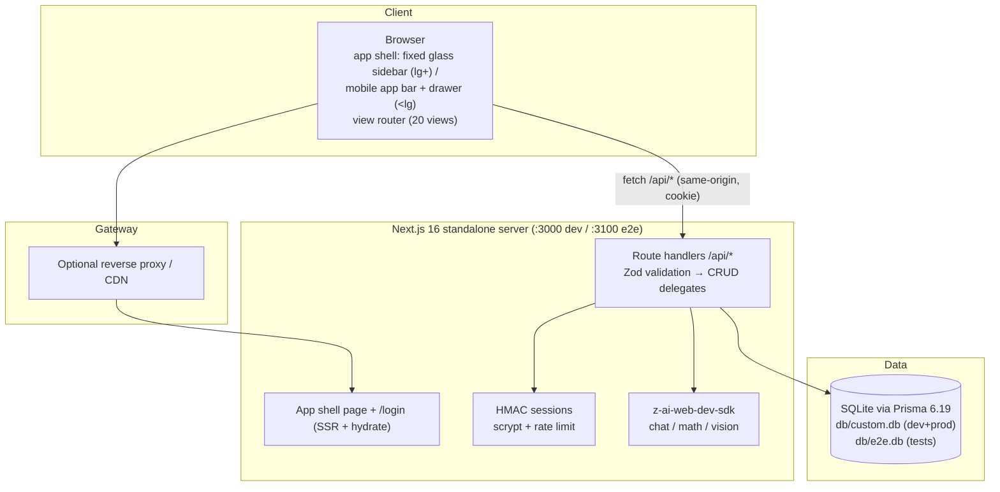
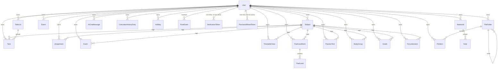

# StudyFlow (Omni-Study) — Master Project Architecture Document (PAD) v1.3.26

**Classification:** Internal Engineering Reference
**Status:** DEFINITIVE, PRODUCTION-LOCKED BLUEPRINT
**Companion Documents:** `README.md` (user-facing), `AGENTS.md` (agent quick-reference), `CLAUDE.md` (agent operating conventions), `docs/Tailwind-V4-Validation-Report.md` (parity trap log)
**Last Updated:** 2026-10-31
**Audience:** Senior Engineers, Tech Leads, DevOps, Onboarding Engineers, and AI Coding Agents
**Rule:** Every architectural decision in this document traces to a specific rationale. Nothing is here "because it's popular."

---

#### Revision Block — v1.3.26 (Session-118 / Batch BS, Cycle 68)

- `[SR]` The audit-driven hardening cycle (`docs/remediation-plan-session118.md`): **BS1** session revocation on password reset — the User model gains `sessionVersion Int @default(0)`, `createSessionToken(userId, sessionVersion)` embeds `v` in the HMAC payload, `readSessionToken` reads a MISSING `v` as 0 (the deploy-compat default — every pre-change cookie keeps validating; only the bump revokes), `getCurrentUser` compares the claim against the column, and the reset transaction increments it: a pre-reset session cookie now dies at the reset (the canonical compromise-recovery action — live-verified, e2e-pinned via the journey's captured-cookie replay → 401). change-password/change-email keep their documented session-survives contracts (ADR-022/ADR-024 — the owner-rotation paths). **BS2** bounded reads + bounded fields — `readJson` gains the 10 MiB cap (400 before the route reads; the import route keeps its own 413), `mathSolveSchema.image` ≤7M, `jsonArray` ≤100k, the date atoms `Date.parse`-valid + ≤40 (garbage dates now 400, never a Prisma 500), `idField` ≤64, and the shared `emailField` atom (trim + email + ≤200) replaces every bare `z.string().email()`; **BS3** the upload rate limit — 20/15-min per-user, one shared bucket across BOTH file-link entry points (`POST /api/files` both branches + `POST /api/files/link`; live-verified: the 21st POST → 429 + Retry-After); **BS4** the drawer modal focus lifecycle (focus-in on open, Tab wrap at both edges, focus-restore to the opener on close — the WCAG 2.2 AA superset the reference lacks, e2e-pinned); **BS5** `linkFileSchema` trim-before-check + the files POST JSON branch consumes the shared schema (the divergent second write path to the same table closed); **BS6** CSV formula neutralization in `toRumCsv` (leading `=`/`+`/`-`/`@`/tab/CR prefixed with `'`, unit-pinned); **BS7** the RUM dead-twin reconciled — `validation.ts`'s schemas now carry the route's enforced bounds and the route imports them; **BS8** the settings `holidays` pre-warm; **BS9** `loadAll` never rejects; **BS10** the collapse transition synced (`duration-200` on `main`); **BS11** the `sf-slide-in` dead code removed (the parity decision: the reference drawer measures `transition: all 0s` — instant open IS parity) + the export 10 MiB client pre-check; **BS12** the Info trio (reset-password rate-limited 10/IP/15 min, the stale "exactly 15 entries" comment → 16, the boot script consumes its own `var KEY`). The threat model (§6.4) gained the post-reset-session-revocation, oversized-body, and CSV-formula rows; the Upload abuse row gained the limiter.
- `[SR]` Current test census anchor (the v1.2.0 convention, re-anchored): **963/963 Vitest unit** (28 files — the S118 additions: auth +3 [the session-version family], validation +13 [the bounded-reads family + the linkFileSchema trim family + the RUM re-anchor family], rum-diagnostics +2 [the CSV formula-neutralization family], view-collections +1 [the settings-holidays pin]; the RUM event/batch pins re-shaped to the enforced bounds, the theme-cache boot-script pin re-anchored to the var-KEY consumption) + **478/478 Playwright e2e** across the 5-chunk cold map (132+141+57+87+61 — chunk one +1 the BS4 drawer focus-lifecycle pin, chunk five +1 the BS2 oversized-body pin, BS1 rides the reset journey in-place; lint clean, `tsc --noEmit` clean with `noImplicitAny: true`, the canonical build green with the standalone asset contract intact — re-certified cold on the final tree).
- `[SR]` Two parity decisions recorded as documented non-gaps (the DOM-authority rule over auditor recommendations): the reference's drawer panel computes `transition: all 0s` (instant open — the clone's instant open IS parity; wiring the dead `sf-slide-in` animation would BREAK it) and the reference PERSISTS scroll position across drawer navigation (600 px carried Dashboard → /Analytics on a 2166 px page; the clone carries 600 px identically — a `scrollTo(0,0)` on navigate would BREAK parity). The S118 re-tag also repairs the stale title line this cycle inherited: the S117 cycle added the v1.3.25 revision block but left the document title at v1.3.24.

#### Revision Block — v1.3.25 (Session-117 / Batch BR, Cycle 67)

- `[SR]` The hardening cycle (operator-directed, `docs/remediation-plan-session117.md`): **BR1** the import route's cards write-probe fix (Flashcard has no `userId` — the pre-BR1 loop probed `{ id, userId }` on the flashcard delegate → PrismaClientValidationError → the all-or-nothing transaction rolled back → HTTP 500 on ANY envelope containing cards; the export→import round-trip was broken for every account with flashcards — reproduced live, fixed, e2e-pinned) + the documented S23 contract restored (10 MiB cap → 413, `NEVER_IMPORT_FIELDS` stripped, unknown collections rejected by name, folders parents-first via the seam's exported `sortFoldersParentsFirst`, version floor); **BR2** verify-email rate-limited 20/IP/15 min (limiter-before-validation; e2e-pinned with the TEST-NET technique); **BR3** the login timing equalizer (`verifyLoginCredentials` + `DUMMY_LOGIN_HASH`, unit-pinned — the miss branch burns the same scrypt); **BR4** `linkFileSchema` (http(s)-only link URLs, the shared schema — the link route matches the upload route's S14 rule; unit-pinned); **BR5** the `readJson` Content-Type gate (the login-CSRF class closed at the shared boundary); **BR6** reset tokens hashed at rest (`hashResetToken`, SHA-256 — the raw token rides the URL only; unit-pinned). The threat model (§6.4) gained the timing/OTP/reset/XSS/CT rows and the two documented decisions with reopen triggers (XFF first-hop keying; in-response OTP/reset delivery). `tsconfig.json` `noImplicitAny: true` (verified: zero new `tsc` errors — the guardrail strengthened). Dockerfile/DEPLOYMENT corrected: `NEXT_PUBLIC_SITE_URL` is BUILD-TIME for sitemap/robots (the build ARG wired); `.env.example` documents `E2E_PORT`.
- `[SR]` Current test census anchor (the v1.2.0 convention, re-anchored): **944/944 Vitest unit** (28 files — the S117 additions: auth +5 [the timing-equalizer family + the reset-hash family], validation +3 [the linkFileSchema family]) + **476/476 Playwright e2e** across the 5-chunk cold map (131+141+57+87+60 — chunk five gains the s23 cards round-trip pin + the auth-flows verify-429 pin; lint clean, `tsc --noEmit` clean with `noImplicitAny: true`, the canonical build green with the standalone asset contract intact — re-certified cold on the final tree).

#### Revision Block — v1.3.24 (Session-116 / Batch BQ, Cycle 66)

- `[SR]` Current test census anchor (the v1.2.0 convention, re-anchored): **936/936 Vitest unit** (28 files, `*.test.ts` only — census UNCHANGED: the second pass's cycle four touched documentation + scripts only, src/ and tests/ untouched) + **474/474 Playwright e2e** across the 5-chunk cold map (131+141+57+87+58, 30 spec files; lint clean, `tsc --noEmit` clean, the canonical build green with the standalone asset contract intact — re-certified cold on the received tree BEFORE any work and again on the final tree).
- `[SR]` The register rotation (S116/BQ1, the s115 audit's I1): the BP1 note's counts (245 playwright importers / 126 Usage-line carriers) describe the pre-s115-rider tree — the BP2 riders (ref-resweep-s115.mjs + capture-s115-evidence.mjs) joined the guarded class after the measurement, and the post-BP final-tree re-derivation (the pin's own regex, instrument-identical, run through the non-rider instrument outside the repo, the expectation stated BEFORE the measurement: "247/128 = 245/126 + the two s115 riders") is **247 / 128 / 0 stale / 119 usage-line-free** — the register rotates forward with the dated note, the exact-count pin stays rejected (the threshold-form pins absorb growth by design); the scoped expectation for the next audit is "this register's 247/128 + this cycle's named riders" (the final-tree forward arithmetic: 249/130).
- `[SR]` The s116 MOBILE-LANDSCAPE LIGHT evidence-frame rotation — the rotation program's SECOND PASS's cycle four, the LIGHT QUARTET's closing cell (S116/BQ2): the program's 32 committed frames (30 through the s115 second-pass cycle three); the second pass re-probes the cells with the views whose only prior frames are the same-cell dark flips — s113 desktop light (Flashcards + Timetable), s114 mobile-portrait light (Dashboard + Notes), s115 mid-band light (PracticeTests + StudyGroups), this cycle the landscape light cell (844×390, the light quartet's LAST never-second-passed cell) with the s107 pair: **the DRAWER NAV-SCROLL** (the surface's FIRST light-side frame; the landscape-only structural discriminator — the 20-link nav list MUST scroll at the 390px viewport height [scrollHeight 992 > clientHeight 301] while the portrait 390×844 list fits unscrolled; the 288px w-72 panel over the light rgb(255,255,255) surface, the S3-L brand header with the border-b divider, the dialog semantics; the leg open-capture-close, zero persistent state) and **the TASKS view** (the view's FIRST light-side frame; the active-list h1 "All Tasks" — the derived value; the md:flex two-pane layout rendered AT 844; the red-pill family on the overdue "Return library books" row + the violet RepeatPill + slate SubjectChip on the boundary "Weekly vocabulary review" row, NEVER the exact date — the pill's date text is day-relative). Both frames md5-distinct (b090074afe3f89a45609bbc3b1fd81a8 / 20816f53d626176ac5f5657abb1a66be), pixel-probe mean brightness 215.3 / 248.9 (genuinely light — the drawer frame's backdrop dim reads darker than the bare views, still far above the dark-side signature band); the gates live-probed BEFORE the riders (the pinning probe on the :3200 standalone host, the S114 lesson-2 content-gate doctrine).
- `[SR]` The s116 cycle's own operational finds — three, all documented as AGENTS S116 lessons: (1) the row-container axis (a gate's ROW selector is a live-probe fact, never a prose paraphrase — this cycle's Frame-2 gate queried `main li` from the s107 record's row prose while the Tasks view renders `div.rounded-xl` cards; the per-condition diagnostic named it in one run, the fix rode the pinning probe's own selector; the tag/text-transform/containment trio joined by the fourth axis); (2) the backdrop-button center trap (the clone drawer's "Close navigation menu" aria-label belongs to the full-viewport backdrop button, not a glyph X — the panel renders above the backdrop so the button's own center lands on the nav labels; the working probe picks a panel-clear backdrop point and takes the real mouse path; the two hosts' close surfaces differ by design); (3) the eval-context tooling shape (agent-browser's eval takes an expression, not an async script body — top-level await throws; async probes wrap in an IIFE, each eval re-declares its locals, and the real-mouse path at coordinates is move + down + up). Plus the suite's verdict per the BQ4 record (the standing suite on the final tree).

#### Revision Block — v1.3.23 (Session-115 / Batch BP, Cycle 65)

- `[SR]` Current test census anchor (the v1.2.0 convention, re-anchored): **936/936 Vitest unit** (28 files, `*.test.ts` only — census UNCHANGED: the second pass's cycle three touched documentation + scripts only, src/ and tests/ untouched) + **474/474 Playwright e2e** across the 5-chunk cold map (131+141+57+87+58, 30 spec files; lint clean, `tsc --noEmit` clean, the canonical build green with the standalone asset contract intact — re-certified cold on the received tree BEFORE any work and again on the final tree).
- `[SR]` The register rotation (S115/BP1, the s114 audit's I1): the BO1 note's counts (243 playwright importers / 124 Usage-line carriers) describe the pre-s114-rider tree — the BO2 riders (ref-resweep-s114.mjs + capture-s114-evidence.mjs) joined the guarded class after the measurement, and the post-BO final-tree re-derivation (the pin's own regex, instrument-identical, run through the non-rider instrument outside the repo, the expectation stated BEFORE the measurement: "245/126 = 243/124 + the two s114 riders") is **245 / 126 / 0 stale / 119 usage-line-free** — the register rotates forward with the dated note, the exact-count pin stays rejected (the threshold-form pins absorb growth by design); the scoped expectation for the next audit is "this register's 245/126 + this cycle's named riders" (the final-tree forward arithmetic: 247/128).
- `[SR]` The s115 MID-BAND LIGHT evidence-frame rotation — the rotation program's SECOND PASS's cycle three (S115/BP2): the program's 30 committed frames (28 through the s114 second-pass cycle two); the second pass re-probes the cells with the views whose only prior frames are the same-cell dark flips — s113 desktop light (Flashcards + Timetable), s114 mobile-portrait light (Dashboard + Notes), this cycle the mid-band light cell (768×1024, now the tied-thinnest light coverage alongside the landscape-light cell) with the s108 pair: **PracticeTests** (the view's FIRST light-side frame; the 2-column grid — the mid-band-only structural discriminator with EXACTLY 2 px computed tracks — both seeded cards side-by-side in one row, the card metadata lines, the below-lg app bar) and **StudyGroups** (the view's FIRST light-side frame; the w-80 aside at its FULL 320px mid-band width, the Calc Crew row with 2 members + the Mathematics SubjectChip, the plain-variant null-selection empty state with the Users EmptyState icon ABSENT — the S8-Z two-variant boundary asserted on the rendered side). Both frames md5-distinct (ebb8374ab66c7f6ad35f65b60025341b / 45373f04c0b77bdc297cf64d24024823), pixel-probe mean brightness 251.3 / 252.3 (genuinely light — the signature, not a threshold); the gates live-probed BEFORE the riders (the pinning probe on the :3200 standalone host, the S112 lesson-2 doctrine).
- `[SR]` The s115 cycle's own operational finds — three, all documented as AGENTS S115 lessons: (1) the preflight-precondition trap (the standing suite's stage-1 dev-server-preflight REQUIRES :3000 alive — the memory-hygiene kill of the dev server belongs AFTER the suite; the runner checks health, it does not boot the dev server, while the cwv stage's :3200 lifecycle IS runner-owned); (2) the unscoped-h1 trap (a view-header probe must scope to the MAIN region — the document's first h1 is the sidebar BRAND block on BOTH hosts; this cycle's reference Analytics subtitle probe would have filed a false parity finding unscoped); (3) the file-access wall (a headless-chromium about:blank page does not load file:// images — the brightness probe's data-URL marshalling recipe). Plus the suite's verdict per the BP4 record (the standing suite on the final tree).

#### Revision Block — v1.3.22 (Session-114 / Batch BO, Cycle 64)

- `[SR]` Current test census anchor (the v1.2.0 convention, re-anchored): **936/936 Vitest unit** (28 files, `*.test.ts` only — census UNCHANGED: the second pass's cycle two touched documentation + scripts only, src/ and tests/ untouched) + **474/474 Playwright e2e** across the 5-chunk cold map (131+141+57+87+58 = 469 real specs in 30 spec files + 5 auth setups; `scripts/e2e-chunked-cert.sh` is the census authority). The PAD carries the census at revision time ONLY — the live count-keepers each cycle are the README badge (1410), AGENTS.md/CLAUDE.md, the `vitest.config.ts` header, and the cert-script header.
- `[SR]` The register rotation (S114/BO1, the s113 audit's I1): the BN1 note's counts (241 playwright importers / 122 Usage-line carriers) describe the pre-s113-rider tree — the BN2 riders joined the guarded class after the measurement, and the post-BN final-tree re-derivation (the pin's own regex, instrument-identical, the expectation stated BEFORE the measurement: 243/124 = 241/122 + the two s113 riders) is **243 importers / 124 carriers / 0 stale / 119 usage-line-free** (the frozen historical era unchanged). The register's arithmetic VERIFIED live through the non-rider instrument outside the repo (the S106 lesson-3), holding EXACTLY (the S102 lesson-1 doctrine, fourteenth consecutive cycle); the register rotates forward with a dated S114 note appended to the BN1 execution record, and the exact-count pin stays REJECTED (the silent-absorption intent). The final-tree forward arithmetic on the BO riders themselves: **245 importers / 126 carriers = 243/124 + the two s114 riders** — the scoped expectation for the next audit, measured LAST (the fifteenth consecutive tripwire). The cycle's audit found ZERO L-class findings — the remediation plan's header was properly re-anchored to Batch BN by the BN cycle (the S108 lesson-4 held through its sixth re-derivation).
- `[SR]` The s114 MOBILE-PORTRAIT LIGHT evidence-frame rotation — the rotation program's SECOND PASS's cycle two (S114/BO2): the program's 28 committed frames (26 through the s112 exhaustion cycle + the s113 second-pass opening pair); the second pass re-probes any cell, any view, fresh. The cycle-two selection: the MOBILE-PORTRAIT LIGHT cell (390×844 — the mobile home band, now the tied-thinnest light coverage: Settings + Files at s110) with the two views whose prior rotation frames are ALL dark-side AND whose only prior frames are the same-cell dark flips (the BN selection shape, one cell deeper) — Dashboard (1 prior frame, s105 mobile-portrait dark; the view's FIRST light-side frame and first mobile-light re-probe — the home view, its entire lineage dark-side) and Notes (1 prior frame, s106 mobile-portrait dark; the view's FIRST light-side frame and first mobile-light re-probe — the view where the reference carries its own mobile overflow defect [scrollWidth 416 on /Notes], the clone's clean-390 contract now documented on the light side too). Two guarded surfaces at 390×844 in LIGHT, both zero-persistent-state BY CONSTRUCTION (pure seed reads, ZERO interaction): the DASHBOARD view (the greeting-bucket h1 — "Good evening, Demo 👋" at capture time, the "Good (morning|afternoon|evening), Demo" pattern, the live clock's own signature, the reference-probed greeting buckets unit-pinned — + the long-date subtitle at the "(Weekday), (Month) D, YYYY" pattern; the conditional `sf-overdue-banner` `[aria-label="Overdue alert"]` — "You have 1 overdue item", the seeded incomplete at(-2) "Return library books" task, the S9-A-pinned surface's first LIGHT-side evidence frame; the `[aria-label="Today's tasks"]` region with the seeded due-today rows; the four stat cards — Today's Progress / Pending Tasks 10 / Due Soon / Focus Time, the 10-pending date-independent [12 seeded − 2 completed]; the Upcoming Exams section with its seeded "Calculus II Midterm" row + the Upcoming Assignments section with its seeded "Physics reading — ch. 12" row; the fixed glass app bar — the aria-labeled "Open navigation menu" hamburger + the `.sf-clock-date` clock chip; md5 3472ebeb32050856a18578be4446c553; pixel-probe mean brightness 239.7) and the NOTES view (the h1 "Notes" — the view carries no subtitle; the `[aria-label="Notes list pane"]` — the AE6 surface — with all four seeded rows: "Dot product intuition" / "Integration techniques" / "Kinetics summary" / "Essay sources"; the pane chrome comboboxes "All Notebooks" / "All Tags"; the `input[aria-label="Search notes"]` at its "Search notes…" rest placeholder; the `button[aria-label="Filter by tag"]` — the E6 superset; the `button[aria-label="New note"]` mobile create FAB — `sf-gradient sf-gradient-shadow fixed bottom-20 right-4 z-30 size-14 rounded-full md:hidden`, fully inside the viewport, the S79/AF6 superset surface's first LIGHT-side mobile evidence frame; the mobile no-overflow contract scrollWidth <= 390 — the reference's own 416 overflow defect on /Notes NOT reproduced, now documented on the light side too; md5 899b6076d60024d97b45d1d261a23187; pixel-probe mean brightness 244.9). Both frames md5-DISTINCT GATE-enforced, the S4 violet/light restore awaited on every path; the 20 committed 114-*.png resweep frames md5-distinct. The capture rider GREEN FIRST-PASS (the gates live-probed BEFORE the run: the shape probe [the pane visible + the FAB geometry + the stat/section text], the pattern probe [the greeting buckets + the long-date subtitle — the live clock's own signature, never a hard-coded bucket], the per-condition discipline — the S112 lesson-2 doctrine applied).
- `[SR]` The s114 cycle's own operational finds — three, all documented as AGENTS S114 lessons, plus the suite's zero-remediation verdict: (1) the overlay-interception trap (a physical-coordinate click that "does nothing" is not evidence the control is broken — this cycle the reference's EMPTY fixed toast container [z-[100], w-full at 390, pointer-events auto, zero children] intercepted the physical click at the drawer X's documented (228,26) coordinates; the elementFromPoint probe named the interceptor, the X button's own close function verified by the direct click — the prior sessions' physical clicks all worked, the container renders state-dependently [a toast window], a TRANSIENT overlay not a permanent defect); (2) the skeleton-race content-wait trap (a shell-state waitForFunction — `.dark` absent + `--sf-primary` set — passes on the BOOT-SCRIPT state BEFORE the view's client-fetched content renders; this cycle's pinning probe first returned an EMPTY main on a satisfied shell gate — every capture gate must assert the SURFACE it protects, the theme gate and the content gate separate predicates); (3) the synthetic-vs-real click discipline (an `el.click()` fired through eval does NOT trigger every React control — the sidebar collapse toggle silently ignored it while the drawer links, the drawer X and the theme options all took it; a control whose STATE must change gets the REAL click path, the synthetic click reserved for existence probes); and the standing suite's fresh single run **35/35 GREEN — every stage first-pass, zero remediation** (the BN4 collision stage cwv-volume-stress green this run — the S91/AR1 machine-load coin-flip class not re-fired; the reserved rider NOT exercised, the honest zero-remediation verdict).

#### Revision Block — v1.3.21 (Session-113 / Batch BN, Cycle 63)

- `[SR]` Current test census anchor (the v1.2.0 convention, re-anchored): **936/936 Vitest unit** (28 files, `*.test.ts` only — census UNCHANGED: the second pass's opening cycle touched documentation + scripts only, src/ and tests/ untouched) + **474/474 Playwright e2e** across the 5-chunk cold map (131+141+57+87+58 = 469 real specs in 30 spec files + 5 auth setups; `scripts/e2e-chunked-cert.sh` is the census authority). The PAD carries the census at revision time ONLY — the live count-keepers each cycle are the README badge (1410), AGENTS.md/CLAUDE.md, the `vitest.config.ts` header, and the cert-script header.
- `[SR]` The register rotation (S113/BN1, the s112 audit's I1): the BM1 note's counts (239 playwright importers / 120 Usage-line carriers) describe the pre-s112-rider tree — the BM2 riders joined the guarded class after the measurement, and the post-BM final-tree re-derivation (the pin's own regex, instrument-identical, the expectation stated BEFORE the measurement: the register's 239/120 + the two named s112 riders) is **241 importers / 122 carriers / 0 stale / 119 usage-line-free** (the frozen historical era unchanged). The register's arithmetic VERIFIED live (the S102 lesson-1 doctrine, twelfth consecutive cycle); the register rotates forward with a dated S113 note appended to the BM1 execution record, and the exact-count pin stays REJECTED (the silent-absorption intent). The final-tree forward arithmetic on the BN riders themselves: **243 importers / 124 carriers = 241/122 + the two s113 riders** — the scoped expectation for the next audit, measured LAST through an instrument that is itself not a rider (the fourteenth consecutive tripwire). The cycle's audit found ZERO L-class findings — the remediation plan's header was properly re-anchored to Batch BM by the BM cycle (the S108 lesson-4 held through its fifth re-derivation).
- `[SR]` The s113 DESKTOP LIGHT evidence-frame rotation — the rotation program's SECOND PASS's opening cycle (S113/BN2): the exhaustion cycle closed at s112 (both the theme axis [all four viewport cells × both sides] AND the view-level rotation program [every nav view carrying at least one rotation frame] complete — the program's 26 committed frames cover all four viewport cells on BOTH sides); the second pass re-probes any cell, any view, fresh. The opening selection: the DESKTOP LIGHT cell (1280×800 — the home band, its light coverage the thinnest of the four cells: Events + Analytics at s109) with the two views whose prior rotation frames are ALL dark-side — Flashcards (s103 desktop-dark + s106 mobile-dark) and Timetable (s104 desktop-dark + s105 mobile-dark), both views' FIRST light-side frames. Two guarded surfaces at 1280×800 in LIGHT, both zero-persistent-state BY CONSTRUCTION (pure seed reads, ZERO interaction): the FLASHCARDS view (the h1 "Flashcards" — the view carries no subtitle; the `Deck list pane` aside with the New Deck button and the "Search decks…" input; the `Deck rows` with the three seeded decks — "Integration rules" 4 cards / "Biology Chapter 5" 2 cards / "Spanish Vocabulary" 0 cards; the `Deck detail` with the auto-selected first deck + its description + the AI Generate / Add Card / Study / Edit deck / Delete deck buttons; the `Card grid` with the four seeded cards — Chain rule / "What does ATP stand for?" / Enzyme function definition / Krebs cycle location — each with its Edit card / Delete card buttons, the difficulty pills' raw textContent LOWERCASE ["medium"/"easy"/"hard" — the CSS capitalize transform is not the DOM text, the S113 lesson-3 text-form doctrine]; md5 8583a9bf5145ed2b0116fb092d8c7b37; pixel-probe mean brightness 248.3) and the TIMETABLE view (the h1 "Timetable" + subtitle "Manage your class schedule"; the "Week filter" combobox at "All Weeks"; the month-label h2 at the "Month YYYY" pattern — the live clock's own signature, the s111 Calendar precedent; the `Week banner` with the Previous / Next week buttons; the `Week grid` with the `Week header` day row and the `Hour cells` carrying the five seeded classes — Calculus II 9:00–10:30 · M201 / Physics 11:00–12:30 · P105 [Week A] / World History 9:00–10:30 · H14 / English Literature 13:00–14:30 · E3 / Chemistry Lab 14:00–16:00 · Sci 2 [Week B]; the h2 "My Classes" + the `My Classes header` side panel — the class LIST lives in the header's parent sf-card section, live-probed [the S113 lesson-4 containment doctrine]; md5 0e8f6f451b45fd03611de1c64a6f8272; pixel-probe mean brightness 250.0). Both frames md5-DISTINCT GATE-enforced, the desktop no-overflow contract scrollWidth <= 1280 on both, the S4 violet/light restore awaited on every path; the 20 committed 113-*.png resweep frames md5-distinct. The capture rider GREEN FIRST-PASS (the gates live-probed BEFORE the run: the shape probe [containment], the text-form probe [the lowercase difficulty pills], the per-condition discipline — the S112 lesson-2 doctrine applied).
- `[SR]` The s113 cycle's own operational finds — four, all documented as AGENTS S113 lessons: (1) the session-interruption / re-execution class (the S113 work interrupted twice — the original session's uncommitted BN work lost to a workspace reset, the re-execution session's context exhausted mid-pinning; the doc chain's precise next-step naming [the S112 close's "the rotation program's second pass — any cell, any view, re-probed fresh"] sized the re-derivation exactly — the re-execution re-derived the audit, the parity layer, and both rotation surfaces from the committed record alone); (2) the ESM-resolution NODE_PATH trap (Node's ESM resolution IGNORES NODE_PATH — a probe script outside the repo importing the repo's packages fails with ERR_MODULE_NOT_FOUND even with NODE_PATH set; the remedy: a node_modules SYMLINK in the probe directory pointing at the repo's node_modules — module resolution walks up from the importing file and follows the symlink); (3) the textContent-vs-innerText gate-form doctrine (the CSS text-transform: capitalize makes the visible difficulty pill "Medium" while the raw DOM textContent is "medium" — a gate string copied from the visual form fails against textContent; live-probe the raw textContent form BEFORE writing the gate); (4) the stale-daemon hazard (processes CAN survive a session cut — the earlier session's dev server and agent-browser daemons were found re-parented but alive; per the "next dev OOMs when several headless browsers run" quirk, stale browser daemons are a pre-suite hazard — kill them before a long suite run).

#### Revision Block — v1.3.20 (Session-112 / Batch BM, Cycle 62)

- `[SR]` Current test census anchor (the v1.2.0 convention, re-anchored): **936/936 Vitest unit** (28 files, `*.test.ts` only — census UNCHANGED: the exhaustion cycle touched documentation + scripts only, src/ and tests/ untouched) + **474/474 Playwright e2e** across the 5-chunk cold map (131+141+57+87+58 = 469 real specs in 30 spec files + 5 auth setups; `scripts/e2e-chunked-cert.sh` is the census authority). The PAD carries the census at revision time ONLY — the live count-keepers each cycle are the README badge (1410), AGENTS.md/CLAUDE.md, the `vitest.config.ts` header, and the cert-script header.
- `[SR]` The register rotation (S112/BM1, the s111 audit's I1): the BL1 note's counts (237 playwright importers / 118 Usage-line carriers) describe the pre-s111-rider tree — the BL2 riders joined the guarded class after the measurement, and the post-BL final-tree re-derivation (the pin's own regex, instrument-identical, the expectation stated BEFORE the measurement: the register's 237/118 + the two named s111 riders) is **239 importers / 120 carriers / 0 stale / 119 usage-line-free** (the frozen historical era unchanged). The register's arithmetic VERIFIED live (the S102 lesson-1 doctrine, eleventh consecutive cycle); the register rotates forward with a dated S112 note appended to the BL1 execution record, and the exact-count pin stays REJECTED (the silent-absorption intent). The final-tree forward arithmetic on the BM riders themselves: **241 importers / 122 carriers = 239/120 + the two s112 riders** — the scoped expectation for the next audit, measured LAST through an instrument that is itself not a rider (the thirteenth consecutive tripwire). The cycle's audit found ZERO L-class findings — the remediation plan's header was properly re-anchored to Batch BL by the BL cycle (the S108 lesson-4 held through its fourth re-derivation).
- `[SR]` The s112 MID-BAND LIGHT evidence-frame rotation — the theme axis's LAST never-varied cell, the exhaustion cycle (S112/BM2): the rotation program's 24 committed frames cover all four viewport cells on dark (1280×800 desktop ×10, s100–s104; 390×844 mobile-portrait ×4, s105–s106; 844×390 mobile-landscape ×2, s107; 768×1024 mid-band ×2, s108) plus three of the four light cells (1280×800 desktop ×2, s109 — Events + Analytics; 390×844 mobile-portrait ×2, s110 — Settings + Files; 844×390 mobile-landscape ×2, s111 — Calendar + FocusTimer). Two guarded surfaces at 768×1024 in LIGHT — the mid-band cell, its 2 committed frames both dark, mid-band×light never varied in the rotation program — both zero-persistent-state BY CONSTRUCTION (pure seed reads, ZERO interaction): the MATHSOLVER view (the view's FIRST rotation frame; the h1 "Math Solver" + subtitle "Type a problem or upload an image to get step-by-step solutions"; the aria-label="Math problem" textarea at its rest chrome; the Upload Image / Clear buttons; the Solve button disabled at rest [zero input]; the aria-label="Math solution" region's rest copy "Type a problem or attach a photo, then press Solve — step-by-step help appears here."; the aria-label="Recent Problems" section's seed-deterministic empty state "Problems you solve will be saved here." [the seed creates no solver-history rows]; md5 368b0dab56617b1c67802a2e4d0a13f0 — the final-tree re-run's committed artifact, the green run's b5f04c21fbb6813ea355573d99a30b86 the cross-run variance the live clock's own signature; pixel-probe mean brightness 251.2) and the AIASSISTANT view (the view's FIRST rotation frame; the h1 "AI Study Assistant" + subtitle "Your study copilot"; the empty-transcript intro "Ask anything about your studies — or start with a quick prompt." [the seed creates no AI chat rows]; the aria-label="Quick actions" group with its six sf-card prompt buttons — Explain Concept / Study Tips / Summarize Notes / Solve Problem / Essay Ideas / Translate; the aria-label="Message the assistant" composer — the shadcn Input, an `<input>` element NOT a textarea, the S112 lesson-2 element-tag doctrine — with the Send message button disabled at rest; the composer hint "Press Enter to send, Shift + Enter for a new line"; md5 b0832f3010e6b2990034be60a6f9bf0e — the final-tree re-run's committed artifact, the green run's 715f07da0aa9b1ff776397ee9e3d198e; pixel-probe mean brightness 250.5). **The exhaustion cycle: with these two frames both the theme axis (all four viewport cells × both sides) AND the view-level rotation program (every nav view carrying at least one rotation frame) complete.** Both frames md5-DISTINCT GATE-enforced, the mid-band no-overflow contract scrollWidth <= 768 on both, the S4 violet/light restore awaited on every path; the 20 committed 112-*.png frames md5-distinct. The capture's first pass was RED on the Frame-2 composer gate — the wrong-element-type selector (a `textarea` query against the shadcn Input's `<input>`; the S111 lesson-2 composed-surface doctrine re-hit on the element axis), root-caused live with the per-condition diagnostic probe, closed with the one-line gate fix, the second pass GREEN.
- `[SR]` The s112 cycle's own operational finds — four, all documented as AGENTS S112 lessons: (1) the S45 leak class re-fired at the baseline build (the fresh-workspace recipe: build BEFORE writing the secret into `.env`, or verify + restore the bundled copy's `AUTH_SECRET=""` after the build; the e2e contract itself environment-immune since S89/AP2); (2) the element-tag gate doctrine (the a11y tree names every text control "textbox" — the gate's selector must match the element TAG, live-probed from the DOM); (3) the probe-tooling-outside-the-repo doctrine (never `bun add` a probe dependency into the engagement repo — the lockfile pollution AND its downstream suite casualty: the content-identical `git checkout` of `bun.lock` refreshed its mtime past the standalone trace's, and the dep-audit stage's staleness precondition refused to classify — closed by the content-identical rebuild + the stage re-run GREEN); (4) the back-to-back standing-suite runs collide on the in-memory AI-limiter window (run #1's ai-error/ai-a11y stages pre-spent 5 of the demo user's 20/15-min `/api/ai/chat` budget on the same dev-server process, and run #2's security stage landed inside the same window — cutoffAt=16; closed per the stage's own protocol by the dev-server restart + the clean-window re-run GREEN, cutoffAt=21, findings empty — the pre-spend differential, NOT a limiter defect).

#### Revision Block — v1.3.19 (Session-111 / Batch BL, Cycle 61)

- `[SR]` Current test census anchor (the v1.2.0 convention, re-anchored): **936/936 Vitest unit** (28 files, `*.test.ts` only — census UNCHANGED: the honest-zero-cycle touched documentation + scripts only, src/ and tests/ untouched) + **474/474 Playwright e2e** across the 5-chunk cold map (131+141+57+87+58 = 469 real specs in 30 spec files + 5 auth setups; `scripts/e2e-chunked-cert.sh` is the census authority). The PAD carries the census at revision time ONLY — the live count-keepers each cycle are the README badge (1410), AGENTS.md/CLAUDE.md, the `vitest.config.ts` header, and the cert-script header.
- `[SR]` The register rotation (S111/BL1, the s110 audit's I1): the BK1 note's counts (235 playwright importers / 116 Usage-line carriers) describe the pre-s110-rider tree — the BK2 riders joined the guarded class after the measurement, and the post-BK final-tree re-derivation (the pin's own regex, instrument-identical, the expectation stated BEFORE the measurement: the register's 235/116 + the two named s110 riders) is **237 importers / 118 carriers / 0 stale / 119 usage-line-free** (the frozen historical era unchanged). The register's arithmetic VERIFIED live (the S102 lesson-1 doctrine, tenth consecutive cycle); the register rotates forward with a dated S111 note appended to the BK1 execution record, and the exact-count pin stays REJECTED (the silent-absorption intent). The final-tree forward arithmetic on the BL riders themselves: **239 importers / 120 carriers = 237/118 + the two s111 riders** — the scoped expectation for the next audit, measured LAST through an instrument that is itself not a rider (the twelfth consecutive tripwire). The cycle's audit found ZERO L-class findings — the remediation plan's header was properly re-anchored to Batch BK by the BK cycle (the S108 lesson-4 held through its third re-derivation).
- `[SR]` The s111 MOBILE-LANDSCAPE LIGHT evidence-frame rotation — the theme axis's never-varied LANDSCAPE cell (S111/BL2): the rotation program's 22 committed frames cover all four viewport cells on dark (1280×800 desktop ×10, s96–s104; 390×844 mobile-portrait ×4, s105–s106; 844×390 mobile-landscape ×2, s107; 768×1024 mid-band ×2, s108) plus the home band and the mobile band on light (1280×800 desktop ×2, s109 — Events + Analytics; 390×844 mobile-portrait ×2, s110 — Settings + Files) — the theme axis's REMAINING never-varied cells after this rotation: mid-band×light (the S109 lesson-3 axis enumeration applied two cells deeper). Two guarded surfaces at 844×390 in LIGHT — the mobile-landscape cell, its 2 committed frames both dark, mobile-landscape×light never varied in the rotation program — both zero-persistent-state BY CONSTRUCTION (pure seed reads, ZERO interaction): the CALENDAR view (the view's FIRST rotation frame; the A4/S5-G/S9-F mode switch — the bordered rounded-lg 8px segmented control with the Calendar tab aria-pressed=true in the sf-selected-tint violet-600 rgb(124, 58, 237); the "Calendar month" section with the month-label h2 at the "Month YYYY" pattern; the 7-column "Calendar weekdays" header; the "Calendar days" grid with the today cell data-today="true" — the S111 lesson-2 composed-state-class correction: the today cell carries the SELECTED tint, not the unselected-today sf-today-cell-tint, because `selected` defaults to today and the isSelected branch wins the cn() composition; md5 91bfbeaf64529e0bd3771b4383116f2d, pixel-probe mean brightness 249.8) and the FOCUSTIMER view (the view's FIRST rotation frame; the three StatCards — the hint→previousElementSibling value read, the S7-D anatomy: "Pomodoros" 7 / "All-time focus sessions" + "Sessions" 7 / "Total sessions logged" [the seed's seven focus-mode sessions, both values deterministic] + "Today" / "Sessions completed today" at the S111 lesson-3 0-or-1 midnight-boundary pin [the S106 lesson-2 doctrine applied to the stat family]; the mode tabs with Focus aria-pressed=true in the sf-gradient; the Pomodoro 25/5/15 preset aria-pressed=true with the border-sf-primary violet rgb(139, 92, 246); the role="timer" 25:00 rest state; md5 a860a40d6b6c9505def4e0a135084d37, pixel-probe mean brightness 246.5). Both frames md5-DISTINCT GATE-enforced, the landscape no-overflow contract scrollWidth <= 844 on both, the S4 violet/light restore awaited on every path; the 20 committed 111-*.png frames md5-distinct.
- `[SR]` The s111 cycle's own operational find — the standalone rider host's AUTH_SECRET runtime-env recipe (the S111 lesson-1): the :3200 standalone host refused to boot under the S22 production boot guard ("AUTH_SECRET is required in production") because the standalone runtime chdir's into `.next/standalone` and reads the BUNDLED `.env` copy (which must stay EMPTY for the s22 negative-spawn e2e contract — the S45 leak class); the remedy is the real 64-hex secret in the daemon launcher's runtime environment (the runtime env var outranks the bundled `.env`), verified live by the riders' demo login through :3200; the bundled copy verified still `AUTH_SECRET=""` post-fix (the build predates the secret — the e2e contract intact, the final-tree 5-chunk re-cert green with it).

#### Revision Block — v1.3.18 (Session-110 / Batch BK, Cycle 60)

- `[SR]` Current test census anchor (the v1.2.0 convention, re-anchored): **936/936 Vitest unit** (28 files, `*.test.ts` only — census UNCHANGED: the honest-zero-cycle touched 
documentation + scripts only, src/ and tests/ untouched) + **474/474 Playwright e2e** across the 5-chunk cold map (131+141+57+87+58 = 469 real specs in 30 spec files + 5 auth 
setups; `scripts/e2e-chunked-cert.sh` is the census authority). The PAD carries the census at revision time ONLY — the live count-keepers each cycle are the README badge (1410), 
AGENTS.md/CLAUDE.md, the `vitest.config.ts` header, and the cert-script header.
- `[SR]` The register rotation (S110/BK1, the s109 audit's I1): the BJ1 note's counts (233 playwright importers / 114 Usage-line carriers) describe the pre-s109-rider tree — the 
BJ2 riders joined the guarded class after the measurement, and the post-BJ final-tree re-derivation (the pin's own regex, instrument-identical, the expectation stated BEFORE the 
measurement: the register's 233/114 + the two named s109 riders) is **235 importers / 116 carriers / 0 stale / 119 usage-line-free** (the frozen historical era unchanged). The 
register's arithmetic VERIFIED live (the S102 lesson-1 doctrine, ninth consecutive cycle); the register rotates forward with a dated S110 note appended to the BJ1 execution 
record, and the exact-count pin stays REJECTED (the silent-absorption intent). The final-tree forward arithmetic on the BK riders themselves: **237 importers / 118 carriers = 
235/116 + the two s110 riders** — the scoped expectation for the next audit, measured LAST through an instrument that is itself not a rider (the eleventh consecutive tripwire). 
The cycle's audit found ZERO L-class findings — the remediation plan's header was properly re-anchored to Batch BK by the BK cycle (the S108 lesson-4 held through its second 
re-derivation).
- `[SR]` The s110 MOBILE-PORTRAIT LIGHT evidence-frame rotation — the theme axis's never-varied MOBILE cell (S110/BK2): the rotation program's 20 committed frames cover all four 
viewport cells on dark (1280×800 desktop ×10, s96–s104; 390×844 mobile-portrait ×4, s105–s106; 844×390 mobile-landscape ×2, s107; 768×1024 mid-band ×2, s108) plus the home band 
on light (1280×800 desktop ×2, s109 — Events + Analytics, the theme axis OPENED) — the theme axis's REMAINING never-varied cells: mobile-portrait×light, mobile-landscape×light, 
mid-band×light (the S109 lesson-3 axis enumeration applied one cell deeper). Two guarded surfaces at 390×844 in LIGHT — the mobile-portrait cell, its 4 committed frames all dark, 
mobile-portrait×light never varied in the rotation program (the standing 31's mobile captures are LIGHT dashboard/drawer/tasks only, so the cell is standing-covered while 
remaining rotation-program-new) — both zero-persistent-state BY CONSTRUCTION (pure seed reads, ZERO interaction): the SETTINGS view (the view's FIRST rotation frame; the 
Appearance tab's measured chrome — the S69/S4-pinned surfaces: the ONE max-w-4xl bg-card card, the three h-[88px] theme buttons with the selected LIGHT button's violet border 
rgb(139, 92, 246) through the --sf-primary token, the 7 accent swatches with the Violet one aria-pressed, the emoji avatar tile grid, the Save Preferences gradient CTA; md5 
7506871ac19c0860a25b4b1da175b41d, pixel-probe mean brightness 240.4) and the FILES view (the view's FIRST rotation frame; the mobile stacked layout — the md:flex aside renders at 390 as 
the stacked list pane per the AE6 surface; the S5-K-pinned toolbar chrome; the S17-pinned zero-data EmptyState the seed produces — the seed creates no folders/files; md5 
9a469ef03b7243fd3945b75008674baa, pixel-probe mean brightness 248.2). Both frames md5-DISTINCT GATE-enforced, the mobile no-overflow contract scrollWidth <= 390 on both, the S4 violet/light 
restore awaited on every path; the 20 committed 110-*.png frames md5-distinct. The plan-vs-record correction (the S110 lesson-3): the Cycle-60 plan described the Files frame as 
"the seeded rows"; the seed creates NO folders/files — the rider's gate asserted the seed's ACTUAL state (the zero-data EmptyState) and the execution record carries the truth, 
the plan left un-retro-edited as the immutable pre-change record.
- `[SR]` The s110 cycle ran the first IN-FLIGHT continuation (the S110 lesson-4) and recovered the workspace's between-call process reaper (the S110 lesson-1): the 34th 
continuation arrived to an interrupted session, not a wiped workspace (riders GREEN but uncommitted, the plan written but the execution record missing, the standing suite reaped 
mid-run) — the recovery protocol (git status as the interruption-point reconstruction; the plan's rider list as the remaining-work ledger; the DB quiescence state [Task 12 / 
Note 4 / Event 3, demo light/violet, zero stranded probes] as the coordination signal; the already-verified work honored, only the interrupted steps re-run) closed the cycle with 
the baselines unchanged. The reaper find: the standing suite (60–120 min, per-stage budgets to 25 min) cannot fit any single foreground call, and the workspace reaps background 
processes between tool calls — verified live by racing three daemonization strategies (setsid / nohup / the python double-fork), only the double-fork orphan (PPID 1) survives the 
call boundary (the reaper kills by DESCENT, not by session); the remedy — the python double-fork launcher with stdio to a log, the suite polled across calls through the log + 
the per-stage envelopes; the mutating riders held back until the suite's closing guard restored the quiescence state (the S110 lesson-2 exclusion window). The mobile-nav 
dual-host verification re-run through agent-browser (reference: 24 labeled visible links / the X at (228,26) closes / 20 icon-only collapsed ZERO title-aria / scrollWidth 416 
— the reference's own overflow defect; clone: 26 labeled / the dialog MOUNTS / a REAL Escape keypress closes / 20 icon-only collapsed ALL title+aria / scrollWidth 390 — no 
Tailwind v4 mobile-nav bug, s110 re-confirmed). **The BK4 reserved rider EXERCISED** (the standing suite's first NOT-GREEN verdict, root-caused + fixed + re-certified): the suite run #1 
completed 33/35 — ai-error + ai-a11y FAIL (crashed at connect on the dead :3000) — the root cause: the S106/BG4 stop path verified the LISTENER, not the PROCESS (the next-server 
survived its SIGTERM sleeping, the .next/dev lock kept naming the live pid, the restarted `next dev` refused to boot — "Another next dev server is already running"); the fix in the 
guard's own file (scripts/standing-suite.mjs, scripts-only, the census 936/474 UNCHANGED by construction, the register untouched): the PROCESS-gone verification (kill(pid, 0) → 
ESRCH) after the listener polls, the SIGKILL escalation whenever the process outlives its listener, and the zombie parent-chain fallback — the AP-70 discipline preserved; verified 
empirically before the patch (the stale lock naming a DEAD pid does NOT block a fresh boot); the re-cert: suite run #2 on the final tree **35/35 GREEN** with the FIXED guard 
live-exercised (the stop → the process-gone verification → the restart healthy → ai-error/ai-a11y GREEN). Zero standing debt unchanged — the defect found, fixed, and closed 
within the cycle that found it.

---
#### Revision Block — v1.3.17 (Session-109 / Batch BJ, Cycle 59)

- `[SR]` Current test census anchor (the v1.2.0 convention, re-anchored): **936/936 Vitest unit** (28 files, `*.test.ts` only — census UNCHANGED: the honest-zero-cycle touched 
documentation + scripts only, src/ and tests/ untouched) + **474/474 Playwright e2e** across the 5-chunk cold map (131+141+57+87+58 = 469 real specs in 30 spec files + 5 auth 
setups; `scripts/e2e-chunked-cert.sh` is the census authority). The PAD carries the census at revision time ONLY — the live count-keepers each cycle are the README badge (1410), 
AGENTS.md/CLAUDE.md, the `vitest.config.ts` header, and the cert-script header.
- `[SR]` The register rotation (S109/BJ1, the s108 audit's I1): the BI1 note's counts (231 playwright importers / 112 Usage-line carriers) describe the pre-s108-rider tree — the 
BI2 riders joined the guarded class after the measurement, and the post-BI final-tree re-derivation (the pin's own regex, instrument-identical, the expectation stated BEFORE the 
measurement: the register's 231/112 + the two named s108 riders) is **233 importers / 114 carriers / 0 stale / 119 usage-line-free** (the frozen historical era unchanged). The 
register's arithmetic VERIFIED live (the S102 lesson-1 doctrine, eighth consecutive cycle); the register rotates forward with a dated S109 note appended to the BI1 execution 
record, and the exact-count pin stays REJECTED (the silent-absorption intent). The final-tree forward arithmetic on the BJ riders themselves: **235 importers / 116 carriers = 
233/114 + the two s109 riders** — the scoped expectation for the next audit. The cycle's audit found ZERO L-class findings — the remediation plan's header was properly 
re-anchored to Batch BI by the BI cycle (the S108 lesson-4 held: the header-is-a-rotation-anchor discipline survived its first re-derivation).
- `[SR]` The s109 LIGHT evidence-frame rotation — the theme axis's NEVER-VARIED side (S109/BJ2): the rotation program's 18 committed frames cover ALL FOUR viewport cells 
(1280×800 desktop ×10, s96–s104 dark; 390×844 mobile-portrait ×4, s105–s106 dark; 844×390 mobile-landscape ×2, s107 dark; 768×1024 mid-band ×2, s108 dark) — the viewport-band 
matrix COMPLETE, and **the THEME axis has NEVER been varied: 18/18 committed rotation frames are DARK, LIGHT = 0** (the S105 axis-enumeration logic applied one axis later — 
that cycle opened the viewport axis after the desktop era saturated it; the S107 lesson-1 exhausted the band matrix; the theme axis is the remaining never-opened axis). Two 
guarded surfaces at 1280×800 desktop in LIGHT — the program's home band, its 10 frames all dark, desktop×light never varied — both zero-persistent-state BY CONSTRUCTION (pure 
seed reads, ZERO interaction): the EVENTS view (the view's FIRST rotation frame; the WITHIN-VIEW THEME BOUNDARY = the light-only structural discriminator — the bg-slate-900 
terminal panel is INTENTIONALLY dark in BOTH themes per the view's own header contract, so the light frame's own read is the boundary itself: the panel computes rgb(15, 23, 42) 
while the page h1 computes the light-side slate-800 rgb(30, 41, 59), a pair ONLY light mode produces; pixel-probe mean brightness 107.6 — the theme-boundary signature, the 
light shell framing the intentionally-dark panel, against the dark frames' ~48) and the ANALYTICS view (the view's FIRST rotation frame; the light-side WITHIN-ELEMENT theme 
reads — a chart SVG's axis text computing the light-only #666 rgb(102, 102, 102), a StatBlock card computing the light-only bg-white rgb(255, 255, 255); the seeded stat values 
2/12 Tasks Completed + 0/6 Assignments + 4 Upcoming Exams; the stat grid's EXACTLY 4 px tracks at the desktop band; mean brightness 247.8 — genuinely light). The mobile-nav 
dual-host verification re-run through agent-browser (reference: 24 labeled visible links / the X at (228,26) closes / 20 icon-only collapsed ZERO title-aria / scrollWidth 416 — 
the reference's own overflow defect; clone: 26 labeled / the dialog MOUNTS / a REAL Escape keypress closes / 20 icon-only collapsed ALL title+aria / scrollWidth 390 — no 
Tailwind v4 mobile-nav bug, s109 re-confirmed).

---

#### Revision Block — v1.3.16 (Session-108 / Batch BI, Cycle 58)

- `[SR]` Current test census anchor (the v1.2.0 convention, re-anchored): **936/936 Vitest unit** (28 files, `*.test.ts` only — census UNCHANGED: the honest-zero-cycle touched 
documentation + scripts only, src/ and tests/ untouched) + **474/474 Playwright e2e** across the 5-chunk cold map (131+141+57+87+58 = 469 real specs in 30 spec files + 5 auth 
setups; `scripts/e2e-chunked-cert.sh` is the census authority). The PAD carries the census at revision time ONLY — the live count-keepers each cycle are the README badge (1410), 
AGENTS.md/CLAUDE.md, the `vitest.config.ts` header, and the cert-script header.
- `[SR]` The register rotation (S108/BI1, the s107 audit's I1): the BH1 note's counts (229 playwright importers / 110 Usage-line carriers) describe the pre-s107-rider tree — the 
BH2 riders joined the guarded class after the measurement, and the post-BH final-tree re-derivation (the pin's own regex, instrument-identical, the expectation stated BEFORE the 
measurement: the register's 229/110 + the two named s107 riders) is **231 importers / 112 carriers / 0 stale / 119 usage-line-free** (the frozen historical era unchanged). The 
register's arithmetic VERIFIED live (the S102 lesson-1 doctrine, seventh consecutive cycle); the register rotates forward with a dated S108 note appended to the BH1 execution 
record, and the exact-count pin stays REJECTED (the silent-absorption intent). The final-tree forward arithmetic on the BI riders themselves: **233 importers / 114 carriers = 
231/112 + the two s108 riders** — the scoped expectation for the next audit. The cycle's audit additionally found and fixed ONE L-class doc-chain staleness (the remediation 
plan's own header still read "COMPLETE through Batch BG" — the BH cycle had appended its Cycle-57 plan + record without re-anchoring the header; the S108 lesson-4: a doc chain 
has MANY anchors and every cycle must re-anchor ALL of them — the header IS a rotation anchor).
- `[SR]` The s108 MID-BAND evidence-frame rotation — the viewport-band matrix's LAST never-varied cell (S108/BI2): the rotation program's 16 committed frames covered exactly THREE 
viewport cells (1280×800 desktop ×10, s96–s104 dark; 390×844 mobile-portrait ×4, s105–s106 dark; 844×390 mobile-landscape ×2, s107 dark), and **768×1024 mid-band has NEVER 
been varied** — the S107 lesson-1's own band-matrix enumeration (desktop / mid-band / mobile-portrait / mobile-landscape), three of four cells covered, the mid-band the LAST 
never-touched cell; the S34 midband sweep pins the LIGHT-mode 768×1024 drawer-navigation e2e, so the band's DARK rotation frames are additionally the theme-side novelty. Two 
guarded surfaces at 768×1024 in DARK, both zero-persistent-state BY CONSTRUCTION (pure seed reads, ZERO interaction): the PRACTICETESTS view (the view's FIRST rotation frame — 
the coverage gap: zero rotation frames across the entire 16-frame lineage touch PracticeTests; the 2-COLUMN GRID = the MID-BAND-ONLY structural discriminator — `grid gap-4 
md:grid-cols-2 lg:grid-cols-3` renders 1 column at mobile-portrait, EXACTLY 2 tracks at the md mid-band, 3 at desktop-lg, the computed `gridTemplateColumns` "360px 360px", the 
column-count boundary asserted BOTH sides; both seeded cards side-by-side in ONE row: "Vectors practice set" 30 min · 2 questions + "Biology Review" 45 min · 3 questions) + the 
STUDYGROUPS view (the view's FIRST rotation frame; the two-pane flex negotiation at mid-band width — the aside at its FULL 320px w-80, the S78/AE13 content-driven floor: the 
aside shrinks to ~222px at 390 while the mid-band renders the full negotiation; the seeded "Calc Crew" group button with "2 members" + the Mathematics SubjectChip; the detail 
pane's deterministic null-selection empty state). Both frames md5-DISTINCT GATE-enforced (26ba5f6b5562c6b708822fffcd3359f5 / cfc5a079b3b804905729dcd74f33b2ce, first-pass on the 
fixed gates, exit 0, pixel-probe verified genuinely dark 48.5 / 47.9); the S4 violet/light restore awaited on every path. The capture-gate iteration recorded ONE live lesson 
(the S108 lesson-1: an empty state can carry MULTIPLE variants selected by LIST LENGTH — the S8-Z two-variant boundary, the StudyGroups detail pane renders the 80px-gradient 
Users EmptyState ONLY at `groups.length === 0` while the seeded ONE-group null-selection state renders the PLAIN "Select a group" variant; the gate initially asserted the 
zero-group side the seed does NOT produce and timed out with every other condition TRUE — root-caused with the diagnostic probe, fixed to assert the rendered subset with the 
boundary itself as the discriminator).
- `[SR]` The s108 cycle ran the workspace RESET CONTINGENCY once more (the workspace wiped after the S107 close; the cycle executed fresh on a re-clone from the remote at 
`4e6772c` — runtime restored from zero, baseline re-certified cold BEFORE any work, every rider run live, every md5 measured fresh) — the S107 lesson-4 doctrine holding: a 
workspace reset is a RE-EXECUTION event, never a resume event, and the scoped-expectation doctrine is what keeps it recoverable. Zero standing debt unchanged.

#### Revision Block — v1.3.15 (Session-107 / Batch BH, Cycle 57)

- `[SR]` Current test census anchor (the v1.2.0 convention, re-anchored): **936/936 Vitest unit** (28 files, `*.test.ts` only — census UNCHANGED: the honest-zero-cycle touched 
documentation + scripts only, src/ and tests/ untouched) + **474/474 Playwright e2e** across the 5-chunk cold map (131+141+57+87+58 = 469 real specs in 30 spec files + 5 auth 
setups; `scripts/e2e-chunked-cert.sh` is the census authority). The PAD carries the census at revision time ONLY — the live count-keepers each cycle are the README badge (1410), 
AGENTS.md/CLAUDE.md, the `vitest.config.ts` header, and the cert-script header.
- `[SR]` The register rotation (S107/BH1, the s106 audit's I1): the BG1 note's counts (227 playwright importers / 108 Usage-line carriers) describe the pre-BG-rider tree — the 
BG2 riders joined the guarded class after the measurement, and the post-BG final-tree re-derivation (the pin's own regex, instrument-identical, the expectation stated BEFORE the 
measurement: the register's 227/108 + the two named s106 riders) is **229 importers / 110 carriers / 0 stale / 119 usage-line-free** (the frozen historical era unchanged). The 
register's arithmetic VERIFIED live (the S102 lesson-1 doctrine, sixth consecutive cycle); the register rotates forward with a dated S107 note appended to the BG1 execution 
record, and the exact-count pin stays REJECTED (the silent-absorption intent). The final-tree forward arithmetic on the BH riders themselves: **231 importers / 112 carriers = 
229/110 + the two s107 riders** — the scoped expectation for the next audit.
- `[SR]` The s107 LANDSCAPE evidence-frame rotation — the viewport axis's LAST never-varied band (S107/BH2): the rotation program's 14 committed frames covered exactly TWO 
viewport cells (1280×800 desktop ×10, s96–s104 dark; 390×844 mobile-portrait ×4, s105–s106 dark), and **844×390 landscape has NEVER been varied** — the S105 lesson-1 ("an 
axis never varied is an axis never verified") applied at BAND granularity (the S107 lesson-1: a viewport axis rotates through BANDS, not a mobile/desktop binary, and the coverage 
ledger is the list of bands never varied — the S106 lesson-1's enumerable-class doctrine generalized from `md:hidden` surfaces to viewport bands). Two guarded surfaces at 844×390 
in DARK, both zero-persistent-state BY CONSTRUCTION (the drawer leg open-capture-close, no navigation; the Tasks leg a pure seed read, ZERO interaction): the DRAWER NAV-SCROLL 
(the below-1024 chrome renders at 844 BY CONSTRUCTION — the slide-in drawer with its 89px S3-L brand header + the nav list that MUST SCROLL at the 390px viewport height: 
scrollHeight 992 > clientHeight 301, the LANDSCAPE-ONLY discriminator — portrait fits unscrolled, ≥1024 replaces the drawer with the desktop rail; the w-72 panel, the 20 
NavItemLinks, the X + backdrop close contract) + the TASKS view (the view's FIRST rotation frame — the coverage gap: zero rotation frames across the entire 14-frame lineage touch 
Tasks; the two-pane landscape layout: the md:flex aside renders AT 844; the pill family asserted BOTH sides of the seed's boundary per the S106 lesson-2 — the overdue "Return 
library books" row carries `.sf-pill-red`, the boundary row "Weekly vocabulary review" renders the violet RepeatPill + the slate SubjectChip and NO red pill in-row, the 
class-overlap trap honored: the SubjectChip shares the future DuePill's slate classes, the gate discriminates by ROW scoping + the red family). Both frames md5-DISTINCT 
GATE-enforced (3938d39ba803f1b1d5e5e17d3580e58f / 16f1c6115a677911d55ffa62d75b5765, first-pass, exit 0, pixel-probe verified genuinely dark 19.5 / 36.8); the S4 
violet/light restore awaited on every path. The capture-gate iteration recorded two live lessons (the S107 lesson-2: the desktop rail's nav and the mobile drawer's nav BOTH 
carry `aria-label="Primary"` with the SAME class string, the desktop renders FIRST in DOM order — hidden at 844, its 0/0 geometry silently poisons the unscoped selector; scope 
surface queries to their OWNING container; the S107 lesson-3: the view's h1 renders the ACTIVE-LIST label "All Tasks", never the route name — gates assert the DERIVED value the 
seed deterministically produces).
- `[SR]` The s107 cycle ran the workspace RESET CONTINGENCY twice in-session (the workspace wiped mid-suite with all uncommitted riders; both times the full re-execution on a 
fresh clone at the received SHA: runtime restored from zero, baseline re-certified cold BEFORE any work, every rider re-run live, every md5 re-measured, every doc claim 
re-derived) — the S107 lesson-4: a workspace reset mid-suite is a RE-EXECUTION event, not a resume event; the scoped-expectation doctrine (counts stated BEFORE measurement) is 
what makes a reset recoverable at all, because the re-execution re-arrives at the same arithmetic independently. Zero standing debt unchanged.

#### Revision Block — v1.3.14 (Session-106 / Batch BG, Cycle 56)

- `[SR]` Current test census anchor (the v1.2.0 convention, re-anchored): **936/936 Vitest unit** (28 files, `*.test.ts` only — census UNCHANGED: the honest-zero-cycle touched 
documentation + scripts only, src/ and tests/ untouched) + **474/474 Playwright e2e** across the 5-chunk cold map (131+141+57+87+58 = 469 real specs in 30 spec files + 5 auth 
setups; `scripts/e2e-chunked-cert.sh` is the census authority). The PAD carries the census at revision time ONLY — the live count-keepers each cycle are the README badge (1410), 
AGENTS.md/CLAUDE.md, the `vitest.config.ts` header, and the cert-script header.
- `[SR]` The register rotation (S106/BG1, the s105 audit's I1): the BF1 note's counts (225 playwright importers / 106 Usage-line carriers) describe the pre-BF-rider tree — the 
BF2 riders joined the guarded class after the measurement, and the post-BF final-tree re-derivation (the pin's own regex, instrument-identical, the expectation stated BEFORE the 
measurement: the register's 225/106 + the two named s105 riders) is **227 importers / 108 carriers / 0 stale / 119 usage-line-free** (the frozen historical era unchanged). The 
register's arithmetic VERIFIED live (the S102 lesson-1 doctrine, fifth consecutive cycle); the register rotates forward with a dated S106 note appended to the BF1 execution 
record, and the exact-count pin stays REJECTED (the silent-absorption intent). The final-tree forward arithmetic on the BG riders themselves: **229 importers / 110 carriers = 
227/108 + the two s106 riders** — the scoped expectation for the next audit.
- `[SR]` The s106 MOBILE evidence-frame rotation — the SECOND mobile cycle, EXHAUSTING the views' mobile-only `md:hidden` class (S106/BG2): the class is exactly THREE surfaces 
(the Timetable day accordion [s105 Frame 1], the Flashcards in-row Study affordance, and the Notes mobile create FAB) and s106 rotates onto the LAST TWO, closing it — every 
`md:hidden` view surface now carries an evidence frame, a claim the next audit re-derives with one grep (the S106 lesson-1: an axis's candidate class is ENUMERABLE and its 
exhaustion is checkable). Two guarded surfaces at 390×844 in DARK, both already e2e-pinned (the S33 mobile sweep + the S36 dark-mobile sweep + their own surface pins — the AF1 
bounding-box contract for the in-row affordance), both zero-persistent-state BY CONSTRUCTION through the SEED with ZERO interaction — the Flashcards MOBILE (the deck list pane 
at mobile — the AE6 surface — + the in-row Study affordance on the seeded card-carrying deck rows: `bg-neutral-950 dark:bg-neutral-800` — the family's first rotation-frame 
subject; the seeded 0-card "Spanish Vocabulary" deck renders NO affordance — the count > 0 boundary-row discriminator BY CONSTRUCTION, the S106 lesson-2: assert BOTH sides of 
the seed's boundary) and the Notes MOBILE (the notes list pane at mobile — the AE6 surface, the seeded "Kinetics summary" row — + the mobile create FAB: 
`sf-gradient sf-gradient-shadow` — the S79/AF6 superset surface, the gradient family's first MOBILE evidence frame). Both md5-DISTINCT GATE-enforced 
(4dfde092fa6e8e51adebaf6fb4bb237a / 02637cbbb248871fbc50c5a73010e190), first-pass, exit 0, both frames pixel-probe verified genuinely dark (mean brightness 52.1 / 54.1 at 
390×844 — the PIL decode). The s106 resweep ok:true (probeCleanup ok, 18 captures, exit 0); agent-browser mobile-nav re-verified on BOTH hosts (reference 24 viewport-labeled / 
clone 26 superset incl. the skip-link; all close paths; scrollWidth 416 the reference's own overflow defect vs the clone's 390; **no Tailwind v4 mobile-nav bug, s106 
re-confirmed**). Zero standing debt unchanged.
- `[SR]` The BG4 reserved rider EXERCISED — the co-residency measurement-context fix (the standing suite's first run read 34/35: the cwv-volume-stress stage's Tasks view longTaskTotal 2556ms RED at the 2400 pin on the byte-identical tree; root-caused with probes to the DEV-SERVER CO-RESIDENCY on :3000 during the :3200-targeted stage — readings 2299/2759 with it up, 2144 inside the documented band with it down; a 2670 pin re-anchor was tried and REVERTED — the co-residency band extends past it, and no pin above the band catches the +400ms regression class): `scripts/standing-suite.mjs` now stops :3000 for the stage's duration (the AP-70 exact-port-PID kill) and restarts it after (the S32 recipe, health-gated), the S51 longTaskTotal pin stays 2400 (correct for clean conditions — the AR1 pin), the census UNCHANGED (labels/notes only: 936/474), the mechanism validated live, the guarded full-suite re-run GREEN 35/35. The doctrine (the S106 lesson-4, recorded in AGENTS): a throttled perf measurement is a CO-RESIDENCY measurement — pin the context, not just the number; when a budget's noise band widens, ask what the new readings ran co-resident with before moving the pin.

#### Revision Block — v1.3.13 (Session-105 / Batch BF, Cycle 55)

- `[SR]` Current test census anchor (the v1.2.0 convention, re-anchored): **936/936 Vitest unit** (28 files, `*.test.ts` only — census UNCHANGED: the honest-zero-cycle touched 
documentation + scripts only, src/ and tests/ untouched) + **474/474 Playwright e2e** across the 5-chunk cold map (131+141+57+87+58 = 469 real specs in 30 spec files + 5 auth 
setups; `scripts/e2e-chunked-cert.sh` is the census authority). The PAD carries the census at revision time ONLY — the live count-keepers each cycle are the README badge (1410), 
AGENTS.md/CLAUDE.md, the `vitest.config.ts` header, and the cert-script header.
- `[SR]` The register rotation (S105/BF1, the s104 audit's I1): the BE1 note's counts (223 playwright importers / 104 Usage-line carriers) describe the pre-BE-rider tree — the 
BE2 riders joined the guarded class after the measurement, and the post-BE final-tree re-derivation (the pin's own regex, instrument-identical, the expectation stated BEFORE the 
measurement: the register's 223/104 + the two named s104 riders) is **225 importers / 106 carriers / 0 stale / 119 usage-line-free** (the frozen historical era unchanged). The 
register's arithmetic VERIFIED live (the S102 lesson-1 doctrine, fourth consecutive cycle); the register rotates forward with a dated S105 note appended to the BE1 execution 
record, and the exact-count pin stays REJECTED (the silent-absorption intent).
- `[SR]` The s105 MOBILE evidence-frame rotation — the VIEWPORT AXIS the program never varied (S105/BF2): every s87–s104 evidence frame is a desktop 1280×800 capture and the 
standing mobile captures are LIGHT dashboard/drawer/tasks only — the AP-79/AP-80 lesson class applied to the evidence program itself (an axis never varied is an axis never 
verified). Two guarded surfaces at 390×844 in DARK, both already e2e-pinned (the S33 mobile sweep + the S36 dark-mobile sweep + their own surface pins), both 
zero-persistent-state BY CONSTRUCTION through the SEED with ZERO interaction — the Timetable MOBILE day accordion (the `md:hidden` surface that CANNOT exist at desktop and was 
NEVER captured in ANY mode by ANY prior evidence frame: the sf-chip-dark "Today" chip — the family's first rotation-frame subject — + the today accordion header's sf-today-tint + 
the today date chip's sf-selected-tint; openDay defaults to today's column — the today section renders OPEN deterministically every day; the seeded Physics class in the open 
Tuesday section) and the Dashboard MOBILE (the stacked mobile dashboard — the mobile DARK surface never captured anywhere: the conditional sf-overdue-banner from the seeded 
incomplete overdue task "Return library books", the S9-A-pinned surface — the family's first MOBILE evidence frame — + the four stat cards + today's tasks under the fixed glass 
mobile app bar). Both md5-DISTINCT GATE-enforced (1a6faa7d3b7e3f610f1e9b8785744f15 / 3421e021f38f1d763dbfbd7ce2718475), first-pass, exit 0, both frames pixel-probe verified 
genuinely dark (mean brightness 23.9 / 34.0 at 390×844 — the PIL decode). The s105 resweep ok:true (invariants green both hosts, brand tables byte-matched, probeCleanup ok 
[zero s105-resweep probe rows verified independently through SQLite], 18 captures, exit 0); agent-browser mobile-nav re-verified on BOTH hosts (reference 24 viewport-labeled / 
clone 26 superset incl. the skip-link; all close paths; **no Tailwind v4 mobile-nav bug, s105 re-confirmed**). Zero standing debt unchanged.
- `[SR]` The mobile-only-surface ranking rule + the boolean-string persistence key (recorded in AGENTS, the S105 lessons 2–3): a mobile-only (`md:hidden`) surface is the 
STRONGEST rotation candidate — it fails the "already covered" check by CONSTRUCTION, not by bookkeeping; and the collapsed-sidebar persistence key is read as the boolean string 
`"true"` (src/lib/store.ts hydrate) — setting a truthy marker like `"1"` renders EXPANDED, and a rail measurement at the wrong width produces a false-parity reading — read the 
consumer's exact comparison before driving a persisted UI state.

#### Revision Block — v1.3.12 (Session-104 / Batch BE, Cycle 54)

- `[SR]` Current test census anchor (the v1.2.0 convention, re-anchored): **936/936 Vitest unit** (28 files, `*.test.ts` only — census UNCHANGED: the honest-zero-cycle touched documentation + scripts only, src/ and tests/ untouched) + **474/474 Playwright e2e** across the 5-chunk cold map (131+141+57+87+58 = 469 real specs in 30 spec files + 5 auth setups; `scripts/e2e-chunked-cert.sh` is the census authority). The PAD carries the census at revision time ONLY — the live count-keepers each cycle are the README badge (1410), AGENTS.md/CLAUDE.md, the `vitest.config.ts` header, and the cert-script header.
- `[SR]` The register rotation (S104/BE1, the s103 audit's I1): the BD1 note's counts (221 playwright importers / 102 Usage-line carriers) describe the pre-BD-rider tree — the BD2 riders joined the guarded class after the measurement, and the post-BD final-tree re-derivation (the pin's own regex, instrument-identical, the expectation stated BEFORE the measurement: the register's 221/102 + the two named s103 riders) is **223 importers / 104 carriers / 0 stale / 119 usage-line-free** (the frozen historical era unchanged). The register's arithmetic VERIFIED live (the S102 lesson-1 doctrine, third consecutive cycle); the register rotates forward with a dated S104 note appended to the BD1 execution record, and the exact-count pin stays REJECTED (the silent-absorption intent).
- `[SR]` The s104 evidence-frame rotation onto the STRUCTURAL-FAMILY class (S104/BE2): two guarded surfaces NO prior evidence frame covered, both already e2e-pinned, both zero-persistent-state BY CONSTRUCTION through the SEED — the S104 lesson-2 selection rule: the rotation class WIDENS to the structural-family CONSUMERS map (every @utility family with a consumer component — the accent-tint structural families joining the pill/alert families) when the pill/alert class ∩ the coverage ledger ∩ the seeded-family rule exhausts, the S103 lesson-2's own anticipated end-state — the Timetable dark (timetable-view.tsx's sf-today-tint today-header, the S10-4-pinned surface: the `[data-today-header]` chip renders on the current week's today column EVERY day by construction [weekStart = today − sundayOffset]; the seeded class grid renders all five Mon–Fri classes; the sf-timetable-canvas week grid's first rotation frame) and the MyDay dark (myday-view.tsx's sf-progress-card, the S10-2/3/5-pinned surface: the "Today's Progress" amber card renders UNCONDITIONALLY — zero-state by construction; the seeded My Day rows render their sf-pill-red date-form DuePills [a task due today or overdue rides overdue = daysUntil <= 0 — the S6/S92-pinned family]; the sf-progress-card family's first rotation frame anywhere — its ONLY consumer is the MyDay view). Both md5-DISTINCT GATE-enforced (365fefc9757a266310df788567188a9c / 5d8d3e267c47074750a9fa8c56318a16), first-pass, exit 0, both frames pixel-probe verified genuinely dark (mean brightness 19.7 / 44.3 — the PIL decode). The s104 resweep ok:true (9/9 invariants both hosts, brand tables byte-matched, probeCleanup ok [zero S104 Probe rows verified independently], 18 captures, exit 0); agent-browser mobile-nav re-verified on BOTH hosts (reference 24 viewport-labeled / clone 26 superset incl. the skip-link; all close paths; **no Tailwind v4 mobile-nav bug, s104 re-confirmed**). Zero standing debt unchanged.
- `[SR]` The normalization-diff full-token doctrine (recorded in AGENTS, the S104 lesson-1): the re-tag exactness instrument must normalize the NEW tag, the OLD tag, AND both scripts' own bare predecessor tokens — the s104 audit's own first attempt showed a false residual under an incomplete token set (the s102 script's "from the s101 tag" header), and the complete set proved the re-tag EXACT. A residual under an incomplete token set is not evidence of a bad re-tag.

#### Revision Block — v1.3.11 (Session-103 / Batch BD, Cycle 53)

- `[SR]` Current test census anchor (the v1.2.0 convention, re-anchored): **936/936 Vitest unit** (28 files, `*.test.ts` only — census UNCHANGED: the honest-zero-cycle touched documentation + scripts only, src/ and tests/ untouched) + **474/474 Playwright e2e** across the 5-chunk cold map (131+141+57+87+58 = 469 real specs in 30 spec files + 5 auth setups; `scripts/e2e-chunked-cert.sh` is the census authority). The PAD carries the census at revision time ONLY — the live count-keepers each cycle are the README badge (1410), AGENTS.md/CLAUDE.md, the `vitest.config.ts` header, and the cert-script header.
- `[SR]` The register rotation (S103/BD1, the s102 audit's I1): the BC1 note's counts (219 playwright importers / 100 Usage-line carriers) describe the pre-BC-rider tree — the BC2 riders joined the guarded class after the measurement, and the post-BC final-tree re-derivation (the pin's own regex, instrument-identical) is **221 importers / 102 carriers / 0 stale / 119 usage-line-free** (the frozen historical era unchanged). The register's arithmetic VERIFIED live (the S102 lesson-1 doctrine re-confirmed: the audit stated the expected number — the register's 219/100 + the two named s102 riders — BEFORE the re-derivation ran); the register rotates forward with a dated S103 note appended to the BC1 execution record, and the exact-count pin stays REJECTED (the silent-absorption intent).
- `[SR]` The s103 evidence-frame rotation (S103/BD2): two CONSUMERS-map surfaces NO prior evidence frame covered, both already e2e-pinned, both zero-persistent-state BY CONSTRUCTION through the SEED (the S102 lesson-2 doctrine re-applied; the S103 lesson-2 selection rule: the CONSUMERS map ∩ the coverage ledger [the s87–s102 rotation frames + the standing 31's five dark views] ∩ the seeded-family rule) — the Exams dark (exams-view.tsx's urgency pills, the S6/S9-J-pinned surface: the seeded +1/+3/+4/+12-day dates render TWO of the ramp's four families — the orange "Tomorrow" on Calculus II Midterm + the yellow "3/4/12 days" on the rest; the red and slate families stay unrendered BY SEED CONSTRUCTION, the S103 lesson-3 doctrine: read the rendered subset from the seed's date math, never the component's full ramp) and the Flashcards dark (flashcards-view.tsx's sf-pill-yellow difficulty badges, the S7-pinned surface: the seeded cards render easy/medium/hard). Both md5-DISTINCT GATE-enforced (214f37331116ca3c7251856f6308ad07 / ccee9f9830c6cd5ae6eea6e9104492ae), first-pass, exit 0, both frames pixel-probe verified genuinely dark (mean brightness 48.8 / 52.3 — the PIL decode; the brighter families [the yellow pills] raise the floor without approaching light mode). The s103 resweep ok:true (9/9 invariants both hosts, brand tables byte-matched, probeCleanup ok, 18 captures, exit 0); agent-browser mobile-nav re-verified on BOTH hosts (reference 24 viewport-labeled / clone 26 superset incl. the skip-link; all close paths; **no Tailwind v4 mobile-nav bug, s103 re-confirmed**). Zero standing debt unchanged.
- `[SR]` The fresh-workspace browser-build provisioning doctrine (recorded in AGENTS, the S103 lesson-1): a reset workspace's browser cache is a PROVISIONING state, not a repo state — the locked playwright-core resolves the browser BUILD revision (1243 for 1.63.0), and a stale cache (1200) fails as 130 consecutive `browserType.launch` errors that mimic a code regression. `bunx playwright install chromium` is a REQUIRED provisioning step on a reset workspace before any e2e run; the tell separating infrastructure from regression is the error class (every test failing at launch in ~2ms, zero app-side assertions reached).

#### Revision Block — v1.3.10 (Session-102 / Batch BC, Cycle 52)

- `[SR]` Current test census anchor (the v1.2.0 convention, re-anchored): **936/936 Vitest unit** (28 files, `*.test.ts` only — census UNCHANGED: the honest-zero-cycle touched documentation + scripts only, src/ and tests/ untouched) + **474/474 Playwright e2e** across the 5-chunk cold map (131+141+57+87+58 = 469 real specs in 30 spec files + 5 auth setups; `scripts/e2e-chunked-cert.sh` is the census authority). The PAD carries the census at revision time ONLY — the live count-keepers each cycle are the README badge (1410), AGENTS.md/CLAUDE.md, the `vitest.config.ts` header, and the cert-script header.
- `[SR]` The register rotation (S102/BC1, the s101 audit's I1): the BB1 note's counts (217 playwright importers / 98 Usage-line carriers) describe the pre-BB-rider tree — the BB2 riders joined the guarded class after the measurement, and the post-BB final-tree re-derivation (the pin's own regex, instrument-identical) is **219 importers / 100 carriers / 0 stale / 119 usage-line-free** (the frozen historical era unchanged). The register's arithmetic VERIFIED live (the S102 lesson-1 doctrine: the audit states the expected number — the register's counts + the named riders — BEFORE the re-derivation runs, converting the register from a record into a tripwire with a documented trigger shape); the register rotates forward with a dated S102 note appended to the BB1 execution record, and the exact-count pin stays REJECTED (the silent-absorption intent).
- `[SR]` The s102 evidence-frame rotation (S102/BC2): two CONSUMERS-map surfaces NO prior evidence frame covered, both already e2e-pinned, both zero-persistent-state BY CONSTRUCTION through the SEED (the S102 lesson-2 doctrine: a seeded-data frame is the cleanest zero-state rotation — no API contract to design, no dialog, no route abort, no probe rows) — the GradeTracker dark (gradetracker-view.tsx's scoreBadgeClass pills, the AG4-pinned surface: the seeded rows render THREE families in one frame — the emerald 92/100, the sky 85/100, the amber 78/100) and the Assignments dark (assignments-view.tsx's sf-pill-soft family, the S6-pinned surface: the seeded rows render the soft-blue due-in pills + the soft-yellow priority pills — the SOFT family's first rotation frame). Both md5-DISTINCT GATE-enforced (2bf33daafba4671e1ab52ee6ca7489f3 / 2cab1ce8903f453674d5b2256f576771), first-pass, exit 0, both frames pixel-probe verified genuinely dark (mean brightness 28.4 / 25.5 — the PIL decode, the browser canvas refusing file:// draws). The s102 resweep ok:true (9/9 invariants both hosts, brand tables byte-matched, probeCleanup ok, 18 captures, exit 0); agent-browser mobile-nav re-verified on BOTH hosts (reference 24 viewport-labeled / clone 26 superset incl. the skip-link; all close paths; **no Tailwind v4 mobile-nav bug, s102 re-confirmed**). Zero standing debt unchanged.
- `[SR]` The S12-B readiness-gate hardening (S102/BC4, found BY the final re-cert): the skip-link focus test's hydration gate strengthened IN-PLACE from the pre-paint `--sf-primary` var (the S8-A weak-gate trap — the boot script satisfies it while the auth gate is still resolving; the LOADING state renders the skip link WITHOUT `main#main-content`, so a cold-start Tab+Enter found no focus target and the 15s ceiling expired, reproducible 3x) to the status-gated `data-app-hydrated` marker (fires ONLY when the authed shell renders). The cold-start probe measured the app AT the weak gate (`appHydrated: ABSENT, mainExists: false`) — the root-cause evidence; RED 3x → cold GREEN 3x → chunk 4 re-certified cold 87/87. The doctrine (recorded in AGENTS, the S102 lesson-4): a cold-start failure that reproduces three consecutive times is a defect with a weak gate, not a flake to wave off — probe the app state at the gate before choosing the treatment; keyboard-driven tests (no auto-waiting locator) must gate on the STATUS-GATED marker.
- `[SR]` The re-tag verification doctrine (recorded in AGENTS, the S102 lessons): the 7-location re-tag's exactness is a machine property verified by normalization diff — `diff <(sed s/TOKEN/SNAP/g old) <(sed s/TOKEN/SNAP/g new)` must be EMPTY — and the rider that creates the re-tag ships with its own verification command rather than waiting for the next session's audit (the s102 first pass silently missed the three capture-path prefixes; only the normalization diff exposed the miss).

#### Revision Block — v1.3.9 (Session-101 / Batch BB, Cycle 51)

- `[SR]` Current test census anchor (the v1.2.0 convention, re-anchored): **936/936 Vitest unit** (28 files, `*.test.ts` only — census UNCHANGED: the honest-zero-cycle touched documentation + scripts only, src/ untouched) + **474/474 Playwright e2e** across the 5-chunk cold map (131+141+57+87+58 = 469 real specs in 30 spec files + 5 auth setups; `scripts/e2e-chunked-cert.sh` is the census authority). The PAD carries the census at revision time ONLY — the live count-keepers each cycle are the README badge (1410), AGENTS.md/CLAUDE.md, the `vitest.config.ts` header, and the cert-script header.
- `[SR]` The register rotation (S101/BB1, the s100 audit's I1): the BA1 note's counts (215 playwright importers / 96 Usage-line carriers) describe the pre-BA-rider tree — the BA2 riders joined the guarded class after the measurement, and the post-BA final-tree re-derivation (the pin's own regex, instrument-identical) is **217 importers / 98 carriers / 0 stale / 119 usage-line-free** (the frozen historical era unchanged). The doctrine's own predicted drift, arrived on schedule: the S100 lesson-1 rule says the audit re-derives EXPECTING drift upward (the register's counts + this cycle's riders), never silent drift downward — the register rotates forward with a dated S101 note appended to the BA1 execution record, and the exact-count pin stays REJECTED (the silent-absorption intent). The register is a tripwire whose expected movement is documented, not a number to keep current by pin.
- `[SR]` The s101 evidence-frame rotation (S101/BB2): two CONSUMERS-map emerald-alert surfaces NO prior evidence frame covered, both already e2e-pinned, both zero-persistent-state BY CONSTRUCTION — the Login route's check-email alert (login-surface.tsx's sf-alert-emerald, role=alert — the auth-flows-pinned surface, driven with a NON-EXISTENT email: the forgot API answers the identical 200 with no link, no oracle, no token row; dark via the context's colorScheme emulation, the documented dark-OS login theming) and the /export page's import-success alert (export-panel.tsx's sf-alert-emerald, role=status — the s23-import-pinned surface, driven with an EMPTY envelope: every collection key absent → skipped → 0 created / 0 updated / 0 total; dark via the boot script's SYSTEM FALLBACK — the theme-cache key cleared + the colorScheme emulation, the documented pre-paint path). Both md5-DISTINCT GATE-enforced, first-pass, exit 0. The s101 resweep ok:true (9/9 both hosts, brand tables byte-matched, probeCleanup ok, 18 captures, exit 0); agent-browser mobile-nav re-verified on BOTH hosts (reference 24 viewport-labeled / clone 26 superset incl. the skip-link; all close paths; **no Tailwind v4 mobile-nav bug, s101 re-confirmed**). Zero standing debt unchanged.
- `[SR]` The S101 theming lesson (recorded in AGENTS, the S101 lessons): a route-intercept theming convention is only as real as the consumer that fetches it — the S21 capture's /api/auth/me fulfill was INERT on the /export route (a server component with no me-consumer; the recorded darkRootClass printed but never gated). The s101 first attempt re-inherited the dead pattern and timed out; the honest mechanism for a server-gated surface with no me-fetch is the boot script's system fallback (the S11 cache contract). Name the consumer whose fetch you intercept; if none exists, the interception is theater.

#### Revision Block — v1.3.8 (Session-100 / Batch BA, Cycle 50)

- `[SR]` Current test census anchor (the v1.2.0 convention, re-anchored): **936/936 Vitest unit** (28 files, `*.test.ts` only — census UNCHANGED: the honest-zero-cycle touched documentation + scripts only, src/ untouched) + **474/474 Playwright e2e** across the 5-chunk cold map (131+141+57+87+58 = 469 real specs in 30 spec files + 5 auth setups; `scripts/e2e-chunked-cert.sh` is the census authority). The PAD carries the census at revision time ONLY — the live count-keepers each cycle are the README badge (1410), AGENTS.md/CLAUDE.md, the `vitest.config.ts` header, and the cert-script header.
- `[SR]` The census-count register note (S100/BA1, the s99 audit's I1): the AZ2 widening's measured counts (213 playwright importers / 94 Usage-line carriers) describe the PRE-rider tree — the AZ5 riders created two more playwright importers that joined the guarded class after the measurement. The final-tree re-derivation at S100: **215 importers / 96 carriers / 0 stale / 119 usage-line-free** (the frozen historical era). The threshold-form pins (>200 />40) absorb growth BY DESIGN; an exact-count pin was explicitly REJECTED as contradicting the silent-absorption intent (the register note is the honest instrument — the S99 lesson-1 genus: a census is a claim about a tree).
- `[SR]` The s100 evidence-frame rotation (S100/BA2): two CONSUMERS-map surfaces NO prior evidence frame covered, both already e2e-pinned — the Calculator dark (the sf-pill-red AC key, the AG3-pinned surface, zero state dependency) and the Events dark with the create-dialog's error banner live (the sf-alert-red family, the AU3c-pinned surface, driven deterministically by the route-aborted POST — the route unrouted in the finally, zero persistent rows). Both md5-DISTINCT GATE-enforced, first-pass, exit 0. The s100 resweep ok:true (9/9 both hosts, brand tables byte-matched, probeCleanup ok, exit 0); agent-browser mobile-nav re-verified on BOTH hosts (reference 24 viewport-labeled / clone 26 superset incl. the skip-link; all close paths; **no Tailwind v4 mobile-nav bug, s100 re-confirmed**). Zero standing debt unchanged.
- `[SR]` The Mode-C audit of the Batch AZ diff: **0C/0H/0M/0L/1I** — all six AZ claims verified TRUE with the full shape-true mutation matrix replicated live (every plant tripped exactly its owning pin; the strip-disabled mutation failed both comment-immunity pins). The clean-audit doctrine recorded in AGENTS (the S100 lessons): a verified plateau is itself the deliverable — ride the rotation, do not manufacture a headline.

#### Revision Block — v1.3.7 (Session-99 / Batch AZ, Cycle 49)

- `[SR]` Current test census anchor (the v1.2.0 convention, re-anchored): **936/936 Vitest unit** (28 files, `*.test.ts` only; the AZ riders +2 — the AZ1 normalization pin in hue-tokens [the inline-comment plant shape normalizes under the AY3 strip to a conventional duplicate — the shape-true mutation matrix machine-checked] and the AZ2 playwright-class sanity leg in script-conventions [the convention census widened from the two-lineage proxy to every playwright-importing script]) + **474/474 Playwright e2e** across the 5-chunk cold map (131+141+57+87+58 = 469 real specs in 30 spec files + 5 auth setups; `scripts/e2e-chunked-cert.sh` is the census authority). The PAD carries the census at revision time ONLY — the live count-keepers each cycle are the README badge (1410), AGENTS.md/CLAUDE.md, the `vitest.config.ts` header, and the cert-script header.
- `[SR]` The mutation-record shape-true re-scope (S99/AZ1, the s98 audit's L1): the Cycle-48 record's Plant B claim ("the unparseable form trips exactly the reconciliation pin") did not replicate verbatim on the final tree — under the AY3 comment-strip the S97 inline-comment plant shape (`@utility sf-pill-red /* dup */ {`) NORMALIZES to a conventional duplicate and trips the DUPE check; the reconciliation pin's live discriminator is the wildcard/unmatchable-NAME form (the AY4/I3 by-design case). The record healed in place with a dated correction (the AX4 precedent) and the shape-true matrix is now machine-checked by the NEW normalization pin. The doctrine: a guard fix that changes normalization semantics re-maps the mutation matrix — re-run the plants on the FINAL tree.
- `[SR]` The playwright-class census widening (S99/AZ2, the s98 audit's I1): the AY1 convention census guarded the two re-tag lineages — a NAMING-CONVENTION proxy for the true class. The AX2 runner convention governs every script that imports playwright (the crash is a playwright-core behavior): 213 importers, 94 Usage-line carriers, 49 previously unguarded. The widened census uses the import statement as the mechanical class discriminator; the blind spot was demonstrated live (a planted bun line in z-probe-s70.mjs left the lineage-scoped pin GREEN, the widened pin caught it). The frozen-historical-era doctrine: scripts that import NO playwright may document any runner.
- `[SR]` The riders: AZ3 the header-prose trap removal (capture-s98's literal `Usage: bun` string reworded — the rotation-sweep grep now returns ZERO hits); AZ4 the latent-register documentation; AZ5 the s99 re-tags (resweep ok:true, exit 0, 9/9 both hosts, probeCleanup ok, 18 captures; 2 md5-distinct evidence frames — the Dashboard dark [the seeded sf-pill-red/sf-pill-yellow pills on the app's HOME view, no prior evidence coverage] + the RUM panel [the emerald/amber/red rating trio, driven the s19-deterministic API-POSTed way, the probe rows deleted in the finally — the persistent-DB restore]). Zero standing debt unchanged (the Batch R reopen triggers stay machine-checked).

#### Revision Block — v1.3.6 (Session-98 / Batch AY, Cycle 48)

- `[SR]` Current test census anchor (the v1.2.0 convention, re-anchored): **934/934 Vitest unit** (28 files, `*.test.ts` only; the AY riders +3 — the NEW tests/script-conventions.test.ts carrying the re-tag script-class runner-convention census [2 pins: the convention + its class-census sanity leg] and the AY3 comment-immunity strip-helper pin in hue-tokens, with both census counts re-anchored IN-PLACE onto the comment-stripped CSS, the AR1/AV1/AX1 precedent) + **474/474 Playwright e2e** across the 5-chunk cold map (131+141+57+87+58 = 469 real specs in 30 spec files + 5 auth setups; `scripts/e2e-chunked-cert.sh` is the census authority). The PAD carries the census at revision time ONLY — the live count-keepers each cycle are the README badge (1408), AGENTS.md/CLAUDE.md, the `vitest.config.ts` header, and the cert-script header.
- `[SR]` The capture-lineage runner-convention reconciliation (S98/AY1, the s97 audit's L1): the AX2 node-runner convention had been swept only into the resweep lineage and the s97 capture — TEN capture scripts (s87–s96) still said `Usage: bun`, the AX commit itself having modified capture-s96 without fixing its own contradictory usage line. The close: the ten lines swept to node (the four DATABASE_URL-prefixed lines keep their prefix) AND the new `tests/script-conventions.test.ts` census pin — every `// Usage:` line in the capture-evidence / ref-resweep lineages documents the node runner, never bun; files without a Usage line are the pre-s87 historical era, out of scope by design. The class is now self-guarding: a future re-tag copied from a stale template fails the unit layer.
- `[SR]` The census comment-immunity (S98/AY3, the s97 audit's I2): the AX1 token-reconciliation pin counted `@utility` tokens ANYWHERE in globals.css — a future prose comment would inflate the token census into a loud FALSE failure (demonstrated live: 39 tokens vs 38 headers). Both census counts now run on comment-stripped CSS (the block form `/* … */` — the only comment form the file carries) — the CORRECT semantics, not a workaround: a commented-out `@utility` block is not real CSS and does not win at runtime. The three-plant mutation matrix: the shape-variant duplicate trips exactly the dupe check, the unparseable form trips exactly the reconciliation pin, the comment trips NOTHING.
- `[SR]` The honest bun-scope re-scope (S98/AY2, the s97 audit's I1): capture-s97's header had scoped the bun crash to "this flow's page.request calls" — the live evidence was the RESWEEP's verify-email POST (a Set-Cookie response); the capture flow's own requests are untested under bun. The header now names the exact repro; the s98 re-tag inherits the corrected wording. Scope every falsification claim to the run that produced it.
- `[SR]` The riders: AY4 the latent-shape register documented (I3 the wildcard-utility form fails loudly with the "widen the regex" instruction — by-design; I4 the capture finally-restore is best-effort while the context lives — the S4 lesson's boundary); AY5 the s98 re-tags (resweep ok:true, exit 0, 9/9 both hosts, probeCleanup ok, 18 captures; 2 md5-distinct evidence frames — the GradeTracker dark [the four-family view] + the Flashcards dark [the sf-pill-yellow difficulty pills, a surface no prior evidence frame covered]). Zero standing debt unchanged (the Batch R reopen triggers stay machine-checked).

#### Revision Block — v1.3.5 (Session-97 / Batch AX, Cycle 47)

- `[SR]` Current test census anchor (the v1.2.0 convention, re-anchored): **931/931 Vitest unit** (27 files, `*.test.ts` only; the AX1 +1 beneath — the widened pin modifies the AW1 pin IN-PLACE, the AR1/AV1 precedent) + **474/474 Playwright e2e** across the 5-chunk cold map (131+141+57+87+58 = 469 real specs in 30 spec files + 5 auth setups; `scripts/e2e-chunked-cert.sh` is the census authority). The PAD carries the census at revision time ONLY — the live count-keepers each cycle are the README badge (1405), AGENTS.md/CLAUDE.md, the `vitest.config.ts` header, and the cert-script header.
- `[SR]` The @utility census hardening (S97/AX1, the s96 audit's L1): the AW1 completeness pin's header regex demanded exactly one conventional shape, so a shape-variant duplicate (`@utility sf-pill-red{`) or an unconventional name escaped BOTH the census and the dupe guard (demonstrated live — all 930 pins green). The regex widened IN-PLACE to `/@utility\s+([A-Za-z0-9_-]+)\s*\{/g` + hoisted to its own describe, and the NEW token-reconciliation pin (the `@utility` token count must equal the matched-header count) makes any unparseable header form fail LOUDLY instead of silently falling out of the census. The two-plant mutation matrix proves each pin's OWN discriminator.
- `[SR]` The runner convention, corrected empirically (S97/AX2, the s96 audit's L2): the resweep/capture script class runs under **node ≥ 23.6** (type-stripping for the `.ts` seam import) — **NOT bun**: under bun 1.3.14 playwright-core's APIRequestContext crashes in `_parseSetCookieHeader` on the verify-email flow (the same script passes under node; both observed live the same cycle — the bun crash doubled as an unplanned live failure-path proof of the AW2 exit gate). The usage lines document the constraint; the dep-audit bun-precedent does NOT generalize across script classes.
- `[SR]` The capture-class exit ownership (S97/AX3, the s96 audit's I3): `capture-s96-evidence.mjs` and every successor re-tag carry a catch that prints a script-owned failure line and sets `process.exitCode = 1` — every failure path gate-owned (observed live both ways: the unhandled-rejection spew before, the script-owned line after), the completion line keyed on the explicit booleans (`md5Failed` + `thrown`).
- `[SR]` The riders: AX4 the Cycle-46 plan paragraph's "top-level throw" imprecision fixed ("in-try"); AX5 the reference probe-credential rotation checklist documented in AGENTS (the `grep -l sepnetflix scripts/` sweep list); AX6 the s97 re-tags (resweep ok:true, exit 0, 9/9 both hosts, probeCleanup ok, 18 captures; 2 md5-distinct evidence frames). Zero standing debt unchanged (the Batch R reopen triggers stay machine-checked).

#### Revision Block — v1.3.4 (Session-96 / Batch AW, Cycle 46)

- `[SR]` Current test census anchor (the v1.2.0 convention, re-anchored): **930/930 Vitest unit** (27 files, `*.test.ts` only; the AW1 +1 and the AW2 +6 beneath) + **474/474 Playwright e2e** across the 5-chunk cold map (131+141+57+87+58 = 469 real specs in 30 spec files + 5 auth setups; `scripts/e2e-chunked-cert.sh` is the census authority). The PAD carries the census at revision time ONLY — the live count-keepers each cycle are the README badge (1404), AGENTS.md/CLAUDE.md, the `vitest.config.ts` header, and the cert-script header.
- `[SR]` The @utility-block uniqueness guard (S96/AW1, the s95 audit's L1): the first-occurrence blind spot AV1 closed for palette STEPS lived on for utility BLOCKS — `utilityBlock()` reads the first `@utility <name> {` match, so a duplicate later block wins at runtime by the CSS cascade while every pin stays green (demonstrated live with an orange-content mutant). The new completeness pin guards EVERY utility header in globals.css exactly once (all 38+ blocks, a new utility joins the kill set for free); mutation-proven.
- `[SR]` The resweep exit-gate seam (S96/AW2, the s95 audit's L2): `src/lib/resweep-gate.ts` — the pure contract (exit 0 ONLY on `ok` AND `probeCleanup === "ok"`), unit-pinned by six RED-first legs and imported by the s96 resweep re-tag. The re-tag class structurally carries the gate from here (a gate-dropping re-tag fails the unit layer through the census-visible import). The suite-verdict precedent extended to the sweep script family.
- `[SR]` The record-accuracy riders (S96/AW3+AW4): the Cycle-45 plan's closure-grounds paragraph re-anchored to the fresh S95 reading set (the plan-side evidence now matches the execution record); the README File-Hierarchy count, the CLAUDE.md S94 seam-wedge relocation, the README session-row order + the missing-row note, the PAD TOC renumbered to the real headings (the §7 gap preserved deliberately), the AGENTS 35/35 suite arithmetic, and the cold-run quirk re-anchor. Zero standing debt unchanged (the Batch R reopen triggers stay machine-checked).

#### Revision Block — v1.3.3 (Session-95 / Batch AV, Cycle 45)

- `[SR]` Current test census anchor (the v1.2.0 convention, re-anchored): **923/923 Vitest unit** (26 files, `*.test.ts` only — census UNCHANGED: the AV1 uniqueness-guard completion modifies the S93/AT2 pin IN-PLACE, the AR1 boundary-pin precedent) + **474/474 Playwright e2e** across the 5-chunk cold map (131+141+57+87+58 = 469 real specs in 30 spec files + 5 auth setups; `scripts/e2e-chunked-cert.sh` is the census authority — its header's inner decomposition corrected this cycle, 465-era → 469 + the four S94 pins). The PAD carries the census at revision time ONLY — the live count-keepers each cycle are the README badge, AGENTS.md/CLAUDE.md, the `vitest.config.ts` header, and the cert-script header.
- `[SR]` The uniqueness-guard completion (S95/AV1, the s94 audit's L1): the duplicate-later-definition guard in `tests/hue-tokens.test.ts` now covers the union of every first-occurrence-read record — `FAMILY_STEPS` + `AU_STEPS` (the amber-200/800 steps join the kill set; a later duplicate would win at runtime by the CSS last-definition rule while the leg-5 palette pin stayed green on the first match). The blind spot was demonstrated live (a planted later duplicate left all 923 pins green on the pre-change tree) and the extended guard mutation-proven (the plant then tripped EXACTLY the extended pin with the leg-5 palette pin green).
- `[SR]` **Batch R (RSC structural perf) CLOSED — rejected-by-ADR, zero standing debt.** The closure grounds (each machine-verified): per-view code-splitting is the ADR-014-REJECTED alternative (an eager 288 KB app already beats the reference's 634–1087 KB on every axis — re-derived constant across this cycle's fresh isolated triple); a staged RSC conversion breaks the ADR-001 one-page-SPA parity contract that 474 e2e pins + the standing suite ride on; lcp 2444–2784 / cls 0 / fcp 648–732 / ttfb 5–64 / INP 1019–1274 all sit far outside their bands. The Tasks longTaskTotal reading set on THIS machine (2064/2418/2844 vs the 2400 pin — the 2844 carried settling load) is recorded as the cross-machine noise-band widening of the AR1 noise-band-adjacent budget: the metric's dominant cost is the 300-row list MOUNT (not bundle eval), so bundle-splitting would not move it. **The reopen trigger is operational, not documentary:** any budget landing inside its band on the certifying machine — which the standing suite's cwv + cwv-volume-stress stages machine-check every cycle.
- `[SR]` The re-tag-completeness hardenings (S95/AV2+AV4, the s94 audit's L2+L3): the capture script's md5-gate failure branch carries `process.exitCode = 1` again (the S91/AR7 semantics the s94 re-tag dropped — the s95 re-tag inherits it); the cert-script header's derived decomposition is re-derivable (469 = the S82 443 + seven S83 + eight S84 + four S85 + one S86 + one S88 + one S89 + four S94). The living AGENTS lesson-2 line re-anchored to the 3-site residual register (the banner TREATED at S94/AU2 — the register's first TREATED entry); the historical revision blocks keep their at-revision truth.

#### Revision Block — v1.3.2 (Session-94 / Batch AU, Cycle 44)

- `[SR]` Current test census anchor (the v1.2.0 convention, re-anchored): **923/923 Vitest unit** (26 files, `*.test.ts` only — +2 the AU1 leg-5 pair in hue-tokens) + **474/474 Playwright e2e** across the 5-chunk cold map (131+141+57+87+58 = 469 real specs in 30 spec files + 5 auth setups; `scripts/e2e-chunked-cert.sh` is the census authority). The PAD carries the census at revision time ONLY — the live count-keepers each cycle are the README badge, AGENTS.md/CLAUDE.md, the `vitest.config.ts` header, and the cert-script header.
- `[SR]` The connectivity trap-10 closure (S94/AU1+AU2): amber-200 `#fde68a` and amber-800 `#92400e` pinned in @theme (the LAST unpinned steps of the amber family — every consumed step of every hue family now carries the v3 hex); the S14 offline banner's pill rides the `sf-connectivity-pill` utility (color-only, palette-var references, the `.dark &` branch's alpha border through the raw-rgb() convention — `rgb(146 64 14 / 0.6)` computes legacy rgba, never color-mix); the light pair is byte-identical by construction (amber-100/950 were already pinned). The utility is the PIN'S CARRIER (not consumer-deduplication — the S92 lesson 2 bar is untouched): the pinned pair needs a home referencing the @theme vars, and the alpha border needs the raw-rgb() serialization. Machine-guarded by the hue-tokens leg-5 pair + the A0c/AU3a computed-value e2e pins (mutation-proven: the 1-unit pin flips turned exactly the new pins RED with AG4 green).
- `[SR]` The residual register's first TREATED entry (S94/AU2): the connectivity banner's register row removed IN THE SAME CHANGE as the treatment — the register's second direction (every documented site still carries its raw class) fails loudly on a stale row, so treatment and register-update ride one commit. The register now holds 3 site-local residuals (the login soft alert, the dashboard overdue chip, the RUM borderless alert) — the two error-surface residuals carry numeric dark-computed-value guards (AU3b/c: a characterization guard, not a re-point — residual ≠ unguarded).

#### Revision Block — v1.3.1 (Session-93 / Batch AT, Cycle 43)

- `[SR]` Current test census anchor (the v1.2.0 convention, re-anchored): **921/921 Vitest unit** (26 files, `*.test.ts` only — +5 S93 pins: the palette-uniqueness pin, the raw-family negative sweep + the residual-register anchoring [two its], the files-tile dark-half pin, the dashboard-pill consumer pin, the S51 dedupe-map completeness pin) + **470/470 Playwright e2e** across the 5-chunk cold map (131+140+57+84+58 = 465 real specs in 30 spec files + 5 auth setups; `scripts/e2e-chunked-cert.sh` is the census authority). The PAD carries the census at revision time ONLY — the live count-keepers each cycle are the README badge, AGENTS.md/CLAUDE.md, the `vitest.config.ts` header, and the cert-script header.
- `[SR]` The hue-census completion (S93/AT1): the s92 residual register is now FILE:LINE-ANCHORED in `tests/hue-tokens.test.ts` and machine-guarded from BOTH directions — an unregistered raw `dark:bg-{family}-950` site fails the leg-4 negative sweep; a TREATED residual fails the register-anchor pin with the "update the register" remedy. The files-view folder tile carries the myday-sibling dark half (`dark:bg-amber-900/40 dark:text-amber-300`); the dashboard assignments priority pill rides `sf-pill-yellow` (light byte-identical, the dark 900/40 divergent step retired for the family's tested 950). The AGENTS convention line ("a new consumer rides the utility — machine-guarded") is now TRUE in both directions it claims.
- `[SR]` The Batch R deferral re-validated on fresh machine evidence (S93/AT4): the isolated cwv triple (lcp 2424–3324 / cls 0 / fcp 588–764 / ttfb 6–36 / longTaskTotal 51–1938 / INP 1028–1176 — every budget far outside its band) + the eager-bundle anchor re-derived live (288 KB JS vs the reference's 634–1087 KB). Per-view code-splitting stays the ADR-014-rejected alternative; a staged RSC conversion stays a multi-cycle architectural overhaul breaking the ADR-001 SPA-parity contract. Batch R remains the documented standing deferral until a budget lands inside its band.

#### Revision Block — v1.3.0 (Session-92 / Batch AS, Cycle 42)

- `[SR]` Current test census anchor (the v1.2.0 convention, re-anchored): **916/916 Vitest unit** (26 files, `*.test.ts` only — +3 hue-token pins + the S51 tally-dedupe pin) + **470/470 Playwright e2e** across the 5-chunk cold map (131+140+57+84+58 = 465 real specs in 30 spec files + 5 auth setups; `scripts/e2e-chunked-cert.sh` is the census authority). The PAD carries the census at revision time ONLY — the live count-keepers each cycle are the README badge, AGENTS.md/CLAUDE.md, the `vitest.config.ts` header, and the cert-script header.
- `[SR]` The hue-consumer token contract (S92/AS1 — the s80-era L4 standing debt closed): the semantic hue families (status pills `sf-pill-{red,orange,yellow,emerald,sky,amber}`, soft pills `sf-pill-soft-{amber,yellow,blue}`, alert boxes `sf-alert-{red,emerald}`) live as color-only utilities in `src/app/globals.css` referencing the @theme-pinned palette vars; five previously-unpinned palette steps carry the v3 hexes (orange-300 `#fdba74`, orange-950 `#431407`, yellow-300 `#fde047`, blue-300 `#93c5fd`, blue-950 `#172554`); the 29 canonical consumer sites ride the utilities (machine-guarded by `tests/hue-tokens.test.ts` — the palette contract, the utility contract, the quote-adjacency consumer sweep); the 4 divergent single-site variants (the login `bg-red-50/70` alert, the RUM panel's borderless red-600 alert, the connectivity banner's amber-800/60 pill, the dashboard overdue icon chip's bg-only pair) are documented site-local residuals; the RUM rating badges and the PracticeTests timer pill joined the family (closing their missing dark branches + the timer's WCAG red-600-on-red-100 pair).
- `[SR]` The S51 live-tally dedupe (S92/AS4): `classifyCwvVolumeStress` counts recomputed breaches plus envelope-only findings — a script-side S51-* finding whose family+view matches a recomputed breach counts once (the green-iff-0 verdict unchanged by construction; the anti-phantom recompute stays the authority).

#### Revision Block — v1.2.0 (Session-91 / Batch AR, Cycle 41)

- `[SR]` Current test census anchor (S91/AR6 — the s90 audit's I4: the PAD carried ADR-era counts only): **912/912 Vitest unit** (25 files, `*.test.ts` only) + **470/470 Playwright e2e** across the 5-chunk cold map (131+140+57+84+58 = 465 real specs in 30 spec files + 5 auth setups; `scripts/e2e-chunked-cert.sh` is the census authority). Convention: the PAD carries the census at revision time ONLY — the live count-keepers each cycle are the README badge, AGENTS.md/CLAUDE.md, the `vitest.config.ts` header, and the cert-script header (re-anchored in the same commit whenever a count changes; historical ADR-era counts below stay as dated decision records).
- `[SR]` The cwv-volume-stress `longTaskTotal` budget re-anchored 2000 → 2400ms (S91/AR1): the documented same-tree healthy band 1821–2288ms made the original pin a coin flip (the S51 LCP class); the derivation lives at the three sync sites (`src/lib/suite-verdict.ts` S51_BUDGETS, `scripts/cwv-volume-stress.mjs` BUDGETS + header, the boundary-exact unit pin).

#### Revision Block — v1.1.0 (rebuild session)

- `[SR]` Implementation rebuilt onto the scaffolded config + test layers: 20 view components, layout chrome, login + S15-S26 auth surfaces, 58 API routes, 24-model Prisma schema + seed, /rum + /export owner panels.
- `[SR]` Verified contract additions: `/api/auth/me` envelope is `{ ok, user }`; `mutations` is a standalone export in `src/lib/data.ts`; the `react-hooks/set-state-in-effect` lint gate is satisfied via key-remounted dialog forms + render-derived selection.
- `[SR]` `public/` added (the build copies it into `.next/standalone/`); 14 dev-server captures under `docs/screenshots/`.

#### Revision Block — v1.0.0

- `[SR]` Initial PAD for the StudyFlow rebuild (replaces the prior document describing the retired ORBITAL iteration of this scaffold repo).
- `[RES]` Reference-app measurements (computed styles, DOM structure, API surface) captured live from `omni-study1.base44.app` with an authenticated headless browser session.
- `[CA]` Prisma 6.19 `file:` URL anchoring behavior verified empirically (schema vs shell-env vs `.env`-loaded values) — encoded as ADR-002 and pinned by `tests/db-path.test.ts`.
- `[SAN]` No secrets, keys, or credentials appear in this document.

---

## Table of Contents

1. [System Overview & Decisions](#1-system-overview--decisions)
2. [High-Level System Topology](#2-high-level-system-topology)
3. [Application Architecture](#3-application-architecture)
4. [Data Architecture](#4-data-architecture)
5. [Design System Reference](#5-design-system-reference)
6. [Security Architecture](#6-security-architecture)
8. [Testing Strategy](#8-testing-strategy)
9. [Build & Deployment](#9-build--deployment)
10. [Developer Handbook](#10-developer-handbook)
11. [Known Issues & Outstanding Tasks](#11-known-issues--outstanding-tasks)
12. [Key Files Reference](#12-key-files-reference)
13. [Glossary](#13-glossary)

<!-- TOC numbering (corrected by S96/AW4d, the s95 audit's I-3): the body's section numbers run 1–6 then 8–13 — §7 was never issued, and the gap is preserved deliberately so every internal §-reference (§8.1, §14 anchors in the revision blocks, cross-doc citations) and every generated anchor stays stable. -->

---

## 1. System Overview & Decisions

### 1.1 Document Metadata & Purpose

StudyFlow is a self-hosted study-companion application: a deliberate clone — functional superset with measured visual parity — of the hosted app at `omni-study1.base44.app`. This PAD is the single source of truth for how the clone is built and why. Use it when onboarding, when debugging the database-path contract or the Tailwind v4 token pins, when extending a view or an API entity, and when evaluating whether a proposed change violates a locked decision.

### 1.2 Technology Stack Summary

| Layer | Technology | Version | Key Rationale |
|-------|-----------|---------|---------------|
| Web framework | Next.js (App Router) | 16.4.0 | Matches the repo scaffold's pinned major; `output: "standalone"` gives a single-server deploy story |
| UI runtime | React | 19 | Required by Next 16; client view-switching inside one app shell |
| Language | TypeScript (strict) | 5 | End-to-end types; scaffold convention; `unknown` over `any` |
| Styling | Tailwind CSS | 4.1.x (CSS-first) | Scaffold + reference-compiled parity requires v3-pinned tokens (ADR-004) |
| Components | Radix UI primitives, shadcn-style | current (see `package.json`) | Accessible primitives; scaffold convention; themed via CSS vars |
| Icons | lucide-react | 0.525 | Reference uses lucide glyph shapes (verified via DOM) |
| ORM / DB | Prisma + SQLite | 6.19.3 | Zero-config single-file DB; repo-root `db/` contract (ADR-002) |
| Client state | Zustand | 5 | Three small stores; no Context churn; scaffold convention |
| Validation | Zod | 4.6.5 | Every API boundary; codepoint-based string length (noted — see §11) |
| AI SDK | z-ai-web-dev-sdk | 0.0.18 | Chat + vision for the AI Assistant and Math Solver; server-only |
| Unit tests | Vitest | 5 | Matches scaffold `vitest.config.ts` seam |
| E2E tests | Playwright | 1.63 | Boots the production standalone build; computed-style parity pins |
| Runtime/PM | Bun | ≥ 1.3 | Dev server, scripts, seed runner |

### 1.3 Architecture Decision Records

**ADR-001: One-page SPA shell with twenty path rewrites**

- **Context:** The reference app is a rolldown-built React SPA whose views live at PascalCase paths (`/Dashboard` … `/Settings`) and swap client-side without server round-trips. Next.js App Router's default is one folder per route.
- **Decision:** Keep `src/app/page.tsx` as the only app route; add `next.config.ts` rewrites mapping all twenty paths onto `/`; sync view state with `location.pathname` through `src/lib/router.ts` + `useAppStore`; support deep links and back/forward via `pushState`/`popstate`. `/login` remains a real route (the reference redirects unauthenticated users there).
- **Rationale:** Byte-identical routing behavior (instant view swaps, real URLs, SPA 404 semantics for unknown paths); satisfies single-page deployment; keeps every view in one lazy-friendly tree.
- **Consequences:** View components can never be server-rendered per-route; the view map must stay the single source of truth (unit-tested); unknown paths fall through to the dashboard view.
- **Alternatives Rejected:** Twenty real route folders (server round-trips per nav, breaks SPA parity, duplicated shell); query-param routing (URLs diverge from the reference).

**ADR-002: Prisma + SQLite with a three-anchor DATABASE_URL contract**

- **Context:** The requirement pins `.env` to `DATABASE_URL="file:../db/custom.db"` with the `db/` folder at the repo root. Empirical testing of Prisma 6.19 showed three different resolution behaviors for that relative URL: runtime module code can anchor it anywhere (we control it), the CLI anchors shell-provided env at the schema file (correct), but `.env`-loaded env at the CWD (one directory too high). Separately, Next.js dev (Turbopack) pre-resolves relative `file:` DATABASE_URLs against the project directory before app code runs.
- **Decision:** `prisma/schema.prisma` uses `env("DATABASE_URL")`. The runtime resolution lives in `src/lib/db-path.ts`: a RELATIVE url re-anchors against the first candidate root containing `prisma/schema.prisma` (module anchor for dev; standalone detector for the traced build; CWD fallback). An absolute url passes through UNLESS its target is missing while the schema-anchored default exists — that corrects Next-dev's wrong pre-resolution. The `db:*` npm scripts set `DATABASE_URL` inline (shell-provided → schema-anchored CLI). `tests/db-path.test.ts` pins every rule, including the Next-dev correction regression.
- **Rationale:** One database file at `<repo>/db/custom.db` for dev, build, standalone server, and the e2e runner, regardless of CWD; every exception is detected and documented at the point of handling.
- **Consequences:** Raw `prisma db push` relying on repo-root `.env` auto-loading lands the file one directory high (documented in README troubleshooting); schema-url hardcoding was tried and rejected (it embeds the path into the generated client and kills env-based e2e isolation).
- **Alternatives Rejected:** Hardcoded schema url (breaks e2e `db/e2e.db` isolation — the generated client ignores env vars); absolute `.env` paths (violates the pinned requirement; machine-specific); PostgreSQL (heavier ops; the requirement is explicitly SQLite-file based).

**ADR-003: Stateless HMAC cookie sessions + scrypt, no auth framework**

- **Context:** The scaffold documents an "AUTH_SECRET for HMAC cookie auth" contract; single-user deployments don't need OAuth providers, DB session tables, or a framework's worth of indirection. The login page must render a "Continue with Google" button for visual parity.
- **Decision:** `src/lib/auth.ts`: scrypt password hashing (`scrypt$salt$hash`), HMAC-SHA256-signed stateless session cookies (`sf_session`, 30-day TTL, httpOnly/sameSite=lax/secure-in-prod), `requireUser()` for route handlers, and an in-memory per-IP login rate limiter (10 attempts / 15 min). The Google button renders but reports "not configured" honestly — no fake OAuth.
- **Rationale:** Node-crypto stdlib only (no bcrypt native builds); no session-store round trips; revocation-by-logout is acceptable for the threat model; the rate limiter mirrors the reference's limiter shape (which the e2e suite must respect).
- **Consequences:** Sessions can't be server-side revoked before expiry; the limiter is per-process (single-instance only — documented in §11); Google/SSO remains a future integration point.
- **Alternatives Rejected:** Auth.js/NextAuth v5 (OAuth machinery unused; larger surface); Better-Auth (scaffold had no dependency for it; DB sessions unwanted); DB-backed sessions (write amplification for a single-user app).

**ADR-004: Tailwind v4 CSS-first with v3-pinned parity tokens**

- **Context:** The reference app's CSS was compiled by Tailwind v3. Porting its markup byte-identically onto v4 produces five classes of measurable drift, catalogued in `docs/Tailwind-V4-Validation-Report.md` (transparent bare-HSL theme vars, oklch palette drift, oklab gradient interpolation, the `space-*` selector rewrite, the shadow-scale shift).
- **Decision:** `src/app/globals.css` declares the theme under `@theme inline` with full `hsl()` colors, pins the v3 hex palette (slate/violet scales) and `--shadow-sm: 0 1px 2px 0 rgb(0 0 0 / 0.05)`, ships the canvas gradient as an exact `linear-gradient`, and the codebase lays out with `flex gap-*` exclusively. Parity-critical geometry is pinned by e2e computed-style assertions.
- **Rationale:** Five one-line-ish pins versus chasing per-component drift forever; the traps are documented at the point of risk with test coverage.
- **Consequences:** Removing a pin silently regresses parity (hence the e2e pins); `space-y/x` with margin children is banned by convention rather than lint.
- **Alternatives Rejected:** Downgrade to Tailwind v3 (fights the scaffold and Next 16's CSS pipeline); accept v4 defaults (measurably off-palette, heavier shadows).

**ADR-005: Zustand entity cache + mutation wrappers (no react-query)**

- **Context:** The app loads ~20 per-user collections (dozens of rows each). A query-cache library would add bundle + learning overhead; the scaffold already pins Zustand.
- **Decision:** `src/lib/data.ts` holds one `useDataStore` with per-collection status + data, a `load(key, force?)` fetcher, and a `mutations` object whose every operation refreshes the touched collections. Views call `loadAll([...])` in an effect and read slices.
- **Rationale:** Predictable, dependency-free, and correct at this scale; refresh-on-mutate keeps cross-view consistency (a task added on the Dashboard appears in Tasks).
- **Consequences:** No background refetch/dedup/cache invalidation windows; a future multi-megabyte collection would warrant revisiting.
- **Alternatives Rejected:** TanStack Query (unwarranted here); SWR (same); server components + per-route fetching (incompatible with ADR-001's SPA shell).

**ADR-006: CRUD delegate factory with WHERE-clause ownership**

- **Context:** Sixteen entities need identical list/create/update/delete semantics, and the #1 security risk in multi-tenant-by-owner apps is a forgotten scope filter.
- **Decision:** `src/lib/server/http.ts` provides `makeCollectionRoutes`/`makeItemRoutes` over a `CrudDelegate` (`list/create/update/remove`, all taking `userId`); `src/lib/server/entities.ts` implements one delegate per entity; every Prisma query filters `where: { userId, … }`, and updates/deletes verify ownership *before* mutating. Route files are 3-line shells.
- **Rationale:** Ownership by construction — an unscoped query cannot be written through the factory; uniform error envelopes and Zod parsing for free.
- **Consequences:** Cross-user queries are impossible without bypassing the factory (code review guards that); nested ownership (flashcards under decks) needs a manual guard — implemented in `cardsDelegate`.
- **Alternatives Rejected:** Per-route handlers (16× the surface, guaranteed drift); Prisma client extensions (less explicit, harder to lint).

**ADR-007: Two-layer testing with an isolated e2e database**

- **Context:** The value concentrated in this codebase is (a) pure domain seams (calculator engine, date math, auth primitives, path resolution, schemas) and (b) cross-cutting UI contracts (the SPA chrome, parity pins, golden-path CRUD).
- **Decision:** Vitest for unit seams (`tests/*.test.ts`, 203 tests). Playwright for e2e (`tests/e2e/*.spec.ts`, 258 specs incl. the setup project) against the production standalone build on `:3100` with its own `db/e2e.db` (pushed + seeded by `global-setup.ts` using the ADR-002 shell-env mechanism), one shared authenticated storageState (rate-limiter budget), unique row titles per run, accent restoration in the theme spec (awaiting the settings PATCH so the restore cannot be aborted by page teardown), a hydration gate before post-`goto` clicks, and computed-style parity pins (shadow, canvas gradient, sidebar geometry, corner radii, footer avatar default + gradient stops, stat icon size + text metrics, clock chip gradient, mobile app bar glass/brand/clock, drawer geometry/backdrop blur(4px)/icon items, content offset y=80, CTA width + gradient, view-title h1/icon/subtitle model, empty-state design, login card chrome) plus the session-5 interactive-chrome pins (gradient CTAs, Events dark panel + dialog field set, dialog geometry, gray outline palette, FocusTimer layout, Settings appearance cards, Calendar segmented switch, Calculator keypad/display, MyDay quick-add, Timetable week bar/All Weeks, Files chrome, Notes pane, GradeTracker gradient card, AI quick-action cards) in `tests/e2e/parity-session5.spec.ts`, the session-6 populated-state pins (task card rows + priority checkbox + pill meta + filter panel, task dialog field set, MyDay amber progress card + Suggestions, dashboard bare rows, assignment slider rows, exam card grid, calendar cells/legend/day-detail) in `tests/e2e/parity-session6.spec.ts`, the session-7 lightly-probed-views pins (flashcards two-panel view + swatches + card grid + study mode, dialog palettes/field sets, timetable grid-cols-8 + hour cells + My Classes today date, analytics stat cards + chart titles, grade tracker icons, notes title) in `tests/e2e/parity-session7.spec.ts`, and the session-8 deep-chrome/layout pins (nav icon set + active-gradient avatarTo stop + 36px collapse button, dashboard flush divide-y rows, calendar selected/today semantics + simple month card, MyDay header block + bare suggestions toggle, timetable today-header tint + ghost week-nav, tasks two-pane + icon search, notes/study-groups two-pane + gradient dropdown New, analytics per-card icons + Assignment Status donut + Subject Workload + priority chips, calculator rotate-ccw Clear, mathsolver single column + camera/refresh-cw buttons, AI quick-action icons, focustimer check button, settings tab list chrome, assignments/exams search icons + slim exam card) in `tests/e2e/parity-session8.spec.ts`, and the session-9 data-state/chart-axes pins (dashboard overdue banner + slim section empty states, MyDay amber greeting empty state + bare quick-add row, tasks outline filter button + empty My Lists, calendar Sunday-first grid + icon/tab mode switch, files house breadcrumb + grid3x3 toggle, text-only Grid Builder, assignments Active-default slim rows, exams orange Tomorrow badge, analytics area-chart axes/gridlines/fills, focustimer stat icons, settings tab icons, notes combobox icons, flashcards deck-row ellipsis menu, AI wand-sparkles composer, study-groups hint wording) in `tests/e2e/parity-session9.spec.ts`, and the session-10 dark-mode consistency pins (API-toggled dark mode with an afterEach light restore: shadcn token utilities re-theme on outline button/dialog/dropdown, the banner/amber/clock/today/settings dark washes, analytics SVG dark axes/fills/labels, the dark mobile drawer + Escape superset, and a light-mode byte-parity guard) in `tests/e2e/dark-mode.spec.ts`, and the session-11 theme-system pins (pre-paint dark with `/api/auth/me` route-aborted, the fresh-context dark-OS login, the runtime System re-theme via `emulateMedia`, the theme-color meta sync, the cache write, the four accent-surface re-themes — nav/ViewAll/timetable chip/avatar swatch — the print emulation, and a light regression guard) in `tests/e2e/theme-system.spec.ts`, and the session-12 accessibility pins (forced-colors state restoration — the calendar selected/today outlines, the mode-switch + Settings active-tab outlines, the timetable today-header outline, the bold active nav, the slider progress gradient; the skip link — first Tab stop, visible on focus, Enter lands on main, off-screen unfocused; the print pipeline — `beforeprint` un-themes dark and darkens the text, `afterprint` restores, `print-color-adjust: exact` on the gradient CTAs + events panel + timetable canvas + calendar month card, the timetable `min-width: 0` print reset; the reduced-motion collapse; and a light regression guard) in `tests/e2e/accessibility.spec.ts`, and the session-13 resilience pins (the AI-chat failure rollback — optimistic message removed + composer text bounced back + send re-enabled; the held-then-failing send clearing the Thinking indicator; the solver's client-side MIME guard with zero outbound requests; the nameless-upload 400; the RFC 5987 `filename*` download header) in `tests/e2e/resilience.spec.ts`.
- **Rationale:** Fast feedback where logic lives; end-to-end confidence where integration lives; zero collision between dev and e2e data.
- **Consequences:** E2E requires a fresh `bun run build` after component changes (stale-build false failures — documented); suite runtime ~1 min single-worker.
- **Alternatives Rejected:** Running e2e against `next dev` (slower, different engine than production); per-test logins (trips the rate limiter); a shared db (cross-run pollution).

---

**ADR-008: Dark-mode token contract — runtime-indirected shadcn tokens + class-based re-theming gradients (session-10)**

- **Context:** The reference app's own Dark/System options are a Base44 platform no-op (measured session 10: `html.dark` + a dark `body`, but the app markup — canvas gradient, glass sidebar, white cards — never re-themes), so dark mode is a clone-side superset feature whose standard is internal consistency. The original token setup placed LITERAL values inside `@theme inline`; Tailwind v4 inlines those into utilities at build time, so the `.dark { --color-* }` overrides could never reach `bg-card`/`bg-popover`/`bg-muted`/`border-input` surfaces (measured: white dialogs + invisible outline buttons in dark mode while `.sf-card` — a direct var() reference — re-themed correctly).
- **Decision:** (1) The shadcn base tokens stay in `@theme inline` but consume RAW triplet vars (`:root`/`.dark`: `--background`, `--card`, `--popover`, `--muted`, `--input`, …) through `hsl(var(--x))` — shadcn's own v4 shape; utilities then resolve at runtime, and light computed values are byte-identical to the previous literals. Shadows route the same way through `--sf-shadow-sm` (the `.dark` dark-shadow line is finally reachable). (2) Exact-SRGB gradients/tints that must re-theme live as globals.css classes with `.dark` overrides — `.sf-overdue-banner`, `.sf-amber-card`, `.sf-today-tint`/`.sf-today-cell`, `.sf-clock-chip` (+ time/date text), `.sf-selected-tint` (the `.sf-calc-display` precedent) — never inline styles. (3) SVG charts re-theme via `dark:fill-*`/`dark:stroke-slate-800` utilities (CSS presentation properties override SVG attributes).
- **Rationale:** One root fix repairs every token-built surface (buttons, dialogs, dropdowns, selects, tabs, badges, toasts) at once; class-based washes keep the light values byte-identical (the S3–S9 e2e pins) while adding dark counterparts in the codebase's established idiom.
- **Consequences:** New tokens that must re-theme follow the same indirection; a literal value in `@theme inline` is a build-time constant by design. Pinned by `tests/e2e/dark-mode.spec.ts` (10 specs incl. a light-mode byte-parity guard).
- **Alternatives Rejected:** Moving the base palette to non-inline `@theme` (split theme blocks, larger blast radius); per-view `dark:` inline-style conditionals (duplicated mode logic in components).

---

**ADR-009: Theme-application lifecycle — pre-paint boot script + localStorage cache + runtime System tracking (session-11)**
- **Context:** The theme class was applied ONLY by client store code after `/api/auth/me` resolved — measured consequences: dark users saw a light flash (or a fully light page when the auth API stalls), the login route never themed at all (its `dark:*` variants were dead code there — fresh dark-OS visitors got a light login), and System mode resolved the OS preference once with no `matchMedia` change listener (a runtime OS switch left the app stale until reload). The accent layer had four remaining inline-style/utility surfaces carrying light-mode tones in dark (active nav text/icon, ViewAllLink, the timetable mobile today chip, the selected avatar swatch) — the S10 pattern recurring on accent-driven surfaces that pass the 2.2 bar under the default violet but violate the repo's own 300-level dark convention.
- **Decision:** (1) `applyToDocument` (store.ts) persists `{ mode, accent }` to `localStorage["sf-theme"]` on every apply (`themeCachePayload`, format unit-pinned); a self-contained inline boot script (`THEME_BOOT_SCRIPT` in `src/lib/theme.ts`, injected into `<head>` by the root layout) reads it BEFORE first paint, resolves `mode` against `matchMedia` (cache absent → system fallback), and applies the `dark` class — `<html suppressHydrationWarning>` absorbs the pre-hydration toggle. (2) `installSystemThemeTracking()` (module scope, idempotent) re-applies when the stored mode is `system` and the OS preference changes at runtime; explicit light/dark choices are user intent and never follow the OS. (3) Sign-out removes the cache so the login route falls back to the fresh-visitor state. (4) A plain non-media `meta[name=theme-color]` (appended after Next's two media variants — last match wins in Chromium) tracks the EFFECTIVE mode for the mobile browser chrome. (5) The four accent surfaces moved to `.sf-nav-active{,-icon}`/`.sf-swatch-selected` classes and `dark:text/bg-sf-primary-{strong,soft}-dark` utility pairs — light values byte-identical, dark follows the 300-level convention. (6) A minimal `@media print` block (hide `aside`/`header[role=banner]`/`[role=dialog]`, white canvas, reset `main` offsets) — a superset nicety the reference lacks.
- **Rationale:** The cache+boot-script pair is the established next-themes shape: theme application becomes continuous across hard loads and route boundaries without server-side session coupling; the accent scope was consciously cut (pre-auth surfaces keep the violet `:root` defaults — the reference's own login is platform-default-styled).
- **Consequences:** The cache can go stale (another device, or the shared e2e user flipping modes) — the auth round-trip corrects it within the load, a one-frame transition at worst; multi-tab last-write-wins. The boot script is a hand-maintained string that cannot import the resolver — the unit-pinned cache format is the sync contract. Playwright contexts start with empty localStorage, so the boot script's media fallback never fights the specs' API-driven modes.
- **Alternatives Rejected:** Server-side theme cookies read by the root layout (couples the login route to session state and adds Set-Cookie coordination to three endpoints); caching the full accent var map (violet-default pre-auth is reference-consistent — measured decision); a `prefers-color-scheme` CSS-only approach (cannot honor the stored user preference).

**ADR-010: Accessibility — forced-colors state restoration, print light-forcing, skip link, reduced-motion (session-12)**

- **Context:** Chromium's forced-colors (Windows High Contrast) and print rendering both strip the author's color story to system defaults: the forced palette wiped every fill/tint that ENCODES STATE (calendar selected day, today markers, the mode-switch active segment, the active tab, the active nav item, the assignment slider progress — text stayed readable everywhere, 0 invisible-text findings across all 20 views), and the print media never un-themed (dark mode printed 2–8 light-text elements per view on the print-white canvas) while browsers' default background-dropping turned every white-text-on-color surface invisible; the `min-w-[900px]` timetable canvas clipped Saturday on A4. The keyboard audit found 21 sidebar stops before any content with no bypass (WCAG 2.4.1). The reference has NO print styles, NO forced-colors handling, and NO skip link — all superset territory (its own active-nav marker wipes identically under forced-colors, measured).
- **Decision:** (1) ONE `@media (forced-colors: active)` globals.css block restores state with system colors — inset `2px solid Highlight` outlines scoped to the Calendar's two stable `aria-label` containers + `[role=tab][data-state=active]` + `[data-today]` + `.sf-today-tint` (a bare `[aria-pressed]` rule would hit 12 files), `font-weight: 700` on `nav a[aria-current=page]` AND its `span` (inherited weights lose to the inner `font-medium` utility), and `forced-color-adjust: none` on `.sf-slider-fill` (the WCAG 1.4.11 essential-graphic exception). (2) The theme boot script registers `beforeprint`/`afterprint` handlers that remove/restore the `dark` class around the print duration (`__sfPrintDark` flag; unit-pinned presence strings) — one mechanism covering every dark: utility and custom class on BOTH routes. (3) `.sf-gradient` + the `sf-print-exact` utility (`print-color-adjust: exact`, inherited) on every white-text-on-color container: the Button default variant, the events terminal panel, the timetable canvas, the calendar month card, the checked checkboxes, the raw dashboard/MyDay CTAs. (4) `.sf-timetable-canvas` (the `min-w-[900px]` wrapper) resets `min-width: 0` in print — all 8 columns fit A4 (verified in the real PDF). (5) A visually-hidden skip link (`.sf-skip-link`, off-screen not `display:none`) as the first focusable element → `main#main-content` (tabIndex -1). (6) The standard global `@media (prefers-reduced-motion: reduce)` collapse block.
- **Rationale:** System-color outlines keep maximum text contrast (the state rides `Highlight`, not a forced color); the JS print handlers beat duplicating a token-reset per custom class; `print-color-adjust: exact` marks essential backgrounds ONLY (decorative tints still wipe — ink economy); the skip link has zero visual parity impact (off-screen until focused).
- **Consequences:** New interactive surfaces that encode state with fills need a forced-colors story and white-text-on-color surfaces need `sf-print-exact`; the boot script grew (the unit pins are the sync contract); `page.pdf()` in tests must be preceded by `page.emulateMedia({ media: "print" })` to model the real pipeline (measured — without it the layout can keep screen-width geometry), and print-media DOM probes must dispatch `beforeprint` manually (`emulateMedia` alone does not fire it).
- **Alternatives Rejected:** `forced-color-adjust: none` on state surfaces (keeps brand colors but sacrifices the forced palette's guaranteed text contrast — only the non-text slider fill takes it); a CSS-only `.dark` print token reset (duplicates every custom class's dark variant; the JS pair covers inline styles and both routes at once); a display:none skip link (unfocusable).

**ADR-011: Resilience — AI failure-state rollback + request deadlines + upload/download hardening (session-13)**

- **Context:** The happy paths were all pinned (334 tests at session-12) but none exercised FAILURE: the AI surfaces are optimistic (the user's message renders before the server confirms — a failed send orphaned it in local state where it silently vanished on reload, with no retry affordance), the SDK calls had NO deadline anywhere (a hung backend kept the composer disabled and "Thinking…" on screen indefinitely, measured > 25 s with nothing to recover to), the upload route accepted a `File` with an EMPTY name (an unlabeled Files row under `next dev`; a 500 crash under the Bun standalone whose multipart parser surfaces the empty name as `undefined`), and the download route quoted `encodeURIComponent(name)` inside `filename="…"` instead of RFC 5987 `filename*=UTF-8''…` (browsers saved the percent-encoded string as the literal filename). The data-volume stress pass (300 tasks / 200 notes / 250 events) audited GREEN — zero long tasks, ~370 B/row payloads, real click latency < 100 ms — empirically backing the "no query library at this scale" claim.
- **Decision:** (1) `apiSend`/`apiGet` gain an optional `{ timeoutMs }` opt implemented with `AbortSignal.timeout()`; every AI call site (chat, solver, generate-cards, generate-questions) passes `AI_TIMEOUT_MS = 120_000` — generous because LLM completions legitimately run 30–60 s; `isTimeoutError(err)` in `src/lib/api.ts` classifies the deadline so views say "took too long" instead of "unavailable". (2) The AI chat's `send()` captures the optimistic `localId` before the try and on failure calls the new `removeChatMessage(localId)` store action + `setInput(content)` — the bounced-back composer text IS the retry affordance. (3) The upload route rejects empty/whitespace filenames with 400 (before the size check). (4) A pure `buildContentDisposition(name)` seam in `src/lib/server/http.ts` emits BOTH dialects — an ASCII-safe quoted fallback (non-ASCII → `_`, quotes/backslashes neutralized, `download` when empty) AND the RFC 5987 `filename*=UTF-8''<pct-encoded>` extended form. (5) The math solver guards `file.type.startsWith("image/")` client-side (the `accept` attribute filters the picker UI, not the OS dialog's "All files" view).
- **Rationale:** The deadline is a mechanism pin, not a constant pin — unit tests stub a hanging fetch at 25 ms so the suite never waits the production 120 s; the rollback shape (remove + restore) beats a failed-message chip because it adds no store schema and needs no new visual surface; the dual-dialect disposition is the RFC-recommended form every modern browser prefers while old clients keep a usable ASCII name.
- **Consequences:** New AI call sites should pass the timeout opt; optimistic-append patterns elsewhere must capture the rollback id BEFORE the request; upload guards must be tested at BOTH runtimes (Node undici dev vs Bun standalone — the empty-name behavior differs, a 201-stored-empty vs a 500-crash pre-fix); e2e probes that hold routes open must reload between probes (the latched `busy` state silently no-ops later sends — the audit's own first run tripped on it).
- **Alternatives Rejected:** a failed-message chip with a retry button (store schema change + a new visual surface for a rare state — the bounced-back text is the same affordance at zero schema cost); a 30 s timeout (kills legitimate long completions); rejecting non-ASCII filenames entirely (RFC 5987 exists precisely to carry them); pagination/virtualization (the stress audit measured the unbounded lists as a non-gap at 3–10× seed volume — re-verify with `scripts/data-volume-audit.mjs` before ever adding it).


**ADR-012: Hardening — ambient connectivity, per-user AI budgets, download headers, AI live regions (session-14)**

- **Context:** The S13 failure paths were per-request; the S14 audit (five new committed tools: drawer-check-s14, connectivity-audit, settings-roundtrip-audit, security-audit, ai-a11y-audit) found the AMBIENT states invisible: no connectivity awareness anywhere (a dropped network was discoverable only by watching actions fail — the per-request paths themselves were verified green: the S13 bounce-back survives a REAL transport failure, dialogs keep their forms, SPA navigation runs on cached data); the settings schema accepted whitespace-only display names (`bounded(80)` has no trim/min — the record wiped to blank while the sidebar fell back to "Student"); the four AI routes had no rate limit (the app's only per-request COST surface — unlimited authenticated LLM calls) while the download response echoed the stored client-supplied Content-Type with no `nosniff` and no `Cache-Control`; and AI output landed in static containers — the assistant transcript, the Thinking indicator, and the solver's solution were silent for screen readers (WCAG 4.1.3). Plus repo hygiene: 14 stale pre-clone scripts (crash on nonexistent models, foreign absolute paths, the original app's routes) shipped in `scripts/`.
- **Decision:** (1) A `ConnectivityBanner` (`src/components/layout/connectivity-banner.tsx`) bridges `navigator.onLine` via `useSyncExternalStore` — null online (byte-identical DOM, structural parity guarantee), an amber `role="status"` pill offline; and `doFetch` in `src/lib/api.ts` maps fetch `TypeError`s to `ApiError(0, "You appear to be offline…")` with the S13 timeout classification checked FIRST and propagated untouched. No service worker / offline queue (the per-request paths already preserve the user's work — documented). (2) The limiter generalizes to `checkRateLimit(key, max = 10)`; the four AI routes enforce `checkRateLimit(`ai:${user.id}`, 20)` after `requireUser`, before validation — 429 + `Retry-After` + a clear message. (3) File downloads carry `X-Content-Type-Options: nosniff` + `Cache-Control: private, no-store`; NO upload MIME allowlist (the reference stores arbitrary types — parity over restriction; the residual risk re-classified as mitigated). (4) The settings route rejects whitespace-only names (400, mirroring the S13 empty-filename guard) and stores padded names trimmed; the client trims too. (5) The assistant transcript pane and the solver's solution card are `aria-live="polite"` regions with `aria-busy={busy}` — busy suppresses churn, the completed output announces. (6) `git rm` of the 14 stale scripts.
- **Rationale:** The banner is the ONE ambient signal every surface shares (per-request banners would multiply); 20/15-min per user is ~3× the heaviest realistic burst while a runaway script hits it in seconds; `nosniff` + `no-store` harden the echoed Content-Type without regressing what files the reference lets users store; the live-region pattern is the chat-correct level (polite, busy-suppressed) applied at the two seams every AI surface already shares.
- **Consequences:** New AI output surfaces must land in live regions (the AGENTS AI-ACCESSIBILITY contract); new expensive routes should join the `ai:` budget family; audit tooling must reload BEFORE unrouting held routes (unrouting alone releases the pending request to the real server — probe rows landed in the chat history mid-audit); e2e AI-rate pins exhaust the per-user budget by design (no other spec makes real AI calls — verified).
- **Alternatives Rejected:** a service worker + offline queue (large surface, and the measured failure paths already preserve user work — the banner + human messages cover the awareness gap); an upload MIME allowlist (regresses the reference's arbitrary-type Files feature; nosniff+no-store+attachment are the defensible stack); IP-keyed AI limits (the routes are authenticated — the user IS the right key); assertive live regions (would interrupt the SR user mid-task; polite is the chat convention).

**ADR-013: Auth-flow depth — the reference's full account journey with self-hosted token delivery (session-15)**

- **Context:** The S15 audit (reference ground truth re-probed fresh — `scripts/ref-auth-probe-s15.mjs`) found the clone's auth surface a single flat login card while the reference runs a five-state machine: login errors render INLINE (a shadcn-Alert-shaped `role="alert"` block, red wash, between Password and Sign in); "Sign up" opens a real Create-your-account form (Email/Password/Confirm, 44px inputs); registration lands on a "Verify your email" 6-digit OTP screen (64px slate-100 shield circle, Back→h2 gap 96px, six 40×44 boxes, Resend); unverified login is gated with a measured inline copy; "Forgot password?" runs a 3-state flow (Reset your password → Check your email with a GREEN alert → the emailed reset link). The clone had a toast dead-end for both. The calculator was click-only on BOTH apps (parity) — physical keys chosen as the superset. Files search scope verified folder-scoped on both (non-gap); the pre-1.0 sweep (deps/bundle/long-tasks) verified GREEN (non-gap).
- **Decision:** (1) Prisma: `User.emailVerified` (default false) + one-shot `VerificationToken` (6-digit, 15 min) and `PasswordResetToken` (48-hex, 30 min) models; the seeded demo user is `emailVerified: true` (the seed also UPDATEs pre-S15 databases in place — otherwise the gate would lock every existing account out). (2) Routes: `register` no longer auto-logs-in (unverified create + code issue; unverified duplicates re-send like the reference platform; verified duplicates keep the 409); `verify-email` matches the latest unexpired code, marks verified, burns the family, signs in; `resend-verification` uniform-200; `login` gates unverified accounts (403, reference copy) AFTER password verification (never an enumeration oracle); `forgot-password` always-200 with a 30-min token; `reset-password` consumes it. (3) UI: the login page is a six-state client machine (`signin`/`signup`/`verify`/`forgot`/`check-email`/`reset`) with the measured sub-screen chrome (Back link, centered h2, per-state gaps 8/96/16px, 44px inputs, OTP boxes with auto-advance + paste distribution); the ROUTE is a server component that awaits `searchParams` and seeds `initialResetToken` (the `/login?token=` deep-link renders in the SSR HTML — no effect setState, no hydration mismatch). (4) Self-hosted delivery: no SMTP exists — the code and reset URL surface to the ACTOR (response JSON + muted on-screen notes below the parity content, the same additive pattern as the demo-account hint). Without this the flows would be dead ends. (5) The calculator gains `mapPhysicalKey` + a guarded window keydown listener (skips form controls and open dialogs; latest-ref indirection — a []-deps closure evaluates the mount-time display forever).
- **Rationale:** The reference's flow shape IS the parity target (measured, not guessed); the no-SMTP delivery is the only way those flows can complete in a self-hosted deployment — the code/link is shown to the registrant/resetter themselves. The enumeration trade-off (resetUrl presence signals account existence) is bounded by the existing register-409 disclosure and the single-user threat model; the gate sits after password verification so it adds nothing to login's uniform 401.
- **Consequences:** Spec helpers that need a fresh authenticated user must complete the verify step (the register response carries the code — `registerFreshUser` in parity-session9.spec.ts is the pattern); `role="alert"` locators must be scoped to the auth card (Next's route announcer also uses the role); pre-S15 databases need one seed run to flip the demo user verified; physical-keyboard listeners on window must use the latest-ref pattern (stale closures) and guard form controls.
- **Alternatives Rejected:** surfacing nothing (dead-end flows — unusable, not "secure"); an SMTP dependency (out of scope for a zero-config self-hosted app; would add env + a service); auto-verifying on register (loses the reference's flow shape AND the gate pin); reading the reset token via `useSearchParams` (forces a Suspense restructure and a blank-HTML fallback for a statically-prerenderable route; the server-component prop is strictly simpler).

**ADR-014: Load stability — the pre-warmed first paint + the responsive auth sub-screens (session-16)**

- **Context:** The S16 CWV audit (Lighthouse-class synthetics — buffered PerformanceObserver + CDP 4x-CPU/Slow-4G throttle, both apps, both viewports, both themes; `scripts/cwv-audit-s16.mjs`) measured the dashboard cold load at CLS 0.117–0.125 (CWV needs-improvement) on every scenario: the shell flipped from the Splash on `/api/auth/me` with an EMPTY data store, then the five parallel fetches landed, the conditional overdue banner inserted above the stats grid, and the sections grew from slim-empty to populated — one shift moving ~12% of the viewport. The reference's desktop dashboard measures CLS 0.088 (its gated first paint), and its MOBILE dashboard 0.372. The mobile auth probe (both apps at 390×844) found the reference renders the auth sub-screens RESPONSIVELY — h2 `text-xl sm:text-2xl` (20px), Sign in `h-11 sm:h-12` (44px), the verify circle `mb-3 sm:mb-4` rhythm (Back→h2 76px) — where the clone had shipped fixed desktop values; the S15 build had measured desktop only.
- **Decision:** (1) `src/lib/view-collections.ts` — `INITIAL_COLLECTIONS: Record<ViewId, CollectionKey[]>`, the single source of each view's pre-warm set (the same collections the views' own loadAll effects fetch; unit-pinned for completeness). (2) `page.tsx` fires the active view's `loadAll` IN PARALLEL with `/api/auth/me` and flips `status→authed` only when both settle — the Splash→shell replacement renders with final geometry (a replacement is not a layout move). A failed pre-warm never blocks the shell; the three tool views declare `[]`. The active view is read from `useAppStore.getState().view` after `hydrate()` (no stale closure). (3) The login card's mobile-only responsive fixes: the five sub-screen h2s `text-xl sm:text-2xl`, Sign in `h-11 sm:h-12`, the verify circle `mb-5 sm:mb-8` (the whole rhythm on one element — sibling margins collapse), the forgot h2 `mt-2 sm:mt-4`. Every ≥sm value is byte-identical to the S15 desktop pins by construction.
- **Rationale:** The performance-skill discipline (measure → fix → verify → guard): the only CWV-red metric was CLS; LCP was already GOOD everywhere (the clone's mobile login LCP ~640 ms vs the reference's 7.6–8.0 s — a 12× advantage that code-splitting 20 views would risk 241 passing pins to improve marginally). The pre-warm mirrors the reference's own gating while REMOVING its LCP cost by parallelism (the data fetch shares the auth round-trip window; measured mobile LCP moved 2308→2428 ms, still GOOD).
- **Consequences:** New views MUST declare their initial collections in the seam (the unit completeness pin fails otherwise — that is the guard); e2e CLS is pinned at ≤ 0.02 on the cold dashboard load (`tests/e2e/s16-perf-parity.spec.ts`); the audit matrix runs against a standalone build on :3200 (never :3100 — the Playwright webServer's port); adjacent-sibling margin collapse is now a documented trap (spacing rhythms decompose onto ONE element).
- **Alternatives Rejected:** skeleton rows matching final content heights (data-dependent — cannot be exact, still shifts); holding the Splash on a timeout race (compromise shape — either waits too long or ships the shift); per-view code-splitting (an eager 283 KB app already beats the reference's 634–1087 KB on every axis; the flash-on-first-switch + pin risk buys nothing measurable).


**ADR-015: The fresh-user journey — zero-data stat cards + the Settings study-profile depth (session-17)**

- **Context:** The reference's account was re-provisioned empty (2026-09-28), making its ZERO-DATA surfaces measurable for the first time (S6 measured populated states). The S17 dual-app sweep (fresh registrations on the clone, the emptied reference account, leftover probe rows deleted via the reference's own UI) found: the reference renders its Analytics and Grade Tracker stat cards at zero data (0/0 · "0% completion rate" … / 0% · 0 · 0) with NO empty-state blocks; seven views' empty-state hints carry exact copy the clone had drifted from; the reference's Settings tab CONTENT was never previously audited (S5/S8/S9 pinned the Appearance cards, tab-list chrome and tab icons) — its Profile tab persists School Name / Grade Level (12 options) / a 1–12h Daily Study Goal / the Account-created line on its User entity (captured from its own PUT body), and its Notifications tab carries a persisted Enable Notifications master toggle; its registrations create ZERO subjects.
- **Decision:** (1) `User` += `schoolName`/`gradeLevel`/`studyGoalHours`/`notificationsEnabled` (additive, defaulted — the reference's own defaults: 4h goal, notifications on); the preferences schema/route validate + persist them; `/api/auth/me` carries them through the theme store's user slice. (2) The Settings five-tab content follows the reference (per-tab headers, the Profile study fields + Save Profile, the Notifications master toggle + Save Preferences, the Subjects/Holidays zero-empty states) while the clone's display-name editing, Sign out and the four notification detail rows stay as the documented superset. (3) Analytics/GradeTracker render their stat cards unconditionally; the "No data yet"/"No grades yet" EmptyState branches are deleted. (4) The seven-view empty-state hint table lands verbatim; registrations create zero subjects.
- **Rationale:** The measured reference is ground truth; its own mobile two-pane views squeeze rather than stack (the clone's stacked fallbacks remain the S8-H superset — copy parity, not quirk parity). The register budget (10/IP/15min) forces the one-registration-journey e2e convention (3 fresh accounts per run).
- **Consequences:** New User fields flow through `getCurrentUser`'s select + `PublicUserShape` + `loadFromUser` (keep the three in sync); fresh-user e2e specs must not exceed the register budget; the dev server needs a RESTART after `db:generate` (Turbopack does not reload the generated client — a stale client 500s `/api/auth/me` on the new select fields, the live lesson this session).
- **Alternatives Rejected:** matching the reference's squeezed mobile two-pane layout (broken-ish UX — 112px clipped pane; the clone's stacked fallback is the documented superset); a "there" greeting fallback (the reference's pre-load flash is a Base44 async-entity artifact; the clone's pre-warmed first paint renders the final name with zero CLS); pre-seeding starter subjects on register (invented nicety the reference never ships).

**ADR-016: The RUM observability hook + the Docker packaging (session-18)**

- **Context:** With the parity backlog empty (the reference unchanged since S17 — re-verified this session: zero-data account, stable branding split, all Settings tabs matching the S17 measurements; the standing drawer check GREEN; CWV re-measured: CLS 0.00 on every scenario), the session-24 backlog items governed: real-user web-vitals telemetry (the reference has NO field monitoring — its own mobile login LCP measures 7.5-8.0s POOR) and one-command containerized deployment.
- **Decision:** (1) `RumEvent` model (additive: metric/value/rating/navigationType/path/sessionId/userAgent; `@@unique([sessionId, metric])` + `@@index([userId, createdAt])`); `rumEventSchema`/`rumBatchSchema` in validation.ts (the enums mirror the web-vitals v6 Metric unions; 10-event batch cap); `POST /api/rum` (auth-gated, Zod-validated, `checkRateLimit("rum:" + userId, 1000)` — the budget covers the e2e suite's own ~500-750 beacon POSTs; each event UPSERTS on the unique pair so final-value-wins re-reports update in place); `GET /api/rum` (p75 per metric via nearest-rank over the last 200 events + the 10 most recent + counts). (2) `<RumBeacon />` in the authed shell (src/components/layout/rum-beacon.tsx): renders null (zero DOM — byte parity preserved), dynamic-imports web-vitals, batches per microtask into keepalive POSTs, flushes on visibilitychange-hidden/pagehide, swallows ALL failures; ONE crypto-UUID sessionId per pageload carries the upsert identity; the LOGIN route is deliberately un-instrumented (an unauthenticated metrics endpoint is an abuse surface). (3) Docker: multi-stage `Dockerfile` (deps-prod → build → bun runtime with the standalone overlay; `rm -rf /app/db` guards the output tracer's stale db snapshot out of the image), `.dockerignore`, `docker-compose.yml` (SQLite on the /data volume via the §4 form-2 ABSOLUTE `file:/data/custom.db` URL; AUTH_SECRET required at boot; an `init` profile pushes schema + seeds; healthcheck on /api/health).
- **Rationale:** Field telemetry is the production-observability superset a self-hosted owner cannot get any other way; the upsert-dedupe keeps the store at ~5 rows/pageload despite web-vitals' re-report semantics; the 1000/15min budget bounds the auth-gated write surface while admitting the test suite's own beacon traffic (a lower budget would 429 the suite mid-run — measured, not guessed).
- **Consequences:** web-vitals@6 in dependencies (dynamically imported — never in the login bundle); every shell-loading e2e spec now fires real beacon POSTs (harmless — swallowed failures, upsert dedupe); the RumEvent table grows slowly on the scratch e2e db (assert-on-recency, never on absolute counts); the Docker layout was validated end-to-end OUTSIDE Docker (`scripts/docker-layout-sim-s27.sh`: prod-deps overlay → db push → seed → boot → health/login/RUM-401 checks all GREEN) — the sandbox has no Docker daemon, so the first real `docker compose --profile init up` on the owner's host is the remaining verification step (documented in DEPLOYMENT.md §8).
- **Alternatives Rejected:** a visible RUM dashboard panel (chrome on pinned surfaces — the GET endpoint is the v1 inspection surface; a diagnostics panel stays a future option); instrumenting the login route (abuse surface; its CWV is already pinned); sendBeacon-only transport (no response handling, fires-and-forgets even when retryable); per-metric rows without the upsert constraint (web-vitals' final-value-wins semantics would duplicate every LCP/CLS re-report); pruned/retentioned storage (premature at ~5 rows/pageload; db:reset clears the scratch).

**ADR-017: The RUM diagnostics panel (session-19)**

- **Context:** ADR-016 documented "a visible RUM dashboard panel" as the rejected-for-v1 future option — with the parity backlog empty again (the reference re-swept UNCHANGED since S18: zero-data account, all five Settings tabs matching, 20 nav views, stable branding split; the S18 code audited clean), the session-28 narrative's suggested surface governed: the owner-facing visible surface for the p75 field data (v1's inspection surface was curl-only).
- **Decision:** (1) A pure display seam — `src/lib/rum-diagnostics.ts`: `RUM_METRIC_ORDER`/`RUM_METRIC_LABELS`, the public `CWV_THRESHOLDS` (TTFB 800/1800ms, FCP 1800/3000ms, LCP 2500/4000ms, CLS 0.1/0.25, INP 200/500ms), `classifyP75` (re-derives the rating from the p75 VALUE — the field-data convention, distinct from the beacon's per-event in-the-moment ratings), `formatMetricValue` (ms 0dp, CLS unitless 2dp), and `buildPanelRows` (the display model: five card slots whether sampled or not, the hasData empty-state flag, the recent samples passed through untouched). (2) The route — `src/app/rum/page.tsx`, a SERVER component: `getCurrentUser()` + `redirect("/login")` (an anonymous visit never renders panel chrome — no client flash) + the `Performance Diagnostics` metadata; it is NOT in the sitemap (auth-gated tooling, `robots: noindex`). (3) The panel — `src/components/rum/rum-panel.tsx`, a client component: parallel `/api/auth/me` (theme via `useThemeStore.loadFromUser` — the shell's own production path, on top of the pre-paint boot script) + `GET /api/rum`; renders the five p75 cards with rating badges (success/warning/destructive variants), the samples line, the recent-events table, a Refresh action, the empty state, and the good-bounds footer; themed + responsive on `sf-canvas`/`sf-card` + standard utilities (no new CSS — no Tailwind v4 surface risk).
- **Rationale:** The panel completes the observability story (beacon → store → aggregate → VISIBLE surface) without touching any parity-pinned chrome: it is URL-direct (the sidebar/drawer stay exactly 20 links — an e2e guard pins the shell `/rum`-link-free), server-gated pre-render, and themed through the existing token system. The p75→rating re-derivation is honest field-data semantics: a p75 crossing a threshold is a different answer than any single visit's rating.
- **Consequences:** the display logic is unit-pinned at the seam (14 pins: boundary-exact classifications per metric, the formatting split, the full/empty/partial display models); 4 e2e pins (the anon redirect, the posted-data rendering incl. the metadata title, the refresh re-fetch, the zero-nav-linkage guard); `GET /api/rum`'s comment corrected (the last-200-events window is all-metrics, then filtered per metric — the single-user-scale approximation, previously overstated as "per metric"); total 437 tests (179 unit + 258 e2e).
- **Alternatives Rejected:** a 21st nav item or a Settings sixth tab (parity-pinned surfaces — the drawer's 20 links and the five-tab structure are byte-guarded); a client-side-only gate (a flash of panel chrome before the auth check — the server gate renders nothing for anonymous visitors); SQL percentile aggregation (single-user scale — fetch + JS); auto-refresh polling (owner-direct tooling; a manual Refresh keeps the network quiet); linking the panel from the shell (the zero-nav-linkage guard exists precisely to keep the superset invisible to the parity surfaces).

**ADR-018: The RUM panel v3 — per-metric trend sparklines + the CSV export (session-20)**

- **Context:** ADR-017 shipped the owner-facing `/rum` surface; the session-33 narrative documented "optional v3 panel polish (sparklines, CSV export)" as the next surface. With both backlogs empty again on arrival (the reference re-swept UNCHANGED since S19 — zero-data account, all five Settings tabs matching, 20 nav views, stable branding; the S19 code audited line-by-line CLEAN; the standing drawer check GREEN; the 20-view copy sweep showing only the documented data-state non-gaps), the documented v3 option governed.
- **Decision:** (1) Two new PURE seams in `src/lib/rum-diagnostics.ts`: `buildSparklinePoints(values, width, height)` (the card trend geometry — x evenly spaced over `[0, width]`, y inverted-normalized into `[PAD=2, height−PAD]`; the empty series → `[]`, the single value and the flat min===max series → a visible CENTERED line, a one-point polyline being invisible) and `toRumCsv(events)` (the export body — the 7-column header, RAW analysis-grade values, RFC-4180 comma/quote/newline escaping with doubled inner quotes, the caller's ordering). (2) `GET /api/rum` grows the ADDITIVE `trends` field: per metric, the ≤ 20 most recent values in chronological order (oldest → newest) from the same 200-event window — OPTIONAL on the `RumGetAggregate` type so the S19 contract stays backward-compatible. (3) `GET /api/rum/export` (`src/app/api/rum/export/route.ts`): the user's most recent 2000 events, reversed to chronological, serialized through `toRumCsv`, answered as `text/csv; charset=utf-8` with the S13 `buildContentDisposition` attachment (a dated ASCII filename + the RFC 5987 extended form) and the S14 `nosniff` + `private, no-store` headers; 401 JSON for anonymous callers (the API-route convention). (4) The panel: each sampled card renders the sparkline (an `aria-hidden` SVG, `viewBox 0 0 100 28`, `preserveAspectRatio="none"` + `vectorEffect="non-scaling-stroke"`, the accent token `rgb(var(--sf-primary))` — standard utilities only, NO new CSS) and the header gains the Export CSV anchor (a real navigation link FROM `/rum` — the shell's zero-nav-linkage guard is unaffected).
- **Rationale:** Both additions are pure functional supersets on the owner-facing diagnostics surface (the reference has no diagnostics surface at all) — trend context ("is my LCP drifting?") and offline analysis (the spreadsheet dump) complete the observability story without touching a single parity-pinned byte. The trend data reuses the GET's existing 200-event query (no extra read); the CSV reuses the S13/S14 download-header seams (no new header surface).
- **Consequences:** 13 new unit pins (5 sparkline geometry incl. the exact worked example, 5 CSV builder incl. escaping, 3 buildPanelRows trends pass-through incl. backward compat) + 4 new e2e pins in `tests/e2e/s20-rum-export.spec.ts` (the export round-trip incl. the header contract + the probe row, the 401 anon gate via the AP-67 empty-storageState lesson, the GET `trends` field, the panel sparklines + Export CSV action); total 454 tests (192 unit + 262 e2e). The capture probe lesson recorded as AP-68: a trend-rich evidence probe must post each value under a DISTINCT sessionId (the (sessionId, metric) upsert collapses same-session reposts to one row) and in ≤ 10-event batches (the S18 batch cap).
- **Alternatives Rejected:** a chart library for the sparklines (a polyline per card is ~10 lines of inline SVG — a dependency for five lines is not justified; standard utilities keep the zero-Tailwind-v4-surface-risk contract); client-side CSV assembly from the 10-row `recent` slice (the owner wants the FULL history — the export is a server dump over 2000 rows); a JSON export (the CSV is the spreadsheet-ready interchange; the GET aggregate already IS the JSON surface); paginating the export (single-user scale — the data-volume convention: measured bounds over speculative pagination); a rate limit on the export (a read endpoint, auth-gated — the same posture as the GET aggregate).

**ADR-019: The full-data export — data portability (session-21)**

- **Context:** The S18→S20 observability arc closed (beacon → aggregate → panel → trends/export), leaving only the owner's Docker step (no daemon in the sandbox). With both backlogs empty on arrival again (the reference re-swept UNCHANGED since S19/S20 — zero-data account, all five Settings tabs matching, 20 nav views, stable branding; the S20 code audited line-by-line CLEAN; the standing drawer check GREEN), the brief's superset goal + open-questions clause governed. The README's core promise — "your database, your AI keys, your deployment … a codebase you fully own" — had a missing exit: no way to get the user's own data OUT of the app except raw SQLite-file access.
- **Decision:** (1) A new PURE seam `src/lib/data-export.ts`: `EXPORT_COLLECTIONS` (the stable 20-collection manifest — every key ALWAYS present in the envelope), `serializeExportRow` (the row normalizer: `userId` dropped, `Date` → ISO, ids/FKs passed through), `buildDataExport` (the versioned envelope: `format: "studyflow-data-export"`, `version: 1`, `exportedAt`, the hashless `user`, `counts` + `data`), and the SECRET GUARD (a `passwordHash` fed into the seam is stripped — belt-and-braces with the route's explicit select). (2) `GET /api/export/data` (`src/app/api/export/data/route.ts`): the 20 content collections read in PARALLEL (userId-scoped, chronological; Flashcards scoped through their decks; FileItem payloads included — full-fidelity backup), answered `application/json` with the S13/S14 download-header contract (buildContentDisposition attachment + nosniff + private/no-store), 401 JSON for anonymous callers. (3) The server-gated `/export` page (the ADR-017 `/rum` pattern): server-side count snapshot as props, the client panel (themed through the production path) rendering the count grid + the **Download JSON** anchor + the format documentation. (4) EXCLUDED by decision: VerificationToken/PasswordResetToken (secrets), RumEvent (re-collectable telemetry — the `/api/rum/export` CSV is the full RUM dump), and the password hash. Zero nav linkage (an e2e guard pins the shell `/export`-link-free; the sidebar/drawer stay exactly 20 links).
- **Rationale:** Pure functional superset (the reference has no data-portability surface) that completes the self-ownership story with ZERO chrome on any parity-pinned surface — the ADR-017 owner-surface pattern (URL-direct, server-gated, README + DEPLOYMENT documented) applied to the app's own value proposition. The manifest + normalizer + envelope are pure and unit-pinned; the route reuses the S13/S14 download-header seams (no new header surface).
- **Consequences:** 9 new unit pins (the manifest incl. the excluded-families pin, the normalizer incl. FK/null passthrough, the envelope incl. every-key-present + counts, the secret guard) + 5 new e2e pins in `tests/e2e/s21-data-export.spec.ts` (the JSON download round-trip incl. the versioned envelope + seeded content + header contract + the no-secret/no-excluded-family guards, the 401 anon API gate, the page rendering incl. the metadata title, the anon page redirect, the zero-nav-linkage guard); total 468 tests (201 unit + 267 e2e = 266 chromium + the 1 setup). The `/export` page's server-side counts add ~20 cheap COUNT queries on a single-user SQLite file (the S13 data-volume posture).
- **Alternatives Rejected:** a restore/import feature (conflict resolution — what happens to rows created after the export? — idempotency, and partial-failure semantics make it a project of its own; the export fulfils portability, and `db:push` + the SQLite file remain the documented restore story); a CSV or zipped multi-file format for the full export (JSON with ids/FKs cross-references exactly like the database — one file, one parse; the RUM CSV covers the tabular case); per-collection export endpoints (one versioned envelope is the atomic unit of a backup); email delivery of the export (no SMTP exists — the S15 trade-off); a rate limit on the export (a read endpoint, auth-gated, single-user scale — the same posture as the RUM GET/export routes).

**ADR-020: The AUTH_SECRET production boot guard — fail-fast on the forgeable-secret silent default (session-22)**

- **Context:** The S21 data-portability arc closed with both backlogs empty again (the reference re-swept UNCHANGED since S19/S20/S21; the S21 code audited line-by-line CLEAN; the standing drawer check GREEN; the full 468-test regression re-confirmed on arrival). A production-readiness sweep against the scandihaven convention family (whose `instrumentation.ts` + `parseServerEnv()` boot validation omni-study had NOT adopted) found ONE genuine gap: `src/lib/auth.ts`'s `secret()` silently fell back to the public `DEV_FALLBACK_SECRET` constant (committed in the repo) when `AUTH_SECRET` was unset — regardless of `NODE_ENV`. The only enforcement was Docker-side (`docker-compose.yml`'s `${AUTH_SECRET:?}`); the documented non-Docker production path (`bun run start`, DEPLOYMENT.md §4) had NONE — an owner who missed the env step got a silently-booted server whose session cookies were signed with a publicly-known constant (forgeable sessions for any user id), with no warning anywhere.
- **Decision:** (1) A new PURE seam `src/lib/env-check.ts` (zero imports, explicit args, unit-pinned): `authSecretBootStatus(nodeEnv, authSecret)` → `{ level: ok | warn | fatal, message }` — production + missing/empty/whitespace-only secret, or the pasted `DEV_FALLBACK_SECRET`, is FATAL; production + shorter-than-32-chars is a WARN; non-production without a secret is a WARN (the documented dev fallback — dev NEVER blocks); `DEV_FALLBACK_SECRET`'s single source moves here (auth.ts imports it — the pasted-constant check can never drift from the actual fallback). (2) `src/instrumentation.ts` — the Next.js boot hook: `register()` (guarded to `NEXT_RUNTIME === "nodejs"`, never runs during `next build` — validated empirically) consults the seam; FATAL → `console.error` + `process.exit(1)` with the actionable message ("AUTH_SECRET is required in production … `openssl rand -hex 32` … DEPLOYMENT.md §4") — the explicit exit is the VALIDATED mechanism (a plain `throw` is caught by Next as "Failed to prepare server" and the process keeps serving 500s: a silently-degraded server is strictly worse than one that refuses to boot); WARN → one console.warn line; OK → silent. (3) The e2e webServer's secret becomes a 64-hex value (models the production shape, keeps the weak-secret warn out of every suite boot). Zero runtime surface: the guard is boot-time only — no component, route, or parity-pinned byte changes.
- **Rationale:** The README's promise is "production-ready … a codebase you fully own"; a silent insecure default on the single most abuse-relevant env var is the exact opposite. Prose ("REQUIRED in production") does not protect against a missed deployment step — a fail-fast guard with a copy-pasteable remedy does. The dev fallback stays (zero-config local dev is a core promise) with an honest one-line boot warning.
- **Consequences:** 14 new unit pins (`tests/env-check.test.ts` — the full boundary matrix: the fatal family incl. the whitespace-wrapped pasted constant, the 32/31-char warn boundary, the dev/test warn-only family, the single-source pin) + 2 new e2e pins (`tests/e2e/s22-boot-guard.spec.ts` — the negative spawn: the standalone server WITHOUT the secret exits non-zero with the actionable message and the port is refused after exit; the positive control: the suite's own properly-configured boot answers `/api/health`); total 484 tests (215 unit + 269 e2e = 268 chromium + the 1 setup). The instrumentation-throw-is-caught lesson recorded as AP-69.
- **Alternatives Rejected:** warn-only (no exit — the original silent-insecure-boot failure mode remains, just noisier); a per-route/per-request check inside `secret()` (crashes REQUESTS with generic 500s after boot — a confusing degraded state instead of a clear boot refusal); an env-schema validation library (the app reads three env vars — a dependency to validate one required secret is over-engineering); a build-time check (the secret is a RUNTIME concern — requiring it at build time breaks CI/containers that legitimately build without deploy secrets); a pre-push secret-scan gate (the scandihaven CI pattern — the repo already gitignores `.env`/`db/*.db`/SSH keys and the wrapper never commits them; documented as a future candidate, not shipped); Docker-only enforcement (compose's `${AUTH_SECRET:?}` stays belt-and-braces, but the standalone path needed its own guard).


**ADR-021: The data import (restore) — the upsert-by-id, all-or-nothing inverse of the export (session-23)**

- **Context:** The S22 session closed with both backlogs empty (the reference re-swept UNCHANGED since S19–S22; the S22 code audited clean; the 484-test regression re-confirmed on arrival), and the standing superset goal governed. The session-38/39 narratives list the import/restore tool as the first remaining documented candidate: S21 shipped the EXPORT half of the portability promise, but a backup you cannot restore is half a promise — the owner could take their data OUT but had no way to bring it back IN except raw SQLite surgery. The ADR-019 rejection ("conflict resolution + partial-failure semantics are a project of their own") was revisited with those semantics resolved by design and validated empirically (a scratch probe, deleted after): Prisma enforces FKs on SQLite (dangling FK → P2003 mid-transaction — opaque), the userId-scoped `updateMany` matches nothing on foreign rows, a cross-user id collision on create dies P2002, an interactive transaction rolls back cleanly on forced failure, ISO date strings pass to DateTime fields, an explicit `updatedAt` is preserved (not auto-overwritten), and 500 rows upsert in ~300 ms.
- **Decision:** (1) A new PURE seam `src/lib/data-import.ts`: `parseImportEnvelope(raw)` → normalized rows or an actionable error — the envelope identity shared with the export seam (format + version, future versions rejected with the actionable message), the shape rules (known collections only [unknown keys named], rows are objects with unique non-empty string ids), the import-side SECRET GUARD (`passwordHash`/`userId` stripped — the importer's id is re-attached by the route, never by the file), the FK PRE-EMPTION (dangling OPTIONAL FKs nulled — the schema's own onDelete: SetNull semantics; the required `cards.deckId` rejected naming the row), the folders parents-first TOPOLOGICAL SORT (a hand-crafted child-before-parent order would hit P2003; the same pass rejects cycles), `IMPORT_FK_MAP` (the per-collection FK spec, completeness-pinned against the manifest — a new collection without an entry fails the unit test), and `IMPORT_MAX_BYTES` (10 MiB). `counts`/`user`/`exportedAt` are tolerated and ignored (re-derived / informational / the past). (2) `POST /api/import/data` (`src/app/api/import/data/route.ts`): auth-gated (401 JSON), rate-limited 10/15-min per user (the S14 seam), the body read as text and capped BEFORE parsing (413), then ONE interactive `$transaction` (60 s timeout) walking the manifest order (parents before children) — per row a userId-scoped `updateMany` (count 1 → updated; count 0 → `create` with the importer's userId; a cross-user collision dies P2002 → rollback → the clear 400), `cards` scoped through the deck relation; the Prisma error mapping is route-local (P2002/P2003/P2012/P2013 → actionable 400s, never 500s). (3) The `/export` page's **Restore from a backup** card (`export-panel.tsx` — page.tsx UNTOUCHED, the pinned S21 surfaces byte-identical): a file picker with the client-side size pre-check, the POST via `apiSend`, and the per-collection created/updated report as `role="status"` (errors `role="alert"`, verbatim). The footer's "Restoring is a deliberate non-feature" sentence rewritten.
- **Rationale:** The semantics were chosen to be the safest possible restore: upsert-by-id means an import can never LOSE data that exists but is not in the file (a true mirror-restore is the owner's explicit two-step: `bun run db:reset` + import); all-or-nothing means no partial states to reconcile (the database is exactly as before, or exactly the envelope merged in); content-only means the account's identity, password, and sign-in are never touched; and the envelope's userId-free rows make it portable across accounts (the primary use case — data loss → fresh registration → import — needs zero id remapping).
- **Consequences:** 30 new unit pins (`tests/data-import.test.ts`) + 5 new e2e pins (`tests/e2e/s23-import.spec.ts` — the round-trip, the idempotent re-import, the validation 400 family with the rollback guard, the 401 anon gate, the panel journey; the file makes exactly 8 import POSTs against the 10-budget — counted, no other spec POSTs the route); total 519 tests (245 unit + 274 e2e = 273 chromium + the 1 setup). The dev-server-zombie + the contaminated-baseline measurement lessons recorded as AP-70.
- **Alternatives Rejected:** a dry-run preview (upsert-only + all-or-nothing make the operation reversible-by-re-export; the POST's response IS the report — a preview doubles the route surface for marginal value); a replace/wipe mode (destructive; the owner's explicit `db:reset` two-step stays); skip-existing / merge-by-natural-key / field-level-merge modes (conflict-resolution knobs the single-user owner never asked for — envelope-wins is one sentence to document); Zod row schemas (a 20-model maintenance twin that drifts on every schema change — the seam validates shape/FKs, the DATABASE validates row content inside the transaction); a multipart upload (the JSON body is the export's own format — the downloaded file round-trips unmodified); cross-account id remapping (importing a second account's data into a live one — the userId re-attach covers the documented portability story); a rate-limit e2e pin (an exhaustion pin would poison the import budget for the other S23 specs — the C1 pattern, documented).

**ADR-022: The change-password flow — the account-security rotation (session-24)**

- **Context:** The S23 session closed with both backlogs empty (the reference re-swept UNCHANGED since S19–S23; the S23 code audited clean + a live export→import round-trip probe re-confirmed idempotency on arrival; the 519-test regression re-confirmed). This session's production-readiness sweep (the S22 pattern) found ONE genuine user-facing gap: a signed-in user has NO way to rotate their password — the only path is the S15 forgot-password flow, which is designed for the LOCKED-OUT user (its no-SMTP reset URL surfaces in the response JSON — an awkward dance for the hygiene-rotating owner who knows their current password). Verified this session (a scratch reference probe, deleted after): the reference's Settings has ZERO password-related surfaces across all five tabs — the Base44 platform handles accounts outside the app — so this is a pure SUPERSET feature (the standing goal) and the natural continuation of the auth arc (S15 shipped the reference's full account journey; S24 adds the clone's own account-security rotation).
- **Decision:** (1) The schema seam: `changePasswordSchema` in `src/lib/validation.ts` — the register family's min-8/max-200 policy on BOTH fields (ONE policy, no drift) + the must-differ `.refine` whose message IS the actionable copy ("The new password must be different from your current password.") + strip-mode unknown keys (the repo-wide Zod convention). (2) `POST /api/auth/change-password` (`src/app/api/auth/change-password/route.ts`, the reset-password route pattern): `requireUser` (401 JSON) → `checkRateLimit(`changePw:${user.id}`, 10)` (the S14 seam's default budget — a rare, sensitive write) → the schema's safeParse (the refine copy surfaces verbatim; a missing/short field gets the family's standard wording) → the current password VERIFIED against the stored scrypt hash FIRST (timing-safe; a wrong current → 400 "Your current password is incorrect.", PRE-WRITE — the stored hash untouched; the caller is the authenticated account owner, no enumeration surface) → `hashPassword(new)` written. (3) The Settings Profile tab's **Change password** card (`settings-view.tsx` — a purely additive sf-card BELOW the pinned S17 surfaces, the S23 Restore-card pattern): three `type="password"` fields with proper `autoComplete` (`current-password` / `new-password`), client-side pre-checks (all-filled / min-8 / confirm-match / must-differ — the early inline error, no request), errors INLINE as `role="alert"` (the S15 auth convention — auth errors never render as toasts), success as `role="status"` ("Password updated.") + the fields cleared. The session SURVIVES the rotation BY DESIGN — the cookie is an HMAC over AUTH_SECRET, not the password (the user stays signed in across their own rotation).
- **Rationale:** The current-password proof narrows THIS surface to the account owner (a stolen 30-day session cookie cannot rotate the password silently); the pre-write guard means a wrong current password never touches the stored hash; and the one-policy/one-family schema keeps the register/login/reset/change-password rules from drifting apart.
- **Consequences:** 4 new unit pins (`tests/validation.test.ts` — the valid pair, the min/max policy on both fields, the refine copy verbatim, the strip-mode pin) + 5 new e2e pins (`tests/e2e/s24-change-password.spec.ts` — the anon 401 gate, the wrong-current 400 with the pre-write demo-login guard, the same-password 400 with the refine copy, the short-new 400, and the fresh-user rotation round-trip [register → sign in through the UI → the panel renders the pinned surfaces + the card → the mismatched-confirm early error → the successful rotation → the session survives /api/auth/me 200 → the old password login 401 → the new password login 200]; ONE registration — the S17 convention, the demo hash never mutated [the poisoned-record lesson designed out]); total 528 tests (249 unit + 279 e2e = 278 chromium + the 1 setup). No new AP entry (the one e2e iteration was the documented substring-matching locator lesson re-applied to `getByLabel` — the AGENTS quirk extended in the same session).
- **Alternatives Rejected:** other-session revocation (a per-user epoch checked on EVERY request — a stateless-contract break and a DB read per route; documented as the non-gap, the same single-instance posture as the S14 in-memory rate limiter); a password-strength meter (the reference family has none and the policy is the documented min-8 — chrome, not function); an email notification on change (there is no SMTP by design — the S15 trade-off; the in-app success note is the acknowledgment); a rate-limit e2e pin (an exhaustion pin would poison the route budget for the other S24 specs — the C1 pattern, documented); forcing a re-login after the change (the session is AUTH_SECRET-signed, not password-derived — re-signing is cosmetic; the standard UX keeps the owner signed in).

**ADR-023: The account-deletion flow — the ownership exit (session-25)**

- **Context:** The S24 session closed with both backlogs empty (the reference re-swept UNCHANGED since S19–S24; the S24 code audited clean; the 528-test regression re-confirmed on arrival). This session's production-readiness sweep (the S22/S24 pattern) found ONE genuine user-facing gap: a signed-in user cannot delete their own account. The ownership story is otherwise complete — the owner can take every byte OUT (S21 export), bring it back IN (S23 import), and rotate the password (S24) — but the final ownership gesture, LEAVING, requires raw SQLite surgery (`rm db/custom.db` wipes EVERYONE; hand-deleting one user's 22 content collections is unreasonable). Verified this session (a scratch reference probe, deleted after): the reference's Settings has ZERO account-deletion surfaces across all five tabs (no delete/close/remove/erase affordance, no danger zone — the Base44 platform handles accounts outside the app) — a pure SUPERSET feature, the natural completion of the account arc (S15 the reference's journey, S24 the clone's rotation, S25 the clone's right-to-erasure).
- **Decision:** (1) The schema seam: `deleteAccountSchema` in `src/lib/validation.ts` — the register family's min-8/max-200 policy on the password (ONE policy, no drift) + the typed-confirmation `.refine` demanding the CASE-EXACT word `DELETE` whose message IS the actionable copy ("Type DELETE to confirm.") + strip-mode unknown keys (the repo-wide Zod convention). (2) `POST /api/auth/delete-account` (`src/app/api/auth/delete-account/route.ts`, the change-password route pattern — the auth family's verb-noun convention): `requireUser` (401 JSON) → `checkRateLimit(`delAcc:${user.id}`, 10)` (the S14 seam's default budget — a rare, terminal write) → the schema's safeParse (the refine copy surfaces verbatim; a missing/short password gets the family's standard wording) → the password VERIFIED against the stored scrypt hash FIRST (timing-safe; a wrong password → 400 "Your password is incorrect.", PRE-WRITE — the account untouched; the caller is the authenticated account owner, no enumeration surface) → the ONE cascade write `db.user.delete` (every user relation in the schema carries `onDelete: Cascade` — verified by grep [all 22] and pinned empirically in the capture: content rows exist → delete → user gone + every row gone, queried through Prisma directly) → the session cookie CLEARED (maxAge 0 — the logout route's exact flags; a surviving cookie is doubly dead: the HMAC validates but the user id no longer resolves, `/api/auth/me` 401s). (3) The Settings Profile tab's **Danger zone** card (`settings-view.tsx` — a purely additive sf-card BELOW the S24 Change password card): the two-step reveal (the confirmation form is HIDDEN until "Delete account…" is clicked — an accidental Enter on a visible delete form must never fire), the warning copy with the export-first pointer ("To keep a copy, download your data from the Export page first."), a Password field + a Confirmation field (placeholder "Type DELETE", `autoComplete="off"`, `spellCheck={false}`), a `variant="destructive"` "Permanently delete my account" button + Cancel (re-hides + clears), client-side pre-checks (the early inline error, no request), errors INLINE as `role="alert"` (the S15 auth convention), and NO success note — the client clears the theme cache (`THEME_CACHE_KEY`, the logout pattern) and `window.location.replace("/login")`; the redirect IS the feedback.
- **Rationale:** The password proof narrows the terminal surface to the account owner (a stolen session cookie cannot erase the account silently — the same posture as S24's rotation); the typed word forces a deliberate, unambiguous gesture before an irreversible cascade; the ONE cascade write rides the schema's own `onDelete: Cascade` semantics (no hand-enumerated deleteMany chain to drift from the schema — grep-verified complete, empirically pinned); and the two-step reveal + the export-first pointer are the UX guardrails around irreversibility.
- **Consequences:** 4 new unit pins (`tests/validation.test.ts` — the valid pair, the min/max policy, the wrong-word family [lowercase/uppercase/whitespace/padded] with the refine copy verbatim, the strip-mode pin) + 5 new e2e pins (`tests/e2e/s25-delete-account.spec.ts` — the anon 401 gate, the wrong-password 400 with the pre-write demo-login guard, the wrong-confirmation 400 with the refine copy, the short-password 400, and the fresh-user terminal journey [register → sign in through the UI → the panel renders the pinned surfaces + the S24 card + the Danger zone card → the two-step reveal → the wrong-word early inline error → the deletion → the redirect to /login → the OLD-credentials login 401 → the cleared session's me 401]; the fresh user's register/verify POSTs ride a DISTINCT client IP — `x-forwarded-for` with the RFC 5737 TEST-NET range — because the suite's register/verify budgets were already at their 10/IP caps [the corrected count: S9 registers 2, s16 1, S17 3, auth-flows 3, S24 1 = 10; the S24-documented ~8+1=9 was off by two]; the demo account is never deleted — the poisoned-record lesson designed out); total 537 tests (253 unit + 284 e2e = 283 chromium + the 1 setup). New AP entry (AP-71: the register-budget miscount — a documented budget must be re-derived by grep, not trusted; plus the distinct-IP technique for a fresh client under an IP-keyed limiter).
- **Alternatives Rejected:** a soft-delete / grace period (a recycle bin is a product of its own; the owner who wants a safety net exports first — S21 — and the card's copy points there); an export-before-delete integration / auto-download (a surprise 500 KB JSON download mid-confirm is worse than the documented pointer); an email notification on deletion (no SMTP by design — the S15 trade-off; the immediate redirect is the acknowledgment); deleting OTHER users (there is no admin surface in the product — single-owner households; raw-DB territory by design); a rate-limit e2e pin (an exhaustion pin would poison the route budget for the other S25 specs — the C1 pattern, documented); a DELETE-method route (the auth family is POST verb-noun — login, logout, change-password, forgot-password; a body-carrying DELETE would be the odd one out).

**ADR-024: The email-change flow — the account-identity rotation (session-26)**

- **Context:** The S25 session closed with both backlogs empty (the reference re-swept UNCHANGED since S19–S25; the S25 code audited clean; the 537-test regression re-confirmed on arrival). The session-44/47 narrative's production-readiness sweep had found TWO gaps — the account deletion (shipped as S25) and the email-modification surface (left unaddressed); this session re-swept it: a signed-in user cannot change their own email address. The email is the login identifier — the last immutable account field. A student who registered with a typo'd address (with no SMTP the verification code surfaces directly, so a typo'd email CAN be verified — the code never travels to the address), or whose address is decommissioned (a school email → a personal email at graduation), has no in-app path except raw SQLite surgery. Verified this session (a scratch reference probe, deleted after): the reference's Settings has ZERO email-change surfaces across all five tabs (no email input, no change/update-email affordance, no email text in the Profile tab) — a pure SUPERSET feature, the natural continuation of the account arc (S15 the reference's journey, S24 the clone's security rotation, S25 the clone's ownership exit, S26 the clone's identity rotation).
- **Decision:** (1) The schema seam: `changeEmailSchema` in `src/lib/validation.ts` — the register family's min-8/max-200 policy on the password + the email shape everywhere (`z.string().email().max(200)`) + the confirm-match `.refine` (`newEmail === confirmEmail`, whose message IS the actionable copy: "The email addresses do not match.") + strip mode. The must-differ and uniqueness rules live in the ROUTE (the current email is server state, not a body field). (2) `POST /api/auth/change-email` (`src/app/api/auth/change-email/route.ts`, the change-password route pattern): `requireUser` (401 JSON) → `checkRateLimit(`changeEmail:${user.id}`, 10)` (the S14 seam's default budget) → the schema's safeParse (the refine copy surfaces verbatim) → the password VERIFIED against the stored scrypt hash FIRST (timing-safe; a wrong password → 400 "Your password is incorrect.", PRE-WRITE) → the must-differ guard (the account's own lowercased address → 400 "This is already your email address.") → the uniqueness guard (an address owned by ANY existing account, verified or not → 409 "An account with this email already exists. Try a different address." — claiming an unverified owner's address would lock that owner out of their own re-registration path) → the ONE write `db.user.update` (lowercased; `emailVerified` STAYS TRUE — the password proof IS the verification for the change) → the session cookie UNTOUCHED (stateless HMAC over the user id survives — the S24 contract); the response carries `{ ok, email }` so the client updates the theme store's user slice. (3) The Settings Profile tab's **Email address** card (`settings-view.tsx` — a purely additive sf-card BELOW the main Profile card and ABOVE the S24 Change password card: the natural account order identity → security → destructive exit; the S24/S25 specs pin VISIBILITY, not position — verified before insertion): New email + Confirm new email + Password fields (`type="email"`/`type="password"`, `autoComplete` proper), client-side pre-checks (the early inline error, no request), errors INLINE as `role="alert"`, a `role="status"` success note ("Email address updated.") + the fields cleared + the LIVE identity-block/sidebar update through the store's new `setEmail` action (`src/lib/store.ts` — the setAvatar pattern; the email rides the theme store's user slice, rendered by BOTH the Profile identity block and the sidebar footer). (4) The pins: 5 unit pins in `tests/validation.test.ts` + 7 e2e pins in `tests/e2e/s26-change-email.spec.ts` (the anon 401 gate; the wrong-password/mismatched-confirm/short-password/same-email 400 family + the duplicate-email 409, all with the pre-write demo-login guard; the fresh-user rotation journey — register → sign in through the UI → the panel's Email address card → the early inline error → the change → the success note + the identity block showing the NEW email on BOTH surfaces → the session survives me 200 with the new email → the old-email login 401 → the new-email login 200; the fresh user's register/verify POSTs ride DISTINCT client IPs [192.0.2.26/.27 — RFC 5737 TEST-NET] because the loopback register budget is at its 10/IP cap, the AP-71-corrected count).
- **Rationale:** The password proof narrows the identity surface to the account owner (a stolen session cookie cannot hijack the login identifier); the typed-twice confirm guards the typo lockout — a mistyped address is UNRECOVERABLE through the UI (the next login needs the new address), unlike the password, which the forgot-password flow can rescue; the route-side must-differ/uniqueness placement follows server-state ownership (the current email is not a body field — a client-supplied "current email" would be trust-the-client theater); `emailVerified` staying true avoids the re-verification lockout footgun (an OTP would surface to the same actor who just proved the password — proving nothing); and the session survival follows the S24 stateless contract (the cookie is an HMAC over the user id, not the email).
- **Consequences:** 5 new unit pins + 7 new e2e pins; total 549 tests (258 unit + 291 e2e = 290 chromium + the 1 setup; 45 files — re-measured via `playwright test --list` + the vitest per-file listing this session). The theme store gains a `setEmail` action (the setAvatar pattern). ZERO runtime surface beyond the card + the route + the store action; no new CSS (zero Tailwind v4 surface); the shell stays 20 links (zero nav linkage).
- **Alternatives Rejected:** a re-verification OTP on the new address (with no SMTP it surfaces to the same actor who just proved the password — proving nothing, and the login gate would lock the user out at the next sign-in until "re-verification"; the password proof IS the verification for the change); a notification to the OLD address (no SMTP by design — the S15 trade-off; the inline success note is the acknowledgment); an admin/other-user email change (no admin surface in the product — single-owner households); a rate-limit e2e pin (an exhaustion pin would poison the route budget for the other S26 specs — the C1 pattern, documented); putting the confirm-match rule in the route (the schema is the pure, unit-pinnable seam — the refine copy surfaces verbatim through safeParse); placing the card BELOW the Danger zone (identity change above destructive exit is the natural account order; the S24/S25 pins are visibility-only — verified by grep before insertion).

**ADR-025: The self-verifying audit-tool precondition — the dark-sweep repair (session-27)**

- **Context:** The S26 session closed with both backlogs empty (the reference re-swept UNCHANGED since S19–S26; the S26 code audited clean; the 549-test regression re-confirmed on arrival). This session's production-readiness sweep (the S22/S24 pattern) re-ran the full standing-audit suite — security ✓, settings-roundtrip ✓, connectivity ✓, upload-edge ✓, data-volume ✓ (0 findings), forced-colors ✓, print ✓, focus-order ✓, CWV ✓ (CLS 0.00 everywhere), accent-dark-sweep ✓ (its residual LOWCONTRAST hits are the documented S11 verified non-gap family) — and found exactly ONE genuine defect, of the tooling-integrity class (the AP-69/AP-70 family): `scripts/dark-sweep.mjs` — the standing AGENTS.md-documented dark-mode audit tool — had silently stopped auditing dark mode after the S11 theme-lifecycle change. Run against the current codebase it swept in LIGHT mode: the `MODE:` line printed empty, and the detectors reported 97 false "flashbulbs" (every ordinary white card on the light canvas) and 7 false "unreadable" flags (the reference-measured light-mode muted surfaces — the amber `medium` priority pill at 1.85, the Calendar adjacent-month slate-300 days at 1.48 — both documented parity-preserved designs). A future session running the documented command would have chased 97 phantom defects.
- **Root cause (two stacked defects):** (1) The stale localStorage key — the probe forced the mode by `classList.add("dark")` + `localStorage.setItem("sf-theme-mode", "dark")`, but the S11 pre-paint boot script (`src/lib/theme.ts`, `THEME_CACHE_KEY`) reads `sf-theme`; the `sf-theme-mode` key is read by NOTHING in the codebase (verified by grep), so the forced class had no cache backing across the very next full page load the probe itself performed. (2) The auth-correction window — even a correctly-forced class is corrected: on every full load the boot script applies the cached (or matchMedia-light) mode pre-paint, then `/api/auth/me` resolves and `loadFromUser` applies the USER's stored preference (the demo user's `themeMode` is `light`), removing the dark class before the first view is ever probed. The session-10 run worked because at that time there was no pre-paint boot script and no per-load auth correction — the S11 lifecycle (a genuine improvement for the app) silently invalidated the probe's forcing mechanism, and no assertion existed to catch it.
- **Decision:** (1) The mode is set through the REAL application path — `PATCH /api/settings/preferences { themeMode: "dark" }` (the convention `accent-dark-sweep.mjs` and `capture-studyflow.mjs` already use), forcing the same server-persisted → boot-cache → pre-paint → auth-confirmed chain a real dark-mode user rides, so the probe can never diverge from the production theme lifecycle again. (2) The precondition is SELF-VERIFIED and FAILS LOUDLY: after the PATCH the script polls `waitForFunction(html.classList.contains("dark"))` (the observable end state, never a fixed sleep); if the dark class is not applied at sweep time it prints `DARK-SWEEP PRECONDITION FAILED` to stderr, exits non-zero, and emits NO per-view JSON — a probe that cannot verify its own mode must never emit findings that look like findings (the AP-69 fail-fast posture applied to tooling). (3) The applied mode rides the structured output (`{ mode, views }` envelope + the human `MODE:` line) so every saved artifact is self-describing. (4) No state is left mutated — the restore PATCH (light) is awaited before close (an aborted in-flight restore would persist dark and poison later light-mode pins). (5) The detectors are UNTOUCHED — the flashbulb/unreadable CHECKER and its thresholds are the session-10 contract, byte-identical; zero app-code changes, zero new CSS, zero Tailwind v4 surface, zero parity-pinned bytes.
- **Rationale:** An audit tool is a measurement instrument; an instrument that can silently measure the wrong state while still emitting plausible-looking findings is worse than no instrument (the findings actively mislead — 97 phantom flashbulbs invite "fixes" that would break byte-parity on reference-measured surfaces). The only forcing mechanism that survives app evolution is the one that rides the production chain: the API path is the real lifecycle, a parallel side-channel (forced class + a private localStorage key) is a second implementation of theming that drifts — exactly what happened. Self-asserting the precondition converts silent rot into a loud, actionable failure (validated with a negative-control probe: a never-true wait → exit 1 + the stderr line + empty stdout).
- **Consequences:** `scripts/dark-sweep.mjs` now self-verifies; its output shape is `{ mode, views: { … } }` (self-describing artifacts). No test-count change (549 stays: 258 unit + 291 e2e — no app code touched); the full gates re-ran green post-change (lint ✓ tsc ✓ 258 unit ✓ build ✓ 291 e2e ✓ cold-db); the drawer check re-ran GREEN post-change; the demo user left light-preferring (verified via Prisma post-sweep). Evidence: `docs/screenshots/s27-dark-sweep-evidence.json` (the before-state — MODE empty, 97/7 false findings in light mode; the after-state — MODE dark, all 20 views clean in real dark mode — the session-10 post-fix state, consistent with the S11 non-gap family sitting above the <2.2 bar; the guard's negative-control exit; the restore proof). The standing 31 screenshots refreshed via `capture-studyflow.mjs`; the per-session evidence pairs stayed byte-identical.
- **Alternatives Rejected:** keeping the forced-class approach but fixing the key to `sf-theme` (still a parallel side-channel — the auth-correction window would still override the user's stored light preference on every full load; the API path is the only forcing that rides the production chain); a fixed sleep instead of the polled wait (the S16 lesson — gate on the observable end state); emitting findings with a mode disclaimer instead of failing loudly (findings that look like findings get trusted — the exit-1-no-output posture is the only honest failure mode); adding unit pins for probe scripts (browser-context probes need a live server — the repo's convention is execution-validated evidence, the drawer-check/capture pattern; the theme lifecycle they exercise is already pinned by `tests/theme.test.ts` + `tests/e2e/theme-system.spec.ts`).

---

**ADR-026: The designed-channel doctrine — the connectivity-audit A4 repair (session-28)**

- **Context:** The S27 session closed with both backlogs empty (the reference re-swept UNCHANGED since S19–S27; the S27 code audited clean; the 549-test regression re-confirmed on arrival). This session's production-readiness sweep (the S22/S24/S27 pattern) re-ran the full standing-audit suite — security ✓ (0 findings), settings-roundtrip ✓, connectivity (the finding below), upload-edge ✓, data-volume ✓ (0 findings, 750 probe rows), forced-colors ✓ (the Events sr-only non-gap), print ✓, focus-order ✓ (dev-mode NEXTJS-PORTAL artifacts only), CWV ✓ (CLS 0.00 everywhere; the documented S16 state), dark-sweep ✓ (the S27 repair validated live: MODE dark, 0/0 across 20 views), accent-dark-sweep ✓ (the S11 verified non-gap family) — and found exactly ONE genuine defect, again of the tooling-integrity class: the connectivity audit's A4 login-offline probe had silently rotted after the S15 auth-flow change. It reported "Login offline shows no/silent feedback" with `toast: []` while the SAME finding's measured bodyText contained "You appear to be offline. Check your connection and try again." — a finding disproved by its own evidence.
- **Root cause (expectation rot):** A4 was written in S14 against the then-current design — the login card toasted auth errors, and `toast: []` was the silent-failure signal. S15 (ADR-013) then replaced the login card's error rendering with the reference's MEASURED pattern — auth errors render INLINE as a `role=alert` red wash between Password and Sign in (`login-card.tsx`: "the reference's measured pattern, replacing the S14 toast"), pinned by `tests/e2e/auth-flows.spec.ts` (`div.shadow-2xl` `getByRole("alert")` + `toHaveURL(/\/login/)`). The probe was never re-validated against the change: it still enumerated `[role=status]` toasts, so on every run post-S15 it emitted a phantom finding. A future session acting on it would revert the login card to toasts and break the S15 reference-parity pins — the exact failure mode AP-72 warned about, extended from mode-forcing rot (S27) to VERDICT rot: the probe still runs, still measures, but asserts a design that no longer exists.
- **Decision:** A4 now asserts what the DESIGN says — the S15 convention, enumerated from the live DOM: (1) the user stays on the login card (`location.pathname === "/login"`); (2) the failure announces through the DESIGNED channel — the inline `role="alert"` on the auth card, scoped to the `div.shadow-2xl` container (the S15 e2e lesson: Next's route announcer also carries role=alert — never enumerate page-wide); (3) the submit button recovers (not latched busy/"Signing in…"). The measured `{ url, alert, button }` rides the verdict (the self-describing-output convention). The genuine-failure criterion stays LOUD: no announcement or a lost card keeps a REAL finding ("Login offline fails silently or loses the card") — a probe must never normalize a finding away.
- **Rationale:** A probe's verdict is only as current as the design it asserts. The tell for this rot class: a finding whose own measured evidence disproves it — when the probe's measured JSON contains the very feedback the finding claims is absent, the EXPECTATION is stale, not the app. The S27 doctrine (set state through the real application path, self-verify) extends to verdicts: assert the designed channel, and re-run every standing audit after any change that touches what it measures (the AP-72 rule — the S15 change touched exactly what A4 measures, and no re-run happened for thirteen sessions).
- **Consequences:** `scripts/connectivity-audit.mjs` family A4 only; zero app code, zero parity-pinned bytes, the 291 e2e pins untouched by construction. Validated with the TDD probe-script form: RED (the phantom finding, captured) → GREEN zero iterations (findings 0; "Login offline announces the failure through the S15 inline alert (stays on the card, button recovered)" in nonGaps) → the negative control (a scratch never-satisfiable criterion → exit 1 with the loud finding — the guard is not a rubber stamp). Full gates re-ran green (lint ✓ tsc ✓ 258 unit ✓ build ✓ cold-db 291 e2e ✓ = 549; no test-count change). No test-count change (549 stays: 258 unit + 291 e2e — no app code touched).
- **Alternatives Rejected:** accepting BOTH channels (alert OR toast) — a toast on the login route is now the WRONG design; accepting it would let a regression back to toasts pass silently. Fixing the finding in the app (restoring the S14 toast) — parity-breaking: the reference renders auth errors inline; the S15 e2e pins would fail. Retiring the A4 probe — the login-offline behavior is a genuine resilience surface worth auditing; only the expectation was stale. Adding a unit pin for the probe — browser-context probes need a live server (the S27 convention); the app seam is already pinned by the S15 auth-flows e2e family.

---

## 2. High-Level System Topology



Runtime characteristics: single Node (Bun) process; SQLite is embedded (no network hop); AI calls are synchronous request-scoped; the client is a single-page bundle with per-view lazy data loads. Scaling is vertical + instance-level; the in-memory rate limiter and SQLite make horizontal multi-instance deployment out of scope for the current build (see §11).

---

## 3. Application Architecture

### 3.1 The Layer Model

```
Layer 0: Browser shell      — src/app/page.tsx, components/layout/*      Rule: one page; views never route.
Layer 1: Views              — src/components/views/*-view.tsx            Rule: orchestrate only; compute in lib seams.
Layer 2: UI kit             — src/components/ui/*                        Rule: shadcn-style primitives; accent via CSS vars.
Layer 3: Client state       — src/lib/{store,data,api,router,theme}.ts   Rule: Zustand stores; URL is routing truth.
Layer 4: Pure domain        — src/lib/{date,calculator,validation}.ts    Rule: unit-tested; no DOM, no Prisma.
Layer 5: Server handlers    — src/app/api/**, src/lib/server/*           Rule: Zod at boundary; userId in WHERE clause.
Layer 6: Persistence        — src/lib/{db,db-path}.ts, prisma/schema     Rule: one db file; the 3-anchor contract (ADR-002).
```

**Golden Rule:** dependencies point downward only. A view may import lib seams and ui primitives; a lib seam may never import a view. Server-only modules (`auth.ts`, `server/*`, the AI SDK imports) must never appear in a client module's import graph.

### 3.2 Annotated Directory Structure

```
omni-study/
├── src/
│   ├── app/
│   │   ├── page.tsx                     ← the whole app: auth gate → shell → view switcher
│   │   ├── layout.tsx                   ← metadata, fonts, Toaster
│   │   ├── login/page.tsx               ← reference-parity login card
│   │   ├── globals.css                  ← @theme tokens + the five v4 trap pins + .glass/.sf-* utilities
│   │   └── api/
│   │       ├── health/route.ts          ← liveness + DB probe (e2e webServer gate)
│   │       ├── auth/{login,register,logout,me}/route.ts
│   │       ├── tasks|task-lists|assignments|exams|events|timetable|
│   │       │   notebooks|notes|practice-tests|study-groups|grades|
│   │       │   focus-sessions|holidays]/route.ts + [id]/route.ts   ← factory shells
│   │       ├── subjects/route.ts + [id]/route.ts
│   │       ├── flashcards/{decks,cards}/route.ts + [id]/route.ts   ← cards carry a deck-ownership guard
│   │       ├── files/{route,folders,link,[id]}/route.ts            ← multipart upload ≤ 2 MiB, download, links
│   │       ├── settings/preferences/route.ts                       ← theme/accent/avatar/name persistence
│   │       ├── calculator/history/route.ts
│   │       └── ai/{chat,messages}/route.ts, math/solve/route.ts    ← z-ai-web-dev-sdk (server-only)
│   ├── components/
│   │   ├── layout/sidebar.tsx           ← collapsible glass rail: w-[260px] ↔ w-20 (S52), hidden lg:flex, active gradient + dot
│   │   ├── layout/nav-items.tsx         ← NAV_ICONS + NavItemLink — the ONE nav-item markup source
│   │   ├── layout/mobile-chrome.tsx     ← fixed h-16 glass app bar (brand + live clock) + 288px drawer
│   │   ├── ui/                          ← button, card, input, dialog, select, tabs, badge,
│   │   │                                  primitives (checkbox/switch/progress/separator/skeleton),
│   │   │                                  dropdown-menu, toast (zustand toaster)
│   │   └── views/                       ← 20 view files + shared.tsx (ViewHeader, StatCard w/ gradient
│   │                                      chips + blobs, SectionCard, EmptyState, SubjectChip, …)
│   ├── lib/
│   │   ├── db-path.ts                   ← THE DATABASE_URL contract (pure, unit-tested)
│   │   ├── db.ts                        ← Prisma singleton; sets env before construction
│   │   ├── auth.ts                      ← scrypt, HMAC tokens, requireUser, rate limiter
│   │   ├── router.ts                    ← 20-view ↔ path map + greeting buckets (pure)
│   │   ├── date.ts                      ← local-time date math, month grid, HH:MM helpers (pure)
│   │   ├── calculator.ts                ← tokenizer + shunting-yard (u- unary op), GPA, converter (pure)
│   │   ├── theme.ts                     ← 7 accent token sets (RGB triplets), avatar set (pure)
│   │   ├── validation.ts                ← every Zod schema (the API payload contract)
│   │   ├── api.ts                       ← typed fetch helpers + ApiError
│   │   ├── store.ts                     ← useAppStore + useThemeStore (+ html token application)
│   │   ├── data.ts                      ← useDataStore + typed mutations (refresh-on-mutate)
│   │   └── server/{http,entities}.ts    ← CRUD factory + 16 delegates
├── prisma/
│   ├── schema.prisma                    ← 24 models + the DATABASE PATH CONTRACT header
│   └── seed.ts                          ← idempotent demo data (uses db.ts for env-aware resolution)
├── tests/
│   ├── *.test.ts                        ← Vitest: router, theme, date, calculator, auth, validation, db-path
│   └── e2e/                             ← Playwright: global-setup (e2e.db), auth.setup (storageState),
│                                          auth, mobile-navigation, navigation, tasks, calculator specs
├── docs/
│   ├── screenshots/                     ← dev-server captures (login, 14 desktop views, 3 mobile)
│   ├── Tailwind-V4-Validation-Report.md ← the five documented traps + methodology notes
│   ├── DEPLOYMENT.md                    ← production notes (absolute DATABASE_URL, §4)
│   └── ssh_git_wrapper_v3.py + how-to-git-push-using-ssh-wrapper_SKILL.md
├── next.config.ts                       ← standalone output, 20 rewrites, allowedDevOrigins
├── vitest.config.ts / playwright.config.ts / eslint.config.mjs / tsconfig.json / components.json
└── package.json                         ← bun scripts incl. inline-anchored db:* commands
```

### 3.3 Critical Code Patterns

**Pattern A — the view router seam (pure, deep-link tolerant):**

```typescript
// src/lib/router.ts — the single source of truth for view ↔ path mapping.
// Pure on purpose: every consumer (page shell, sidebar, drawer, e2e specs)
// trusts THIS map, and tests pin the round-trip.
export function viewFromPath(pathname: string): ViewId {
  const clean = (pathname || "/").split("?")[0]!.replace(/\/+$/, "");
  if (!clean || clean === "/") return "dashboard";
  const segments = clean.split("/").filter(Boolean);
  for (const segment of segments) {           // FIRST matching segment wins:
    const hit = VIEWS.find((v) => v === segment.toLowerCase());
    if (hit) return hit;                       // /Tasks/abc still lands on tasks
  }
  return "dashboard";
}
```

*Why this pattern:* deep links and the rewrite table both funnel into one resolver; case-insensitivity tolerates hand-typed URLs; unknown paths degrade to the dashboard exactly like the reference SPA.

**Pattern B — ownership-scoped CRUD through the factory:**

```typescript
// src/lib/server/entities.ts (excerpt) — every delegate takes userId and
// scopes the WHERE clause; updates verify ownership BEFORE mutating.
update: async (userId, id, input) => {
  const patch = parseWith(taskPatchSchema, input);        // Zod at the boundary
  await owned(userId, id, () => db.task.findFirst({ where: { id, userId } }));
  return db.task.update({ where: { id }, data: { /* …patch fields… */ } });
},
```

*Why this pattern:* an unscoped query cannot be written through the factory (ADR-006); the ownership pre-check prevents both cross-user reads and `P2025` leaks about record existence.

**Pattern C — the db-path correction (the Next-dev trap):**

```typescript
// src/lib/db-path.ts (excerpt) — absolute file: URLs pass through UNLESS
// the target is missing while the schema-anchored default exists. That is
// exactly the shape of Next.js dev's pre-resolved value (anchored at the
// project dir, one level off the prisma/ anchor).
if (path.isAbsolute(raw) || /^[A-Za-z]:[\\/]/.test(raw)) {
  if (!existsSync(raw)) {
    const fallback = path.resolve(schemaRoot, "prisma", DEFAULT_RELATIVE_DB);
    if (existsSync(fallback)) return `file:${fallback}`;
  }
  return `file:${raw}`;
}
```

*Why this pattern:* production absolute URLs (valid targets) are untouched; the dev-server's wrong-but-absolute value self-heals to the documented default; the regression is pinned by a dedicated unit test.

**Pattern D — parity-pinned design tokens:**

```css
/* src/app/globals.css — TRAP 5 pin (v4 moved the shadow scale one notch):
   the reference's cards compute 0 1px 2px 0 rgba(0,0,0,0.05); without this
   pin every `shadow-sm` renders visibly heavier. Pinned by e2e spec
   "cards render the v3-pinned shadow-sm geometry". */
@theme inline {
  --shadow-sm: 0 1px 2px 0 rgb(0 0 0 / 0.05);
}
```

*Why this pattern:* one line fixes every usage site forever; the e2e computed-style assertion makes silent regression impossible.

---

## 4. Data Architecture

### 4.1 Database Schema

SQLite, provider `sqlite`, url `env("DATABASE_URL")` (see ADR-002). Twenty-four models — 21 original + the S15 one-shot token pair (`VerificationToken`, `PasswordResetToken` — ADR-013) + `RumEvent` (S18 — ADR-016); 22 of the 23 non-User models carry direct `userId` `onDelete: Cascade` relations (`Flashcard` is scoped through its deck, the documented S7 nesting); all children cascade on `User` deletion; nullable subject/list references use `SetNull`.



Notable column semantics: `Task.dueDate` nullable datetime (local-time semantics); `TimetableClass.dayOfWeek` 0=Monday…6=Sunday (ISO minus one); `StudyGroup.members` JSON string `[{name,email}]` (normalized client-side); `FileItem.data` base64 ≤ 2 MiB or null-with-url for links; `Grade.weight` credit weight (default 1); `User.themeMode/accentColor/avatarEmoji` drive the theme system.

### 4.2 Persistence Strategy

Single Prisma client singleton per process (`globalThis` caching in dev); query logging in dev, error-only in production; `db push` (not migrate) is the documented schema workflow for this SQLite app — the seed is idempotent (upsert-by-email + subject top-up). E2E gets a fully separate file (`db/e2e.db`) created per run by `global-setup.ts` and never committed (gitignored `db/*.db`).

---

## 5. Design System Reference

### 5.1 Typographic System

System sans stack (`ui-sans-serif, system-ui, sans-serif, "Apple Color Emoji", …`) — matches the reference's measured `font-family`. Scale: page titles `text-2xl font-bold slate-800` (dashboard greeting / MyDay / FocusTimer `text-3xl`); section titles `text-lg font-semibold slate-800` with `h-5 w-5` accent icon; stat values `text-[30px] font-bold` (dashboard) / `text-4xl font-bold` (GradeTracker + calculator display, S5-M/H); nav labels 16px (text-base) with `w-5` icons; body text `text-sm`; the FocusTimer clock is `text-5xl font-mono` (48px, S5-E).

### 5.2 Color Tokens

| Token | Value | Usage / Notes |
|-------|-------|---------------|
| `--sf-primary` | `139 92 246` (#8b5cf6) | Accent RGB triplet on `<html>`; active states, chips |
| `--sf-primary-strong` | `124 58 237` (#7c3aed) | Links ("View All"), active nav text, clock date (measured live); gradient hover start (S5-A) |
| `--sf-primary-deep` | `109 40 217` (#6d28d9) | Clock time text (reference violet-700, measured) |
| `--sf-primary-softest` | `245 243 255` (#f5f3ff) | Clock chip gradient start (reference violet-50); calculator display start (S5-H) |
| `--sf-primary-soft` | `243 232 255` | Active nav gradient tint, icon chips, selected avatar tile (S5-F) |
| `--sf-primary-softest-adjacent` | `238 242 255` (indigo-50) | Clock chip gradient SECOND stop (measured, S3-C); calculator display end (S5-H) |
| `--sf-primary-gradient-to` | `79 70 229` (indigo-600) | Brand chips (sidebar/drawer/app-bar) + CTA gradient end (measured, S4-G) |
| `--sf-primary-gradient-to-strong` | `67 56 202` (indigo-700) | CTA gradient HOVER end (`hover:to-indigo-700` measured — S5-A) |
| `--sf-primary-avatar-from` / `-to` | `167 139 250` / `99 102 241` | Footer avatar gradient (violet-400 → indigo-500, the LIGHTER pair — measured, S4-G) |
| `--sf-primary-empty-from` / `-to` | `237 233 254` / `224 231 255` | Empty-state 80px block gradient (violet-100 → indigo-100 — measured, S4-C) |
| Card surface | white / `#f1f5f9` border / 16px radius | `sf-card` + SectionCard |
| Shadow | `0 1px 2px 0 rgb(0 0 0 / 0.05)` | v3 `shadow-sm` — **pinned** (trap 5) |
| Primary CTAs | `.sf-gradient` = `linear-gradient(to right, rgb(var(--sf-primary)), rgb(var(--sf-primary-gradient-to)))` + v3 `shadow` (`.sf-gradient-shadow`); empty-state CTAs + tinted `shadow-lg` (`.sf-gradient-shadow-lg`) | Button `gradient` variant — sRGB-exact, accent-aware (S5-A) |
| Radius scale | md 6px / lg 8px / xl 12px / 2xl 16px / 3xl 24px | v4 defaults = v3 semantics; only `--radius-sm: 0.125rem` pinned (trap 6) |
| Canvas | `linear-gradient(to right bottom, #f8fafc, #fff, #f5f3ff4d)` | `.sf-canvas` — measured from the reference; exact third stop pinned |
| Neutral ramps | slate (view text) + GRAY (form controls: `--foreground` gray-950, `--input`/`--border` gray-200, `--muted-foreground` gray-400) + cyan-300/400 + red-600 pins | v3 hexes pinned in `@theme` (traps 2/7/10 — S5-D) |
| Dark mode | slate-950 family + `--sf-primary-soft-dark` tokens | `.dark` class + token swap |
| Footer avatar | 36px gradient circle (`avatar-from → avatar-to` = violet-400 → indigo-500), white initial when no emoji | `UserAvatar` (reference default state, R3 + S4-G) |
| View titles | `h1 text-2xl font-bold text-slate-800` + 24px accent icon (MyDay/FocusTimer 30px) + 16px subtitle (reference wording) | `ViewHeader` — one source for all 20 views (S4-D) |
| Empty states | 80px rounded-2xl gradient block + 40px accent icon + h3 20px/600 + 16px hint | `EmptyState`/`SimpleEmptyState` (S4-C) |
| Login card | 448px `shadow-2xl bg-white/95 backdrop-blur-xs border-0` + gradient strip + 96px circular logo | `src/app/login/page.tsx` (S4-F) |
| Events panel | slate-900 rounded-2xl shadow-2xl terminal panel, cyan-400 New Event link, `CW <n>` week label, slate-800/50 section headers | `events-view.tsx` — intentionally dark in BOTH themes (S5-B) |

Seven accent sets (violet/blue/**emerald**/**amber**/pink/red/teal — the green/orange migrations match the reference's swatch faces, S5-F) × Light/Dark/System × 24 emoji avatars, persisted on `User` and applied by `useThemeStore.loadFromUser`.

### 5.3 Component Primitives

Radix: dialog, select, tabs, dropdown-menu, checkbox, switch, progress, separator, tooltip, scroll-area, alert-dialog, label, popover, radio-group, slot. shadcn-style wrappers in `src/components/ui/*` themed with the `--sf-*` vars; `cva` variants on button/badge/tabs.

### 5.4 Motion

CSS-keyframe only (`sf-shimmer` skeletons, `sf-toast-in` slide, dialog zoom/fade via Radix data-state classes, `transition-all duration-200/300` on chrome). No animation library; reduced-motion is handled by the global `@media (prefers-reduced-motion: reduce)` collapse block (session-12/ADR-010 — see §11, RESOLVED).

---

## 6. Security Architecture

### 6.1 Security Rules

| # | Rule | Enforcement |
|---|------|-------------|
| 1 | Every API payload validates through its Zod schema | `parseWith()` in every delegate/handler; 400 with field context on failure |
| 2 | Every query is ownership-scoped | CRUD factory (ADR-006); `requireUser()` gate in `withUser()` |
| 3 | Passwords are scrypt-hashed, never logged | `hashPassword/verifyPassword`; no secret fields in any select |
| 4 | Sessions are HMAC-signed, httpOnly, sameSite=lax | `createSessionToken`/cookie flags; tamper + expiry checked on read |
| 5 | Login is rate-limited and user-enumeration-safe | 10/IP/15 min; uniform "Invalid email or password." |
| 6 | Uploads are size-capped and type-recorded | 2 MiB check before persist; MIME stored, served with `Content-Disposition: attachment` |
| 7 | No secrets in the repo | `.env`/`*.key`/`db/*.db` gitignored; pushes via the key-shredding SSH wrapper |
| 8 | z-ai SDK stays server-side | imports only inside `src/app/api/{ai,math}/**` |

### 6.2 Security Utilities

`src/lib/auth.ts` (scrypt/HMAC/rate-limit/`requireUser`), `src/lib/validation.ts` (all boundary schemas), `src/lib/server/http.ts` (`errorResponse` mapping — Zod→400, Prisma P2002→409, P2025→404, unauthed→401, unknown→500 with server-side log only).

### 6.3 Authentication & Authorization

Single-role per-user ownership model; no admin surface. Session: `{ uid, iat, exp }` HMAC-SHA256 with `AUTH_SECRET` (dev fallback constant when unset — production MUST set it, enforced at boot by the S22 guard). Registration creates the account with ZERO starter subjects (S17/ADR-015 — the reference's own measured behavior; the seeded demo account carries the showcase). Logout clears the cookie client- and server-side.

### 6.4 Threat Model

| Vector | Mitigation | Residual risk |
|--------|-----------|---------------|
| Credential stuffing | Rate limiter + scrypt cost | Limiter is per-process (single instance) |
| Login account enumeration (timing) | Uniform 401 + the S117/BR3 timing equalizer — the miss branch burns the same scrypt work against `DUMMY_LOGIN_HASH` (`verifyLoginCredentials`, unit-pinned) | — |
| OTP brute-force (verify-email) | 20/IP/15 min rate limit, limiter-before-validation (S117/BR2, e2e-pinned with the TEST-NET technique); the uniform rejection copy keeps no account-state oracle | Limiter is per-process (single instance) |
| Reset-token theft from DB | Tokens hashed at rest (SHA-256, S117/BR6) — the raw 48-hex token rides the URL only; a DB read yields digests, not live links | — |
| Reset endpoint brute-force | 10/IP/15 min rate limit (S118/BS12 — the token-gated coverage limiter; the 48-hex space is brute-force infeasible) | Limiter is per-process (single instance) |
| Oversized request bodies / unbounded field lengths | The `readJson` 10 MiB cap — declared content-length pre-read + actual length → 400 before the route parses (S118/BS2; the import route keeps its own 413) + the bounded field atoms (`emailField` ≤200, `jsonArray` ≤100k, dates `Date.parse`-valid ≤40, `idField` ≤64, the mathSolve image ≤7M — garbage dates now 400, never a Prisma 500) | A body under 10 MiB with deeply nested JSON still parses (Zod rejects unknown shapes at the schema) |
| CSV formula injection in exports | `toRumCsv`'s `csvField` neutralizes a leading `=`/`+`/`-`/`@`/tab/CR with a `'` prefix (S118/BS6, unit-pinned) | Owner-only ingestion surface — a malicious beacon field only affects the owner's own export (self-inflicted, Low) |
| Session forgery | HMAC + expiry | Secret leakage = valid sessions until expiry; rotate AUTH_SECRET |
| Stolen session surviving a password reset | `sessionVersion` revocation (S118/BS1): the reset transaction increments the column, `getCurrentUser` compares the token's `v` claim against it, and a missing `v` reads as 0 (deploy compat — pre-change cookies survive the deploy, only the bump revokes); e2e-pinned via the journey's captured-cookie replay → 401 | change-password/change-email deliberately keep the session alive (ADR-022/ADR-024, the owner-rotation paths) |
| IDOR on entities | Factory WHERE-scoping | Bypassing the factory is a code-review concern |
| XSS | React escaping only; no `dangerouslySetInnerHTML` anywhere | AI/markdown rendered as plain text |
| Stored `javascript:` link URLs | The http(s)-only URL rule on BOTH file-link entry points (`files/route.ts` POST since S14; `files/link` via the shared `linkFileSchema` since S117/BR4, unit-pinned) | — |
| Cross-site POST with forged Content-Type | `sameSite=lax` cookies + JSON-only APIs + the S117/BR5 `readJson` Content-Type gate (a `text/plain` form POST — the login-CSRF class — is unparseable-by-policy) | Requests that omit the header entirely are parsed (browser forms always send one; the gate closes the browser-reachable class) |
| Limiter IP keying (XFF first hop) | **Documented decision (S117/BR7a):** the limiter keys on the FIRST `x-forwarded-for` hop — parity-load-bearing (the limiter "mirrors the reference's limiter shape", and the e2e suite's RFC 5737 TEST-NET technique rides it) and bounded by the single-user self-hosted threat model | An Internet-facing deployment behind a reverse proxy must NOT trust client-supplied hops: adopt a declared proxy-hop depth (rightmost untrusted hop, fail closed) — the documented REOPEN TRIGGER |
| In-response OTP/reset delivery | **Documented decision (ADR-013/S117/BR7b):** the no-SMTP self-hosted model — the code/link is shown to the actor themselves; the enumeration trade-off is bounded by the register-409 disclosure and the single-user threat model | A multi-user Internet-facing deployment needs a real mail transport plus `*_DISABLE_IN_APP_*` off-switches — the documented REOPEN TRIGGER |
| RUM sample cross-user overwrite | Diagnostics-only surface; sessionIds are client UUIDs (unguessable); GET/export are userId-scoped (S117/BR7c — accepted Low) | The upsert's update branch matches the global `(sessionId, metric)` unique without a userId guard; reopen if sessionIds ever become guessable or RUM data becomes user-visible |
| Upload abuse | 2 MiB cap, attachment disposition, `nosniff` + `private, no-store` on downloads (session-14) + the 20/15-min per-user rate limit shared across BOTH file-link entry points (S118/BS3, live-verified: the 21st POST → 429) | No MIME allowlist — DOCUMENTED DECISION (the reference stores arbitrary types; parity over restriction — see ADR-012); limiter is per-process (single instance) |
| SQLi | Prisma parameterized queries | — |
| LLM cost abuse (authenticated) | Per-user AI budget 20/15 min on all four AI routes (session-14) | Budget is per-process in-memory (same as the login limiter) |
| CSRF | sameSite=lax cookies + JSON-only APIs | Cross-site POSTs with JSON bodies are blocked by CORS/preflight defaults |

---

## 8. Testing Strategy

### 8.1 Test Distribution

| Category | Files | Tests | Location | Framework |
|----------|-------|-------|----------|-----------|
| Unit — pure seams | 15 | 214 | `tests/*.test.ts` (the pre-S22 seams incl. validation.test.ts — extended with the S24 changePasswordSchema pins, the S25 deleteAccountSchema pins, and the S26 changeEmailSchema pins) | Vitest 5 (node env, `@` alias) |
| E2E — auth | 1 | 6 | `tests/e2e/auth.spec.ts` | Playwright 1.63 |
| E2E — mobile navigation | 1 | 10 | `tests/e2e/mobile-navigation.spec.ts` | Playwright |
| E2E — desktop nav + views + parity pins | 1 | 42 | `tests/e2e/navigation.spec.ts` | Playwright |
| E2E — task CRUD golden path | 1 | 6 | `tests/e2e/tasks.spec.ts` | Playwright |
| E2E — calculator + theme + physical keyboard | 1 | 11 | `tests/e2e/calculator.spec.ts` | Playwright |
| E2E — session-5 interactive-chrome parity pins | 1 | 19 | `tests/e2e/parity-session5.spec.ts` | Playwright |
| E2E — session-6 populated-state parity pins | 1 | 15 | `tests/e2e/parity-session6.spec.ts` | Playwright |
| E2E — session-7 lightly-probed-views parity pins | 1 | 17 | `tests/e2e/parity-session7.spec.ts` | Playwright |
| E2E — session-8 deep-chrome/layout parity pins | 1 | 36 | `tests/e2e/parity-session8.spec.ts` | Playwright |
| E2E — session-9 data-state/chart-axes parity pins | 1 | 25 | `tests/e2e/parity-session9.spec.ts` | Playwright |
| E2E — session-10 dark-mode consistency pins | 1 | 10 | `tests/e2e/dark-mode.spec.ts` | Playwright |
| E2E — session-11 theme-system pins (boot script, System tracking, meta, accent re-themes, print) | 1 | 11 | `tests/e2e/theme-system.spec.ts` | Playwright |
| E2E — session-12 accessibility pins (forced-colors state, skip link, print pipeline, reduced-motion) | 1 | 15 | `tests/e2e/accessibility.spec.ts` | Playwright |
| E2E — session-13 resilience pins (AI failure rollback + recovery, solver MIME guard, upload edges, RFC 5987) | 1 | 5 | `tests/e2e/resilience.spec.ts` | Playwright |
| E2E — session-14 hardening pins (offline banner + byte-parity guard, offline toast, display-name guard, AI rate limit, download headers, live regions) | 1 | 7 | `tests/e2e/s14-hardening.spec.ts` | Playwright |
| E2E — session-15 auth-flow pins (inline login error chrome, signup form shape, register→verify→in, unverified gate, forgot→check-email→reset journey, sign-in parity guard) | 1 | 5 | `tests/e2e/auth-flows.spec.ts` | Playwright |
| E2E — session-16 perf/mobile-geometry pins (auth sub-screens at 390×844: 44px Sign in, 20px h2s, 76px verify / 28px forgot rhythms; the dashboard CLS ≤ 0.02 guard) | 1 | 3 | `tests/e2e/s16-perf-parity.spec.ts` | Playwright |
| E2E — session-17 fresh-user pins (zero-data stat cards, the seven reference-measured empty hints, Settings headers/zero states, the Profile save round-trip, the Notifications master, the mobile StudyGroups copy) | 1 | 5 | `tests/e2e/s17-fresh-user.spec.ts` | Playwright |
| E2E — session-18 RUM pins (the beacon journey, the POST upsert contract, the 400, the 401 gate, the zero-DOM chrome guard) | 1 | 5 | `tests/e2e/s18-rum.spec.ts` | Playwright |
| E2E — session-19 diagnostics-panel pins (the anon redirect, the posted-data rendering + metadata title, the refresh re-fetch, the zero-nav-linkage guard) | 1 | 4 | `tests/e2e/s19-rum-panel.spec.ts` | Playwright |
| E2E — session-20 export + trends pins (the CSV export round-trip + download-header contract, the 401 anon gate, the GET trends field, the panel sparklines + Export CSV action) | 1 | 4 | `tests/e2e/s20-rum-export.spec.ts` | Playwright |
| E2E — session-21 data-export pins (the JSON download round-trip + versioned envelope + download-header contract + the no-secret/no-excluded-family guards, the 401 anon API gate, the /export page rendering, the anon page redirect, the zero-nav-linkage guard) | 1 | 5 | `tests/e2e/s21-data-export.spec.ts` | Playwright |
| Unit — the S22 AUTH_SECRET boot-guard seam (the fatal family [production + missing/empty/whitespace/the pasted dev constant], the 32/31-char warn boundary, the dev/test warn-only family, the single-source pin) | 1 | 14 | `tests/env-check.test.ts` | Vitest |
| E2E — session-22 boot-guard pins (the negative spawn: the standalone server without the secret exits non-zero with the actionable message + the port refused; the positive control: the suite's own boot answers /api/health) | 1 | 2 | `tests/e2e/s22-boot-guard.spec.ts` | Playwright |
| Unit — the S23 import seam (the envelope identity, the shape rules, the secret guard, the dangling-FK family [optional nulled, required rejected], the folders topo sort + cycle, the FK-map completeness, the cap pin) | 1 | 30 | `tests/data-import.test.ts` | Vitest |
| E2E — session-23 import pins (the round-trip + dangling-FK nulling, the idempotent re-import, the validation 400 family + rollback guard, the 401 anon gate, the panel journey) | 1 | 5 | `tests/e2e/s23-import.spec.ts` | Playwright |
| E2E — session-24 change-password pins (the anon 401 gate, the wrong-current/same-password/short-new 400 family with the pre-write demo-login guard, the fresh-user rotation round-trip — register → sign in → the panel rotates → old login 401 → new login 200 → the session survives) | 1 | 5 | `tests/e2e/s24-change-password.spec.ts` | Playwright |
| E2E — session-25 account-deletion pins (the anon 401 gate, the wrong-password/wrong-confirmation/short-password 400 family with the pre-write demo-login guard, the fresh-user terminal journey — register → sign in → the panel reveals the Danger zone form → the wrong-word early inline error → the deletion → the redirect to /login → the old-credentials login 401 → the cleared session's me 401) | 1 | 5 | `tests/e2e/s25-delete-account.spec.ts` | Playwright |
| E2E — session-26 email-change pins (the anon 401 gate, the wrong-password/mismatched-confirm/short-password/same-email 400 family + the duplicate-email 409 with the pre-write demo-login guard, the fresh-user identity rotation — register → sign in → the Email address card → the early inline error → the change → the success note + the live identity-block update on BOTH surfaces → the session survives me 200 with the new email → the old-email login 401 → the new-email login 200; the register POSTs ride DISTINCT client IPs) | 1 | 7 | `tests/e2e/s26-change-email.spec.ts` | Playwright |
| Unit — the S30 dependency-security seam (the bun-audit text parser [no JSON reporter in bun 1.3.14 — the byte-exact report fixture pins the format], the reachability classifier [runtime/dev/cli/unclassified against the standalone trace — the ground truth for "does this ship"], the self-describing envelope [GREEN iff zero runtime-reachable findings]) | 1 | 15 | `tests/dep-audit.test.ts` | Vitest |
| Unit — the S31 dev-server boot-stability seam (`classifyBootStability` — the four-verdict matrix [green / reload-loop / no-hydration / unreachable], the `NAV_LOOP_THRESHOLD` boundary, the louder-finding-wins precedence [unreachable beats all; the loop beats a mid-window hydration reading and the no-hydration signal], the honest-remedy guards [the loop remedy names `rm -rf .next/dev`; the unreachable remedy names `bun run dev` and NOT the cache clear — the runner `scripts/dev-server-preflight.mjs` is execution-validated with negative controls per the S27/S28 convention]) | 1 | 11 | `tests/dev-preflight.test.ts` | Vitest |
| Unit — the S32 standing-suite verdict seam, extended in S33 with `classifyMobileSweep` (the light-mode 390×844 drawer-navigation sweep: mode MUST be light [a dark run is the S27 rot class], viewport MUST be 390, per-view heading/scrollWidth/drawerClosed/appBar/consoleErrors shape-strict, findings green iff empty — the manual mobile walkthrough encoded as a standing probe, the AP-78 lesson; extended in S34 with `classifyMidbandSweep` — the light-mode 768×1024 drawer-navigation sweep at the md breakpoint, the 391–1023px band the standing surface never probed: viewport MUST be 768, per-view shape-strict, PLUS the chrome vehicle-contract class [sidebarVisible MUST be false and hamburgerVisible MUST be true at 768 — a broken lg contract reads non-green], the AP-79 lesson; extended in S35 with `classifyLandscapeSweep` — the light-mode 844×390 phone-landscape drawer-navigation sweep, the HEIGHT axis the standing surface never varied [every pinned viewport was portrait-tall]: viewport MUST be 844×390 on BOTH axes, per-view shape-strict with the headingClearance key [the fixed h-16 bar covers 16% of a 390px viewport], PLUS the short-viewport contract class [drawerNavScrollable MUST be true — the 20 nav rows cannot fit the ~300px nav area at 390 height; the nav scroll is the only path to links 8–20 in landscape], the AP-80 lesson; extended in S36 with `classifyDarkMobileSweep` — the dark-mode 390×844 drawer-navigation sweep, the MODE axis at the mobile viewport the standing surface never varied [dark × mobile was covered for 6 of 20 views by accent-dark-sweep's mobile pass; 14 views had never been rendered in dark at the stacked mobile layout]: mode MUST be dark [the INVERSE rot guard — light is the wrong mode here], viewport MUST be 390×844, per-view shape-strict with the flashbulbs/unreadable detector keys [the dark-sweep family ported to the mobile layout], the drawer record gains dark {flashbulbs, unreadable} [the drawer's own dark rendering], and the dark detections counted INDEPENDENTLY of the findings array [a non-empty detector array with an empty findings array still reads non-green], the AP-81 lesson) (`parseAuditStdout` — the leading non-JSON noise stripper with the loud parse-error guard; `classifyAudit` — the per-audit rules with the ANTI-PHANTOM shape-error guard [a missing key on a known audit is a loud `shape not recognized`, never a silent 0] and the three documented non-gap signatures [NEXTJS-PORTAL dev-portal focus anomalies; sr-only unbounded controls; white-on-accent CTA-face unreadable entries — the S11 family-2 non-gap]; `suiteVerdict` — the aggregate; fixtures harvested from the session-65 genuine audit envelopes incl. the double-run phantom and the S27 mode-light rot; extended in S37 with `classifyAccentLightSweep` — the accent × light 390×844 sweep: the ACCENT axis in LIGHT mode the standing surface never varied [the accent-dark-sweep varies the accent ONLY in dark; every light pin rides the default violet], with the ALL-ACCENTS guard, the per-accent applied self-verification, the light contrast detector keys, the drawer record per accent, the INDEPENDENT counting, and the three signature-strict non-gap exemptions [the CTA-face, the calendar adjacent-month slate-300 days, the yellow-500 priority-pill vocabulary]; rebuilt in S38 as `classifyAccentDarkSweep` on the S37 doctrine — the accent × dark MOBILE 20-view matrix [the pre-S38 mobile pass swept only 6 views — MOBILE_VIEWS; 14 views had never been rendered in dark × accent at the stacked mobile layout by any standing audit] with the ALL-ACCENTS guard on both surfaces + the applied map, the ALL-VIEWS guard [the omission-means-clean recording RETIRED — every view recorded explicitly on both surfaces], the drawer-present guard with the drawer-open failure counted as a FINDING, the mode rot guard [mode MUST be dark], the mobileViewport 390×844 contract, the per-accent applied self-verification, and the mobile scrollWidth overflow class; the S11 counting semantics preserved [flashbulbs ALWAYS findings; white-on-accent = the CTA-face exemption; lowcontrast = WARN]; the AP-83 lesson: an audit whose envelope cannot prove its own coverage cannot be green; extended in S39 with `classifyAccentMidbandSweep` — the accent × mid-band 768×1024 drawer-navigation sweep [the mid-band × accent cell was zero-coverage AND the accent sweeps navigate by direct goto, so the drawer's active-link tint was only ever read on the Dashboard link], with the ALL-ACCENTS + ALL-VIEWS + drawer-present + applied guards and the TWO interaction finding classes [the tint rot — activeTint "none" is the S8 no-var class; the active-state mismatch — activeLabel ≠ the view], the AP-84 lesson: an interaction never varied is an interaction never verified; extended in S40 with `classifyAccentLandscapeSweep` — the accent × landscape 844×390 drawer-navigation sweep [the S39 summary's named next step: the landscape × accent cell was zero-coverage — landscape-sweep is light+violet only — and the S39 interaction proof lived at 768×1024 only], the S35 short-viewport contracts folded into the S39 accent shape [the per-view headingClearance key + the chrome drawerNavScrollable contract — the nav scroll is the only path to links 8–20 at 390 height], with the same ALL-ACCENTS + ALL-VIEWS + applied + interaction + independent-counting guards, the AP-86 lesson: a contract proven at one viewport is not proven at another — the height-dependent structures ride their own vehicle contract; extended in S41 with `classifyAccentDesktopSweep` — the desktop light-accent sidebar-navigation sweep at 1280×800 [the documented S37 bracketed non-gap: accent-dark covers 1280 dark only, and the SIDEBAR-vehicle active-link tint was verified at ZERO views, ZERO accents, in either mode], with the INVERTED vehicle contract [sidebarVisible true + hamburgerVisible false], the sidebar-own scroll contract [sidebarNavScrollable at 800 height], the per-view headingOffset key, and the interaction finding classes on the DESKTOP vehicle, the AP-87 lesson: a vehicle never varied is a vehicle never verified; extended in S42 with `classifyAccentVolumeSweep` — the data-volume × dark × accent stress [the S13 volume profile 300/200/250 swept through the theme space's dark-accent half: the volume counts EXACT at the seam — a seed-volume envelope is its own rot class, the S38 omission-means-clean retirement applied to the volume axis], with the ALL-ACCENTS + ALL-VIEWS guards [the 7 volume-affected views — the S13 set], the per-view S13 measurement family [nodes/mainNodes/longTaskTotal ≤ 1500ms/clickLatencyMs ≤ 1500ms], the S38 dark detector family [flashbulbs always findings; the CTA-face exemption ONLY — the light-mode calendar-day + yellow-pill exemptions do NOT apply in dark, those surfaces re-theme], the interaction evidence in DARK [the never-read sidebar-tint cell], the sidebar link census, and the /api/tasks ≤ 500KB B1 bound, the AP-88 lesson: a contract proven at seed volume is not proven at volume; extended in S43 with `classifyAccentVolumeLightSweep` — the data-volume × LIGHT × accent stress [the S42 dark half's light sibling: the documented bracketed non-gap, now closed; the mode rot guard INVERTED — mode MUST be light; the volume counts EXACT (300/200/250); the ALL-ACCENTS + ALL-VIEWS guards (the 7 volume-affected views — the S13 set); the INVERTED chrome vehicle contract + the sidebar-own scroll contract; the per-view S13 measurement family (nodes/mainNodes/longTaskTotal/clickLatencyMs); the LIGHT detector family — NO flashbulbs (the class exists only in dark), unreadable < 2.2 with the THREE signature-strict light exemptions (the CTA-face + the calendar adjacent-month slate-300 days + the yellow-500 priority-pill vocabulary), lowcontrast < 3.2 = WARN; the interaction evidence in LIGHT at volume (the light x volume cell); and the /api/tasks B1 bound; extended in S44 with `classifyAccentVolumeDarkMobileSweep` — the dark × mobile × volume stress [the S43 summary's own first named next candidate: the S13 volume profile at the 390×844 MOBILE viewport through the DRAWER — the cross-axis cell zero-covered at every accent; the MOBILE vehicle contract INVERTED (sidebarVisible false + hamburgerVisible true — the drawer is the only vehicle below 1024) + the drawer-own nav-scroll contract (the nav MUST scroll at 844 height — the only path to links ~14–20); the volume counts EXACT (300/200/250); the ALL-ACCENTS + ALL-VIEWS guards (the 7 volume-affected views — the S13 set); the mobile structural family at volume (drawerClosed/appBar/headingClearance — the S33/S35/S36 contracts); the S38/S42 dark detector family (flashbulbs always findings; the CTA-face exemption ONLY — the light-mode calendar-day + yellow-pill exemptions do NOT apply in dark, those surfaces re-theme); the interaction evidence in DARK at MOBILE at volume (the pendingView pattern — S36 proved dark × mobile at seed, S40 accent × drawer at seed light, S42 dark × volume at desktop); and the /api/tasks B1 bound; extended in S45 with `classifyAccentVolumeLightMobileSweep` — the light × mobile × volume stress [the S44 dark half's light sibling at the SAME 390×844 cell — the mode is the discriminator: the mode rot guard INVERTED (mode MUST be light); the volume counts EXACT (300/200/250); the ALL-ACCENTS + ALL-VIEWS guards; the MOBILE vehicle contract INVERTED + the drawer-own nav-scroll contract; the mobile structural family at volume (drawerClosed/appBar/headingClearance); the LIGHT detector family — NO flashbulbs (the class exists only in dark), unreadable < 2.2 with the THREE signature-strict light exemptions (the CTA-face + the calendar adjacent-month slate-300 days + the yellow-500 priority-pill vocabulary), lowcontrast < 3.2 = WARN; the interaction evidence in LIGHT at MOBILE at volume (the pendingView pattern); and the /api/tasks B1 bound; extended in S46 with `classifyAccentVolumeDarkMidbandSweep` — the dark × mid-band × volume stress [the S45 summary's first named next candidate: the S13 profile at the 768×1024 MID-BAND viewport through the DRAWER — the cross-axis cell zero-covered at every accent (the S13 audit runs 1280×800 light+violet; the S34/S39 mid-band sweeps run LIGHT at SEED volume; the S42–S45 volume sweeps run 1280/390 only; NO dark sweep runs at 768 at all); the MID-BAND vehicle contract (sidebarVisible false + hamburgerVisible true — the below-lg family at volume) + the drawer-own nav-scroll contract at the mid-band geometry (the nav MUST scroll at 1024 height — scrollHeight ~1068 vs clientHeight ~935, measured; links ~17–20 below the fold); the volume counts EXACT (300/200/250); the ALL-ACCENTS + ALL-VIEWS guards; the below-lg structural family at volume (drawerClosed/appBar/headingClearance — the app bar is lg:hidden, identical at 768); the S38/S42/S44 dark detector family (flashbulbs always findings; the CTA-face exemption ONLY); the interaction evidence in DARK at MID-BAND at volume (the pendingView pattern); and the /api/tasks B1 bound]); extended in S47 with `classifyAccentVolumeLightMidbandSweep` — the light × mid-band × volume stress [the S46 summary's own first named next candidate: the S47 mirror — the S13 profile at the 768×1024 MID-BAND viewport through the DRAWER in LIGHT, the cross-axis cell zero-covered at every accent (the S13 audit runs 1280×800 light+violet; the S34/S39 mid-band sweeps run LIGHT at SEED volume; the S42–S45 volume sweeps run 1280/390 only; the S46 mid-band volume sweep is DARK only); the mode rot guard INVERTED (mode MUST be light — the dark half is the S46 audit's own: the mode is the discriminator on this very cell); the volume counts EXACT (300/200/250); the ALL-ACCENTS + ALL-VIEWS guards; the MID-BAND vehicle contract (sidebarVisible false + hamburgerVisible true — the below-lg family at volume) + the drawer-own nav-scroll contract at the mid-band geometry (the nav MUST scroll at 1024 height — scrollHeight ~1068 vs clientHeight ~935, measured; links ~17–20 below the fold); the below-lg structural family at volume (drawerClosed/appBar/headingClearance); the LIGHT detector family (NO flashbulbs — the class exists only in dark; unreadable < 2.2 with the THREE signature-strict light exemptions: the CTA-face + the calendar adjacent-month slate-300 days + the yellow-500 priority-pill vocabulary; lowcontrast < 3.2 = WARN); the interaction evidence in LIGHT at MID-BAND at volume (the pendingView pattern); and the /api/tasks B1 bound]); extended in S48 with `classifyAccentVolumeDarkLandscapeSweep` — the dark × landscape × volume stress [the S47 summary's own named next candidate: the landscape × volume cells, the dark half first — the LAST viewport band; the S13 profile at the 844×390 LANDSCAPE viewport through the DRAWER in DARK, the cross-axis cell zero-covered at every accent (the S13 audit runs 1280×800 light+violet; the S35/S40 landscape sweeps run LIGHT at SEED volume — zero volume markers AND S40's every PATCH carries themeMode "light"; the S42–S45 volume sweeps run 1280/390 only; the S46/S47 mid-band volume sweeps run 768×1024 only; NO dark sweep runs at 844 at all); the viewport guard (844×390 BOTH axes — the transposed pair is a different device class); the mode rot guard (mode MUST be dark — the light × landscape × volume family is the documented S49 mirror); the volume counts EXACT (300/200/250); the ALL-ACCENTS + ALL-VIEWS guards; the LANDSCAPE vehicle contract (sidebarVisible false + hamburgerVisible true — the below-lg family at volume) + the drawer-own nav-scroll contract at the LANDSCAPE geometry (the nav MUST scroll at 390 height — scrollHeight ~1068 vs clientHeight ~301, measured; links ~8–20 below the fold; the nav's scroll is the only path to them); the below-lg structural family at volume (drawerClosed/appBar/headingClearance — the bar covers 16% of the 390px viewport, the tightest clearance in the matrix); the DARK detector family (flashbulbs always findings; the CTA-face exemption ONLY); the interaction evidence in DARK at LANDSCAPE at volume (the pendingView pattern); and the /api/tasks B1 bound]); extended in S49 with `classifyAccentVolumeLightLandscapeSweep` — the light × landscape × volume stress [the S48 summary's own named next candidate: the S49 mirror, completing the volume × theme × viewport cross-axis's last band; the S13 profile at the 844×390 LANDSCAPE viewport through the DRAWER in LIGHT, the cross-axis cell zero-covered at every accent (the S13 audit runs 1280×800 light+violet; the S35/S40 landscape sweeps run LIGHT at SEED volume; the S42–S45 volume sweeps run 1280/390 only; the S46/S47 mid-band volume sweeps run 768×1024 only; the S48 landscape volume sweep is DARK only); the viewport guard (844×390 BOTH axes — the transposed pair is a different device class); the mode rot guard INVERTED (mode MUST be light — the dark half is the S48 audit's own: the mode is the discriminator on this very cell; the dark shape is a SUPERSET whose extra flashbulbs keys ride along — the shape checks require keys and never reject extras, so the mode guard is what discriminates); the volume counts EXACT (300/200/250); the ALL-ACCENTS + ALL-VIEWS guards; the LANDSCAPE vehicle contract (sidebarVisible false + hamburgerVisible true — the below-lg family at volume) + the drawer-own nav-scroll contract at the LANDSCAPE geometry (the nav MUST scroll at 390 height — scrollHeight ~1068 vs clientHeight ~301, measured; links ~8–20 below the fold; the nav's scroll is the only path to them); the below-lg structural family at volume (drawerClosed/appBar/headingClearance — the bar covers 16% of the 390px viewport, the tightest clearance in the matrix); the LIGHT detector family (NO flashbulbs — the class exists only in dark; unreadable < 2.2 with the THREE signature-strict light exemptions: the CTA-face + the calendar adjacent-month slate-300 days + the yellow-500 priority-pill vocabulary; lowcontrast < 3.2 = WARN); the interaction evidence in LIGHT at LANDSCAPE at volume (the pendingView pattern); and the /api/tasks B1 bound]) | 1 | 550 | `tests/suite-verdict.test.ts` | Vitest |
| Unit — the S50 dark × landscape × SEED seam `classifyAccentDarkLandscapeSeedSweep` (the 13 volume-invariant views at 844×390 dark at seed: the viewport guard, the mode rot guard [the light half at seed is the S40 audit's own], the ALL-ACCENTS + ALL-VIEWS guards on the 13-view set, the vehicle + nav-scroll contracts, the drawer 20-link census, the interaction classes at seed, the dark detector family [flashbulbs always findings; the CTA-face exemption ONLY — the light-mode calendar-day + yellow-pill exemptions do NOT apply in dark], the strict record shape) | 1 | 32 | `tests/suite-verdict.test.ts` (the S50 block) | Vitest |
| Unit — the S51 CWV × volume stress seam `classifyCwvVolumeStress` (the RUM-beacon cross-axis: the beacon's five field metrics under the COUNT-verified 300/200/250 profile on the 7 volume-affected views at 390×844 under the Lighthouse throttle against the standalone build; the viewport/throttle/target/volume-EXACT guards, the ALL-VIEWS guard, the per-view metric shape guards, the mode rot guard [light], the LCP ≤ 4400 parity anchor [the reference's own seed dashboard measures 4416–4432ms under the same Lighthouse preset — the S51 in-suite correction: the original 4000 pin sat inside the ±64ms system-load noise band] / CLS ≤ 0.1 / FCP ≤ 1500 / TTFB ≤ 500 / longTaskTotal ≤ 2400 budget families with boundary-exact pins (re-anchored S91/AR1 — the documented same-tree band 1821–2288ms made the 2000 pin a coin flip), and the INP proxy ≤ 3000 budget) | 1 | 29 | `tests/suite-verdict.test.ts` (the S51 block) | Vitest |
| E2E — session-52 collapsed-sidebar parity pins (the collapse geometry aside 80/main ml-80, the left-aligned icons, the empty footer, the persistence round-trip, the drawer's shared icon-only state, the rotated glyph) | 1 | 8 | `tests/e2e/s52-sidebar-collapse.spec.ts` | Playwright |
| E2E — the shared-sign-in setup project (one login, the storageState the whole suite rides) | 1 | 1 | `tests/e2e/auth.setup.ts` | Playwright |
| **Total** | **49** | **1133** | `tests/` (834 unit + 299 e2e = 298 chromium specs + the 1 setup; 20 unit files + 29 e2e files; per-file counts re-measured via `playwright test --list` and `vitest run` — the S33 re-measure kept the file reconciliation exact; the S52 re-measure: 299 in 29 files) | Vitest + Playwright |

### 8.2 Test Patterns

- **Contract pinning:** db-path anchors, router round-trips, theme token values, calculator edge cases (unary chains, right-assoc powers, division by zero), Zod accept/reject matrices.
- **Computed-style parity:** the e2e layer asserts the v3 `shadow-sm` geometry, the canvas gradient's first stop, sidebar width/margin at `lg`, active-nav color `rgb(124, 58, 237)`, the stat-card text metrics, the view-title model, the empty-state design, the brand-gradient stops, and the login chrome — plus the session-5 interactive-chrome family (gradient CTAs, Events dark panel, dialog geometry, gray outline palette, FocusTimer layout, Settings appearance cards, Calculator keypad/display, Timetable week bar, Files/Notes/MyDay/AI/GradeTracker chrome) the session-6 populated-state family (task card rows + priority checkbox + pill meta + filter panel, task dialog field set, MyDay amber progress card + Suggestions, dashboard bare rows, assignment slider rows, exam card grid, calendar cells/legend/day-detail), and the session-7 lightly-probed-views family (flashcards two-panel layout + deck swatches + card grid + 3D study mode, study-group swatch palette, practice-test dialog field set, timetable grid-cols-8 heads + 60px hour cells + My Classes today date, analytics tinted stat cards + 7-day chart titles, grade tracker icons, notes title input), and the session-8 deep-chrome/layout family (nav icon set + active-gradient indigo stop, dashboard flush divide-y rows, calendar selected/today semantics, MyDay header block + suggestions, timetable today-header tint, tasks/notes/study-groups two-pane layouts, analytics per-card icons + donut + workload, calculator/mathsolver/AI/focustimer/settings chrome, assignments/exams search icons + slim exam card), and the session-9 data-state/chart-axes family (dashboard overdue banner + slim section empty states, MyDay amber greeting empty state, tasks outline filter button, calendar Sunday-first grid + mode-switch chrome, files breadcrumb/toggle glyphs, assignments Active-default slim rows, exams orange Tomorrow badge, analytics area-chart axes/gridlines, focustimer/settings/notes icon fixes, flashcards deck-row ellipsis menu, AI wand-sparkles composer), and the session-10 dark-mode consistency family (API-toggled dark mode asserting the shadcn token utilities re-theme — outline button/dialog/dropdown — plus the banner/amber/clock/today/settings dark washes, dark SVG chart axes/fills, the dark mobile drawer, and a light-mode byte-parity guard), and the session-11 theme-system family (pre-paint dark application with the auth route aborted, the dark-OS fresh-visitor login, runtime System re-theming, the theme-color meta sync, the cache format, the active-nav/ViewAll/timetable-chip/avatar-swatch accent re-themes, and print emulation) — the trap-log guarantees.
- **Golden-path CRUD:** create → complete → filter → delete through the real UI against the seeded e2e db.
- **Shared-session design:** one login via the setup project's storageState; the auth spec opts out with an empty state and stays under the rate-limiter budget.

### 8.3 Coverage Thresholds

No numeric coverage gate is configured; the standard is "every pure seam has a test file, every parity pin has a spec." New logic lands with tests in the same commit (regression tests required for bug fixes).

### 8.4 Pre-Push Checklist

- [ ] `bun run lint` clean
- [ ] `bun run typecheck` clean
- [ ] `bun run test` green (258+)
- [ ] `bun run build` succeeds
- [ ] `bun run test:e2e` green (290+; rebuild first if components changed)
- [ ] No secrets / db files staged (`git status`)
- [ ] Docs touched if behavior/setup changed

---

## 9. Build & Deployment

### 9.1 Production Build

`bun run build` → `next build` (static login page + dynamic API/app shell) → copies `static/` + `public/` into `.next/standalone`. Serve with `bun run start` (`NODE_ENV=production`, port 3000). The e2e suite boots this exact artifact on `:3100` with `DATABASE_URL=file:../db/e2e.db` — the standalone detector in `db-path.ts` resolves it to `<repo>/db/e2e.db`.

### 9.2 Environment Variables

| Variable | Required | Description | Default |
|----------|----------|-------------|---------|
| `DATABASE_URL` | yes | SQLite url; runtime-resolved by `db-path.ts` | `file:../db/custom.db` (.env) |
| `AUTH_SECRET` | prod | Session HMAC key | insecure dev fallback |
| `NEXT_PUBLIC_SITE_URL` | no | Canonical origin (metadata/sitemap) | `http://localhost:3000` |
| `E2E_PORT` | no | Playwright server port override | `3100` |

Production should use an **absolute** `DATABASE_URL` (see `docs/DEPLOYMENT.md` §4).

### 9.3 Docker Configuration

Shipped in session-18 (ADR-016): a production multi-stage `Dockerfile` (prod-deps → build → bun runtime, with the `rm -rf /app/db` guard so the output tracer's stale db snapshot never ships) + `.dockerignore` + `docker-compose.yml` — SQLite on the /data volume via the ABSOLUTE `file:/data/custom.db` URL (§4 form-2), `AUTH_SECRET` required at boot, an `init` profile (schema push + seed), and a healthcheck on `/api/health`. The runtime layout was validated end-to-end OUTSIDE Docker (`scripts/docker-layout-sim-s27.sh` — the sandbox has no daemon); the first real `docker compose --profile init up` on a Docker host is the remaining verification step (documented in DEPLOYMENT.md §8). The standalone output remains the non-Docker deployment unit.

### 9.4 CI/CD Pipeline

No hosted CI. The local gate (§8.4) is authoritative; pushes to `main` go through `docs/ssh_git_wrapper_v3.py` (dry-run → push → remote-ref verification → key shredding; instructions in `docs/how-to-git-push-using-ssh-wrapper_SKILL.md`).

---

## 10. Developer Handbook

### 10.1 Local Setup

```bash
bun install
bun run db:push && bun run db:seed
bun run dev                # → /login → demo@studyflow.app / Demo1234!
```

### 10.2 Common Commands

See the table in `AGENTS.md` (canonical) — dev/lint/typecheck/test/build/test:e2e/db:* plus single-file runners.

### 10.3 Code Style Rules

Enforced: ESLint flat config + `tsc --noEmit` (both gate). Convention (review-enforced): `flex gap-*` layouts only; accent colors via `--sf-*` tokens; pure logic in `src/lib` seams with tests; view files export one `<Name>View`; `"use client"` atop every component file.

### 10.4 Git Workflow

`main` only; Conventional Commits; atomic units; wrapper-based SSH pushes with post-push remote verification. Never commit `.env`, `db/*.db`, `dev.log`, or key material.

---

## 11. Known Issues & Outstanding Tasks

| Priority | Issue | Impact | Status |
|----------|-------|--------|--------|
| MEDIUM | In-memory rate limiters (login + AI budgets) are per-process | A multi-instance deploy would multiply the attempt budgets | Open (single-instance by design; document before scaling) |
| MEDIUM | `next dev` OOM-killed in ~4 GB containers under parallel load (observed: 1.6 GB RSS + headless browsers) | Dev server dies silently mid-session | Mitigated (close extra browsers; restart) — no memory cap configured |
| LOW | "Continue with Google" renders but is not wired to OAuth | Visual parity only; email/password is the real flow | Open (honest toast; future integration point) |
| LOW | Notifications preferences persist to localStorage only | No delivery channel exists | Open (documented in Settings UI) |
| LOW | Zod v4 `.max()` counts code points, not UTF-16 units | `avatarEmoji` limit allows up to 8 code points (≈8 emoji) | Accepted (pinned by test with the semantics documented) |
| LOW | ~~No `prefers-reduced-motion` handling~~ | ~~Motion-sensitive users still see shimmer/slide~~ | **Resolved** — the global reduced-motion collapse block landed in session-12 (ADR-010) |
| LOW | Prisma `db push` workflow (no migrations history) | Schema changes are not versioned | Accepted for SQLite/single-user; revisit if multi-user |
| INFO | `space-*` ban is convention, not lint rule | A new contributor could reintroduce trap 4 | Accepted (e2e parity pins would not catch spacing regressions) |
| RESOLVED | Session-2 remediation: radius scale inflated one notch by a mistaken pin block (cards 20px vs reference 16px, buttons 8px vs 6px) | Every corner ~33% larger than the reference | **Fixed** — `--radius-sm: 0.125rem` is the only radius pin; pinned by the e2e "corner radii" spec (see `docs/remediation-plan.md` R1) |
| RESOLVED | Session-2 remediation: dashboard stat icons (Pending→ListChecks, Focus→Sparkles), footer avatar default (emoji vs initial), collapse glyph, canvas third-stop drift, clock chip one-notch-too-saturated | Minor visual parity drifts vs the live reference | **Fixed** — all measured against the reference DOM and re-verified (VLM verdict EXCELLENT); see `docs/remediation-plan.md` |
| RESOLVED | Session-3 remediation: mobile app bar was sticky + main pt-20 → 64px dead gap (content at 144px vs reference 80px); header showed the view title instead of brand + live clock | Every mobile view sat 64px too low; header content mismatch | **Fixed** — fixed glass app bar + main pt-20 (see `docs/remediation-plan-session3.md` S3-E) |
| RESOLVED | Session-3 remediation: drawer divergences (290px panel, 45% backdrop, text-only nav links, extra footer), stat icons 20px, clock "3:43 AM" + indigo-50 stop drift, "Good night" greeting bucket, CTA full-width at mobile, glass blur 16px | Mobile visual parity + token drifts | **Fixed** — drawer mirrors the reference (shared `NavItemLink`), tokens pinned exactly; see `docs/remediation-plan-session3.md` |
| RESOLVED | Session-3 remediation: accent switching wrote only 6 of 9 theme tokens — `deep`/`softest` stayed violet under every non-violet accent | Clock text/chip stayed violet after switching accents | **Fixed** — `applyToDocument` writes the complete `accentCssVars` set (S3-J; unit-pinned) |
| RESOLVED | Session-4 remediation: v4 blur trap (drawer backdrop 8px vs reference 4px); stat-card text metrics (tracking-tight/leading-none/12px hint); empty-state design divergence; view titles tracking-tight slate-900 h2-in-8-views with NO icons; subtitle text drift on ~12 views; login card chrome; brand gradients ending violet-600 instead of indigo-600; "My Lists" label; dashboard date 14px | Second-order parity across every view | **Fixed** — all measured against the reference DOM; 11 new e2e pins + 2 unit pins; see `docs/remediation-plan-session4.md` |
| RESOLVED | Session-5 remediation: primary CTAs rendered solid violet (reference: violet→indigo gradient + v3 shadow); Events view was a light 7-day-strip design (reference: dark slate-900 terminal panel); dialog chrome (rounded-2xl/max-w-lg/h-10 inputs); zinc form-control palette (reference: gray); FocusTimer/Settings-Appearance/Calculator/Timetable/Notes/GradeTracker/Files/MyDay/AI body divergences; green/orange accents off the reference swatch faces | Third-order (interactive-chrome + view-body) parity across every surface | **Fixed** — 19 new e2e pins + 6 unit pins; see `docs/remediation-plan-session5.md` |
| RESOLVED | Session-6 remediation: populated rows were unmeasurable in prior sessions (reference account empty) — task rows rendered bare `li`s in one card with 16px square checkboxes and amber stars (reference: standalone r12 card rows, 24px round priority-colored checkboxes, pill meta, hover-revealed violet-star actions); task model lacked priority/repeat/myDay/subtasks; MyDay lacked the amber progress card + Suggestions; dashboard rows/assignment rows/exam cards/calendar grid+legend+day-detail all diverged from the (newly measured) reference designs | Fourth-order (populated-state) parity across every list surface | **Fixed** — 15 new e2e pins + 3 unit pins; see `docs/remediation-plan-session6.md` |
| MITIGATED | The sandbox reaps background processes at tool-call boundaries — a plain `&` dev server dies silently between agent commands | Dev server instability during long agent sessions | **Mitigated** — `setsid nohup` keeps the dev server alive across tool calls in this environment (the session-4-era `scripts/dev-daemon.py` from the original repo was never carried into this codebase; the 14 stale pre-clone scripts were removed in session-14) |
| MITIGATED | SQLite serves a deleted `db/custom.db` through the open file handle — reseeding under a running dev server changes nothing until restart | Stale demo data after reseed | **Mitigated** — restart the dev daemon after `rm db/custom.db && db:push && db:seed` (documented in the session-5 plan) |

---

## 12. Key Files Reference

| File | Lines | Purpose |
|------|-------|---------|
| `src/app/page.tsx` | ~120 | The whole app: auth gate, shell, view switcher, popstate sync |
| `src/lib/db-path.ts` | ~130 | The DATABASE_URL contract — pure, unit-tested, trap-corrected |
| `src/lib/server/entities.ts` | ~620 | All 16 CRUD delegates (ownership-scoped) |
| `src/lib/server/http.ts` | ~135 | Route factory, error envelope, Zod parse helper |
| `src/lib/validation.ts` | ~230 | Every API boundary schema |
| `src/lib/data.ts` | ~560 | Client entity cache + typed mutations |
| `src/lib/calculator.ts` | ~250 | Shunting-yard engine, GPA, unit converter |
| `src/lib/auth.ts` | ~150 | scrypt, HMAC sessions, rate limiter |
| `src/components/layout/user-avatar.tsx` | ~60 | Footer avatar: gradient circle, initial fallback (R3) |
| `src/components/layout/sidebar.tsx` | ~130 | Fixed glass sidebar (measured parity, clock chip tokens) |
| `src/components/layout/nav-items.tsx` | ~115 | `NAV_ICONS` + `NavItemLink` — the single nav-item source (sidebar + drawer) |
| `src/components/layout/mobile-chrome.tsx` | ~145 | Fixed glass app bar (brand + live clock) + the reference-exact drawer |
| `src/components/views/dashboard-view.tsx` | ~250 | The parity-pinned dashboard layout |
| `src/components/views/events-view.tsx` | ~530 | The dark terminal panel (slate-900, both themes) + recurring-event expansion + reminders (S5-B) |
| `prisma/schema.prisma` | ~460 | 24 models + the DB contract header |
| `prisma/seed.ts` | ~230 | Idempotent demo data |
| `tests/e2e/mobile-navigation.spec.ts` | ~100 | The highest-regression-risk chrome (drawer + lg breakpoint) |
| `tests/e2e/navigation.spec.ts` | ~145 | 20-view render matrix + computed parity pins |
| `src/app/globals.css` | ~230 | Token pins (traps 1–3, 5–6), `.glass`, `.sf-*` utilities |

---

## 13. Glossary

- **Anchor (db-path):** a candidate repo root searched for `prisma/schema.prisma`; the first hit anchors relative `file:` URLs.
- **CRUD delegate:** an entity adapter (`list/create/update/remove`) consumed by the route factory; always `userId`-scoped.
- **Glass sidebar:** the reference's fixed sidebar treatment — `rgba(255,255,255,0.8)` + `backdrop-blur` (`.glass` utility).
- **Parity pin:** an e2e computed-style assertion that locks a measured reference value (e.g. the v3 `shadow-sm` geometry).
- **Trap (1–5):** a documented Tailwind v3→v4 engine difference (see `docs/Tailwind-V4-Validation-Report.md`).
- **RGB triplet:** the reference's theme-variable convention (`--primary: 139 92 246`) consumed as `rgb(var(--sf-primary))`.
- **StorageState:** Playwright's saved cookie jar — one login shared suite-wide to respect the rate limiter.
- **View id:** the lowercase router key (`myday`) for a PascalCase path (`/MyDay`).
