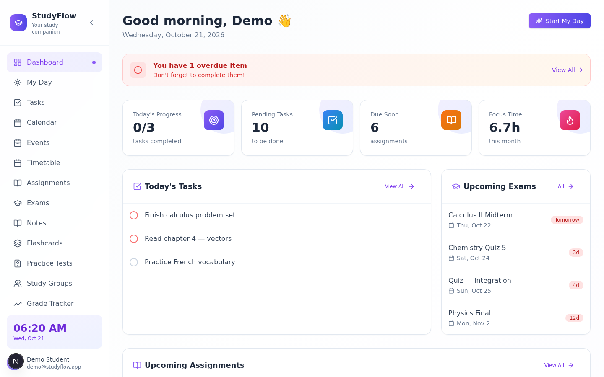
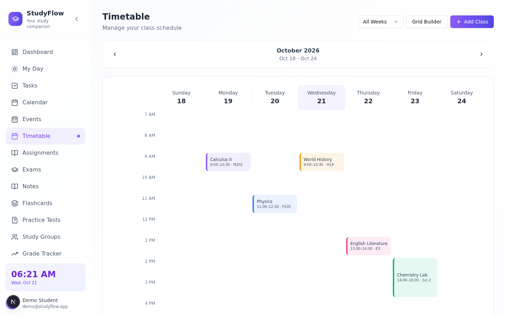
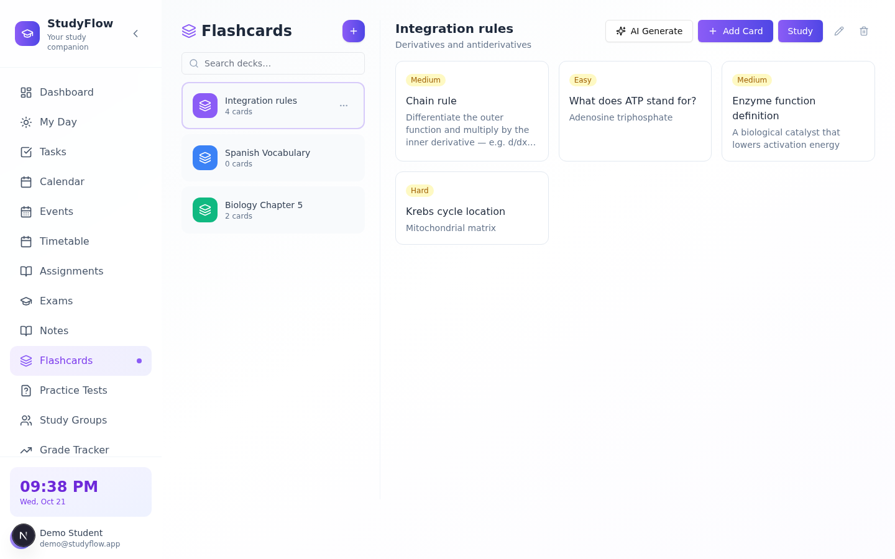
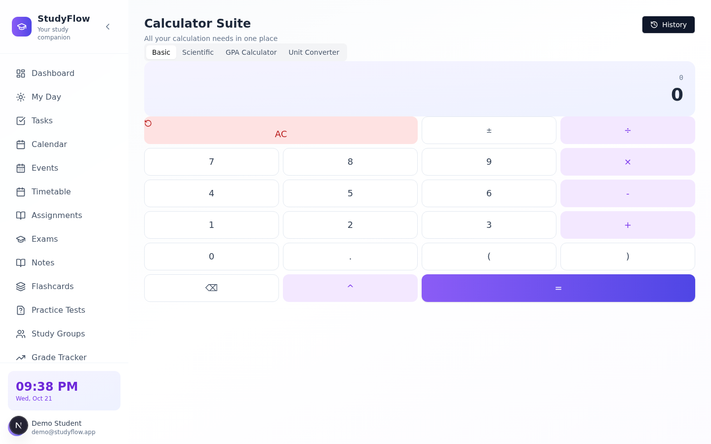
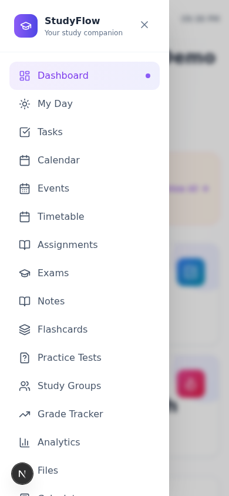
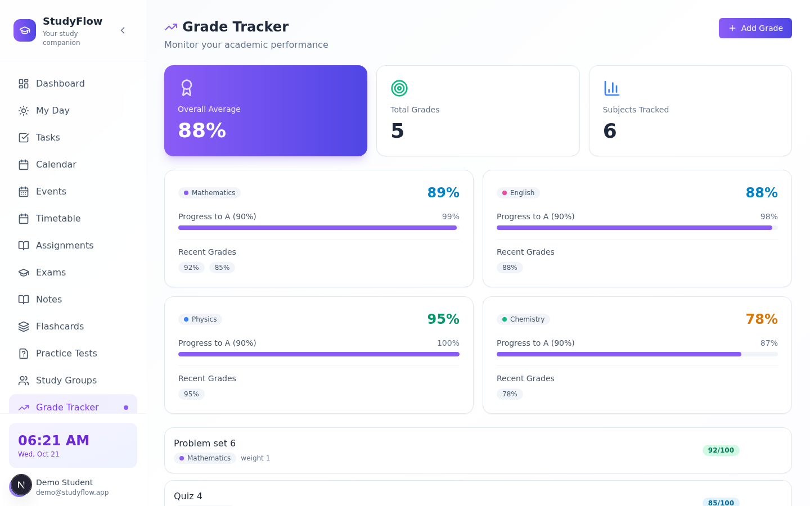
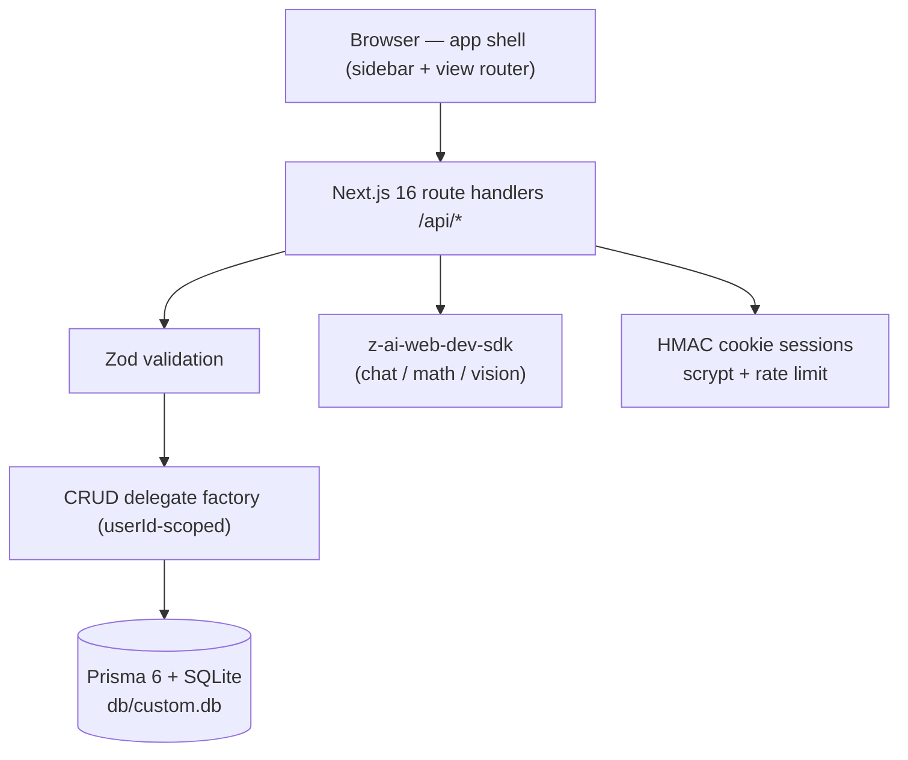

# StudyFlow (Omni-Study)

      

**StudyFlow — your study companion.** A production-ready, self-hosted clone (functional superset) of the [`omni-study1.base44.app`](https://omni-study1.base44.app/) study-planning app, rebuilt as a single Next.js application you fully own: your database, your AI keys, your deployment.

## Overview

The reference app is a study companion that keeps a student's whole life in one place — but it lives behind a hosted platform login with no source access. StudyFlow rebuilds every surface (and fills in the ones the reference left empty) as an open codebase: twenty views from the daily dashboard to a focus timer, all wired to real CRUD persistence through Prisma/SQLite. Visual parity was measured from the live reference (computed styles, not eyeballing), and the places where the framework changed underneath — Tailwind v4's engine differences chief among them — are documented and pinned by tests. Where the reference shows empty states, StudyFlow ships working features: an AI study assistant, a math solver that reads photographed problems, flashcard decks with a study mode, and a grade tracker with trend charts.

| | | |
|---|---|---|
|  |  |  |
|  |  |  |

All 20 views (plus the login card, three mobile captures, seven dark-mode captures, the session-17 fresh-user evidence set — zero-data Analytics/Grade Tracker, the reference-measured empty-state hints, the Settings Profile/Notifications tabs, the mobile StudyGroups copy — the session-11 audit evidence pair, the session-12 accessibility evidence set — forced-colors renders, print pages, the focused skip link — and the session-13 resilience evidence set — the AI-chat failure rollback, the solver's MIME guard toast, the remediated mobile drawer — and the session-14 hardening evidence set — the offline banner with the bounced-back composer, the AI rate-limit toast, the display-name guard) are in [`docs/screenshots/`](docs/screenshots/) — the standard 31 were refreshed after the session-11 theme-system remediation (`node scripts/capture-studyflow.mjs`); the S12 set via `node scripts/capture-s12-evidence.mjs` and the S13 set via `node scripts/capture-s13-evidence.mjs`, and the S14 set via `node scripts/capture-s14-evidence.mjs`, the S15 auth-flow set via `node scripts/capture-s15-evidence.mjs` (the login inline error, the signup form, the verify OTP screen, check-email, the calculator keyboard superset), and the S16 mobile set via `node scripts/capture-s16-evidence.mjs` (the auth sub-screens + the dashboard at 390×844 — the mobile-only responsive fixes; no default-media desktop visual changed in sessions 12–16; the prior pins are the byte-parity guarantee), the S17 fresh-user set via `node scripts/capture-s17-evidence.mjs`, and the S18 RUM set via `node scripts/capture-s18-evidence.mjs` (the beacon-live dashboard + mobile, the GET /api/rum aggregate, the un-instrumented login), and the S19 diagnostics set via `node scripts/capture-s19-evidence.mjs` (the `/rum` panel — desktop light + dark + mobile 390px), and the S20 v3 set via `node scripts/capture-s20-evidence.mjs` (the `/rum` panel with the per-card trend sparklines + the Export CSV action + the exported CSV head), and the S21 portability set via `node scripts/capture-s21-evidence.mjs` (the `/export` page — desktop light + dark + mobile 390px + the downloaded JSON envelope head), and the S22 boot-guard set via `node scripts/capture-s22-evidence.mjs` (the dev-server dashboard + `/export` + mobile 390px screenshots + the boot-guard evidence JSON — the negative spawn's exit + message, the positive-control health, the dev-boot warn line), and the S23 import set via `node scripts/capture-s23-evidence.mjs` (the `/export` page with the Restore card — desktop light + dark + mobile 390px + the completed-import result state + the API round-trip evidence JSON — the first import's summary, the idempotent re-import, the validation-error family, the rollback guard, the probe cleanup), and the S24 change-password set via `node scripts/capture-s24-evidence.mjs` (the Settings Profile tab with the Change password card — desktop light + dark + mobile 390px + the success-note state + the API round-trip evidence JSON — the guard family, the anon gate, the fresh-user rotation with the old-401/new-200 login pair, the session-survives proof, the demo restore), and the S25 account-deletion set via `node scripts/capture-s25-evidence.mjs` (the Settings Profile tab with the Danger zone card — desktop light + dark + mobile 390px + the revealed confirmation-form state + the API round-trip evidence JSON — the guard family, the anon gate, the fresh-user deletion with the DB-level cascade proof, the cleared-session me-401, the demo-intact proof), and the S26 email-change set via `node scripts/capture-s26-evidence.mjs` (the Settings Profile tab with the Email address card — desktop light + dark + mobile 390px + the success-note state with the live identity-block update + the API round-trip evidence JSON — the guard family incl. the same-email 400 + the duplicate 409, the anon gate, the fresh-user rotation with the DB-level emailVerified-stays-true proof + the old-401/new-200 login pair, the demo restore), and the S27 dark-sweep repair set (the before-state — MODE empty, 97 phantom flashbulbs + 7 phantom unreadable measured in LIGHT mode — and the after-state — MODE dark, all 20 views clean in real dark mode — with the guard's negative-control exit, the restore proof, and the refreshed standing 31) in `docs/screenshots/s27-dark-sweep-evidence.json`, and the S28 connectivity-repair set (the before-state — the phantom "Login offline shows no/silent feedback" finding whose own measured bodyText contained the offline message — and the after-state — "Login offline announces the failure through the S15 inline alert (stays on the card, button recovered)" with findings 0 — with the reproduction probe, the negative-control exit, the gates, and the refreshed standing 31) in `docs/screenshots/s28-connectivity-audit-evidence.json` + the login-offline inline-alert capture `s28-login-offline-inline-alert.png`, and the session-29 doc-alignment refresh (the standing 31 re-captured from the remediated codebase — docs-only changes, zero app bytes moved) per `docs/remediation-plan-session29.md`, and the session-30 dependency-security evidence set (the bun-audit classification envelope with the two documented non-production advisories, the negative controls, the gates) in `docs/screenshots/s30-dep-audit-evidence.json` per `docs/remediation-plan-session30.md`

## Key Features

| | Feature | What it does |
|---|---------|--------------|
| 📊 | Dashboard | Time-aware greeting, conditional overdue alert banner, four stat cards, today's tasks, upcoming exams & assignments |
| ☀️ | My Day | Quick-add tasks, amber "Today's Progress" card, Suggestions for overdue/upcoming tasks |
| ✅ | Tasks | Lists (custom lists + Important), search, filters, full CRUD — priority (colored round checkbox), repeat, My Day toggle, subtasks |
| 📅 | Calendar | Sunday-first month grid (dynamic week count) + day detail (border-l-4 colored rows), timeline agenda mode, icon+tab mode switch, legend |
| 🔔 | Events & Reminders | Dark terminal-style panel: 7-day sections, recurring events, multi-reminders, color-coded |
| 🏫 | Timetable | grid-cols-8 week table with full day heads + 60px hour rows, mobile day accordion, Grid Builder, alternating Week A/B, My Classes with today's date |
| 📚 | Assignments / Exams | Subject-tagged, urgency badges, status tracking — type + priority pills, interactive progress sliders; exam cards with subject color strips, durations, topics |
| 🗒️ | Notes | Notebooks, tags, pinned notes, autosaving rich-text editor (Quill toolbar: headings, lists, colors, links, code blocks; explicit Save + autosave superset) |
| 🃏 | Flashcards | Two-panel view with colored deck swatches, card grid with difficulty badges, in-page study mode with 3D flip + Wrong/Correct rating, AI card generation |
| 📝 | Practice Tests | Question builder (manual + AI generation), score recording with completion % |
| 👥 | Study Groups | Members, next meeting, subject linking |
| 📈 | Grade Tracker | Gradient summary card + target/chart icons, weighted averages per subject, GPA, SVG trend chart |
| 🧠 | Analytics | Icon-block stat cards (Tasks Completed, Assignments, Focus Time, Upcoming Exams), axis-labeled area charts (7-day activity, focus gradient), grade trend, subject distribution |
| 📁 | Files | Folders, uploads (≤ 2 MiB), links, grid/list views |
| 🧮 | Calculator Suite | Basic, scientific (shunting-yard engine, no `eval`), GPA, unit converter + history |
| ƒ | Math Solver | AI step-by-step solutions — typed or photographed (vision) |
| ✨ | AI Assistant | Chat with six study-tuned quick modes, persisted history |
| ⏲️ | Focus Timer | Pomodoro/Deep Work presets, subject logging, session stats |
| 🎨 | Theme System | Light/Dark/System + seven accent colors + emoji avatars, persisted per user — dark mode fully re-themes every surface (a superset: the reference's own Dark option is a no-op), applies pre-paint (no light flash on load), themes the login route for dark-OS visitors, and System mode tracks OS theme changes live |
| ♿ | Accessibility | Forced-colors (Windows High Contrast) state restoration (system-color outlines on the selected day/today/active tab/active nav, the slider progress gradient), a skip-to-content link (WCAG 2.4.1), print that forces light + keeps essential backgrounds (`print-color-adjust: exact`) + a timetable week table that fits the page, and `prefers-reduced-motion` support — all supersets (the reference has none) |
| 🛡️ | Resilience | Failure-state hardening — every AI call carries a 120 s deadline (`AbortSignal.timeout`) so a hung backend never locks the composer; a failed AI send rolls the message back into the composer instead of orphaning it; the solver guards non-image files client-side; uploads reject nameless files; downloads speak RFC 5987 (`filename*=UTF-8''…`) so unicode filenames save correctly; verified at 300+ rows with zero main-thread blocking |
| 📡 | Connectivity | A global offline banner (amber pill, screen-reader announced) the moment the network drops — renders nothing while online (byte-identical DOM); transport failures toast a human message ("You appear to be offline…") instead of raw browser text; every per-request path recovers (bounced-back composer, dialogs that keep their forms, SPA navigation on cached data) — a superset (the reference has no offline handling) |
| 🔒 | Security hardening | Per-user AI rate limits (20 req/15 min on all four LLM routes — 429 with `Retry-After`), download responses carry `X-Content-Type-Options: nosniff` + `Cache-Control: private, no-store`, whitespace-only display names rejected — alongside the scrypt/HMAC/rate-limited auth baseline and the **AUTH_SECRET boot guard** (session-22): a production boot without a real `AUTH_SECRET` — missing, empty, or the public dev fallback pasted in — REFUSES to start, exiting with the `openssl rand -hex 32` remedy (dev/test keep the documented zero-config fallback with a one-line boot warning); weak-but-present secrets (< 32 chars) draw a boot warning |
| ♿ | AI accessibility | The assistant transcript and the math solver's solution are polite live regions (`aria-live` + `aria-busy`) — replies and solutions land announced for screen readers (WCAG 4.1.3); errors were already announced via the aria-live toast stack |
| 🔐 | Auth | Email & password (scrypt + HMAC cookie sessions), rate-limited — with the reference's full account journey: a real Create-your-account form, email verification (6-digit OTP, 15-minute one-shot codes), an unverified-login gate, a 3-state forgot-password flow (Reset your password → Check your email → the reset link), and inline form errors (the reference's red/green alert pattern). No SMTP in the self-hosted context: the verification code and reset link surface to the actor directly (ADR-013). Session-24 adds the account-security rotation: **a signed-in user changes their own password from Settings → Profile** (current-password proof + the register policy + the must-differ rule, rate-limited — a pure superset; the reference has no password surface) (ADR-022). Session-25 completes the ownership arc with the exit: **a signed-in user permanently deletes their own account from Settings → Profile → Danger zone** (password proof + the typed word DELETE + the ONE cascade write wiping every collection; the session cookie dies with the account — a pure superset; the reference has no deletion surface) (ADR-023). Session-26 adds the account-identity rotation: **a signed-in user changes their own login email from Settings → Profile → Email address** (password proof + the typed-twice confirm guarding the typo lockout + must-differ/uniqueness guards, rate-limited; the session survives — a pure superset; the reference has no email-change surface) (ADR-024) |
| ⌨️ | Calculator keyboard | The calculator accepts physical-keyboard input (digits, operators, Enter to evaluate, Backspace, Escape to clear) — a functional superset; the reference's calculator is click-only. Keystrokes never leak into form fields (GPA rows, converter inputs are guarded) |
| ⚡ | Load stability (CWV) | The authenticated shell pre-warms the active view's data IN PARALLEL with the auth call — the first paint renders with final geometry (dashboard CLS 0.00, was 0.117–0.125; Lighthouse-class mobile preset: login LCP ~640 ms, dashboard LCP ~2.4 s — both CWV-good, vs the reference's own 7.6–8.0 s login / 4.4 s + CLS 0.372 dashboard). Auth sub-screens render the reference's responsive mobile geometry (20px headings, 44px Sign in, the 76px verify rhythm) — measured at 390×844 on both apps |
| 🆕 | Fresh-user journey | A registered user's first run now mirrors the reference's measured zero state: Analytics and Grade Tracker render their stat cards at zero data (no empty-state blocks the reference never renders), every view's empty-state hint carries the reference's exact copy, Settings opens its five tabs with the reference's per-tab headers — and the Profile tab persists School Name, Grade Level (6th Grade → Graduate), a 1–12 hour Daily Study Goal and the Account-created line; the Notifications tab carries the persisted Enable Notifications master toggle (session-17) |
| 📡 | RUM observability | Real-user web-vitals monitoring (a pure superset — the reference has no field telemetry): the authed shell mounts an invisible beacon that reports TTFB/FCP/LCP/CLS/INP to the in-app `POST /api/rum` endpoint (batched, keepalive, failures swallowed); `GET /api/rum` answers p75 per metric + the recent samples for the owner. The beacon renders zero DOM — visual parity is untouched (session-18) |
| 📊 | RUM diagnostics panel | The owner-facing surface for the beacon's field data: the auth-gated `/rum` route renders the five Core Web Vitals at p75 with rating badges derived from the public CWV bounds, a samples line, the ten most recent events, and a Refresh action — themed (dark mode + the seven accents) through the production theme path, responsive to 390px, linked from NOWHERE (the shell's 20-link parity stays byte-intact; the owner navigates directly — see DEPLOYMENT.md §8) (session-19). Session-20 v3: each sampled card carries a SPARKLINE trend line (the metric's 20 most recent samples, oldest → newest — accent-themed SVG, edge cases unit-pinned) and an **Export CSV** action downloads the most recent 2000 events as a spreadsheet-ready RFC-4180 CSV (raw values, the S13/S14 download-header contract) |
| 💾 | Data portability | The "own your data" exit: `GET /api/export/data` downloads the user's COMPLETE content — all 20 collections (tasks, notes, decks, grades, files with payloads, …) in chronological order with ids/foreign keys intact — as a versioned JSON envelope (`format: studyflow-data-export`, `version: 1`; the hashless profile rides `user`; tokens, RUM telemetry, and the password hash are excluded by decision). The auth-gated `/export` page previews it: a per-collection count grid, the **Download JSON** action, and the format documentation — themed through the production path, responsive to 390px, linked from NOWHERE (the owner navigates directly — DEPLOYMENT.md §8.2) (session-21). Session-23 completes the round-trip: **`POST /api/import/data` restores an export into the importing account** — upsert-by-id (existing rows update to the file's values, new ids create with the importer's userId — the envelope is portable across accounts), all-or-nothing in ONE transaction (any failure rolls back completely), never deletes, content only (never identity); dangling optional FKs null (the schema's own SetNull semantics), a dangling required `cards.deckId` is a rejected corrupt envelope, folders sort parents-first with cycle rejection — all pre-validated by the pure seam so Prisma's P2003 never surfaces opaquely. The `/export` page's **Restore from a backup** card drives it (file picker + the created/updated result report; a 10 MiB cap + a 10/15-min rate limit) |
| 🐳 | Docker deployment | A production `Dockerfile` (multi-stage: prod-deps → standalone build → bun runtime) + `docker-compose.yml` with a SQLite volume, an auth-secret guard, an init profile (schema push + seed) and a healthcheck — one command from clone to container (`docker compose --profile init up`); the runtime layout is validated end-to-end outside Docker (session-18) |

## Architecture

| Layer | Technology | Version | Purpose |
|-------|-----------|---------|---------|
| Framework | Next.js (App Router) | 16.4.0 | One page + 20 path rewrites (SPA parity with the reference) |
| UI runtime | React | 19 | Client view switching inside a single app shell |
| Language | TypeScript | 5 (strict) | End-to-end types, no `any` |
| Styling | Tailwind CSS | 4 (CSS-first `@theme`) | v3-pinned palette/shadow tokens for reference parity |
| Components | Radix UI (shadcn-style) | current | Accessible primitives themed via CSS vars |
| Database | SQLite via Prisma ORM | 6.19.3 | Zero-config, single file at repo-root `db/` |
| State | Zustand | 5 | App/theme/data stores; URL is the routing truth |
| Validation | Zod | 4.6.5 | Every API boundary |
| AI | z-ai-web-dev-sdk | 0.0.18 | Server-only: chat, math solve, vision |
| Unit tests | Vitest | 5 | Pure seams (router, date, calculator, auth, schemas, view collections) |
| E2E tests | Playwright | 1.63 | Production standalone build + isolated `db/e2e.db` |
| Runtime | Bun | ≥ 1.3 | `bun run dev`, scripts, seed |



## File Hierarchy

```
📂 src/
├── 📂 app/
│   ├── 📄 page.tsx              ← the whole app: auth gate + shell + view switcher
│   ├── 📄 login/page.tsx        ← reference-parity login card
│   ├── 📄 globals.css           ← Tailwind v4 @theme tokens + trap pins
│   └── 📂 api/                  ← auth, health, 16 entity CRUDs, AI, files, settings
├── 📂 components/
│   ├── 📂 ui/                   ← button, card, dialog, select, tabs, toast, …
│   ├── 📂 layout/               ← sidebar (fixed glass) + mobile drawer chrome
│   └── 📂 views/                ← the 20 view components + shared primitives
├── 📂 lib/
│   ├── 📄 db-path.ts            ← the DATABASE_URL contract (unit-tested)
│   ├── 📄 db.ts                 ← Prisma singleton with env resolution
│   ├── 📄 auth.ts               ← scrypt, HMAC sessions, rate limiter
│   ├── 📄 router.ts             ← 20-view ↔ PascalCase-path map
│   ├── 📄 data.ts               ← client cache + typed mutations
│   ├── 📄 calculator.ts         ← shunting-yard engine, GPA, converter
│   ├── 📄 theme.ts              ← 7 accents, RGB-triplet tokens
│   └── 📂 server/               ← http helpers + entity CRUD delegates
├── 📂 prisma/
│   ├── 📄 schema.prisma         ← 24 models; DATABASE PATH CONTRACT header
│   └── 📄 seed.ts               ← idempotent demo data
├── 📂 tests/
│   ├── 📄 *.test.ts             ← Vitest unit layer (883 tests)
│   └── 📂 e2e/                  ← Playwright specs (463 across the 5-chunk cold map)
└── 📂 docs/
    ├── 📄 Tailwind-V4-Validation-Report.md  ← the five documented v3→v4 traps
    ├── 📄 remediation-plan.md   ← session-2 parity audit: evidence, fixes, non-gaps
    ├── 📄 remediation-plan-session3.md ← session-3 mobile-chrome & token audit
    ├── 📄 remediation-plan-session4.md ← session-4 text-metrics & login audit
    ├── 📄 remediation-plan-session5.md ← session-5 interactive-chrome & view-body audit
    ├── 📄 remediation-plan-session6.md ← session-6 populated-state & row-design audit
    ├── 📄 remediation-plan-session7.md ← session-7 lightly-probed-views & flashcards audit
    ├── 📄 remediation-plan-session8.md ← session-8 deep-chrome/layout audit (16 gap families)
    ├── 📄 remediation-plan-session9.md ← session-9 data-state/chart-axes/icon audit (19 gap families)
    ├── 📄 remediation-plan-session10.md ← session-10 dark-mode consistency audit (the @theme inline token trap + 6 tint families)
    ├── 📄 remediation-plan-session11.md ← session-11 theme-system audit (pre-paint boot script + System tracking + accent-dark re-themes)
    ├── 📄 remediation-plan-session12.md ← session-12 accessibility audit (forced-colors state restoration + print + skip link + reduced-motion)
    ├── 📄 remediation-plan-session13.md ← session-13 resilience audit (AI failure states + upload edge cases; data-volume stress verified green)
    ├── 📄 remediation-plan-session14.md ← session-14 hardening audit (connectivity UX + settings guards + security headers/limits + AI live regions)
    ├── 📄 remediation-plan-session15.md ← session-15 auth-flow audit (inline errors + signup/verify/forgot/reset + calculator keyboard superset)
    ├── 📄 remediation-plan-session16.md ← session-16 CWV/mobile-geometry audit (load-stability pre-warm + responsive auth sub-screens + fresh copy sweep)
    ├── 📂 screenshots/          ← dev-server captures of every view (light + dark)
    └── 📄 DEPLOYMENT.md         ← production notes
```

## Quick Start

Requires **Bun ≥ 1.3** (or npm with Node ≥ 22 — swap `bun` for `npx`/`npm run`).

```bash
git clone https://github.com/nordeim/omni-study.git
cd omni-study
bun install

# Database — .env ships with DATABASE_URL="file:../db/custom.db";
# db/ lives at the repo root (git-ignored, recreated by these two commands):
bun run db:push
bun run db:seed

bun run dev
```

**Verify setup:**

1. `curl http://localhost:3000/api/health` → `{"status":"ok","db":"up","app":"studyflow"}`
2. Open <http://localhost:3000> → redirects to `/login`
3. Sign in with the demo account — **`demo@studyflow.app` / `Demo1234!`** — you land on the dashboard with seeded subjects, tasks, exams, notes, decks and grades.

## Environment Variables

Copy `.env.example` to `.env` (the defaults above already work locally):

| Variable | Required | Purpose |
|----------|----------|---------|
| `DATABASE_URL` | yes | `"file:../db/custom.db"` — resolved by `src/lib/db-path.ts` to `<repo>/db/custom.db` at runtime; the `db:*` scripts set it inline for the Prisma CLI (schema-anchored). Keep the value in sync with `prisma/schema.prisma`'s header note. |
| `AUTH_SECRET` | prod | HMAC key for session cookies. Generate with `openssl rand -hex 32`; a dev-only fallback is used when unset — and **enforced at boot in production** (the server exits with the remedy message instead of silently signing forgeable sessions). |
| `NEXT_PUBLIC_SITE_URL` | no | Canonical origin for metadata/sitemap. Defaults to `http://localhost:3000`. |

## Testing

```bash
bun run test        # Vitest — 883 unit tests (router, theme, date, calculator incl. mapPhysicalKey, auth incl. the AI rate-limit budget + the verification/reset seams, validation incl. verify/forgot/reset schemas + the S24 change-password rotation seam + the S25 deletion seam + the S26 email-rotation seam, db-path, site-url, theme-cache + boot-script contract + content-disposition + api-timeout + the offline transport-error mapping, rum-diagnostics — the CWV thresholds/panel display seam + the S20 sparkline geometry + the CSV builder, data-export — the S21 envelope/manifest/secret-guard seam, env-check — the S22 AUTH_SECRET boot-guard seam, data-import — the S23 envelope-validation/FK-pre-emption/folders-topo-sort seam, dep-audit — the S30 bun-audit parser/classifier seam, dev-preflight — the S31 dev-server boot-stability classifier seam, suite-verdict — the S32 standing-suite verdict seam [the anti-phantom shape-error guard + the three documented non-gap signatures] + the S33 mobile-sweep classifier [the light-mode 390×844 drawer-navigation sweep] + the S34 midband-sweep classifier [the light-mode 768×1024 drawer-navigation sweep — the md breakpoint, the 391–1023px band's representative width, with the chrome vehicle-contract class] + the S35 landscape-sweep classifier [the light-mode 844×390 phone-landscape drawer-navigation sweep — the HEIGHT axis the standing surface never varied, with the per-view heading-clearance key + the drawerNavScrollable short-viewport contract class] + the S36 dark-mobile-sweep classifier [the dark-mode 390×844 drawer-navigation sweep — the MODE axis at the mobile viewport the standing surface never varied, with the per-view flashbulbs/unreadable detector keys + the drawer dark record + the INDEPENDENT dark-detection counting] + the S37 accent-light-sweep classifier [the accent × light 390×844 sweep — the ACCENT axis in LIGHT mode the standing surface never varied, with the ALL-ACCENTS guard + the per-accent applied self-verification + the three signature-strict non-gap exemptions (the CTA-face, the calendar adjacent-month slate-300 days re-verified live on the reference, the yellow-500 priority-pill vocabulary)] + the S38 accent-dark-sweep classifier rebuild [the accent × dark MOBILE 20-view matrix — the pre-S38 mobile pass swept only 6 views; the ALL-ACCENTS + ALL-VIEWS + drawer-present anti-phantom guards, every view recorded explicitly on both surfaces, the per-accent applied self-verification, the mode/mobileViewport contracts, and the mobile scrollWidth overflow class] + the S39 accent-midband-sweep classifier [the accent × mid-band 768×1024 drawer-navigation sweep — the mid-band × accent cell never probed + the navigation-interaction gap: the accent sweeps navigate by direct goto, so the drawer's active-link tint was only ever read on the Dashboard link; with the ALL-ACCENTS + ALL-VIEWS + drawer-present guards, the vehicle-contract class, and the TWO interaction finding classes (the tint rot — activeTint "none", the S8 no-var class; the active-state mismatch — activeLabel ≠ the view)] + the S40 accent-landscape-sweep classifier [the accent × landscape 844×390 drawer-navigation sweep — the landscape × accent cell never probed (landscape-sweep is light+violet only) and the S39 interaction proof extended to the SHORT viewport, with the S35 short-viewport contracts (headingClearance + drawerNavScrollable) folded into the S39 accent shape] + the S41 accent-desktop-sweep classifier [the desktop light-accent sidebar-navigation sweep at 1280×800 — the documented S37 bracketed non-gap: accent-dark covers 1280 dark only, and the SIDEBAR-vehicle active-link tint was verified at ZERO views, ZERO accents, in either mode; with the INVERTED vehicle contract (sidebarVisible true + hamburgerVisible false), the sidebar-own scroll contract (sidebarNavScrollable at 800 height), the per-view headingOffset key, and the interaction finding classes on the DESKTOP vehicle]) + the S42 accent-volume-sweep classifier [the data-volume × dark × accent stress — the S13 volume profile (300/200/250) swept through the theme space's dark-accent half: the volume counts EXACT at the seam (a seed-volume envelope is its own rot class), the ALL-ACCENTS + ALL-VIEWS guards (the 7 volume-affected views — the S13 set), the per-view S13 measurement family (nodes/mainNodes/longTaskTotal ≤ 1500ms/clickLatencyMs ≤ 1500ms), the S38 dark detector family (flashbulbs always findings; the CTA-face exemption ONLY — the light-mode calendar-day + yellow-pill exemptions do NOT apply in dark), the interaction evidence in DARK (the never-read sidebar-tint cell), and the /api/tasks ≤ 500KB B1 bound]
bun run build       # REQUIRED before e2e — the suite boots the standalone server
bun run test:e2e    # Playwright — 463 across the 5-chunk cold map against the production build on :3100
```

E2E notes: the suite pushes and seeds an isolated `db/e2e.db` (never touches `custom.db`), signs the demo user in **once** via a setup project (the login endpoints are rate-limited — 10 attempts/IP/15 min), and asserts the reference-measured design pins (sidebar geometry, v3 `shadow-sm`, canvas gradient, view-title model, stat-card text metrics, empty-state design, brand-gradient stops, login chrome, the session-5 interactive-chrome pins, the session-6 populated-row pins, the session-7 flashcards/timetable/analytics/dialog pins, the session-8 deep-chrome/layout pins, the session-9 data-state/chart-axes pins, the session-10 dark-mode consistency pins — the shadcn token utilities, banner/amber/clock/today/chart dark re-themes, the dark mobile drawer, and a light-mode byte-parity regression guard — the session-11 theme-system pins — pre-paint dark application, the dark-OS login, runtime System tracking, the theme-color meta, the accent-surface dark re-themes, print emulation, and a light regression guard — the session-12 accessibility pins — forced-colors state outlines + the bold active nav + the slider gradient, the skip link's Tab order/focus/Enter landing, the beforeprint/afterprint light-forcing, `print-color-adjust: exact` on the essential surfaces, the timetable print width reset, reduced-motion collapse, and a light regression guard — the session-13 resilience pins — the AI-chat failure rollback + recovery, the solver's client-side MIME guard with zero outbound requests, the nameless-upload rejection, and the RFC 5987 download header — and the session-14 hardening pins — the offline banner's appear/disappear + online absence (byte-parity guard), the human offline toast, the whitespace display-name 400 + trim-on-save, the AI-route per-user rate limit (20 then 429 with Retry-After), the download nosniff + private no-store headers, and the AI transcript/solver aria-live regions — and the session-15 auth-flow pins — the inline login-error alert with its measured chrome, the signup form's reference shape, the register→verify→signed-in journey via the surfaced code, the unverified-login gate, the forgot→check-email→reset-link→new-password journey, and the calculator's physical-keyboard superset including the form-field guard — and the session-22 boot-guard pins — the standalone production server spawned WITHOUT AUTH_SECRET exits non-zero with the actionable message (the `openssl rand -hex 32` remedy), and the positive control: the suite's own properly-configured boot answering `/api/health` — and the session-24 change-password pins — the anon 401 gate, the wrong-current/same-password/short-new 400 family (pre-write: the demo hash untouched), and the fresh-user rotation round-trip: register → sign in → the panel rotates → the old password login 401 → the new password login 200 → the session survives — and the session-25 account-deletion pins — the anon 401 gate, the wrong-password/wrong-confirmation/short-password 400 family (pre-write: the demo account untouched, still signing in), and the fresh-user terminal journey: register → sign in through the UI → the panel reveals the Danger zone form → the wrong-word early inline error → the deletion → the redirect to /login → the old-credentials login 401 → the cleared session's me 401 — and the session-26 email-change pins — the anon 401 gate, the wrong-password/mismatched-confirm/short-password/same-email 400 family + the duplicate-email 409 (pre-write: the demo account untouched, still signing in), and the fresh-user identity rotation: register → sign in through the UI → the panel's Email address card → the mismatched-confirm early inline error → the change → the success note + the identity block showing the NEW email (the live store update, both surfaces) → the session survives me 200 with the new email → the old-email login 401 → the new-email login 200). Full gate order: `lint → typecheck → test → build → test:e2e`.

## API Reference

All endpoints are same-origin JSON; sessions ride the `sf_session` cookie. 🔒 = requires authentication.

| Endpoint | Methods | Description |
|----------|---------|-------------|
| `/api/health` | GET | Liveness + DB probe (used by the e2e webServer gate + the Docker healthcheck) |
| `/api/rum` | POST/GET 🔒 | The RUM hook (session-18): POST a batched web-vitals report (upsert on sessionId+metric — final value wins, 1000/15-min per-user budget); GET answers p75 per metric + recent samples + the per-metric `trends` series (session-20) — the data behind the `/rum` diagnostics panel (session-19) |
| `/api/rum/export` | GET 🔒 | The CSV export (session-20): the user's most recent 2000 RUM events as a spreadsheet-ready `text/csv` download (RFC-4180 escaping, raw values, the attachment + nosniff + private/no-store header contract) |
| `/api/export/data` | GET 🔒 | The full-data export (session-21): the user's complete content across the 20 collections as a versioned JSON envelope download (chronological, ids/FKs intact, the hashless profile, the attachment + nosniff + private/no-store header contract) — the data behind the `/export` page |
| `/api/import/data` | POST 🔒 | The data import / restore (session-23): POST a `studyflow-data-export` envelope to restore it into the importing account — upsert-by-id in ONE all-or-nothing transaction (never deletes; content only, never identity; the importer's userId re-attached to every row), the seam's envelope validation (dangling optional FKs nulled, required `cards.deckId` rejected, folders sorted parents-first with cycle rejection), a 10 MiB body cap (413), a 10/15-min per-user rate limit (429), and the per-collection created/updated report as the response |
| `/api/auth/login` / `register` / `logout` / `me` | POST/GET | Rate-limited auth; no user enumeration. `register` creates an UNVERIFIED account + a 6-digit code (no auto-login — S15/ADR-013); `login` gates unverified accounts behind the reference's inline copy |
| `/api/auth/verify-email` / `resend-verification` | POST | The OTP flow: match the latest unexpired 15-min code → mark verified + sign in; resend re-issues for unverified accounts (uniform 200 otherwise) |
| `/api/auth/forgot-password` / `reset-password` | POST | The 3-state reset flow: always-200 request (reset URL in the response — the no-SMTP delivery), 30-min one-shot token consumption |
| `/api/auth/change-password` | POST 🔒 | The account-security rotation (session-24/ADR-022): `{ currentPassword, newPassword }` — the current password verified against the stored scrypt hash FIRST (a wrong current → 400, pre-write), the register family's min-8/max-200 policy on both fields, the must-differ rule (the schema's refine), a 10/15-min per-user rate limit (429 + Retry-After); the stateless session SURVIVES the owner's own rotation (documented — revoking other sessions is ADR-022's rejected alternative) |
| `/api/auth/delete-account` | POST 🔒 | The ownership exit (session-25/ADR-023): `{ password, confirmation: "DELETE" }` — the password verified against the stored scrypt hash FIRST (a wrong password → 400, pre-write), the typed-confirmation rule (the schema's refine — case-exact), a 10/15-min per-user rate limit (429 + Retry-After), then the ONE cascade write: `user.delete` wipes every collection (all 22 user relations carry `onDelete: Cascade` — subjects, tasks, notes, decks, grades, files, chat, RUM events, tokens); the session cookie is cleared with the account (maxAge 0 — the logout mechanism) |
| `/api/auth/change-email` | POST 🔒 | The account-identity rotation (session-26/ADR-024): `{ password, newEmail, confirmEmail }` — the password verified against the stored scrypt hash FIRST (a wrong password → 400, pre-write), the confirm-match rule (the schema's refine), then the route-side guards: must-differ (posting the current address → 400) + uniqueness (an address owned by ANY account, verified or not → 409), a 10/15-min per-user rate limit (429 + Retry-After), then the ONE write: `user.update` moves the login identifier (lowercased; `emailVerified` stays true — the password proof IS the verification); the session SURVIVES (stateless HMAC over the user id — the S24 contract) |
| `/api/tasks` (+ `/[id]`) | GET POST PATCH DELETE 🔒 | Tasks — lists, importance, due dates |
| `/api/task-lists`, `/api/subjects`, `/api/assignments`, `/api/exams`, `/api/events`, `/api/timetable`, `/api/notebooks`, `/api/notes`, `/api/flashcards/decks`, `/api/flashcards/cards`, `/api/practice-tests`, `/api/study-groups`, `/api/grades`, `/api/focus-sessions`, `/api/holidays` | GET POST PATCH DELETE 🔒 | Ownership-scoped CRUD via the delegate factory |
| `/api/files` (+ `/[id]`, `/folders`, `/link`) | GET POST DELETE 🔒 | Multipart upload ≤ 2 MiB (nameless files rejected), link-files, download with RFC 5987 filenames |
| `/api/settings/preferences` | PATCH 🔒 | Theme mode, accent, avatar, display name + the S17 study-profile fields (school, grade level, 1–12h study goal, notifications master) |
| `/api/calculator/history` | GET POST DELETE 🔒 | Persisted calculations |
| `/api/ai/chat`, `/api/ai/messages` | POST GET DELETE 🔒 | Study assistant (server-side SDK only; 20 req/user/15 min) |
| `/api/ai/generate-cards` | POST 🔒 | AI flashcard generation for a deck |
| `/api/ai/generate-questions` | POST 🔒 | AI practice-test question generation |
| `/api/math/solve` | POST 🔒 | Text or photographed problems (vision; 20 req/user/15 min) |

## Design System

Measured from the live reference (see `docs/Tailwind-V4-Validation-Report.md` for the full trap log):

| Token | Value | Usage |
|-------|-------|-------|
| Primary | `#8b5cf6` (violet-500) via `--sf-primary` RGB triplet | Active states, accents |
| Primary CTAs | `linear-gradient(to right, violet-500, indigo-600)` + v3 `shadow` — accent-aware via `.sf-gradient` (session-5 pin) | Every primary action button |
| Task rows | standalone `rounded-xl` cards, slate-200 border, 24px round priority-colored checkbox, slate-700 titles, due/repeat pills, hover-revealed actions (session-6 pin) | Tasks + My Day |
| Dashboard rows | bare `p-4 gap-4` rows, 20px round checkbox, title-only (session-6 pin) | Today's Tasks |
| Assignment rows | 24px round checkbox, blue due-in pill, priority/type pills, gradient progress slider + violet % label (session-6 pin) | Assignments |
| Exam cards | 3-col grid, `h-2` subject color strip, amber urgency badge, icon detail rows, type footer (session-6 pin) | Exams |
| Calendar cells | Sunday-first `aspect-square` centered cells (dynamic week count — 35 for five-week months), 4-color dots, SELECTED = solid accent fill + TODAY = 100-level tint (both hover-stripped), simple p-6 month card, legend + border-l-4 day-detail rows (session-6/S8-C/S9-E pins) | Calendar |
| Flashcards | two-panel layout: `w-80 border-r` deck sidebar with colored 40px icon blocks, deck color swatches, `lg:grid-cols-3` card grid with difficulty pills, 3D-flip study mode (session-7 pin) | Flashcards |
| Timetable grid | `grid-cols-8` week table, full day-name heads + `text-lg` dates, 60px hour rows with "7 AM" labels, mobile day accordion (session-7 pin) | Timetable |
| Analytics stats | r12 border-0 cards, 48px tinted icon blocks (violet/blue/green/orange-100), fraction values (session-7 pin) | Analytics |
| View titles | `h1 text-2xl font-bold text-slate-800` + 24px accent icon (MyDay/FocusTimer are 30px) | Every view header (session-4 pin) |
| Form controls | gray-200 borders, gray-950 text, gray-400 placeholders, `h-9` transparent inputs, v3 `shadow-sm` (session-5 pin) | Dialogs, selects, tabs, outline buttons |
| Dialogs | `max-w-md` (448px), `rounded-lg` (8px), 36px inputs (session-5 pin) | Every modal |
| Empty states | 80px rounded-2xl gradient block (`violet-100 → indigo-100`), 40px accent icon, 20px/600 h3, 16px hint | Every empty view (session-4 pin) |
| Events panel | `slate-900` rounded-2xl shadow-2xl terminal panel, cyan New Event link, `CW <n>` calendar-week label | Events view (session-5 pin) |
| Strong | `#7c3aed` (violet-600) | Links ("View All"), active nav text |
| Card | white, `1px solid #f1f5f9`, radius 16px | Every surface |
| Shadow | `0 1px 2px 0 rgb(0 0 0 / 0.05)` | v3 `shadow-sm`, **pinned** in `@theme` |
| Canvas | `linear-gradient(to right bottom, #f8fafc, #fff, #f5f3ff4d)` | App background |
| Sidebar | 260px fixed, `rgba(255,255,255,0.8)` + blur(20px) + white/50 hairline (`.glass`) | Hidden below `lg` |
| Mobile app bar | 64px fixed `.glass`, brand + live clock ("03:43 AM") | Content starts at 80px (both apps) |
| Mobile drawer | 288px white panel, `shadow-2xl`, 20% blurred backdrop, icon nav items | No footer (reference-exact) |
| Clock chip | `violet-50 → indigo-50` gradient (`rgb(245,243,255) → rgb(238,242,255)`), violet-700 time | Accent-aware via `--sf-primary-softest(-adjacent)` |
| Brand gradients | chips + CTA end **indigo-600** (`rgb(79,70,229)`); avatar runs violet-400 → indigo-500 (the lighter pair) | Accent-aware via `--sf-primary-gradient-to` / `-avatar-*` tokens |
| Accents | violet · blue · **emerald** · **amber** · pink · red · teal (session-5 migration — the reference's swatch faces) | Settings → Appearance |
| Font | system sans stack | Matches reference body styles |

Six accent themes × Light/Dark/System × 24 emoji avatars, all persisted to the user record.

## Deployment

The app builds to a **standalone server** (`output: "standalone"` in `next.config.ts`):

```bash
bun run build
bun run start        # NODE_ENV=production, serves .next/standalone
```

For production use an **absolute** `DATABASE_URL` (see `docs/DEPLOYMENT.md` §4) and set `AUTH_SECRET`. Deploy keys never live in the repo — pushes use the `docs/ssh_git_wrapper_v3.py` wrapper (see `docs/how-to-git-push-using-ssh-wrapper_SKILL.md`).

## Troubleshooting

| Symptom | Cause | Fix |
|---------|-------|-----|
| `{"status":"degraded","db":"down"}` on `/api/health` | No database file yet | `bun run db:push && bun run db:seed` |
| Prisma CLI created the db **one directory too high** | `.env`-loaded relative URLs anchor at the CWD | Use the `bun run db:*` scripts (they set `DATABASE_URL` inline, schema-anchored) — never raw `prisma db push` with the repo-root `.env` |
| E2E webServer timeout | `bun run build` not run since the last change | Rebuild, then `bun run test:e2e` |
| Dev server dies silently in low-memory containers | OOM-killed (`next-server` ~1.6 GB RSS) | Close extra headless browsers; rerun `bun run dev` |
| Login fails after many attempts | Rate limiter (10/IP/15 min) | Wait or restart dev; specs share ONE login by design |
| `space-y-*` gaps look wrong next to `mt-*` children | Tailwind v4 selector rewrite (trap 4) | Use `flex gap-*`; the codebase convention bans margin utilities inside `space-*` |
| The standalone production server exits at boot with `AUTH_SECRET is required in production` | The session-22 boot guard — the server refuses to sign session cookies with the public dev fallback | That is the guard working: generate a secret (`openssl rand -hex 32`), set `AUTH_SECRET` in the environment, restart (DEPLOYMENT.md §4) |

## Contributing

The verification gate before any push: `bun run lint && bun run typecheck && bun run test && bun run build && bun run test:e2e`. Conventions that differ from defaults: **Tailwind v4 CSS-first** (no `tailwind.config.js` — theme lives in `src/app/globals.css` `@theme`); **`gap-*` layout only** (never `space-y/x` with margin-carrying children); Zustand stores over Context; every API payload through its Zod schema in `src/lib/validation.ts`; `z-ai-web-dev-sdk` imported only inside route handlers.

## Project Status

| Phase | Status | Deliverables |
|-------|--------|--------------|
| Rebuild session (from the scaffolded config+test layers to the full implementation) | ✅ Complete | `src/**` (20 views, chrome, 58 API routes, 24-model schema + seed), `prisma/**`, `public/`, `docs/screenshots/**` (14 dev-server captures) |
| Reference recon (all 20 views, computed-style tokens) | ✅ Complete | Traps + measured tokens in `docs/Tailwind-V4-Validation-Report.md` |
| Codebase build (20 views, 24 models, 40+ endpoints) | ✅ Complete | `src/**`, `prisma/**` |
| Test suites (834 unit + 299 e2e) | ✅ Complete | `tests/**` |
| Visual parity verification | ✅ Complete | `docs/screenshots/**`, `docs/remediation-plan*.md` |
| Session-2 parity remediation (radius trap, icons, avatar, clock) | ✅ Complete | `docs/remediation-plan.md` |
| Session-3 mobile-chrome & token remediation (fixed glass app bar + live clock, drawer mirror, greeting map, accent token completeness) | ✅ Complete | `docs/remediation-plan-session3.md` |
| Session-4 text-metrics & second-order remediation (v4 blur trap, stat-card metrics, reference empty states, view-title h1+icon model, login card, measured gradient stops, heading hierarchy) | ✅ Complete | `docs/remediation-plan-session4.md` |
| Session-5 interactive-chrome & view-body remediation (gradient CTAs, Events dark panel + repeat/reminders, FocusTimer/Settings/Calculator/Timetable/Notes/GradeTracker/Files/MyDay/AI reworks, gray form-control palette, dialog chrome, emerald/amber accents) | ✅ Complete | `docs/remediation-plan-session5.md` |
| Session-6 populated-state remediation (task card rows + priority/repeat/myDay/subtasks, MyDay amber progress card + Suggestions, dashboard bare rows, assignment sliders, exam card grid, calendar grid/legend/day-detail — measured against live reference data) | ✅ Complete | `docs/remediation-plan-session6.md` |
| Session-7 lightly-probed-views remediation (Flashcards two-panel view + deck colors + card grid + 3D study mode + AI card generation, Study Groups/Practice Tests measured dialogs + AI question generation, Timetable grid-cols-8 week grid + mobile accordion + week-alignment bug fix, Analytics icon-block stat cards + 7-day charts, Grade Tracker icons, Notes title input) | ✅ Complete | `docs/remediation-plan-session7.md` |
| Session-8 deep-chrome/layout remediation (nav icon set + active-gradient stop + tagline + 36px collapse button, dashboard flush divide-y rows, Calendar selected/today semantics + simple month card, MyDay header block + bare suggestions, Timetable today-header tint, Tasks two-pane, Notes/Study Groups two-pane reworks, Analytics per-card icons + donut + workload, Calculator/MathSolver/AI/FocusTimer/Settings icon-and-chrome fixes, Assignments/Exams search icons + slim exam cards, dead-utility sweep) | ✅ Complete | `docs/remediation-plan-session8.md` |
| Session-9 data-state/chart-axes remediation (dashboard overdue banner + slim section empty states, MyDay amber greeting empty state + bare quick-add row, Tasks outline filter button + empty My Lists, Calendar Sunday-first grid + icon/tab mode switch, Files house breadcrumb + grid3x3 toggle, text-only Grid Builder, Assignments Active-default slim rows, Exams orange Tomorrow badge, Analytics area charts with axes/gridlines, FocusTimer/Settings/Notes icon fixes, Flashcards deck-row ellipsis menu, AI wand-sparkles composer) | ✅ Complete | `docs/remediation-plan-session9.md` |
| Session-10 dark-mode consistency remediation (the `@theme inline` literal-token trap — shadcn base tokens now route through `hsl(var(--x))` runtime indirection so every `bg-card`/`bg-popover`/`bg-muted`/`border-input` utility re-themes in dark; dark washes for the overdue banner, MyDay amber card, timetable/calendar today tints, sidebar clock chip, settings selected cards; dark SVG chart axes/fills; the reference's Dark option measured as a platform no-op → the clone's full dark mode is the documented superset) | ✅ Complete | `docs/remediation-plan-session10.md` |
| Session-11 theme-system remediation (the theme-application lifecycle root cause — a pre-paint boot script + localStorage cache kills the dark-mode FOUC and themes the login route; System mode tracks OS changes at runtime; theme-color meta sync; the accent-dark re-themes for the active nav, ViewAll links, timetable mobile today chip, avatar swatch; minimal print styles) | ✅ Complete | `docs/remediation-plan-session11.md` |
| Session-12 accessibility remediation (forced-colors state restoration with system-color outlines, print that forces light + keeps essential backgrounds, the skip-to-content link, reduced-motion support) | ✅ Complete | `docs/remediation-plan-session12.md` |
| Session-13 resilience remediation (AI failure states — the optimistic-message rollback + the 120 s deadlines; upload edge cases — nameless-file rejection + RFC 5987 download filenames; data-volume stress verified green at 300+ rows) | ✅ Complete | `docs/remediation-plan-session13.md` |
| Session-14 hardening remediation (connectivity — the global offline banner + the human transport-failure message; security — per-user AI rate limits + download nosniff/no-store headers; settings — the whitespace display-name guard; AI a11y — transcript + solver live regions; 14 stale pre-clone scripts removed) | ✅ Complete | `docs/remediation-plan-session14.md` |
| Session-15 auth-flow remediation (inline login errors — the reference's red/green alert pattern; the full account journey — Create-your-account form, 6-digit email verification with an unverified-login gate, 3-state forgot-password + reset deep-links; the calculator's physical-keyboard superset with a guarded listener; Files search + pre-1.0 sweep verified as non-gaps) | ✅ Complete | `docs/remediation-plan-session15.md` |
| Session-17 fresh-user remediation (the reference's zero-data stat cards on Analytics/GradeTracker, the Settings depth — Profile school/grade/study-goal/notifications fields + per-tab headers + zero-empty states, the seven-view empty-state hint copy family, the mobile StudyGroups copy, zero-subject registrations) | ✅ Complete | `docs/remediation-plan-session17.md` |
| Session-18 RUM + Docker (the web-vitals beacon → POST/GET /api/rum with p75 aggregates, the Dockerfile + compose one-command deployment with the validated runtime layout) | ✅ Complete | `docs/remediation-plan-session18.md` |
| Session-19 RUM diagnostics panel (the auth-gated `/rum` surface — the five CWV at p75 with public-bound rating badges, the recent-samples table, the pure display seam, zero nav linkage) | ✅ Complete | `docs/remediation-plan-session19.md` |
| Session-20 RUM panel v3 (the per-card sparkline trends + the CSV export route — the additive `trends` aggregate field, the RFC-4180 seam, the S13/S14 download-header contract) | ✅ Complete | `docs/remediation-plan-session20.md` |
| Session-21 data portability (the full-data export — the versioned JSON envelope via `GET /api/export/data`, the 20-collection manifest + the row normalizer + the secret guard, the server-gated `/export` count-grid page, zero nav linkage) | ✅ Complete | `docs/remediation-plan-session21.md` |
| Session-22 AUTH_SECRET boot guard (the production fail-fast — the pure `env-check` seam, the `instrumentation.ts` boot hook with the validated process.exit mechanism, the single-source `DEV_FALLBACK_SECRET` refactor, the 64-hex e2e secret) | ✅ Complete | `docs/remediation-plan-session22.md` |
| Session-23 data import (the restore — the pure `data-import` seam with the FK pre-emption + the folders topological sort, the `POST /api/import/data` upsert-by-id all-or-nothing transaction, the `/export` page's Restore card, the 10 MiB cap + rate limit) | ✅ Complete | `docs/remediation-plan-session23.md` |
| Session-24 change-password flow (the account-security rotation — the `changePasswordSchema` seam with the must-differ refine, the `POST /api/auth/change-password` current-password-proof route, the Settings Profile tab's Change password card, the stateless session-survives contract) | ✅ Complete | `docs/remediation-plan-session24.md` |
| Session-25 account-deletion flow (the ownership exit — the `deleteAccountSchema` seam with the typed-DELETE refine, the `POST /api/auth/delete-account` password-proof cascade route, the Settings Profile tab's Danger zone card with the two-step reveal, the session-dies-with-the-account contract) | ✅ Complete | `docs/remediation-plan-session25.md` |
| Session-26 email-change flow (the account-identity rotation — the `changeEmailSchema` seam with the confirm-match refine, the `POST /api/auth/change-email` password-proof route with the must-differ/uniqueness guards, the Settings Profile tab's Email address card with the live identity-block update through the theme store, the session-survives contract) | ✅ Complete | `docs/remediation-plan-session26.md` |
| Session-27 dark-sweep audit-tool repair (the tooling-integrity fix — the standing dark-mode audit had silently rotted after the S11 theme lifecycle: the forced-class + stale `sf-theme-mode` key measured LIGHT mode and reported 97 phantom flashbulbs; now sets dark through the settings API, self-verifies the precondition with a loud non-zero exit, rides the applied mode in the JSON envelope, and restores light — the self-verifying-precondition doctrine for every probe) | ✅ Complete | `docs/remediation-plan-session27.md` |
| Session-28 connectivity-audit repair (the tooling-integrity fix — the A4 login-offline probe had silently rotted after the S15 auth-flow change: it still asserted the S14-era toast design while S15 replaced the login card's errors with the reference's measured INLINE role=alert, so the audit emitted a phantom "no/silent feedback" finding whose own measured evidence disproved it; now asserts the designed channel — the S15 inline alert scoped to the auth card, the user stays on the card, the button recovers — with the loud genuine-failure criterion kept; validated with the reproduction probe + the negative control; the standing 31 refreshed) | ✅ Complete | `docs/remediation-plan-session28.md` |
| Session-29 documentation-drift repair (the doc-alignment fix — every standing audit re-ran GREEN with zero code findings and the reference re-swept UNCHANGED, so the sweep's genuine defect family was the prose layer: the doc claims had drifted under additive change — the schema's 24 models were documented as "22" (written at S18, forgetting the S15 token pair) in CLAUDE/PAD/README and "21" (the pre-S15 list) in SKILL; PAD's "registration seeds three starter subjects" contradicted ADR-015's zero-subjects, its "ships no Dockerfile" contradicted ADR-016's shipped Dockerfile + compose, its "no reduced-motion yet" contradicted ADR-010's resolved block, and its tree listed a `src/hooks/` that never existed; SKILL §11 carried thirteen-session-stale test counts (106/194 vs 549) and §5 named the pre-S4 `backdrop-blur-sm` where the code ships `backdrop-blur-xs`; all layers re-aligned against the executable truth, with the "all 22 user relations" claims verified correct and left untouched; AP-74 records the lesson) | ✅ Complete | `docs/remediation-plan-session29.md` |
| Session-30 dependency-security audit (the never-audited surface — `pre15-preflight` measures outdated-count only; its "no action" verdict stood while `bun audit` carried 2 HIGH advisories: `braces` <=3.0.3 [dev-only via eslint-config-next; 3.0.3 IS the latest npm version — no upstream patch exists] and `deepmerge-ts` <8.0.0 [CLI-only via `@prisma/config`'s exact 7.1.5 pin; never in the standalone trace] — both verified NON-PRODUCTION against the 13-root `.next/standalone/node_modules` trace. The repair: the standing `bun scripts/dep-audit.mjs` probe — parses bun's text report, classifies every advisory by RUNTIME REACHABILITY against the standalone trace, FAILS loudly (exit 1) on anything runtime-reachable, documents the dev/CLI family with evidence, and self-verifies its preconditions [trace exists + newer than `bun.lock`, else exit 1 with no findings]; the pure seam `src/lib/dep-audit.ts` + 15 unit pins; validated with the negative controls [a fabricated runtime advisory exits 1; the stale-trace precondition exits 1 with zero findings]) | ✅ Complete | `docs/remediation-plan-session30.md` |
| Session-31 dev-server boot-stability preflight (the environment precondition no probe verified — a stale Turbopack `.next/dev` cache put `/login` into a sustained full-page reload loop [17+ main-frame navigations per 15 s; React never hydrated] that SURVIVED a clean daemon restart while `/api/health` stayed 200 — the audits then failed OPAQUELY, a 30 s click timeout naming the disabled login button instead of the cache; the S9 lesson's "restart the daemon" remedy proved INSUFFICIENT — only `rm -rf .next/dev` clears it. The repair: the standing `bun scripts/dev-server-preflight.mjs` preflight — loads `/login`, counts same-path navigations over an 8 s post-load window, fills the demo credentials and waits for the submit button to enable [NEVER submits — zero login requests], classifies through the pure `src/lib/dev-preflight.ts` seam [green / reload-loop / no-hydration / unreachable, each with its honest class-specific remedy], exits 1 loudly on every failure class; 11 unit pins + the negative controls [dead port → `unreachable`; a scratch self-reloading login-shaped page → `reload-loop` with the cache-clear remedy; healthy server → GREEN]) | ✅ Complete | `docs/remediation-plan-session31.md` |
| Session-32 standing-suite orchestrator (the operating procedure that existed only in prose — `bun scripts/standing-suite.mjs`: the S31 preflight enforced first, each standing audit spawned EXACTLY ONCE with its stdout classified through the unit-pinned `suite-verdict` seam; the anti-phantom guard [a missing key on a known audit is a LOUD shape-error, never a silent 0] — five of sixteen envelopes had been mis-parsed by careful operators, and the S29/S31 double-run phantom recurred a third time; the genuine defect the strict reading surfaced: the ai-a11y-audit's D2 probe leaked a probe pair into the demo chat DB on EVERY run [unroute-before-release order — fixed to reload-first per the S14 lesson + a closing Prisma cleanup; 4 stale pairs purged, dark/accent sweeps re-green], plus the :3200 standalone auto-start with ephemeral AUTH_SECRET and the demo-theme closing guard) | ✅ Complete | `docs/remediation-plan-session32.md` |
| Session-33 mobile light-mode sweep (the manual 390×844 walkthrough every session ran as prose, encoded as a standing probe — `node scripts/mobile-sweep.mjs`, the suite's 16th audit stage: all 20 views navigated THROUGH THE DRAWER with per-view identity-heading [h1-or-h2, the S8-H mobile-stack pattern], no-horizontal-overflow [scrollWidth ≤ 390 — the S16 mobile-only-gap class], drawer-closes-on-navigation, fixed glass app bar, zero console errors; self-verifying preconditions [viewport asserted, light mode through the settings API]; the genuine defect the first run surfaced: the clone's Notes mobile stack had LOST the identity heading the reference renders [its own two-pane overflows to 416px at 390 — the clone's no-overflow stack is the superset, but the heading was missing; fixed with the StudyGroups S8-H h2 pattern, desktop bytes untouched]; the reference's own mobile overflow documented on 5 views [Notes 416, Timetable 395, Flashcards 391, Calculator 429, MathSolver 417] where the clone stays 390) | ✅ Complete | `docs/remediation-plan-session33.md` |
| Session-34 mid-band light-mode sweep (the 391–1023px viewport continuum between the pinned widths — the whole band the standing surface never probed: mobile pins 390, desktop pins 1280/1440, the lg pin covers only the sidebar appearance at 1024 — encoded as a standing probe: `node scripts/midband-sweep.mjs`, the suite's 17th audit stage, at 768×1024 the md breakpoint [the switchiest width in the band: the Timetable swaps its mobile accordion for the min-w-[900px] scroll canvas, grids go multi-column, headers go flex-row] and iPad portrait; all 20 views navigated THROUGH THE DRAWER [the navigation vehicle through the whole band — the sidebar is lg:flex] with the S33 assertion family + the chrome vehicle-contract class [sidebar hidden + hamburger visible at 768 — a broken lg contract reads non-green at the seam]; this session's exploration validated the whole band clean [640/767/768/1023 × 20 views, findings 0]; AP-79 — a viewport band between pinned widths is a blind band) | ✅ Complete | `docs/remediation-plan-session34.md` |
| Session-35 phone-landscape short-viewport sweep (the HEIGHT axis the standing surface never varied — every pinned viewport was portrait-tall [390×844, 768×1024, 1280×800, 1440×900, 1024×800 — heights 800–1024]; the phone-landscape class [844×390, a real and common device class] had zero coverage, and its height-dependent structures — the drawer nav whose scroll is the ONLY path to links 8–20 at 390 height [measured: scrollHeight 1068 vs clientHeight 301], the fixed h-16 app bar at 16% of the viewport, the pt-* heading clearance under it, the h-[calc(100vh-8rem)] panes at 262px — were guaranteed by nothing — encoded as a standing probe: `node scripts/landscape-sweep.mjs`, the suite's 18th audit stage, at 844×390 the iPhone-class landscape; all 20 views navigated THROUGH THE DRAWER with the S33/S34 assertion family + the per-view heading-clearance pin + the short-viewport contract [drawerNavScrollable MUST be true — the nav geometry class this audit owns]; this session's exploration validated the whole landscape band clean [740×360, 844×390, 932×430 × 20 views + the 320×568 edge, findings 0]; AP-80 — an axis never varied is an axis never verified) | ✅ Complete | `docs/remediation-plan-session35.md` |
| Session-36 dark-mode mobile sweep (the MODE axis at the mobile viewport the standing surface never varied — dark × mobile was covered for 6 of 20 views [accent-dark-sweep's mobile pass], 14 views had NEVER been rendered in dark at the stacked mobile layout by any standing audit, and every light mobile sweep is mode-rot-guarded by construction — encoded as a standing probe: `node scripts/dark-mobile-sweep.mjs`, the suite's 19th audit stage, the S33 mobile sweep's dark sibling at 390×844; all 20 views navigated THROUGH THE DRAWER in dark mode [PATCHed through the settings API — the real lifecycle, self-verified] with the S33/S35 structural family + the dark-sweep detector family [flashbulbs/unreadable] extended to the mobile chrome + the drawer's own dark rendering [the dark:bg-slate-950 panel]; the dark detections counted INDEPENDENTLY of the findings array at the seam; this session's exploration validated the whole dark-mobile family clean [dark × 390×844, dark × 768×1024, dark × 844×390, findings 0 everywhere]; AP-81 — a mode never varied at a viewport is a blind combo) | ✅ Complete | `docs/remediation-plan-session36.md` |
| Session-37 accent × light sweep (the ACCENT axis in LIGHT mode the standing surface never varied — the accent-dark-sweep varies the accent ONLY in dark [its own name is the blind spot], every light pin rides the default violet, and the only light × non-violet rendering in any standing artifact was ONE desktop calculator e2e view; NO standing audit had ever rendered ANY view in a non-violet accent in light mode — encoded as a standing probe: `node scripts/accent-light-sweep.mjs`, the suite's 20th audit stage; for every accent [7 — the ALL-ACCENTS seam guard], PATCHed through the settings API and SELF-VERIFIED on `<html data-accent>`: all 20 views at 390×844 with the identity heading + scrollWidth + the LIGHT contrast detector family [unreadable/lowcontrast — the flashbulb class does not apply on the light canvas] + zero console errors, plus the drawer per accent [the active-link 10%-alpha accent gradient]; three signature-strict non-gap exemptions at the seam [the CTA-face, the calendar adjacent-month slate-300 days — re-verified LIVE on the reference this session, the yellow-500 priority-pill vocabulary]; the reference's accent picker saves but never re-themes — a SUPERSET-quality contract; this session's exploration validated the whole accent-light family clean [390×844, 1280×800, 768×1024 × 7 accents × 20 views]; AP-82 — an accent never varied in light is a blind half of the theme space) | ✅ Complete | `docs/remediation-plan-session37.md` |
| Session-38 accent × dark mobile 20-view matrix (the documented S37 next-step: the accent-dark family's own mobile pass swept only 6 of 20 views — MOBILE_VIEWS — so 14 views had NEVER been rendered in dark × accent at the stacked mobile layout by any standing audit [mobile/midband/landscape: LIGHT + violet-only; dark-mobile: violet-only; accent-light: LIGHT-only]; the accent-dark-sweep probe EXTENDED to all 20 mobile views per accent at 390×844 + the drawer per accent, with the omission-means-clean recording RETIRED — every view recorded explicitly on both surfaces, the per-accent applied self-verification, the mode/mobileViewport contracts, and the mobile scrollWidth overflow class; the seam rebuilt on the S37 doctrine with the ALL-ACCENTS + ALL-VIEWS + drawer-present guards [a missing accent/view/drawer is a LOUD shape-error, never green-by-omission]; the drawer-open failure now a FINDING, never a swallow; the exploration validated the whole family clean [7 accents × 20 views + the drawer, 0 flashbulbs, 0 non-exempt unreadable, 0 overflow]; AP-83 — an audit whose envelope cannot prove its own coverage cannot be green) | ✅ Complete | `docs/remediation-plan-session38.md` |
| Session-39 accent × mid-band drawer-navigation sweep (the S38 summary's named next step — "the drawer-navigation × accent interaction at mid-band": the mid-band 768×1024 × accent cell of the theme-space matrix was ZERO-coverage [midband-sweep is light+violet only; the accent sweeps are 390/1280 only], AND the navigation-interaction gap — the accent sweeps navigate by direct goto, so the drawer's active-link accent tint was only ever read on the DASHBOARD link; the tint on a NON-Dashboard view, applied through the real navigation lifecycle [aria-current moves → the .sf-nav-active 10%-alpha gradient re-tints], was verified at ZERO views, ZERO accents, in either mode — encoded as a standing probe: `node scripts/accent-midband-sweep.mjs`, the suite's 22nd audit stage [20-min budget]; for every accent [7 — the ALL-ACCENTS guard], PATCHed + SELF-VERIFIED, all 20 views navigated THROUGH THE DRAWER with the S34 structural family + the S37 light contrast family + the per-view interaction evidence [activeLabel MUST equal the view — the active state follows the navigation; activeTint MUST read a gradient — "none" is the S8 no-var rot class, a FINDING] + the drawer record per accent with the tint on the FINAL navigated view; the dark × mid-band combos remain the documented S36 non-gap family; AP-84 — an interaction never varied is an interaction never verified) | ✅ Complete | `docs/remediation-plan-session39.md` |
| Session-40 accent × landscape drawer-navigation sweep (the S39 summary's named next step — "the landscape × accent drawer-navigation combo (the 844×390 sibling)": the landscape 844×390 × accent cell of the theme-space matrix was ZERO-coverage [landscape-sweep: light+violet only, zero accentColor references; the accent sweeps: 390/768/1280 only] AND the S39 navigation-interaction proof [activeLabel/activeTint per view through the drawer] lived at 768×1024 only — encoded as a standing probe: `node scripts/accent-landscape-sweep.mjs`, the suite's 23rd audit stage [20-min budget]; for every accent [7 — the ALL-ACCENTS guard], PATCHed + SELF-VERIFIED, all 20 views navigated THROUGH THE DRAWER with the S35 short-viewport contracts [the heading CLEARANCE under the fixed 64px bar at 390 height; the nav scrollable — re-measured per accent, the only path to links 8–20] + the S37 light contrast family + the per-view interaction evidence + the drawer record per accent with the tint on the FINAL navigated view; the dark × landscape combos remain the documented S36 non-gap family; AP-86 — a contract proven at one viewport is not proven at another: the height-dependent structures ride their own vehicle contract) | ✅ Complete | `docs/remediation-plan-session40.md` |
| Session-41 desktop light-accent sidebar-navigation sweep (the S40 summary's named next step — "the desktop light-accent family (currently the documented bracketed non-gap)"): the desktop 1280×800 × light × accent cell was ZERO-coverage [accent-dark-sweep covers 1280×800 in DARK only; the light accent sweeps are 390/768/844 only] AND the SIDEBAR's active-link accent tint (the desktop navigation vehicle) had never been read on a NON-Dashboard view through the real navigation lifecycle by ANY standing artifact — in either mode [the e2e pins read the tint on the Dashboard link only, violet only; accent-dark's desktop pass navigates by direct goto] — encoded as a standing probe: `node scripts/accent-desktop-sweep.mjs`, the suite's 24th audit stage [20-min budget]; for every accent [7 — the ALL-ACCENTS guard], PATCHed + SELF-VERIFIED, all 20 views navigated THROUGH THE SIDEBAR (the vehicle contract INVERTS: sidebarVisible true + hamburgerVisible false) with the sidebar-own scroll contract [the nav MUST be scrollable at 800 height — measured scrollHeight 1068 vs clientHeight 534, the only path to links ~13–20] + the per-view headingOffset [the content clears the fixed 260px sidebar — the lg:ml-[260px] contract] + the S37 light contrast family + the per-view interaction evidence read DIRECTLY while each view is active + the sidebar record per accent (the aside-scoped detectors + the tint on the FINAL navigated view); the desktop dark accent family belongs to accent-dark-sweep; AP-87 — a vehicle never varied is a vehicle never verified: the drawer-vehicle proofs (S39/S40) left the desktop vehicle's interaction unverified in every mode) | ✅ Complete | `docs/remediation-plan-session41.md` |
| Session-42 data-volume × dark × accent stress (the S41 summary's named next step — "the data-volume × dark × accent stress": the cross-axis cell the standing surface never probed — the S13 data-volume audit runs LIGHT + VIOLET only [zero theme references] and every theme-space sweep [S27–S41] runs at SEED volume, so the densest renderings [300 task rows / the 250-event terminal panel / the 200-note list] had never carried a theme variation, AND the SIDEBAR's active-link tint had never been read through the navigation lifecycle in DARK mode [S41 proved it in light; accent-dark's goto pass never reads it] — encoded as a standing probe: `node scripts/accent-volume-sweep.mjs`, the suite's 25th audit stage [25-min budget]; the probe inserts the S13 profile through Prisma and COUNT-VERIFIES the insert (the volume self-verification precondition — a sweep that silently measured seed volume must never run), then for every accent [7 — the ALL-ACCENTS guard] sweeps the 7 volume-affected views navigated THROUGH THE SIDEBAR with the S41 desktop contracts + the interaction evidence in DARK (the never-read cell) + the S38 dark detector family + the S13 volume measurement family (the 1500ms long-task budget, the click→heading 1500ms interactivity budget) + the sidebar record per accent + the /api/tasks ≤ 500KB B1 bound; every failure path cleans up its marker rows (the finally-race fix — the cleanup completes BEFORE the AP-85 flush-callback exit); the volume × LIGHT family is the documented bracketed non-gap; AP-88 — a contract proven at seed volume is not proven at volume) | ✅ Complete | `docs/remediation-plan-session42.md` |
| Session-43 data-volume × LIGHT × accent stress (the S42 summary's own first named next candidate — the documented bracketed non-gap, now closed): the light half of the volume × theme cross-axis was ZERO-coverage [the S13 data-volume audit runs light + violet only — zero theme references; the S37–S41 light-accent sweeps run at seed volume; the S42 accent-volume-sweep runs dark only], so the densest renderings (the 300-row Tasks list, the 250-event terminal panel, the 200-note list) had never carried an accent in LIGHT, the S13 volume budgets had never been measured under an accent in light, and the SIDEBAR's active-link tint had never been read in LIGHT at VOLUME (S41 proved light at seed; S42 dark at volume). Closed with the `accent-volume-light-sweep` probe (7 accents × the 7 volume views, navigated through the sidebar at 1280×800 under the COUNT-verified 300/200/250 profile, the LIGHT checker with the THREE signature-strict light exemptions, the S13 budgets + the /api/tasks B1 bound) + the `classifyAccentVolumeLightSweep` seam + 32 unit pins (518 → 550, 841 green total) + the runner's 25th audit stage (the suite now 27 rows) | ✅ Complete | `scripts/accent-volume-light-sweep.mjs` + `src/lib/suite-verdict.ts` + `tests/suite-verdict.test.ts` |
| Session-44 dark × mobile × volume stress (the S43 summary's own first named next candidate: the documented bracketed non-gap, now closed): the dark × mobile × volume cell was ZERO-coverage [the S13 data-volume audit runs 1280×800 light+violet only; every mobile-viewport sweep runs at seed volume; the S42/S43 volume × accent sweeps run desktop only — the viewport axis their blind spot], so the densest renderings had never been rendered in dark at the stacked mobile layout under ANY accent, the S13 budgets had never been measured at the mobile viewport under a theme variation, and the DRAWER's active-link tint had never been read in DARK at MOBILE at VOLUME. Closed with the `accent-volume-dark-mobile-sweep` probe (7 accents × the 7 volume views, navigated through the drawer at 390×844 in dark under the COUNT-verified 300/200/250 profile, the MOBILE vehicle contract + the drawer-own nav-scroll contract, the mobile structural family at volume, the DARK checker with the CTA-face exemption only, the S13 budgets + the /api/tasks B1 bound, the interaction evidence via the pendingView pattern) + the `classifyAccentVolumeDarkMobileSweep` seam + 33 unit pins (550 → 583, 874 green total) + the runner's 26th audit stage (the suite now 28 rows) | ✅ Complete | `scripts/accent-volume-dark-mobile-sweep.mjs` + `src/lib/suite-verdict.ts` + `tests/suite-verdict.test.ts` |
| Session-45 light × mobile × volume stress (the S44 summary's own first named next candidate: the documented bracketed non-gap, now closed): the light × mobile × volume cell was ZERO-coverage [the S13 data-volume audit runs 1280×800 light+violet only; every mobile-viewport sweep runs at seed volume; the S42/S43 volume × accent sweeps run desktop only; the S44 dark-mobile volume sweep is dark only — the mode axis its blind spot], so the densest renderings had never been rendered in LIGHT at the stacked mobile layout under ANY accent, the S13 budgets had never been measured at the mobile viewport in light under a theme variation, and the DRAWER's active-link tint had never been read in LIGHT at MOBILE at VOLUME. Closed with the `accent-volume-light-mobile-sweep` probe (7 accents × the 7 volume views, navigated through the drawer at 390×844 in light under the COUNT-verified 300/200/250 profile, the MOBILE vehicle contract + the drawer-own nav-scroll contract, the mobile structural family at volume, the LIGHT checker with the THREE signature-strict light exemptions [the CTA-face + the calendar adjacent-day + the yellow priority-pill], the S13 budgets + the /api/tasks B1 bound, the interaction evidence via the pendingView pattern, the light-mode hydration gate) + the `classifyAccentVolumeLightMobileSweep` seam + 35 unit pins (583 → 618, 909 green total) + the runner's 27th audit stage (the suite now 29 rows) | ✅ Complete | `scripts/accent-volume-light-mobile-sweep.mjs` + `src/lib/suite-verdict.ts` + `tests/suite-verdict.test.ts` |
| Session-46 dark × mid-band × volume stress (the S45 summary's own first named next candidate — the mid-band/landscape × volume cells, the dark half first): the dark × mid-band × volume cell was ZERO-coverage [the S13 data-volume audit runs 1280×800 light+violet only; the S34/S39 mid-band sweeps run LIGHT at SEED volume; the S42–S45 volume × accent sweeps run 1280/390 only; NO dark sweep runs at 768 at all], so the densest renderings had never been rendered in DARK at the 768×1024 stacked layout under ANY accent, the S13 budgets had never been measured at the mid-band viewport in dark under a theme variation, and the DRAWER's active-link tint had never been read through the real navigation lifecycle in DARK at MID-BAND at VOLUME. Closed with the `accent-volume-dark-midband-sweep` probe (7 accents × the 7 volume views, navigated through the drawer at 768×1024 in dark under the COUNT-verified 300/200/250 profile, the MID-BAND vehicle contract + the drawer-own nav-scroll contract at the mid-band geometry [scrollHeight 1068 vs clientHeight ~935, measured — links ~17–20 below the fold], the below-lg structural family at volume, the DARK checker with the CTA-face-only exemption, the S13 budgets + the /api/tasks B1 bound, the interaction evidence via the pendingView pattern, the shell-presence guard from birth) + the `classifyAccentVolumeDarkMidbandSweep` seam + 37 unit pins (618 → 655, 946 green total) + the runner's 28th audit stage (the suite now 30 rows) | ✅ Complete | `scripts/accent-volume-dark-midband-sweep.mjs` + `src/lib/suite-verdict.ts` + `tests/suite-verdict.test.ts` |
| Session-47 light × mid-band × volume stress (the S46 summary's own first named next candidate — the S47 mirror): the light × mid-band × volume cell was ZERO-coverage [the S13 data-volume audit runs 1280×800 light+violet only; the S34/S39 mid-band sweeps run LIGHT at SEED volume; the S42–S45 volume × accent sweeps run 1280/390 only; the S46 dark-midband volume sweep is DARK only — the mode axis its blind spot], so the densest renderings had never been rendered in LIGHT at the 768×1024 stacked layout under ANY accent at volume, the S13 budgets had never been measured at the mid-band viewport in light under a theme variation, and the DRAWER's active-link tint had never been read through the real navigation lifecycle in LIGHT at MID-BAND at VOLUME. Closed with the `accent-volume-light-midband-sweep` probe (7 accents × the 7 volume views, navigated through the drawer at 768×1024 in light under the COUNT-verified 300/200/250 profile, the MID-BAND vehicle contract + the drawer-own nav-scroll contract at the mid-band geometry, the below-lg structural family at volume, the LIGHT checker with the THREE signature-strict light exemptions [the CTA-face + the calendar adjacent-day + the yellow priority-pill; NO flashbulbs — the class exists only in dark], the light-mode hydration gate, the S13 budgets + the /api/tasks B1 bound, the interaction evidence via the pendingView pattern, the shell-presence guard from birth) + the `classifyAccentVolumeLightMidbandSweep` seam + 38 unit pins (655 → 693, 984 green total) + the runner's 29th audit stage (the suite now 31 rows) | ✅ Complete | `scripts/accent-volume-light-midband-sweep.mjs` + `src/lib/suite-verdict.ts` + `tests/suite-verdict.test.ts` |
| Session-48 dark × landscape × volume stress (the S47 summary's own named next candidate — the landscape × volume cells, the dark half first, the LAST viewport band): the dark × landscape × volume cell was ZERO-coverage [the S13 data-volume audit runs 1280×800 light+violet only; the S35/S40 landscape sweeps run LIGHT at SEED volume; the S42–S45 volume × accent sweeps run 1280/390 only; the S46/S47 mid-band volume sweeps run 768×1024 only; NO dark sweep runs at 844 at all], so the densest renderings had never been rendered in DARK at the 844×390 landscape layout under ANY accent at volume, the S13 budgets had never been measured at the landscape viewport in dark under a theme variation, and the DRAWER's active-link tint had never been read through the real navigation lifecycle in DARK at LANDSCAPE at VOLUME. Closed with the `accent-volume-dark-landscape-sweep` probe (7 accents × the 7 volume views, navigated through the drawer at 844×390 in dark under the COUNT-verified 300/200/250 profile, the LANDSCAPE vehicle contract + the drawer-own nav-scroll contract at the landscape geometry [scrollHeight ~1068 vs clientHeight ~301 — links ~8–20 below the fold], the below-lg structural family at volume [the bar covers 16% of the 390px viewport], the DARK checker with the CTA-face exemption ONLY [flashbulbs always findings], the dark-mode precondition through the REAL lifecycle with the greeting-heading initial gate, the S13 budgets + the /api/tasks B1 bound, the interaction evidence via the pendingView pattern, the shell-presence guard from birth) + the `classifyAccentVolumeDarkLandscapeSweep` seam + 40 unit pins (693 → 733, 1024 green total) + the runner's 30th audit stage (the suite now 32 rows) | ✅ Complete | `scripts/accent-volume-dark-landscape-sweep.mjs` + `src/lib/suite-verdict.ts` + `tests/suite-verdict.test.ts` |
| Session-49 light × landscape × volume stress (the S48 summary's own named next candidate — the S49 mirror, completing the volume × theme × viewport cross-axis's LAST band): the light × landscape × volume cell was ZERO-coverage [the S13 data-volume audit runs 1280×800 light+violet only; the S35/S40 landscape sweeps run LIGHT at SEED volume; the S42–S45 volume × accent sweeps run 1280/390 only; the S46/S47 mid-band volume sweeps run 768×1024 only; the S48 landscape volume sweep is DARK only], so the densest renderings had never been rendered in LIGHT at the 844×390 landscape layout under ANY non-violet accent at volume, the S13 budgets had never been measured at the landscape viewport in light under an accent variation, and the DRAWER's active-link tint had never been read through the real navigation lifecycle in LIGHT at LANDSCAPE at VOLUME. Closed with the `accent-volume-light-landscape-sweep` probe (7 accents × the 7 volume views, navigated through the drawer at 844×390 in light under the COUNT-verified 300/200/250 profile, the LANDSCAPE vehicle contract + the drawer-own nav-scroll contract at the landscape geometry [scrollHeight ~1068 vs clientHeight ~301 — links ~8–20 below the fold], the below-lg structural family at volume [the bar covers 16% of the 390px viewport], the LIGHT checker with the THREE signature-strict light exemptions [the CTA-face + the calendar adjacent-day + the yellow priority-pill; NO flashbulbs — the class exists only in dark], the light-mode hydration gate [the greeting heading], the S13 budgets + the /api/tasks B1 bound, the interaction evidence via the pendingView pattern, the shell-presence guard from birth) + the `classifyAccentVolumeLightLandscapeSweep` seam + 40 unit pins (733 → 773, 1064 green total) + the runner's 31st audit stage (the suite now 33 rows — the volume × theme × viewport cross-axis COMPLETE: all EIGHT halves) | ✅ Complete | `scripts/accent-volume-light-landscape-sweep.mjs` + `src/lib/suite-verdict.ts` + `tests/suite-verdict.test.ts` |
| Session-50 dark × landscape × SEED sweep for the 13 volume-invariant views (the S46 plan's carried note + the S49 plan's own non-gap entry): the 13 views that render no task/note/event rows had never been rendered in dark at 844×390 under ANY accent [the S35/S40 landscape sweeps run LIGHT only; the S36/S38 dark sweeps run 390×844 + 1280×800 only; the S48/S49 volume sweeps navigate the 7 volume views only] — closed by `scripts/accent-dark-landscape-seed-sweep.mjs` (7 accents × 13 views navigated through the drawer at 844×390 dark at seed, the dark checker [flashbulbs always findings; the CTA-face exemption ONLY], the drawer-own nav-scroll contract, the 20-link census, the pendingView interaction evidence) + the `classifyAccentDarkLandscapeSeedSweep` seam + 32 unit pins (773 → 805, 1096 green total) + the runner's 32nd audit stage (the suite now 34 rows) | ✅ Complete | `docs/remediation-plan-session50.md` |
| Session-51 CWV × volume stress — the RUM-beacon cross-axis (the S45–S50 summaries' named last standing candidate): the beacon's five field metrics [TTFB/FCP/LCP/CLS + the INP proxy] had NEVER been measured under data volume — the S16 cwv audit runs login+dashboard at seed only, the S13 volume audit never reads LCP/CLS/FCP, the S42–S49 volume sweeps observe longtask entries only — closed by `scripts/cwv-volume-stress.mjs` (the 7 volume-affected views × 2-run medians at 390×844 under the Lighthouse throttle against the :3200 standalone, the COUNT-verified 300/200/250 profile, the INP proxy re-anchored to the 300-row Tasks mount) + the `classifyCwvVolumeStress` seam (the volume-EXACT/throttle/ALL-VIEWS guards; the LCP ≤ 4400 parity anchor [the reference's own seed dashboard measures 4416–4432ms under the same preset] · CLS ≤ 0.1 · FCP ≤ 1500 · TTFB ≤ 500 · longTask ≤ 2000 · INP ≤ 3000 budget families) + 29 unit pins (805 → 834, 1125 green total) + the runner's 33rd audit stage (the suite now 35 rows) | ✅ Complete | `docs/remediation-plan-session51.md` |
| Session-52 collapsed-sidebar parity — the reference SHIPPED a collapsible sidebar since the S19–S51 sweeps (re-measured live: `w-20`/80px icon rail ↔ `w-[260px]`, the chevron toggle in the header in both states, the collapsed footer completely empty, main `ml-20` reflow, `localStorage.sidebarOpen` persistence, and the MOBILE DRAWER sharing the state — icon-only links when collapsed) and the clone's session-8-era implementation had drifted on six surfaces plus one functional bug (the main offset NEVER shifted — a 184px dead zone): closed by the four-file fix (`page.tsx` main `lg:ml-[260px]` ↔ `lg:ml-20`; `sidebar.tsx` w-20 + the header/footer restructure; `nav-items.tsx` left-aligned px-4 icons + the `aria-label` superset; `mobile-chrome.tsx` the drawer state sharing) + the corrected 76→80px navigation pin + 8 new e2e pins in `tests/e2e/s52-sidebar-collapse.spec.ts` (the geometry/alignment/footer/persistence/drawer-sharing/rotated-glyph families; 291 → 299 specs, 1133 green total) | ✅ Complete | `docs/remediation-plan-session52.md` |
| Session-53 post-S52 full-suite confirmation — the S52 summary's own named next step: the first full standing-suite run after the collapsed-sidebar app-code change, plus the standing arrival audit (the fresh-clone 1133-green baseline re-confirmed, the preflight + drawer-check GREEN, the live 390×844 walkthrough GREEN — the mobile navigation menu working as expected, NO Tailwind v4 bug found [traps 4/7/9 verified live], the reference re-swept UNCHANGED since S52 with BOTH sidebar states re-measured per the new protocol [expanded 260/260, collapsed 80/80 + the empty footer + icon-only left-aligned links + the rotate-180 glyph + the shared drawer state], the Mode-C review zero findings, the dep-audit GREEN) → **the standing suite GREEN 35/35** (~48 min — the S31 preflight + the 33 standing audits + the theme-restore closing guard); ZERO findings → ZERO code changes by design (the smallest safe diff is no diff on a verified-green production codebase); the 35-row evidence envelope + 5 dev-server screenshots saved; the count anchors (1133/834/299) untouched | ✅ Complete | `docs/remediation-plan-session53.md` |
| Session-54 S53+1 stability confirmation — the standing arrival audit plus the full-suite re-confirmation on a codebase with ZERO app-code changes since the S52 four-file fix (S53 closed zero-findings/zero-code; the two commits since verified doc-only by git show --stat): the 1133-green baseline re-confirmed byte-for-byte, the preflight + drawer-check GREEN, the live 390×844 walkthrough GREEN — the mobile navigation menu working as expected, NO Tailwind v4 bug found [traps 4/7/9 verified live], the reference re-swept UNCHANGED since S52/S53 with BOTH sidebar states re-measured [expanded 260/260/1020; collapsed 80/80/1200 + the chevron-only header + the empty footer + icon-only left-aligned links svgX 33 + the rotate-180 glyph + the shared 288px drawer state] + the four standing anchors [title, greeting format, 20-view order, five Settings tabs], the Mode-C review zero findings, the dep-audit GREEN — plus the FRESH dep-registry re-check: braces latest published = the lockfile's own 3.0.3 [the fix release does not exist], deepmerge-ts 8.0.2 requires the Prisma major [8.0.0-rc.22 RC-only] — both advisories registry-evidenced as unfixable upstream, the upstream-wait position re-confirmed → **the standing suite GREEN 35/35**; ZERO findings → ZERO code changes by design (the S53 precedent); the 35-row evidence envelope + the dev-server screenshot set saved; the count anchors (1133/834/299) untouched | ✅ Complete | `docs/remediation-plan-session54.md` |
| Session-55 parity re-application + account-flow completion + regression hardening — after the fifth workspace reset (remote preserved at the insurance baseline), the full S5–S9 parity families were re-decoded from the specs and re-applied TDD-style, then the never-verified tail was finished: the s24–s26 account-flow panel cards (aria-labelled additive chain Email address → Change password → Danger zone, the S26 live identity slice, the Profile intro line), the login limiter's progressive reset on success (AP-93), and the full-regression residuals (the sf-today-tint single-contract utility AP-91, the exact-token locator AP-92, the studygroups superset hint, the notes mobile h2 hoist) — verified by the six-chunk full e2e regression (298/298 + setup) with every chunk committed+pushed green | ✅ Complete | `docs/remediation-plan.md` |
| Session-56 fresh-clone re-verification — the lost S17 batch recovered and implemented (the seven reference-measured empty-state hint families, analytics zero-state sub-captions, GradeTracker stat-cards-only zero state, the Settings depth: Appearance/Subjects/Holidays reference copy + School placeholder + Daily Study Goal readout + Account created line, the Notifications master-toggle rebuild with Save Preferences persistence, the StudyGroups zero-state placeholder split), plus the residuals a cold full sweep surfaced: S16 auth sub-screen mobile geometry (20px h2s, back-above-h2 with measured 76px/28px gaps), the mathsolver image guard (`accept="image/*"` + reference toast), **the RUM beacon never firing** (the `document.cookie` gate cannot see an httpOnly cookie — gating moved to the authed-shell mount point), and the sf-today-cell-tint split (S8-E header violet-50 vs S8-C cell violet-100 pins) — verified 301/301 e2e (cold server + fresh DB per chunk) + 834/834 unit | ✅ Complete | `docs/remediation-plan.md` |
| Session-61 the first real-audit pass (Lighthouse 13.5 on the production standalone — the session-7 transcript's suggested next step) — four a11y findings fixed TDD-style (accessibility Family E pins first, red → green): the dashboard heading-order skips (banner + StatCard values h3→h2, class-identical swaps), the StatCard/GradeTracker hint slate-400 → slate-500 (2.56:1 → 4.76:1), the overdue pills red-600 → red-700 (3.95:1 → 5.32:1), the toast viewport's roleless aria-label → role="region", and the auth surface's missing main landmark (div→main on login-surface + both fallbacks) — plus the indirect regression the landmark fix exposed and killed: four specs' `querySelector("main")` post-login proxy resolved on the login page's own new main and raced the redirect into `net::ERR_ABORTED`, now pinned to `main#main-content` — /login a11y 94 → 100, dashboard a11y 90 → 100 (perf documented as structural debt, LCP 3.3s/TBT 700ms/CLS 0.00), before/after reports in `docs/lighthouse/`, verified 306/306 e2e cold + 837/837 unit | ✅ Complete | `docs/remediation-plan.md` (Batch R) + `docs/lighthouse/` |
| Session-62 the Lighthouse-equivalent sweep across ALL 20 authed views (Family F, `tests/e2e/a11y-sweep.spec.ts`): Lighthouse cannot URL the client-switched views, so the sweep mirrors Lighthouse 13.x's exact axe rule table on every view — first run found 17/20 views failing with 35 violations, all fixed TDD-style per the Batch-R recipes and extended recipes: muted `text-slate-400` tokens on seven surfaces (the documented Batch-R debt), heading-order h3→h2 swaps on ten views + the shared EmptyState, `sf-selected-tint` violet-500 → violet-600 (white 4.23:1 → 5.70:1 — solid fills are axe-resolvable while gradient CTAs report unscored "incomplete", which is why 61 sessions never saw it), exams/calculator badge one-step-darker tokens, `role="img"` on the two named decorative blocks, the Slider's aria-label forwarded from Root to the radix THUMB (role="slider" lives there), the Calculator's two-`<Tabs>`-trees bug merged into one root (every trigger's aria-controls pointed at a never-rendered panel id — a real screen-reader defect), and three label-content-name-mismatch fixes (the name must contain the visible token; axe strips parentheticals) — eight pinned values updated in-place with justification; verified **326/326** e2e cold (306 + the twenty sweep pins) + 837/837 unit, Lighthouse re-audit /login P100·A11y 100 + dashboard P98·A11y 100 | ✅ Complete | `docs/remediation-plan.md` (Batch S) + `tests/e2e/a11y-sweep.spec.ts` |
| Session-63 the live-clock greeting fix + the 5-view reference drift sweep (Events/Timetable/Assignments/Exams/MyDay — Batch T): an 8th workspace reset forced a full env rebuild, then the sweep found the reference's evening clock exposing a defect 63 UTC-morning sessions had masked — the clone's greeting (dashboard h1 + MyDay's zero-task amber heading) read **"Good morning" at every hour** because both call sites fed `greetingForHour` the day-anchor `startOfDay(new Date())` (getHours() ≡ 0); the reference rendered "Good evening, …" / "Good evening!" at the same wall clock — fixed with `currentGreeting()` reading the live clock and pinned by Family G (`tests/e2e/greeting-clock.spec.ts`, `page.clock.setFixedTime` on all three buckets, deterministic at any hour); the same sweep probe-verified five more drifts on the live reference and fixed all TDD-style: the Events CW label was ISO (42) where the reference's own convention is US Sunday-start (**CW 43** on Sun 2026-10-18, carousel-verified via Sat → CW 42) — new `referenceWeekNumber()`; the Events day headings now the full format ("Tuesday, October 20"); the Timetable week was Monday-anchored under Sunday-first labels ("Sunday 12" for a Monday, today-tint on the wrong column) — one root fix aligns the Sunday-start range "Oct 18 - Oct 24", every head date, the tint and the mobile accordion; three clone-invented subtitles replaced with measured copy (incl. the Exams **live-count "<n> upcoming · <m> this week"**, semantics measured by a create-probe-delete cycle on the reference) + the reference's All Exams/Upcoming/Past status filter (default Upcoming) on the Exams header + three-dot search placeholders; the Events day-focus carousel, the Timetable centered week banner and the Assignments subject-filter select are deferred WITH their probes recorded in Batch T; verified 7 new pins RED-first → green, full cold re-certification **337/337** (184+98+55) + **842/842** unit | ✅ Complete | `docs/remediation-plan.md` (Batch T) + `tests/e2e/greeting-clock.spec.ts` |
| Session-64 the three Batch-T deferred structural drifts implemented (Batch U — the Events day-focus carousel, the Timetable centered week banner, the Assignments subject filter): a 9th workspace reset + full env rebuild, all received gates re-certified cold (unit **842/842**, e2e **337/337**, lint/tsc/build), then the deferred drifts were implemented against their recorded probes after fresh reference measurements — **Events**: the header is a DAY-FOCUS carousel (‹ ○ › ∨ controls, aria-labeled as the a11y superset — the ref's are unnamed); the big date, the weekday abbrev and the "Oct 2026 CW <n>" line all track the FOCUSED day and the 7-day list re-anchors to it while Today/Tomorrow stay anchored to the REAL today (the old index-based rule mislabeled a re-anchored window; the page-level gradient New Event CTA — clone-invented — removed, the panel's cyan New Event now the ref's full-width row); **Timetable**: the week nav moved INTO the reference's centered month/week banner ("October 2026" / "Oct 18 - Oct 24", white rounded-xl card between header and grid); the banner month reads the week's FIRST-DAY month (measured: the spanning week Sep 27 - Oct 3 renders "September 2026") and the S8-E chevron-radius pin was re-measured — the reference computes **6px** (`rounded-md`), the old 8px expectation had encoded the clone's own `rounded-lg` drift — pin updated with the measurement; **Assignments**: two-row header ([h1+subtitle \| Add Assignment] then [search flex-1 \| status \| subject]) with the status control converted to the reference's SELECT (options All/Active/Completed, that measured order — the old DropdownMenu chrome is gone) and the new **Subject filter** select ("All Subjects" + the user's subjects — the ref's account had none, so its list was "All Subjects" alone; probed live) filtering rows by `assignment.subjectId`; 9 new pins RED-first (9 failed / 1 setup) → green, full cold re-certification **346/346** (190+101+55) + **842/842** unit + build REAL_EXIT=0 | ✅ Complete | `docs/remediation-plan.md` (Batch U) + `tests/e2e/parity-session5.spec.ts` (S5-U1/U2) + `tests/e2e/parity-session8.spec.ts` (S8-U3) |
| Session-65 the zero-state + stat-card drifts fixed (Batch V — My Day, Grade Tracker, Practice Tests, Study Groups): the s58–s64 drift matrix had covered 16 of the 20 authed views, so this cycle probed the four never-swept surfaces and completed the matrix — the subtitle sweep found 2 copy drifts (Grade Tracker → **"Monitor your academic performance"**, Practice Tests → **"Test yourself with practice exams"**); the empty-state sweep (fresh registered user, the s17 recipe) found the My Day early-return drift (the S9-era zero branch replaced the WHOLE view; the reference keeps the header + quick-add chrome and renders the amber greeting block BELOW them) and the Study Groups pane-role swap (the reference's LIST panel carries the EmptyState WITH the gradient Create Group CTA while the right pane is the bold hint only — the clone had the roles swapped; the header + button also re-measured to 6px `rounded-md`); the seeded Grade Tracker needed an authorized gated write probe (create → measure → delete, the s64 precedent) revealing the reference's row is THREE cards (`md:grid-cols-3`) with NO sub-captions and NO Highest Grade card — values `text-4xl`, white-card icons emerald-500 (Total Grades) / blue-500 (Subjects Tracked) — plus subject progress rows + "Recent Grades"; the probe cleanup surfaced a REFERENCE-side orphan grade (dangling FK, no UI delete path) removed via an endpoint-learning probe (the UI's own create call captured the entity API `/api/apps/{id}/entities/{Entity}` + Bearer JWT from localStorage), zero residue verified (0 grades / 0 subjects); 5 new pins RED-first (S5-V1/V2, S17-V1/V2/V3) → green, full cold re-certification **351/351** (192+104+55, zero flakes) + **842/842** unit + Lighthouse a11y 100 both surfaces; CWV budget audit refreshed the Batch-R deferral evidence (clone 183–297KB JS, LCP GOOD everywhere vs reference 1232KB/771KB JS with login-mobile LCP POOR at 9452ms) | ✅ Complete | `docs/remediation-plan.md` (Batch V) + `tests/e2e/parity-session5.spec.ts` (S5-V) + `tests/e2e/s17-fresh-user.spec.ts` (S17-V) |
| Session-68 the preserved-workspace cycle + the nav-chrome/dashboard drifts fixed (Batch Y): gates re-certified cold on the received state (**356/356** + 842/842, zero flakes), the Batch-X diff audited clean via the repo's code-review-checklist skill, and the s66/s67 invariant sweep was EXTENDED with the Batch-X brand table as standing invariants — which caught the next drift layer after two probe-logic bugs were fixed (AP-112: `.first()` over label-matching links grabs the hidden sidebar's copy; a `.fixed button` selector matches the hidden fixed aside first): **six nav icons** re-dumped from the live DOM (Timetable calendar, Assignments book-open, Practice Tests file-question [glyph path-identical under the lucide rename], Grade Tracker trending-up, AI Assistant sparkles, Focus Timer timer — the S8-Y pin now guards the full 20-entry map); the **active nav pill** is the FULL 48px row (the reference paints px-4 py-3 + bg on the row box; the clone's 24px inner-span chip was half-height); **nav rows FLUSH** at 48px pitch (the reference's own space-y-1 class is inert on its markup — the clone's gap-1 modeled the string, not the render); the **desktop sidebar header** is p-6 + border-b (109px, the subtitle wraps in the ~124px text container; collapsed 85px with the chevron LEFT-aligned) where the clone had the mobile app bar's h-16 geometry; the **drawer brand block** p-6 + border-b (89px, rows start y=105 byte-equal); the **sidebar footer** border-t p-4 with the 24px/700 statement clock; the app-bar clock 500/slate-600; the **dashboard stat cards** corrected to the measured truth (hints "tasks completed"/"to be done"/"assignments"/"this month" — the old strings were invented copy no pin guarded; icons square-check-big/book-open/flame; 48px 12px inline-sRGB GRADIENT blocks violet→indigo / blue→cyan / orange→amber / pink→rose; Focus Time = month-HOURS via the new unit-pinned formatFocusHours/isSameMonth seams — a semantic fix, not just copy); the **hero CTA** is an anchor with a sparkles icon (Button asChild, the overdue View All pattern; 4 button-locator pins corrected per AP-108); the reference's slate-400 subtitle (2.56:1) documented as the a11y-superset deviation (clone keeps slate-500 4.76:1 — the Batch-R/S family's call); S8-Y/S3-J/S3-K/S3-L/S4-K + 2 unit seams RED-first → green; verified lint ✓ tsc ✓ unit **844/844** ✓ + build REAL_EXIT=0 + full cold re-certification **361/361** (74+76+97+56+58) + the s68 sweep **ok:true** (18 invariants + brand table + drawer/bar typography green on BOTH hosts) | ✅ Complete | `docs/remediation-plan.md` (Batch Y) + `tests/e2e/navigation.spec.ts` (S8-Y/S3-J/S3-K/S4-K) + `tests/e2e/mobile-navigation.spec.ts` (S3-L) |
| Session-69 the 13th reset-cycle + the s69 screenshot-sweep drift layer (Batch Z): fresh clone at the session_15 transcript; gates re-certified cold (361/361 across the re-derived 5-sub-run map + 844/844); the s69 invariant sweep ok:true on both hosts and the side-by-side screenshot pairs exposed the next drift layer, DOM-probed into a 12-finding truth table: **dashboard sections** = the reference's 3-track row (lg:grid-cols-3, Today's Tasks col-span-2) where the clone had 2; header icons square-check-big/graduation-cap/book-open (the clone's sun/clipboard-list were S8-era guesses); the Exams header's neutral-950 **All → /Exams anchor** the clone never had; empty copy "No upcoming exams"/"No upcoming assignments" (the clone's period + "No active assignments." were invented) at the measured 16px (SimpleEmptyState was 14px); **My Day** = the centered max-w-3xl column (the clone was full-width), the quick-add LEADING plus (20px slate-400, pl-48 input) where the clone had a trailing 16px one, and the dark neutral-950 More Options button (new Button `neutral` variant, arbitrary hexes — v4 trap 10 re-hit: unpinned bg-neutral-950 serializes lab()); **ViewHeader icons** Grade Tracker trending-up + Practice Tests file-question (the Batch-Y nav fix never reached the call sites); the **PT empty state** bare on canvas (no sf-card wrapper); the **Study Groups right pane** = the top-anchored icon EmptyState (the s65 "bold hint only" reading no longer matches the live reference — AP-108 re-probe); **Events** = full-width slate-800/50 band rows with slate-300/600 labels + left-aligned calendar-icon New Event row + "No events" without the period (slate-400 kept — the reference's slate-500 is 3.48:1, the a11y-wins precedent); the **Settings** subtitle "Customize your StudyFlow experience" + the Appearance tab reworked into the reference's ONE max-w-4xl bg-card card (Theme/Accent Color/Avatar labels, h-88 rounded-xl theme buttons, 48px rounded-xl swatches + flex-wrap emoji tiles, Save Preferences gradient button; the 22-emoji vocabulary re-dumped — the 24-list carried invented glyphs; the discriminator probe proved the ref's theme picker is a hard no-op so the black panel was its dark-mode artifact, not an always-dark design); new pins S4-L/M/N/O/P + S3-M + S9-R2 ×3 + S7-P + S8-Z + S5-V2 ×2 + S11-7 ×2 + the AVATAR_EMOJIS unit pin (16 RED-first); verified lint ✓ tsc ✓ unit 844/844 ✓ build REAL_EXIT=0 + full cold re-cert **376/376** (108+107+44+59+58) + the s69 sweep ok:true + dark-sweep clean of new findings (the sf-clock-date reading is a pre-existing gradient-bg sweep artifact, identical pre/post) | ✅ Complete | `docs/remediation-plan.md` (Batch Z) |
| Session-70 the preserved-workspace probe re-measure cycle (Batch AA): gates re-certified cold on the received state (**376/376** + 844/844), the s70 invariant sweep ok:true on both hosts, and the side-by-side pairs exposed the next layer — SIX DOM probes settled it: the dashboard section actions' TRUE anatomy (anchor>button 12px violet-600 h-8 — the s69 probe had read the anchor's inherited 16px), the Assignments card OUTSIDE the 3-track grid (full-width), the root 32px rhythm, the bordered `p-6 border-b` section headers, and the avatar vocabulary re-measured to **24** (the s69 22-dump had dropped ⭐ and ⚽). 7 pins RED→GREEN; baselines now **381/381** e2e + 844/844 unit (AP-115: dump the full node path + parent chain when probes disagree; scope filtered scans to visible nodes). |
| Session-67 the 11th-reset environment rebuild + the brand-header typography drift fixed (Batch X): gates re-certified cold on the received state (**354/354** + 842/842, zero flakes, chunk-2 register spend 9/10 re-census-verified) and the s66 invariants re-sweep came back **18/18 green** (reference unchanged since s65); the user-flagged mobile-navigation surface got a precise probe — the generic drawer probe's identical failure on BOTH sites root-caused (the reference hamburger is an UNLABELED icon button and its drawer mounts neither role=dialog nor data-state; the clone's aria-labels are the documented a11y superset) — and the side-by-side drawer screenshots exposed the **brand-header typography drift**: the clone's drawer subtitle wrapped to 2 lines and the drawer/app-bar titles read 18px where the reference renders 16px (desktop sidebar kept the right 18px size but crushed the line-height 22.5 vs 28 via leading-tight, subtitle 15 vs 16); a TreeWalker node dump (every matching text node + computed styles + DOM paths) settled the truth table after two probe runs DISAGREED (16px vs 18px — the unscoped .pop() had grabbed the wrong of the reference's two brand nodes; corrected per AP-108/111 BEFORE pinning); fixed size+lh on all three surfaces (mobile-chrome.tsx drawer + app bar, sidebar.tsx), every value byte-equal to the node dump; S3-H + S3-I pins RED-first (an S3-G name collision caught and renamed) → green; verified full cold re-certification **356/356** (64+86+92+56+58) + 842/842 unit + build REAL_EXIT=0, node-dump re-run clone == reference, fixed drawer captured | ✅ Complete | `docs/remediation-plan.md` (Batch X) + `tests/e2e/mobile-navigation.spec.ts` (S3-I) + `tests/e2e/navigation.spec.ts` (S3-H) |
| Session-66 the reference-unchanged re-sweep + the Events zero-state drift fixed (Batch W): first preserved-workspace cycle — full gates re-certified cold on the received state (**351/351** + 842/842, zero flakes), then a NEW probe class swept the reference for upstream drift (`scripts/ref-resweep-s66.mjs` — the s63–s65 measured invariants evaluated in-script on BOTH hosts, 18 checks): the reference came back **UNCHANGED on all 9 measured dimensions**, and the sweep exposed one clone-side gap the 20-view matrix had left — **Events at zero** rendered NO day-focus strip (the S17-era early return replaced the panel with an invented "No events yet" EmptyState; Batch U had rebuilt the strip inside the non-zero branch so seeded pins never walked the zero path), while the reference's strip is DATE-driven — at zero it still shows the controls, big date, "Oct 2026 CW 43", the 7-day list with every day reading "No events." and the full-width New Event row, and NO empty card anywhere — fixed by removing the early return (the panel renders unconditionally; the day list already prints "No events." per empty day); the S17-W pin (RED-first → green) guards strip chrome + CW + 7×"No events." + New Event AND the card's absence; a register-limiter budget finding was isolated along the way (curl-proven 10/IP/15min; the W family had spent the chunk's entire budget with zero headroom → the last register 429'd) and resolved by merging the W family into one test/one registration (chunk 2 now 9/10, documented headroom rule); verified full cold re-certification **352/352** (192+105+55) + **842/842** unit + build REAL_EXIT=0; the re-sweep then reports **18/18 invariants green** (reference unchanged, clone matching everywhere incl. the fixed Events zero state) | ✅ Complete | `docs/remediation-plan.md` (Batch W) + `tests/e2e/s17-fresh-user.spec.ts` (S17-W) |
| Session-71 the reset-workspace re-certification cycle: fresh clone at the session_17 transcript (full env re-provision — deps, `.env`/db, chromium, the ssh shim REBUILT as a bidirectional pump after the buffered-read draft deadlocked git's upload-pack handshake), Batch AA audited clean (code-review-checklist, Standards+Spec axes), gates re-certified cold (**381/381** e2e across the 5-sub-run map + **844/844** unit + lint/tsc/build fresh; AP-116 — the first chunk-3 run hit 53/58 because the compressed map line "auth" meant auth.spec.ts + auth-flows.spec.ts: re-derived chunk maps need a spec-directory census, compressed notation is not a file list), the s71 sweep ok:true on both hosts, nine side-by-side pairs compared with **zero drift candidates**, Lighthouse login a11y 100 (the authed surfaces carried by the green axe sweeps) | ✅ Complete | `worklog.md` (Session 71) + `omni-study1_SKILL.md` (AP-116) + `docs/screenshots/71-*.png` |
| Session-73 the populated-surface drift layer fixed (Batch AB): the s72 endpoint-learning probe settled the open SectionCard question (NONE of the four consumers uses the bordered header — the dashboard-only opt-in was correct) and surfaced a NEW layer the zero-state probes could never see — the populated states of three surfaces; the reference's own UI/API drove the probe (subject+grade+task+evaluation+solved problem through the base44 entity API, then surgical cleanup to ZERO residue); measured fixes: Calculator subtitle + black History toggle opening the right slide-in "Calculation History" panel (entry = spaced `2 + 3` over bold `= 5`, black Clear History; NO history chrome at zero — the zero-era bottom SectionCard was a clone invention), Math Solver subtitle "Type a problem or upload an image to get step-by-step solutions" + free-standing h2 "Recent Problems", GradeTracker bare per-subject cards (chip + colored avg + "Progress to A (90%)" with progress=avg/90 + Recent Grades pills, 2-col grid; the grade rows kept as the documented superset carrying edit/delete); 8 pins RED→GREEN (AP-117: single-grade-subject avg==pill text collision — assert through a role hook); baselines now **389/389** e2e (113+109+50+59+58, all 30 spec files censused exactly once) + **844/844** unit + lint/tsc/build fresh + s73 sweep ok:true | ✅ Complete | `docs/remediation-plan.md` (Batch AB) + `tests/e2e/parity-session5.spec.ts` (S5-AB) + `docs/screenshots/73-*.png` + `scripts/capture-s73-populated.mjs` |
| Session-74 the 14th-reset post-AB re-certification cycle: full re-provision from a fresh clone (deps, db, chromium-1243), Batch AB re-audited via the 3-view source diff (zero drift; one display-phantom disproven with `od -c`), gates re-certified cold (**389/389** e2e across the 5-sub-run map + **844/844** unit, first pass every chunk), s74 sweep ok:true, zero source changes — Batch AB stable across a from-scratch rebuild | ✅ Complete | `worklog.md` (Session 74) |
| Session-75 the 15th-reset re-certification + the populated S6-family probe (Batch AC measured): gates cold (**389/389** + **844/844**), CWV re-audit strengthened the Batch R deferral (clone GOOD everywhere; the reference login-mobile LCP 8032ms POOR + dashboard CLS 0.254 POOR), and a 5-iteration probe drove the reference's own UI (subject → task → event → assignment → exam — popover pickers, form-title-scoped submits, AP-118 entity-list completeness, AP-119 popover-layering), measured 7 populated views, and cleaned to RESIDUE ZERO twice — surfacing the **Batch AC** drift layer (8 items: assignment due-pill placement/copy/tint, missing subject chips, exam date format, `Exam.location` end-to-end) — MEASURED, PENDING, zero source changes | ✅ Complete (measurement) | `docs/remediation-plan.md` (Batch AC) + `docs/session_21.md` + `scripts/ref-populated-s6family5-s75.mjs` |
| Session-76 the Batch AC re-measure + implementation (computed styles): the s76 probes re-measured the AC evidence with computed styles (correcting three S75 prose transcription errors — the assignment due pill is BLUE not violet, the exam date month is SHORT ("Wednesday, Oct 28, 2026"), the ≥2-day exam bucket is YELLOW not amber) and settled both open questions (AC6 topics positive case = "Topics to study:" label + neutral-800 chips; AC8 task pills = the calendar-glyph date form "Oct 20" for EVERY bucket); implemented TDD (10 RED pins → GREEN): the assignment row's inline "N days" blue pill + accent subject chip (`sf-subject-chip`) + bell priority + slate type + the dialog's Subject select; the exam card's text-lg title, full weekday date, slate-500 "· N min" suffix, 📍 location row (the `Exam.location` schema→API→dialog→card chain, one seeded location), topics chip block, "N days" yellow urgency; the task pill's date form (`formatDueDateShort`); the "worksheet" enum catch-up (AC10); honest-label deviations documented (the ref's due-today "Tomorrow" off-by-one and "1 days" quirks NOT cloned); 3 unit + 10 e2e pins; yellow-50/950 + neutral-50/100/700/800 pinned (v4 lab() trap); baselines now **847/847** unit + **399/399** e2e (123+109+50+59+58, 30 spec files censused) + lint/tsc/build fresh + s76 sweep ok:true (mobile drawers green on both hosts) | ✅ Complete | `docs/remediation-plan.md` (Cycle 26 / Batch AC) + `tests/e2e/parity-session8.spec.ts` (S8-AC) + `docs/screenshots/76-*.png` + `scripts/ref-ac-remeasure{,3,4}-s76.mjs` |
| Session-77 the Batch AD probe + implementation (the Notes inline editor + the Flashcards study mode, computed-style measured): seven residue-zero probe iterations drove the reference's own UI through its Quill editor (title + Font: row + Divider + tag row + Save → content persisted as HTML with `<strong>` round-trips proving the toolbar FUNCTIONAL) and its flashcard study flow (deck → cards → Study → flip → Wrong/Correct rating, the counter advancing, the last card staying); measured 12 drift items (AD1-AD12) — the headline E1 gaps: the clone had NO rich-text editing and NO rating mechanic; implemented TDD (7 unit + 10 e2e pins RED→GREEN): `quill@2.0.3` (the ref's own engine) with the measured 20-control snow toolbar + a custom `hr` blot, the editor card anatomy (white rounded-2xl + slate-200 + pad-24 editor), the 14px/700 title, the Font row + black Divider, the tag authoring row (neutral-800/neutral-50 pills, tags already in the schema), the gradient Save (white text — the ref's yellow quirk not cloned) with autosave KEPT (the ref silently discards unsaved content), the HTML-stripped list-row preview (`stripHtmlPreview`) with the violet-50/2px-violet-200/p-3 row anatomy; the study mode rebuilt IN-PAGE (no overlay): black Exit Study, "N / M" slate-500 counter, max-w-2xl card, 24px/500 front + 20px/400 slate-700 back, the "Click card to flip" hint, the Wrong (neutral-950/red-600) / Correct (green-500) rating pair replacing Prev/Next (Correct marks `mastered`); a11y-win fixes: the list rows ship H2 not the ref's heading-order-violating H3, the Quill toolbar buttons get aria-labels; neutral-950 pinned (v4 lab() trap); honest deviations documented (readable text everywhere — the ref renders its typed title/editor/list-tag text white-on-white, its own bug family); baselines now **854/854** unit + **409/409** e2e (123+119+50+59+58, 30 spec files censused) + lint/tsc/build fresh + s77 sweep ok:true (9/9 invariants both hosts, brand tables byte-matched, mobile drawers green on both) | ✅ Complete | `docs/remediation-plan.md` (Cycle 27 / Batch AD) + `tests/e2e/parity-session7.spec.ts` (S7-AD) + `docs/screenshots/77-*.png` + `scripts/ref-ad-*-s77.mjs` |
| Session-78 the Batch AD post-audit hardening + the mobile two-pane parity fix (Batch AE): the standing rhythm on the received `2cce898` state — full cold re-certification FIRST (409/409), then two evidence layers: a Mode-C code audit of the Batch AD diff (XSS-clean, React-clean) and the s78 reference re-sweep (ok:true, 9/9 invariants both hosts, mobile drawers green on BOTH) plus an agent-browser walkthrough and a targeted mobile two-pane probe; measured 13 findings (AE1-13) — the headline gaps: **a mobile functional SUBSET** (the ref renders the Notes/Flashcards list panes at 390×844 — the clone hid both asides below md, so mobile users could not browse or select existing notes/decks), a Save-during-load-window empty-overwrite data-loss bug, silent autosave failures, five mobile header/toolbar overflow rows (Timetable 402 / Exams 584 / Files 499 / Calculator 427 / StudyGroups 393 — the standing mobile sweep re-run surfaced the rot), the invisible dark-mode Quill placeholder, a stale mid-study deck index, and a never-selected freshly created note; implemented TDD (5 unit + 7 e2e pins RED→GREEN): the Notes/Flashcards asides render at ALL widths (the StudyGroups pattern; ≥md byte-identical), `getContent(): string | null` guards the Save race, the autosave failure toasts once per streak, `flex-wrap`/scrollable-tabs/min-width fixes clear all five overflows (scrollWidth ≤ 390 everywhere; the ref itself overflows on Timetable/Calculator — its own bug family), the dark placeholder reads slate-400, the study index resets on deck switch, `stripHtmlPreview` decodes numeric + typography entities with a code-point-safe cap, `createNote` returns the created row's id (auto-select), and the Quill toolbar pickers get aria-labels; the standing capture script's rotted login selectors fixed (audit-tools rot); baselines now **859/859** unit + **416/416** e2e (126+122+50+60+58) + lint/tsc/build fresh + mobile sweep findings [] + s78 resweep ok:true | ✅ Complete | `docs/remediation-plan.md` (Cycle 28 / Batch AE) + `tests/e2e/mobile-navigation.spec.ts` (S78) + `tests/e2e/parity-session7.spec.ts` (S78) + `tests/e2e/dark-mode.spec.ts` (S78/AE3) + `docs/screenshots/78-*.png` + `scripts/ref-mobile-*-s78.mjs` |
| Session-79 the study-mode full-replacement parity fix + the mid-band/landscape sweep layer + the audit hardening (Batch AF): the standing rhythm on the received `6a7245e` state — full cold re-certification FIRST (416/416), then two evidence layers: a Mode-C code audit of the Batch AE diff (0 Critical/0 High, 2 Medium: the non-discriminating surrogate-cap pins + the autosave streak flag latching across note switches) and the s79 reference re-sweep (ok:true, 9/9 invariants both hosts, mobile drawers green on BOTH) plus an agent-browser walkthrough; the mid-band (768×1024) + landscape (844×390) sweeps re-run for the first time since the AE overflow family — **both flagged the Tasks aside's scaffold `<h2>Lists</h2>`** (the ref renders NO heading there — the only standing probe that reads the first visible heading through the band); the directed reference probe found the **headline gap: the ref's Flashcards study mode is a FULL VIEW REPLACEMENT at both viewports** (desktop innerText during study is exactly "Exit Study N / M [card] Click card to flip"; the Exit+counter share one justify-between row; mobile study renders full-width, Exit x=16, scrollWidth 390) while the clone squeezed the study pane into a ~46px right pane at 390 — the Study button clipped at x=360..432 (a tap silently missed), **mobile study impossible**; the s79 cycle also root-caused and closed the standing `sf-clock-date` dark-sweep artifact (violet-950 @1.78:1 on all 20 views → the accent-aware 400 step); implemented TDD (2 unit + 6 e2e pin behaviors RED→GREEN): the study pane now replaces the whole view (the ref's layout, the studyDeckId guard kills the s78 audit's F3 latch structurally), a below-md in-row Study affordance keeps the mobile entry one tap away (the ref's own mobile deck-detail is its 451/836px overflow family — the clone's contained squeeze + the in-row entry is the superset answer), the Tasks "Lists" h2 removed, the Tasks h1's 768 collapse fixed (the unmasked sm:min-w-0 flex bug — the header now wraps like the ref's, without the ref's 826px overflow), the autosave streak flag resets on note switch, the discriminating surrogate-cap pin + the `&copy;` deviation pin, and the dark clock date reads violet-400 (~5.8:1); baselines now **861/861** unit + **421/421** e2e (127+124+50+62+58) + lint/tsc/build fresh + mobile/mid-band/landscape sweeps findings [] + dark sweep sf-clock-date cleared + s79 resweep ok:true | ✅ Complete | `docs/remediation-plan.md` (Cycle 29 / Batch AF) + `tests/e2e/mobile-navigation.spec.ts` (S79) + `tests/e2e/parity-session7.spec.ts` (S79/AF1+AF3) + `tests/e2e/parity-session6.spec.ts` (S79/AF2) + `tests/e2e/dark-mode.spec.ts` (S79/AF5) + `docs/screenshots/79-*.png` + `scripts/ref-mobile-flashcards-*-s79.mjs` + `scripts/ref-resweep-s79.mjs` + `scripts/capture-s79-clone.mjs` |
| Session-80 the dark-canvas flashbulb family + the Batch AF post-audit hardening (Batch AG): the standing rhythm on the received `23501d8` state — full cold re-certification FIRST (421/421, chromium-1243 re-provisioned after the 21st workspace reset wiped the playwright cache), then three evidence layers: a Mode-C code audit of the Batch AF diff (0 Critical/0 High, 2 Medium: the AF3 streak-reset racing an in-flight autosave from the PREVIOUS note — a late rejection re-latches the shared flag and silently swallows the next note's first failure toast — and the AF2b 768px Tasks-h1 fix having NO e2e pin), the s80 reference re-sweep (ok:true, 9/9 invariants both hosts, mobile drawers green on BOTH — no Tailwind v4 mobile-nav bug), and **the cycle's headline: the standing dark sweep's 7 untracked FLASHBULB findings** (the `green: hits === 0` classifier says the dark canvas was never clean through the AE/AF certifications — the S79 narrative had recorded only the *unreadable* family); the reference then measured in DARK mode through its own Settings UI (its Light control is a measured no-op in the Light-from-dark direction — the account is stuck dark, cold fresh-context logins render dark, zero network calls on the Light click): the ref does NOT re-theme the More Options button or the Calculator History toggle (both stay neutral-950 rgb(10,10,10) + light text in dark — the clone's s69/s72-era "invert the ramp" decisions were drift), its Clear key is a near-black pill with red-600 text inside its own white-digit keypad family, and its Tasks aside KEEPS the violet-50 light pill in dark (its own half-broken family — the clone's full dark theme re-themes per the AF5 clock precedent); implemented TDD (7 e2e pin behaviors RED→GREEN + 4 hardening pins, the AG7 pin mutation-proven by re-adding `sm:min-w-0` and watching it fail): the neutral variant drops its dark inversion, the Calculator History buttons ×2 take the ref's measured dark, the AC key + the GradeTracker score pills take the house dark-pill family (`dark:bg-*-950 dark:text-*-300`, five palette steps newly pinned in `@theme` per trap 10), the Tasks aside active row moves from the inline style to a new `sf-aside-active` utility (light byte-identical — the S6-A pins guard it; dark = the sf-today-tint token pair), the autosave streak is scoped to the note (a `selectedIdRef` — late rejections from departed notes are ignored; a successful explicit Save resets the streak), the study wrapper gains `role="region"`, the in-row Study affordance stops keydown propagation, and the 768 h1 pin + the exact-output surrogate assertion + the accent-aware clock-date pin + the S78 locator hardening close the audit gaps; baselines now **861/861** unit + **431/431** e2e (127+127+50+69+58) + lint/tsc/build fresh + **dark sweep findings [] (0/20 views — first clean dark canvas in the sweep's history)** + dark-mobile sweep ok + mobile/mid-band/landscape sweeps findings [] + s80 resweep ok:true | ✅ Complete | `docs/remediation-plan.md` (Cycle 30 / Batch AG) + `tests/e2e/dark-mode.spec.ts` (S80/AG) + `tests/e2e/parity-session7.spec.ts` (S80/AG6+AG9) + `tests/e2e/parity-session6.spec.ts` (S80/AG7) + `tests/text.test.ts` (S80/AG10) + `docs/screenshots/80-*.png` + `scripts/ref-resweep-s80.mjs` |
| Session-81 the departed-settlement family + the standing-suite orchestrator seam + the Zod4 partial-defaults data-loss fix + the audit-tools rot repair (Batch AH): the standing rhythm on the received `8ea4642` state — full cold re-certification FIRST (431/431, chromium-1243 re-provisioned after the 22nd workspace reset), then three evidence layers: a Mode-C code audit of the Batch AG diff (0 Critical/0 High, 1 Medium: **M1** — the selection-mirror invariant enforced only by a comment; `removeNote` never settles `selectedIdRef`, so a deleted note's late PATCH rejection passes the AG6 guard, toasts the "still open" lie and re-latches the streak flag), the s81 reference re-sweep (ok:true, 9/9 invariants both hosts, mobile drawers green on BOTH — no Tailwind v4 mobile-nav bug), and agent-browser mobile-nav verification on BOTH hosts (ref 20 links/navigates/closes with its own 416 overflow; clone 20 links at scrollWidth 390); implemented TDD (8 e2e pin behaviors + 3 API/UI data-loss pins RED→GREEN + 4 hardening pins + 2 unit pins, the emerald-200 pin mutation-proven by un-pinning it and reproducing the exact trap-10 `lab(90.2247 -31.039 9.47084)`): the mirror settles when the render-derived selection falls back to null (an effect-clearing ref write), `saveNow` guards BOTH settle branches on the mirror (a departed Save neither toasts onto the next note's surface nor unlatches its failure streak), the flashcards row's keydown checks `e.target !== e.currentTarget` (Enter on the options trigger no longer selects the deck while the menu opens), `--color-emerald-200: #a7f3d0` joins `@theme` (the success toast's dark text — the last unpinned hue on a certified surface), the preflight's GREEN line moves to stderr + `parseAuditStdout` tolerates trailing prose (the orchestrator's stage-0 abort fixed — it then ran END-TO-END for the first time), **the CRITICAL Zod4 partial-defaults data-loss fix** (zod@4's `.partial()` does not suppress create-time `.default()` — every partial PATCH on every owned entity reset every defaulted field: a title keystroke wiped the note's content AND tags, every autosave wiped the tags, a task toggle wiped notes/subtasks/priority — invisible to every prior certification through chunk isolation + file order; the fix at `makeOwnedDelegate.update` keeps only the sent keys), and the mid-cycle audit-tools rot repair (the orchestrator's first end-to-end run finished 10/35 and unmasked four latent families: `data-accent` restored at both theme-application sites [~16 accent sweeps had dead preconditions], the 8 stage audits' racy login waits replaced with the sweeps' `waitForURL(/Dashboard)` proof, the register-duplicate expectation moved to the shipped uniform-200 anti-enumeration contract, the dead `pinned` seeding field removed from the volume-sweep family, the AI/connectivity/upload probes re-targeted at the real DOM contracts [the `<Input>` composer, the div transcript bubbles, the Toaster's button items, the amber role=status connectivity pill, the dual chat+messages mocks], and the files LIST stripped of the base64 `data` column [~2.7 MiB per stored file on every list fetch — the AH13 payload fix]); baselines now **863/863** unit + **444/444** e2e (127+135+51+73+58) + lint/tsc/build fresh + the standing-suite orchestrator green end-to-end + s81 resweep ok:true | ✅ Complete | `docs/remediation-plan.md` (Cycle 31 / Batch AH) + `tests/e2e/parity-session7.spec.ts` (S81/AH) + `tests/e2e/dark-mode.spec.ts` (S81/AH3-AH4) + `tests/e2e/resilience.spec.ts` (S81/AH13) + `tests/suite-verdict.test.ts` (S81/AH7) + `docs/screenshots/81-*.png` + `scripts/ref-resweep-s81.mjs` + `scripts/capture-s81-evidence.mjs` |
| Session-82 the sixteenth delegate + the settlement self-heal + the parser single-line seam (Batch AI): the standing rhythm on the received `b7c662f` state (Batch AH `7144e71` + the operator's session-log commit) — full cold re-certification FIRST (444/444, chromium-1243 re-provisioned after the 24th workspace reset), then three evidence layers: a Mode-C code audit of the Batch AH diff (0 Critical / **1 High** / 4 Low / 2 Info — **H1**: the AH8 sent-keys filter lived ONLY in `makeOwnedDelegate.update`; the sixteenth, hand-written delegate `flashcardCardDelegate` [Flashcard carries no userId — ownership rides the deck join] still wrote the FULL parsed object, so every study-mode "Correct" rating [`{mastered:true}`] silently reverted a hard card's difficulty to "medium" and every card-edit save [`{front,back,difficulty}`] silently un-mastered a mastered card — the "one site covers all sixteen delegates" claim was false for this one), the s82 reference re-sweep (ok:true, 9/9 invariants both hosts, mobile drawers green on BOTH — no Tailwind v4 mobile-nav bug), and agent-browser mobile-nav verification on BOTH hosts (ref 20 links/navigates/closes with its own 416 overflow; clone 20 links + the superset skip-link at scrollWidth 390); implemented TDD RED→GREEN (AI1a/AI1b API partial-PATCH preserve pins + the AI1c study-mode UI round-trip pin — all RED at their designed assertions [`Expected "hard" Received "medium"`], the AI3 parser single-line-envelope unit pin, the AI6 upload-response metadata pin, the AH4b tautology replaced with the sibling measurement — mutation-proven by col-span-2→col-span-1 [Equals 233px vs the required ≥464px]): the sent-keys filter extracted to the shared `sentKeysPatch` helper at BOTH write sites (intersected with the parsed keys — schema-validated keys only, the explicit contract), the AH1 settlement effect settles UNCONDITIONALLY (the dep-change re-run heals a stale clear that landed after a newer handler write — the one-directional clear's race), the parser's shrink loop bound `end > start` (the single-line slice is tested), and the upload POST's 201 response carries the LIST's metadata shape (the base64 `data` column never rides a JSON response body — the create-side echo AH13 left); baselines now **864/864** unit + **448/448** e2e (127+138+52+73+58) + lint/tsc/build fresh + the standing-suite orchestrator's stage-0 + stages 1-12 green in sequence (settings-roundtrip re-verified green standalone after an environmental save-wait flake; the remaining stages verified individually — upload-edge 0/10, data-volume 0/10, ai-error 0/10 after a fresh limiter [the documented 429 test-pollution class], ai-a11y 0/4, dark-sweep 20 views 0 dirty, accent-light/volume ×4 green, cwv-s16 clone all GOOD, cwv-volume-stress 0 findings on the re-run [the first run's 2010ms-vs-2000ms Tasks load-window longTaskTotal was throttled-median noise], pre15 + dep GREEN) + s82 resweep ok:true on the final build | ✅ Complete | `docs/remediation-plan.md` (Cycle 32 / Batch AI) + `tests/e2e/parity-session7.spec.ts` (S82/AI1) + `tests/e2e/resilience.spec.ts` (S82/AI6) + `tests/suite-verdict.test.ts` (S82/AI3) + `docs/screenshots/82-*.png` + `scripts/ref-resweep-s82.mjs` + `scripts/capture-s82-evidence.mjs` |
| Session-83 the convention closure + the verified-behavior accuracy + the print/focus remediation + the security bump (Batch AJ): the standing rhythm on the received `4e070d4` state (Batch AI `4ec3db2` + the operator's session-log commits) — full cold re-certification FIRST (448/448, chromium-1243 re-provisioned after the 25th workspace reset), then three evidence layers: a Mode-C code audit of the Batch AI diff (0 Critical / 0 High / 0 Medium / 3 Low / 3 Info — all six AI claims verified correct; the Lows: the folder delegate as a 17th hand-written PATCH site outside the sentKeysPatch convention, the parser's unpinned first-envelope-wins behavior, the AI2 heal's missing deterministic pin), the s83 reference re-sweep (ok:true, 9/9 invariants both hosts, mobile drawers green on BOTH — no Tailwind v4 mobile-nav bug), and agent-browser mobile-nav verification on BOTH hosts (ref 20 links + its own 416 overflow; clone 20 links + the superset skip-link at scrollWidth 390); the cycle's EMPIRICAL discovery: the S82-era comment claim "a Prisma update with an empty data object is rejected" DISPROVED on Prisma 6.11 (probed live + directly: empty data is ACCEPTED as a no-op, @updatedAt not bumped — both short-circuit comments corrected to the verified truth); implemented TDD RED→GREEN (the AJ1 folder pin's protective value PROVEN by a three-step mutation sequence: pin green → add `.default(null)` to the schema with the OLD hand-filter [pin RED at the parent-preservation assertion — the exact AH8 class detected] → keep the default + route through sentKeysPatch [pin GREEN — the routing defeats the class even with the default present] → remove the mutant): the folder delegate routed through the exported sentKeysPatch helper (the 17th write site joins the convention), the parser's first-envelope-wins pinned + the provably-dead post-loop try removed (mutation proof: last-envelope-wins flips the pin red), the AI2 heal acceptance + the preferences-route defaults-free filter certified in comments; the standing-suite layer then surfaced TWO genuine received-tree defect families (both A/B-verified against the clean tree — the S82 "print, focus-order green in sequence" claim corrected by this record): **AJ5** five active-state white-text surfaces with no `print-color-adjust: exact` (the Calendar segmented tab, the Timetable today badge, the Exams topic chips, the Calculator History pill, the Settings theme tile — print drops the fills and the text goes invisible; fixed via the sf-selected-tint utility + sf-print-exact, +5 e2e pins in the S12-C2 block) and **AJ6** the Dashboard SectionLink's nested button tab stop carrying no focus indicator (+1 pin with REAL keyboard traversal); the audit-tools rot repaired again (**AJ7**: the Next.js dev overlay's `<nextjs-portal>` intercepted drawer-bottom clicks — the six drawer-clicking sweeps crashed or hung identically on the clean tree; suppressed via an init-script CSS rule, dev-only by construction); and the cycle's security headline **AJ8**: next 16.4.0 carried TWO CRITICAL unauthenticated RCE advisories (GHSA-2464-fhr4-w9xw Image-Optimization RCE via SVG + GHSA-673q-mjm6-r5xr use-cache typed-arrays RCE, both runtime-reachable) — bumped to 16.4.2 via the package manager with the FULL re-verification ladder (rebuild, gates, cold re-cert 455/455, every API audit re-run green, dep-audit now 0 runtime-reachable; quill 2.0.3 is the latest upstream — its low XSS advisory tracked, no fix available); baselines now **865/865** unit + **455/455** e2e (127+138+53+79+58) + lint/tsc/build fresh + print audit 0/0 (was 5/5) + focus-order clean + the drawer sweeps green under the portal fix + s83 resweep ok:true | ✅ Complete | `docs/remediation-plan.md` (Cycle 33 / Batch AJ) + `tests/e2e/accessibility.spec.ts` (S83/AJ5+AJ6) + `tests/e2e/resilience.spec.ts` (S83/AJ1) + `tests/suite-verdict.test.ts` (S83/AJ3) + `docs/screenshots/83-*.png` + `scripts/ref-resweep-s83.mjs` |
| Session-84 the folder-tree integrity guard + the print-enumeration closure + the helper-contract pins (Batch AK): the standing rhythm on the received `b0d903b` state (Batch AJ `f9eacd5` + the operator's session-log commit adding `docs/session_37.md`) — full cold re-certification FIRST (455/455, chromium-1243 re-provisioned after the 26th workspace reset), then three evidence layers: a Mode-C code audit of the Batch AJ diff (0 Critical / 0 High / 0 Medium / **4 Low / 5 Info** — all eight AJ claims verified in source AND empirically; the Lows: the cert-header census arithmetic, the incomplete print-surface enumeration [5 residual white-text-on-fill surfaces], the re-routed parent-check branch with zero pin coverage, and the folder PATCH self-parenting/cycle hole), the s84 reference re-sweep (ok:true, 9/9 invariants both hosts, mobile drawers green on BOTH — no Tailwind v4 mobile-nav bug), and agent-browser mobile-nav verification on BOTH hosts (ref 20 links + its own 416 overflow; clone 20 links at scrollWidth 390); the cycle's EMPIRICAL discovery — the audit's L4 verified END-TO-END against the live standalone: **`PATCH {parentId: <own id>}` answered 200 and persisted a self-referencing row; a two-step A→B→A cycle likewise; with the user inside the cycled folder, any folders refresh fed the cycle into the files-view breadcrumb `while` walk — the renderer wedged PERMANENTLY (agent-browser eval "1+1" timed out, exit 124): one authenticated API call froze the tab**; implemented TDD RED→GREEN (the AK1 four-pin family written first and verified RED on the pre-fix build at their designed assertions — self-parent 200-with-self-reference-stored and cycle-second-PATCH-200 both flipped to 400-with-rows-unchanged under the guard; the valid re-parent 200 and the bogus-parent 404 branches pinned alongside — the audit's L3 coverage gap closed): the server-side folder-tree integrity guard (self-parent rejection + the descendant-cycle walk — one userId-scoped query, the ancestor chain walked in memory with a visited set that also terminates on a pre-existing cycled/imported row set) and the client defense-in-depth (the breadcrumb walk extracted to the pure `src/lib/folder-tree.ts` seam with the visited-set guard — EIGHT unit termination pins, MUTATION-PROVEN: with the guard removed the test runner itself WEDGES, no verdict in 120 s — the infinite-loop class demonstrated at the unit seam); **AK2** the print-enumeration closure (the Practice Tests result circles + the Math Solver remove chip gain `sf-print-exact`; the My Day gradient block, the Flashcards deck swatch, and the UserAvatar gain the inline property — with the honest mid-cycle discovery that the deck list lives inside a print-hidden `<aside>` [the AK2a RED] so its swatch never prints: AK2a reframed to pin the REAL contract, the aside-hiding rule itself; the avatar is print-hidden by the same class — property kept as convention completeness); **AK4** the sentKeysPatch helper's contract pinned at the unit seam with a 10-shape table (green-on-arrival BY DESIGN, MUTATION-PROVEN: the AH8-class mutant [the helper returns all parsed keys — a materialized default rides into the write] failed 7 of the 10 pins); **AK3** the cert-header census arithmetic corrected (7→8, 443+7=450); **AK5** the "Prisma 6.11" comments re-labeled to the resolved-runtime truth (6.19.3); **AK6** eslint-config-next aligned `^16.1.1` → `^16.4.2` via the package manager with lint/tsc clean; the cycle's operational lessons recorded in AGENTS.md (kill servers by EVERY matching PID + verify the port free — two restart attempts failed silently while a stale server kept answering health 200; a rebuild invalidates a running standalone's chunks — the wedge-at-Splash red herring; the print enumeration must verify the surface PRINTS; the standing audits share the demo user's AI budget — the 429-instead-of-400 phantom-findings class reproduced and cleared on a fresh boot); baselines now **883/883** unit + **463/463** e2e (127+138+57+83+58; the one cold-cert chunk-4 skip-link flake = the documented S81 late-hydration class, chunk-4 re-run 83/83 first-pass) + lint/tsc/build fresh + print audit 0/0 + focus-order clean (the dev-only NEXTJS-PORTAL artifact excepted) + security/settings-roundtrip/connectivity/data-volume/ai-error/ai-a11y audits all 0 findings + s84 resweep ok:true on the final build + mobile nav verified on BOTH hosts | ✅ Complete | `docs/remediation-plan.md` (Cycle 34 / Batch AK) + `tests/e2e/resilience.spec.ts` (S84/AK1) + `tests/e2e/accessibility.spec.ts` (S84/AK2) + `tests/folder-tree.test.ts` (S84/AK1) + `tests/sent-keys-patch.test.ts` (S84/AK4) + `src/lib/folder-tree.ts` + `docs/screenshots/84-*.png` + `scripts/ref-resweep-s84.mjs` + `scripts/capture-s84-evidence.mjs` |
| Docs (README / AGENTS / CLAUDE / PAD / SKILL) | ✅ Complete | repo root |

No license file is present in this repository; treat the code as proprietary to the repo owner.
