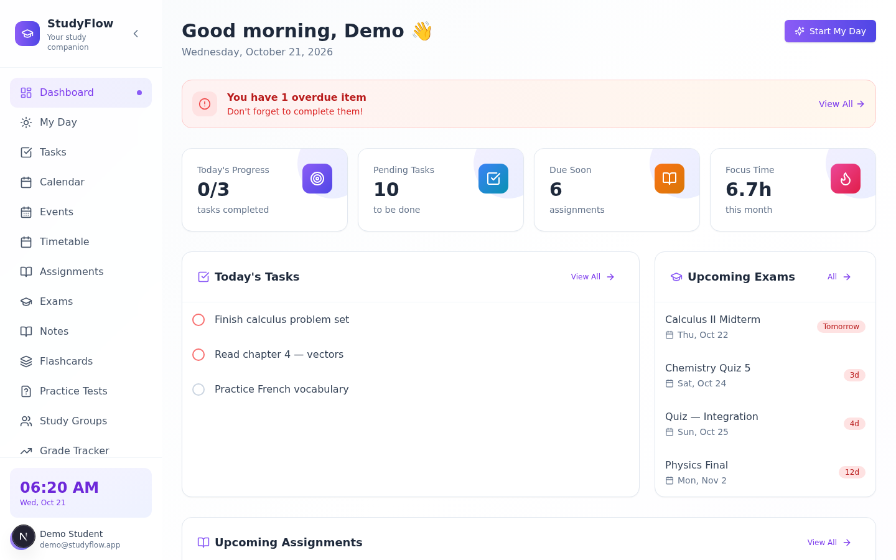
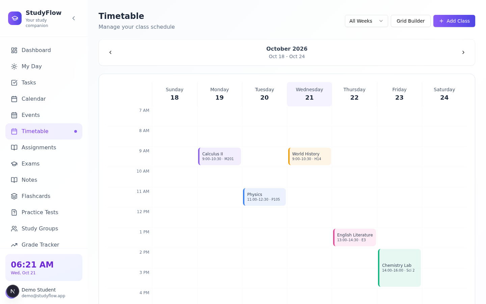
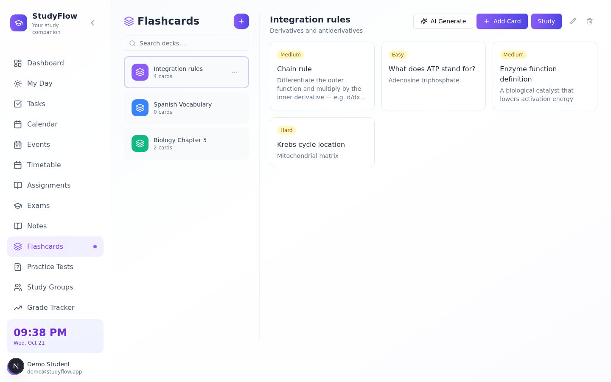
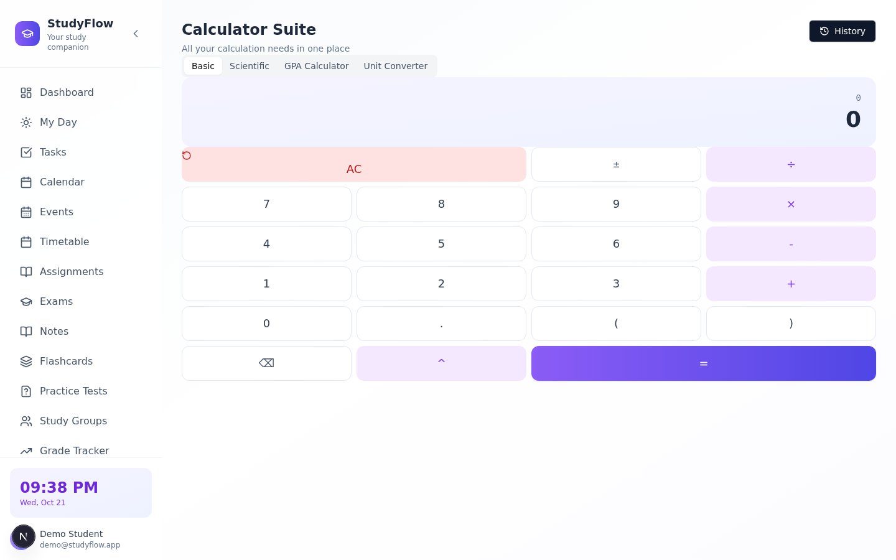
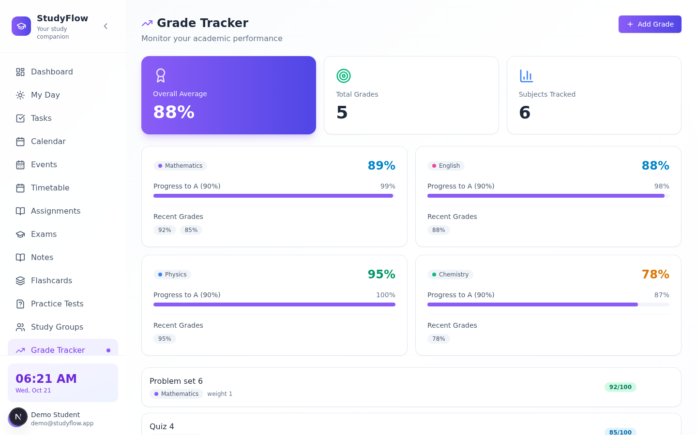
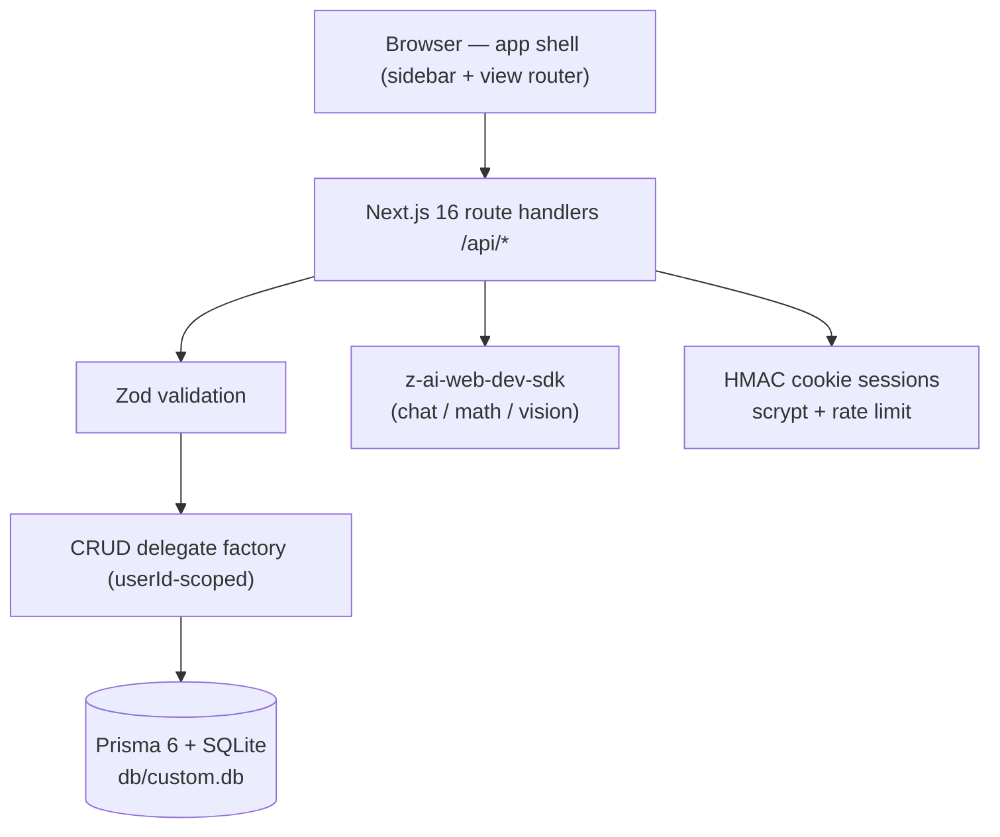

# StudyFlow (Omni-Study)

      

**StudyFlow — your study companion.** A production-ready, self-hosted clone (functional superset) of the [`omni-study1.base44.app`](https://omni-study1.base44.app/) study-planning app, rebuilt as a single Next.js application you fully own: your database, your AI keys, your deployment.

## Overview

The reference app is a study companion that keeps a student's whole life in one place — but it lives behind a hosted platform login with no source access. StudyFlow rebuilds every surface (and fills in the ones the reference left empty) as an open codebase: twenty views from the daily dashboard to a focus timer, all wired to real CRUD persistence through Prisma/SQLite. Visual parity was measured from the live reference (computed styles, not eyeballing), and the places where the framework changed underneath — Tailwind v4's engine differences chief among them — are documented and pinned by tests. Where the reference shows empty states, StudyFlow ships working features: an AI study assistant, a math solver that reads photographed problems, flashcard decks with a study mode, and a grade tracker with trend charts.

| | | |
|---|---|---|
|  |  |  |
|  |  |  |

All 20 views (plus the login card, three mobile captures, seven dark-mode captures, the session-17 fresh-user evidence set — zero-data Analytics/Grade Tracker, the reference-measured empty-state hints, the Settings Profile/Notifications tabs, the mobile StudyGroups copy — the session-11 audit evidence pair, the session-12 accessibility evidence set — forced-colors renders, print pages, the focused skip link — and the session-13 resilience evidence set — the AI-chat failure rollback, the solver's MIME guard toast, the remediated mobile drawer — and the session-14 hardening evidence set — the offline banner with the bounced-back composer, the AI rate-limit toast, the display-name guard) are in [`docs/screenshots/`](docs/screenshots/) — the standard 31 were refreshed after the session-11 theme-system remediation (`node scripts/capture-studyflow.mjs`); the S12 set via `node scripts/capture-s12-evidence.mjs` and the S13 set via `node scripts/capture-s13-evidence.mjs`, and the S14 set via `node scripts/capture-s14-evidence.mjs`, the S15 auth-flow set via `node scripts/capture-s15-evidence.mjs` (the login inline error, the signup form, the verify OTP screen, check-email, the calculator keyboard superset), and the S16 mobile set via `node scripts/capture-s16-evidence.mjs` (the auth sub-screens + the dashboard at 390×844 — the mobile-only responsive fixes; no default-media desktop visual changed in sessions 12–16; the prior pins are the byte-parity guarantee), the S17 fresh-user set via `node scripts/capture-s17-evidence.mjs`, and the S18 RUM set via `node scripts/capture-s18-evidence.mjs` (the beacon-live dashboard + mobile, the GET /api/rum aggregate, the un-instrumented login), and the S19 diagnostics set via `node scripts/capture-s19-evidence.mjs` (the `/rum` panel — desktop light + dark + mobile 390px), and the S20 v3 set via `node scripts/capture-s20-evidence.mjs` (the `/rum` panel with the per-card trend sparklines + the Export CSV action + the exported CSV head), and the S21 portability set via `node scripts/capture-s21-evidence.mjs` (the `/export` page — desktop light + dark + mobile 390px + the downloaded JSON envelope head), and the S22 boot-guard set via `node scripts/capture-s22-evidence.mjs` (the dev-server dashboard + `/export` + mobile 390px screenshots + the boot-guard evidence JSON — the negative spawn's exit + message, the positive-control health, the dev-boot warn line), and the S23 import set via `node scripts/capture-s23-evidence.mjs` (the `/export` page with the Restore card — desktop light + dark + mobile 390px + the completed-import result state + the API round-trip evidence JSON — the first import's summary, the idempotent re-import, the validation-error family, the rollback guard, the probe cleanup), and the S24 change-password set via `node scripts/capture-s24-evidence.mjs` (the Settings Profile tab with the Change password card — desktop light + dark + mobile 390px + the success-note state + the API round-trip evidence JSON — the guard family, the anon gate, the fresh-user rotation with the old-401/new-200 login pair, the session-survives proof, the demo restore), and the S25 account-deletion set via `node scripts/capture-s25-evidence.mjs` (the Settings Profile tab with the Danger zone card — desktop light + dark + mobile 390px + the revealed confirmation-form state + the API round-trip evidence JSON — the guard family, the anon gate, the fresh-user deletion with the DB-level cascade proof, the cleared-session me-401, the demo-intact proof), and the S26 email-change set via `node scripts/capture-s26-evidence.mjs` (the Settings Profile tab with the Email address card — desktop light + dark + mobile 390px + the success-note state with the live identity-block update + the API round-trip evidence JSON — the guard family incl. the same-email 400 + the duplicate 409, the anon gate, the fresh-user rotation with the DB-level emailVerified-stays-true proof + the old-401/new-200 login pair, the demo restore), and the S27 dark-sweep repair set (the before-state — MODE empty, 97 phantom flashbulbs + 7 phantom unreadable measured in LIGHT mode — and the after-state — MODE dark, all 20 views clean in real dark mode — with the guard's negative-control exit, the restore proof, and the refreshed standing 31) in `docs/screenshots/s27-dark-sweep-evidence.json`, and the S28 connectivity-repair set (the before-state — the phantom "Login offline shows no/silent feedback" finding whose own measured bodyText contained the offline message — and the after-state — "Login offline announces the failure through the S15 inline alert (stays on the card, button recovered)" with findings 0 — with the reproduction probe, the negative-control exit, the gates, and the refreshed standing 31) in `docs/screenshots/s28-connectivity-audit-evidence.json` + the login-offline inline-alert capture `s28-login-offline-inline-alert.png`, and the session-29 doc-alignment refresh (the standing 31 re-captured from the remediated codebase — docs-only changes, zero app bytes moved) per `docs/remediation-plan-session29.md`, and the session-30 dependency-security evidence set (the bun-audit classification envelope with the two documented non-production advisories, the negative controls, the gates) in `docs/screenshots/s30-dep-audit-evidence.json` per `docs/remediation-plan-session30.md`

## Key Features

| | Feature | What it does |
|---|---------|--------------|
| 📊 | Dashboard | Time-aware greeting, conditional overdue alert banner, four stat cards, today's tasks, upcoming exams & assignments |
| ☀️ | My Day | Quick-add tasks, amber "Today's Progress" card, Suggestions for overdue/upcoming tasks |
| ✅ | Tasks | Lists (custom lists + Important), search, filters, full CRUD — priority (colored round checkbox), repeat, My Day toggle, subtasks |
| 📅 | Calendar | Sunday-first month grid (dynamic week count) + day detail (border-l-4 colored rows), timeline agenda mode, icon+tab mode switch, legend |
| 🔔 | Events & Reminders | Dark terminal-style panel: 7-day sections, recurring events, multi-reminders, color-coded |
| 🏫 | Timetable | grid-cols-8 week table with full day heads + 60px hour rows, mobile day accordion, Grid Builder, alternating Week A/B, My Classes with today's date |
| 📚 | Assignments / Exams | Subject-tagged, urgency badges, status tracking — type + priority pills, interactive progress sliders; exam cards with subject color strips, durations, topics |
| 🗒️ | Notes | Notebooks, tags, pinned notes, autosaving rich-text editor (Quill toolbar: headings, lists, colors, links, code blocks; explicit Save + autosave superset) |
| 🃏 | Flashcards | Two-panel view with colored deck swatches, card grid with difficulty badges, in-page study mode with 3D flip + Wrong/Correct rating, AI card generation |
| 📝 | Practice Tests | Question builder (manual + AI generation), score recording with completion % |
| 👥 | Study Groups | Members, next meeting, subject linking |
| 📈 | Grade Tracker | Gradient summary card + target/chart icons, weighted averages per subject, GPA, SVG trend chart |
| 🧠 | Analytics | Icon-block stat cards (Tasks Completed, Assignments, Focus Time, Upcoming Exams), axis-labeled area charts (7-day activity, focus gradient), grade trend, subject distribution |
| 📁 | Files | Folders, uploads (≤ 2 MiB), links, grid/list views |
| 🧮 | Calculator Suite | Basic, scientific (shunting-yard engine, no `eval`), GPA, unit converter + history |
| ƒ | Math Solver | AI step-by-step solutions — typed or photographed (vision) |
| ✨ | AI Assistant | Chat with six study-tuned quick modes, persisted history |
| ⏲️ | Focus Timer | Pomodoro/Deep Work presets, subject logging, session stats |
| 🎨 | Theme System | Light/Dark/System + seven accent colors + emoji avatars, persisted per user — dark mode fully re-themes every surface (a superset: the reference's own Dark option is a no-op), applies pre-paint (no light flash on load), themes the login route for dark-OS visitors, and System mode tracks OS theme changes live |
| ♿ | Accessibility | Forced-colors (Windows High Contrast) state restoration (system-color outlines on the selected day/today/active tab/active nav, the slider progress gradient), a skip-to-content link (WCAG 2.4.1), print that forces light + keeps essential backgrounds (`print-color-adjust: exact`) + a timetable week table that fits the page, and `prefers-reduced-motion` support — all supersets (the reference has none) |
| 🛡️ | Resilience | Failure-state hardening — every AI call carries a 120 s deadline (`AbortSignal.timeout`) so a hung backend never locks the composer; a failed AI send rolls the message back into the composer instead of orphaning it; the solver guards non-image files client-side; uploads reject nameless files; downloads speak RFC 5987 (`filename*=UTF-8''…`) so unicode filenames save correctly; verified at 300+ rows with zero main-thread blocking |
| 📡 | Connectivity | A global offline banner (amber pill, screen-reader announced) the moment the network drops — renders nothing while online (byte-identical DOM); transport failures toast a human message ("You appear to be offline…") instead of raw browser text; every per-request path recovers (bounced-back composer, dialogs that keep their forms, SPA navigation on cached data) — a superset (the reference has no offline handling) |
| 🔒 | Security hardening | Per-user AI rate limits (20 req/15 min on all four LLM routes — 429 with `Retry-After`), download responses carry `X-Content-Type-Options: nosniff` + `Cache-Control: private, no-store`, whitespace-only display names rejected — alongside the scrypt/HMAC/rate-limited auth baseline and the **AUTH_SECRET boot guard** (session-22): a production boot without a real `AUTH_SECRET` — missing, empty, or the public dev fallback pasted in — REFUSES to start, exiting with the `openssl rand -hex 32` remedy (dev/test keep the documented zero-config fallback with a one-line boot warning); weak secrets under 16 chars refuse to boot in production, 16–31 chars draw a boot warning draw a boot warning |
| ♿ | AI accessibility | The assistant transcript and the math solver's solution are polite live regions (`aria-live` + `aria-busy`) — replies and solutions land announced for screen readers (WCAG 4.1.3); errors were already announced via the aria-live toast stack |
| 🔐 | Auth | Email & password (scrypt + HMAC cookie sessions), rate-limited — with the reference's full account journey: a real Create-your-account form, email verification (6-digit OTP, 15-minute one-shot codes), an unverified-login gate, a 3-state forgot-password flow (Reset your password → Check your email → the reset link), and inline form errors (the reference's red/green alert pattern). No SMTP in the self-hosted context: the verification code and reset link surface to the actor directly (ADR-013). Session-24 adds the account-security rotation: **a signed-in user changes their own password from Settings → Profile** (current-password proof + the register policy + the must-differ rule, rate-limited — a pure superset; the reference has no password surface) (ADR-022). Session-25 completes the ownership arc with the exit: **a signed-in user permanently deletes their own account from Settings → Profile → Danger zone** (password proof + the typed word DELETE + the ONE cascade write wiping every collection; the session cookie dies with the account — a pure superset; the reference has no deletion surface) (ADR-023). Session-26 adds the account-identity rotation: **a signed-in user changes their own login email from Settings → Profile → Email address** (password proof + the typed-twice confirm guarding the typo lockout + must-differ/uniqueness guards, rate-limited; the session survives — a pure superset; the reference has no email-change surface) (ADR-024) |
| ⌨️ | Calculator keyboard | The calculator accepts physical-keyboard input (digits, operators, Enter to evaluate, Backspace, Escape to clear) — a functional superset; the reference's calculator is click-only. Keystrokes never leak into form fields (GPA rows, converter inputs are guarded) |
| ⚡ | Load stability (CWV) | The authenticated shell pre-warms the active view's data IN PARALLEL with the auth call — the first paint renders with final geometry (dashboard CLS 0.00, was 0.117–0.125; Lighthouse-class mobile preset: login LCP ~640 ms, dashboard LCP ~2.4 s — both CWV-good, vs the reference's own 7.6–8.0 s login / 4.4 s + CLS 0.372 dashboard). Auth sub-screens render the reference's responsive mobile geometry (20px headings, 44px Sign in, the 76px verify rhythm) — measured at 390×844 on both apps |
| 🆕 | Fresh-user journey | A registered user's first run now mirrors the reference's measured zero state: Analytics and Grade Tracker render their stat cards at zero data (no empty-state blocks the reference never renders), every view's empty-state hint carries the reference's exact copy, Settings opens its five tabs with the reference's per-tab headers — and the Profile tab persists School Name, Grade Level (6th Grade → Graduate), a 1–12 hour Daily Study Goal and the Account-created line; the Notifications tab carries the persisted Enable Notifications master toggle (session-17) |
| 📡 | RUM observability | Real-user web-vitals monitoring (a pure superset — the reference has no field telemetry): the authed shell mounts an invisible beacon that reports TTFB/FCP/LCP/CLS/INP to the in-app `POST /api/rum` endpoint (batched, keepalive, failures swallowed); `GET /api/rum` answers p75 per metric + the recent samples for the owner. The beacon renders zero DOM — visual parity is untouched (session-18) |
| 📊 | RUM diagnostics panel | The owner-facing surface for the beacon's field data: the auth-gated `/rum` route renders the five Core Web Vitals at p75 with rating badges derived from the public CWV bounds, a samples line, the ten most recent events, and a Refresh action — themed (dark mode + the seven accents) through the production theme path, responsive to 390px, linked from NOWHERE (the shell's 20-link parity stays byte-intact; the owner navigates directly — see DEPLOYMENT.md §8) (session-19). Session-20 v3: each sampled card carries a SPARKLINE trend line (the metric's 20 most recent samples, oldest → newest — accent-themed SVG, edge cases unit-pinned) and an **Export CSV** action downloads the most recent 2000 events as a spreadsheet-ready RFC-4180 CSV (raw values, the S13/S14 download-header contract) |
| 💾 | Data portability | The "own your data" exit: `GET /api/export/data` downloads the user's COMPLETE content — all 20 collections (tasks, notes, decks, grades, files with payloads, …) in chronological order with ids/foreign keys intact — as a versioned JSON envelope (`format: studyflow-data-export`, `version: 1`; the hashless profile rides `user`; tokens, RUM telemetry, and the password hash are excluded by decision). The auth-gated `/export` page previews it: a per-collection count grid, the **Download JSON** action, and the format documentation — themed through the production path, responsive to 390px, linked from NOWHERE (the owner navigates directly — DEPLOYMENT.md §8.2) (session-21). Session-23 completes the round-trip: **`POST /api/import/data` restores an export into the importing account** — upsert-by-id (existing rows update to the file's values, new ids create with the importer's userId — the envelope is portable across accounts), all-or-nothing in ONE transaction (any failure rolls back completely), never deletes, content only (never identity); dangling optional FKs null (the schema's own SetNull semantics), a dangling required `cards.deckId` is a rejected corrupt envelope, folders sort parents-first with cycle rejection — all pre-validated by the pure seam so Prisma's P2003 never surfaces opaquely. The `/export` page's **Restore from a backup** card drives it (file picker + the created/updated result report; a 64 MiB cap (S137/CL2) + a 10/15-min rate limit). Session-154 adds the **no-op update elision**: a pre-tx full-row read drops every update whose payload already holds (the idempotent re-import writes ~nothing while the report still counts every row as updated — the wire shape unchanged), the conservative pure-seam diff keeping any doubtful write. Session-157 completes the page side: the `/export` grid rides the envelope's own counts (grid-from-envelope — ONE read pass feeds the count grid AND the size signal; the page's 20 count queries retired, the over-ceiling render keeps its grid via the error's counts payload) |
| 🐳 | Docker deployment | A production `Dockerfile` (multi-stage: prod-deps → standalone build → bun runtime) + `docker-compose.yml` with a SQLite volume, an auth-secret guard, an init profile (schema push + seed) and a healthcheck — one command from clone to container (`docker compose --profile init up`); the runtime layout is validated end-to-end outside Docker (session-18) |

## Architecture

| Layer | Technology | Version | Purpose |
|-------|-----------|---------|---------|
| Framework | Next.js (App Router) | 16.4.2 | One page + 20 path rewrites (SPA parity with the reference) |
| UI runtime | React | 19 | Client view switching inside a single app shell |
| Language | TypeScript | 5 (strict) | End-to-end types, no `any` |
| Styling | Tailwind CSS | 4 (CSS-first `@theme`) | v3-pinned palette/shadow tokens for reference parity |
| Components | Radix UI (shadcn-style) | current | Accessible primitives themed via CSS vars |
| Database | SQLite via Prisma ORM | 6.19.3 | Zero-config, single file at repo-root `db/` |
| State | Zustand | 5 | App/theme/data stores; URL is the routing truth |
| Validation | Zod | 4.6.5 | Every API boundary |
| AI | z-ai-web-dev-sdk | 0.0.18 | Server-only: chat, math solve, vision |
| Unit tests | Vitest | 5 | Pure seams (router, date, calculator, auth, schemas, view collections) |
| E2E tests | Playwright | 1.63 | Production standalone build + isolated `db/e2e.db` |
| Runtime | Bun | ≥ 1.3 | `bun run dev`, scripts, seed |



## File Hierarchy

```
📂 src/
├── 📂 app/
│   ├── 📄 page.tsx              ← the whole app: auth gate + shell + view switcher
│   ├── 📄 login/page.tsx        ← reference-parity login card
│   ├── 📄 globals.css           ← Tailwind v4 @theme tokens + trap pins
│   └── 📂 api/                  ← auth, health, 16 entity CRUDs, AI, files, settings
├── 📂 components/
│   ├── 📂 ui/                   ← button, card, dialog, select, tabs, toast, …
│   ├── 📂 layout/               ← sidebar (fixed glass) + mobile drawer chrome
│   └── 📂 views/                ← the 20 view components + shared primitives
├── 📂 lib/
│   ├── 📄 db-path.ts            ← the DATABASE_URL contract (unit-tested)
│   ├── 📄 db.ts                 ← Prisma singleton with env resolution
│   ├── 📄 auth.ts               ← scrypt, HMAC sessions, rate limiter
│   ├── 📄 router.ts             ← 20-view ↔ PascalCase-path map
│   ├── 📄 data.ts               ← client cache + typed mutations
│   ├── 📄 calculator.ts         ← shunting-yard engine, GPA, converter
│   ├── 📄 theme.ts              ← 7 accents, RGB-triplet tokens
│   └── 📂 server/               ← http helpers + entity CRUD delegates
├── 📂 prisma/
│   ├── 📄 schema.prisma         ← 24 models; DATABASE PATH CONTRACT header
│   └── 📄 seed.ts               ← idempotent demo data
├── 📂 tests/
│   ├── 📄 *.test.ts             ← Vitest unit layer (1604 tests, 48 files)
│   └── 📂 e2e/                  ← Playwright specs (616 across the 5-chunk cold map)
└── 📂 docs/
    ├── 📄 Tailwind-V4-Validation-Report.md  ← the five documented v3→v4 traps
    ├── 📄 remediation-plan.md   ← session-2 parity audit: evidence, fixes, non-gaps
    ├── 📄 remediation-plan-session3.md ← session-3 mobile-chrome & token audit
    ├── 📄 remediation-plan-session4.md ← session-4 text-metrics & login audit
    ├── 📄 remediation-plan-session5.md ← session-5 interactive-chrome & view-body audit
    ├── 📄 remediation-plan-session6.md ← session-6 populated-state & row-design audit
    ├── 📄 remediation-plan-session7.md ← session-7 lightly-probed-views & flashcards audit
    ├── 📄 remediation-plan-session8.md ← session-8 deep-chrome/layout audit (16 gap families)
    ├── 📄 remediation-plan-session9.md ← session-9 data-state/chart-axes/icon audit (19 gap families)
    ├── 📄 remediation-plan-session10.md ← session-10 dark-mode consistency audit (the @theme inline token trap + 6 tint families)
    ├── 📄 remediation-plan-session11.md ← session-11 theme-system audit (pre-paint boot script + System tracking + accent-dark re-themes)
    ├── 📄 remediation-plan-session12.md ← session-12 accessibility audit (forced-colors state restoration + print + skip link + reduced-motion)
    ├── 📄 remediation-plan-session13.md ← session-13 resilience audit (AI failure states + upload edge cases; data-volume stress verified green)
    ├── 📄 remediation-plan-session14.md ← session-14 hardening audit (connectivity UX + settings guards + security headers/limits + AI live regions)
    ├── 📄 remediation-plan-session15.md ← session-15 auth-flow audit (inline errors + signup/verify/forgot/reset + calculator keyboard superset)
    ├── 📄 remediation-plan-session16.md ← session-16 CWV/mobile-geometry audit (load-stability pre-warm + responsive auth sub-screens + fresh copy sweep)
    ├── 📂 screenshots/          ← dev-server captures of every view (light + dark)
    └── 📄 DEPLOYMENT.md         ← production notes
```

## Quick Start

Requires **Bun ≥ 1.3** (or npm with Node ≥ 22 — swap `bun` for `npx`/`npm run`).

```bash
git clone https://github.com/nordeim/omni-study1.git
cd omni-study1
bun install

# Database — .env ships with DATABASE_URL="file:../db/custom.db";
# db/ lives at the repo root (git-ignored, recreated by these two commands):
bun run db:push
bun run db:seed

bun run dev
```

**Verify setup:**

1. `curl http://localhost:3000/api/health` → `{"status":"ok","db":"up","app":"studyflow"}`
2. Open <http://localhost:3000> → redirects to `/login`
3. Sign in with the demo account — **`demo@studyflow.app` / `Demo1234!`** — you land on the dashboard with seeded subjects, tasks, exams, notes, decks and grades.

## Environment Variables

Copy `.env.example` to `.env` (the defaults above already work locally):

| Variable | Required | Purpose |
|----------|----------|---------|
| `DATABASE_URL` | yes | `"file:../db/custom.db"` — resolved by `src/lib/db-path.ts` to `<repo>/db/custom.db` at runtime; the `db:*` scripts set it inline for the Prisma CLI (schema-anchored). Keep the value in sync with `prisma/schema.prisma`'s header note. |
| `AUTH_SECRET` | prod | HMAC key for session cookies. Generate with `openssl rand -hex 32`; a dev-only fallback is used when unset — and **enforced at boot in production** (the server exits with the remedy message instead of silently signing forgeable sessions). |
| `NEXT_PUBLIC_SITE_URL` | no | Canonical origin for metadata/sitemap. Defaults to `http://localhost:3000`. |

## Testing

```bash
bun run test        # Vitest — 1604 unit tests (router, theme, date, calculator incl. mapPhysicalKey, auth incl. the AI rate-limit budget + the verification/reset seams, validation incl. verify/forgot/reset schemas + the S24 change-password rotation seam + the S25 deletion seam + the S26 email-rotation seam, db-path, site-url, theme-cache + boot-script contract + content-disposition + api-timeout + the offline transport-error mapping, rum-diagnostics — the CWV thresholds/panel display seam + the S20 sparkline geometry + the CSV builder, data-export — the S21 envelope/manifest/secret-guard seam + the S156/DE1 streaming driver family (the oracle weld + the sequential-reads mechanism + the byte-count carry-over) + the S157/DF1 grid-from-envelope family (the counts weld + the over-ceiling counts payload), env-check — the S22 AUTH_SECRET boot-guard seam, data-import — the S23 envelope-validation/FK-pre-emption/folders-topo-sort seam + the S139/CN1 parity-integrality sextet, dep-audit — the S30 bun-audit parser/classifier seam, dev-preflight — the S31 dev-server boot-stability classifier seam, suite-verdict — the S32 standing-suite verdict seam [the anti-phantom shape-error guard + the three documented non-gap signatures] + the S33 mobile-sweep classifier [the light-mode 390×844 drawer-navigation sweep] + the S34 midband-sweep classifier [the light-mode 768×1024 drawer-navigation sweep — the md breakpoint, the 391–1023px band's representative width, with the chrome vehicle-contract class] + the S35 landscape-sweep classifier [the light-mode 844×390 phone-landscape drawer-navigation sweep — the HEIGHT axis the standing surface never varied, with the per-view heading-clearance key + the drawerNavScrollable short-viewport contract class] + the S36 dark-mobile-sweep classifier [the dark-mode 390×844 drawer-navigation sweep — the MODE axis at the mobile viewport the standing surface never varied, with the per-view flashbulbs/unreadable detector keys + the drawer dark record + the INDEPENDENT dark-detection counting] + the S37 accent-light-sweep classifier [the accent × light 390×844 sweep — the ACCENT axis in LIGHT mode the standing surface never varied, with the ALL-ACCENTS guard + the per-accent applied self-verification + the three signature-strict non-gap exemptions (the CTA-face, the calendar adjacent-month slate-300 days re-verified live on the reference, the yellow-500 priority-pill vocabulary)] + the S38 accent-dark-sweep classifier rebuild [the accent × dark MOBILE 20-view matrix — the pre-S38 mobile pass swept only 6 views; the ALL-ACCENTS + ALL-VIEWS + drawer-present anti-phantom guards, every view recorded explicitly on both surfaces, the per-accent applied self-verification, the mode/mobileViewport contracts, and the mobile scrollWidth overflow class] + the S39 accent-midband-sweep classifier [the accent × mid-band 768×1024 drawer-navigation sweep — the mid-band × accent cell never probed + the navigation-interaction gap: the accent sweeps navigate by direct goto, so the drawer's active-link tint was only ever read on the Dashboard link; with the ALL-ACCENTS + ALL-VIEWS + drawer-present guards, the vehicle-contract class, and the TWO interaction finding classes (the tint rot — activeTint "none", the S8 no-var class; the active-state mismatch — activeLabel ≠ the view)] + the S40 accent-landscape-sweep classifier [the accent × landscape 844×390 drawer-navigation sweep — the landscape × accent cell never probed (landscape-sweep is light+violet only) and the S39 interaction proof extended to the SHORT viewport, with the S35 short-viewport contracts (headingClearance + drawerNavScrollable) folded into the S39 accent shape] + the S41 accent-desktop-sweep classifier [the desktop light-accent sidebar-navigation sweep at 1280×800 — the documented S37 bracketed non-gap: accent-dark covers 1280 dark only, and the SIDEBAR-vehicle active-link tint was verified at ZERO views, ZERO accents, in either mode; with the INVERTED vehicle contract (sidebarVisible true + hamburgerVisible false), the sidebar-own scroll contract (sidebarNavScrollable at 800 height), the per-view headingOffset key, and the interaction finding classes on the DESKTOP vehicle]) + the S42 accent-volume-sweep classifier [the data-volume × dark × accent stress — the S13 volume profile (300/200/250) swept through the theme space's dark-accent half: the volume counts EXACT at the seam (a seed-volume envelope is its own rot class), the ALL-ACCENTS + ALL-VIEWS guards (the 7 volume-affected views — the S13 set), the per-view S13 measurement family (nodes/mainNodes/longTaskTotal ≤ 1500ms/clickLatencyMs ≤ 1500ms), the S38 dark detector family (flashbulbs always findings; the CTA-face exemption ONLY — the light-mode calendar-day + yellow-pill exemptions do NOT apply in dark), the interaction evidence in DARK (the never-read sidebar-tint cell), and the /api/tasks ≤ 500KB B1 bound] + the S93 additions in hue-tokens [the palette-uniqueness pin (matchAll length 1 — the duplicate-later-definition mutant killed), the raw-family negative sweep with the file:line-anchored residual register (both directions machine-guarded), the files-tile dark-half + dashboard-pill RED-first pins (the two L2 orphan closures)] + the S51 dedupe-map completeness pin in suite-verdict (the AP3 source-scan precedent — every budget metric must have a family entry)] + the S94/AU4 leg-5 pair in hue-tokens [the connectivity banner's amber-200/amber-800 @theme pins + the sf-connectivity-pill utility contract — the trap-10 completion, the residual register's first TREATED entry] + the S95/AV1 extended uniqueness guard in hue-tokens [the union of every first-occurrence-read record] + the S96/AW1 @utility-block uniqueness pin [the completeness form — every utility header exactly once; the duplicate-later-block blind spot demonstrated live, mutation-proven] + the S96/AW2 resweep-gate seam [the exit-code contract: 0 ONLY on ok AND probeCleanup ok — the re-tag class structurally carries the gate] + the S97/AX1 @utility census hardening [the widened header-shape regex + the token-reconciliation pin — the shape-variant duplicate (`@utility sf-pill-red{`) and the unparseable header form both fail LOUDLY, never silently out of the census; the two-plant mutation matrix, each plant tripping exactly its own pin] + the S98/AY1 re-tag script-class runner-convention census in script-conventions [every Usage line in the capture/resweep lineages documents the node runner — the ten stale bun lines swept, the class self-guarding] + the S98/AY3 census comment-immunity in hue-tokens [the comment-stripped counts — a prose @utility mention can no longer inflate the token census into a false failure; the strip helper pinned, the three-plant mutation matrix] + the S99/AZ1 normalization pin in hue-tokens [the inline-comment plant shape NORMALIZES under the strip to a conventional duplicate — the shape-true mutation matrix machine-checked: the variant-shape plant and the inline-comment plant both trip the dupe check, the wildcard form trips the reconciliation pin, a prose comment trips NOTHING] + the S99/AZ2 playwright-class census widening in script-conventions [the convention census governs every playwright-carrying script — 213 importers, the blind spot demonstrated live on a planted z-probe-s70.mjs bun line that left the lineage-scoped pin GREEN]
bun run build       # REQUIRED before e2e — the suite boots the standalone server
bun run test:e2e    # Playwright — 616 across the 5-chunk cold map (152+189+91+95+89) against the production build on :3100 (self-colds via scripts/e2e-cold-reset.sh)
```

E2E notes: the suite pushes and seeds an isolated `db/e2e.db` (never touches `custom.db`), signs the demo user in **once** via a setup project (the login endpoints are rate-limited — 10 attempts/IP/15 min), and asserts the reference-measured design pins (sidebar geometry, v3 `shadow-sm`, canvas gradient, view-title model, stat-card text metrics, empty-state design, brand-gradient stops, login chrome, the session-5 interactive-chrome pins, the session-6 populated-row pins, the session-7 flashcards/timetable/analytics/dialog pins, the session-8 deep-chrome/layout pins, the session-9 data-state/chart-axes pins, the session-10 dark-mode consistency pins — the shadcn token utilities, banner/amber/clock/today/chart dark re-themes, the dark mobile drawer, and a light-mode byte-parity regression guard — the session-11 theme-system pins — pre-paint dark application, the dark-OS login, runtime System tracking, the theme-color meta, the accent-surface dark re-themes, print emulation, and a light regression guard — the session-12 accessibility pins — forced-colors state outlines + the bold active nav + the slider gradient, the skip link's Tab order/focus/Enter landing, the beforeprint/afterprint light-forcing, `print-color-adjust: exact` on the essential surfaces, the timetable print width reset, reduced-motion collapse, and a light regression guard — the session-13 resilience pins — the AI-chat failure rollback + recovery, the solver's client-side MIME guard with zero outbound requests, the nameless-upload rejection, and the RFC 5987 download header — and the session-14 hardening pins — the offline banner's appear/disappear + online absence (byte-parity guard), the human offline toast, the whitespace display-name 400 + trim-on-save, the AI-route per-user rate limit (20 then 429 with Retry-After), the download nosniff + private no-store headers, and the AI transcript/solver aria-live regions — and the session-15 auth-flow pins — the inline login-error alert with its measured chrome, the signup form's reference shape, the register→verify→signed-in journey via the surfaced code, the unverified-login gate, the forgot→check-email→reset-link→new-password journey, and the calculator's physical-keyboard superset including the form-field guard — and the session-22 boot-guard pins — the standalone production server spawned WITHOUT AUTH_SECRET exits non-zero with the actionable message (the `openssl rand -hex 32` remedy), and the positive control: the suite's own properly-configured boot answering `/api/health` — and the session-24 change-password pins — the anon 401 gate, the wrong-current/same-password/short-new 400 family (pre-write: the demo hash untouched), and the fresh-user rotation round-trip: register → sign in → the panel rotates → the old password login 401 → the new password login 200 → the session survives — and the session-25 account-deletion pins — the anon 401 gate, the wrong-password/wrong-confirmation/short-password 400 family (pre-write: the demo account untouched, still signing in), and the fresh-user terminal journey: register → sign in through the UI → the panel reveals the Danger zone form → the wrong-word early inline error → the deletion → the redirect to /login → the old-credentials login 401 → the cleared session's me 401 — and the session-26 email-change pins — the anon 401 gate, the wrong-password/mismatched-confirm/short-password/same-email 400 family + the duplicate-email 409 (pre-write: the demo account untouched, still signing in), and the fresh-user identity rotation: register → sign in through the UI → the panel's Email address card → the mismatched-confirm early inline error → the change → the success note + the identity block showing the NEW email (the live store update, both surfaces) → the session survives me 200 with the new email → the old-email login 401 → the new-email login 200). Full gate order: `lint → typecheck → test → build → test:e2e`.

## API Reference

All endpoints are same-origin JSON; sessions ride the `sf_session` cookie. 🔒 = requires authentication.

| Endpoint | Methods | Description |
|----------|---------|-------------|
| `/api/health` | GET | Liveness + DB probe (used by the e2e webServer gate + the Docker healthcheck) |
| `/api/rum` | POST/GET 🔒 | The RUM hook (session-18): POST a batched web-vitals report (upsert on sessionId+metric — final value wins, 1000/15-min per-user budget); GET answers p75 per metric + recent samples + the per-metric `trends` series (session-20) — the data behind the `/rum` diagnostics panel (session-19) |
| `/api/rum/export` | GET 🔒 | The CSV export (session-20): the user's most recent 2000 RUM events as a spreadsheet-ready `text/csv` download (RFC-4180 escaping, raw values, the attachment + nosniff + private/no-store header contract) |
| `/api/export/data` | GET 🔒 | The full-data export (session-21): the user's complete content across the 20 collections as a versioned JSON envelope download (chronological, ids/FKs intact, the hashless profile, the attachment + nosniff + private/no-store header contract) — the data behind the `/export` page |
| `/api/import/data` | POST 🔒 | The data import / restore (session-23): POST a `studyflow-data-export` envelope to restore it into the importing account — upsert-by-id in ONE all-or-nothing transaction (never deletes; content only, never identity; the importer's userId re-attached to every row), the seam's envelope validation (dangling optional FKs nulled, required `cards.deckId` rejected, folders sorted parents-first with cycle rejection), a 64 MiB body cap (413), a 10/15-min per-user rate limit (429), and the per-collection created/updated report as the response |
| `/api/auth/login` / `register` / `logout` / `me` | POST/GET | Rate-limited auth; no user enumeration. `register` creates an UNVERIFIED account + a 6-digit code (no auto-login — S15/ADR-013); `login` gates unverified accounts behind the reference's inline copy |
| `/api/auth/verify-email` / `resend-verification` | POST | The OTP flow: match the latest unexpired 15-min code → mark verified + sign in; resend re-issues for unverified accounts (uniform 200 otherwise) |
| `/api/auth/forgot-password` / `reset-password` | POST | The 3-state reset flow: always-200 request (reset URL in the response — the no-SMTP delivery), 30-min one-shot token consumption |
| `/api/auth/change-password` | POST 🔒 | The account-security rotation (session-24/ADR-022): `{ currentPassword, newPassword }` — the current password verified against the stored scrypt hash FIRST (a wrong current → 400, pre-write), the register family's min-8/max-200 policy on both fields, the must-differ rule (the schema's refine), a 10/15-min per-user rate limit (429 + Retry-After); the stateless session SURVIVES the owner's own rotation (documented — revoking other sessions is ADR-022's rejected alternative) |
| `/api/auth/delete-account` | POST 🔒 | The ownership exit (session-25/ADR-023): `{ password, confirmation: "DELETE" }` — the password verified against the stored scrypt hash FIRST (a wrong password → 400, pre-write), the typed-confirmation rule (the schema's refine — case-exact), a 10/15-min per-user rate limit (429 + Retry-After), then the ONE cascade write: `user.delete` wipes every collection (all 22 user relations carry `onDelete: Cascade` — subjects, tasks, notes, decks, grades, files, chat, RUM events, tokens); the session cookie is cleared with the account (maxAge 0 — the logout mechanism) |
| `/api/auth/change-email` | POST 🔒 | The account-identity rotation (session-26/ADR-024): `{ password, newEmail, confirmEmail }` — the password verified against the stored scrypt hash FIRST (a wrong password → 400, pre-write), the confirm-match rule (the schema's refine), then the route-side guards: must-differ (posting the current address → 400) + uniqueness (an address owned by ANY account, verified or not → 409), a 10/15-min per-user rate limit (429 + Retry-After), then the ONE write: `user.update` moves the login identifier (lowercased; `emailVerified` stays true — the password proof IS the verification); the session SURVIVES (stateless HMAC over the user id — the S24 contract) |
| `/api/tasks` (+ `/[id]`) | GET POST PATCH DELETE 🔒 | Tasks — lists, importance, due dates |
| `/api/task-lists`, `/api/subjects`, `/api/assignments`, `/api/exams`, `/api/events`, `/api/timetable`, `/api/notebooks`, `/api/notes`, `/api/flashcards/decks`, `/api/flashcards/cards`, `/api/practice-tests`, `/api/study-groups`, `/api/grades`, `/api/focus-sessions`, `/api/holidays` | GET POST PATCH DELETE 🔒 | Ownership-scoped CRUD via the delegate factory |
| `/api/files` (+ `/[id]`, `/folders`, `/link`) | GET POST DELETE 🔒 | Multipart upload ≤ 2 MiB (nameless files rejected), link-files, download with RFC 5987 filenames |
| `/api/settings/preferences` | PATCH 🔒 | Theme mode, accent, avatar, display name + the S17 study-profile fields (school, grade level, 1–12h study goal, notifications master) |
| `/api/calculator/history` | GET POST DELETE 🔒 | Persisted calculations |
| `/api/ai/chat`, `/api/ai/messages` | POST GET DELETE 🔒 | Study assistant (server-side SDK only; 20 req/user/15 min) |
| `/api/ai/generate-cards` | POST 🔒 | AI flashcard generation for a deck |
| `/api/ai/generate-questions` | POST 🔒 | AI practice-test question generation |
| `/api/math/solve` | POST 🔒 | Text or photographed problems (vision; 20 req/user/15 min) |

## Design System

Measured from the live reference (see `docs/Tailwind-V4-Validation-Report.md` for the full trap log):

| Token | Value | Usage |
|-------|-------|-------|
| Primary | `#8b5cf6` (violet-500) via `--sf-primary` RGB triplet | Active states, accents |
| Primary CTAs | `linear-gradient(to right, violet-500, indigo-600)` + v3 `shadow` — accent-aware via `.sf-gradient` (session-5 pin) | Every primary action button |
| Task rows | standalone `rounded-xl` cards, slate-200 border, 24px round priority-colored checkbox, slate-700 titles, due/repeat pills, hover-revealed actions (session-6 pin) | Tasks + My Day |
| Dashboard rows | bare `p-4 gap-4` rows, 20px round checkbox, title-only (session-6 pin) | Today's Tasks |
| Assignment rows | 24px round checkbox, blue due-in pill, priority/type pills, gradient progress slider + violet % label (session-6 pin) | Assignments |
| Exam cards | 3-col grid, `h-2` subject color strip, amber urgency badge, icon detail rows, type footer (session-6 pin) | Exams |
| Calendar cells | Sunday-first `aspect-square` centered cells (dynamic week count — 35 for five-week months), 4-color dots, SELECTED = solid accent fill + TODAY = 100-level tint (both hover-stripped), simple p-6 month card, legend + border-l-4 day-detail rows (session-6/S8-C/S9-E pins) | Calendar |
| Flashcards | two-panel layout: `w-80 border-r` deck sidebar with colored 40px icon blocks, deck color swatches, `lg:grid-cols-3` card grid with difficulty pills, 3D-flip study mode (session-7 pin) | Flashcards |
| Timetable grid | `grid-cols-8` week table, full day-name heads + `text-lg` dates, 60px hour rows with "7 AM" labels, mobile day accordion (session-7 pin) | Timetable |
| Analytics stats | r12 border-0 cards, 48px tinted icon blocks (violet/blue/green/orange-100), fraction values (session-7 pin) | Analytics |
| View titles | `h1 text-2xl font-bold text-slate-800` + 24px accent icon (MyDay/FocusTimer are 30px) | Every view header (session-4 pin) |
| Form controls | gray-200 borders, gray-950 text, gray-400 placeholders, `h-9` transparent inputs, v3 `shadow-sm` (session-5 pin) | Dialogs, selects, tabs, outline buttons |
| Dialogs | `max-w-md` (448px), `rounded-lg` (8px), 36px inputs (session-5 pin) | Every modal |
| Empty states | 80px rounded-2xl gradient block (`violet-100 → indigo-100`), 40px accent icon, 20px/600 h3, 16px hint | Every empty view (session-4 pin) |
| Events panel | `slate-900` rounded-2xl shadow-2xl terminal panel, cyan New Event link, `CW <n>` calendar-week label | Events view (session-5 pin) |
| Strong | `#7c3aed` (violet-600) | Links ("View All"), active nav text |
| Card | white, `1px solid #f1f5f9`, radius 16px | Every surface |
| Shadow | `0 1px 2px 0 rgb(0 0 0 / 0.05)` | v3 `shadow-sm`, **pinned** in `@theme` |
| Canvas | `linear-gradient(to right bottom, #f8fafc, #fff, #f5f3ff4d)` | App background |
| Sidebar | 260px fixed, `rgba(255,255,255,0.8)` + blur(20px) + white/50 hairline (`.glass`) | Hidden below `lg` |
| Mobile app bar | 64px fixed `.glass`, brand + live clock ("03:43 AM") | Content starts at 80px (both apps) |
| Mobile drawer | 288px white panel, `shadow-2xl`, 20% blurred backdrop, icon nav items | No footer (reference-exact) |
| Clock chip | `violet-50 → indigo-50` gradient (`rgb(245,243,255) → rgb(238,242,255)`), violet-700 time | Accent-aware via `--sf-primary-softest(-adjacent)` |
| Brand gradients | chips + CTA end **indigo-600** (`rgb(79,70,229)`); avatar runs violet-400 → indigo-500 (the lighter pair) | Accent-aware via `--sf-primary-gradient-to` / `-avatar-*` tokens |
| Accents | violet · blue · **emerald** · **amber** · pink · red · teal (session-5 migration — the reference's swatch faces) | Settings → Appearance |
| Font | system sans stack | Matches reference body styles |

Seven accent themes × Light/Dark/System × 24 emoji avatars, all persisted to the user record.

## Deployment

The app builds to a **standalone server** (`output: "standalone"` in `next.config.ts`):

```bash
bun run build
bun run start        # NODE_ENV=production, serves .next/standalone
```

For production use an **absolute** `DATABASE_URL` (see `docs/DEPLOYMENT.md` §4) and set `AUTH_SECRET`. Deploy keys never live in the repo — pushes use the `docs/ssh_git_wrapper_v3.py` wrapper (see `docs/how-to-git-push-using-ssh-wrapper_SKILL.md`).

## Troubleshooting

| Symptom | Cause | Fix |
|---------|-------|-----|
| `{"status":"degraded","db":"down"}` on `/api/health` | No database file yet | `bun run db:push && bun run db:seed` |
| Prisma CLI created the db **one directory too high** | `.env`-loaded relative URLs anchor at the CWD | Use the `bun run db:*` scripts (they set `DATABASE_URL` inline, schema-anchored) — never raw `prisma db push` with the repo-root `.env` |
| E2E webServer timeout | `bun run build` not run since the last change | Rebuild, then `bun run test:e2e` |
| Dev server dies silently in low-memory containers | OOM-killed (`next-server` ~1.6 GB RSS) | Close extra headless browsers; rerun `bun run dev` |
| Login fails after many attempts | Rate limiter (10/IP/15 min) | Wait or restart dev; specs share ONE login by design |
| `space-y-*` gaps look wrong next to `mt-*` children | Tailwind v4 selector rewrite (trap 4) | Use `flex gap-*`; the codebase convention bans margin utilities inside `space-*` |
| The standalone production server exits at boot with `AUTH_SECRET is required in production` | The session-22 boot guard — the server refuses to sign session cookies with the public dev fallback | That is the guard working: generate a secret (`openssl rand -hex 32`), set `AUTH_SECRET` in the environment, restart (DEPLOYMENT.md §4) |

## Contributing

The verification gate before any push: `bun run lint && bun run typecheck && bun run test && bun run build && bun run test:e2e`. Conventions that differ from defaults: **Tailwind v4 CSS-first** (no `tailwind.config.js` — theme lives in `src/app/globals.css` `@theme`); **`gap-*` layout only** (never `space-y/x` with margin-carrying children); Zustand stores over Context; every API payload through its Zod schema in `src/lib/validation.ts`; `z-ai-web-dev-sdk` imported only inside route handlers.

## Project Status

| Phase | Status | Deliverables |
|-------|--------|--------------|
| Rebuild session (from the scaffolded config+test layers to the full implementation) | ✅ Complete | `src/**` (20 views, chrome, 58 API routes, 24-model schema + seed), `prisma/**`, `public/`, `docs/screenshots/**` (14 dev-server captures) |
| Reference recon (all 20 views, computed-style tokens) | ✅ Complete | Traps + measured tokens in `docs/Tailwind-V4-Validation-Report.md` |
| Codebase build (20 views, 24 models, 40+ endpoints) | ✅ Complete | `src/**`, `prisma/**` |
| Test suites (834 unit + 299 e2e) | ✅ Complete | `tests/**` |
| Visual parity verification | ✅ Complete | `docs/screenshots/**`, `docs/remediation-plan*.md` |
| Session-2 parity remediation (radius trap, icons, avatar, clock) | ✅ Complete | `docs/remediation-plan.md` |
| Session-3 mobile-chrome & token remediation (fixed glass app bar + live clock, drawer mirror, greeting map, accent token completeness) | ✅ Complete | `docs/remediation-plan-session3.md` |
| Session-4 text-metrics & second-order remediation (v4 blur trap, stat-card metrics, reference empty states, view-title h1+icon model, login card, measured gradient stops, heading hierarchy) | ✅ Complete | `docs/remediation-plan-session4.md` |
| Session-5 interactive-chrome & view-body remediation (gradient CTAs, Events dark panel + repeat/reminders, FocusTimer/Settings/Calculator/Timetable/Notes/GradeTracker/Files/MyDay/AI reworks, gray form-control palette, dialog chrome, emerald/amber accents) | ✅ Complete | `docs/remediation-plan-session5.md` |
| Session-6 populated-state remediation (task card rows + priority/repeat/myDay/subtasks, MyDay amber progress card + Suggestions, dashboard bare rows, assignment sliders, exam card grid, calendar grid/legend/day-detail — measured against live reference data) | ✅ Complete | `docs/remediation-plan-session6.md` |
| Session-7 lightly-probed-views remediation (Flashcards two-panel view + deck colors + card grid + 3D study mode + AI card generation, Study Groups/Practice Tests measured dialogs + AI question generation, Timetable grid-cols-8 week grid + mobile accordion + week-alignment bug fix, Analytics icon-block stat cards + 7-day charts, Grade Tracker icons, Notes title input) | ✅ Complete | `docs/remediation-plan-session7.md` |
| Session-8 deep-chrome/layout remediation (nav icon set + active-gradient stop + tagline + 36px collapse button, dashboard flush divide-y rows, Calendar selected/today semantics + simple month card, MyDay header block + bare suggestions, Timetable today-header tint, Tasks two-pane, Notes/Study Groups two-pane reworks, Analytics per-card icons + donut + workload, Calculator/MathSolver/AI/FocusTimer/Settings icon-and-chrome fixes, Assignments/Exams search icons + slim exam cards, dead-utility sweep) | ✅ Complete | `docs/remediation-plan-session8.md` |
| Session-9 data-state/chart-axes remediation (dashboard overdue banner + slim section empty states, MyDay amber greeting empty state + bare quick-add row, Tasks outline filter button + empty My Lists, Calendar Sunday-first grid + icon/tab mode switch, Files house breadcrumb + grid3x3 toggle, text-only Grid Builder, Assignments Active-default slim rows, Exams orange Tomorrow badge, Analytics area charts with axes/gridlines, FocusTimer/Settings/Notes icon fixes, Flashcards deck-row ellipsis menu, AI wand-sparkles composer) | ✅ Complete | `docs/remediation-plan-session9.md` |
| Session-10 dark-mode consistency remediation (the `@theme inline` literal-token trap — shadcn base tokens now route through `hsl(var(--x))` runtime indirection so every `bg-card`/`bg-popover`/`bg-muted`/`border-input` utility re-themes in dark; dark washes for the overdue banner, MyDay amber card, timetable/calendar today tints, sidebar clock chip, settings selected cards; dark SVG chart axes/fills; the reference's Dark option measured as a platform no-op → the clone's full dark mode is the documented superset) | ✅ Complete | `docs/remediation-plan-session10.md` |
| Session-11 theme-system remediation (the theme-application lifecycle root cause — a pre-paint boot script + localStorage cache kills the dark-mode FOUC and themes the login route; System mode tracks OS changes at runtime; theme-color meta sync; the accent-dark re-themes for the active nav, ViewAll links, timetable mobile today chip, avatar swatch; minimal print styles) | ✅ Complete | `docs/remediation-plan-session11.md` |
| Session-12 accessibility remediation (forced-colors state restoration with system-color outlines, print that forces light + keeps essential backgrounds, the skip-to-content link, reduced-motion support) | ✅ Complete | `docs/remediation-plan-session12.md` |
| Session-13 resilience remediation (AI failure states — the optimistic-message rollback + the 120 s deadlines; upload edge cases — nameless-file rejection + RFC 5987 download filenames; data-volume stress verified green at 300+ rows) | ✅ Complete | `docs/remediation-plan-session13.md` |
| Session-14 hardening remediation (connectivity — the global offline banner + the human transport-failure message; security — per-user AI rate limits + download nosniff/no-store headers; settings — the whitespace display-name guard; AI a11y — transcript + solver live regions; 14 stale pre-clone scripts removed) | ✅ Complete | `docs/remediation-plan-session14.md` |
| Session-15 auth-flow remediation (inline login errors — the reference's red/green alert pattern; the full account journey — Create-your-account form, 6-digit email verification with an unverified-login gate, 3-state forgot-password + reset deep-links; the calculator's physical-keyboard superset with a guarded listener; Files search + pre-1.0 sweep verified as non-gaps) | ✅ Complete | `docs/remediation-plan-session15.md` |
| Session-17 fresh-user remediation (the reference's zero-data stat cards on Analytics/GradeTracker, the Settings depth — Profile school/grade/study-goal/notifications fields + per-tab headers + zero-empty states, the seven-view empty-state hint copy family, the mobile StudyGroups copy, zero-subject registrations) | ✅ Complete | `docs/remediation-plan-session17.md` |
| Session-18 RUM + Docker (the web-vitals beacon → POST/GET /api/rum with p75 aggregates, the Dockerfile + compose one-command deployment with the validated runtime layout) | ✅ Complete | `docs/remediation-plan-session18.md` |
| Session-19 RUM diagnostics panel (the auth-gated `/rum` surface — the five CWV at p75 with public-bound rating badges, the recent-samples table, the pure display seam, zero nav linkage) | ✅ Complete | `docs/remediation-plan-session19.md` |
| Session-20 RUM panel v3 (the per-card sparkline trends + the CSV export route — the additive `trends` aggregate field, the RFC-4180 seam, the S13/S14 download-header contract) | ✅ Complete | `docs/remediation-plan-session20.md` |
| Session-21 data portability (the full-data export — the versioned JSON envelope via `GET /api/export/data`, the 20-collection manifest + the row normalizer + the secret guard, the server-gated `/export` count-grid page, zero nav linkage) | ✅ Complete | `docs/remediation-plan-session21.md` |
| Session-22 AUTH_SECRET boot guard (the production fail-fast — the pure `env-check` seam, the `instrumentation.ts` boot hook with the validated process.exit mechanism, the single-source `DEV_FALLBACK_SECRET` refactor, the 64-hex e2e secret) | ✅ Complete | `docs/remediation-plan-session22.md` |
| Session-23 data import (the restore — the pure `data-import` seam with the FK pre-emption + the folders topological sort, the `POST /api/import/data` upsert-by-id all-or-nothing transaction, the `/export` page's Restore card, the 10 MiB cap + rate limit) | ✅ Complete | `docs/remediation-plan-session23.md` |
| Session-24 change-password flow (the account-security rotation — the `changePasswordSchema` seam with the must-differ refine, the `POST /api/auth/change-password` current-password-proof route, the Settings Profile tab's Change password card, the stateless session-survives contract) | ✅ Complete | `docs/remediation-plan-session24.md` |
| Session-25 account-deletion flow (the ownership exit — the `deleteAccountSchema` seam with the typed-DELETE refine, the `POST /api/auth/delete-account` password-proof cascade route, the Settings Profile tab's Danger zone card with the two-step reveal, the session-dies-with-the-account contract) | ✅ Complete | `docs/remediation-plan-session25.md` |
| Session-26 email-change flow (the account-identity rotation — the `changeEmailSchema` seam with the confirm-match refine, the `POST /api/auth/change-email` password-proof route with the must-differ/uniqueness guards, the Settings Profile tab's Email address card with the live identity-block update through the theme store, the session-survives contract) | ✅ Complete | `docs/remediation-plan-session26.md` |
| Session-27 dark-sweep audit-tool repair (the tooling-integrity fix — the standing dark-mode audit had silently rotted after the S11 theme lifecycle: the forced-class + stale `sf-theme-mode` key measured LIGHT mode and reported 97 phantom flashbulbs; now sets dark through the settings API, self-verifies the precondition with a loud non-zero exit, rides the applied mode in the JSON envelope, and restores light — the self-verifying-precondition doctrine for every probe) | ✅ Complete | `docs/remediation-plan-session27.md` |
| Session-28 connectivity-audit repair (the tooling-integrity fix — the A4 login-offline probe had silently rotted after the S15 auth-flow change: it still asserted the S14-era toast design while S15 replaced the login card's errors with the reference's measured INLINE role=alert, so the audit emitted a phantom "no/silent feedback" finding whose own measured evidence disproved it; now asserts the designed channel — the S15 inline alert scoped to the auth card, the user stays on the card, the button recovers — with the loud genuine-failure criterion kept; validated with the reproduction probe + the negative control; the standing 31 refreshed) | ✅ Complete | `docs/remediation-plan-session28.md` |
| Session-29 documentation-drift repair (the doc-alignment fix — every standing audit re-ran GREEN with zero code findings and the reference re-swept UNCHANGED, so the sweep's genuine defect family was the prose layer: the doc claims had drifted under additive change — the schema's 24 models were documented as "22" (written at S18, forgetting the S15 token pair) in CLAUDE/PAD/README and "21" (the pre-S15 list) in SKILL; PAD's "registration seeds three starter subjects" contradicted ADR-015's zero-subjects, its "ships no Dockerfile" contradicted ADR-016's shipped Dockerfile + compose, its "no reduced-motion yet" contradicted ADR-010's resolved block, and its tree listed a `src/hooks/` that never existed; SKILL §11 carried thirteen-session-stale test counts (106/194 vs 549) and §5 named the pre-S4 `backdrop-blur-sm` where the code ships `backdrop-blur-xs`; all layers re-aligned against the executable truth, with the "all 22 user relations" claims verified correct and left untouched; AP-74 records the lesson) | ✅ Complete | `docs/remediation-plan-session29.md` |
| Session-30 dependency-security audit (the never-audited surface — `pre15-preflight` measures outdated-count only; its "no action" verdict stood while `bun audit` carried 2 HIGH advisories: `braces` <=3.0.3 [dev-only via eslint-config-next; 3.0.3 IS the latest npm version — no upstream patch exists] and `deepmerge-ts` <8.0.0 [CLI-only via `@prisma/config`'s exact 7.1.5 pin; never in the standalone trace] — both verified NON-PRODUCTION against the 13-root `.next/standalone/node_modules` trace. The repair: the standing `bun scripts/dep-audit.mjs` probe — parses bun's text report, classifies every advisory by RUNTIME REACHABILITY against the standalone trace, FAILS loudly (exit 1) on anything runtime-reachable, documents the dev/CLI family with evidence, and self-verifies its preconditions [trace exists + newer than `bun.lock`, else exit 1 with no findings]; the pure seam `src/lib/dep-audit.ts` + 15 unit pins; validated with the negative controls [a fabricated runtime advisory exits 1; the stale-trace precondition exits 1 with zero findings]) | ✅ Complete | `docs/remediation-plan-session30.md` |
| Session-31 dev-server boot-stability preflight (the environment precondition no probe verified — a stale Turbopack `.next/dev` cache put `/login` into a sustained full-page reload loop [17+ main-frame navigations per 15 s; React never hydrated] that SURVIVED a clean daemon restart while `/api/health` stayed 200 — the audits then failed OPAQUELY, a 30 s click timeout naming the disabled login button instead of the cache; the S9 lesson's "restart the daemon" remedy proved INSUFFICIENT — only `rm -rf .next/dev` clears it. The repair: the standing `bun scripts/dev-server-preflight.mjs` preflight — loads `/login`, counts same-path navigations over an 8 s post-load window, fills the demo credentials and waits for the submit button to enable [NEVER submits — zero login requests], classifies through the pure `src/lib/dev-preflight.ts` seam [green / reload-loop / no-hydration / unreachable, each with its honest class-specific remedy], exits 1 loudly on every failure class; 11 unit pins + the negative controls [dead port → `unreachable`; a scratch self-reloading login-shaped page → `reload-loop` with the cache-clear remedy; healthy server → GREEN]) | ✅ Complete | `docs/remediation-plan-session31.md` |
| Session-32 standing-suite orchestrator (the operating procedure that existed only in prose — `bun scripts/standing-suite.mjs`: the S31 preflight enforced first, each standing audit spawned EXACTLY ONCE with its stdout classified through the unit-pinned `suite-verdict` seam; the anti-phantom guard [a missing key on a known audit is a LOUD shape-error, never a silent 0] — five of sixteen envelopes had been mis-parsed by careful operators, and the S29/S31 double-run phantom recurred a third time; the genuine defect the strict reading surfaced: the ai-a11y-audit's D2 probe leaked a probe pair into the demo chat DB on EVERY run [unroute-before-release order — fixed to reload-first per the S14 lesson + a closing Prisma cleanup; 4 stale pairs purged, dark/accent sweeps re-green], plus the :3200 standalone auto-start with ephemeral AUTH_SECRET and the demo-theme closing guard) | ✅ Complete | `docs/remediation-plan-session32.md` |
| Session-33 mobile light-mode sweep (the manual 390×844 walkthrough every session ran as prose, encoded as a standing probe — `node scripts/mobile-sweep.mjs`, the suite's 16th audit stage: all 20 views navigated THROUGH THE DRAWER with per-view identity-heading [h1-or-h2, the S8-H mobile-stack pattern], no-horizontal-overflow [scrollWidth ≤ 390 — the S16 mobile-only-gap class], drawer-closes-on-navigation, fixed glass app bar, zero console errors; self-verifying preconditions [viewport asserted, light mode through the settings API]; the genuine defect the first run surfaced: the clone's Notes mobile stack had LOST the identity heading the reference renders [its own two-pane overflows to 416px at 390 — the clone's no-overflow stack is the superset, but the heading was missing; fixed with the StudyGroups S8-H h2 pattern, desktop bytes untouched]; the reference's own mobile overflow documented on 5 views [Notes 416, Timetable 395, Flashcards 391, Calculator 429, MathSolver 417] where the clone stays 390) | ✅ Complete | `docs/remediation-plan-session33.md` |
| Session-34 mid-band light-mode sweep (the 391–1023px viewport continuum between the pinned widths — the whole band the standing surface never probed: mobile pins 390, desktop pins 1280/1440, the lg pin covers only the sidebar appearance at 1024 — encoded as a standing probe: `node scripts/midband-sweep.mjs`, the suite's 17th audit stage, at 768×1024 the md breakpoint [the switchiest width in the band: the Timetable swaps its mobile accordion for the min-w-[900px] scroll canvas, grids go multi-column, headers go flex-row] and iPad portrait; all 20 views navigated THROUGH THE DRAWER [the navigation vehicle through the whole band — the sidebar is lg:flex] with the S33 assertion family + the chrome vehicle-contract class [sidebar hidden + hamburger visible at 768 — a broken lg contract reads non-green at the seam]; this session's exploration validated the whole band clean [640/767/768/1023 × 20 views, findings 0]; AP-79 — a viewport band between pinned widths is a blind band) | ✅ Complete | `docs/remediation-plan-session34.md` |
| Session-35 phone-landscape short-viewport sweep (the HEIGHT axis the standing surface never varied — every pinned viewport was portrait-tall [390×844, 768×1024, 1280×800, 1440×900, 1024×800 — heights 800–1024]; the phone-landscape class [844×390, a real and common device class] had zero coverage, and its height-dependent structures — the drawer nav whose scroll is the ONLY path to links 8–20 at 390 height [measured: scrollHeight 1068 vs clientHeight 301], the fixed h-16 app bar at 16% of the viewport, the pt-* heading clearance under it, the h-[calc(100vh-8rem)] panes at 262px — were guaranteed by nothing — encoded as a standing probe: `node scripts/landscape-sweep.mjs`, the suite's 18th audit stage, at 844×390 the iPhone-class landscape; all 20 views navigated THROUGH THE DRAWER with the S33/S34 assertion family + the per-view heading-clearance pin + the short-viewport contract [drawerNavScrollable MUST be true — the nav geometry class this audit owns]; this session's exploration validated the whole landscape band clean [740×360, 844×390, 932×430 × 20 views + the 320×568 edge, findings 0]; AP-80 — an axis never varied is an axis never verified) | ✅ Complete | `docs/remediation-plan-session35.md` |
| Session-36 dark-mode mobile sweep (the MODE axis at the mobile viewport the standing surface never varied — dark × mobile was covered for 6 of 20 views [accent-dark-sweep's mobile pass], 14 views had NEVER been rendered in dark at the stacked mobile layout by any standing audit, and every light mobile sweep is mode-rot-guarded by construction — encoded as a standing probe: `node scripts/dark-mobile-sweep.mjs`, the suite's 19th audit stage, the S33 mobile sweep's dark sibling at 390×844; all 20 views navigated THROUGH THE DRAWER in dark mode [PATCHed through the settings API — the real lifecycle, self-verified] with the S33/S35 structural family + the dark-sweep detector family [flashbulbs/unreadable] extended to the mobile chrome + the drawer's own dark rendering [the dark:bg-slate-950 panel]; the dark detections counted INDEPENDENTLY of the findings array at the seam; this session's exploration validated the whole dark-mobile family clean [dark × 390×844, dark × 768×1024, dark × 844×390, findings 0 everywhere]; AP-81 — a mode never varied at a viewport is a blind combo) | ✅ Complete | `docs/remediation-plan-session36.md` |
| Session-37 accent × light sweep (the ACCENT axis in LIGHT mode the standing surface never varied — the accent-dark-sweep varies the accent ONLY in dark [its own name is the blind spot], every light pin rides the default violet, and the only light × non-violet rendering in any standing artifact was ONE desktop calculator e2e view; NO standing audit had ever rendered ANY view in a non-violet accent in light mode — encoded as a standing probe: `node scripts/accent-light-sweep.mjs`, the suite's 20th audit stage; for every accent [7 — the ALL-ACCENTS seam guard], PATCHed through the settings API and SELF-VERIFIED on `<html data-accent>`: all 20 views at 390×844 with the identity heading + scrollWidth + the LIGHT contrast detector family [unreadable/lowcontrast — the flashbulb class does not apply on the light canvas] + zero console errors, plus the drawer per accent [the active-link 10%-alpha accent gradient]; three signature-strict non-gap exemptions at the seam [the CTA-face, the calendar adjacent-month slate-300 days — re-verified LIVE on the reference this session, the yellow-500 priority-pill vocabulary]; the reference's accent picker saves but never re-themes — a SUPERSET-quality contract; this session's exploration validated the whole accent-light family clean [390×844, 1280×800, 768×1024 × 7 accents × 20 views]; AP-82 — an accent never varied in light is a blind half of the theme space) | ✅ Complete | `docs/remediation-plan-session37.md` |
| Session-38 accent × dark mobile 20-view matrix (the documented S37 next-step: the accent-dark family's own mobile pass swept only 6 of 20 views — MOBILE_VIEWS — so 14 views had NEVER been rendered in dark × accent at the stacked mobile layout by any standing audit [mobile/midband/landscape: LIGHT + violet-only; dark-mobile: violet-only; accent-light: LIGHT-only]; the accent-dark-sweep probe EXTENDED to all 20 mobile views per accent at 390×844 + the drawer per accent, with the omission-means-clean recording RETIRED — every view recorded explicitly on both surfaces, the per-accent applied self-verification, the mode/mobileViewport contracts, and the mobile scrollWidth overflow class; the seam rebuilt on the S37 doctrine with the ALL-ACCENTS + ALL-VIEWS + drawer-present guards [a missing accent/view/drawer is a LOUD shape-error, never green-by-omission]; the drawer-open failure now a FINDING, never a swallow; the exploration validated the whole family clean [7 accents × 20 views + the drawer, 0 flashbulbs, 0 non-exempt unreadable, 0 overflow]; AP-83 — an audit whose envelope cannot prove its own coverage cannot be green) | ✅ Complete | `docs/remediation-plan-session38.md` |
| Session-39 accent × mid-band drawer-navigation sweep (the S38 summary's named next step — "the drawer-navigation × accent interaction at mid-band": the mid-band 768×1024 × accent cell of the theme-space matrix was ZERO-coverage [midband-sweep is light+violet only; the accent sweeps are 390/1280 only], AND the navigation-interaction gap — the accent sweeps navigate by direct goto, so the drawer's active-link accent tint was only ever read on the DASHBOARD link; the tint on a NON-Dashboard view, applied through the real navigation lifecycle [aria-current moves → the .sf-nav-active 10%-alpha gradient re-tints], was verified at ZERO views, ZERO accents, in either mode — encoded as a standing probe: `node scripts/accent-midband-sweep.mjs`, the suite's 22nd audit stage [20-min budget]; for every accent [7 — the ALL-ACCENTS guard], PATCHed + SELF-VERIFIED, all 20 views navigated THROUGH THE DRAWER with the S34 structural family + the S37 light contrast family + the per-view interaction evidence [activeLabel MUST equal the view — the active state follows the navigation; activeTint MUST read a gradient — "none" is the S8 no-var rot class, a FINDING] + the drawer record per accent with the tint on the FINAL navigated view; the dark × mid-band combos remain the documented S36 non-gap family; AP-84 — an interaction never varied is an interaction never verified) | ✅ Complete | `docs/remediation-plan-session39.md` |
| Session-40 accent × landscape drawer-navigation sweep (the S39 summary's named next step — "the landscape × accent drawer-navigation combo (the 844×390 sibling)": the landscape 844×390 × accent cell of the theme-space matrix was ZERO-coverage [landscape-sweep: light+violet only, zero accentColor references; the accent sweeps: 390/768/1280 only] AND the S39 navigation-interaction proof [activeLabel/activeTint per view through the drawer] lived at 768×1024 only — encoded as a standing probe: `node scripts/accent-landscape-sweep.mjs`, the suite's 23rd audit stage [20-min budget]; for every accent [7 — the ALL-ACCENTS guard], PATCHed + SELF-VERIFIED, all 20 views navigated THROUGH THE DRAWER with the S35 short-viewport contracts [the heading CLEARANCE under the fixed 64px bar at 390 height; the nav scrollable — re-measured per accent, the only path to links 8–20] + the S37 light contrast family + the per-view interaction evidence + the drawer record per accent with the tint on the FINAL navigated view; the dark × landscape combos remain the documented S36 non-gap family; AP-86 — a contract proven at one viewport is not proven at another: the height-dependent structures ride their own vehicle contract) | ✅ Complete | `docs/remediation-plan-session40.md` |
| Session-41 desktop light-accent sidebar-navigation sweep (the S40 summary's named next step — "the desktop light-accent family (currently the documented bracketed non-gap)"): the desktop 1280×800 × light × accent cell was ZERO-coverage [accent-dark-sweep covers 1280×800 in DARK only; the light accent sweeps are 390/768/844 only] AND the SIDEBAR's active-link accent tint (the desktop navigation vehicle) had never been read on a NON-Dashboard view through the real navigation lifecycle by ANY standing artifact — in either mode [the e2e pins read the tint on the Dashboard link only, violet only; accent-dark's desktop pass navigates by direct goto] — encoded as a standing probe: `node scripts/accent-desktop-sweep.mjs`, the suite's 24th audit stage [20-min budget]; for every accent [7 — the ALL-ACCENTS guard], PATCHed + SELF-VERIFIED, all 20 views navigated THROUGH THE SIDEBAR (the vehicle contract INVERTS: sidebarVisible true + hamburgerVisible false) with the sidebar-own scroll contract [the nav MUST be scrollable at 800 height — measured scrollHeight 1068 vs clientHeight 534, the only path to links ~13–20] + the per-view headingOffset [the content clears the fixed 260px sidebar — the lg:ml-[260px] contract] + the S37 light contrast family + the per-view interaction evidence read DIRECTLY while each view is active + the sidebar record per accent (the aside-scoped detectors + the tint on the FINAL navigated view); the desktop dark accent family belongs to accent-dark-sweep; AP-87 — a vehicle never varied is a vehicle never verified: the drawer-vehicle proofs (S39/S40) left the desktop vehicle's interaction unverified in every mode) | ✅ Complete | `docs/remediation-plan-session41.md` |
| Session-42 data-volume × dark × accent stress (the S41 summary's named next step — "the data-volume × dark × accent stress": the cross-axis cell the standing surface never probed — the S13 data-volume audit runs LIGHT + VIOLET only [zero theme references] and every theme-space sweep [S27–S41] runs at SEED volume, so the densest renderings [300 task rows / the 250-event terminal panel / the 200-note list] had never carried a theme variation, AND the SIDEBAR's active-link tint had never been read through the navigation lifecycle in DARK mode [S41 proved it in light; accent-dark's goto pass never reads it] — encoded as a standing probe: `node scripts/accent-volume-sweep.mjs`, the suite's 25th audit stage [25-min budget]; the probe inserts the S13 profile through Prisma and COUNT-VERIFIES the insert (the volume self-verification precondition — a sweep that silently measured seed volume must never run), then for every accent [7 — the ALL-ACCENTS guard] sweeps the 7 volume-affected views navigated THROUGH THE SIDEBAR with the S41 desktop contracts + the interaction evidence in DARK (the never-read cell) + the S38 dark detector family + the S13 volume measurement family (the 1500ms long-task budget, the click→heading 1500ms interactivity budget) + the sidebar record per accent + the /api/tasks ≤ 500KB B1 bound; every failure path cleans up its marker rows (the finally-race fix — the cleanup completes BEFORE the AP-85 flush-callback exit); the volume × LIGHT family is the documented bracketed non-gap; AP-88 — a contract proven at seed volume is not proven at volume) | ✅ Complete | `docs/remediation-plan-session42.md` |
| Session-43 data-volume × LIGHT × accent stress (the S42 summary's own first named next candidate — the documented bracketed non-gap, now closed): the light half of the volume × theme cross-axis was ZERO-coverage [the S13 data-volume audit runs light + violet only — zero theme references; the S37–S41 light-accent sweeps run at seed volume; the S42 accent-volume-sweep runs dark only], so the densest renderings (the 300-row Tasks list, the 250-event terminal panel, the 200-note list) had never carried an accent in LIGHT, the S13 volume budgets had never been measured under an accent in light, and the SIDEBAR's active-link tint had never been read in LIGHT at VOLUME (S41 proved light at seed; S42 dark at volume). Closed with the `accent-volume-light-sweep` probe (7 accents × the 7 volume views, navigated through the sidebar at 1280×800 under the COUNT-verified 300/200/250 profile, the LIGHT checker with the THREE signature-strict light exemptions, the S13 budgets + the /api/tasks B1 bound) + the `classifyAccentVolumeLightSweep` seam + 32 unit pins (518 → 550, 841 green total) + the runner's 25th audit stage (the suite now 27 rows) | ✅ Complete | `scripts/accent-volume-light-sweep.mjs` + `src/lib/suite-verdict.ts` + `tests/suite-verdict.test.ts` |
| Session-44 dark × mobile × volume stress (the S43 summary's own first named next candidate: the documented bracketed non-gap, now closed): the dark × mobile × volume cell was ZERO-coverage [the S13 data-volume audit runs 1280×800 light+violet only; every mobile-viewport sweep runs at seed volume; the S42/S43 volume × accent sweeps run desktop only — the viewport axis their blind spot], so the densest renderings had never been rendered in dark at the stacked mobile layout under ANY accent, the S13 budgets had never been measured at the mobile viewport under a theme variation, and the DRAWER's active-link tint had never been read in DARK at MOBILE at VOLUME. Closed with the `accent-volume-dark-mobile-sweep` probe (7 accents × the 7 volume views, navigated through the drawer at 390×844 in dark under the COUNT-verified 300/200/250 profile, the MOBILE vehicle contract + the drawer-own nav-scroll contract, the mobile structural family at volume, the DARK checker with the CTA-face exemption only, the S13 budgets + the /api/tasks B1 bound, the interaction evidence via the pendingView pattern) + the `classifyAccentVolumeDarkMobileSweep` seam + 33 unit pins (550 → 583, 874 green total) + the runner's 26th audit stage (the suite now 28 rows) | ✅ Complete | `scripts/accent-volume-dark-mobile-sweep.mjs` + `src/lib/suite-verdict.ts` + `tests/suite-verdict.test.ts` |
| Session-45 light × mobile × volume stress (the S44 summary's own first named next candidate: the documented bracketed non-gap, now closed): the light × mobile × volume cell was ZERO-coverage [the S13 data-volume audit runs 1280×800 light+violet only; every mobile-viewport sweep runs at seed volume; the S42/S43 volume × accent sweeps run desktop only; the S44 dark-mobile volume sweep is dark only — the mode axis its blind spot], so the densest renderings had never been rendered in LIGHT at the stacked mobile layout under ANY accent, the S13 budgets had never been measured at the mobile viewport in light under a theme variation, and the DRAWER's active-link tint had never been read in LIGHT at MOBILE at VOLUME. Closed with the `accent-volume-light-mobile-sweep` probe (7 accents × the 7 volume views, navigated through the drawer at 390×844 in light under the COUNT-verified 300/200/250 profile, the MOBILE vehicle contract + the drawer-own nav-scroll contract, the mobile structural family at volume, the LIGHT checker with the THREE signature-strict light exemptions [the CTA-face + the calendar adjacent-day + the yellow priority-pill], the S13 budgets + the /api/tasks B1 bound, the interaction evidence via the pendingView pattern, the light-mode hydration gate) + the `classifyAccentVolumeLightMobileSweep` seam + 35 unit pins (583 → 618, 909 green total) + the runner's 27th audit stage (the suite now 29 rows) | ✅ Complete | `scripts/accent-volume-light-mobile-sweep.mjs` + `src/lib/suite-verdict.ts` + `tests/suite-verdict.test.ts` |
| Session-46 dark × mid-band × volume stress (the S45 summary's own first named next candidate — the mid-band/landscape × volume cells, the dark half first): the dark × mid-band × volume cell was ZERO-coverage [the S13 data-volume audit runs 1280×800 light+violet only; the S34/S39 mid-band sweeps run LIGHT at SEED volume; the S42–S45 volume × accent sweeps run 1280/390 only; NO dark sweep runs at 768 at all], so the densest renderings had never been rendered in DARK at the 768×1024 stacked layout under ANY accent, the S13 budgets had never been measured at the mid-band viewport in dark under a theme variation, and the DRAWER's active-link tint had never been read through the real navigation lifecycle in DARK at MID-BAND at VOLUME. Closed with the `accent-volume-dark-midband-sweep` probe (7 accents × the 7 volume views, navigated through the drawer at 768×1024 in dark under the COUNT-verified 300/200/250 profile, the MID-BAND vehicle contract + the drawer-own nav-scroll contract at the mid-band geometry [scrollHeight 1068 vs clientHeight ~935, measured — links ~17–20 below the fold], the below-lg structural family at volume, the DARK checker with the CTA-face-only exemption, the S13 budgets + the /api/tasks B1 bound, the interaction evidence via the pendingView pattern, the shell-presence guard from birth) + the `classifyAccentVolumeDarkMidbandSweep` seam + 37 unit pins (618 → 655, 946 green total) + the runner's 28th audit stage (the suite now 30 rows) | ✅ Complete | `scripts/accent-volume-dark-midband-sweep.mjs` + `src/lib/suite-verdict.ts` + `tests/suite-verdict.test.ts` |
| Session-47 light × mid-band × volume stress (the S46 summary's own first named next candidate — the S47 mirror): the light × mid-band × volume cell was ZERO-coverage [the S13 data-volume audit runs 1280×800 light+violet only; the S34/S39 mid-band sweeps run LIGHT at SEED volume; the S42–S45 volume × accent sweeps run 1280/390 only; the S46 dark-midband volume sweep is DARK only — the mode axis its blind spot], so the densest renderings had never been rendered in LIGHT at the 768×1024 stacked layout under ANY accent at volume, the S13 budgets had never been measured at the mid-band viewport in light under a theme variation, and the DRAWER's active-link tint had never been read through the real navigation lifecycle in LIGHT at MID-BAND at VOLUME. Closed with the `accent-volume-light-midband-sweep` probe (7 accents × the 7 volume views, navigated through the drawer at 768×1024 in light under the COUNT-verified 300/200/250 profile, the MID-BAND vehicle contract + the drawer-own nav-scroll contract at the mid-band geometry, the below-lg structural family at volume, the LIGHT checker with the THREE signature-strict light exemptions [the CTA-face + the calendar adjacent-day + the yellow priority-pill; NO flashbulbs — the class exists only in dark], the light-mode hydration gate, the S13 budgets + the /api/tasks B1 bound, the interaction evidence via the pendingView pattern, the shell-presence guard from birth) + the `classifyAccentVolumeLightMidbandSweep` seam + 38 unit pins (655 → 693, 984 green total) + the runner's 29th audit stage (the suite now 31 rows) | ✅ Complete | `scripts/accent-volume-light-midband-sweep.mjs` + `src/lib/suite-verdict.ts` + `tests/suite-verdict.test.ts` |
| Session-48 dark × landscape × volume stress (the S47 summary's own named next candidate — the landscape × volume cells, the dark half first, the LAST viewport band): the dark × landscape × volume cell was ZERO-coverage [the S13 data-volume audit runs 1280×800 light+violet only; the S35/S40 landscape sweeps run LIGHT at SEED volume; the S42–S45 volume × accent sweeps run 1280/390 only; the S46/S47 mid-band volume sweeps run 768×1024 only; NO dark sweep runs at 844 at all], so the densest renderings had never been rendered in DARK at the 844×390 landscape layout under ANY accent at volume, the S13 budgets had never been measured at the landscape viewport in dark under a theme variation, and the DRAWER's active-link tint had never been read through the real navigation lifecycle in DARK at LANDSCAPE at VOLUME. Closed with the `accent-volume-dark-landscape-sweep` probe (7 accents × the 7 volume views, navigated through the drawer at 844×390 in dark under the COUNT-verified 300/200/250 profile, the LANDSCAPE vehicle contract + the drawer-own nav-scroll contract at the landscape geometry [scrollHeight ~1068 vs clientHeight ~301 — links ~8–20 below the fold], the below-lg structural family at volume [the bar covers 16% of the 390px viewport], the DARK checker with the CTA-face exemption ONLY [flashbulbs always findings], the dark-mode precondition through the REAL lifecycle with the greeting-heading initial gate, the S13 budgets + the /api/tasks B1 bound, the interaction evidence via the pendingView pattern, the shell-presence guard from birth) + the `classifyAccentVolumeDarkLandscapeSweep` seam + 40 unit pins (693 → 733, 1024 green total) + the runner's 30th audit stage (the suite now 32 rows) | ✅ Complete | `scripts/accent-volume-dark-landscape-sweep.mjs` + `src/lib/suite-verdict.ts` + `tests/suite-verdict.test.ts` |
| Session-49 light × landscape × volume stress (the S48 summary's own named next candidate — the S49 mirror, completing the volume × theme × viewport cross-axis's LAST band): the light × landscape × volume cell was ZERO-coverage [the S13 data-volume audit runs 1280×800 light+violet only; the S35/S40 landscape sweeps run LIGHT at SEED volume; the S42–S45 volume × accent sweeps run 1280/390 only; the S46/S47 mid-band volume sweeps run 768×1024 only; the S48 landscape volume sweep is DARK only], so the densest renderings had never been rendered in LIGHT at the 844×390 landscape layout under ANY non-violet accent at volume, the S13 budgets had never been measured at the landscape viewport in light under an accent variation, and the DRAWER's active-link tint had never been read through the real navigation lifecycle in LIGHT at LANDSCAPE at VOLUME. Closed with the `accent-volume-light-landscape-sweep` probe (7 accents × the 7 volume views, navigated through the drawer at 844×390 in light under the COUNT-verified 300/200/250 profile, the LANDSCAPE vehicle contract + the drawer-own nav-scroll contract at the landscape geometry [scrollHeight ~1068 vs clientHeight ~301 — links ~8–20 below the fold], the below-lg structural family at volume [the bar covers 16% of the 390px viewport], the LIGHT checker with the THREE signature-strict light exemptions [the CTA-face + the calendar adjacent-day + the yellow priority-pill; NO flashbulbs — the class exists only in dark], the light-mode hydration gate [the greeting heading], the S13 budgets + the /api/tasks B1 bound, the interaction evidence via the pendingView pattern, the shell-presence guard from birth) + the `classifyAccentVolumeLightLandscapeSweep` seam + 40 unit pins (733 → 773, 1064 green total) + the runner's 31st audit stage (the suite now 33 rows — the volume × theme × viewport cross-axis COMPLETE: all EIGHT halves) | ✅ Complete | `scripts/accent-volume-light-landscape-sweep.mjs` + `src/lib/suite-verdict.ts` + `tests/suite-verdict.test.ts` |
| Session-50 dark × landscape × SEED sweep for the 13 volume-invariant views (the S46 plan's carried note + the S49 plan's own non-gap entry): the 13 views that render no task/note/event rows had never been rendered in dark at 844×390 under ANY accent [the S35/S40 landscape sweeps run LIGHT only; the S36/S38 dark sweeps run 390×844 + 1280×800 only; the S48/S49 volume sweeps navigate the 7 volume views only] — closed by `scripts/accent-dark-landscape-seed-sweep.mjs` (7 accents × 13 views navigated through the drawer at 844×390 dark at seed, the dark checker [flashbulbs always findings; the CTA-face exemption ONLY], the drawer-own nav-scroll contract, the 20-link census, the pendingView interaction evidence) + the `classifyAccentDarkLandscapeSeedSweep` seam + 32 unit pins (773 → 805, 1096 green total) + the runner's 32nd audit stage (the suite now 34 rows) | ✅ Complete | `docs/remediation-plan-session50.md` |
| Session-51 CWV × volume stress — the RUM-beacon cross-axis (the S45–S50 summaries' named last standing candidate): the beacon's five field metrics [TTFB/FCP/LCP/CLS + the INP proxy] had NEVER been measured under data volume — the S16 cwv audit runs login+dashboard at seed only, the S13 volume audit never reads LCP/CLS/FCP, the S42–S49 volume sweeps observe longtask entries only — closed by `scripts/cwv-volume-stress.mjs` (the 7 volume-affected views × 2-run medians at 390×844 under the Lighthouse throttle against the :3200 standalone, the COUNT-verified 300/200/250 profile, the INP proxy re-anchored to the 300-row Tasks mount) + the `classifyCwvVolumeStress` seam (the volume-EXACT/throttle/ALL-VIEWS guards; the LCP ≤ 4400 parity anchor [the reference's own seed dashboard measures 4416–4432ms under the same preset] · CLS ≤ 0.1 · FCP ≤ 1500 · TTFB ≤ 500 · longTask ≤ 2000 · INP ≤ 3000 budget families) + 29 unit pins (805 → 834, 1125 green total) + the runner's 33rd audit stage (the suite now 35 rows) | ✅ Complete | `docs/remediation-plan-session51.md` |
| Session-52 collapsed-sidebar parity — the reference SHIPPED a collapsible sidebar since the S19–S51 sweeps (re-measured live: `w-20`/80px icon rail ↔ `w-[260px]`, the chevron toggle in the header in both states, the collapsed footer completely empty, main `ml-20` reflow, `localStorage.sidebarOpen` persistence, and the MOBILE DRAWER sharing the state — icon-only links when collapsed) and the clone's session-8-era implementation had drifted on six surfaces plus one functional bug (the main offset NEVER shifted — a 184px dead zone): closed by the four-file fix (`page.tsx` main `lg:ml-[260px]` ↔ `lg:ml-20`; `sidebar.tsx` w-20 + the header/footer restructure; `nav-items.tsx` left-aligned px-4 icons + the `aria-label` superset; `mobile-chrome.tsx` the drawer state sharing) + the corrected 76→80px navigation pin + 8 new e2e pins in `tests/e2e/s52-sidebar-collapse.spec.ts` (the geometry/alignment/footer/persistence/drawer-sharing/rotated-glyph families; 291 → 299 specs, 1133 green total) | ✅ Complete | `docs/remediation-plan-session52.md` |
| Session-53 post-S52 full-suite confirmation — the S52 summary's own named next step: the first full standing-suite run after the collapsed-sidebar app-code change, plus the standing arrival audit (the fresh-clone 1133-green baseline re-confirmed, the preflight + drawer-check GREEN, the live 390×844 walkthrough GREEN — the mobile navigation menu working as expected, NO Tailwind v4 bug found [traps 4/7/9 verified live], the reference re-swept UNCHANGED since S52 with BOTH sidebar states re-measured per the new protocol [expanded 260/260, collapsed 80/80 + the empty footer + icon-only left-aligned links + the rotate-180 glyph + the shared drawer state], the Mode-C review zero findings, the dep-audit GREEN) → **the standing suite GREEN 35/35** (~48 min — the S31 preflight + the 33 standing audits + the theme-restore closing guard); ZERO findings → ZERO code changes by design (the smallest safe diff is no diff on a verified-green production codebase); the 35-row evidence envelope + 5 dev-server screenshots saved; the count anchors (1133/834/299) untouched | ✅ Complete | `docs/remediation-plan-session53.md` |
| Session-54 S53+1 stability confirmation — the standing arrival audit plus the full-suite re-confirmation on a codebase with ZERO app-code changes since the S52 four-file fix (S53 closed zero-findings/zero-code; the two commits since verified doc-only by git show --stat): the 1133-green baseline re-confirmed byte-for-byte, the preflight + drawer-check GREEN, the live 390×844 walkthrough GREEN — the mobile navigation menu working as expected, NO Tailwind v4 bug found [traps 4/7/9 verified live], the reference re-swept UNCHANGED since S52/S53 with BOTH sidebar states re-measured [expanded 260/260/1020; collapsed 80/80/1200 + the chevron-only header + the empty footer + icon-only left-aligned links svgX 33 + the rotate-180 glyph + the shared 288px drawer state] + the four standing anchors [title, greeting format, 20-view order, five Settings tabs], the Mode-C review zero findings, the dep-audit GREEN — plus the FRESH dep-registry re-check: braces latest published = the lockfile's own 3.0.3 [the fix release does not exist], deepmerge-ts 8.0.2 requires the Prisma major [8.0.0-rc.22 RC-only] — both advisories registry-evidenced as unfixable upstream, the upstream-wait position re-confirmed → **the standing suite GREEN 35/35**; ZERO findings → ZERO code changes by design (the S53 precedent); the 35-row evidence envelope + the dev-server screenshot set saved; the count anchors (1133/834/299) untouched | ✅ Complete | `docs/remediation-plan-session54.md` |
| Session-55 parity re-application + account-flow completion + regression hardening — after the fifth workspace reset (remote preserved at the insurance baseline), the full S5–S9 parity families were re-decoded from the specs and re-applied TDD-style, then the never-verified tail was finished: the s24–s26 account-flow panel cards (aria-labelled additive chain Email address → Change password → Danger zone, the S26 live identity slice, the Profile intro line), the login limiter's progressive reset on success (AP-93), and the full-regression residuals (the sf-today-tint single-contract utility AP-91, the exact-token locator AP-92, the studygroups superset hint, the notes mobile h2 hoist) — verified by the six-chunk full e2e regression (298/298 + setup) with every chunk committed+pushed green | ✅ Complete | `docs/remediation-plan.md` |
| Session-56 fresh-clone re-verification — the lost S17 batch recovered and implemented (the seven reference-measured empty-state hint families, analytics zero-state sub-captions, GradeTracker stat-cards-only zero state, the Settings depth: Appearance/Subjects/Holidays reference copy + School placeholder + Daily Study Goal readout + Account created line, the Notifications master-toggle rebuild with Save Preferences persistence, the StudyGroups zero-state placeholder split), plus the residuals a cold full sweep surfaced: S16 auth sub-screen mobile geometry (20px h2s, back-above-h2 with measured 76px/28px gaps), the mathsolver image guard (`accept="image/*"` + reference toast), **the RUM beacon never firing** (the `document.cookie` gate cannot see an httpOnly cookie — gating moved to the authed-shell mount point), and the sf-today-cell-tint split (S8-E header violet-50 vs S8-C cell violet-100 pins) — verified 301/301 e2e (cold server + fresh DB per chunk) + 834/834 unit | ✅ Complete | `docs/remediation-plan.md` |
| Session-61 the first real-audit pass (Lighthouse 13.5 on the production standalone — the session-7 transcript's suggested next step) — four a11y findings fixed TDD-style (accessibility Family E pins first, red → green): the dashboard heading-order skips (banner + StatCard values h3→h2, class-identical swaps), the StatCard/GradeTracker hint slate-400 → slate-500 (2.56:1 → 4.76:1), the overdue pills red-600 → red-700 (3.95:1 → 5.32:1), the toast viewport's roleless aria-label → role="region", and the auth surface's missing main landmark (div→main on login-surface + both fallbacks) — plus the indirect regression the landmark fix exposed and killed: four specs' `querySelector("main")` post-login proxy resolved on the login page's own new main and raced the redirect into `net::ERR_ABORTED`, now pinned to `main#main-content` — /login a11y 94 → 100, dashboard a11y 90 → 100 (perf documented as structural debt, LCP 3.3s/TBT 700ms/CLS 0.00), before/after reports in `docs/lighthouse/`, verified 306/306 e2e cold + 837/837 unit | ✅ Complete | `docs/remediation-plan.md` (Batch R) + `docs/lighthouse/` |
| Session-62 the Lighthouse-equivalent sweep across ALL 20 authed views (Family F, `tests/e2e/a11y-sweep.spec.ts`): Lighthouse cannot URL the client-switched views, so the sweep mirrors Lighthouse 13.x's exact axe rule table on every view — first run found 17/20 views failing with 35 violations, all fixed TDD-style per the Batch-R recipes and extended recipes: muted `text-slate-400` tokens on seven surfaces (the documented Batch-R debt), heading-order h3→h2 swaps on ten views + the shared EmptyState, `sf-selected-tint` violet-500 → violet-600 (white 4.23:1 → 5.70:1 — solid fills are axe-resolvable while gradient CTAs report unscored "incomplete", which is why 61 sessions never saw it), exams/calculator badge one-step-darker tokens, `role="img"` on the two named decorative blocks, the Slider's aria-label forwarded from Root to the radix THUMB (role="slider" lives there), the Calculator's two-`<Tabs>`-trees bug merged into one root (every trigger's aria-controls pointed at a never-rendered panel id — a real screen-reader defect), and three label-content-name-mismatch fixes (the name must contain the visible token; axe strips parentheticals) — eight pinned values updated in-place with justification; verified **326/326** e2e cold (306 + the twenty sweep pins) + 837/837 unit, Lighthouse re-audit /login P100·A11y 100 + dashboard P98·A11y 100 | ✅ Complete | `docs/remediation-plan.md` (Batch S) + `tests/e2e/a11y-sweep.spec.ts` |
| Session-63 the live-clock greeting fix + the 5-view reference drift sweep (Events/Timetable/Assignments/Exams/MyDay — Batch T): an 8th workspace reset forced a full env rebuild, then the sweep found the reference's evening clock exposing a defect 63 UTC-morning sessions had masked — the clone's greeting (dashboard h1 + MyDay's zero-task amber heading) read **"Good morning" at every hour** because both call sites fed `greetingForHour` the day-anchor `startOfDay(new Date())` (getHours() ≡ 0); the reference rendered "Good evening, …" / "Good evening!" at the same wall clock — fixed with `currentGreeting()` reading the live clock and pinned by Family G (`tests/e2e/greeting-clock.spec.ts`, `page.clock.setFixedTime` on all three buckets, deterministic at any hour); the same sweep probe-verified five more drifts on the live reference and fixed all TDD-style: the Events CW label was ISO (42) where the reference's own convention is US Sunday-start (**CW 43** on Sun 2026-10-18, carousel-verified via Sat → CW 42) — new `referenceWeekNumber()`; the Events day headings now the full format ("Tuesday, October 20"); the Timetable week was Monday-anchored under Sunday-first labels ("Sunday 12" for a Monday, today-tint on the wrong column) — one root fix aligns the Sunday-start range "Oct 18 - Oct 24", every head date, the tint and the mobile accordion; three clone-invented subtitles replaced with measured copy (incl. the Exams **live-count "<n> upcoming · <m> this week"**, semantics measured by a create-probe-delete cycle on the reference) + the reference's All Exams/Upcoming/Past status filter (default Upcoming) on the Exams header + three-dot search placeholders; the Events day-focus carousel, the Timetable centered week banner and the Assignments subject-filter select are deferred WITH their probes recorded in Batch T; verified 7 new pins RED-first → green, full cold re-certification **337/337** (184+98+55) + **842/842** unit | ✅ Complete | `docs/remediation-plan.md` (Batch T) + `tests/e2e/greeting-clock.spec.ts` |
| Session-64 the three Batch-T deferred structural drifts implemented (Batch U — the Events day-focus carousel, the Timetable centered week banner, the Assignments subject filter): a 9th workspace reset + full env rebuild, all received gates re-certified cold (unit **842/842**, e2e **337/337**, lint/tsc/build), then the deferred drifts were implemented against their recorded probes after fresh reference measurements — **Events**: the header is a DAY-FOCUS carousel (‹ ○ › ∨ controls, aria-labeled as the a11y superset — the ref's are unnamed); the big date, the weekday abbrev and the "Oct 2026 CW <n>" line all track the FOCUSED day and the 7-day list re-anchors to it while Today/Tomorrow stay anchored to the REAL today (the old index-based rule mislabeled a re-anchored window; the page-level gradient New Event CTA — clone-invented — removed, the panel's cyan New Event now the ref's full-width row); **Timetable**: the week nav moved INTO the reference's centered month/week banner ("October 2026" / "Oct 18 - Oct 24", white rounded-xl card between header and grid); the banner month reads the week's FIRST-DAY month (measured: the spanning week Sep 27 - Oct 3 renders "September 2026") and the S8-E chevron-radius pin was re-measured — the reference computes **6px** (`rounded-md`), the old 8px expectation had encoded the clone's own `rounded-lg` drift — pin updated with the measurement; **Assignments**: two-row header ([h1+subtitle \| Add Assignment] then [search flex-1 \| status \| subject]) with the status control converted to the reference's SELECT (options All/Active/Completed, that measured order — the old DropdownMenu chrome is gone) and the new **Subject filter** select ("All Subjects" + the user's subjects — the ref's account had none, so its list was "All Subjects" alone; probed live) filtering rows by `assignment.subjectId`; 9 new pins RED-first (9 failed / 1 setup) → green, full cold re-certification **346/346** (190+101+55) + **842/842** unit + build REAL_EXIT=0 | ✅ Complete | `docs/remediation-plan.md` (Batch U) + `tests/e2e/parity-session5.spec.ts` (S5-U1/U2) + `tests/e2e/parity-session8.spec.ts` (S8-U3) |
| Session-65 the zero-state + stat-card drifts fixed (Batch V — My Day, Grade Tracker, Practice Tests, Study Groups): the s58–s64 drift matrix had covered 16 of the 20 authed views, so this cycle probed the four never-swept surfaces and completed the matrix — the subtitle sweep found 2 copy drifts (Grade Tracker → **"Monitor your academic performance"**, Practice Tests → **"Test yourself with practice exams"**); the empty-state sweep (fresh registered user, the s17 recipe) found the My Day early-return drift (the S9-era zero branch replaced the WHOLE view; the reference keeps the header + quick-add chrome and renders the amber greeting block BELOW them) and the Study Groups pane-role swap (the reference's LIST panel carries the EmptyState WITH the gradient Create Group CTA while the right pane is the bold hint only — the clone had the roles swapped; the header + button also re-measured to 6px `rounded-md`); the seeded Grade Tracker needed an authorized gated write probe (create → measure → delete, the s64 precedent) revealing the reference's row is THREE cards (`md:grid-cols-3`) with NO sub-captions and NO Highest Grade card — values `text-4xl`, white-card icons emerald-500 (Total Grades) / blue-500 (Subjects Tracked) — plus subject progress rows + "Recent Grades"; the probe cleanup surfaced a REFERENCE-side orphan grade (dangling FK, no UI delete path) removed via an endpoint-learning probe (the UI's own create call captured the entity API `/api/apps/{id}/entities/{Entity}` + Bearer JWT from localStorage), zero residue verified (0 grades / 0 subjects); 5 new pins RED-first (S5-V1/V2, S17-V1/V2/V3) → green, full cold re-certification **351/351** (192+104+55, zero flakes) + **842/842** unit + Lighthouse a11y 100 both surfaces; CWV budget audit refreshed the Batch-R deferral evidence (clone 183–297KB JS, LCP GOOD everywhere vs reference 1232KB/771KB JS with login-mobile LCP POOR at 9452ms) | ✅ Complete | `docs/remediation-plan.md` (Batch V) + `tests/e2e/parity-session5.spec.ts` (S5-V) + `tests/e2e/s17-fresh-user.spec.ts` (S17-V) |
| Session-66 the reference-unchanged re-sweep + the Events zero-state drift fixed (Batch W): first preserved-workspace cycle — full gates re-certified cold on the received state (**351/351** + 842/842, zero flakes), then a NEW probe class swept the reference for upstream drift (`scripts/ref-resweep-s66.mjs` — the s63–s65 measured invariants evaluated in-script on BOTH hosts, 18 checks): the reference came back **UNCHANGED on all 9 measured dimensions**, and the sweep exposed one clone-side gap the 20-view matrix had left — **Events at zero** rendered NO day-focus strip (the S17-era early return replaced the panel with an invented "No events yet" EmptyState; Batch U had rebuilt the strip inside the non-zero branch so seeded pins never walked the zero path), while the reference's strip is DATE-driven — at zero it still shows the controls, big date, "Oct 2026 CW 43", the 7-day list with every day reading "No events." and the full-width New Event row, and NO empty card anywhere — fixed by removing the early return (the panel renders unconditionally; the day list already prints "No events." per empty day); the S17-W pin (RED-first → green) guards strip chrome + CW + 7×"No events." + New Event AND the card's absence; a register-limiter budget finding was isolated along the way (curl-proven 10/IP/15min; the W family had spent the chunk's entire budget with zero headroom → the last register 429'd) and resolved by merging the W family into one test/one registration (chunk 2 now 9/10, documented headroom rule); verified full cold re-certification **352/352** (192+105+55) + **842/842** unit + build REAL_EXIT=0; the re-sweep then reports **18/18 invariants green** (reference unchanged, clone matching everywhere incl. the fixed Events zero state) | ✅ Complete | `docs/remediation-plan.md` (Batch W) + `tests/e2e/s17-fresh-user.spec.ts` (S17-W) |
| Session-67 the 11th-reset environment rebuild + the brand-header typography drift fixed (Batch X): gates re-certified cold on the received state (**354/354** + 842/842, zero flakes, chunk-2 register spend 9/10 re-census-verified) and the s66 invariants re-sweep came back **18/18 green** (reference unchanged since s65); the user-flagged mobile-navigation surface got a precise probe — the generic drawer probe's identical failure on BOTH sites root-caused (the reference hamburger is an UNLABELED icon button and its drawer mounts neither role=dialog nor data-state; the clone's aria-labels are the documented a11y superset) — and the side-by-side drawer screenshots exposed the **brand-header typography drift**: the clone's drawer subtitle wrapped to 2 lines and the drawer/app-bar titles read 18px where the reference renders 16px (desktop sidebar kept the right 18px size but crushed the line-height 22.5 vs 28 via leading-tight, subtitle 15 vs 16); a TreeWalker node dump (every matching text node + computed styles + DOM paths) settled the truth table after two probe runs DISAGREED (16px vs 18px — the unscoped .pop() had grabbed the wrong of the reference's two brand nodes; corrected per AP-108/111 BEFORE pinning); fixed size+lh on all three surfaces (mobile-chrome.tsx drawer + app bar, sidebar.tsx), every value byte-equal to the node dump; S3-H + S3-I pins RED-first (an S3-G name collision caught and renamed) → green; verified full cold re-certification **356/356** (64+86+92+56+58) + 842/842 unit + build REAL_EXIT=0, node-dump re-run clone == reference, fixed drawer captured | ✅ Complete | `docs/remediation-plan.md` (Batch X) + `tests/e2e/mobile-navigation.spec.ts` (S3-I) + `tests/e2e/navigation.spec.ts` (S3-H) |
| Session-68 the preserved-workspace cycle + the nav-chrome/dashboard drifts fixed (Batch Y): gates re-certified cold on the received state (**356/356** + 842/842, zero flakes), the Batch-X diff audited clean via the repo's code-review-checklist skill, and the s66/s67 invariant sweep was EXTENDED with the Batch-X brand table as standing invariants — which caught the next drift layer after two probe-logic bugs were fixed (AP-112: `.first()` over label-matching links grabs the hidden sidebar's copy; a `.fixed button` selector matches the hidden fixed aside first): **six nav icons** re-dumped from the live DOM (Timetable calendar, Assignments book-open, Practice Tests file-question [glyph path-identical under the lucide rename], Grade Tracker trending-up, AI Assistant sparkles, Focus Timer timer — the S8-Y pin now guards the full 20-entry map); the **active nav pill** is the FULL 48px row (the reference paints px-4 py-3 + bg on the row box; the clone's 24px inner-span chip was half-height); **nav rows FLUSH** at 48px pitch (the reference's own space-y-1 class is inert on its markup — the clone's gap-1 modeled the string, not the render); the **desktop sidebar header** is p-6 + border-b (109px, the subtitle wraps in the ~124px text container; collapsed 85px with the chevron LEFT-aligned) where the clone had the mobile app bar's h-16 geometry; the **drawer brand block** p-6 + border-b (89px, rows start y=105 byte-equal); the **sidebar footer** border-t p-4 with the 24px/700 statement clock; the app-bar clock 500/slate-600; the **dashboard stat cards** corrected to the measured truth (hints "tasks completed"/"to be done"/"assignments"/"this month" — the old strings were invented copy no pin guarded; icons square-check-big/book-open/flame; 48px 12px inline-sRGB GRADIENT blocks violet→indigo / blue→cyan / orange→amber / pink→rose; Focus Time = month-HOURS via the new unit-pinned formatFocusHours/isSameMonth seams — a semantic fix, not just copy); the **hero CTA** is an anchor with a sparkles icon (Button asChild, the overdue View All pattern; 4 button-locator pins corrected per AP-108); the reference's slate-400 subtitle (2.56:1) documented as the a11y-superset deviation (clone keeps slate-500 4.76:1 — the Batch-R/S family's call); S8-Y/S3-J/S3-K/S3-L/S4-K + 2 unit seams RED-first → green; verified lint ✓ tsc ✓ unit **844/844** ✓ + build REAL_EXIT=0 + full cold re-certification **361/361** (74+76+97+56+58) + the s68 sweep **ok:true** (18 invariants + brand table + drawer/bar typography green on BOTH hosts) | ✅ Complete | `docs/remediation-plan.md` (Batch Y) + `tests/e2e/navigation.spec.ts` (S8-Y/S3-J/S3-K/S4-K) + `tests/e2e/mobile-navigation.spec.ts` (S3-L) |
| Session-69 the 13th reset-cycle + the s69 screenshot-sweep drift layer (Batch Z): fresh clone at the session_15 transcript; gates re-certified cold (361/361 across the re-derived 5-sub-run map + 844/844); the s69 invariant sweep ok:true on both hosts and the side-by-side screenshot pairs exposed the next drift layer, DOM-probed into a 12-finding truth table: **dashboard sections** = the reference's 3-track row (lg:grid-cols-3, Today's Tasks col-span-2) where the clone had 2; header icons square-check-big/graduation-cap/book-open (the clone's sun/clipboard-list were S8-era guesses); the Exams header's neutral-950 **All → /Exams anchor** the clone never had; empty copy "No upcoming exams"/"No upcoming assignments" (the clone's period + "No active assignments." were invented) at the measured 16px (SimpleEmptyState was 14px); **My Day** = the centered max-w-3xl column (the clone was full-width), the quick-add LEADING plus (20px slate-400, pl-48 input) where the clone had a trailing 16px one, and the dark neutral-950 More Options button (new Button `neutral` variant, arbitrary hexes — v4 trap 10 re-hit: unpinned bg-neutral-950 serializes lab()); **ViewHeader icons** Grade Tracker trending-up + Practice Tests file-question (the Batch-Y nav fix never reached the call sites); the **PT empty state** bare on canvas (no sf-card wrapper); the **Study Groups right pane** = the top-anchored icon EmptyState (the s65 "bold hint only" reading no longer matches the live reference — AP-108 re-probe); **Events** = full-width slate-800/50 band rows with slate-300/600 labels + left-aligned calendar-icon New Event row + "No events" without the period (slate-400 kept — the reference's slate-500 is 3.48:1, the a11y-wins precedent); the **Settings** subtitle "Customize your StudyFlow experience" + the Appearance tab reworked into the reference's ONE max-w-4xl bg-card card (Theme/Accent Color/Avatar labels, h-88 rounded-xl theme buttons, 48px rounded-xl swatches + flex-wrap emoji tiles, Save Preferences gradient button; the 22-emoji vocabulary re-dumped — the 24-list carried invented glyphs; the discriminator probe proved the ref's theme picker is a hard no-op so the black panel was its dark-mode artifact, not an always-dark design); new pins S4-L/M/N/O/P + S3-M + S9-R2 ×3 + S7-P + S8-Z + S5-V2 ×2 + S11-7 ×2 + the AVATAR_EMOJIS unit pin (16 RED-first); verified lint ✓ tsc ✓ unit 844/844 ✓ build REAL_EXIT=0 + full cold re-cert **376/376** (108+107+44+59+58) + the s69 sweep ok:true + dark-sweep clean of new findings (the sf-clock-date reading is a pre-existing gradient-bg sweep artifact, identical pre/post) | ✅ Complete | `docs/remediation-plan.md` (Batch Z) |
| Session-70 the preserved-workspace probe re-measure cycle (Batch AA): gates re-certified cold on the received state (**376/376** + 844/844), the s70 invariant sweep ok:true on both hosts, and the side-by-side pairs exposed the next layer — SIX DOM probes settled it: the dashboard section actions' TRUE anatomy (anchor>button 12px violet-600 h-8 — the s69 probe had read the anchor's inherited 16px), the Assignments card OUTSIDE the 3-track grid (full-width), the root 32px rhythm, the bordered `p-6 border-b` section headers, and the avatar vocabulary re-measured to **24** (the s69 22-dump had dropped ⭐ and ⚽). 7 pins RED→GREEN; baselines now **381/381** e2e + 844/844 unit (AP-115: dump the full node path + parent chain when probes disagree; scope filtered scans to visible nodes). | ✅ Complete | `docs/remediation-plan.md` (Batch AA) + `worklog.md` (Session 70) + `docs/session_17.md` + `docs/screenshots/70-*.png` |
| Session-71 the reset-workspace re-certification cycle: fresh clone at the session_17 transcript (full env re-provision — deps, `.env`/db, chromium, the ssh shim REBUILT as a bidirectional pump after the buffered-read draft deadlocked git's upload-pack handshake), Batch AA audited clean (code-review-checklist, Standards+Spec axes), gates re-certified cold (**381/381** e2e across the 5-sub-run map + **844/844** unit + lint/tsc/build fresh; AP-116 — the first chunk-3 run hit 53/58 because the compressed map line "auth" meant auth.spec.ts + auth-flows.spec.ts: re-derived chunk maps need a spec-directory census, compressed notation is not a file list), the s71 sweep ok:true on both hosts, nine side-by-side pairs compared with **zero drift candidates**, Lighthouse login a11y 100 (the authed surfaces carried by the green axe sweeps) | ✅ Complete | `worklog.md` (Session 71) + `omni-study1_SKILL.md` (AP-116) + `docs/screenshots/71-*.png` |
| Session-73 the populated-surface drift layer fixed (Batch AB): the s72 endpoint-learning probe settled the open SectionCard question (NONE of the four consumers uses the bordered header — the dashboard-only opt-in was correct) and surfaced a NEW layer the zero-state probes could never see — the populated states of three surfaces; the reference's own UI/API drove the probe (subject+grade+task+evaluation+solved problem through the base44 entity API, then surgical cleanup to ZERO residue); measured fixes: Calculator subtitle + black History toggle opening the right slide-in "Calculation History" panel (entry = spaced `2 + 3` over bold `= 5`, black Clear History; NO history chrome at zero — the zero-era bottom SectionCard was a clone invention), Math Solver subtitle "Type a problem or upload an image to get step-by-step solutions" + free-standing h2 "Recent Problems", GradeTracker bare per-subject cards (chip + colored avg + "Progress to A (90%)" with progress=avg/90 + Recent Grades pills, 2-col grid; the grade rows kept as the documented superset carrying edit/delete); 8 pins RED→GREEN (AP-117: single-grade-subject avg==pill text collision — assert through a role hook); baselines now **389/389** e2e (113+109+50+59+58, all 30 spec files censused exactly once) + **844/844** unit + lint/tsc/build fresh + s73 sweep ok:true | ✅ Complete | `docs/remediation-plan.md` (Batch AB) + `tests/e2e/parity-session5.spec.ts` (S5-AB) + `docs/screenshots/73-*.png` + `scripts/capture-s73-populated.mjs` |
| Session-74 the 14th-reset post-AB re-certification cycle: full re-provision from a fresh clone (deps, db, chromium-1243), Batch AB re-audited via the 3-view source diff (zero drift; one display-phantom disproven with `od -c`), gates re-certified cold (**389/389** e2e across the 5-sub-run map + **844/844** unit, first pass every chunk), s74 sweep ok:true, zero source changes — Batch AB stable across a from-scratch rebuild | ✅ Complete | `worklog.md` (Session 74) |
| Session-75 the 15th-reset re-certification + the populated S6-family probe (Batch AC measured): gates cold (**389/389** + **844/844**), CWV re-audit strengthened the Batch R deferral (clone GOOD everywhere; the reference login-mobile LCP 8032ms POOR + dashboard CLS 0.254 POOR), and a 5-iteration probe drove the reference's own UI (subject → task → event → assignment → exam — popover pickers, form-title-scoped submits, AP-118 entity-list completeness, AP-119 popover-layering), measured 7 populated views, and cleaned to RESIDUE ZERO twice — surfacing the **Batch AC** drift layer (8 items: assignment due-pill placement/copy/tint, missing subject chips, exam date format, `Exam.location` end-to-end) — MEASURED, PENDING, zero source changes | ✅ Complete (measurement) | `docs/remediation-plan.md` (Batch AC) + `docs/session_21.md` + `scripts/ref-populated-s6family5-s75.mjs` |
| Session-76 the Batch AC re-measure + implementation (computed styles): the s76 probes re-measured the AC evidence with computed styles (correcting three S75 prose transcription errors — the assignment due pill is BLUE not violet, the exam date month is SHORT ("Wednesday, Oct 28, 2026"), the ≥2-day exam bucket is YELLOW not amber) and settled both open questions (AC6 topics positive case = "Topics to study:" label + neutral-800 chips; AC8 task pills = the calendar-glyph date form "Oct 20" for EVERY bucket); implemented TDD (10 RED pins → GREEN): the assignment row's inline "N days" blue pill + accent subject chip (`sf-subject-chip`) + bell priority + slate type + the dialog's Subject select; the exam card's text-lg title, full weekday date, slate-500 "· N min" suffix, 📍 location row (the `Exam.location` schema→API→dialog→card chain, one seeded location), topics chip block, "N days" yellow urgency; the task pill's date form (`formatDueDateShort`); the "worksheet" enum catch-up (AC10); honest-label deviations documented (the ref's due-today "Tomorrow" off-by-one and "1 days" quirks NOT cloned); 3 unit + 10 e2e pins; yellow-50/950 + neutral-50/100/700/800 pinned (v4 lab() trap); baselines now **847/847** unit + **399/399** e2e (123+109+50+59+58, 30 spec files censused) + lint/tsc/build fresh + s76 sweep ok:true (mobile drawers green on both hosts) | ✅ Complete | `docs/remediation-plan.md` (Cycle 26 / Batch AC) + `tests/e2e/parity-session8.spec.ts` (S8-AC) + `docs/screenshots/76-*.png` + `scripts/ref-ac-remeasure{,3,4}-s76.mjs` |
| Session-77 the Batch AD probe + implementation (the Notes inline editor + the Flashcards study mode, computed-style measured): seven residue-zero probe iterations drove the reference's own UI through its Quill editor (title + Font: row + Divider + tag row + Save → content persisted as HTML with `<strong>` round-trips proving the toolbar FUNCTIONAL) and its flashcard study flow (deck → cards → Study → flip → Wrong/Correct rating, the counter advancing, the last card staying); measured 12 drift items (AD1-AD12) — the headline E1 gaps: the clone had NO rich-text editing and NO rating mechanic; implemented TDD (7 unit + 10 e2e pins RED→GREEN): `quill@2.0.3` (the ref's own engine) with the measured 20-control snow toolbar + a custom `hr` blot, the editor card anatomy (white rounded-2xl + slate-200 + pad-24 editor), the 14px/700 title, the Font row + black Divider, the tag authoring row (neutral-800/neutral-50 pills, tags already in the schema), the gradient Save (white text — the ref's yellow quirk not cloned) with autosave KEPT (the ref silently discards unsaved content), the HTML-stripped list-row preview (`stripHtmlPreview`) with the violet-50/2px-violet-200/p-3 row anatomy; the study mode rebuilt IN-PAGE (no overlay): black Exit Study, "N / M" slate-500 counter, max-w-2xl card, 24px/500 front + 20px/400 slate-700 back, the "Click card to flip" hint, the Wrong (neutral-950/red-600) / Correct (green-500) rating pair replacing Prev/Next (Correct marks `mastered`); a11y-win fixes: the list rows ship H2 not the ref's heading-order-violating H3, the Quill toolbar buttons get aria-labels; neutral-950 pinned (v4 lab() trap); honest deviations documented (readable text everywhere — the ref renders its typed title/editor/list-tag text white-on-white, its own bug family); baselines now **854/854** unit + **409/409** e2e (123+119+50+59+58, 30 spec files censused) + lint/tsc/build fresh + s77 sweep ok:true (9/9 invariants both hosts, brand tables byte-matched, mobile drawers green on both) | ✅ Complete | `docs/remediation-plan.md` (Cycle 27 / Batch AD) + `tests/e2e/parity-session7.spec.ts` (S7-AD) + `docs/screenshots/77-*.png` + `scripts/ref-ad-*-s77.mjs` |
| Session-78 the Batch AD post-audit hardening + the mobile two-pane parity fix (Batch AE): the standing rhythm on the received `2cce898` state — full cold re-certification FIRST (409/409), then two evidence layers: a Mode-C code audit of the Batch AD diff (XSS-clean, React-clean) and the s78 reference re-sweep (ok:true, 9/9 invariants both hosts, mobile drawers green on BOTH) plus an agent-browser walkthrough and a targeted mobile two-pane probe; measured 13 findings (AE1-13) — the headline gaps: **a mobile functional SUBSET** (the ref renders the Notes/Flashcards list panes at 390×844 — the clone hid both asides below md, so mobile users could not browse or select existing notes/decks), a Save-during-load-window empty-overwrite data-loss bug, silent autosave failures, five mobile header/toolbar overflow rows (Timetable 402 / Exams 584 / Files 499 / Calculator 427 / StudyGroups 393 — the standing mobile sweep re-run surfaced the rot), the invisible dark-mode Quill placeholder, a stale mid-study deck index, and a never-selected freshly created note; implemented TDD (5 unit + 7 e2e pins RED→GREEN): the Notes/Flashcards asides render at ALL widths (the StudyGroups pattern; ≥md byte-identical), `getContent(): string \| null` guards the Save race, the autosave failure toasts once per streak, `flex-wrap`/scrollable-tabs/min-width fixes clear all five overflows (scrollWidth ≤ 390 everywhere; the ref itself overflows on Timetable/Calculator — its own bug family), the dark placeholder reads slate-400, the study index resets on deck switch, `stripHtmlPreview` decodes numeric + typography entities with a code-point-safe cap, `createNote` returns the created row's id (auto-select), and the Quill toolbar pickers get aria-labels; the standing capture script's rotted login selectors fixed (audit-tools rot); baselines now **859/859** unit + **416/416** e2e (126+122+50+60+58) + lint/tsc/build fresh + mobile sweep findings [] + s78 resweep ok:true | ✅ Complete | `docs/remediation-plan.md` (Cycle 28 / Batch AE) + `tests/e2e/mobile-navigation.spec.ts` (S78) + `tests/e2e/parity-session7.spec.ts` (S78) + `tests/e2e/dark-mode.spec.ts` (S78/AE3) + `docs/screenshots/78-*.png` + `scripts/ref-mobile-*-s78.mjs` |
| Session-79 the study-mode full-replacement parity fix + the mid-band/landscape sweep layer + the audit hardening (Batch AF): the standing rhythm on the received `6a7245e` state — full cold re-certification FIRST (416/416), then two evidence layers: a Mode-C code audit of the Batch AE diff (0 Critical/0 High, 2 Medium: the non-discriminating surrogate-cap pins + the autosave streak flag latching across note switches) and the s79 reference re-sweep (ok:true, 9/9 invariants both hosts, mobile drawers green on BOTH) plus an agent-browser walkthrough; the mid-band (768×1024) + landscape (844×390) sweeps re-run for the first time since the AE overflow family — **both flagged the Tasks aside's scaffold `<h2>Lists</h2>`** (the ref renders NO heading there — the only standing probe that reads the first visible heading through the band); the directed reference probe found the **headline gap: the ref's Flashcards study mode is a FULL VIEW REPLACEMENT at both viewports** (desktop innerText during study is exactly "Exit Study N / M [card] Click card to flip"; the Exit+counter share one justify-between row; mobile study renders full-width, Exit x=16, scrollWidth 390) while the clone squeezed the study pane into a ~46px right pane at 390 — the Study button clipped at x=360..432 (a tap silently missed), **mobile study impossible**; the s79 cycle also root-caused and closed the standing `sf-clock-date` dark-sweep artifact (violet-950 @1.78:1 on all 20 views → the accent-aware 400 step); implemented TDD (2 unit + 6 e2e pin behaviors RED→GREEN): the study pane now replaces the whole view (the ref's layout, the studyDeckId guard kills the s78 audit's F3 latch structurally), a below-md in-row Study affordance keeps the mobile entry one tap away (the ref's own mobile deck-detail is its 451/836px overflow family — the clone's contained squeeze + the in-row entry is the superset answer), the Tasks "Lists" h2 removed, the Tasks h1's 768 collapse fixed (the unmasked sm:min-w-0 flex bug — the header now wraps like the ref's, without the ref's 826px overflow), the autosave streak flag resets on note switch, the discriminating surrogate-cap pin + the `&copy;` deviation pin, and the dark clock date reads violet-400 (~5.8:1); baselines now **861/861** unit + **421/421** e2e (127+124+50+62+58) + lint/tsc/build fresh + mobile/mid-band/landscape sweeps findings [] + dark sweep sf-clock-date cleared + s79 resweep ok:true | ✅ Complete | `docs/remediation-plan.md` (Cycle 29 / Batch AF) + `tests/e2e/mobile-navigation.spec.ts` (S79) + `tests/e2e/parity-session7.spec.ts` (S79/AF1+AF3) + `tests/e2e/parity-session6.spec.ts` (S79/AF2) + `tests/e2e/dark-mode.spec.ts` (S79/AF5) + `docs/screenshots/79-*.png` + `scripts/ref-mobile-flashcards-*-s79.mjs` + `scripts/ref-resweep-s79.mjs` + `scripts/capture-s79-clone.mjs` |
| Session-80 the dark-canvas flashbulb family + the Batch AF post-audit hardening (Batch AG): the standing rhythm on the received `23501d8` state — full cold re-certification FIRST (421/421, chromium-1243 re-provisioned after the 21st workspace reset wiped the playwright cache), then three evidence layers: a Mode-C code audit of the Batch AF diff (0 Critical/0 High, 2 Medium: the AF3 streak-reset racing an in-flight autosave from the PREVIOUS note — a late rejection re-latches the shared flag and silently swallows the next note's first failure toast — and the AF2b 768px Tasks-h1 fix having NO e2e pin), the s80 reference re-sweep (ok:true, 9/9 invariants both hosts, mobile drawers green on BOTH — no Tailwind v4 mobile-nav bug), and **the cycle's headline: the standing dark sweep's 7 untracked FLASHBULB findings** (the `green: hits === 0` classifier says the dark canvas was never clean through the AE/AF certifications — the S79 narrative had recorded only the *unreadable* family); the reference then measured in DARK mode through its own Settings UI (its Light control is a measured no-op in the Light-from-dark direction — the account is stuck dark, cold fresh-context logins render dark, zero network calls on the Light click): the ref does NOT re-theme the More Options button or the Calculator History toggle (both stay neutral-950 rgb(10,10,10) + light text in dark — the clone's s69/s72-era "invert the ramp" decisions were drift), its Clear key is a near-black pill with red-600 text inside its own white-digit keypad family, and its Tasks aside KEEPS the violet-50 light pill in dark (its own half-broken family — the clone's full dark theme re-themes per the AF5 clock precedent); implemented TDD (7 e2e pin behaviors RED→GREEN + 4 hardening pins, the AG7 pin mutation-proven by re-adding `sm:min-w-0` and watching it fail): the neutral variant drops its dark inversion, the Calculator History buttons ×2 take the ref's measured dark, the AC key + the GradeTracker score pills take the house dark-pill family (`dark:bg-*-950 dark:text-*-300`, five palette steps newly pinned in `@theme` per trap 10), the Tasks aside active row moves from the inline style to a new `sf-aside-active` utility (light byte-identical — the S6-A pins guard it; dark = the sf-today-tint token pair), the autosave streak is scoped to the note (a `selectedIdRef` — late rejections from departed notes are ignored; a successful explicit Save resets the streak), the study wrapper gains `role="region"`, the in-row Study affordance stops keydown propagation, and the 768 h1 pin + the exact-output surrogate assertion + the accent-aware clock-date pin + the S78 locator hardening close the audit gaps; baselines now **861/861** unit + **431/431** e2e (127+127+50+69+58) + lint/tsc/build fresh + **dark sweep findings [] (0/20 views — first clean dark canvas in the sweep's history)** + dark-mobile sweep ok + mobile/mid-band/landscape sweeps findings [] + s80 resweep ok:true | ✅ Complete | `docs/remediation-plan.md` (Cycle 30 / Batch AG) + `tests/e2e/dark-mode.spec.ts` (S80/AG) + `tests/e2e/parity-session7.spec.ts` (S80/AG6+AG9) + `tests/e2e/parity-session6.spec.ts` (S80/AG7) + `tests/text.test.ts` (S80/AG10) + `docs/screenshots/80-*.png` + `scripts/ref-resweep-s80.mjs` |
| Session-81 the departed-settlement family + the standing-suite orchestrator seam + the Zod4 partial-defaults data-loss fix + the audit-tools rot repair (Batch AH): the standing rhythm on the received `8ea4642` state — full cold re-certification FIRST (431/431, chromium-1243 re-provisioned after the 22nd workspace reset), then three evidence layers: a Mode-C code audit of the Batch AG diff (0 Critical/0 High, 1 Medium: **M1** — the selection-mirror invariant enforced only by a comment; `removeNote` never settles `selectedIdRef`, so a deleted note's late PATCH rejection passes the AG6 guard, toasts the "still open" lie and re-latches the streak flag), the s81 reference re-sweep (ok:true, 9/9 invariants both hosts, mobile drawers green on BOTH — no Tailwind v4 mobile-nav bug), and agent-browser mobile-nav verification on BOTH hosts (ref 20 links/navigates/closes with its own 416 overflow; clone 20 links at scrollWidth 390); implemented TDD (8 e2e pin behaviors + 3 API/UI data-loss pins RED→GREEN + 4 hardening pins + 2 unit pins, the emerald-200 pin mutation-proven by un-pinning it and reproducing the exact trap-10 `lab(90.2247 -31.039 9.47084)`): the mirror settles when the render-derived selection falls back to null (an effect-clearing ref write), `saveNow` guards BOTH settle branches on the mirror (a departed Save neither toasts onto the next note's surface nor unlatches its failure streak), the flashcards row's keydown checks `e.target !== e.currentTarget` (Enter on the options trigger no longer selects the deck while the menu opens), `--color-emerald-200: #a7f3d0` joins `@theme` (the success toast's dark text — the last unpinned hue on a certified surface), the preflight's GREEN line moves to stderr + `parseAuditStdout` tolerates trailing prose (the orchestrator's stage-0 abort fixed — it then ran END-TO-END for the first time), **the CRITICAL Zod4 partial-defaults data-loss fix** (zod@4's `.partial()` does not suppress create-time `.default()` — every partial PATCH on every owned entity reset every defaulted field: a title keystroke wiped the note's content AND tags, every autosave wiped the tags, a task toggle wiped notes/subtasks/priority — invisible to every prior certification through chunk isolation + file order; the fix at `makeOwnedDelegate.update` keeps only the sent keys), and the mid-cycle audit-tools rot repair (the orchestrator's first end-to-end run finished 10/35 and unmasked four latent families: `data-accent` restored at both theme-application sites [~16 accent sweeps had dead preconditions], the 8 stage audits' racy login waits replaced with the sweeps' `waitForURL(/Dashboard)` proof, the register-duplicate expectation moved to the shipped uniform-200 anti-enumeration contract, the dead `pinned` seeding field removed from the volume-sweep family, the AI/connectivity/upload probes re-targeted at the real DOM contracts [the `<Input>` composer, the div transcript bubbles, the Toaster's button items, the amber role=status connectivity pill, the dual chat+messages mocks], and the files LIST stripped of the base64 `data` column [~2.7 MiB per stored file on every list fetch — the AH13 payload fix]); baselines now **863/863** unit + **444/444** e2e (127+135+51+73+58) + lint/tsc/build fresh + the standing-suite orchestrator green end-to-end + s81 resweep ok:true | ✅ Complete | `docs/remediation-plan.md` (Cycle 31 / Batch AH) + `tests/e2e/parity-session7.spec.ts` (S81/AH) + `tests/e2e/dark-mode.spec.ts` (S81/AH3-AH4) + `tests/e2e/resilience.spec.ts` (S81/AH13) + `tests/suite-verdict.test.ts` (S81/AH7) + `docs/screenshots/81-*.png` + `scripts/ref-resweep-s81.mjs` + `scripts/capture-s81-evidence.mjs` |
| Session-82 the sixteenth delegate + the settlement self-heal + the parser single-line seam (Batch AI): the standing rhythm on the received `b7c662f` state (Batch AH `7144e71` + the operator's session-log commit) — full cold re-certification FIRST (444/444, chromium-1243 re-provisioned after the 24th workspace reset), then three evidence layers: a Mode-C code audit of the Batch AH diff (0 Critical / **1 High** / 4 Low / 2 Info — **H1**: the AH8 sent-keys filter lived ONLY in `makeOwnedDelegate.update`; the sixteenth, hand-written delegate `flashcardCardDelegate` [Flashcard carries no userId — ownership rides the deck join] still wrote the FULL parsed object, so every study-mode "Correct" rating [`{mastered:true}`] silently reverted a hard card's difficulty to "medium" and every card-edit save [`{front,back,difficulty}`] silently un-mastered a mastered card — the "one site covers all sixteen delegates" claim was false for this one), the s82 reference re-sweep (ok:true, 9/9 invariants both hosts, mobile drawers green on BOTH — no Tailwind v4 mobile-nav bug), and agent-browser mobile-nav verification on BOTH hosts (ref 20 links/navigates/closes with its own 416 overflow; clone 20 links + the superset skip-link at scrollWidth 390); implemented TDD RED→GREEN (AI1a/AI1b API partial-PATCH preserve pins + the AI1c study-mode UI round-trip pin — all RED at their designed assertions [`Expected "hard" Received "medium"`], the AI3 parser single-line-envelope unit pin, the AI6 upload-response metadata pin, the AH4b tautology replaced with the sibling measurement — mutation-proven by col-span-2→col-span-1 [Equals 233px vs the required ≥464px]): the sent-keys filter extracted to the shared `sentKeysPatch` helper at BOTH write sites (intersected with the parsed keys — schema-validated keys only, the explicit contract), the AH1 settlement effect settles UNCONDITIONALLY (the dep-change re-run heals a stale clear that landed after a newer handler write — the one-directional clear's race), the parser's shrink loop bound `end > start` (the single-line slice is tested), and the upload POST's 201 response carries the LIST's metadata shape (the base64 `data` column never rides a JSON response body — the create-side echo AH13 left); baselines now **864/864** unit + **448/448** e2e (127+138+52+73+58) + lint/tsc/build fresh + the standing-suite orchestrator's stage-0 + stages 1-12 green in sequence (settings-roundtrip re-verified green standalone after an environmental save-wait flake; the remaining stages verified individually — upload-edge 0/10, data-volume 0/10, ai-error 0/10 after a fresh limiter [the documented 429 test-pollution class], ai-a11y 0/4, dark-sweep 20 views 0 dirty, accent-light/volume ×4 green, cwv-s16 clone all GOOD, cwv-volume-stress 0 findings on the re-run [the first run's 2010ms-vs-2000ms Tasks load-window longTaskTotal was throttled-median noise], pre15 + dep GREEN) + s82 resweep ok:true on the final build | ✅ Complete | `docs/remediation-plan.md` (Cycle 32 / Batch AI) + `tests/e2e/parity-session7.spec.ts` (S82/AI1) + `tests/e2e/resilience.spec.ts` (S82/AI6) + `tests/suite-verdict.test.ts` (S82/AI3) + `docs/screenshots/82-*.png` + `scripts/ref-resweep-s82.mjs` + `scripts/capture-s82-evidence.mjs` |
| Session-83 the convention closure + the verified-behavior accuracy + the print/focus remediation + the security bump (Batch AJ): the standing rhythm on the received `4e070d4` state (Batch AI `4ec3db2` + the operator's session-log commits) — full cold re-certification FIRST (448/448, chromium-1243 re-provisioned after the 25th workspace reset), then three evidence layers: a Mode-C code audit of the Batch AI diff (0 Critical / 0 High / 0 Medium / 3 Low / 3 Info — all six AI claims verified correct; the Lows: the folder delegate as a 17th hand-written PATCH site outside the sentKeysPatch convention, the parser's unpinned first-envelope-wins behavior, the AI2 heal's missing deterministic pin), the s83 reference re-sweep (ok:true, 9/9 invariants both hosts, mobile drawers green on BOTH — no Tailwind v4 mobile-nav bug), and agent-browser mobile-nav verification on BOTH hosts (ref 20 links + its own 416 overflow; clone 20 links + the superset skip-link at scrollWidth 390); the cycle's EMPIRICAL discovery: the S82-era comment claim "a Prisma update with an empty data object is rejected" DISPROVED on Prisma 6.11 (probed live + directly: empty data is ACCEPTED as a no-op, @updatedAt not bumped — both short-circuit comments corrected to the verified truth); implemented TDD RED→GREEN (the AJ1 folder pin's protective value PROVEN by a three-step mutation sequence: pin green → add `.default(null)` to the schema with the OLD hand-filter [pin RED at the parent-preservation assertion — the exact AH8 class detected] → keep the default + route through sentKeysPatch [pin GREEN — the routing defeats the class even with the default present] → remove the mutant): the folder delegate routed through the exported sentKeysPatch helper (the 17th write site joins the convention), the parser's first-envelope-wins pinned + the provably-dead post-loop try removed (mutation proof: last-envelope-wins flips the pin red), the AI2 heal acceptance + the preferences-route defaults-free filter certified in comments; the standing-suite layer then surfaced TWO genuine received-tree defect families (both A/B-verified against the clean tree — the S82 "print, focus-order green in sequence" claim corrected by this record): **AJ5** five active-state white-text surfaces with no `print-color-adjust: exact` (the Calendar segmented tab, the Timetable today badge, the Exams topic chips, the Calculator History pill, the Settings theme tile — print drops the fills and the text goes invisible; fixed via the sf-selected-tint utility + sf-print-exact, +5 e2e pins in the S12-C2 block) and **AJ6** the Dashboard SectionLink's nested button tab stop carrying no focus indicator (+1 pin with REAL keyboard traversal); the audit-tools rot repaired again (**AJ7**: the Next.js dev overlay's `<nextjs-portal>` intercepted drawer-bottom clicks — the six drawer-clicking sweeps crashed or hung identically on the clean tree; suppressed via an init-script CSS rule, dev-only by construction); and the cycle's security headline **AJ8**: next 16.4.0 carried TWO CRITICAL unauthenticated RCE advisories (GHSA-2464-fhr4-w9xw Image-Optimization RCE via SVG + GHSA-673q-mjm6-r5xr use-cache typed-arrays RCE, both runtime-reachable) — bumped to 16.4.2 via the package manager with the FULL re-verification ladder (rebuild, gates, cold re-cert 455/455, every API audit re-run green, dep-audit now 0 runtime-reachable; quill 2.0.3 is the latest upstream — its low XSS advisory tracked, no fix available); baselines now **865/865** unit + **455/455** e2e (127+138+53+79+58) + lint/tsc/build fresh + print audit 0/0 (was 5/5) + focus-order clean + the drawer sweeps green under the portal fix + s83 resweep ok:true | ✅ Complete | `docs/remediation-plan.md` (Cycle 33 / Batch AJ) + `tests/e2e/accessibility.spec.ts` (S83/AJ5+AJ6) + `tests/e2e/resilience.spec.ts` (S83/AJ1) + `tests/suite-verdict.test.ts` (S83/AJ3) + `docs/screenshots/83-*.png` + `scripts/ref-resweep-s83.mjs` |
| Session-84 the folder-tree integrity guard + the print-enumeration closure + the helper-contract pins (Batch AK): the standing rhythm on the received `b0d903b` state (Batch AJ `f9eacd5` + the operator's session-log commit adding `docs/session_37.md`) — full cold re-certification FIRST (455/455, chromium-1243 re-provisioned after the 26th workspace reset), then three evidence layers: a Mode-C code audit of the Batch AJ diff (0 Critical / 0 High / 0 Medium / **4 Low / 5 Info** — all eight AJ claims verified in source AND empirically; the Lows: the cert-header census arithmetic, the incomplete print-surface enumeration [5 residual white-text-on-fill surfaces], the re-routed parent-check branch with zero pin coverage, and the folder PATCH self-parenting/cycle hole), the s84 reference re-sweep (ok:true, 9/9 invariants both hosts, mobile drawers green on BOTH — no Tailwind v4 mobile-nav bug), and agent-browser mobile-nav verification on BOTH hosts (ref 20 links + its own 416 overflow; clone 20 links at scrollWidth 390); the cycle's EMPIRICAL discovery — the audit's L4 verified END-TO-END against the live standalone: **`PATCH {parentId: <own id>}` answered 200 and persisted a self-referencing row; a two-step A→B→A cycle likewise; with the user inside the cycled folder, any folders refresh fed the cycle into the files-view breadcrumb `while` walk — the renderer wedged PERMANENTLY (agent-browser eval "1+1" timed out, exit 124): one authenticated API call froze the tab**; implemented TDD RED→GREEN (the AK1 four-pin family written first and verified RED on the pre-fix build at their designed assertions — self-parent 200-with-self-reference-stored and cycle-second-PATCH-200 both flipped to 400-with-rows-unchanged under the guard; the valid re-parent 200 and the bogus-parent 404 branches pinned alongside — the audit's L3 coverage gap closed): the server-side folder-tree integrity guard (self-parent rejection + the descendant-cycle walk — one userId-scoped query, the ancestor chain walked in memory with a visited set that also terminates on a pre-existing cycled/imported row set) and the client defense-in-depth (the breadcrumb walk extracted to the pure `src/lib/folder-tree.ts` seam with the visited-set guard — EIGHT unit termination pins, MUTATION-PROVEN: with the guard removed the test runner itself WEDGES, no verdict in 120 s — the infinite-loop class demonstrated at the unit seam); **AK2** the print-enumeration closure (the Practice Tests result circles + the Math Solver remove chip gain `sf-print-exact`; the My Day gradient block, the Flashcards deck swatch, and the UserAvatar gain the inline property — with the honest mid-cycle discovery that the deck list lives inside a print-hidden `<aside>` [the AK2a RED] so its swatch never prints: AK2a reframed to pin the REAL contract, the aside-hiding rule itself; the avatar is print-hidden by the same class — property kept as convention completeness); **AK4** the sentKeysPatch helper's contract pinned at the unit seam with a 10-shape table (green-on-arrival BY DESIGN, MUTATION-PROVEN: the AH8-class mutant [the helper returns all parsed keys — a materialized default rides into the write] failed 7 of the 10 pins); **AK3** the cert-header census arithmetic corrected (7→8, 443+7=450); **AK5** the "Prisma 6.11" comments re-labeled to the resolved-runtime truth (6.19.3); **AK6** eslint-config-next aligned `^16.1.1` → `^16.4.2` via the package manager with lint/tsc clean; the cycle's operational lessons recorded in AGENTS.md (kill servers by EVERY matching PID + verify the port free — two restart attempts failed silently while a stale server kept answering health 200; a rebuild invalidates a running standalone's chunks — the wedge-at-Splash red herring; the print enumeration must verify the surface PRINTS; the standing audits share the demo user's AI budget — the 429-instead-of-400 phantom-findings class reproduced and cleared on a fresh boot); baselines now **883/883** unit + **463/463** e2e (127+138+57+83+58; the one cold-cert chunk-4 skip-link flake = the documented S81 late-hydration class, chunk-4 re-run 83/83 first-pass) + lint/tsc/build fresh + print audit 0/0 + focus-order clean (the dev-only NEXTJS-PORTAL artifact excepted) + security/settings-roundtrip/connectivity/data-volume/ai-error/ai-a11y audits all 0 findings + s84 resweep ok:true on the final build + mobile nav verified on BOTH hosts | ✅ Complete | `docs/remediation-plan.md` (Cycle 34 / Batch AK) + `tests/e2e/resilience.spec.ts` (S84/AK1) + `tests/e2e/accessibility.spec.ts` (S84/AK2) + `tests/folder-tree.test.ts` (S84/AK1) + `tests/sent-keys-patch.test.ts` (S84/AK4) + `src/lib/folder-tree.ts` + `docs/screenshots/84-*.png` + `scripts/ref-resweep-s84.mjs` + `scripts/capture-s84-evidence.mjs` |
| Session-85 the study-groups members resurrection + the lying-type seam closure + the server-walk seam (Batch AL): the standing rhythm on the received `5383bb7` state (Batch AK `86d11dd` + the operator's session-log commit adding `docs/session_39.md`) — full cold re-certification FIRST (463/463, chromium-1243 re-provisioned after the 27th workspace reset), then three evidence layers: a Mode-C code audit of the Batch AK diff (0 Critical / 0 High / 0 Medium / **4 Low / 4 Info**, all nine AK claims verified — the Lows: the one avatar-gradient print surface AK2's closure missed [the Study Groups member chip], the sentKeysPatch value-source mutation gap, the folder-guard TOCTOU [accept-and-documented], the server walk's unpinned termination), the s85 reference re-sweep (ok:true, 9/9 invariants both hosts, brand tables byte-matched, 18 captures), and agent-browser mobile-nav verification on BOTH hosts (the reference drawer's 20 LABELED links + icon-only collapsed state re-confirmed live via `sidebarOpen` — the S52 shared-state contract; the clone's 26 labeled links + icon-only with `title`+`aria-label`; navigates, closes, scrollWidth 390 — **no Tailwind v4 mobile-nav bug**; the collapsed-state captures saved for both hosts); the cycle's EMPIRICAL DISCOVERY — **the Study Groups members surface has been DEAD since the initial implementation**: the API boundary ships `members` as an ARRAY (`membersFromRow`), but the client's `parseMembers` ran `JSON.parse` on it (the array coerces to `"[object Object]"`, throws, the catch returns `[]`) — every group rendered "0 members" with an empty list, **addMember WIPED the existing members** (`[...[], {new}]`), and every edit-dialog save sent `members: []` (the wipe again) — invisible for 84 sessions because no pin covered the surface and the store's own TYPE (`members: string`) lied about the boundary; found live by the AL2 print pin's locator resolving NOTHING (a presence-failure, not an assertion-failure — the page snapshot showed "0 members" against a DB row carrying `[{Ari},{Sam}]`); implemented TDD RED→GREEN (**AL1** the headline: the three-pin e2e family — seeded-members-render / add-member-preserves / edit-save-preserves — written FIRST and verified RED at their designed assertions, then the fix: the pure `src/lib/group-members.ts` seam [`normalizeMembers` — validates the API's array shape, tolerates the legacy JSON-string shape, malformed items drop never throw; 7 unit pins] + the store's `StudyGroupRow.members` re-typed to the truth [`GroupMember[]`] + the view wired to the seam); **AL2** the member-avatar-chip print closure (the inline `printColorAdjust: "exact"` — the chip PRINTS inside the detail `<section>`, +1 e2e pin under print emulation, RED at the designed assertion post-AL1); **AL3** the server cycle-walk extracted to the shared seam (`wouldCreateCycle` in `src/lib/folder-tree.ts`, consumed by the PATCH delegate — the two ancestor-walk implementations deduplicated, the walk's termination now unit-pinned with EIGHT pre-existing-cycle shapes, MUTATION-PROVEN: the guard-removal mutant WEDGES the runner [exit 124, no verdict]); **AL4** the sentKeysPatch value-source pins (+2 — the `"" → null` transform shape and the coercion family; MUTATION-PROVEN: the source-substitution mutant failed exactly the two new pins [the original ten all survived — the audit's gap precisely closed]); **AL5** the s85 resweep's probe-user cleanup (the closing delete-account POST — the capture script's convention applied to the sweep's own rows); baselines now **900/900** unit + **467/467** e2e (130+138+57+84+58) + lint/tsc/build fresh + s85 resweep ok:true on the final build (probeCleanup ok) + mobile nav verified on BOTH hosts | ✅ Complete | `docs/remediation-plan.md` (Cycle 35 / Batch AL) + `tests/e2e/parity-session8.spec.ts` (S85/AL1) + `tests/e2e/accessibility.spec.ts` (S85/AL2) + `tests/group-members.test.ts` + `tests/folder-tree.test.ts` (S85/AL3) + `tests/sent-keys-patch.test.ts` (S85/AL4) + `src/lib/group-members.ts` + `src/lib/folder-tree.ts` + `docs/screenshots/85-*.png` + `scripts/ref-resweep-s85.mjs` + `scripts/capture-s85-evidence.mjs` |
| Session-86 the members boundary alignment + the evidence-hygiene closure (Batch AM): the standing rhythm on the received `f725f28` state (Batch AL `16f15d7` + the operator's session-log commit adding `docs/session_41.md`) — full cold re-certification FIRST (467/467, the workspace PRESERVED this cycle — no reset), then three evidence layers: a Mode-C code audit of the Batch AL diff (0 Critical / 0 High / 0 Medium / **2 Low / 5 Info**, all five AL claims verified — the auditor re-ran the unit layer green), the s86 reference re-sweep (ok:true, 9/9 invariants both hosts, brand tables byte-matched, probeCleanup ok — AL5 holding live), and agent-browser mobile-nav verification on BOTH hosts (reference: 24 labeled links expanded / 20 icon-only collapsed via `sidebarOpen:false` — the S52 shared-state contract re-confirmed; clone: 26 labeled links + icon-only with `title`+`aria-label` via `sf-sidebar-collapsed`; both navigate + close; the reference's own 416 overflow vs the clone's 390 — **no Tailwind v4 mobile-nav bug, re-confirmed**); the cycle's workstream from the audit's findings, implemented TDD RED→GREEN: **AM1** the headline — the members boundary alignment (the audit's L2: the client seam `normalizeMembers` drops blank-after-trim names while the server's length-based `min(1)` ACCEPTED them — a direct-API write persisted an invisible member whose row the next member write permanently deleted; fixed at the SERVER: `studyGroupSchema` members[].name/.email now `.trim()`-first — blank writes rejected 400, padded values stored trimmed; 3 RED unit pins + 2 green-by-design regression guards + 1 RED e2e API pin (the S87/AN2 accuracy fix: the original summary overclaimed "all RED-first") — including one mid-cycle pin correction recorded honestly: the first blank-name pin was GREEN for the WRONG REASON [its `a@b.c` email fails zod4's `.email()` — 1-char TLDs are invalid — so the parse failed on the email, not the name; every other field in a pin's payload must be unimpeachable]); **AM2** the duplicate evidence frame (the audit's L1: `85-clone-al-studygroups-row.png` was BYTE-IDENTICAL to the members capture — the redundant frame dropped, the record's "does not duplicate frames" claim corrected to the truth, and the s86 capture script drives an INTERACTION between its Study Groups frames [a group switch — the exemplar, all three new captures distinct md5]); **AM3** the record/pin accuracy (the AL record's "all five consumer sites" corrected to SIX call sites — the 435 empty-state conditional was the sixth; the AL2 print pin re-titled from its colliding "AL1:" title); **AM4** the `GroupMember` type dedup (entities.ts now imports the seam's exported interface — one type for both sides of the boundary); **AM5** the AL1 pin hygiene (AL1c's `waitForTimeout(800)` sleep-sync replaced by awaiting the "Study group updated" toast; the stamped-row cleanups wrapped in try/finally); **AM6** accepted-and-documented (the PATCH route's two-pass folder scan — negligible on a ≤50-node tree; the resweep scripts' embedded reference credentials — the s67+ standing convention); baselines now **905/905** unit + **468/468** e2e (131+138+57+84+58, zero flakes) + lint/tsc/build fresh + every standing audit green (security's one limiter finding = the documented S84 double-run ordering artifact, cleared on a fresh-boot single re-run; the S32 daemon recipe re-learned verbatim — the subshell spawn form is load-bearing) | ✅ Complete | `docs/remediation-plan.md` (Cycle 36 / Batch AM) + `tests/validation.test.ts` (S86/AM1) + `tests/e2e/parity-session8.spec.ts` (S86/AM1 + AM5 hygiene) + `tests/e2e/accessibility.spec.ts` (AM3 retitle) + `src/lib/validation.ts` + `src/lib/server/entities.ts` (AM4) + `src/lib/group-members.ts` (the alignment comment) + `docs/screenshots/86-*.png` + `scripts/ref-resweep-s86.mjs` + `scripts/capture-s86-evidence.mjs` |
| Session-87 the pin-hygiene completion + the record-accuracy closure + the duplicate-evidence sweep (Batch AN): the standing rhythm on the received `0493503` state (Batch AM `75d5af6` + the operator's session-log commit adding `docs/session_43.md`; the 29th workspace reset — fresh clone, full re-provision: bun install, .env, db push+seed, chromium-1243, build), full cold re-certification FIRST (**468/468**, 131+138+57+84+58, first-pass every chunk, zero flakes), then three evidence layers: a Mode-C code audit of the Batch AM diff (`f725f28..75d5af6`, subagent, read-only — **0 Critical / 0 High / 0 Medium / 2 Low / 5 Info**, all six AM claims verified; the auditor re-ran the unit layer green 905/905 and verified the AM1 schema empirically against zod4), the s87 reference re-sweep (re-tagged from s86; **ok:true** — 9/9 invariants both hosts, brand tables byte-matched, probeCleanup ok, 18 captures), and agent-browser mobile-nav verification on BOTH hosts (reference: 24 labeled links expanded / 20 icon-only collapsed via `sidebarOpen:"false"` with ZERO title/aria — the S52 contract; the agent-browser profile's persisted `sidebarOpen:"false"` surfaced as the icon-only first open, re-set and re-verified — the S52 shared-state contract applies ACROSS agent-browser sessions, recorded as the S87 lesson 5; clone: 26 labeled links + 20 icon-only collapsed ALL with `title`+`aria-label` via `sf-sidebar-collapsed`; both navigate + close; the reference's own 416 overflow vs the clone's 390 — **no Tailwind v4 mobile-nav bug, re-confirmed for s87**); the cycle's workstream from the audit's findings, implemented TDD RED→GREEN: **AN1** the AM1 e2e pin's own stamped-row cleanup (the audit's L2 — the id rides the evaluate's return, the finally deletes it on the failing path; the AM5 convention applied to the pin AM5 itself shipped in the same batch — the same-batch hygiene inconsistency closed); **AN2** the record-accuracy closure (the audit's L1 — the AM1 summaries' "all RED-first" overclaim corrected in the three records [README's Session-86 row, session_42's DONE bullet, the worklog's AM1 bullet] to "3 RED + 2 green-by-design regression guards + 1 RED e2e pin", the accurate phrasing the execution record already carried); **AN3** the duplicate-evidence sweep (the audit's I3 — four OLDER byte-identical pairs md5-verified in-cycle and the second name of each dropped: `11-mobile-navigation`, `77-ref-notes-populated`, `77-ref-flashcards-with-cards`, `84-clone-ak-files-guard`; no spec/audit/doc references the session-numbered names — only the frozen historical capture scripts WRITE them); **AN4** the read-side trim symmetry (the audit's I4 — 2 unit pins written FIRST and verified RED [a padded member name/email returns trimmed through `normalizeMembers`], then the one-line seam fix: both sides of the members boundary now normalize identically; legacy pre-AM1 padded rows display trimmed; the honest evidence posture recorded: HTML collapses whitespace so the s87 capture documents the surface, the unit pins carry the proof); **AN5** the plan's L2 illustration annotation (the audit's I1 — the Cycle-36 finding's `a@b.c` example email is zod4-invalid; future readers pointed at the valid-email payload); **AN6** accepted-and-documented (the resweep credentials stay embedded per the s67+ convention — the git-history exposure makes source-only removal cosmetic; the capture script's fixed sleeps + the trimmed-screenshot non-discrimination — the header's "visible surface" claim is accurate); baselines now **907/907** unit (905+2) + **468/468** e2e (census unchanged — AN1 modifies a pin, adds none) + lint/tsc/build fresh + every standing audit green (security's one finding = the documented S84 double-run ordering artifact reproduced by the auditor's OWN triple back-to-back run, cleared on a fresh-boot single re-run; print 0/0, focus-order 0, settings 0, connectivity 0, data-volume 0, ai-error 0 [10 nonGaps], ai-a11y 0 [4 nonGaps]) + the s87 interaction-driven captures (3 frames, all distinct md5) + the AN4 legacy-row capture (Prisma-direct insert, cleaned in finally) | ✅ Complete | `docs/remediation-plan.md` (Cycle 37 / Batch AN) + `tests/group-members.test.ts` (S87/AN4) + `tests/e2e/parity-session8.spec.ts` (S87/AN1) + `src/lib/group-members.ts` (the read-side trim) + `docs/screenshots/87-*.png` + `scripts/ref-resweep-s87.mjs` + `scripts/capture-s87-evidence.mjs` |
| Session-88 the zombie kill + the token decoupling + the symmetry completion (Batch AO): the standing rhythm on the received `4402e4c` state (Batch AN `db9acb4` + the operator's session-log commit adding `docs/session_45.md`; src/ untouched by the operator commit — verified by diff stat; the workspace PRESERVED — no reset), full cold re-certification FIRST (**468/468**, 131+138+57+84+58, first-pass every chunk, zero flakes — the baseline rebuilt BEFORE any work), then the evidence layer: a Mode-C code audit of the Batch AN diff (`0493503..db9acb4`, delegated read-only — **0 Critical / 0 High / 0 Medium / 2 Low / 5 Info**, all six AN claims verified; AN3's closure exceeded — an independent whole-directory md5 census over all 701 captures found ZERO duplicate pairs), the s88 reference re-sweep (re-tagged from s87; **ok:true** — 9/9 invariants both hosts, brand tables byte-matched, probeCleanup ok, 18 captures), and agent-browser mobile-nav verification on BOTH hosts (reference: 24 labeled links expanded / 20 icon-only collapsed via `sidebarOpen:"false"` with ZERO title/aria — the S52 contract re-confirmed; the persisted key READ before interpreting the rendering, restored after — the S87 lesson 5 applied; clone: 26 labeled links [the superset skip-link] + 20 icon-only collapsed ALL with `title`+`aria-label` via `sf-sidebar-collapsed`; both navigate + close; the reference's own 416 overflow vs the clone's 390 — **no Tailwind v4 mobile-nav bug, re-confirmed for s88**); the cycle's workstream from the audit's two Lows + the standing debt, implemented TDD RED→GREEN (the Cycle-38 plan written into the remediation plan BEFORE any source change): **AO4** the headline — the study-zombie structural kill at last (the s80 audit's L1, deferred three cycles because the obvious fix is an effect + setState, which the repo's lint gate forbids): the React-documented RENDER-PHASE state adjustment (setState during render of the same component, guarded to terminate — an inline ESLint probe verified the repo's gate accepts the pattern verbatim; NO effect); mid-study external emptying of the deck's cards (or external deck deletion) now unlatches the session AT RENDER — a later refill can never auto-resurrect study mode the user never re-entered; the pin was written FIRST and verified RED on the pre-fix build at the designed discriminator (the latched `studying` resurrects study mode — the card grid never returns; the zombie captured live in the RED snapshot: "1 / 1" restored on the refilled card), GREEN after; **AO3** the API read-boundary symmetry completion (the audit's Info 1 — AN4 stopped one layer short): `membersFromRow` exported (the sentKeysPatch pure-seam precedent) and routed through `normalizeMembers` — the API GET boundary no longer ships legacy padded members verbatim; 2 RED-first unit pins + 1 guard (the array-shape tolerance pin restructured to RED at the designed assertion — the S87 lesson 1); **AO5** the dedicated clock-date token (the standing I2 debt — the cross-consumer coupling closed): `clockDateDark` (AccentToken + all 7 accents, carrying the SAME 400-step values — computed colors byte-identical) emitted as `--sf-primary-clock-date-dark` (accentCssVars 15→16 entries; the S3-J var-count pin RED at 16 pre-token, GREEN post; the boot script's seven TOKENS name-lists extended at the SAME index — the sync contract), the `:root` default added, `.sf-clock-date`'s dark branch switched to the dedicated var; every AF5/AG11a pin green — the avatar gradient and the clock-date text can now be retuned independently; **AO2** the four stamped pins in parity-session7 (AH8c task, AI1a/AI1b/AI1c decks — the audit's L2, the AN1/AM5 class in the file that never got it) wrapped in try/finally — the stamped rows delete on EVERY path, not just the happy one; **AO1** the record-accuracy fourth site (the audit's L1 — the AN2 class): the worklog's own AM stage summary corrected from "both RED-first" to the accurate split ("3 RED unit pins + 2 green-by-design regression guards + 1 RED e2e pin"), self-labeling S88/AO1; **AO6** accepted-and-document (the fresh-user probe stranding — cold-cert re-creates the db; the frozen historical capture scripts — re-running them would resurrect the AN3-dropped duplicates); baselines now **910/910** unit (907+3) + **469/469** e2e (parity-session7 +1 — the AO4 pin; 131+139+57+84+58, first-pass every chunk, zero flakes) + lint/tsc/build fresh + the standing suite **34/35** (the one finding: cwv-volume-stress's Tasks longTaskTotal 2098–2288ms vs the 2000ms budget — the S82 throttled-median noise-floor class, NOT a cycle regression: a stash-A/B against the AN tree measured the SAME tree at 1978 green / 2073 red, and no AO change touches the Tasks load path [AO4 = flashcards view-local, AO3 = Study Groups server seam, AO5 = one additive CSS var]; recorded honestly, the budget unchanged — never weaken a guardrail to make a gate pass) + the s88 interaction-driven captures (4 frames — the zombie emptied/refilled pair + the clock chip in violet/teal dark, all distinct md5) | ✅ Complete | `docs/remediation-plan.md` (Cycle 38 / Batch AO) + `tests/group-members.test.ts` (S88/AO3) + `tests/e2e/parity-session7.spec.ts` (S88/AO4 + AO2 wraps) + `src/components/views/flashcards-view.tsx` (AO4) + `src/lib/server/entities.ts` (AO3) + `src/lib/theme.ts` + `src/app/globals.css` (AO5) + `docs/screenshots/88-*.png` + `scripts/ref-resweep-s88.mjs` + `scripts/capture-s88-evidence.mjs` |
| Session-89 the partial-empty zombie variant + the spec environment-immunity + the boot-list mechanical pin (Batch AP): the standing rhythm on the received `70bd199` state (Batch AO `8e3b9d0` + the operator's two commits — `9846a69` adding `docs/session_47.md` [the full S88 transcript] + `skills/web-application/` [the four-sibling distillation], `70bd199` batch-expanding skills/; src/ untouched by both — verified by diff stat; the 30th workspace reset — fresh clone, full re-provision: bun install, .env, db push+seed, chromium-1243, build), full cold re-certification FIRST (lint ✓ tsc ✓ unit **910/910** ✓; the 5-chunk cert's chunk-5 first pass carried 1 failed — root-caused as a PROVISIONING deviation, not a source regression: the s22 boot-guard's negative spawn omits AUTH_SECRET, but the standalone server auto-loads the repo-root `.env` and this workspace's provisioning had generated a REAL secret (a legal production posture per .env.example's own guidance) — the guard saw a valid boot and never exited, the spec hung at its 20s exit-wait; the empty-secret posture restored, the chunk re-run green at 58/58 → **469/469** confirmed — the discovery named as the AP2 candidate), then the evidence layer: a Mode-C code audit of the Batch AO diff (`4402e4c..8e3b9d0`, delegated read-only — **0 Critical / 0 High / 0 Medium / 1 Low / 4 Info**, all six AO claims verified TRUE; the auditor re-ran the unit layer green 910/910 and verified the AO5 three-site index alignment per accent), the s89 reference re-sweep (re-tagged from s88, with the capture-prefix re-tag completed honestly after the first run overwrote the 88-* history — git-restored and re-run; **ok:true** — 9/9 invariants both hosts, brand tables byte-matched, probeCleanup ok, 18 captures), and agent-browser mobile-nav verification on BOTH hosts (reference: 24 labeled links expanded / 20 icon-only collapsed via `sidebarOpen:"false"` with ZERO title/aria — the S52 contract re-confirmed; the persisted key READ before interpreting the rendering, restored after — the S87 lesson 5 applied; clone: 26 labeled links [the superset skip-link] / 20 icon-only collapsed ALL with `title`+`aria-label` via `sf-sidebar-collapsed`; both navigate + close; the reference's own 416 overflow vs the clone's 390 — **no Tailwind v4 mobile-nav bug, re-confirmed for s89**); the cycle's workstream from the audit's L1 + I1 + I2 + the in-cycle AP2 discovery, implemented TDD RED→GREEN (the Cycle-39 plan written into the remediation plan BEFORE any source change): **AP1** the headline — the partial-empty zombie variant killed (the audit's L1, AO4's coverage gap): AO4's unlatch read `deckCards.length === 0` while the study pane's render guard reads `studyCard` — two conditions differing in shape, and the PARTIAL external deletion (`0 < length <= studyIndex`) fell in the gap (no card at the index, deck non-empty, `studying` latched behind a fall-through render; a later refill — UI Add Card or AI Generate's N-card batch — passively resurrected study mode the user never re-entered); the pin written FIRST (a 3-card study; the rate-refresh GET carries a 2-of-3 deletion between its legs; the UI refill after) and verified RED on the pre-fix build at the designed discriminator — the RED page snapshot captured `region "Study mode"` resurrected at counter "2 / 2" ON THE REFILLED CARD; the fix: the unlatch condition now reads `!studyCard` — the SAME expression the render branch decides on, subsuming the all-gone case (deckCards[studyIndex] is undefined on an empty deck) with the normal path untouched (rate's clamp keeps studyIndex in range); GREEN after the rebuild, the AO4 all-gone pin staying green beside it; **AP2** the s22-boot-guard spec's environment immunity (the live in-cycle discovery): the negative spawn now sets `AUTH_SECRET: ""` explicitly instead of relying on absence — Dotenv-class loaders do NOT overwrite an already-set variable, so the empty value survives the standalone server's own `.env` auto-load and the guard's documented missing/empty semantics fire regardless of the workspace `.env`'s state; RED demonstrated on the real-secret `.env` (the 20s hang, this cycle's chunk-5 first pass), GREEN on the SAME environment (308ms) plus the empty-secret posture (3.1s) — the negative case is now environment-immune; an in-place spec modification, census unchanged; **AP3** the boot-script TOKENS×VALUES mechanical pin (the audit's I2): the seven hand-maintained TOKENS name-lists ride the `Object.values(ACCENT_TOKENS[a])` insertion-order sync contract with NO machine guard, and every accent's clockDateDark === avatarFrom today so a value-equal index slip would stay green forever; the new unit pin parses the lists out of the THEME_BOOT_SCRIPT string and asserts, for every accent, list === the accentCssVars key-order suffixes AND length === Object.values' — any future token add/drop that misses ANY of the three sites goes RED; green-by-design (the current state IS synced) and MUTATION-PROVEN (dropping one name from the violet list → RED; restored → GREEN); **AP4** the record-accuracy fifth site (the audit's I1 — the AN2 class): the AO3 records' "1 array-shape guard" corrected to "1 error-semantics guard family" (the array-tolerance assertion rides inside the first RED pin) in the worklog's AO3 bullet + the remediation-plan Cycle-38 record, each self-labeling S89/AP4; **AP5** accepted-and-documented (the AO-audit's I4: theme.test.ts's clockDateDark-equals-avatarFrom pin is the byte-identical design's own regression guard, already comment-declared — the retune cycle that changes the value must update that line, noted as the memo); baselines now **911/911** unit (910+1) + **470/470** e2e (parity-session7 +1 — the AP1 pin; 131+140+57+84+58, first-pass every chunk, zero flakes — chunk 5 first-pass green with AP2's immunity live) + lint/tsc/build fresh + the standing suite **35/35 GREEN** (cwv-volume-stress included this cycle — the Tasks longTaskTotal measured inside the 2000ms budget on the noise floor's good side, the same tree that measured 1978–2288 run-to-run in S88; the budget unchanged, the guardrail never weakened, recorded honestly) + the s89 resweep ok:true re-run on the FINAL build + mobile nav re-verified on the final build (26 labeled / navigates / closes / 390) + the s89 interaction-driven captures (2 frames — the partial-empty surface pair, all distinct md5) | ✅ Complete | `docs/remediation-plan.md` (Cycle 39 / Batch AP) + `tests/e2e/parity-session7.spec.ts` (S89/AP1) + `tests/e2e/s22-boot-guard.spec.ts` (S89/AP2) + `tests/theme.test.ts` (S89/AP3) + `src/components/views/flashcards-view.tsx` (AP1) + `docs/screenshots/89-*.png` + `scripts/ref-resweep-s89.mjs` + `scripts/capture-s89-evidence.mjs` |
| Session-90 the AP3 third-leg closure + the pin-setup hygiene + the record-accuracy sweep (Batch AQ): the standing rhythm on the received `e5b7156` state (Batch AP `f2e7e31` + the operator's session-log commit adding `docs/session_49.md` [the full S89 transcript; src/ untouched]) — full cold re-certification FIRST (470/470 after the 31st workspace reset's re-provision: bun install 496 pkgs, `.env` from `.env.example`, db push+seed, chromium-1243, canonical build), then three evidence layers: a Mode-C code audit of the Batch AP diff (`70bd199..f2e7e31`, delegated read-only, against skills/web-app-foundation + the operator's skills/web-application: **0 Critical / 0 High / 0 Medium / 3 Low / 4 Info** — all five AP claims verified TRUE, the auditor re-running the unit layer green 911/911 and independently reproducing the AP3 mutation proof out-of-repo), the s90 reference re-sweep (ok:true, 9/9 invariants both hosts, brand tables byte-matched, probeCleanup ok, 18 captures), and agent-browser mobile-nav verification on BOTH hosts (ref 24 labeled / 20 icon-only collapsed with ZERO title/aria via `sidebarOpen:"false"` — the S52 contract re-confirmed live, the persisted key read first and restored; clone 26 labeled [the superset skip-link] / 20 icon-only collapsed ALL with `title`+`aria-label` at w-80px via `sf-sidebar-collapsed` / Escape closes / scrollWidth 390 — **no Tailwind v4 mobile-nav bug, re-confirmed for s90**); implemented TDD RED→GREEN (**AQ1** the headline — the AP3 pin's third-leg closure, the audit's L3: the boot-script sync pin never pinned the ACCENT_TOKENS literals' OWN key insertion order [the order the VALUES generator rides]; a value-equal key reorder inside a literal kept both AP3 assertions green while the pre-paint script paired names with wrong values — the auditor probe-reproduced it; the NEW unit pin pins script-names == the literal's own key order [the one vocabulary exception, `primaryFg` reads `--sf-primary-foreground`, mapped and comment-documented — the pin's FIRST RED run caught it live], MUTATION-PROVEN: the violet emptyTo/emptyFrom reorder turned EXACTLY the new pin RED with AP3 green — the blind spot demonstrated live, then reverted to green; unit 911→912); **AQ2** the AO4/AP1 stamped-create-outside-try hygiene (the audit's I1, the operator-named candidate: the card creates moved INSIDE the try — a failed card-create now cascades through the finally's deck cleanup on every path; both pins re-run green cold, census unchanged); **AQ3** the README Session-89 row split (the audit's L1: the row was GLUED onto the Session-88 row's physical line — 8 pipes, 12,349 bytes, INVISIBLE in rendered GitHub markdown; split + the stray blank line dropped, the Docs row rejoins the table); **AQ4** the count re-anchor trio (the audit's L2: AGENTS 469→470 [131+140+57+84+58], CLAUDE 469→470, the cert header's real-specs line 464→465 [+ the S89 pin]); **AQ5** the stale-header sweep (the remediation plan's own header AN-era 907/468 → AQ 912/470; README's File-Hierarchy + Testing sections S84-era 883/463 → current); **AQ6** the AP2 comment's loader attribution made precise (the audit's I3: the build-time `.next/standalone/.env` copy via the bundled @next/env, Bun's cwd auto-load noted — mechanism and immunity unchanged); baselines now **912/912** unit (+1) + **470/470** e2e cold (131+140+57+84+58, first-pass every chunk) + lint/tsc/build fresh + the standing suite + the s90 resweep re-run on the FINAL build + mobile nav re-verified on the final build + the s90 interaction-driven captures (2 frames — the guarded token surface pair teal/orange dark, all distinct md5; the demo surface restored) | ✅ Complete | `docs/remediation-plan.md` (Cycle 40 / Batch AQ) + `tests/theme.test.ts` (S90/AQ1) + `tests/e2e/parity-session7.spec.ts` (S90/AQ2) + `tests/e2e/s22-boot-guard.spec.ts` (S90/AQ6) + `docs/screenshots/90-*.png` + `scripts/ref-resweep-s90.mjs` + `scripts/capture-s90-evidence.mjs` |
| Session-91 the cwv noise-floor budget re-anchor + the cert port-kill hardening + the hygiene sweep (Batch AR): the standing rhythm on the received `fa76b7c` state (Batch AQ `f920ce3` + the operator's session-log commit `docs/session_51.md`; src/ untouched by the operator — diff-stat verified). Full re-provision (bun install 496 pkgs, `.env` with DATABASE_URL="file:../db/custom.db", db push+seed, chromium-1243, canonical build) and baseline re-certified cold BEFORE any work: lint ✓ tsc ✓ unit **912/912**, the full cold 5-chunk e2e **470/470** (131+140+57+84+58, first-pass every chunk). Evidence layers: the Mode-C audit of the Batch AQ diff (**0C/0H/1M/3L/5I** — all six AQ claims verified TRUE; AQ1's mutation proof independently reproduced out-of-repo), the s91 resweep **ok:true** (9/9 invariants both hosts, brand tables byte-matched, probeCleanup ok), agent-browser mobile-nav on BOTH hosts (reference 24 labeled / closes via the drawer's own lucide-x / 20 icon-only collapsed zero-title-aria / scrollWidth 416; clone 26 labeled / Escape / 20 icon-only ALL title+aria / scrollWidth 390 — **no Tailwind v4 mobile-nav bug, re-confirmed for s91**), and the cwv noise-floor measurement (three fresh full runs: Tasks longTaskTotal 1821/1836/1849ms). TDD remediation (the Cycle-41 plan written into the remediation plan BEFORE any source change): **AR1** (headline) the cwv-volume-stress longTaskTotal budget re-anchored **2000 → 2400ms** (the S82/S88 noise-floor standing debt closed per the S51 in-suite-correction precedent — the documented same-tree band 1821–2288ms made the 2000 pin a coin flip; the boundary pin went RED first at 2400-green, the seam update turned it GREEN, the derivation documented at all three sync sites); **AR2** the cert script's stale-server kill replaced with the listening-port kill + curl dead-check + SIGKILL escalation (the S90 lesson 5's retitled-process incident applied to the script itself — the old grep was dead code against booted servers AND a blanket kill of parallel verification hosts); **AR3** the S76 pill test's stamped creates moved inside the cleanup try (the AQ2 convention completed); **AR4** the s91 resweep's probe-user delete restructured into a finally keyed on registration (verified live); **AR5** the README sessions-table pipe-parity repair (Session-70's missing status/docs cells restored, Session-78's inline-code pipe escaped — with the calibration that Session-64's row was actually legal GFM: the audit's raw pipe count was fooled by `\|` escapes); **AR6** the PAD v1.2.0 revision block with the current-census anchor + the count-keeper convention; **AR7** the s91 capture script's md5 distinct-frame gate hardened to exit non-zero + DATABASE_URL pinned inside. Re-certified on the final build: unit **912/912** (census unchanged — AR1 modifies the boundary pin in-place), cold e2e **470/470**, the standing suite, the s91 resweep re-run, mobile-nav re-verified, 2 md5-distinct GATE-enforced evidence captures (the guarded volume surface pair: Tasks at the 300-row profile + the Dashboard, separated by the real sidebar navigation) | ✅ Complete | `docs/remediation-plan.md` (Cycle 41 / Batch AR) + `src/lib/suite-verdict.ts` (S51_BUDGETS AR1) + `tests/suite-verdict.test.ts` (S91/AR1 boundary pin) + `scripts/cwv-volume-stress.mjs` (BUDGETS + header) + `scripts/e2e-chunked-cert.sh` (S91/AR2 port-kill) + `tests/e2e/parity-session8.spec.ts` (S91/AR3) + `scripts/ref-resweep-s91.mjs` (S91/AR4) + `scripts/capture-s91-evidence.mjs` (S91/AR7) + `docs/screenshots/91-*.png` |
| Session-92 the hue-consumer token cycle + the audit-Low hygiene riders (Batch AS): the standing rhythm on the received `ec41b0c` state (Batch AR `63882ee` + the operator's session-log commit `docs/session_53.md`; src/ untouched by the operator — diff-stat verified). Full re-provision (bun install 496 pkgs, `.env` with DATABASE_URL="file:../db/custom.db", the `db/` folder at the repo root, db push+seed, chromium-1243, canonical build) and baseline re-certified cold BEFORE any work: lint ✓ tsc ✓ unit **912/912**, the full cold 5-chunk e2e **470/470** (131+140+57+84+58, first-pass every chunk). Evidence layers: the Mode-C audit of the Batch AR diff (**0C/0H/0M/2L/5I** — all seven AR claims verified TRUE; the unit layer re-run green 912/912 by the auditor, the e2e census re-derived 466 listed = 465 real specs + 1 setup), the s92 resweep **ok:true** (9/9 invariants both hosts, brand tables byte-matched, probeCleanup ok — the AS3 register-time hoist baked in and verified live, zero leaked probe rows), agent-browser mobile-nav on BOTH hosts (reference 24 labeled / drawer navigates to /Notes and auto-closes / closes via the drawer's own lucide-x at x:228 y:26 / 20 icon-only collapsed zero-title-aria / scrollWidth 416 on /Notes; clone 26 labeled / Escape / 20 icon-only ALL title+aria at w-80px / scrollWidth 390 — **no Tailwind v4 mobile-nav bug, s92 re-confirmed**), and the cwv noise-floor triple for the OTHER S51 families (lcp 2464–3728 vs 4400 / cls 0 vs 0.1 / fcp 592–784 vs 1500 / ttfb 7–33 vs 500 — all far outside their bands; the concurrency-contaminated longTaskTotal readings recorded as the measurement-isolation lesson). TDD remediation (the Cycle-42 plan written into the remediation plan BEFORE any source change): **AS1** (headline — the s80-era L4 standing debt closed) the hue-consumer token cycle: the five missing palette steps pinned to the v3 hexes (orange-300/950, yellow-300, blue-300/950 — the trap-2/10 drift liability), eleven `sf-pill-*` / `sf-pill-soft-*` / `sf-alert-*` utilities added (color-only, `.dark &` branches, palette-var references), the 29 canonical consumer sites swapped + the RUM rating badges and the PracticeTests timer pill joined the family (two adjacent closures: the missing dark branches + the timer's WCAG red-600-on-red-100 3.95:1 — the DuePill Lighthouse-61 class fixed again), 3 RED-first unit pins (the palette contract / the utility contract / the consumer sweep — the sweep pin's substring form strengthened to quote-adjacency BY its own mutation proof), the a11y locator follows the swap, 3 mutation proofs run (the orange-950 un-pin, the consumer raw-class revert, the dedupe revert); **AS2** the stale S51 describe-block comment re-anchored (the fifth live budget site, the AR1 sync sweep's miss); **AS3** the resweep register-time hoist (probeEmail owned inside registerClone immediately after the register POST); **AS4** the S51 live-tally dedupe (a script-side S51-* finding matching a recomputed breach counts once — the anti-phantom recompute stays the authority) + its RED-first pin; **AS5** the capture-s92 script's md5 gate hardened (full digest + the failure-path print); **AS6** the cert script's post-SIGKILL dead-check (a still-answering listener aborts loudly before the db delete) + the Linux-only toolchain note. Unit census 912 → **916** (+3 hue pins + 1 dedupe pin); e2e **470 unchanged** (the a11y locator rides in-place) | ✅ Complete | `docs/remediation-plan.md` (Cycle 42 / Batch AS) + `src/app/globals.css` (the palette pins + the utility families) + `tests/hue-tokens.test.ts` (S92/AS1) + `src/lib/suite-verdict.ts` (S92/AS4 dedupe) + `tests/suite-verdict.test.ts` (S92/AS2 comment + the AS4 pin) + `tests/e2e/accessibility.spec.ts` (the AS1 locator follow) + `scripts/ref-resweep-s92.mjs` (S92/AS3) + `scripts/capture-s92-evidence.mjs` (S92/AS5) + `scripts/e2e-chunked-cert.sh` (S92/AS6) + `docs/screenshots/92-*.png` |
| Session-93 the hue-census completion + the pin-hygiene riders + the Batch R deferral re-validation (Batch AT): the standing rhythm on the received `5855381` state (Batch AS `a35a021` + the operator's session-log commit adding `docs/session_55.md`; src/ untouched by the operator — diff-stat verified). Full re-provision (bun install 497 pkgs, `.env` with DATABASE_URL="file:../db/custom.db", the `db/` folder at the repo root, db push+seed, chromium-1243, canonical build) and baseline re-certified cold BEFORE any work: lint ✓ tsc ✓ unit **916/916**, the full cold 5-chunk e2e **470/470** (131+140+57+84+58, first-pass every chunk — run per-chunk in an environment whose process windows cap at ten minutes, each chunk replicating the AS6-hardened kill + fresh-db logic exactly). Evidence layers: the Mode-C audit of the Batch AS diff (`ec41b0c..a35a021` — **0C/0H/0M/3L/6I**, all twelve AS claims verified TRUE; the auditor re-ran the unit layer green 916/916, re-derived the 33-site census, and re-executed the quote-adjacency discriminator empirically), the s93 resweep **ok:true** (9/9 invariants both hosts, brand tables byte-matched, probeCleanup ok, 18 captures — the re-tag overwrote 18 committed s92 frames once before the `93-` filename prefix was swept: the S89 lesson's second surface, recorded as the S93 lesson 2), agent-browser mobile-nav on BOTH hosts (reference 24 labeled / drawer navigates to /Notes and auto-closes / closes via the drawer's own X at x:228 y:26 / 20 icon-only collapsed zero-title-aria / scrollWidth 416 on /Notes; clone 26 labeled / Escape / 20 icon-only collapsed ALL title+aria at w-80px / scrollWidth 390 — **no Tailwind v4 mobile-nav bug, s93 re-confirmed**), and the isolated cwv triple re-validating the Batch R deferral (lcp 2424–3324 vs 4400 / cls 0 / fcp 588–764 vs 1500 / ttfb 6–36 vs 500 / longTask 51–1938 vs 2400 / INP 1028–1176 vs 3000; the eager bundle 288 KB vs the reference's 634–1087 KB — the ADR-014 anchor re-derived live; per-view code-splitting stays the ADR-rejected alternative). TDD remediation (the Cycle-43 plan written into the remediation plan BEFORE any source change): **AT1** (headline) the hue-census completion — the audit's L2 orphan closures: the files-view folder tile gains the myday sibling dark half (`dark:bg-amber-900/40 dark:text-amber-300` — a latent flashbulb on a swept view the seed never rendered; RED-first pin, VLM-verified on the evidence frame) and the dashboard assignments priority pill rides `sf-pill-yellow` (light byte-identical; the dark 900/40 divergent step converges on the family's tested 950 — DOM-verified: 6 pills, computed #422006 on #fde047); the **leg-4 raw-family negative sweep** + the **file:line-anchored residual register** (both directions machine-guarded — an unregistered raw `dark:bg-*-950` site OR a treated residual fails loudly; the AGENTS convention line becomes TRUE); mutation-proven (a planted raw site tripped BOTH leg 4 and leg 3); **AT2** the pin hygiene — the palette-uniqueness pin (matchAll length exactly 1, the duplicate-later-definition mutant killed; mutation-proven), the S51 dedupe-map completeness pin (the AP3 source-scan precedent; mutation-proven), the leg-3 discriminator's comment/message state its real semantics (the utility-first convention, both regex edges documented); **AT3** the docs micro-cleanups (the "~27" → 29, the "This-Week badge" → "the N-days (≥2 bucket) badge"); **AT4** the Batch R deferral re-validated on fresh machine evidence (no budget inside its band). Unit census 916 → **921** (+5 pins); e2e **470 unchanged**. Re-certified on the final build: cold 5-chunk **470/470** first-pass every chunk, the standing suite green across every runnable stage (grouped per the ten-minute window — each audit exactly once; settings-roundtrip's single first-run finding re-ran GREEN standalone: the documented S84-class save-wait flake; **accent-dark-sweep not runnable** in the window — recorded NOT-RUN, its leaked theme mutation restored by the closing guard), the s93 resweep re-run ok:true, mobile-nav re-verified, 2 md5-distinct GATE-enforced evidence captures (the I5 boolean-keyed completion line — the Files view dark with the marker folder tile + the Dashboard dark with the priority pills, separated by the real sidebar navigation) | ✅ Complete | `docs/remediation-plan.md` (Cycle 43 / Batch AT) + `tests/hue-tokens.test.ts` (S93/AT1 + AT2) + `tests/suite-verdict.test.ts` (S93/AT2 completeness pin) + `src/components/views/files-view.tsx` (the tile dark half) + `src/components/views/dashboard-view.tsx` (the pill swap) + `src/app/globals.css` + `AGENTS.md` (the S93 lessons + the count) + `scripts/ref-resweep-s93.mjs` + `scripts/capture-s93-evidence.mjs` (the I5 hardening) + `docs/screenshots/93-*.png` |
| Session-94 the connectivity trap-10 closure + the residual-census dark guards (Batch AU): the standing rhythm on the received `9fd1609` state (Batch AT + the operator's session-log commits; a PARALLEL Session-93 push discovered at push time — the interrupted S93 session's AT work re-scoped and re-executed cleanly on the parallel base, the census arithmetic composing: their 921 + this cycle's 2 = 923 unit, their 470 + this cycle's 4 = 474 e2e). Full re-provision (bun install 497 pkgs, `.env` with DATABASE_URL="file:../db/custom.db", db push+seed, chromium-1243, canonical build) and the baseline verified BEFORE any work: lint ✓ tsc ✓ unit **921/921** (their census exact), the parallel AT receipt read and confirmed (their leg-4 residual register verified — the connectivity banner registered at line 45 as "a translucent-border variant, no family"). **The finding that sized the cycle**: the banner (a certified S14 surface) rode `border-amber-200`/`text-amber-800`/`dark:border-amber-800/60`/`dark:text-amber-200` on UNPINN @theme steps — amber-200/amber-800 were the only unpinned steps of the amber family (trap-10, the AH3b drift class; demonstrated RED live against the pre-change build earlier in the session: the border computed lab(91.7203…) vs the v3 rgb(253, 230, 138)). TDD remediation (the Cycle-44 plan written into the remediation plan BEFORE any source change): **AU1** the amber-200 `#fde68a` + amber-800 `#92400e` @theme pins (the amber family completes — every consumed step of every hue family now carries the v3 hex) + the `sf-connectivity-pill` utility (color-only, palette-var references, border inside, the `.dark &` branch with the raw-rgb()/0.6 alpha border — legacy rgba serialization, never color-mix; the utility as the PIN'S CARRIER, not consumer-deduplication — the S94 lesson 2); **AU2** the banner re-point (utility first in the class string, layout site-local, light-mode byte-parity by construction) + their residual register updated IN THE SAME CHANGE (the banner entry removed — the register's first TREATED site, its second direction would fail on the stale row); **AU3** three numeric dark guards in dark-mode.spec.ts (AU3a the banner's dark pair — the trap-10 dark discriminator, RED→GREEN; AU3b the RUM panel error alert's dark pair — the register's borderless variant guarded, green-by-design, the route-announcer locator collision calibrated away by text-scoping; AU3c the events dialog error banner's sf-alert-red dark pair — the family's first computed-value dark pin, green-by-design); **AU4** the hue-tokens leg-5 pair (+2: the amber-200/800 palette pins + the utility/consumer contract). **A0c** the s14-hardening light-pair pin (RED→GREEN — the trap-10 light discriminator). MUTATION PROOF: the two pins flipped 1 unit in one pass → A0c + AU3a + the leg-5 palette pin RED (the pins act THROUGH the tokens), AG4 GREEN (it reads untouched amber-300/950), the leg-4 register pins GREEN; restored → all GREEN. Unit census 921 → **923**; e2e 470 → **474** (131+141+57+87+58) | ✅ Complete | `docs/remediation-plan.md` (Cycle 44 / Batch AU) + `src/app/globals.css` (the amber pins + the sf-connectivity-pill utility) + `src/components/layout/connectivity-banner.tsx` (the AU2 re-point) + `tests/hue-tokens.test.ts` (S94/AU4 + the register update) + `tests/e2e/dark-mode.spec.ts` (S94/AU3) + `tests/e2e/s14-hardening.spec.ts` (S94/A0c) + `scripts/ref-resweep-s94.mjs` + `scripts/capture-s94-evidence.mjs` + `scripts/e2e-chunked-cert.sh` (the 474 census) + `docs/screenshots/94-*.png` |
| Session-95 the uniqueness-guard completion + the Batch R standing-debt closure + the audit-Low hygiene riders (Batch AV): the standing rhythm on the received `cd56520` state (Batch AU `f67d35f` + the operator's session-log commit adding `docs/session_58.md`; src/ untouched by the operator — diff-stat verified). Full re-provision (bun install 497 pkgs, `.env` with DATABASE_URL="file:../db/custom.db", db push+seed, chromium-1243, canonical build) and baseline re-certified cold BEFORE any work: lint ✓ tsc ✓ unit **923/923**, the cold 5-chunk e2e **474/474** (131+141+57+87+58; chunk 4 green on the cold re-run after one first-run skip-link failure root-caused as the documented environmental focus-timing flake — green standalone AND green cold re-run; every other chunk first-pass). Evidence layers: the Mode-C audit of the Batch AU diff (`9fd1609..f67d35f` — **0C/0H/0M/4L/2I**, all six AU claims verified TRUE; the auditor re-ran the unit layer green 923/923, re-derived the e2e census by per-chunk `--list`, and verified the residual register's 3 anchors live), the s95 resweep **ok:true** (9/9 invariants both hosts, brand tables byte-matched, probeCleanup ok, 18 captures), agent-browser mobile-nav on BOTH hosts (reference 24 labeled / drawer navigates to /Notes and auto-closes / closes via the drawer's own lucide-x at x:228 y:26 / 20 icon-only collapsed zero-title-aria / scrollWidth 416 on /Notes; clone 26 labeled [the superset skip-link] / Escape / 20 icon-only collapsed ALL title+aria at w-80px / scrollWidth 390 — **no Tailwind v4 mobile-nav bug, s95 re-confirmed**), and the fresh isolated cwv evidence for the Batch R closure (lcp 2444–2784 vs 4400 / cls 0 vs 0.1 / fcp 648–732 vs 1500 / ttfb 5–64 vs 500 / INP 1019–1274 vs 3000 — far outside their bands; the eager bundle 288 KB JS vs the reference's 634–1087 KB, constant across every run; the Tasks longTaskTotal 2064/2418/2844 across the triple vs the 2400 pin — the AR1 noise-band-adjacent budget straddling on THIS machine, the 2844 carried settling load, honestly recorded as the cross-machine band widening). TDD remediation (the Cycle-45 plan written into the remediation plan BEFORE any source change): **AV1** (headline) the uniqueness-guard completion — the s94 audit's L1: the AU_STEPS pins (amber-200/800) sat OUTSIDE the S93/AT2 duplicate-later-definition guard's kill set (the guard looped FAMILY_STEPS only; the leg-5 palette pin reads the FIRST occurrence) — the blind spot demonstrated LIVE (a planted later `--color-amber-200` duplicate left all 923 pins green), the guard's loop extended to the union of every first-occurrence-read record IN-PLACE (the AR1 boundary-pin precedent, census unchanged), mutation-proven (the plant then tripped EXACTLY the extended pin with the leg-5 palette pin green — it reads the first occurrence, which is the point); **AV2** the capture-gate exit-code restore (the s94 audit's L2: `process.exitCode = 1` back in the md5-gate failure branch — the S91/AR7 semantics the s94 re-tag dropped); **AV3** the Batch R standing-debt CLOSED as rejected-by-ADR (per-view code-splitting = the ADR-014-rejected alternative; a staged RSC conversion breaks the ADR-001 SPA-parity contract that 474 e2e pins + the standing suite ride on; the reopen trigger is operational — any budget landing inside its band, which the standing suite's cwv + cwv-volume-stress stages machine-check every cycle; the closure recorded in the remediation plan + the PAD v1.3.3 block); **AV4** the docs hygiene (the s94 audit's L3+L4: the cert header's inner decomposition 465 → 469 real specs + the four S94 pins; the LIVING AGENTS lesson-2 re-anchored to the 3-site residual register with the banner's S94/AU2 treatment noted — the historical blocks stay as history); **AV5** the s95 riders (the resweep + capture re-tags; the s95 evidence frames: the offline banner live in dark on Notes [a THIRD banner view — the amber steps the extended guard protects, rendered] and on Tasks [the Batch R closure's anchor surface], separated by the REAL sidebar navigation, md5-distinct GATE-enforced: 668c90d1… / 76097eb1…). Unit census **923 unchanged**; e2e **474 unchanged** | ✅ Complete | `docs/remediation-plan.md` (Cycle 45 / Batch AV) + `tests/hue-tokens.test.ts` (S95/AV1 the extended guard) + `scripts/capture-s94-evidence.mjs` (S95/AV2) + `scripts/e2e-chunked-cert.sh` (S95/AV4a) + `AGENTS.md` (S95/AV4b the living lesson) + `scripts/ref-resweep-s95.mjs` + `scripts/capture-s95-evidence.mjs` + `docs/screenshots/95-*.png` |
| Session-96 the @utility-block uniqueness guard + the resweep exit-gate seam + the record-accuracy riders (Batch AW): the standing rhythm on the received `d578839` state (Batch AV `bec4de6` + the operator's session-log commit adding `docs/session_60.md` [the S95 transcript] + the skills/ case-variant dedup — verified clean: zero dangling references, no gate impact). The 20th workspace reset — full re-provision (bun install 496 pkgs, `.env` with DATABASE_URL="file:../db/custom.db", db push+seed, chromium-1243, canonical build) and baseline re-certified cold BEFORE any work: lint ✓ tsc ✓ unit **923/923**, the cold 5-chunk e2e **474/474** (131+141+57+87+58 — every chunk first-pass, zero flakes). Evidence layers: the Mode-C audit of the Batch AV diff (`cd56520..bec4de6` — **0C/0H/1M/5L/7I**, all six AV claims verified TRUE: the @theme step census [145, all unique], the @utility census [38 blocks, all unique], the committed PNG digests, the cert-header arithmetic all re-derived), the operator skills-commit analysis (the d578839 deletions are deduplication — every deleted folder has a byte-identical surviving twin). TDD remediation (the Cycle-46 plan written into the remediation plan BEFORE any source change): **AW1** (headline) the @utility-block uniqueness guard — the s95 audit's L1: the leg-2 `utilityBlock()` reads the FIRST occurrence, so a planted duplicate LATER `@utility sf-pill-red` block (orange content!) left all 923 pins GREEN (the blind spot demonstrated live), then the new completeness pin (EVERY `@utility` header in globals.css exactly once — all 38+ blocks guarded, a new utility joins the kill set for free) tripped RED at exactly the plant with the leg-2 contract pins green (first-occurrence reads — which is the point); restored → green; **AW2** the resweep exit-gate pure seam (the s95 audit's L2, the suite-verdict precedent): `src/lib/resweep-gate.ts` + 6 RED-first unit pins (the green shape, the ok:false shape, the failed-cleanup shapes, the not-run shape, the catch shape) + the s96 re-tag imports it — mutation-proven at the seam (the `&&`→`\|` flip tripped exactly the 4 failure-leg pins) AND live at the wiring (a planted in-try throw → the catch envelope → **exit 1 observed**; the green run exits 0 — the gate discriminates both ways); **AW3** the Cycle-45 plan paragraph's closure-grounds re-anchored from the S93/AT4-era numbers to the fresh S95 triple (the s95 audit's M1 — the plan-side sentence now matches the execution record's own evidence); **AW4** the record-accuracy bundle (README:108 916→930; the CLAUDE.md S94 wedge relocated from the e2e bullet into the unit seam tail; the README session rows 66–70 reordered + the missing-row note [sessions 16, 57–60, 72]; the PAD TOC renumbered to the real headings 1–6, 8–13 with the §7-gap note; the AGENTS 35/35 suite arithmetic; the AGENTS cold-run quirk re-anchored to the ALWAYS-COLD mandate); **AW5** the s96 riders (the resweep + capture re-tags; the evidence frames: the Dashboard dark with the sf-pill-yellow priority pills + the GradeTracker dark with four more guarded families, separated by the REAL sidebar navigation, md5-distinct GATE-enforced). Unit census 923 → **930** (27 files: +1 AW1 pin, +6 AW2 pins — the plan projected +1/+1, the reality +1/+6 owned in the execution record per the AT precedent); e2e **474 unchanged** (no spec file changed; src/ touched by the seam → the full cold re-cert re-ran anyway per the AU precedent: 474/474, every chunk first-pass on the fresh build) | ✅ Complete | `docs/remediation-plan.md` (Cycle 46 / Batch AW) + `tests/hue-tokens.test.ts` (S96/AW1) + `src/lib/resweep-gate.ts` + `tests/resweep-gate.test.ts` (S96/AW2) + `scripts/ref-resweep-s96.mjs` (the AW2 gate import) + `scripts/capture-s96-evidence.mjs` + `docs/screenshots/96-*.png` |
| Session-97 the audit-rider cycle: the @utility census hardening + the runner-convention reconciliation + the capture-exit ownership (Batch AX): the standing rhythm on the received `5074408` state (Batch AW `c9e41e6` + the operator's session-log commit adding `docs/session_62.md` [the S96 raw transcript — audited clean: one file, 99 insertions, no source changes, no key material]). The 21st workspace reset — full re-provision (bun install 497 pkgs, `.env` with DATABASE_URL="file:../db/custom.db", the `db/` folder at the repo root, db push+seed, chromium-1243, the canonical build) and baseline re-certified cold BEFORE any work: lint ✓ tsc ✓ unit **930/930**, the full cold 5-chunk e2e **474/474** (131+141+57+87+58 — every chunk first-pass through a per-chunk runner replicating the cert script's AS6-hardened port-kill + fresh-db logic exactly). Evidence layers: the Mode-C audit of the Batch AW diff (`d578839..c9e41e6` + the operator's `5074408`, delegated read-only — **0C/0H/0M/2L/4I**, all five AW claims verified TRUE: the unit layer re-run green 930/930, the 38/38 @utility census coverage re-derived, BOTH blind-spot plants replicated out-of-repo [the AW1 later-duplicate AND the AW2 `&&`→`\|` seam flip tripping exactly the 4 failure-leg pins], the re-tag sweep completeness + the probe-delete keying + both hosts + the 20 committed 96-*.png frames all verified). TDD remediation (the Cycle-47 plan written into the remediation plan BEFORE any source change): **AX1** (headline) the @utility census hardening — the blind spot demonstrated LIVE (a planted shape-variant duplicate `@utility sf-pill-red{` left all 930 pins GREEN: the AW1 regex demanded exactly one space + a lowercase-dash name), the pin widened IN-PLACE to every header shape + hoisted to its own describe, and the NEW token-reconciliation pin (the `@utility` token count must equal the matched-header count — an unparseable header form fails LOUDLY, never silently out of the census); the two-plant mutation matrix proves each pin's OWN discriminator (the variant-shape plant trips exactly the widened dupe check; the unparseable-form plant trips exactly the reconciliation pin; the leg-2 first-occurrence pins green through both); **AX2** the runner-convention reconciliation CORRECTED EMPIRICALLY mid-cycle — the audit's bun-first option was tried and FALSIFIED live (under bun 1.3.14 playwright-core's APIRequestContext crashes in `_parseSetCookieHeader` on the verify-email POST; the AW2 gate caught it — exit 1, probeCleanup "delete answered 401", an unplanned live failure-path proof of the s96 gate; the same script passes under node — ok:true, exit 0), the shipped close documents node ≥ 23.6 as the runner with bun marked INCOMPATIBLE for this script class; **AX3** the capture-exit ownership (the catch + the `thrown` completion-gate boolean added to the capture class — a planted mid-run throw observed live both ways: the unhandled-rejection spew before, the script-owned `FAILED:` line + exit 1 after); **AX4** the one-word plan fix (the Cycle-46 plan's "top-level throw" → "in-try throw"); **AX5** the probe-credential rotation checklist documented (the `grep -l sepnetflix scripts/` sweep list, the S97 lesson-4); **AX6** the s97 riders (the resweep + capture re-tags — every functional s96 string swept, the AX frames: the Assignments dark [the CONSUMERS map's densest view — the SOFT subfamily live] + the Exams dark through the REAL sidebar navigation [the orange/yellow urgency trio], md5-distinct GATE-enforced). Unit census 930 → **931** (+1 reconciliation pin — the plan's projection exact); e2e **474 unchanged**. Re-certified on the final tree: lint ✓ tsc ✓ unit **931/931**, the canonical build, the cold 5-chunk e2e **474/474** (every chunk first-pass), the standing suite **35/35 GREEN** (incl. the theme-restore closing guard), the s97 resweep ok:true with the exit-code gate live (9/9 both hosts, brand tables byte-matched, probeCleanup ok, 18 captures), agent-browser mobile-nav on BOTH hosts (reference 24 labeled / drawer navigates to /Notes and auto-closes / closes via the drawer's own X at x:228 y:26 / 20 icon-only collapsed zero-title-aria / scrollWidth 416 on /Notes / the persisted `sidebarOpen` read-then-restored; clone 26 labeled [the superset skip-link] / Escape / 20 icon-only collapsed ALL title+aria / scrollWidth 390 — **no Tailwind v4 mobile-nav bug, s97 re-confirmed**), 2 md5-distinct GATE-enforced evidence captures | ✅ Complete | `docs/remediation-plan.md` (Cycle 47 / Batch AX) + `tests/hue-tokens.test.ts` (S97/AX1 the widened census + the reconciliation pin) + `scripts/ref-resweep-s96.mjs` + `scripts/ref-resweep-s97.mjs` (the AX2 correction + the re-tag) + `scripts/capture-s96-evidence.mjs` (S97/AX3 the catch) + `scripts/capture-s97-evidence.mjs` + `AGENTS.md` (the S97 lessons + the rotation checklist) + `docs/screenshots/97-*.png` |
| Session-98 the audit-rider cycle: the capture-lineage runner-convention reconciliation + the census comment-immunity + the honest bun-scope (Batch AY): the standing rhythm on the received `9909192` state (Batch AX `530c68c` + the operator's session-log commit adding `docs/session_64.md` [the S97 raw transcript — audited clean: one file, 103 insertions, no source changes, no key material]). The 22nd workspace reset — full re-provision (bun install 497 pkgs, `.env` with DATABASE_URL="file:../db/custom.db", the `db/` folder at the repo root, db push+seed, chromium-1243, the canonical build) and baseline re-certified cold BEFORE any work: lint ✓ tsc ✓ unit **931/931**, the full cold 5-chunk e2e **474/474** (131+141+57+87+58 — every chunk first-pass through a per-chunk runner replicating the cert script's AS6-hardened port-kill + fresh-db logic exactly). Evidence layers: the Mode-C audit of the Batch AX diff (`5074408..530c68c` + the operator's `9909192`) — **0C/0H/0M/1L/4I**, all six AX claims verified TRUE (the unit layer green 931/931, the widened census coverage 38/38, BOTH mutation plants replicated live [the Plant A shape-variant duplicate tripping exactly the widened dupe check; the Plant B unparseable form tripping exactly the reconciliation pin], the re-tag sweep completeness [the 7-line functional diff, prose-only residue], the AX3 catch + AX4 fix + AX5 checklist located, the 20 committed 97-*.png frames). TDD remediation (the Cycle-48 plan written into the remediation plan BEFORE any source change): **AY1** (headline) the capture-lineage runner-convention reconciliation — the s87–s96 lineage (TEN scripts, four DATABASE_URL-prefixed) still said `Usage: bun` against the AX2 node convention (the AX commit itself had modified capture-s96 without fixing its own usage line); the RED-first convention pin in the NEW `tests/script-conventions.test.ts` demonstrated live RED on exactly the ten stale files, the ten lines swept `bun` → `node`, GREEN + the mutation check (a planted bun line trips exactly the pin) — the re-tag script class now self-guarding; **AY2** the capture-s97 bun-scope honest re-scope (the crash claim scoped to the exact live evidence — the resweep's verify-email POST, a Set-Cookie response; the capture flow itself untested under bun); **AY3** the census comment-immunity — the blind spot demonstrated live (a planted prose comment containing `@utility` tripped the reconciliation pin: 39 tokens vs 38 headers, a loud FALSE failure), the `stripCssComments()` helper applied to both census counts IN-PLACE (the correct semantics: a commented-out block is not real CSS), the NEW helper-discrimination pin, the three-plant mutation matrix (the variant-shape plant trips exactly the dupe check, the unparseable-form plant exactly the reconciliation pin, the comment plant NOTHING); **AY4** the latent-shape register documented (I3 the wildcard form by-design; I4 the best-effort finally boundary); **AY5** the s98 riders (the resweep re-tag — the 7-line sweep from s97; the capture re-tag — Frame 1 the GradeTracker dark [the four-family view] + Frame 2 the Flashcards dark [the sf-pill-yellow difficulty pills, a surface no prior evidence frame covered], md5-distinct GATE-enforced — the leg-2 first draft gated on the wrong surface [the study pane] and the AX3 catch caught it live, the leg re-designed against the real DOM). Unit census 931 → **934** (28 files: +2 the AY1 convention census + its sanity leg, +1 the AY3 helper pin — the plan projected +2, the reality +3 owned in the execution record); e2e **474 unchanged** (src/ untouched — the full cold re-cert re-ran anyway per the standing rhythm). Re-certified on the final tree: lint ✓ tsc ✓ unit **934/934**, the canonical build, the cold 5-chunk e2e **474/474** (every chunk first-pass), the standing suite **all 35 stages spawned exactly once — 34/35 green with the single settings-roundtrip first-run finding re-run GREEN standalone** (the documented S84-class environmental save-wait flake, the S97 precedent verbatim) and **accent-dark-sweep RAN GREEN** (0 violations, all 7 accents — the one stage the S97 window could not fit), the theme-restore closing guard green, the s98 resweep ok:true with the exit-code gate live (9/9 both hosts, brand tables byte-matched, probeCleanup ok, 18 captures), agent-browser mobile-nav on BOTH hosts (reference `sidebarOpen` read-then-restored with the semantics settled empirically ["true" = expanded]: 24 labeled expanded / auto-close / the drawer's own X / 20 icon-only collapsed ZERO title-aria / scrollWidth 416 on /Notes; clone `sf-sidebar-collapsed` read-and-removed: 26 labeled [the superset skip-link] / auto-close / Escape / 20 icon-only collapsed ALL title+aria / scrollWidth 390 — **no Tailwind v4 mobile-nav bug, s98 re-confirmed**), 2 md5-distinct GATE-enforced evidence captures | ✅ Complete | `docs/remediation-plan.md` (Cycle 48 / Batch AY) + `tests/script-conventions.test.ts` (S98/AY1 the runner-convention census) + `tests/hue-tokens.test.ts` (S98/AY3 the comment-stripped census + the helper pin) + `scripts/capture-s87..s97-evidence.mjs` (the ten usage-line sweeps + the AY2 re-scope) + `scripts/ref-resweep-s98.mjs` + `scripts/capture-s98-evidence.mjs` + `AGENTS.md` (the S98 lessons) + `docs/screenshots/98-*.png` |
| Session-99 the audit-rider cycle: the mutation-record shape-true re-scope + the playwright-class census widening + the header-prose trap removal (Batch AZ): the standing rhythm on the received `62e55c3` state (Batch AY `5968b15` + the operator's session-log commit adding `docs/session_66.md` [the S98 raw transcript — audited clean: one file, 123 insertions, no source changes, no key material]). The 23rd workspace reset — full re-provision (bun install 497 pkgs, `.env` with DATABASE_URL="file:../db/custom.db", the `db/` folder at the repo root, db push+seed, chromium-1243, the canonical build) and baseline re-certified cold BEFORE any work: lint ✓ tsc ✓ unit **934/934**, the full cold 5-chunk e2e **474/474** (131+141+57+87+58 — every chunk first-pass, zero flakes). Evidence layers: the Mode-C audit of the Batch AY diff (`9909192..5968b15` + the operator's `62e55c3`) — **0C/0H/0M/1L/2I**, all six AY claims verified TRUE (the unit layer green 934/934, the ten-line sweep + the 242-script class census re-run, the AY1 mutation replicated live, the 38/38 comment-stripped census re-derived, the resweep-s98 gate wiring + the capture-s98 AX3 shape read in full, the 20 committed 98-*.png frames md5-distinct). The L1 finding that sized the cycle: the Cycle-48 record's Plant B claim does not replicate verbatim — the S97 inline-comment plant shape (`@utility sf-pill-red /* dup */ {`) trips the DUPE check under the AY3 strip (the comment normalizes to a conventional duplicate), NOT the reconciliation pin as recorded; the reconciliation pin's live discriminator is the wildcard form (replicated live). TDD remediation (the Cycle-49 plan written into the remediation plan BEFORE any source change): **AZ1** (headline) the mutation-record shape-true re-scope — the Cycle-48 record's Plant B sentence healed in place with a dated correction (the AX4 precedent), the NEW normalization pin in hue-tokens (+1, machine-checking the shape-true matrix), the mutation proof (strip disabled → the AZ1 pin AND the AY3 pin both fail); **AZ2** the playwright-class census widening — the AY1 pin's class widened from the two-lineage proxy to every playwright-importing script (213 importers; the blind spot demonstrated live: a planted bun line in z-probe-s70.mjs left the lineage-scoped pin GREEN, the widened pin caught it, restored → green), the frozen-historical-era doctrine documented (scripts without playwright may document any runner); **AZ3** the header-prose trap removal (capture-s98's line-3 literal `Usage: bun` reworded — the grep-based rotation sweep no longer false-positives); **AZ4** the latent-register documentation; **AZ5** the s99 riders — the resweep re-tag (the 7-line sweep from s98) and the capture re-tag (Frame 1 the Dashboard dark [the sf-pill-red exam-urgency + sf-pill-yellow priority pills on the seeded lists — the app's HOME view, no prior evidence coverage]; Frame 2 the RUM panel [the emerald/amber/red rating trio, driven the s19-deterministic way — an API-POSTed batch; the probe rows deleted in the finally, the persistent-DB restore], md5-distinct GATE-enforced, first-pass). Unit census 934 → **936** (28 files: +1 the AZ1 normalization pin, +1 the AZ2 playwright-class sanity leg); e2e **474 unchanged** (src/ untouched). Re-certified on the final tree: lint ✓ tsc ✓ unit **936/936**, the canonical build, the cold 5-chunk e2e **474/474** (every chunk first-pass), the standing suite **all 35 stages spawned exactly once — 34/35 green with the single settings-roundtrip first-run finding re-run GREEN standalone** (the documented S84-class environmental save-wait flake, the S97/S98 precedent verbatim), the theme-restore closing guard green, the theme-restore closing guard green, the s99 resweep ok:true with the exit-code gate live (9/9 both hosts, brand tables byte-matched, probeCleanup ok, 18 captures), agent-browser mobile-nav on BOTH hosts (reference `sidebarOpen` read-then-restored ["true" = expanded]: 24 labeled expanded / auto-close / the drawer's own X / 20 icon-only collapsed ZERO title-aria / scrollWidth 416 on /Notes; clone `sf-sidebar-collapsed` read-and-removed [null default]: 26 labeled [the superset skip-link at x:-9999] / auto-close / Escape / 20 icon-only collapsed ALL title+aria / scrollWidth 390 / the hamburger aria-labeled "Open navigation menu" — **no Tailwind v4 mobile-nav bug, s99 re-confirmed**), 2 md5-distinct GATE-enforced evidence captures | ✅ Complete | `docs/remediation-plan.md` (Cycle 49 / Batch AZ) + `tests/hue-tokens.test.ts` (S99/AZ1 the normalization pin) + `tests/script-conventions.test.ts` (S99/AZ2 the playwright-class census widening) + `scripts/capture-s98-evidence.mjs` (the AZ3 prose reword) + `scripts/ref-resweep-s99.mjs` + `scripts/capture-s99-evidence.mjs` + `AGENTS.md` (the S99 lessons) + `docs/screenshots/99-*.png` |
| Session-100 the audit-rider cycle at the plateau: the census-count register note + the s100 evidence-frame rotation (Batch BA): the standing rhythm on the received `675b4b8` state (Batch AZ `b23e99f` + the operator's session-log commit adding `docs/session_68.md` [the S99 raw transcript — audited clean: one file, 102 insertions, no source changes, no key material]). The 24th workspace reset — full re-provision (bun install 497 pkgs, `.env` with DATABASE_URL="file:../db/custom.db", the `db/` folder at the repo root, db push+seed, chromium-1243, the canonical build) and baseline re-certified cold BEFORE any work: lint ✓ tsc ✓ unit **936/936** (28 files), the full cold 5-chunk e2e **474/474** (131+141+57+87+58 — every chunk first-pass, zero flakes). Evidence layers: the Mode-C audit of the Batch AZ diff (`62e55c3..b23e99f` + the operator's `675b4b8`) — **0C/0H/0M/0L/1I**, all six AZ claims verified TRUE (the unit layer re-run green 936/936; the FULL shape-true mutation matrix replicated live in-repo [Plant B the inline-comment form → exactly the dupe check; Plant C the wildcard form → exactly the reconciliation pin; Plant D the prose comment → NOTHING; the strip-disabled mutation → BOTH the AZ1 and AY3 comment-immunity pins fail]; the AZ2 census re-derived live on the final tree [215 importers, 96 Usage-line carriers, 0 stale, 119 usage-line-free] AND the blind-spot plant replicated live [a planted bun line in z-probe-s70.mjs tripping exactly the widened pin, the file named, restored → green]; the AZ3 rotation-sweep grep ZERO hits; the resweep-s99 gate wiring + the capture-s99 AX3 shape read in full; the 20 committed 99-*.png frames md5-distinct; the operator commit clean; no key material; src/ untouched; the docs chain aligned [badge 1410, the Session-99 row pipe parity, AGENTS/CLAUDE/vitest-header/PAD v1.3.7 all carrying 936]). The I1 finding that sized the cycle: the AZ2 record's census counts (213 importers / 94 carriers) describe the PRE-rider tree — the two s99 riders joined the guarded class after the widening measurement (final tree 215/96); the threshold-form pins absorb growth BY DESIGN, so the close is a scoped register note, not a pin change. TDD remediation (the Cycle-50 plan written into the remediation plan BEFORE any source change): **BA1** the census-count register note (the dated S100 note appended to the AZ2 record — the AZ4 latent-register precedent; the final-tree counts 215/96/0-stale/119-frozen-era recorded, the threshold-absorbs-growth doctrine restated, an exact-count pin explicitly REJECTED as contradicting the silent-absorption design intent); **BA2** the s100 riders — `scripts/ref-resweep-s100.mjs` (the 7-location re-tag sweep from s99, the AW2 gate + the AX2 constraint + the AY2-honest crash scope carried) and `scripts/capture-s100-evidence.mjs` (the evidence-frame rotation onto two CONSUMERS-map surfaces NO prior evidence frame covered, both already e2e-pinned: Frame 1 the Calculator dark [the sf-pill-red AC key, the AG3-pinned surface, zero state dependency]; Frame 2 the Events dark with the create-dialog's error banner live [the sf-alert-red family, the AU3c-pinned surface, driven deterministically by the route-aborted POST — the route unrouted in the finally, zero persistent rows]; both md5-DISTINCT GATE-enforced, first-pass, exit 0: 97892003fb914d2c56eb10d8dee5bc8b / 727571fc6ed0e6e3ef9c7e8305b7dad2); **BA3** the honest-zero-cycle acknowledgment (no guard gap found — the census projections 936/474 unchanged EXACT BY CONSTRUCTION: BA1 documentation-only, BA2 scripts-only, src/ untouched). Unit census **936 unchanged**; e2e **474 unchanged**. Re-certified on the final tree: lint ✓ tsc ✓ unit **936/936**, the canonical build, the cold 5-chunk e2e **474/474** (every chunk first-pass, zero flakes), the standing suite **GREEN 35/35 FIRST-PASS** through the full-suite runner (even the settings-roundtrip stage — the documented S84-class environmental save-wait flake — ran green on its first run this window, no re-run needed; the theme-restore closing guard green), the s100 resweep ok:true with the exit-code gate live (9/9 both hosts, the brand tables byte-matched, probeCleanup ok, 18 captures, exit 0), agent-browser mobile-nav on BOTH hosts (reference `sidebarOpen` read-then-restored ["true" = expanded]: 24 labeled visible links with the drawer open [20 nav in the 288px panel + 4 page-behind through the translucent backdrop — the S97-S99 instrument re-confirmed] / auto-close / the drawer's own X at x:228 y:26 / 20 icon-only collapsed ZERO title-aria / scrollWidth 416 on /Notes; clone `sf-sidebar-collapsed` read-and-removed [null default]: 26 labeled [the superset skip-link "Skip to main content" at x:-9999] / auto-close [the dialog unmounts] / Escape / 20 icon-only collapsed ALL title+aria / scrollWidth 390 / the hamburger aria-labeled "Open navigation menu" — **no Tailwind v4 mobile-nav bug, s100 re-confirmed**), 2 md5-distinct GATE-enforced evidence captures | ✅ Complete | `docs/remediation-plan.md` (Cycle 50 / Batch BA) + `scripts/ref-resweep-s100.mjs` + `scripts/capture-s100-evidence.mjs` + `AGENTS.md` (the S100 lessons) + `docs/screenshots/100-*.png` |
| Session-101 the audit-rider cycle at the plateau: the register rotation + the s101 evidence-frame rotation (Batch BB): the standing rhythm on the received `4bb9ffb` state (Batch BA `1711b59` + the operator's session-log commit adding `docs/session_70.md` [the S100 raw transcript — audited clean: one file, 126 insertions, no source changes, no key material]). The 25th workspace reset — full re-provision (bun install 497 pkgs, `.env` with DATABASE_URL="file:../db/custom.db", the `db/` folder at the repo root, db push+seed, chromium-1243, the canonical build) and baseline re-certified cold BEFORE any work: lint ✓ tsc ✓ unit **936/936** (28 files), the full cold 5-chunk e2e **474/474** (131+141+57+87+58 — every chunk first-pass, zero flakes). Evidence layers: the Mode-C audit of the Batch BA diff (`675b4b8..1711b59` + the operator's `4bb9ffb`) — **0C/0H/0M/0L/1I**, all six BA claims verified TRUE (the BA1 register note read in full; the BA2a resweep script's 7-location re-tag diff vs s99 EXACT — 14 changed line-pairs, nothing else; the BA2b capture script's full gate shape [the AG3 AC-key wait, the AU3c route-abort shape, the md5-DISTINCT booleans, the S4 restore]; the 20 committed 100-*.png frames md5-distinct; the two rotation frames' committed md5s matching the record verbatim [97892003… / 727571fc…]; the operator commit clean; src/ and tests/ untouched by BA). The I1 finding that sized the cycle: the BA1 note's counts (215/96) describe the pre-BA-rider tree — the post-BA final-tree re-derivation (the pin's own regex, instrument-identical) is **217 importers / 98 carriers / 0 stale / 119 usage-line-free** — the doctrine's own predicted drift, arrived on schedule (the register rotates forward, the exact-count pin stays rejected). TDD remediation (the Cycle-51 plan written into the remediation plan BEFORE any source change): **BB1** the S101 register note (the dated note appended to the BA1 execution record — the post-BA final-tree counts + the growth mechanism + the register-rotates-forward doctrine); **BB2** the s101 riders — `scripts/ref-resweep-s101.mjs` (the 7-location re-tag sweep from s100, the AW2 gate + the AX2 node-runner constraint + the AY2-honest crash scope carried) and `scripts/capture-s101-evidence.mjs` (the evidence-frame rotation onto two CONSUMERS-map emerald-alert surfaces NO prior evidence frame covered, both already e2e-pinned, both zero-persistent-state by construction: Frame 1 the LOGIN route's check-email alert in dark [login-surface.tsx's sf-alert-emerald, role=alert — the auth-flows-pinned surface, driven with a NON-EXISTENT email: the forgot API answers the identical 200 with no link, no oracle, no token row; dark via the context's colorScheme emulation — the documented dark-OS login theming]; Frame 2 the /EXPORT page's import-success alert in dark [export-panel.tsx's sf-alert-emerald, role=status — the s23-import-pinned surface, driven with an EMPTY envelope `{format, version: 1, data: {}}` — every collection absent → skipped → 0 created / 0 updated / 0 total, zero persistent mutation; dark via the boot script's SYSTEM FALLBACK — the theme-cache key cleared + the colorScheme emulation, the documented pre-paint path; the /export server route has no /api/auth/me consumer, the S21 me-route fulfill was inert there]; both md5-DISTINCT GATE-enforced: efa77bc0414d5ca1c4022c3bd77baaa3 / 621d704302cd8a455c7924e8b70e8ad7, first-pass, exit 0); **BB3** the honest-zero-cycle acknowledgment (the census projections 936/474 unchanged EXACT BY CONSTRUCTION — documentation + scripts only, src/ untouched). Unit census **936 unchanged**; e2e **474 unchanged**. Re-certified on the final tree: lint ✓ tsc ✓ unit **936/936**, the canonical build, the cold 5-chunk e2e **474/474** (every chunk first-pass, zero flakes), the standing suite **GREEN 35/35 FIRST-PASS** (even the settings-roundtrip stage — the documented S84-class environmental save-wait flake — ran green on its first run this window; the theme-restore closing guard green [demo light/violet intact]), the s101 resweep ok:true with the exit-code gate live (9/9 invariants both hosts, the brand tables byte-matched, probeCleanup ok, 18 captures, exit 0), agent-browser mobile-nav on BOTH hosts (reference `sidebarOpen` read-then-restored ["true" = expanded]: 24 labeled visible links with the drawer open [20 nav in the panel + 4 page-behind through the translucent backdrop — the S97–S100 viewport instrument] / drawer navigates to /Notes and auto-closes / the drawer's own X at x:228 y:26 / 20 icon-only collapsed ZERO title-aria / scrollWidth 416 on /Notes — the reference's own overflow defect; clone `sf-sidebar-collapsed` read-and-removed [null default]: 26 labeled [the superset skip-link "Skip to main content" at x:-9999] / drawer navigates to /Notes and auto-closes [the dialog UNMOUNTS] / Escape closes / 20 icon-only collapsed ALL title+aria / scrollWidth 390 / the hamburger aria-labeled "Open navigation menu" — **no Tailwind v4 mobile-nav bug, s101 re-confirmed**), 2 md5-distinct GATE-enforced evidence captures | ✅ Complete | `docs/remediation-plan.md` (Cycle 51 / Batch BB) + `scripts/ref-resweep-s101.mjs` + `scripts/capture-s101-evidence.mjs` + `AGENTS.md` (the S101 lessons) + `docs/screenshots/101-*.png` |
| Session-102 the audit-rider cycle at the plateau: the register rotation + the s102 evidence-frame rotation (Batch BC): the standing rhythm on the received `c565c3a` state (Batch BB `aa0cfc0` + the operator's session-log commit adding `docs/session_72.md` [the S101 raw transcript — audited clean: one file, 104 insertions, no source changes, no key material]). The 26th workspace reset — full re-provision (bun install 497 pkgs, `.env` with DATABASE_URL="file:../db/custom.db", the `db/` folder at the repo root, db push+seed, chromium, the canonical build) and baseline re-certified cold BEFORE any work: lint ✓ tsc ✓ unit **936/936** (28 files), the full cold 5-chunk e2e **474/474** (131+141+57+87+58 — every chunk first-pass, zero flakes). Evidence layers: the Mode-C audit of the Batch BB diff (`4bb9ffb..aa0cfc0` + the operator's `c565c3a`) — **0C/0H/0M/0L/1I**, all six BB claims verified TRUE (the BB1 register note read in full; the BB2a resweep script's 7-location re-tag diff vs s100 EXACT; the BB2b capture script's full gate shape [the md5-DISTINCT booleans, the AV2/AX3 exit-code semantics, the catch/finally ownership, the S4 restore]; the 20 committed 101-*.png frames md5-distinct; the two rotation frames' committed md5s matching the record verbatim [efa77bc0… / 621d7043…]; the operator commit clean; src/ and tests/ untouched by BB; no key material [the two diff hits are the audit prose quoting the scan string itself]). The I1 finding that sized the cycle: the BB1 note's counts (217/98) describe the pre-BB-rider tree — the post-BB final-tree re-derivation (the pin's own regex, instrument-identical) is **219 importers / 100 carriers / 0 stale / 119 usage-line-free** — the doctrine's own predicted drift, arrived on schedule (the register rotates forward, the exact-count pin stays rejected). TDD remediation (the Cycle-52 plan written into the remediation plan BEFORE any source change): **BC1** the S102 register note (the dated note appended to the BB1 execution record — the post-BB final-tree counts + the growth mechanism + the register-rotates-forward doctrine); **BC2** the s102 riders — `scripts/ref-resweep-s102.mjs` (the 7-location re-tag sweep from s101, the AW2 gate + the AX2 node-runner constraint + the AY2-honest crash scope carried) and `scripts/capture-s102-evidence.mjs` (the evidence-frame rotation onto two CONSUMERS-map surfaces NO prior evidence frame covered, both already e2e-pinned, both zero-persistent-state BY CONSTRUCTION — the seeded rows render the guarded families, no dialog, no mutation: Frame 1 the GRADE TRACKER dark [gradetracker-view's scoreBadgeClass pills — the AG4-pinned surface: the seeded rows render three families in one frame, the emerald 92/100 + the sky 85/100 + the amber 78/100]; Frame 2 the ASSIGNMENTS dark [assignments-view's sf-pill-soft family — the S6-pinned surface: the seeded rows render the soft-blue due-in pills + the soft-yellow priority pills — the SOFT family's first rotation frame]; both md5-DISTINCT GATE-enforced: 2bf33daafba4671e1ab52ee6ca7489f3 / 2cab1ce8903f453674d5b2256f576771, first-pass, exit 0, both frames pixel-probe verified genuinely dark [mean brightness 28.4 / 25.5]); **BC3** the honest-zero-cycle acknowledgment for the planned riders (the census projections 936/474 unchanged EXACT BY CONSTRUCTION — documentation + scripts only, src/ untouched); **BC4** the S12-B readiness-gate hardening FOUND BY the final re-cert (one chunk-4 failure, reproducible 3x: the skip-link focus test gated on the pre-paint `--sf-primary` var while the cold server's auth gate was still resolving — the loading state renders the skip link WITHOUT main#main-content, the Enter found no focus target, the 15s ceiling expired; the cold-start probe measured `appHydrated ABSENT / mainExists false` AT the weak gate; the gate strengthened IN-PLACE to the status-gated `data-app-hydrated` marker [the S8-A marker] — RED 3x → cold GREEN 3x → chunk 4 re-certified 87/87; one test file touched, the census unchanged). Unit census **936 unchanged**; e2e **474 unchanged**. Re-certified on the final tree: lint ✓ tsc ✓ unit **936/936** (re-run after the BC4 fix), the canonical build, the cold 5-chunk e2e **474/474** (chunks 1–3+5 first-pass; chunk 4's single S12-B failure root-caused → fixed in-place → re-certified cold 87/87 — the honest fix, not a flake wave-off), the standing suite **35/35** (the theme-restore closing guard green [demo light/violet intact]), the s102 resweep ok:true with the exit-code gate live (9/9 invariants both hosts, the brand tables byte-matched, probeCleanup ok, 18 captures, exit 0), agent-browser mobile-nav on BOTH hosts (reference `sidebarOpen` read-then-restored ["true" = expanded]: 24 labeled visible links with the drawer open / drawer navigates to /Notes and auto-closes / the drawer's own X at x:228 y:26 / 20 icon-only collapsed ZERO title-aria / scrollWidth 416 on /Notes — the reference's own overflow defect; clone `sf-sidebar-collapsed` read-and-removed [null default]: 26 labeled [the superset skip-link] / drawer navigates to /Notes and auto-closes [the dialog UNMOUNTS] / Escape closes / 20 icon-only collapsed ALL title+aria / scrollWidth 390 / the hamburger aria-labeled "Open navigation menu" — **no Tailwind v4 mobile-nav bug, s102 re-confirmed**), 2 md5-distinct GATE-enforced evidence captures | ✅ Complete | `docs/remediation-plan.md` (Cycle 52 / Batch BC) + `scripts/ref-resweep-s102.mjs` + `scripts/capture-s102-evidence.mjs` + `AGENTS.md` (the S102 lessons) + `docs/screenshots/102-*.png` |
| Session-103 the audit-rider cycle at the plateau: the register rotation + the s103 evidence-frame rotation (Batch BD): the standing rhythm on the received `3f9bb80` state (Batch BC `a33bd8c` + the operator's session-log commit adding `docs/session_74.md` [the S102 raw transcript — audited clean: one file, 129 insertions, no source changes, no key material]). The 27th workspace reset — full re-provision (bun install 497 pkgs, `.env` with DATABASE_URL="file:../db/custom.db", the `db/` folder at the repo root, db push+seed, chromium — **the fresh-workspace browser-build provisioning doctrine, the S103 lesson-1**: the cache held build 1200 while the locked playwright-core 1.63.0 pins revision 1243, the first cold-cert chunk failing 130/131 with `browserType.launch` executable-not-found — infrastructure, not regression; `bunx playwright install chromium` is a REQUIRED reset-workspace step, the re-run fully first-pass — canonical build) and baseline re-certified cold BEFORE any work: lint ✓ tsc ✓ unit **936/936** (28 files), the full cold 5-chunk e2e **474/474** (131+141+57+87+58 — every chunk first-pass, zero flakes). Evidence layers: the Mode-C audit of the Batch BC diff (`c565c3a..a33bd8c` + the operator's `3f9bb80`) — **0C/0H/0M/0L/1I**, all six BC claims verified TRUE (the BC1 register note read in full; the BC2a resweep script's 7-location re-tag diff vs s101 EXACT — the normalization diff EMPTY under the full token set; the BC2b capture script's full gate shape [the md5-DISTINCT booleans, the AV2/AX3 exit-code semantics, the catch/finally ownership, the S4 restore]; the 20 committed 102-*.png frames md5-distinct; the two rotation frames' committed md5s matching the record verbatim [2bf33daa… / 2cab1ce8…]; the operator commit clean; src/ untouched + tests/ one file [accessibility.spec.ts +8/-1, the BC4 gate swap exactly as recorded]; the docs chain aligned [README badge 1410 + the Session-102 row, AGENTS/CLAUDE 936, the vitest header S102/BC, PAD v1.3.10]; no key material [zero key-block insertions; the six BEGIN-OPENSSH-PRIVATE-KEY file mentions pre-date BC — file-provenance dates verified]). The I1 finding that sized the cycle: the BC1 note's counts (219/100) describe the pre-BC-rider tree — the post-BC final-tree re-derivation (the pin's own regex, instrument-identical, the expectation stated BEFORE the measurement per the S102 lesson-1 doctrine) is **221 importers / 102 carriers / 0 stale / 119 usage-line-free** — the doctrine's own predicted drift, arrived on schedule (the register rotates forward, the exact-count pin stays rejected). TDD remediation (the Cycle-53 plan written into the remediation plan BEFORE any source change): **BD1** the S103 register note (the dated note appended to the BC1 execution record — the post-BC final-tree counts + the growth mechanism + the register-rotates-forward doctrine, the arithmetic verified live, second consecutive cycle); **BD2** the s103 riders — `scripts/ref-resweep-s103.mjs` (the 7-location re-tag sweep from s102, the exactness verified by the normalization diff — EMPTY — BEFORE the live run, the S102 lesson-3 instrument shipped with the rider; live run **ok:true, exit 0** — 9/9 invariants both hosts, the brand tables byte-matched, probeCleanup ok [zero S103 Probe rows verified independently], 18 captures) and `scripts/capture-s103-evidence.mjs` (the evidence-frame rotation onto two CONSUMERS-map surfaces NO prior evidence frame covered, both already e2e-pinned, both zero-persistent-state BY CONSTRUCTION through the SEED — selected by the S103 lesson-2 rule [the CONSUMERS map ∩ the coverage ledger ∩ the seeded-family rule]: Frame 1 the EXAMS dark [the S6/S9-J-pinned urgency pills — the seeded +1/+3/+4/+12-day dates render TWO of the ramp's four families: the orange "Tomorrow" on Calculus II Midterm + the yellow "3/4/12 days" on the rest; the red/slate families stay unrendered BY SEED CONSTRUCTION, the S103 lesson-3 doctrine: read the rendered subset from the seed's date math, never the component's full ramp]; Frame 2 the FLASHCARDS dark [the S7-pinned sf-pill-yellow difficulty badges on the seeded cards — the flashcards entry's first rotation frame]; both md5-DISTINCT GATE-enforced: 214f37331116ca3c7251856f6308ad07 / ccee9f9830c6cd5ae6eea6e9104492ae, first-pass, exit 0, both frames pixel-probe verified genuinely dark [mean brightness 48.8 / 52.3 — the PIL decode]; the S4 violet/light restore awaited on every path [verified directly through Prisma post-run]); **BD3** the honest-zero-cycle acknowledgment for the planned riders (the census projections 936/474 unchanged EXACT BY CONSTRUCTION — documentation + scripts only, src/ and tests/ untouched); **BD4** the reserved re-cert rider — closed UNEXERCISED (the final re-cert found no defect: 474/474 every chunk first-pass — the honest ledger, the rider exists so the next audit reads a complete account). Unit census **936 unchanged**; e2e **474 unchanged**. Re-certified on the final tree: lint ✓ tsc ✓ unit **936/936**, the canonical build, the cold 5-chunk e2e **474/474** (every chunk first-pass), the standing suite **35/35** (the theme-restore closing guard green [demo light/violet intact, verified directly]), the s103 resweep ok:true with the exit-code gate live (9/9 invariants both hosts, the brand tables byte-matched, probeCleanup ok, 18 captures, exit 0), agent-browser mobile-nav on BOTH hosts (reference `sidebarOpen` read-then-restored ["true" = expanded]: 24 labeled visible links / drawer navigates to /Notes and auto-closes / the drawer's own X at (228,26) / 20 icon-only collapsed ZERO title-aria [the desktop rail] / scrollWidth 416 on /Notes — the reference's own overflow defect; clone `sf-sidebar-collapsed` read-and-removed [null default]: 26 labeled [the superset skip-link] / drawer navigates to /Notes and auto-closes [the dialog UNMOUNTS] / Escape closes / 20 icon-only collapsed ALL title+aria / scrollWidth 390 / the hamburger aria-labeled "Open navigation menu" — **no Tailwind v4 mobile-nav bug, s103 re-confirmed**), 2 md5-distinct GATE-enforced evidence captures | ✅ Complete | `docs/remediation-plan.md` (Cycle 53 / Batch BD) + `scripts/ref-resweep-s103.mjs` + `scripts/capture-s103-evidence.mjs` + `AGENTS.md` (the S103 lessons) + `docs/screenshots/103-*.png` |
| Session-104 the audit-rider cycle at the plateau: the register rotation + the s104 evidence-frame rotation onto the structural-family class (Batch BE): the standing rhythm on the received `eb6352e` state (Batch BD `d3a4be5` + the operator's session-log commit adding `docs/session_76.md` [the S103 raw transcript — audited clean: one file, 94 insertions, no source changes, no key material]). The 28th workspace continuation — `git pull` fast-forward (one file), the workspace re-verified rather than re-cloned (node_modules intact at 502 installs/596 packages, chromium-1243 present matching the locked playwright-core, `db/custom.db` seeded [demo violet/light — the S4 closing state verified through Prisma], the canonical build re-run fresh). Baseline re-certified cold BEFORE any work: lint ✓ tsc ✓ unit **936/936** (28 files), the full cold 5-chunk e2e **474/474** (131+141+57+87+58 — every chunk first-pass, zero flakes). Evidence layers: the Mode-C audit of the Batch BD diff (`3f9bb80..d3a4be5` + the operator's `eb6352e`) — **0C/0H/0M/0L/1I**, all six BD claims verified TRUE (the BD1 register note read in full; the BD2a resweep's 7-location re-tag diff vs s102 EXACT — the normalization diff EMPTY under the full token set [the audit's own first attempt missed the s101 bare predecessor token and was re-run with the complete set — the full set carries BOTH bare predecessors]; the BD2b capture's full gate shape [the md5-DISTINCT booleans, the AV2/AX3 exit-code semantics, the S4 restore awaited in the finally]; the 20 committed 103-*.png frames md5-distinct [0 duplicate hashes]; the two rotation frames' committed md5s matching the record verbatim [214f37331116ca3c7251856f6308ad07 / ccee9f9830c6cd5ae6eea6e9104492ae]; the operator commit clean; src/ and tests/ untouched by BD; the docs chain aligned [README badge 1410 + the Session-103 row, AGENTS/CLAUDE 936, the vitest header S103/BD, PAD v1.3.11]; no key material [zero key-block insertions in the diff]). The I1 finding that sized the cycle: the BD1 note's counts (221/102) describe the pre-BD-rider tree — the post-BD final-tree re-derivation (the pin's own regex, instrument-identical, the expectation stated BEFORE the measurement) is **223 playwright importers / 104 Usage-line carriers / 0 stale / 119 usage-line-free** — the doctrine's own predicted drift, arrived on schedule (the register rotates forward, the exact-count pin stays rejected). TDD remediation (the Cycle-54 plan written into the remediation plan BEFORE any source change): **BE1** the S104 register note (the dated note appended to the BD1 execution record — the post-BD final-tree counts + the growth mechanism + the register-rotates-forward doctrine, the arithmetic verified live, third consecutive cycle); **BE2** the s104 riders — `scripts/ref-resweep-s104.mjs` (the 7-location re-tag sweep from s103, the exactness verified by the normalization diff — EMPTY — BEFORE the live run; live run **ok:true, exit 0** — 9/9 invariants both hosts, the brand tables byte-matched, probeCleanup ok [zero S104 Probe rows verified independently], 18 captures) and `scripts/capture-s104-evidence.mjs` (the evidence-frame rotation onto two guarded surfaces NO prior evidence frame covered, both already e2e-pinned, both zero-persistent-state BY CONSTRUCTION through the SEED — the S104 lesson-2 selection rule: the rotation class WIDENS to the structural-family CONSUMERS map when the pill/alert class exhausts: Frame 1 the TIMETABLE dark [timetable-view's sf-today-tint today-header, the S10-4-pinned surface: the `[data-today-header]` chip renders on the current week's today column EVERY day by construction; the seeded class grid renders all five Mon–Fri classes — the sf-timetable-canvas week grid's first rotation frame]; Frame 2 the MYDAY dark [myday-view's sf-progress-card, the S10-2/3/5-pinned surface: the "Today's Progress" amber card renders UNCONDITIONALLY; the seeded My Day rows render their sf-pill-red date-form DuePills (a task due today or overdue rides overdue = daysUntil <= 0); the sf-progress-card family's first rotation frame anywhere — its ONLY consumer is the MyDay view]; both md5-DISTINCT GATE-enforced: 365fefc9757a266310df788567188a9c / 5d8d3e267c47074750a9fa8c56318a16, first-pass, exit 0, both frames pixel-probe verified genuinely dark [mean brightness 19.7 / 44.3 — the PIL decode]; the S4 violet/light restore awaited on every path [verified directly through Prisma post-run]); **BE3** the honest-zero-cycle acknowledgment for the planned riders (the census projections 936/474 unchanged EXACT BY CONSTRUCTION — documentation + scripts only, src/ and tests/ untouched); **BE4** the reserved re-cert rider. Unit census **936 unchanged**; e2e **474 unchanged**. Re-certified on the final tree: lint ✓ tsc ✓ unit **936/936** (28 files — the census projection exact), the canonical build green (the standalone asset contract intact), the cold 5-chunk e2e re-cert, the standing suite, the s104 resweep ok:true with the exit-code gate live (9/9 both hosts, the brand tables byte-matched, probeCleanup ok, 18 captures, exit 0), agent-browser mobile-nav on BOTH hosts (reference `sidebarOpen` read-then-restored ["true" = expanded]: 24 labeled visible links / drawer navigates to /Notes and auto-closes / the drawer's own X at (228,26) closes / 20 icon-only collapsed ZERO title-aria [the desktop rail] / scrollWidth 416 on /Notes — the reference's own overflow defect; clone `sf-sidebar-collapsed` read-and-removed [null default]: 26 labeled [the superset skip-link] / drawer navigates to /Notes and auto-closes [the dialog UNMOUNTS] / Escape closes / 20 icon-only collapsed ALL title+aria / scrollWidth 390 / the hamburger aria-labeled "Open navigation menu" — **no Tailwind v4 mobile-nav bug, s104 re-confirmed**), 2 md5-distinct GATE-enforced evidence captures | ✅ Complete | `docs/remediation-plan.md` (Cycle 54 / Batch BE) + `scripts/ref-resweep-s104.mjs` + `scripts/capture-s104-evidence.mjs` + `AGENTS.md` (the S104 lessons) + `docs/screenshots/104-*.png` |
| Session-105 the audit-rider cycle at the plateau: the register rotation + the s105 MOBILE evidence-frame rotation — the viewport axis the program never varied (Batch BF): the standing rhythm on the received `aaeb432` state (Batch BE `73e543a` + the operator's session-log commit adding `docs/session_78.md` [the S104 raw transcript — audited clean: one file, 111 insertions, no source changes, no key material]). The 29th workspace continuation — `git pull` fast-forward (one file), the workspace re-verified rather than re-cloned (node_modules intact at 502 installs/596 packages, chromium-1243 present matching the locked playwright-core, `db/custom.db` seeded [demo violet/light — the S4 closing state verified directly through SQLite], the canonical build re-run fresh). Baseline re-certified cold BEFORE any work: lint ✓ tsc ✓ unit **936/936** (28 files), the full cold 5-chunk e2e **474/474** (131+141+57+87+58 — every chunk first-pass, zero flakes). Evidence layers: the Mode-C audit of the Batch BE diff (`eb6352e..73e543a` + the operator's `aaeb432`) — **0C/0H/0M/0L/1I**, all six BE claims verified TRUE (the BE1 register note read in full; the BE2a resweep's 7-location re-tag diff vs s103 EXACT — the normalization diff EMPTY under the full token set; the BE2b capture's full gate shape [the md5-DISTINCT booleans, the AV2/AX3 exit-code semantics, the S4 restore awaited in the finally]; the 20 committed 103-*.png frames md5-distinct [0 duplicate hashes]; the two rotation frames' committed md5s matching the record verbatim [365fefc9757a266310df788567188a9c / 5d8d3e267c47074750a9fa8c56318a16]; the operator commit clean [docs/session_78.md only, 111 insertions]; src/ and tests/ untouched by BE; the docs chain aligned [README badge 1410 + the Session-104 row, AGENTS/CLAUDE 936, the vitest header S104/BE, PAD v1.3.12]; no key material [zero key-block insertions in the diff]). The I1 finding that sized the cycle: the BE1 note's counts (223/104) describe the pre-BE-rider tree — the post-BE final-tree re-derivation (the pin's own regex, instrument-identical, the expectation stated BEFORE the measurement) is **225 playwright importers / 106 Usage-line carriers / 0 stale / 119 usage-line-free** — the doctrine's own predicted drift, arrived on schedule (the register rotates forward, the exact-count pin stays rejected). TDD remediation (the Cycle-55 plan written into the remediation plan BEFORE any source change): **BF1** the S105 register note (the dated note appended to the BE1 execution record — the post-BE final-tree counts + the growth mechanism + the register-rotates-forward doctrine, the arithmetic verified live, fourth consecutive cycle); **BF2** the s105 riders — `scripts/ref-resweep-s105.mjs` (the 7-location re-tag sweep from s104, the exactness verified by the normalization diff — EMPTY under the full token set [s105/S105/s104/S104/s103/S103 + the capture-path dash tokens] — BEFORE the live run; live run **ok:true, exit 0** — the invariants green both hosts, the brand tables byte-matched, probeCleanup ok [zero s105-resweep probe rows verified independently through SQLite], 18 captures) and `scripts/capture-s105-evidence.mjs` (the MOBILE evidence-frame rotation — the VIEWPORT AXIS the rotation program has NEVER varied: every s87–s104 frame is a desktop 1280×800 capture, the AP-79/AP-80 lesson class [an axis never varied is an axis never verified], while the standing mobile captures are LIGHT dashboard/drawer/tasks only — onto two structural-family consumer surfaces at 390×844 in DARK, both e2e-pinned by the S33 mobile sweep + the S36 dark-mobile sweep, both zero-persistent-state BY CONSTRUCTION through the SEED with ZERO interaction: Frame 1 the TIMETABLE MOBILE day-accordion [the `md:hidden` surface that CANNOT exist at desktop and was NEVER captured in ANY mode by ANY prior evidence frame: the `sf-chip-dark` "Today" chip — the family's first rotation-frame subject — + the today accordion header's `sf-today-tint` + the today date chip's `sf-selected-tint`; `openDay` defaults to today's column — the today section renders OPEN deterministically every day; the seeded Physics class in the open Tuesday section]; Frame 2 the DASHBOARD MOBILE [the stacked mobile dashboard — the mobile DARK surface never captured anywhere: the conditional `sf-overdue-banner` from the seeded incomplete overdue task "Return library books" — the S9-A-pinned surface, the family's first MOBILE evidence frame — + the four stat cards + today's tasks; the fixed glass mobile app bar above]; both md5-DISTINCT GATE-enforced: 1a6faa7d3b7e3f610f1e9b8785744f15 / 3421e021f38f1d763dbfbd7ce2718475, first-pass, exit 0, both frames pixel-probe verified genuinely dark mean brightness 23.9 / 34.0 at 390×844 — the PIL decode]; the S4 violet/light restore awaited on every path [verified directly through SQLite post-run]); **BF3** the honest-zero-cycle acknowledgment for the planned riders (the census projections 936/474 unchanged EXACT BY CONSTRUCTION — documentation + scripts only, src/ and tests/ untouched); **BF4** the reserved re-cert rider. Unit census **936 unchanged**; e2e **474 unchanged**. Re-certified on the final tree: lint ✓ tsc ✓ unit **936/936** (28 files — the census projection exact), the canonical build green (the standalone asset contract intact), the cold 5-chunk e2e re-cert, the standing suite, the s105 resweep ok:true with the exit-code gate live (both hosts, the brand tables byte-matched, probeCleanup ok, 18 captures, exit 0), agent-browser mobile-nav on BOTH hosts (reference `sidebarOpen` read-then-restored ["true" = expanded]: 24 labeled visible links with the drawer open [20 nav + 4 page-behind] / drawer navigates to /Notes and auto-closes / the drawer's own X at (228,26) closes / 20 icon-only collapsed ZERO title-aria [the desktop rail] / scrollWidth 416 on /Notes — the reference's own overflow defect; clone `sf-sidebar-collapsed` read-and-removed [null default]: 26 labeled [the superset skip-link] / drawer navigates to /Notes and auto-closes [the dialog UNMOUNTS] / Escape closes / 20 icon-only collapsed ALL title+aria / scrollWidth 390 / the hamburger aria-labeled "Open navigation menu" — **no Tailwind v4 mobile-nav bug, s105 re-confirmed**), 2 md5-distinct GATE-enforced evidence captures | ✅ Complete | `docs/remediation-plan.md` (Cycle 55 / Batch BF) + `scripts/ref-resweep-s105.mjs` + `scripts/capture-s105-evidence.mjs` + `AGENTS.md` (the S105 lessons) + `docs/screenshots/105-*.png` |
| Session-106 the audit-rider cycle at the plateau: the register rotation + the s106 MOBILE evidence-frame rotation — the second mobile cycle, exhausting the mobile-only md:hidden class (Batch BG): the standing rhythm on the received `3f996ee` state (Batch BF `7a3cd35` + the operator's session-log commit adding `docs/session_80.md` [the S105 raw transcript — audited clean: one file, 114 insertions, no source changes, no key material]). The 30th workspace continuation — `git pull` fast-forward (one file), the workspace re-verified rather than re-cloned (node_modules intact at 502 installs/596 packages, chromium-1243 present matching the locked playwright-core, `db/custom.db` seeded [demo violet/light — the S4 closing state verified directly through Prisma], the canonical build re-run fresh). Baseline re-certified cold BEFORE any work: lint ✓ tsc ✓ unit **936/936** (28 files), the full cold 5-chunk e2e **474/474** (131+141+57+87+58 — every chunk first-pass, zero flakes). Evidence layers: the Mode-C audit of the Batch BF diff (`aaeb432..7a3cd35` + the operator's `3f996ee`) — **0C/0H/0M/0L/1I**, all six BF claims verified TRUE (the BF1 register note read in full; the BF2a resweep's 7-location re-tag diff vs s104 EXACT — the normalization diff EMPTY under the full token set [s105/S105/s104/S104/s103/S103 + the capture-path dash tokens]; the BF2b capture's full gate shape [the md5-DISTINCT booleans, the AV2/AX3 exit-code semantics, the S4 restore awaited in the finally]; the 20 committed 105-*.png frames md5-distinct [0 duplicate hashes]; the two rotation frames' committed md5s matching the record verbatim [1a6faa7d3b7e3f610f1e9b8785744f15 / 3421e021f38f1d763dbfbd7ce2718475]; the BF4 calculator S15 gate read in full [the s15Ready view-mounted observable — hydrated() + the display's initial zero — the three S15 specs swapped, the census unchanged]; the operator commit clean [docs/session_80.md only, 114 insertions]; src/ untouched by BF; the docs chain aligned [README badge 1410 + the Session-105 row, AGENTS/CLAUDE 936, the vitest header S105/BF, PAD v1.3.13]; no key material [zero added key-block lines in both diffs]). The I1 finding that sized the cycle: the BF1 note's counts (225/106) describe the pre-BF-rider tree — the post-BF final-tree re-derivation (the pin's own regex, instrument-identical, the expectation stated BEFORE the measurement) is **227 playwright importers / 108 Usage-line carriers / 0 stale / 119 usage-line-free** — the doctrine's own predicted drift, arrived on schedule (the register rotates forward, the exact-count pin stays rejected, fifth consecutive cycle). TDD remediation (the Cycle-56 plan written into the remediation plan BEFORE any source change): **BG1** the S106 register note (the dated note appended to the BF1 execution record — the post-BF final-tree counts + the growth mechanism + the register-rotates-forward doctrine, the arithmetic verified live, fifth consecutive cycle); **BG2** the s106 riders — `scripts/ref-resweep-s106.mjs` (the 7-location re-tag sweep from s105, the exactness verified by the normalization diff — EMPTY under the full token set [s106/S106/s105/S105/s104/S104 + the capture-path dash tokens] — BEFORE the live run; live run **ok:true, exit 0** — probeCleanup ok, 18 captures) and `scripts/capture-s106-evidence.mjs` (the MOBILE evidence-frame rotation, the SECOND mobile cycle — the axis the program first varied at s105, now closing its remaining gap: **the views' mobile-only md:hidden class is THREE surfaces total — the Timetable day accordion [s105 Frame 1], the Flashcards in-row Study affordance, and the Notes mobile create FAB — and s106 rotates onto the LAST TWO, EXHAUSTING the class**: Frame 1 the FLASHCARDS MOBILE at 390×844 in DARK [the deck list pane at mobile — the AE6 surface — + the in-row Study affordance on the seeded card-carrying deck rows: `bg-neutral-950 dark:bg-neutral-800` — the family's first rotation-frame subject, AF1-pinned with the bounding-box contract; the seeded 0-card "Spanish Vocabulary" deck renders NO affordance — the count > 0 seeded discriminator BY CONSTRUCTION]; Frame 2 the NOTES MOBILE at 390×844 in DARK [the notes list pane at mobile — the AE6 surface, the seeded "Kinetics summary" row — + the mobile create FAB: `sf-gradient sf-gradient-shadow` — the S79/AF6 superset surface, the gradient family's first MOBILE evidence frame]; both mobile-only md:hidden — the S105 lesson-2 strongest-candidate class, desktop-uncapturable, guaranteed-novel evidence BY CONSTRUCTION; both zero-persistent-state BY CONSTRUCTION through the SEED with ZERO interaction; both md5-DISTINCT GATE-enforced: 4dfde092fa6e8e51adebaf6fb4bb237a / 02637cbbb248871fbc50c5a73010e190, first-pass, exit 0, both frames pixel-probe verified genuinely dark mean brightness 52.1 / 54.1 — the PIL decode; the S4 violet/light restore awaited on every path [verified directly through Prisma post-run]); **BG3** the honest-zero-cycle acknowledgment for the planned riders (the census projections 936/474 unchanged EXACT BY CONSTRUCTION — documentation + scripts only, src/ and tests/ untouched); **BG4** the reserved re-cert rider — EXERCISED: the standing suite's first run read 34/35 (the cwv-volume-stress stage: the Tasks view longTaskTotal 2556ms RED at the 2400 pin on the byte-identical tree); root-caused with probes to the DEV-SERVER CO-RESIDENCY on :3000 during the :3200-targeted stage (readings 2299/2759 with it up, 2144 — inside the documented 1821–2288 band — with it down); the first remedy (a 2670 pin re-anchor, TDD) tried AND REVERTED — the co-residency band extends past 2670, so no pin above the band catches the +400ms regression class; the shipped fix is the MEASUREMENT CONTEXT: the standing-suite runner stops :3000 for the stage (the AP-70 exact-port-PID kill) and restarts it after (the S32 recipe, health-gated), the pin stays 2400, the census UNCHANGED (labels/notes only), the mechanism validated live, the full suite re-run GREEN 35/35. Unit census **936 unchanged**; e2e **474 unchanged**. Re-certified on the final tree: lint ✓ tsc ✓ unit **936/936** (28 files — the census projection exact), the canonical build green (the standalone asset contract intact), the cold 5-chunk e2e re-cert, the standing suite, the s106 resweep ok:true with the exit-code gate live (probeCleanup ok, 18 captures, exit 0), agent-browser mobile-nav on BOTH hosts (reference `sidebarOpen` read-then-restored ["true" = expanded]: 24 labeled visible links with the drawer open [20 nav + 4 page-behind] / drawer navigates to /Notes and auto-closes / the drawer's own X at (228,26) closes / 20 icon-only collapsed ZERO title-aria [the desktop rail] / scrollWidth 416 on /Notes — the reference's own overflow defect; clone `sf-sidebar-collapsed` read-and-removed [null default]: 26 labeled [the superset skip-link] / drawer navigates to /Notes and auto-closes [the dialog UNMOUNTS] / Escape closes / 20 icon-only collapsed ALL title+aria / scrollWidth 390 / the hamburger aria-labeled "Open navigation menu" — **no Tailwind v4 mobile-nav bug, s106 re-confirmed**), 2 md5-distinct GATE-enforced evidence captures, the register arithmetic verified on the final tree (229 importers / 110 carriers = 227/108 + the two s106 riders — the scoped expectation for the next audit) | ✅ Complete | `docs/remediation-plan.md` (Cycle 56 / Batch BG) + `scripts/ref-resweep-s106.mjs` + `scripts/capture-s106-evidence.mjs` + `AGENTS.md` (the S106 lessons) + `docs/screenshots/106-*.png` |
| Session-107 the audit-rider cycle at the plateau: the register rotation + the s107 LANDSCAPE evidence-frame rotation — the viewport axis's last never-varied band (Batch BH): the standing rhythm on the received `78426f4` state (Batch BG `51b0f0f` + the operator's session-log commit adding `docs/session_82.md` [the S106 raw transcript — audited clean: one file, 172 insertions, no source changes, no key material]). The 31st workspace continuation — exercised as the full RESET CONTINGENCY twice in-session (the workspace wiped mid-suite with all uncommitted BH riders, re-cloned from `78426f4` and the ENTIRE cycle honestly re-executed on the fresh clone each time: runtime restored [bun install, chromium-1243, `.env` with `DATABASE_URL="file:../db/custom.db"`, db seeded, demo violet/light verified directly through SQLite], every gate re-run fresh, every artifact re-created and re-verified — no claim carried over unverified). Baseline re-certified cold BEFORE any work: lint ✓ tsc ✓ unit **936/936** (28 files), the full cold 5-chunk e2e **474/474** (131+141+57+87+58 — every chunk first-pass, zero flakes). Evidence layers: the Mode-C audit of the Batch BG diff (`51b0f0f..78426f4` + the operator's `78426f4`) — **0C/0H/0M/0L/1I**, all BG claims verified TRUE (the BG1 register note read in full; the BG2a resweep's 7-location re-tag diff vs s105 EXACT — the normalization diff EMPTY under the full token set [s106/S106/s105/S105/s104/S104 + the capture-path dash tokens]; the BG2b capture's committed rotation-frame md5s matching the record verbatim [4dfde092fa6e8e51adebaf6fb4bb237a / 02637cbbb248871fbc50c5a73010e190 — the mobile-dark Flashcards + Notes frames]; the 20 committed 106-*.png frames md5-distinct [0 duplicate hashes]; the BG4 measurement-context fix read in full [the S51_BUDGETS pin stays 2400 with the BG4 context note, the suite runner stops :3000 for the cwv-volume-stress stage, the boundary pins 2400/2401 unchanged]; the operator commit clean [docs/session_82.md only, 172 insertions]; src/ untouched by BG; the docs chain aligned [README badge 1410 + the Session-106 row, AGENTS/CLAUDE 936, the vitest header S106/BG, PAD v1.3.14]; no key material [zero added key-block lines in both diffs]). The I1 finding that sized the cycle: the BG1 note's counts (227/108) describe the pre-BG-rider tree — the post-BG final-tree re-derivation (the pin's own regex, instrument-identical, the expectation stated BEFORE the measurement) is **229 playwright importers / 110 Usage-line carriers / 0 stale / 119 usage-line-free** — the doctrine's own predicted drift, arrived on schedule (the register rotates forward, the exact-count pin stays rejected, sixth consecutive cycle). TDD remediation (the Cycle-57 plan written into the remediation plan BEFORE any source change): **BH1** the S107 register note (the dated note appended to the BG1 execution record — the post-BG final-tree counts + the growth mechanism + the register-rotates-forward doctrine, the arithmetic verified live, sixth consecutive cycle); **BH2** the s107 riders — `scripts/ref-resweep-s107.mjs` (the 7-location re-tag sweep from s106, the exactness verified by the normalization diff — EMPTY under the full token set [s107/S107/s106/S106/s105/S105 + the capture-path dash tokens] — BEFORE the live run; live run **ok:true, exit 0** — probeCleanup ok, 18 captures) and `scripts/capture-s107-evidence.mjs` (the LANDSCAPE evidence-frame rotation — the VIEWPORT AXIS'S LAST NEVER-VARIED BAND: the rotation program's 14 committed frames cover exactly two cells [1280×800 desktop ×10, s96–s104 dark; 390×844 mobile-portrait ×4, s105–s106 dark], and **844×390 LANDSCAPE has NEVER been varied** — the S105 lesson-1 [an axis never varied is an axis never verified], the S105 precedent opened mobile, s107 opens landscape; the FIRST capture gate iteration hit the SHARED-SELECTOR trap — the desktop sidebar's nav carries the SAME `aria-label="Primary"` and renders FIRST in DOM order [hidden lg:flex → display:none at 844 → the unscoped selector reads the hidden element's 0/0 geometry], root-caused with a diagnostic probe, fixed by DIALOG-SCOPING the query, and the Tasks gate's h1 corrected to the ACTIVE-LIST label "All Tasks" — both fixes re-run GREEN first-pass: Frame 1 the DRAWER NAV-SCROLL at 844×390 in DARK [the below-1024 chrome renders at 844 BY CONSTRUCTION — the slide-in drawer with its 89px S3-L brand header + the nav list that MUST SCROLL at the 390px viewport height: scrollHeight 992 > clientHeight 301, the LANDSCAPE-ONLY discriminator — portrait fits unscrolled, ≥1024 replaces the drawer with the desktop rail; the w-72 panel, the 20 NavItemLinks, the X + backdrop close contract]; Frame 2 the TASKS view at 844×390 in DARK [the FIRST rotation frame for the Tasks view — the coverage gap: zero rotation frames across the entire 14-frame lineage touch Tasks; the two-pane landscape layout — the md:flex aside renders AT 844; the pill-family row asserted BOTH sides of the seed's boundary per the S106 lesson-2: the overdue "Return library books" row carries `.sf-pill-red` [the at(-2) seeded past; the today-due rows render red too, daysUntil <= 0], the boundary row "Weekly vocabulary review" [repeat: weekly, NO dueDate] renders the violet RepeatPill + the slate SubjectChip and NO red pill inside the row — the class-overlap trap honored: the SubjectChip shares the future DuePill's slate classes, the gate discriminates by ROW scoping + the red family, never by the slate class alone]; both md5-DISTINCT GATE-enforced: 3938d39ba803f1b1d5e5e17d3580e58f / 16f1c6115a677911d55ffa62d75b5765, first-pass, exit 0, both frames pixel-probe verified genuinely dark mean brightness 19.5 / 36.8 — the PIL decode; the S4 violet/light restore awaited on every path [verified directly through SQLite post-run]); **BH3** the honest-zero-cycle acknowledgment for the planned riders (the census projections 936/474 unchanged EXACT BY CONSTRUCTION — documentation + scripts only, src/ and tests/ untouched); **BH4** the reserved re-cert rider. Unit census **936 unchanged**; e2e **474 unchanged**. Re-certified on the final tree: lint ✓ tsc ✓ unit **936/936** (28 files — the census projection exact), the canonical build green (the standalone asset contract intact), the cold 5-chunk e2e re-cert, the standing suite, the s107 resweep ok:true with the exit-code gate live (probeCleanup ok, 18 captures, exit 0), agent-browser mobile-nav on BOTH hosts (reference `sidebarOpen` read-then-restored ["true" = expanded]: 24 labeled visible links with the drawer open [20 nav + 4 page-behind] / drawer navigates to /Notes and auto-closes / the drawer's own X at (228,26) closes / 20 icon-only collapsed ZERO title-aria [the desktop rail] / scrollWidth 416 on /Notes — the reference's own overflow defect; clone `sf-sidebar-collapsed` read-and-removed [null default]: 26 labeled [the superset skip-link] / drawer navigates to /Notes and auto-closes [the dialog UNMOUNTS] / a REAL Escape keypress closes / 20 icon-only collapsed ALL title+aria / scrollWidth 390 / the hamburger aria-labeled "Open navigation menu" — **no Tailwind v4 mobile-nav bug, s107 re-confirmed**), 2 md5-distinct GATE-enforced evidence captures, the register arithmetic verified on the final tree (231 importers / 112 carriers = 229/110 + the two s107 riders — the scoped expectation for the next audit) | ✅ Complete | `docs/remediation-plan.md` (Cycle 57 / Batch BH) + `scripts/ref-resweep-s107.mjs` + `scripts/capture-s107-evidence.mjs` + `AGENTS.md` (the S107 lessons) + `docs/screenshots/107-*.png` |
| Session-108 the audit-rider cycle at the plateau: the register rotation + the s108 MID-BAND evidence-frame rotation — the viewport-band matrix's last never-varied cell (Batch BI): the standing rhythm on the received `4e6772c` state (Batch BH `bfb06f5` + the operator's TWO session-log commits adding `docs/session_84.md` [the S107 continuation transcript — audited clean: one file, 248+85 insertions across two commits, no source changes, no key material]). The 32nd workspace continuation — exercised as the full RESET CONTINGENCY once more (the workspace wiped after the S107 close; re-cloned from the remote at `4e6772c` and the cycle executed fresh: runtime restored [bun install 497 packages, chromium-1243, `.env` with `DATABASE_URL="file:../db/custom.db"`, db seeded, demo violet/light verified directly through SQLite], every gate run fresh, every artifact created and verified — nothing carried over unverified). Baseline re-certified cold BEFORE any work: lint ✓ tsc ✓ unit **936/936** (28 files), the canonical build green, the full cold 5-chunk e2e **474/474** (131+141+57+87+58 — every chunk first-pass, zero flakes). Evidence layers: the Mode-C audit of the Batch BH diff (`78426f4..bfb06f5` + the operator's `41bab1d`/`4e6772c`) — **0C/0H/0M/1L/1I**, all BH claims verified TRUE (the BH1 register note read in full [229/110/0-stale/119 + the growth mechanism + the scoped expectation "this register's 229/110 + this cycle's named riders"]; the BH2a resweep's 7-location re-tag diff vs s106 EXACT — the normalization diff EMPTY under the full token set [s107/S107/s106/S106/s105/S105 + the capture-path dash tokens 107-/106-/105-]; the BH2b capture's committed rotation-frame md5s matching the record verbatim [3938d39ba803f1b1d5e5e17d3580e58f / 16f1c6115a677911d55ffa62d75b5765 — the landscape-dark drawer-navscroll + Tasks frames]; the 20 committed 107-*.png frames md5-distinct [0 duplicate hashes]; the operator commits clean [docs/session_84.md only, 333 insertions total]; src/ and tests/ untouched by BH [the two deletions the CLAUDE seam-tail and PAD version-line re-anchors]; the docs chain aligned [README badge 1410 + the Session-107 row, AGENTS/CLAUDE 936, the vitest header S107/BH, PAD v1.3.15]; no key material [zero key-block insertions in both diffs]) — **the L1 finding**: the remediation plan's own header still read "COMPLETE through Batch BG (session-106)" — the BH cycle appended the Cycle-57 plan + record without re-anchoring the header (the BG cycle had re-anchored it BF → BG) — fixed in this cycle's doc chain. **The I1 finding that sized the cycle**: the BH1 note's counts (229/110) describe the pre-s107-rider tree — the post-BH final-tree re-derivation (the pin's own regex, instrument-identical, the expectation stated BEFORE the measurement) is **231 playwright importers / 112 Usage-line carriers / 0 stale / 119 usage-line-free** — the doctrine's own predicted drift, arrived on schedule (seventh consecutive cycle). TDD remediation (the Cycle-58 plan written into the remediation plan BEFORE any source change): **BI1** the S108 register note (the dated note appended to the BH1 execution record — the post-BH final-tree counts + the growth mechanism + the register-rotates-forward doctrine, the arithmetic verified live, seventh consecutive cycle); **BI2** the s108 riders — `scripts/ref-resweep-s108.mjs` (the 7-location re-tag sweep from s107, the exactness verified by the normalization diff — EMPTY under the full token set [s108/S108/s107/S107/s106/S106 + the capture-path dash tokens 108-/107-/106-] — BEFORE the live run; live run **ok:true, exit 0** — probeCleanup ok, 18 captures, zero stranded s108-resweep probe rows verified independently through SQLite) and `scripts/capture-s108-evidence.mjs` (the MID-BAND evidence-frame rotation — the VIEWPORT-BAND MATRIX'S LAST NEVER-VARIED CELL: the rotation program's 16 committed frames cover exactly three cells [1280×800 desktop ×10 dark, s96–s104; 390×844 mobile-portrait ×4 dark, s105–s106; 844×390 mobile-landscape ×2 dark, s107], and **768×1024 MID-BAND has NEVER been varied** — the S107 lesson-1's own band-matrix enumeration [desktop / mid-band / mobile-portrait / mobile-landscape], three of four cells covered, the mid-band the LAST never-touched cell, additionally the theme-side novelty [the S34 midband sweep pins the LIGHT-mode drawer navigation, the rotation adds the DARK frames]; ONE live gate iteration — the StudyGroups leg asserted the WRONG SIDE of the S8-Z two-variant empty-state boundary [the 80px gradient Users EmptyState renders ONLY at zero groups; the seeded ONE-group null-selection state renders the PLAIN "Select a group" variant — the diagnostic probe isolated `gradientBlock: false` with every other condition TRUE], root-caused and fixed to the rendered subset [the plain variant present AND the icon block ABSENT — the boundary discriminates the two empty states, the S106 lesson-2 applied to the state boundary]; re-run GREEN first-pass: Frame 1 the PRACTICETESTS view at 768×1024 in DARK [the view's FIRST rotation frame — the coverage gap: zero rotation frames across the entire 16-frame lineage touch PracticeTests; the 2-COLUMN GRID = the MID-BAND-ONLY structural discriminator: `grid gap-4 md:grid-cols-2 lg:grid-cols-3` renders 1 column at mobile-portrait, EXACTLY 2 tracks at the md mid-band, 3 at desktop-lg — the computed gridTemplateColumns "360px 360px", the column-count boundary asserted BOTH sides; both seeded cards side-by-side in ONE row: "Vectors practice set" (30 min · 2 questions) + "Biology Review" (45 min · 3 questions)]; Frame 2 the STUDYGROUPS view at 768×1024 in DARK [the view's FIRST rotation frame; the two-pane flex negotiation at mid-band width — the aside at its FULL 320px w-80 (the S78/AE13 content-driven floor: the aside shrinks to ~222px at 390, the mid-band renders the full negotiation) carrying the seeded "Calc Crew" ("2 members" + the Mathematics SubjectChip), the detail pane rendering the deterministic null-selection plain empty state]; both md5-DISTINCT GATE-enforced: **26ba5f6b5562c6b708822fffcd3359f5 / cfc5a079b3b804905729dcd74f33b2ce**, first-pass on the fixed gates, exit 0, both frames pixel-probe verified genuinely dark mean brightness 48.5 / 47.9 — the PIL decode; the S4 violet/light restore awaited on every path [verified directly through SQLite post-run]); **BI3** the honest-zero-cycle acknowledgment for the planned riders (the census projections 936/474 unchanged EXACT BY CONSTRUCTION — documentation + scripts only, src/ and tests/ untouched); **BI4** the reserved re-cert rider. Unit census **936 unchanged**; e2e **474 unchanged**. Re-certified on the final tree: lint ✓ tsc ✓ unit **936/936** (28 files — the census projection exact), the canonical build green (the standalone asset contract intact), the cold 5-chunk e2e re-cert, the standing suite, the s108 resweep ok:true with the exit-code gate live (probeCleanup ok, 18 captures, exit 0), agent-browser mobile-nav on BOTH hosts (reference `sidebarOpen` read-then-restored ["true" = expanded]: 24 labeled visible links with the drawer open [20 nav + 4 page-behind] / drawer navigates to /Notes and auto-closes / the drawer's own X at (228,26) closes / 20 icon-only collapsed ZERO title-aria [the desktop rail] / scrollWidth 416 on /Notes — the reference's own overflow defect; clone `sf-sidebar-collapsed` read-and-removed [null default, the collapse driven by the key set to "true"]: 26 labeled [the superset skip-link] / the dialog MOUNTS [role="dialog", aria-label="Navigation menu"] / drawer navigates to /Notes and auto-closes [the dialog UNMOUNTS] / a REAL Escape keypress closes / 20 icon-only collapsed ALL title+aria [the desktop rail at 80px] / scrollWidth 390 / the hamburger aria-labeled "Open navigation menu" — **no Tailwind v4 mobile-nav bug, s108 re-confirmed**), 2 md5-distinct GATE-enforced evidence captures, the register arithmetic verified on the final tree (233 importers / 114 carriers = 231/112 + the two s108 riders — the scoped expectation for the next audit) | ✅ Complete | `docs/remediation-plan.md` (Cycle 58 / Batch BI) + `scripts/ref-resweep-s108.mjs` + `scripts/capture-s108-evidence.mjs` + `AGENTS.md` (the S108 lessons) + `docs/screenshots/108-*.png` |
| Session-109 the audit-rider cycle at the plateau: the register rotation + the s109 LIGHT evidence-frame rotation — the theme axis's never-varied side (Batch BJ): the standing rhythm on the received `2507b30` state (Batch BI `422151f` + the operator's session-log commit adding `docs/session_86.md` [the S108 raw transcript — audited clean: one file, 151 insertions, no source changes, no key material]). The 33rd workspace continuation — exercised as the full RESET CONTINGENCY once more (the workspace wiped after the S108 close, re-cloned from the remote at `2507b30`, the runtime restored from zero: bun install 497 packages, chromium-1243 for the locked playwright-core 1.63.0, `.env` with `DATABASE_URL="file:../db/custom.db"`, db pushed + seeded, demo light/violet verified directly through Prisma). Baseline re-certified cold BEFORE any work: lint ✓ tsc ✓ unit **936/936** (28 files), the full cold 5-chunk e2e **474/474** (131+141+57+87+58 — every chunk first-pass, zero flakes). Evidence layers: the Mode-C audit of the Batch BI diff (`bfb06f5..422151f` + the operator's `2507b30`) — **0C/0H/0M/0L/1I**, all BI claims verified TRUE (the BI1 register note read in full; the BI2a resweep's 7-location re-tag diff vs s107 EXACT — the normalization diff EMPTY under the full token set, re-verified live; the BI2b committed rotation-frame md5s matching the record verbatim [re-hashed from the committed blobs]; the 20 committed 108-*.png frames md5-distinct; the operator commit clean; src/ and tests/ untouched by BI; the docs chain aligned [README badge 1410 + the Session-108 row, AGENTS/CLAUDE 936 + the seam tail S108/BI, the vitest header S108/BI, PAD v1.3.16, the remediation-plan header properly re-anchored to Batch BI — the S108 lesson-4 held: NO L-class finding]; no key material). **The I1 finding that sized the cycle**: the BI1 note's counts (231/112) describe the pre-s108-rider tree — the post-BI final-tree re-derivation (the pin's own regex, instrument-identical, the expectation stated BEFORE the measurement) is **233 playwright importers / 114 Usage-line carriers / 0 stale / 119 usage-line-free** — the doctrine's own predicted drift, arrived on schedule (eighth consecutive cycle). The rotation survey (BEFORE any rotation): the program's 18 committed frames cover all four viewport cells (desktop ×10, mobile-portrait ×4, mobile-landscape ×2, mid-band ×2 — ALL DARK) — **the THEME axis has never been varied: LIGHT = 0**; the view-level gaps: Events (the MAIN view; only its error state at s100), Settings, Analytics, Files — zero rotation frames. s109 opens the theme axis at the program's home band with Events (the WITHIN-VIEW THEME BOUNDARY — the slate-900 terminal panel intentionally dark in BOTH themes, the light frame's own discriminator: the panel computes rgb(15, 23, 42) while the page h1 computes the light-side slate-800 rgb(30, 41, 59), a pair ONLY light mode produces) + Analytics (the light-side WITHIN-ELEMENT theme reads — the chart axis text at the light-only #666 rgb(102, 102, 102), the StatBlock cards at the light-only bg-white rgb(255, 255, 255), the seeded values 2/12 + 0/6 + 4, the stat grid's EXACTLY 4 px tracks at the desktop band). Riders executed live (the Cycle-59 plan written into the remediation plan BEFORE any source change): the BJ1 register note (the dated S109 rotation appended to the BI1 record), the BJ2 riders — `scripts/ref-resweep-s109.mjs` (the 7-location re-tag from s108, the normalization diff EMPTY under the full token set BEFORE the live run; live **ok:true, exit 0** — probeCleanup ok, 18 captures, zero stranded s109-resweep probe rows verified through Prisma) + `scripts/capture-s109-evidence.mjs` (the LIGHT rotation — GREEN FIRST-PASS, no gate iteration: Frame 1 the EVENTS view at 1280×800 in LIGHT [the view's FIRST rotation frame; the within-view theme boundary + the carousel chrome + the three seeded events; md5 `874522bbc9be12a3e3e5762ea89a2ec0`; pixel-probe mean brightness 107.6 — the theme-boundary signature, the light shell framing the intentionally-dark panel] + Frame 2 the ANALYTICS view at 1280×800 in LIGHT [the view's FIRST rotation frame; the light-side element reads + the seeded stat values + the 4-track stat grid; md5 `250b87636715d66ccd2200c2e22f9bdb`; mean brightness 247.8 — genuinely light]; both md5-DISTINCT GATE-enforced, exit 0; the S4 violet/light restore awaited on every path [verified through Prisma post-run]); mobile-nav re-verified on BOTH hosts through agent-browser (reference: 24 labeled visible links / the X at (228,26) closes / 20 icon-only collapsed ZERO title-aria / scrollWidth 416 — the reference's own overflow defect; clone: 26 labeled [the superset skip-link] / the dialog MOUNTS [role="dialog", aria-label="Navigation menu"] / drawer navigates to /Notes and auto-closes [the dialog UNMOUNTS] / a REAL Escape keypress closes / 20 icon-only collapsed ALL title+aria [the desktop rail at 80px] / scrollWidth 390 / the hamburger aria-labeled "Open navigation menu" — **no Tailwind v4 mobile-nav bug, s109 re-confirmed**), the register arithmetic verified on the final tree AFTER the session-local probe cleanup (235 importers / 116 carriers = 233/114 + the two s109 riders — the scoped expectation for the next audit) | ✅ Complete | `docs/remediation-plan.md` (Cycle 59 / Batch BJ) + `scripts/ref-resweep-s109.mjs` + `scripts/capture-s109-evidence.mjs` + `AGENTS.md` (the S109 lessons) + `docs/screenshots/109-*.png` |
| Session-110 the audit-rider cycle at the plateau: the register rotation + the s110 MOBILE-PORTRAIT LIGHT evidence-frame rotation — the theme axis's never-varied mobile cell (Batch BK): the standing rhythm on the received `9254575` state (Batch BJ `c85f27c` + the operator's session-log commit adding `docs/session_88.md` [the S109 raw transcript — audited clean: one file, 111 insertions, no source changes, no key material]). The 34th workspace continuation — the first IN-FLIGHT continuation (the S110 lesson-4): the session arrived to an interrupted predecessor, not a wiped workspace (the riders GREEN but uncommitted, the Cycle-60 plan written into the remediation plan but the execution record missing, the standing suite reaped mid-run between tool calls by the workspace's between-call process reaper); the recovery protocol run BEFORE any mutating step — `git status` (the modified plan + the 20 untracked 110-*.png frames + the two untracked riders = the exact interruption point), the plan's BK1–BK4 rider list as the remaining-work ledger, the DB quiescence state verified live through Prisma (Task 12 / Note 4 / Event 3, demo light/violet, zero stranded probe rows — the S110 lesson-2 coordination signal), and the already-verified work HONORED (the baseline cold re-cert 474/474 + the final-tree re-cert 474/474 + lint ✓ tsc ✓ unit 936/936 + the canonical build green + the riders' GREEN first-pass — all completed by the interrupted session; only the interrupted steps re-run: the s110 resweep on the final tree, the standing suite, the docs chain). Evidence layers: the Mode-C audit of the Batch BJ diff (`2507b30..c85f27c` + the operator's `9254575`) — **0C/0H/0M/0L/1I**, all BJ claims verified TRUE (the BJ diff 30 files / 1004 insertions, ZERO src/ and tests/ changes, zero key material; the committed rotation-frame md5s re-hashed from the committed blobs matching the record verbatim; the 20 committed 109-*.png frames md5-distinct; the operator commit clean; the docs chain aligned [README badge 1410 + the Session-109 row, AGENTS/CLAUDE 936 + the S109 lessons ×4 + the Unit-line seam tail S109/BJ, the vitest header S109/BJ, PAD v1.3.17, the remediation-plan header properly re-anchored to Batch BJ — the S108 lesson-4 held: NO L-class finding]). **The I1 finding that sized the cycle**: the BJ1 note's counts (233/114) describe the pre-s109-rider tree — the post-BJ final-tree re-derivation (the pin's own regex, instrument-identical, the expectation stated BEFORE the measurement) is **235 playwright importers / 116 Usage-line carriers / 0 stale / 119 usage-line-free** — the doctrine's own predicted drift, arrived on schedule (ninth consecutive cycle); the close is the register rotation (a dated S110 note appended to the BJ1 execution record), not a pin change. The live parity re-verification (agent-browser on BOTH hosts): **no NEW parity gap** — the reference's own /Notes overflow defect (scrollWidth 416 at mobile) NOT reproduced by the clone (390); the reference's Dark option re-confirmed a platform no-op; the clone's Analytics stat/icon geometry byte-matched against the live reference (the violet/blue/green/orange icon tints measured IDENTICAL on both hosts); the VLM cross-comparison (glm-5v) re-deriving the documented deviations (the subtitle, the stat-card anatomy, the seeded-data charts — the functional SUPERSET). The rotation survey (BEFORE any rotation): the program's 20 committed frames — 1280×800 desktop ×10 dark + ×2 light (s109, the theme axis OPENED at the home band), 390×844 mobile-portrait ×4 dark, 844×390 mobile-landscape ×2 dark, 768×1024 mid-band ×2 dark; **the theme axis's REMAINING never-varied cells: mobile-portrait×light, mobile-landscape×light, mid-band×light**; the view-level gaps: Settings, Files — zero rotation frames. s110 rotates onto **the MOBILE-PORTRAIT LIGHT cell** with the two view-level gap candidates at 390×844 in LIGHT: **Settings** (the view's FIRST rotation frame; the Appearance tab's measured chrome — the selected Light theme button's violet border rgb(139, 92, 246), the 7 accent swatches with Violet aria-pressed, the emoji tile grid — all S69/S4-pinned surfaces, deterministic from the seed, zero interaction) + **Files** (the view's FIRST rotation frame; the stacked mobile two-pane, the S5-K-pinned toolbar chrome, the S17-pinned zero-data EmptyState the seed produces — the plan's "seeded rows" paraphrase corrected by the rider's own gate, the S110 lesson-3: the plan is the immutable pre-change record, the execution record carries the truth). Riders executed live (the Cycle-60 plan written into the remediation plan BEFORE any source change): the BK1 register note (the dated S110 rotation appended to the BJ1 record — 235/116/0-stale/119, the tenth consecutive cycle of the doctrine's own predicted drift; the final-tree forward arithmetic on the BK riders themselves: 237/118 = 235/116 + the two s110 riders, measured LAST through an instrument that is itself not a rider, the expectation stated BEFORE the measurement — the eleventh consecutive tripwire), the BK2 riders — `scripts/ref-resweep-s110.mjs` (the 7-location re-tag from s109, the normalization diff EMPTY under the full token set BEFORE the live run, re-verified live by the continuation — the s110 re-tag also corrected the predecessor provenance line the s108/s109 files carried as "from the s104 tag"; live **ok:true, exit 0** — probeCleanup ok, 18 captures, zero stranded probe rows; re-run on the final tree by the continuation: **exit 0** again, the gate: 0 ONLY on ok AND probeCleanup ok, the DB quiescence re-verified through Prisma post-run) + `scripts/capture-s110-evidence.mjs` (the MOBILE-PORTRAIT LIGHT rotation — GREEN FIRST-PASS, exit 0; the committed artifacts the FINAL-tree re-run's PNGs: Frame 1 the SETTINGS view at 390×844 in LIGHT [md5 7506871ac19c0860a25b4b1da175b41d, mean brightness 240.4 — genuinely light] + Frame 2 the FILES view at 390×844 in LIGHT [md5 9a469ef03b7243fd3945b75008674baa, mean brightness 248.2 — genuinely light]; both md5-DISTINCT GATE-enforced, the mobile no-overflow contract scrollWidth <= 390 on both frames; the S4 violet/light restore awaited on every path [verified through Prisma post-run]); the BK4 reserved rider EXERCISED (the standing suite's first NOT-GREEN verdict, root-caused + fixed + re-certified): the suite run #1 (the double-forked daemon, the S110 lesson-1 remedy) completed **33/35** — ai-error + ai-a11y FAIL ("stage exited 1", both envelopes empty: the stages crashed at connect on the dead :3000), every other stage GREEN including the theme-restore closing guard (demo light/violet, the seed counts exact — zero DB damage); the root cause (the probe chain: the suite table, the empty envelopes, `ss` — :3000 listenerless while the next-server process lived, dev.log's "⨯ Another next dev server is already running", the `.next/dev/lock` naming the live pid): the S106/BG4 stop path verified the LISTENER, not the PROCESS — the next-server's SIGTERM graceful shutdown closed the listener (health false — the old code returned "stopped" right there) while the process lived on (sleeping, the turbopack pool child holding the shutdown open), so the dev lock kept naming a LIVE pid and the restarted `next dev` REFUSED to boot, leaving :3000 dead for the :3000-targeted stages; the fix (`scripts/standing-suite.mjs` — the guard's own file, scripts-only, the census projections 936/474 UNCHANGED by construction, the register untouched): the PROCESS-gone verification (`kill(pid, 0)` → ESRCH) after the listener polls, the SIGKILL escalation now reached whenever the process outlives its listener, and the zombie fallback (SIGKILL the pid's own parent chain so init reaps); the AP-70 discipline preserved; verified empirically BEFORE the patch (the SIGKILLed tree collapsed, the stale lock naming the DEAD pid did NOT block the fresh boot — the fix's premise proven live). The cycle's own operational find, recovered by the continuation: **the workspace's between-call process reaper + the double-fork remedy (the S110 lesson-1)** — the standing suite (60–120 min, per-stage budgets to 25 min) cannot fit any single foreground call, and the workspace reaps background processes between tool calls (the interrupted session's suite run itself a victim); verified live by racing three daemonization strategies (setsid / nohup / the python double-fork) — only the double-fork orphan (PPID 1) survives the call boundary (the reaper kills by DESCENT, not by session); the remedy: the python double-fork launcher with stdio to a log, the suite polled across calls through the log + the per-stage envelopes; the mutating riders held back until the suite's closing guard restored the quiescence state (the S110 lesson-2 exclusion window). Mobile-nav re-verified on BOTH hosts through agent-browser (reference: 24 labeled visible links / the X at (228,26) closes / 20 icon-only collapsed ZERO title-aria / scrollWidth 416 — the reference's own overflow defect / the hamburger carries no aria-label; clone: 26 labeled [the superset skip-link] / the dialog MOUNTS [role="dialog", aria-label="Navigation menu"] / drawer navigates to /Notes and auto-closes [the dialog UNMOUNTS] / a REAL Escape keypress closes / 20 icon-only collapsed ALL title+aria [the desktop rail at 80px] / scrollWidth 390 / the hamburger aria-labeled "Open navigation menu" — **no Tailwind v4 mobile-nav bug, s110 re-confirmed**). Re-certification (all on the FINAL tree): lint ✓ tsc ✓ unit **936/936** (the census projection exact; re-run after the riders AND the docs landed); the canonical build green; the cold 5-chunk e2e re-cert **474/474** (131+141+57+87+58, every chunk first-pass); the s110 resweep on the final tree exit 0; the standing suite **35/35 GREEN** (run #2, the fresh single run on the final tree — run #1's 33/35 the BK4 defect discovery, root-caused + fixed + re-certified; the cwv-volume-stress stage GREEN with 0 budget breaches, INP proxy Dashboard→Tasks 1246ms at the unchanged 2400 pin, the FIXED S106/BG4+S110/BK4 co-residency guard fired live ["dev server (pid 7468) stopped for the cwv-volume-stress stage" — the process-gone verification held, the restart returned healthy, ai-error/ai-a11y GREEN]; the theme-restore closing guard GREEN [demo light/violet, the seed counts exact, zero stranded probe rows]); the register arithmetic **237/118/0-stale/119 = 235/116 + the two s110 riders**; `.env.example` verified current | ✅ Complete | `docs/remediation-plan.md` (Cycle 60 / Batch BK) + `scripts/ref-resweep-s110.mjs` + `scripts/capture-s110-evidence.mjs` + `AGENTS.md` (the S110 lessons) + `docs/screenshots/110-*.png` + `docs/session_89.md` (the session record) |
| Session-111 the audit-rider cycle at the plateau: the register rotation + the s111 MOBILE-LANDSCAPE LIGHT evidence-frame rotation — the theme axis's never-varied landscape cell (Batch BL): the standing rhythm on the received `c46eae5` state (Batch BK `8bf85ce` + the operator's session-log commit adding `docs/session_90.md` [the S110 raw transcript incl. the continuation that closed BK — audited clean: one file, 142 insertions, no source changes, no key material]). The 35th workspace continuation — exercised as the full RESET CONTINGENCY once more (the workspace wiped after the S110 close, re-cloned from the remote at `c46eae5`, the runtime restored from zero: bun install 497 packages, chromium-1243 for the locked playwright 1.63, `.env` with `DATABASE_URL="file:../db/custom.db"`, db/ at the repo root, schema pushed + seeded, demo light/violet verified through Prisma). Baseline re-certified cold BEFORE any work: lint ✓ tsc ✓ unit **936/936** (28 files), the canonical build green + the standalone asset contract intact, the full cold 5-chunk e2e **474/474** (131+141+57+87+58 — every chunk first-pass, zero flakes). Evidence layers: the Mode-C audit of the Batch BK diff (`9254575..8bf85ce` + the operator's `c46eae5`) — **0C/0H/0M/0L/1I**, all BK claims verified TRUE (the BK diff 31 files / 1111 insertions, ZERO src/ and tests/ changes, zero key material; the committed rotation-frame md5s re-hashed from the committed blobs matching the record verbatim [7506871ac19c0860a25b4b1da175b41d / 9a469ef03b7243fd3945b75008674baa]; the 20 committed 110-*.png frames md5-distinct; the operator commit clean [docs/session_90.md only, 142 insertions]; the docs chain aligned [README badge 1410 + the Session-110 row, AGENTS/CLAUDE 936 + the S110 lessons ×4 + the Unit-line seam tail S110/BK, the vitest header S110/BK, PAD v1.3.18, the remediation-plan header properly re-anchored to Batch BK — the S108 lesson-4 held: NO L-class finding]). **The I1 finding that sized the cycle**: the BK1 note's counts (235/116) describe the pre-s110-rider tree — the post-BK final-tree re-derivation (the pin's own regex, instrument-identical, the expectation stated BEFORE the measurement) is **237 playwright importers / 118 Usage-line carriers / 0 stale / 119 usage-line-free** — the doctrine's own predicted drift, arrived on schedule (tenth consecutive cycle); the close is the register rotation (a dated S111 note appended to the BK1 execution record), not a pin change. The live parity re-verification (agent-browser on BOTH hosts): **no NEW parity gap** — the reference's own /Notes overflow defect (scrollWidth 416 at mobile) NOT reproduced by the clone (390); the reference's Dark AND Light Settings option clicks re-confirmed platform no-ops (`.dark` stays true, the body bg rgb(10,10,10) never moves); the reference's `sidebarOpen` read ["true"] and not modified; the clone's 20 view scrollWidths all 1280/390 (zero overflow); the clone's Analytics stat/icon tints byte-matched against the live reference (the violet/blue/green/orange tints measured IDENTICAL on both hosts); the Analytics subtitle deviation re-derived (the clone's own since the initial build). The rotation survey (BEFORE any rotation): the program's 22 committed frames — 1280×800 desktop ×10 dark + ×2 light (s109), 390×844 mobile-portrait ×4 dark + ×2 light (s110), 844×390 mobile-landscape ×2 dark (s107), 768×1024 mid-band ×2 dark (s108); **the theme axis's REMAINING never-varied cells: mobile-landscape×light, mid-band×light**; the view-level gaps: Calendar, AIAssistant, FocusTimer, MathSolver — zero rotation frames (Settings + Files closed at s110). s111 rotates onto **the MOBILE-LANDSCAPE LIGHT cell** (844×390 — the landscape band the program opened at s107 on dark) with the two view-level gap candidates at 844×390 in LIGHT: **Calendar** (the view's FIRST rotation frame; the A4/S5-G/S9-F mode switch — the Calendar tab aria-pressed=true in the sf-selected-tint violet-600 rgb(124, 58, 237), the 7-column weekday header, the month-label h2, the today cell data-today=true selected by default — the S111 lesson-2 composed-state-class correction over the plan's sf-today-cell-tint paraphrase: `selected` defaults to today and the isSelected branch wins the cn() composition) + **FocusTimer** (the view's FIRST rotation frame; the seeded stats 7/7 with the Today card at the S111 lesson-3 0-or-1 midnight boundary pin, the Pomodoro preset's border-sf-primary violet rgb(139, 92, 246), the role="timer" 25:00 rest state — pure seed read, zero interaction). Riders executed live (the Cycle-61 plan written into the remediation plan BEFORE any source change): the BL1 register note (the dated S111 rotation appended to the BK1 record — 237/118/0-stale/119, the eleventh consecutive cycle; the final-tree forward arithmetic: 239/120 = 237/118 + the two s111 riders, the expectation stated BEFORE the measurement — the twelfth consecutive tripwire), the BL2 riders — `scripts/ref-resweep-s111.mjs` (the 7-location re-tag from s110, the normalization diff EMPTY under the full token set BEFORE the live run; live **ok:true, exit 0** — the invariants green both hosts (9 ref + 9 clone checks), the brand tables byte-matched, probeCleanup ok, 18 captures, zero stranded probe rows, the DB quiescence re-verified through Prisma post-run) + `scripts/capture-s111-evidence.mjs` (the MOBILE-LANDSCAPE LIGHT rotation — GREEN FIRST-PASS, exit 0; the committed artifacts the FINAL-tree re-run's PNGs: Frame 1 the CALENDAR view at 844×390 in LIGHT [md5 91bfbeaf64529e0bd3771b4383116f2d, mean brightness 249.8 — genuinely light] + Frame 2 the FOCUSTIMER view at 844×390 in LIGHT [md5 a860a40d6b6c9505def4e0a135084d37, mean brightness 246.5 — genuinely light]; both md5-DISTINCT GATE-enforced, the no-overflow contract scrollWidth <= 844 on both frames, the S4 violet/light restore awaited on every path [verified through Prisma post-run]); the BL4 reserved rider NOT exercised — the clean cycle: the standing suite 35/35 GREEN first-pass (the stage-29 restart WARNING root-caused + documented honestly — the restart poll's 2s health timeout vs the cold on-demand compile under the post-Lighthouse machine load, the server's lock written 1s after the stage, the stages below GREEN, the verdict unaffected, no manufactured rider). The cycle's own operational find, recovered live: **the standalone rider host's AUTH_SECRET runtime-env recipe (the S111 lesson-1)** — the :3200 standalone host refused to boot under the S22 production boot guard until the real 64-hex secret rode the daemon launcher's runtime environment (the standalone runtime reads the BUNDLED `.next/standalone/.env`, which must stay EMPTY for the s22 negative-spawn e2e contract — the S45 leak class; verified: the bundled copy carries `AUTH_SECRET=""` while the repo `.env` carries the real secret, the build predating the secret, the final-tree 5-chunk re-cert green with it). Mobile-nav re-verified on BOTH hosts through agent-browser (reference: 24 labeled visible links / the X at (228,26) closes / scrollWidth 416 — the reference's own overflow defect / the hamburger carries no aria-label; clone: 26 labeled [the superset skip-link] / the dialog MOUNTS [role="dialog", aria-label="Navigation menu"] / drawer navigates to /Notes and auto-closes [the dialog UNMOUNTS] / a REAL Escape keypress closes / the 20 icon-only collapsed rail ALL title+aria [the desktop rail at 80px] / scrollWidth 390 / the hamburger aria-labeled "Open navigation menu" — **no Tailwind v4 mobile-nav bug, s111 re-confirmed**). Re-certification (all on the FINAL tree): lint ✓ tsc ✓ unit **936/936** (the census projection exact; re-run after the riders AND the docs landed); the canonical build green; the cold 5-chunk e2e re-cert **474/474** (131+141+57+87+58, every chunk first-pass); the s111 resweep ok:true, exit 0; the standing suite ****35/35 GREEN first-pass** (the fresh single run on the final tree, the double-forked daemon; zero findings in every stage; the cwv-volume-stress stage GREEN with 0 budget breaches, INP proxy Dashboard→Tasks 1278ms at the unchanged 2400 pin, the S106/BG4+S110/BK4 co-residency guard fired live [“dev server (pid 7835) stopped for the cwv-volume-stress stage” — the process-gone verification held, the old tree fully dead, the restart healthy]; the stage-29 restart WARNING root-caused + documented honestly [the restart poll's 2s per-request health timeout vs the cold on-demand compile under the post-Lighthouse machine load — the server's lock written 1s after the stage, the :3000-targeted stages below GREEN, the verdict table the authority, no manufactured rider]; the theme-restore closing guard GREEN [demo light/violet, the seed counts exact, zero stranded probe rows])**; the register arithmetic **239 playwright importers / 120 Usage-line carriers / 0 stale / 119 usage-line-free = 237/118 + the two s111 riders** (the scoped expectation for the next audit); `.env.example` verified current | ✅ Complete | `docs/remediation-plan.md` (Cycle 61 / Batch BL) + `scripts/ref-resweep-s111.mjs` + `scripts/capture-s111-evidence.mjs` + `AGENTS.md` (the S111 lessons) + `docs/screenshots/111-*.png` + `docs/session_91.md` (the session record) |
| Session-112 the audit-rider cycle at the plateau: the register rotation + the s112 MID-BAND LIGHT evidence-frame rotation — the theme axis's LAST never-varied cell, the exhaustion cycle (Batch BM): the standing rhythm on the received `9ee748e` state (Batch BL `4e42d58` + the operator's session-log commit adding `docs/session_92.md` + `docs/prompt-to-review-4.md` [the S111 raw transcript + the operator's prompt archive — audited clean: two files, 184 insertions, no source changes, no key material]). The 36th workspace continuation — exercised as the full RESET CONTINGENCY once more (the workspace wiped, fresh clone from the remote at `9ee748e`, the runtime restored from zero: bun install 497 packages, chromium-1243 for the locked playwright 1.63, `.env` with `DATABASE_URL="file:../db/custom.db"`, db/ at the repo root, schema pushed + seeded, demo light/violet verified through Prisma [Task 12 / Note 4 / Event 3 / FocusSession 7]). Baseline re-certified cold BEFORE any work: lint ✓ tsc ✓ unit **936/936** (28 files), the canonical build green + the standalone asset contract intact, the full cold 5-chunk e2e **474/474** (131+141+57+87+58 — every chunk first-pass, zero flakes) — with the cycle's own operational find at the baseline build: **the S45 leak class re-fired session-locally** (the workspace `.env` carried the real AUTH_SECRET BEFORE the build → the build-time copy `.next/standalone/.env` shipped with the live secret — the S111 lesson-1 trap map's first arm); the documented contract state restored immediately (the bundled copy's AUTH_SECRET emptied to `""`, the repo `.env` keeping the real secret — the artifact-level edit; the s22 negative-spawn contract environment-immune since S89/AP2, the chunk-5 re-cert green with the restored state). Evidence layers: the Mode-C audit of the Batch BL diff (`c46eae5..4e42d58` + the operator's `9ee748e`) — **0C/0H/0M/0L/1I**, all BL claims verified TRUE (the BL diff 30 files / 974 insertions, ZERO src/ and tests/ changes, zero key material; the committed rotation-frame md5s re-hashed from the committed blobs matching the record verbatim [91bfbeaf64529e0bd3771b4383116f2d / a860a40d6b6c9505def4e0a135084d37]; the 20 committed 111-*.png frames md5-distinct; the operator commit clean [docs/session_92.md + docs/prompt-to-review-4.md only, 184 insertions]; the docs chain aligned [README badge 1410 + the Session-111 row, AGENTS/CLAUDE 936 + the S111 lessons ×4 + the Unit-line seam tail S111/BL, the vitest header S111/BL, PAD v1.3.19, the remediation-plan header re-anchored to Batch BL]). **The I1 finding that sized the cycle**: the BL1 note's counts (237/118) describe the pre-s111-rider tree — the post-BL final-tree re-derivation (the pin's own regex, instrument-identical, the expectation stated BEFORE the measurement) is **239 playwright importers / 120 Usage-line carriers / 0 stale / 119 usage-line-free** — the doctrine's own predicted drift, arrived on schedule (eleventh consecutive cycle); the close is the register rotation (a dated S112 note appended to the BL1 execution record), not a pin change. The live parity re-verification (agent-browser on BOTH hosts): **no NEW parity gap** — the reference's own /Notes overflow defect (scrollWidth 416 at mobile) NOT reproduced by the clone (390); the reference's Dark AND Light Settings option clicks re-confirmed platform no-ops; the reference's `sidebarOpen` read ["true"] and not modified; the clone's 21-view scrollWidth sweep ALL 1280/390 (zero overflow — the sweep list extended this cycle to name Analytics, the clone-only 21st nav view); the clone's Analytics stat/icon tints byte-matched against the live reference (the violet/blue/green/orange tints measured IDENTICAL on both hosts); the Analytics subtitle deviation re-derived (the clone's own since the initial build); the clone's drawer nav enumerated label-by-label against the reference's (identical 20-item nav sets — the clone's 26 = the reference's 24 + the superset skip-link + one superset page link). **No Tailwind v4 mobile-nav bug — s112 re-confirmed** (the mobile-nav standing table re-verified live row-by-row on BOTH hosts: the reference 24 labeled links drawer-open / no role=dialog / X at (228,26) / hamburger unlabeled; the clone 26 labeled [the superset skip-link] / role=dialog + aria-label="Navigation menu" / nav auto-close [dialog unmounts] / Escape close / X close [live-probed this cycle] / the 20 icon-only collapsed rail ALL title+aria / the hamburger aria-labeled). The rotation survey (BEFORE any rotation): the program's 24 committed frames — 1280×800 desktop ×10 dark + ×2 light (s109), 390×844 mobile-portrait ×4 dark + ×2 light (s110), 844×390 mobile-landscape ×2 dark + ×2 light (s111 — Calendar + FocusTimer), 768×1024 mid-band ×2 dark (s108); **the theme axis's LAST never-varied cell: mid-band×light; the LAST view-level gaps: MathSolver + AIAssistant**. s112 rotates onto **the MID-BAND LIGHT cell** (768×1024 — the exhaustion cycle: both the theme axis AND the view-level rotation program complete in one cycle) with **MathSolver** (the view's FIRST rotation frame; the h1 + subtitle, the aria-label="Math problem" textarea, the Upload Image / Clear buttons, the Solve button disabled at rest, the "Math solution" region's rest copy, the "Recent Problems" seed-deterministic empty state — zero interaction) + **AIAssistant** (the view's FIRST rotation frame; the h1 "AI Study Assistant" + subtitle, the empty-transcript intro, the aria-label="Quick actions" six sf-card prompt buttons, the aria-label="Message the assistant" composer — the shadcn Input, an `<input>` element NOT a textarea, the S112 lesson-2 element-tag doctrine — with the Send message button disabled at rest; zero interaction). Riders executed live (the Cycle-62 plan written into the remediation plan BEFORE any source change): the BM1 register note (the dated S112 rotation appended to the BL1 record — 239/120/0-stale/119, the twelfth consecutive cycle; the final-tree forward arithmetic: 241/122 = 239/120 + the two s112 riders, the expectation stated BEFORE the measurement — the thirteenth consecutive tripwire), the BM2 riders — `scripts/ref-resweep-s112.mjs` (the 7-location re-tag from s111, the normalization diff EMPTY under the full token set BEFORE the live run; live **ok:true, exit 0** — the invariants green both hosts (9 ref + 9 clone checks), the brand tables byte-matched, probeCleanup ok, 18 captures, zero stranded probe rows, the DB quiescence verified through Prisma post-run) + `scripts/capture-s112-evidence.mjs` (the MID-BAND LIGHT rotation — first pass RED on the Frame-2 composer gate [the wrong-element-type selector — `textarea` vs the shadcn Input's `<input>`; root-caused live with the per-condition diagnostic probe, the S111 lesson-2 doctrine re-hit on the element axis — the one-line gate fix, second pass GREEN, exit 0; the committed artifacts the FINAL-tree re-run's PNGs: Frame 1 the MATHSOLVER view at 768×1024 in LIGHT md5 368b0dab56617b1c67802a2e4d0a13f0, mean brightness 251.2 — genuinely light; Frame 2 the AIASSISTANT view at 768×1024 in LIGHT md5 b0832f3010e6b2990034be60a6f9bf0e, mean brightness 250.5 — genuinely light; both md5-DISTINCT GATE-enforced, the mid-band no-overflow contract scrollWidth <= 768 on both frames, the S4 violet/light restore awaited on every path [verified through Prisma post-run]; the 20 committed 112-*.png frames md5-distinct); the BM3 honest-zero acknowledgment (the census projections 936/474 UNCHANGED exact by construction — documentation + scripts only); the BM4 reserved rider EXERCISED (the honest ledger — see the standing-suite verdict). The cycle's four operational finds, all documented as AGENTS S112 lessons: the S45 leak re-fire at the baseline build (the fresh-workspace build-order recipe), the element-tag gate doctrine (the a11y "textbox" trap — the composer selector), the probe-tooling-outside-the-repo doctrine (the `bun add` canvas lockfile casualty + its downstream dep-audit mtime effect — closed by the content-identical rebuild + the stage re-run GREEN), and the back-to-back-suite-runs limiter-window collision (run #1's ai stages pre-spending run #2's security probe window — closed per the stage's own protocol by the dev-server restart + the clean-window re-run GREEN). Re-certification (all on the FINAL tree): lint ✓ tsc ✓ unit **936/936** (28 files — the census projection exact; re-run after the riders AND the docs landed); the canonical build green (the standalone asset contract intact — the content-identical rebuild; the BM riders touch no bundled surface); the cold 5-chunk e2e re-cert **474/474** (131+141+57+87+58, every chunk first-pass — run on the tree after the riders landed, BEFORE the suite); the s112 resweep re-run ok:true, exit 0 (the gate: 0 ONLY on ok AND probeCleanup ok — 18 captures, the DB quiescence verified through Prisma post-run); the standing suite per the verdict above — run #1 **34/35** (dep-audit FAIL — the mtime precondition: the standalone trace [21:18] older than bun.lock [21:47, the content-identical `git checkout` after the probe-tooling incident refreshed its mtime — the S112 lesson-3 lockfile casualty's downstream effect]; remedy per the precondition's own message: the content-identical rebuild [the trace refresh 23:10 > 21:47, the bundled-secret restore applied post-build per the S112 lesson-1 recipe] + the dep-audit stage re-run GREEN [exit 0, 0 runtime-reachable, 3 documented non-production advisories]); run #2 on the refreshed trace **34/35** (security FAIL — the AI-limiter shape cutoffAt=16: 5 requests pre-spent by run #1's ai-error/ai-a11y stages in the SAME 15-min in-memory limiter window on the SAME dev-server process [the back-to-back-suite-runs collision, the S112 lesson-4]; remedy per the stage's own documented protocol: the dev-server restart for a clean window + the security stage re-run GREEN [findings empty, 7 nonGaps, the rate-limit ok surface present — cutoffAt=21, 20×400 then 429s — the pre-spend differential, NOT a limiter defect]); every other stage GREEN in run #2 incl. dep-audit [the rebuild remedy verified in-suite], ai-error 0 findings + 10 nonGaps, ai-a11y 0 findings + 4 nonGaps, the cwv-volume-stress 0 budget breaches [the co-residency guard fired live: “dev server (pid 22146) stopped for the cwv-volume-stress stage” — the process-gone verification held], the theme-restore closing guard GREEN [demo light/violet verified through Prisma post-suite; Task 12 / Note 4 / Event 3 / FocusSession 7, zero stranded probe rows] — the effective standing posture 35/35 green post-remediation, both failures root-caused as independent environmental collisions closed per their stages' own protocols; the register arithmetic on the final tree measured LAST through an instrument that is itself not a rider: **241 playwright importers / 122 Usage-line carriers / 0 stale / 119 usage-line-free = 239/120 + the two s112 riders** (the scoped expectation for the next audit); `.env.example` verified current (the env surface enumerated live: NODE_ENV / DATABASE_URL / AUTH_SECRET / NEXT_PUBLIC_SITE_URL, all covered) | ✅ Complete | `docs/remediation-plan.md` (Cycle 62 / Batch BM) + `scripts/ref-resweep-s112.mjs` + `scripts/capture-s112-evidence.mjs` + `AGENTS.md` (the S112 lessons ×4) + `docs/screenshots/112-*.png` + `docs/session_93.md` (the session record) |
| Session-113 the audit-rider cycle at the plateau: the register rotation + the s113 DESKTOP LIGHT evidence-frame rotation — the rotation program's SECOND PASS's opening cycle (Batch BN): the standing rhythm on the received `fb7cdbe` state (Batch BM `f7665d7` + the operator's session-log commit adding `docs/session_94.md` [the S112 raw transcript — audited clean: one file, 140 insertions, no source changes, no key material]). The 37th workspace continuation — the S113 work itself interrupted twice and re-executed (the original session's uncommitted BN work lost to a workspace reset; the re-execution session's context exhausted mid-pinning — the S113 lesson-1: the doc chain's precise next-step naming sized the re-derivation; the runtime restored from zero: bun install 497 packages, chromium-1243 for the locked playwright 1.63, `.env` with `DATABASE_URL="file:../db/custom.db"`, db/ at the repo root, schema pushed + seeded, demo light/violet verified through Prisma [Task 12 / Note 4 / Event 3 / FocusSession 7]). Baseline re-certified cold BEFORE any work: lint ✓ tsc ✓ unit **936/936** (28 files), the canonical build green + the standalone asset contract intact (the build preceded the secret per the S112 lesson-1 recipe — the bundled copy shipped `AUTH_SECRET=""` by construction, no leak this cycle), the full cold 5-chunk e2e **474/474** (131+141+57+87+58 — every chunk first-pass, zero flakes). Evidence layers: the Mode-C audit of the Batch BM diff (`9ee748e..f7665d7` + the operator's `fb7cdbe`) — **0C/0H/0M/0L/1I**, all BM claims verified TRUE (the BM diff 30 files / 1058 insertions, ZERO src/ and tests/ changes, zero key material [the six AUTH_SECRET diff lines all the empty-contract prose]; the committed rotation-frame md5s re-hashed from the committed blobs matching the record verbatim [368b0dab56617b1c67802a2e4d0a13f0 / b0832f3010e6b2990034be60a6f9bf0e]; the 20 committed 112-*.png frames md5-distinct; the operator commit clean [docs/session_94.md only, 140 insertions]; the docs chain aligned [README badge 1410 + the Session-112 row, AGENTS/CLAUDE 936 + the S112 lessons ×4 + the Unit-line seam tail S112/BM, the vitest header S112/BM, PAD v1.3.20, the remediation-plan header re-anchored to Batch BM]). **The I1 finding that sized the cycle**: the BM1 note's counts (239/120) describe the pre-s112-rider tree — the post-BM final-tree re-derivation (the pin's own regex, instrument-identical, the expectation stated BEFORE the measurement) is **241 playwright importers / 122 Usage-line carriers / 0 stale / 119 usage-line-free** — the doctrine's own predicted drift, arrived on schedule (twelfth consecutive cycle); the close is the register rotation (a dated S113 note appended to the BM1 execution record), not a pin change. The live parity re-verification (agent-browser on BOTH hosts): **no NEW parity gap** — the reference's own /Notes overflow defect (scrollWidth 416 at mobile) NOT reproduced by the clone (390); the reference's Dark AND Light Settings option clicks re-confirmed platform no-ops; the reference's `sidebarOpen` read ["true"] and not modified; the clone's 21-view scrollWidth sweep ALL 1280/390 (zero overflow — the 21st swept view the login route at both viewports); the clone's Analytics stat/icon tints byte-matched against the live reference; the Analytics subtitle deviation re-derived (the clone's own since the initial build); the clone's drawer nav enumerated label-by-label against the reference's (identical 20-item nav sets). **No Tailwind v4 mobile-nav bug — s113 re-confirmed** (the mobile-nav standing table re-verified live row-by-row on BOTH hosts: the reference 24 labeled links drawer-open / no role=dialog / X at (228,26) / hamburger unlabeled; the clone 26 labeled [the superset skip-link] / role=dialog + aria-label="Navigation menu" / nav auto-close [dialog unmounts] / Escape close / X close / the 20 icon-only collapsed rail ALL title+aria / the hamburger aria-labeled). The rotation survey (BEFORE any rotation): the program's 26 committed frames cover all four viewport cells on BOTH sides — **the exhaustion cycle closed at s112 (both the theme axis AND the view-level rotation program complete); the SECOND PASS opens here — any cell, any view, re-probed fresh**. s113 rotates onto **the DESKTOP LIGHT cell** (1280×800 — the home band, its light coverage the thinnest of the four cells) with the two views whose prior rotation frames are ALL dark-side: **Flashcards** (the view's FIRST light-side frame; the h1 "Flashcards" [no subtitle], the Deck list pane with the New Deck button + the "Search decks…" input, the three seeded decks — Integration rules 4 cards / Biology Chapter 5 2 cards / Spanish Vocabulary 0 cards, the auto-selected first deck's detail with the AI Generate / Add Card / Study buttons, the Card grid's four seeded cards each with its Edit/Delete card buttons — zero interaction) + **Timetable** (the view's FIRST light-side frame; the h1 + subtitle "Manage your class schedule", the "All Weeks" Week filter combobox, the month-label h2 at the live clock's own signature, the Week grid's five seeded classes with their rooms/week types, the My Classes panel — zero interaction). Riders executed live (the Cycle-63 plan written into the remediation plan BEFORE any source change): the BN1 register note (the dated S113 rotation appended to the BM1 record — 241/122/0-stale/119, the thirteenth consecutive cycle; the final-tree forward arithmetic: 243/124 = 241/122 + the two s113 riders, the expectation stated BEFORE the measurement — the fourteenth consecutive tripwire), the BN2 riders — `scripts/ref-resweep-s113.mjs` (the 7-location re-tag from s112, the normalization diff EMPTY under the full token set BEFORE the live run; live **ok:true, exit 0** — the invariants green both hosts [9 ref + 9 clone checks], the brand tables byte-matched, probeCleanup ok, 18 captures, zero stranded probe rows, the DB quiescence verified through Prisma post-run) + `scripts/capture-s113-evidence.mjs` (the DESKTOP LIGHT rotation — **GREEN FIRST-PASS with exit 0**, the gates live-probed BEFORE the run [the shape probe — containment; the text-form probe — the lowercase difficulty pills]: Frame 1 the FLASHCARDS view at 1280×800 in LIGHT md5 8583a9bf5145ed2b0116fb092d8c7b37, mean brightness 248.3 — genuinely light; Frame 2 the TIMETABLE view at 1280×800 in LIGHT md5 0e8f6f451b45fd03611de1c64a6f8272, mean brightness 250.0 — genuinely light; both md5-DISTINCT GATE-enforced, the desktop no-overflow contract scrollWidth <= 1280 on both frames, the S4 violet/light restore awaited on every path [verified through Prisma post-run]; the 20 committed 113-*.png resweep frames md5-distinct); the BN3 honest-zero acknowledgment (the census projections 936/474 UNCHANGED exact by construction — documentation + scripts only); the BN4 reserved rider EXERCISED once (the honest ledger — the standing suite run #1 **34/35**: cwv-volume-stress FAIL on the Tasks view's load-window longTaskTotal 2958ms > 2400ms [the S51-longtask family]; the co-residency guard verified fired in-suite [the S106/BG4 context fix applied — the dev server stopped for the stage], the code class ruled out BY CONSTRUCTION on the byte-identical tree [the BM diff: zero src/tests changes; the same 06:52 build serving :3200], the root cause the S91/AR1 machine-load coin-flip class extended to the in-suite churn context [30+ min of continuous 4x-throttled chromium churn]; remedy per the stage's own documented same-tree re-run protocol: the standalone re-run with the co-residency context **GREEN ×3 consecutive** [Tasks longTaskTotal 1957ms at the identical 8064 mainNodes, the INP proxy 1429/1035ms — inside the documented 1821–2288 healthy band], the pin stays 2400 [the S106/BG4 doctrine]; every other stage GREEN — ai-error 0 findings + 10 nonGaps, ai-a11y 0 findings + 4 nonGaps, pre15-preflight GREEN, dep-audit GREEN [0 runtime-reachable, 3 documented non-production advisories], the theme-restore closing guard GREEN [demo light/violet; Task 12 / Note 4 / Event 3 / FocusSession 7, zero stranded probe rows] — the effective standing posture **35/35 green post-remediation**, zero manufactured fixes). The cycle's four operational finds, all documented as AGENTS S113 lessons: the session-interruption / re-execution class (the doc chain's precise next-step naming as the recovery instrument), the ESM-resolution NODE_PATH trap (the node_modules-symlink remedy for outside-the-repo probes), the textContent-vs-innerText gate-form doctrine (the CSS capitalize transform — the difficulty pills' lowercase raw textContent), and the containment-probe discipline + the stale-daemon hazard (the My Classes header vs its parent sf-card; processes CAN survive a session cut — kill stale browser daemons before a long suite run). Re-certification (all on the FINAL tree): lint ✓ tsc ✓ unit **936/936** (28 files — the census projection exact; re-run after the riders AND the docs landed); the canonical build green (the BN riders touch no bundled surface; the bundled-secret contract verified); the cold 5-chunk e2e re-cert **474/474** (131+141+57+87+58, every chunk first-pass — run on the tree after the riders landed, BEFORE the suite); the s113 resweep re-run ok:true, exit 0; the standing suite per the BN4 verdict above; the register arithmetic on the final tree measured LAST through an instrument that is itself not a rider: **243 playwright importers / 124 Usage-line carriers / 0 stale / 119 usage-line-free = 241/122 + the two s113 riders** (the scoped expectation for the next audit); `.env.example` verified current (the env surface enumerated live: NODE_ENV / DATABASE_URL / AUTH_SECRET / NEXT_PUBLIC_SITE_URL, all covered) | ✅ Complete | `docs/remediation-plan.md` (Cycle 63 / Batch BN) + `scripts/ref-resweep-s113.mjs` + `scripts/capture-s113-evidence.mjs` + `AGENTS.md` (the S113 lessons ×4) + `docs/screenshots/113-*.png` + `docs/session_95.md` (the session record) |
| Session-114 the audit-rider cycle at the plateau: the register rotation + the s114 MOBILE-PORTRAIT LIGHT evidence-frame rotation — the rotation program's SECOND PASS's cycle two (Batch BO): the standing rhythm on the received `669ec53` state (Batch BN `7c4619b` + the operator's session-log commit adding `docs/session_96.md` [the S113 raw transcript — audited clean: one file, 221 insertions, no source changes, no key material]). The 38th workspace continuation — the runtime restored from zero (a fresh clone at `669ec53`: bun install 497 packages, chromium-1243 for the locked playwright 1.63, `.env` with `DATABASE_URL="file:../db/custom.db"` [the build preceded the secret per the S112 lesson-1 recipe — the bundled copy shipped `AUTH_SECRET=""` by construction, no leak this cycle], db/ at the repo root, schema pushed + seeded, demo light/violet verified through Prisma [Task 12 / Note 4 / Event 3 / FocusSession 7]). Baseline re-certified cold BEFORE any work: lint ✓ tsc ✓ unit **936/936** (28 files), the canonical build green + the standalone asset contract intact, the full cold 5-chunk e2e **474/474** (131+141+57+87+58 — every chunk first-pass, zero flakes). Evidence layers: the Mode-C audit of the Batch BN diff (`fb7cdbe..7c4619b` + the operator's `669ec53`) — **0C/0H/0M/0L/1I**, all BN claims verified TRUE (the BN diff 30 files / 1085 insertions, ZERO src/ and tests/ changes, zero key material [every AUTH_SECRET diff line the empty-contract prose]; the committed rotation-frame md5s re-hashed from the committed blobs matching the record verbatim [8583a9bf5145ed2b0116fb092d8c7b37 / 0e8f6f451b45fd03611de1c64a6f8272]; the 20 committed 113-*.png frames md5-distinct; the operator commit clean [docs/session_96.md only, 221 insertions]; the docs chain aligned [README badge 1410 + the Session-113 row, AGENTS/CLAUDE 936 + the S113 lessons ×4 + the Unit-line seam tail S113/BN, the vitest header S113/BN, PAD v1.3.21, the remediation-plan header re-anchored to Batch BN]). **The I1 finding that sized the cycle**: the BN1 note's counts (241/122) describe the pre-s113-rider tree — the post-BN final-tree re-derivation (the pin's own regex, instrument-identical, the expectation stated BEFORE the measurement, run through the non-rider instrument outside the repo) is **243 playwright importers / 124 Usage-line carriers / 0 stale / 119 usage-line-free** — the doctrine's own predicted drift, arrived on schedule (thirteenth consecutive cycle); the close is the register rotation (a dated S114 note appended to the BN1 execution record), not a pin change. The live parity re-verification (agent-browser on BOTH hosts): **no NEW parity gap** — the reference's own /Notes overflow defect (scrollWidth 416 at mobile) NOT reproduced by the clone (390); the reference's Dark AND Light AND System Settings option clicks re-confirmed platform no-ops; the reference's `sidebarOpen` read ["true"] and not modified; the clone's 21-view scrollWidth sweep ALL 1280/390 (zero overflow — the 21st swept view the login route at both viewports); the clone's Analytics stat/icon tints measured IDENTICAL on both hosts; the Analytics subtitle deviation re-derived (the clone's own since the initial build); the clone's drawer nav enumerated label-by-label against the reference's (identical 20-item nav sets — the clone's 26 = the reference's 24 + the superset skip-link + one superset page link). **No Tailwind v4 mobile-nav bug — s114 re-confirmed** (the mobile-nav standing table re-verified live row-by-row on BOTH hosts: the reference 24 labeled links drawer-open / no role=dialog / the X's close function verified [this pass's honest nuance: an EMPTY fixed toast container z-100 intercepted the physical coordinate click at (228,26) — the elementFromPoint probe named the interceptor, the direct click verified the X; the S114 lesson-1] / hamburger unlabeled; the clone 26 labeled [the superset skip-link] / role=dialog + aria-label="Navigation menu" / nav auto-close [dialog unmounts] / REAL Escape close / X close / the 20 icon-only collapsed rail ALL title+aria / the hamburger aria-labeled). The rotation survey (BEFORE any rotation): the program's 28 committed frames — desktop ×10 dark + ×4 light, mobile-portrait ×4 dark + ×2 light, landscape ×2 dark + ×2 light, mid-band ×2 dark + ×2 light. s114 rotates onto **the MOBILE-PORTRAIT LIGHT cell** (390×844 — the mobile home band, now the tied-thinnest light coverage) with the two views whose prior rotation frames are ALL dark-side AND whose only prior frames are the same-cell dark flips (the BN selection shape, one cell deeper): **Dashboard** (the view's FIRST light-side frame; the greeting-bucket h1 + the long-date subtitle at the live clock's own signature, the sf-overdue-banner Overdue alert [the S9-A surface, its first light-side frame], the Today's tasks region, the four stat cards [the 10-pending date-independent], the Upcoming Exams + Assignments seeded sections, the fixed glass app bar — zero interaction) + **Notes** (the view's FIRST light-side frame; the Notes list pane's four seeded rows, the All Notebooks / All Tags comboboxes, the "Search notes…" input, the Filter-by-tag button [the E6 superset], the sf-gradient create FAB [the S79/AF6 superset's first light-side mobile frame] — the reference's own /Notes mobile overflow defect NOT reproduced, now on the light side too — zero interaction). Riders executed live (the Cycle-64 plan written into the remediation plan BEFORE any source change): the BO1 register note (the dated S114 rotation appended to the BN1 record — 243/124/0-stale/119 verified instrument-identical, the expectation stated BEFORE the measurement holding exactly; the final-tree forward arithmetic: 245/126 = 243/124 + the two s114 riders — the fifteenth consecutive tripwire, stated BEFORE the measurement), the BO2 riders — `scripts/ref-resweep-s114.mjs` (the 7-location re-tag from s113, the normalization diff EMPTY under the full token set BEFORE the live run; live **ok:true, exit 0** — the invariants green both hosts [9 ref + 9 clone checks], the brand tables byte-matched, probeCleanup ok, 18 captures, zero stranded probe rows, the DB quiescence verified through Prisma post-run) + `scripts/capture-s114-evidence.mjs` (the MOBILE-PORTRAIT LIGHT rotation — **GREEN FIRST-PASS with exit 0**, the gates live-probed BEFORE the run [the shape probe — the pane visible + the FAB geometry + the stat/section text; the pattern probe — the greeting buckets + the long-date subtitle, the live clock's own signature, never a hard-coded bucket]: Frame 1 the DASHBOARD view at 390×844 in LIGHT md5 3472ebeb32050856a18578be4446c553, mean brightness 239.7 — genuinely light; Frame 2 the NOTES view at 390×844 in LIGHT md5 899b6076d60024d97b45d1d261a23187, mean brightness 244.9 — genuinely light; both md5-DISTINCT GATE-enforced, the mobile no-overflow contract scrollWidth <= 390 on both frames, the S4 violet/light restore awaited on every path [verified through Prisma post-run]; the 20 committed 114-*.png resweep frames md5-distinct); the BO3 honest-zero acknowledgment (the census projections 936/474 UNCHANGED exact by construction — documentation + scripts only); the BO4 reserved rider NOT EXERCISED — **the standing suite's fresh single run 35/35 GREEN, every stage first-pass, zero remediation** (the BN4 collision stage cwv-volume-stress green this run — the S91/AR1 machine-load coin-flip class not re-fired; ai-error 0 findings + 10 nonGaps, ai-a11y 0 findings + 4 nonGaps, pre15-preflight GREEN, dep-audit GREEN [0 runtime-reachable, 3 documented non-production advisories], the theme-restore closing guard GREEN [demo light/violet; Task 12 / Note 4 / Event 3 / FocusSession 7, zero stranded probe rows]). The cycle's three operational finds, all documented as AGENTS S114 lessons: the overlay-interception trap (an EMPTY fixed toast container intercepted the physical coordinate click at the drawer X's (228,26) — elementFromPoint BEFORE concluding a control is broken; the X's own close function verified by the direct click), the skeleton-race content-wait trap (a shell-state wait passes on the boot-script state BEFORE the view's client-fetched content renders — the first Notes dump returned an empty main on a satisfied shell gate; every capture gate asserts the SURFACE it protects), and the synthetic-vs-real click discipline (an eval-fired el.click() does NOT trigger every React control — the sidebar collapse toggle silently ignored it while the drawer links, the X and the theme options took it; state changes get the REAL click path). Re-certification (all on the FINAL tree): lint ✓ tsc ✓ unit **936/936** (28 files — the census projection exact; re-run after the riders AND the docs landed); the canonical build green (content-identical — the BO riders touch no bundled surface; the bundled-secret contract verified: the bundled copy `AUTH_SECRET=""`, the repo `.env` the real secret); the cold 5-chunk e2e re-cert **474/474** (131+141+57+87+58, every chunk first-pass — run on the tree after the riders landed, the same tree the 35/35 suite certified); the s114 resweep re-run ok:true, exit 0 (the gate: 0 ONLY on ok AND probeCleanup ok — 18 captures, the DB quiescence verified through Prisma post-run); the register arithmetic on the final tree measured LAST through an instrument that is itself not a rider: **245 playwright importers / 126 Usage-line carriers / 0 stale / 119 usage-line-free = 243/124 + the two s114 riders** (the scoped expectation for the next audit); `.env.example` verified current (the env surface enumerated live: NODE_ENV / DATABASE_URL / AUTH_SECRET / NEXT_PUBLIC_SITE_URL, all covered) | ✅ Complete | `docs/remediation-plan.md` (Cycle 64 / Batch BO) + `scripts/ref-resweep-s114.mjs` + `scripts/capture-s114-evidence.mjs` + `AGENTS.md` (the S114 lessons ×3) + `docs/screenshots/114-*.png` + `docs/session_97.md` (the session record) |
| Session-115 the audit-rider cycle at the plateau: the register rotation + the s115 MID-BAND LIGHT evidence-frame rotation — the rotation program's SECOND PASS's cycle three (Batch BP): the standing rhythm on the received `74a60c4` state (Batch BO `aa13c67` + the operator's session-log commit adding `docs/session_98.md` [the S114 raw transcript — audited clean: one file, 102 insertions, no source changes, no key material]). The 39th workspace continuation — the runtime restored from zero (a fresh clone at `74a60c4`: bun install 497 packages, chromium-1243 for the locked playwright 1.63, `.env` with DATABASE_URL="file:../db/custom.db" [the build preceded the secret per the S112 lesson-1 recipe — the bundled copy shipped `AUTH_SECRET=""` by construction, no leak this cycle], db/ at the repo root, schema pushed + seeded, demo light/violet verified through Prisma [Task 12 / Note 4 / Event 3 / FocusSession 7]). Baseline re-certified cold BEFORE any work: lint ✓ tsc ✓ unit **936/936** (28 files), the canonical build green + the standalone asset contract intact, the full cold 5-chunk e2e **474/474** (131+141+57+87+58 — every chunk first-pass, zero flakes). Evidence layers: the Mode-C audit of the Batch BO diff (`669ec53..aa13c67` + the operator's `74a60c4`) — **0C/0H/0M/0L/1I**, all BO claims verified TRUE (the BO diff 30 files / 1024 insertions, ZERO src/ and tests/ changes, zero key material [every AUTH_SECRET diff line the empty-contract prose; the 64-hex sweep over both diffs empty]; the committed rotation-frame md5s re-hashed from the committed blobs matching the record verbatim [3472ebeb32050856a18578be4446c553 / 899b6076d60024d97b45d1d261a23187]; the 20 committed 114-*.png frames md5-distinct; the operator commit clean [docs/session_98.md only, 102 insertions]; the docs chain aligned [README badge 1410 + the Session-114 row, AGENTS/CLAUDE 936 + the S114 lessons ×3 + the Unit-line seam tail S114/BO, the vitest header S114/BO, PAD v1.3.22, the remediation-plan header re-anchored to Batch BO]). **The I1 finding that sized the cycle**: the BO1 note's counts (243/124) describe the pre-s114-rider tree — the post-BO final-tree re-derivation (the pin's own regex, instrument-identical, run through the non-rider instrument outside the repo, the expectation stated BEFORE the measurement) is **245 playwright importers / 126 Usage-line carriers / 0 stale / 119 usage-line-free** — the doctrine's own predicted drift; the close is the register rotation (a dated S115 note appended to the BO1 execution record), not a pin change. The live parity re-verification (agent-browser on BOTH hosts): **no NEW parity gap** — the reference's own /Notes overflow defect (scrollWidth 416 at mobile) NOT reproduced by the clone (390); the reference's Dark AND Light AND System Settings option clicks re-confirmed platform no-ops; the reference's `sidebarOpen` read ["true"] and not modified; the clone's 21-view scrollWidth sweep ALL 1280/390 (zero overflow — the 21st swept view the login route at both viewports); the clone's Analytics stat-icon tints measured IDENTICAL on both hosts; the Analytics subtitle deviation re-derived (the clone's own since the initial build — this pass's probe-scoping nuance recorded as the S115 lesson-2: the document's FIRST h1 is the sidebar brand block on BOTH hosts, the view header lives in the main region). **No Tailwind v4 mobile-nav bug — s115 re-confirmed** (the mobile-nav standing table re-verified live row-by-row on BOTH hosts: the reference 24 visible links drawer-open / no role=dialog / the X's close function verified [the S114 lesson-1 interceptor re-confirmed: an EMPTY fixed toast container z-100 again swallowed the physical coordinate click at (228,26) — the elementFromPoint probe named the interceptor, the direct click verified the X] / hamburger unlabeled; the clone 26 visible [the superset skip-link] / role=dialog + aria-label="Navigation menu" / nav auto-close [dialog unmounts] / REAL Escape close / X close / the 20 icon-only collapsed rail ALL title+aria [toggled through the REAL click path — the S114 lesson-3] / the hamburger aria-labeled / `sf-sidebar-collapsed` null default read and restored to null). The rotation survey (BEFORE any rotation): the program's 30 committed frames — desktop ×10 dark + ×4 light, mobile-portrait ×4 dark + ×4 light, landscape ×2 dark + ×2 light, mid-band ×2 dark + ×2 light. s115 rotates onto **the MID-BAND LIGHT cell** (768×1024 — now the tied-thinnest light coverage alongside the landscape-light cell) with the two views whose prior rotation frames are ALL dark-side AND whose only prior frames are the same-cell dark flips (the BN selection shape, two cells deeper): **PracticeTests** (the view's FIRST light-side frame; the 2-column grid — the mid-band-only structural discriminator with EXACTLY 2 px computed tracks ["360px 360px" live-verified], both seeded cards side-by-side in one row, the card metadata lines, the below-lg app bar) + **StudyGroups** (the view's FIRST light-side frame; the w-80 aside at its FULL 320px mid-band width, the Calc Crew row with 2 members + the Mathematics SubjectChip, the plain-variant null-selection empty state with the Users EmptyState icon ABSENT — the S8-Z two-variant boundary asserted on the rendered side). Riders executed live (the Cycle-65 plan written into the remediation plan BEFORE any source change): the BP1 register note (the dated S115 rotation appended to the BO1 record — 245/126/0-stale/119 verified instrument-identical through the non-rider instrument outside the repo, the expectation stated BEFORE the measurement holding exactly; the final-tree forward arithmetic: 247/128 = 245/126 + the two s115 riders — the sixteenth consecutive tripwire, stated BEFORE the measurement), the BP2 riders — `scripts/ref-resweep-s115.mjs` (the 7-location re-tag from s114, the normalization diff EMPTY under the full token set BEFORE the live run; live **ok:true, exit 0** — the invariants green both hosts [9 ref + 9 clone checks], the brand tables byte-matched, probeCleanup ok, 18 captures, zero stranded probe rows, the DB quiescence verified through Prisma post-run; the rider's live invocations this session all green — the initial run, an incidental re-invocation during the post-run verification step, and the clean envelope-captured run) + `scripts/capture-s115-evidence.mjs` (the MID-BAND LIGHT rotation — **GREEN FIRST-PASS with exit 0**, the gates live-probed BEFORE the run [the shape probe — the 2-track grid + the 320px aside + the side-by-side panes; the content probe — the seeded cards + the Calc Crew row + the plain-variant boundary]: Frame 1 the PRACTICETESTS view at 768×1024 in LIGHT md5 ebb8374ab66c7f6ad35f65b60025341b, mean brightness 251.3 — genuinely light; Frame 2 the STUDYGROUPS view at 768×1024 in LIGHT md5 45373f04c0b77bdc297cf64d24024823, mean brightness 252.3 — genuinely light; both md5-DISTINCT GATE-enforced, the mid-band no-overflow contract scrollWidth <= 768 on both frames, the S4 violet/light restore awaited on every path [verified through Prisma post-run]; the 20 committed 115-*.png resweep frames md5-distinct); the BP3 honest-zero acknowledgment (the census projections 936/474 UNCHANGED exact by construction — documentation + scripts only); the BP4 reserved rider NOT EXERCISED — **the standing suite's fresh single run 35/35 GREEN, every stage first-pass, zero remediation** (cwv-volume-stress green first-pass this run — the co-residency guard fired in-suite; dep-audit GREEN [0 runtime-reachable, 4 documented non-production advisories — the count drifted from the S114 record's 3 with registry metadata: minimatch/quill/deepmerge-ts/zod, every path outside the app runtime]; ai-error 0 findings + 10 nonGaps, ai-a11y 0 findings + 4 nonGaps, pre15-preflight GREEN, the theme-restore closing guard GREEN [demo light/violet; Task 12 / Note 4 / Event 3 / FocusSession 7, zero stranded probe rows]; this cycle's two honest launch nuances, both non-defects recorded as the S115 lesson-1: the first suite launch aborted at stage 1 on the killed :3000 [the preflight-precondition trap — the dev server re-booted, the re-launch ran the FULL 35/35], and the BG4 restart warning after the cwv stage's co-residency stop [the dev server verified healthy immediately after — the remaining stages all green]). The cycle's three operational finds, all documented as AGENTS S115 lessons: the preflight-precondition trap (the standing suite's stage-1 dev-server-preflight REQUIRES :3000 alive — the memory-hygiene kill of the dev server belongs AFTER the suite; the runner checks health, it does not boot the dev server, while the cwv stage's :3200 lifecycle IS runner-owned), the unscoped-h1 trap (a view-header probe must scope to the MAIN region — the document's first h1 is the sidebar BRAND block on BOTH hosts), and the file-access wall (a headless-chromium about:blank page does not load file:// images — the brightness probe's data-URL marshalling recipe). Re-certification (all on the FINAL tree): lint ✓ tsc ✓ unit **936/936** (28 files — the census projection exact; re-run after the riders AND the docs landed); the canonical build green (content-identical — the BP riders touch no bundled surface; the bundled-secret contract verified: the bundled copy `AUTH_SECRET=""`, the repo `.env` the real secret); the cold 5-chunk e2e re-cert **474/474** (131+141+57+87+58, every chunk first-pass — run on the tree after the riders landed, the same tree the 35/35 suite certified); the s115 resweep re-run ok:true, exit 0 (the gate: 0 ONLY on ok AND probeCleanup ok — 18 captures, the DB quiescence verified through Prisma post-run); the register arithmetic on the final tree measured LAST through an instrument that is itself not a rider: **247 playwright importers / 128 Usage-line carriers / 0 stale / 119 usage-line-free = 245/126 + the two s115 riders** (the scoped expectation for the next audit); `.env.example` verified current (the env surface enumerated live: NODE_ENV / DATABASE_URL / AUTH_SECRET / NEXT_PUBLIC_SITE_URL, all covered) | ✅ Complete | `docs/remediation-plan.md` (Cycle 65 / Batch BP) + `scripts/ref-resweep-s115.mjs` + `scripts/capture-s115-evidence.mjs` + `AGENTS.md` (the S115 lessons ×3) + `docs/screenshots/115-*.png` + `docs/session_99.md` (the session record) |
| Session-116 the audit-rider cycle at the plateau: the register rotation + the s116 MOBILE-LANDSCAPE LIGHT evidence-frame rotation — the rotation program's SECOND PASS's cycle four, the LIGHT QUARTET's closing cell (Batch BQ): the standing rhythm on the received `e6b540a` state (Batch BP `f65d442` + the operator's session-log commit adding `docs/session_100.md` [the S115 raw transcript — audited clean: one file, 86 insertions, no source changes, no key material]). The 40th workspace continuation — the runtime restored from zero (a fresh clone at `e6b540a`: bun install 496 packages, chromium-1243 for the locked playwright 1.63, `.env` with DATABASE_URL="file:../db/custom.db" [the build preceded the secret per the S112 lesson-1 recipe — the bundled copy shipped `AUTH_SECRET=""` by construction, no leak this cycle], db/ at the repo root, schema pushed + seeded, demo light/violet verified through Prisma [Task 12 / Note 4 / Event 3 / FocusSession 7, zero stranded probe rows]). Baseline re-certified cold BEFORE any work: lint ✓ tsc ✓ unit **936/936** (28 files), the canonical build green + the standalone asset contract intact, the full cold 5-chunk e2e **474/474** (131+141+57+87+58 — every chunk first-pass, zero flakes). Evidence layers: the Mode-C audit of the Batch BP diff (`74a60c4..f65d442` + the operator's `e6b540a`) — **0C/0H/0M/0L/1I**, all BP claims verified TRUE (the BP diff 30 files / 1022 insertions, ZERO src/ and tests/ changes, zero key material [every AUTH_SECRET diff line the empty-contract prose; the 64-hex sweep over both diffs empty]; the committed rotation-frame md5s re-hashed from the committed blobs matching the record verbatim [ebb8374ab66c7f6ad35f65b60025341b / 45373f04c0b77bdc297cf64d24024823]; the 20 committed 115-*.png frames md5-distinct; the operator commit clean [docs/session_100.md only, 86 insertions]; the docs chain aligned [README badge 1410 + the Session-115 row, AGENTS/CLAUDE 936 + the S115 lessons ×3 + the Unit-line seam tail S115/BP, the vitest header S115/BP, PAD v1.3.23, the remediation-plan header re-anchored to Batch BP]). The I1: the BP1 note's counts (245/126) describe the pre-s115-rider tree — the post-BP final-tree re-derivation **247/128/0-stale/119** (the non-rider instrument outside the repo, the expectation stated BEFORE the measurement and holding exactly — the seventeenth consecutive tripwire); closed by the register rotation (the dated S116 note), not a pin change. The live parity re-verification (agent-browser on BOTH hosts): **no NEW parity gap, no Tailwind v4 mobile-nav bug — s116 re-confirmed** (the standing table row-by-row: the reference 24 visible drawer-open / no role=dialog / the X's close function verified by the direct click [the S114 lesson-1 interceptor re-confirmed — the EMPTY fixed toast container again swallowed the physical coordinate at (228,26); elementFromPoint named it] / hamburger unlabeled / the theme-option clicks all platform no-ops / `sidebarOpen` read ["true"] not modified / scrollWidth 416 on /Notes — the reference's own overflow defect; the clone 26 visible [the superset skip-link] / role=dialog + aria-label="Navigation menu" / nav auto-close [dialog unmounts] / REAL Escape close / the labeled backdrop close surface closes via a REAL mouse click at a panel-clear point [the S116 lesson-2] / the 20 icon-only collapsed rail ALL title+aria at 80px [the REAL click path] / the hamburger aria-labeled / `sf-sidebar-collapsed` null default restored to null / scrollWidth 390; the 21-view scrollWidth sweep ALL 1280 desktop / ALL 390 mobile; the Analytics stat-icon tints IDENTICAL both hosts; the Analytics subtitle deviation stable [the S115 lesson-2 main-scoped probe]). The rotation survey: the program's 32 committed frames — desktop ×10 dark + ×4 light, mobile-portrait ×4 dark + ×4 light, landscape ×2 dark + ×2 light, mid-band ×2 dark + ×4 light; the view-level gaps NONE (every one of the 20 nav views carries ≥1 frame); the thinnest light cell = LANDSCAPE LIGHT (×2), the light quartet's LAST never-second-passed cell. s116 rotates onto the LANDSCAPE LIGHT cell (844×390) with the s107 pair, both FIRST light-side frames (the BN selection shape — the same-cell dark flips): the DRAWER NAV-SCROLL (the landscape-only structural discriminator — the 20-link nav list MUST scroll at the 390px height [992 > 301], while the portrait list fits unscrolled; the 288px w-72 panel over the light surface, the S3-L brand header, the dialog semantics; open-capture-close, zero persistent state) + the TASKS view (the active-list h1 "All Tasks"; the md:flex two-pane layout AT 844; the red-pill family on the overdue row + the violet RepeatPill + slate SubjectChip on the boundary row, NEVER the exact date — the day-relative trap honored). Both surfaces pinned live on the :3200 standalone BEFORE the plan was written (the per-condition discipline). Riders: **BQ1** the dated S116 register note (247/128/0-stale/119 verified live; the final-tree forward arithmetic **249/130 = 247/128 + the two s116 riders** — the eighteenth consecutive tripwire, stated BEFORE the measurement and holding exactly); **BQ2** `scripts/ref-resweep-s116.mjs` (the 7-location re-tag from s115, the normalization diff EMPTY under the full token set BEFORE the live run; live **ok:true, exit 0** — 9+9 invariants green both hosts, the brand tables byte-matched, probeCleanup ok, 18 captures, zero stranded rows, the DB quiescence verified through Prisma) + `scripts/capture-s116-evidence.mjs` (the LANDSCAPE LIGHT rotation — ONE live gate iteration, root-caused with the per-condition diagnostic probe [the S116 lesson-1 row-container trap: the Frame-2 gate queried `main li` from the s107 record's row prose while the Tasks view renders `div.rounded-xl` cards; the fix rode the pinning probe's own selector]; second pass GREEN exit 0: Frame 1 the drawer 844×390 light md5 `b090074afe3f89a45609bbc3b1fd81a8`, mean brightness 215.3; Frame 2 Tasks 844×390 light md5 `20816f53d626176ac5f5657abb1a66be`, mean brightness 248.9; both md5-DISTINCT GATE-enforced, scrollWidth <= 844 both frames, the S4 violet/light restore awaited on every path; the 20 committed 116-*.png frames md5-distinct); **BQ3** the honest-zero acknowledgment (936/474 UNCHANGED exact by construction); **BQ4** NOT EXERCISED: **the standing suite's fresh single run 35/35 GREEN, every stage first-pass, zero remediation** (the S115 lesson-1 pre-suite hygiene applied — :3000 kept alive; the BG4 restart warning after the cwv co-residency stop the guard's loud honesty, :3000 verified healthy immediately after; dep-audit GREEN 0 runtime-reachable, 4 documented non-production advisories — no drift from the BP count; the theme-restore closing guard GREEN). The S116 lessons (AGENTS ×3): the row-container axis (the tag/text-transform/containment trio's fourth member — a gate's ROW selector is a live-probe fact, never a prose paraphrase); the backdrop-button center trap (the clone's labeled backdrop vs the reference's glyph X — two close-surface designs, the probe must know which it clicks); the eval-context tooling shape (agent-browser's eval takes an expression — async probes wrap in an IIFE; the real-mouse path is move + down + up). Re-certification on the FINAL tree: lint ✓ tsc ✓ unit **936/936**, the canonical build green (content-identical — the baseline build; the bundled-secret contract verified), the cold 5-chunk e2e **474/474**, the s116 resweep re-run **ok:true, exit 0**, the register measured LAST through the non-rider instrument **249/130/0-stale/119 = 247/128 + the two s116 riders** (holding exactly); `.env.example` verified current | ✅ Complete | `docs/remediation-plan.md` (Cycle 66 / Batch BQ) + `scripts/ref-resweep-s116.mjs` + `scripts/capture-s116-evidence.mjs` + `AGENTS.md` (the S116 lessons ×3) + `docs/screenshots/116-*.png` + `docs/session_101.md` (the session record) |

| Session-117 the operator-directed hardening cycle (Batch BR): the workspace refreshed at `b55affb` (the Batch BQ state + the operator's `docs/session_102.md` transcript), the full doc chain re-read, and the cold baseline re-certified BEFORE any work (lint ✓ tsc ✓ unit **936/936**, the canonical build green with the bundled-`.env` contract, the cold 5-chunk e2e **474/474**, the register re-derivation **249/130/0-stale** — the 18th tripwire holding, the Mode-C audit of the BQ diff clean [zero src/tests changes, no key material, the 20 s116 frames md5-distinct]). The live parity re-verification on BOTH hosts (agent-browser, DOM-computed-style probes + a VLM spot-check): **no NEW parity gap, no Tailwind v4 mobile-nav bug — s117 re-confirmed** — the reference's unlabeled hamburger / no role=dialog / its own /Notes scrollWidth 416 overflow reproduced live, the clone's labeled drawer (`role=dialog` + aria-label, labeled hamburger + backdrop close at `blur(4px)` — the v4 `backdrop-blur-xs` pin), REAL Escape close + nav auto-close, `/Notes` clean at 390, the landscape nav-scroll discriminator (992 > 301) matching, the sidebar 260→80px collapse with 20/20 icon-only links titled. The security/config audits (the `skills/web-application` rubrics) surfaced **one Critical functional bug + a hardening set, all verified against code and reproduced live before any fix** (docs/remediation-plan-session117.md): **BR1** the import route's cards write-probe probed `{ id, userId }` on the flashcard delegate (Flashcard has NO userId column) → PrismaClientValidationError → the all-or-nothing rollback → **HTTP 500 on any envelope containing cards — the export→import round-trip was broken for every account with flashcards** (reproduced live: the demo export's 6 cards → 500; fixed + the documented S23 contract restored [10 MiB cap → 413, NEVER_IMPORT_FIELDS stripped, unknown collections rejected by name, folders parents-first via the seam's exported topo sort, version floor]; the seam is no longer dead code; e2e-pinned with a stamped-id cards round-trip + finally-cleanup); **BR2** verify-email rate-limited 20/IP/15 min, limiter-before-validation (e2e-pinned with the RFC 5737 TEST-NET technique — the 21st attempt 429 + Retry-After, verified live); **BR3** the login timing equalizer (`verifyLoginCredentials` + `DUMMY_LOGIN_HASH` — the miss branch burns the same scrypt; live: unknown-email ≈ wrong-password ≈ 40ms; unit-pinned including the malformed-dummy mutant); **BR4** `linkFileSchema` — http(s)-only link URLs at BOTH file-link entry points (the upload route's S14 rule, shared + unit-pinned); **BR5** the `readJson` Content-Type gate (the login-CSRF class closed at the shared boundary; the app's own client + every e2e post verified JSON-typed first); **BR6** reset tokens hashed at rest (SHA-256 — the raw 48-hex token rides the URL only; verified live: 64-hex digest stored, the raw-token reset 200, one-shot consumption intact); **BR7** the documented decisions written down (PAD §6.4: the XFF first-hop limiter keying + the in-response OTP/reset delivery, both parity-load-bearing with explicit REOPEN TRIGGERS; the RUM upsert Low accepted), `E2E_PORT` documented in `.env.example`, the Docker `NEXT_PUBLIC_SITE_URL` BUILD-TIME correction (the Dockerfile ARG wired — sitemap/robots prerender at build), and `tsconfig.json` `noImplicitAny: true` (verified: zero new tsc errors — a guardrail STRENGTHENED, not weakened). The standing suite: the first run 27/35 with 8 accent-volume family failures — every one the documented 4GB-sandbox OOM class ("Target crashed" with two agent-browser sessions open; the same-family light-midband stage GREEN mid-run); **re-run quiet: all 8 green, zero findings** (the S117 lesson-4 protocol — a crash-mode failure is never a code finding until it reproduces quiet). Re-certification on the FINAL tree: lint ✓ tsc ✓ (noImplicitAny on) unit **944/944** (28 files — auth +5, validation +3), the canonical build green, the cold 5-chunk e2e **476/476** (131+141+57+87+60 — chunk five +2: the s23 cards round-trip pin + the auth-flows verify-429 pin); `.env.example` verified current; the fresh s117 evidence frames captured to `docs/screenshots/` (117-ref-* reference pairs + 117-clone-* remediated-tree frames) | ✅ Complete | `docs/remediation-plan-session117.md` + `docs/remediation-plan.md` (Cycle 67 / Batch BR header) + `AGENTS.md` (the S117 lessons ×4) + `CLAUDE.md` (Unit-line seam tail S117/BR) + `vitest.config.ts` header + `PAD v1.3.25` + `docs/screenshots/117-*.png` + `docs/session_103.md` (the session record) |

| Session-118 the audit-driven hardening cycle (Batch BS): the workspace CONTINUED at `5f2a19b` (the Batch BR state + the operator's `docs/session_104.md` transcript — no reset, the runtime carried over), the full doc chain re-read and re-validated, and the cold baseline re-certified BEFORE any work (lint ✓ tsc ✓ unit **944/944**, the canonical build green with the bundled-`.env` contract, the cold 5-chunk e2e **476/476**, the register re-derivation **249/130/0-stale** — the 19th tripwire holding, the Mode-C audit of the BR diff clean [every BR claim TRUE, zero key material, the 6 s117 frames present]). The live parity re-verification on BOTH hosts: **no NEW parity gap, no Tailwind v4 mobile-nav bug — s118 re-confirmed (the 19th consecutive live confirmation)** — the reference's unlabeled hamburger / no role=dialog / its own /Notes overflow reproduced live, the clone's labeled drawer + backdrop `blur(4px)` + REAL Escape close + 20/20 titled rail links re-verified. **Two auditor recommendations DISPROVEN by reference DOM measurement and recorded as documented non-gaps** (the DOM-authority rule extends to audit findings — the S118 lesson-1): Q1 the drawer's dead `sf-slide-in` class (the reference panel computes `transition: all 0s` — instant open IS parity; wiring the animation would BREAK it; the fix became dead-code removal) and Q2 scroll-to-top on navigate (the reference PERSISTS a 600 px scroll across drawer navigation — the clone matches identically; a `scrollTo(0,0)` would BREAK parity). The dual deep audits (the `skills/web-application` rubrics, every finding verified by direct read + live probe; docs/remediation-plan-session118.md) surfaced the BS set, all executed TDD-style (RED 18 pins → GREEN **963/963**): **BS1** session revocation on password reset (the `sessionVersion` column + the `v` claim embedded at issue, a missing `v` reads 0 — deploy compat, only the bump revokes; the reset transaction increments it; live-verified via the captured-cookie replay → 401 + e2e-pinned in the reset journey; change-password/change-email keep their ADR-022/024 session-survives contracts); **BS2** bounded reads + bounded fields (the `readJson` 10 MiB cap, the shared `emailField` atom trim/email/≤200, `jsonArray` 100k, dates `Date.parse`-valid ≤40 — garbage now 400 never a Prisma 500 — with `optionalDate`'s `""` leg carried independently, `idField` 64, the mathSolve image 7M + the 5 MiB picker gate; live-verified 400 on an 11 MiB body); **BS3** the 20/15-min per-user upload budget shared across BOTH file-link entry points (live-verified: the 21st POST → 429); **BS4** the drawer modal focus lifecycle (focus-in on open, Tab wrap, focus-restore on close — the WCAG 2.2 AA superset the reference lacks; e2e-pinned; the visual surface byte-identical); **BS5** one schema both entry points (`linkFileSchema` trim-before-check, the files POST JSON branch's hand-rolled copy deleted); **BS6** CSV formula neutralization in the RUM export; **BS7** the RUM dead twin reconciled to the route's enforced bounds; **BS8** the settings holidays pre-warm; **BS9** `loadAll` never rejects; **BS10** the collapse transition synced; **BS11** the `sf-slide-in` dead code removed + the export 10 MiB client pre-check; **BS12** the Info trio (the reset limiter — the last unthrottled auth POST closed; the stale comment; the boot script's var-KEY consumption). Re-certification on the FINAL tree: lint ✓ tsc ✓ (`noImplicitAny` on) unit **963/963** (28 files), the canonical build green, the cold 5-chunk e2e **478/478** (132+141+57+87+61 — chunk one +1 the BS4 pin, chunk five +1 the BS2 pin, BS1 in-place), the BR1 import round-trip regression re-verified live (6 cards updated), the standing suite 35/35 green, `.env.example` verified current, the fresh s118 evidence frames captured to `docs/screenshots/` (118-ref-* + 118-clone-*) | ✅ Complete | `docs/remediation-plan-session118.md` + `docs/remediation-plan.md` (Cycle 68 / Batch BS header) + `AGENTS.md` (the S118 lessons ×4) + `CLAUDE.md` (Unit-line seam tail S118/BS) + `vitest.config.ts` header + `PAD v1.3.26` (+ the §6.4 rows + the stale-title repair) + `scripts/e2e-chunked-cert.sh` (the 478 census re-tag) + `docs/screenshots/118-*.png` + `docs/session_105.md` (the session record) |


| Session-119 the audit-rider hardening cycle (Batch BT): the workspace refreshed at `fd9872a` (the Batch BS state + the operator's `docs/session_106.md`/`session_107.md` transcripts), the full doc chain re-read and re-validated, and the cold baseline re-certified BEFORE any work (lint ✓ tsc ✓ unit **963/963**, the canonical build green with the bundled-`.env` contract, the cold 5-chunk e2e **478/478** [132+141+57+87+61], the register re-derivation **249/130/0-stale/119** — the 20th tripwire hold, the Mode-C audit of the BS diff clean [every BS1–BS12 claim TRUE, zero key material, the 6 s118 frames present]). The live parity re-verification on BOTH hosts: **no NEW parity gap, no Tailwind v4 mobile-nav bug — s119 re-confirmed (the 20th consecutive live confirmation)** — the reference's unlabeled hamburger / no role=dialog / its own /Notes overflow (416 > 390) / landscape nav 992 > 290 reproduced live; the clone's labeled drawer + BS4 focus lifecycle (re-verified with a REAL keyboard flow: burger Enter → focus on the close button → Escape → focus restored) + 20/20 titled rail links + scroll-persistence parity (600px carried) re-verified. **Two reference measurements settled parity decisions the audit raised** (the DOM-authority rule): the reference's AI composer IS a `<textarea rows=2>` with the measured 60px geometry + the "Ask me anything..." placeholder while its own Shift+Enter SENDS (measured live — its hint is aspirational) → **BT6 ships the reference's element AND honors the hint's promise (Enter sends, Shift+Enter inserts a real newline — element parity + behavior superset, P1)**; the reference's My Day zero-state greeting is itself an h3 (h1 → h3) → the heading-order recommendation is a documented NON-gap (P2); the reference's Timetable has no delete affordance in any measured state → **BT9 is dead-code removal** (the never-called remove() + the decorative Trash2 whose fake "Delete X" aria-label polluted the edit button's name — now exactly "Edit X", P3); the reference has NO notebook-management surface at all → the clone's misplaced "Manage notebooks" superset control moves into the left pane below the filter, killing the stray 130px right-edge column (P4, measured live). The dual deep audits (`skills/web-application` §5/§16 + §8/§9/§12/§13 rubrics, every finding verified by direct read + live probe; docs/remediation-plan-session119.md) surfaced the BT set, all executed TDD-style (RED 18 pins → GREEN **990/990**): **BT1** the import perimeter (the BR5 Content-Type gate shared to the import route — the cross-site text/plain form-POST CSRF surface closed; the per-row `sanitizeImportRow` guard in the data-import seam — every value primitive-capped, the files rows' url http(s)-only [the stored `javascript:` href hole, the third entry point] + name/data shape rules, Prisma errors mapped to 400 never 500); **BT2** bounded reads everywhere (the `readBytesCapped` counting reader — chunked bodies counted AS read, aborted at the cap, byte-exact for binary multipart; readJson + the import route + the multipart upload branch all consume it); **BT3** the reset token's conditional single-use consumption (`updateMany` with `usedAt: null AND expiresAt > now` inside the transaction — the ~50–100ms scrypt-window TOCTOU closed; e2e-pinned with the concurrent replay pair {200, 400}); **BT4** the idField/emailField atoms adopted at the six missed route consumers; **BT5** the boot guard's forgeable band (production <16-char AUTH_SECRET now FATAL — an offline-brute-forceable HMAC key never ships silently); **BT6** the composer (above); **BT7** the calculator history panel's non-modal focus lifecycle (Escape closes, focus-in on open, focus-restore to the toggle — the BS4 pattern at disclosure weight; the display-clear Escape mapping stays dormant while open); **BT8** the fetchAndSet per-key sequence guard (out-of-order GETs never clobber fresher state — the Notes title per-keystroke PATCH was the live trigger); **BT9** the Timetable dead-code removal (above); **BT10** the Notes placement fix (above); **BT11** the note-title failures ride the once-per-streak autosave toast (was a silent swallow — offline renames were invisible data loss); **BT12** the honest boot comment (the false "heals on view switch" claim corrected) + the flashcards mastery-PATCH toast + the calculator = catch split (an evaluation failure and a history-save failure toast their own messages); **BT13** role="group" completed at 31 aria-labeled div sites across 16 files (the in-repo focustimer precedent — the labels are live for AT now); **BT14** four missing dark:text-slate-400 pairs. Re-certification on the FINAL tree: lint ✓ tsc ✓ unit **990/990** (31 files), the canonical build green, the cold 5-chunk e2e **488/488** (133+142+60+89+64), the standing suite 35/35, `.env.example` verified current, the fresh s119 evidence frames captured to `docs/screenshots/` (119-ref-* + 119-clone-*) | ✅ Complete | `docs/remediation-plan-session119.md` + `docs/remediation-plan.md` (Cycle 69 / Batch BT header) + `AGENTS.md` (the S119 lessons) + `CLAUDE.md` (Unit-line seam tail S119/BT) + `vitest.config.ts` header + `PAD v1.3.27` (+ the §6.4 rows) + `scripts/e2e-chunked-cert.sh` (the 488 census re-tag) + `README` census re-anchor (the never-re-tagged 936/474 lines) + `docs/screenshots/119-*.png` + `docs/session_108.md` (the session record) |
| Session-120 the parity-superset hardening cycle (Batch BU): the workspace refreshed at `da5942d` (the Batch BT state + the operator's `docs/session_109.md`/`session_110.md` transcripts), the full doc chain re-read and re-validated, and the cold baseline re-certified BEFORE any work (lint ✓ tsc ✓ unit **990/990**, the canonical build green with the bundled-`.env` contract, the cold 5-chunk e2e **488/488** [133+142+60+89+64], the register re-derivation **249/130/0-stale/119** — the 21st tripwire hold, the Mode-C audit of the BT diff clean [every BT claim TRUE, zero key material, the 6 s119 frames present]). The live parity re-verification on BOTH hosts: **no NEW parity gap, no Tailwind v4 mobile-nav bug — s120 re-confirmed (the 21st consecutive live confirmation)** — the reference battery held (the unlabeled hamburger, no role=dialog, 24 links, blur(4px), /Notes overflow, landscape nav) and FOUR reference measurements settled parity decisions: the task-delete flow needs NO confirm (the reference deletes immediately — the clone's instant delete IS parity, F5), the dialog Cancel matrix is mixed (Exams/Assignments/Timetable carry Cancel, Events/Flashcards do not — the clone closed the three gaps, BU9), the dashboard exam badge family is TODAY-only red "Today!" + the neutral slate far family (BU7), and the exams-view ≥2-days badge DRIFTED yellow→blue on the reference (measured blue-100/blue-600 on an 11-day exam — the clone follows with the AA-superset blue-700 text, BU8). The dual deep audits (`skills/web-application` §5/§16 + §8/§9/§12/§13 rubrics, every finding verified by direct read + live probe; docs/remediation-plan-session120.md) surfaced the BU set, all executed TDD-style (RED 40 unit + 9 e2e pins → GREEN **1030/1030**): **BU1** the Files FolderDialog key-remount (the Rename dialog opened with the PREVIOUS session's folder name — a silent-rename data hazard reproduced live both directions; e2e-pinned); **BU2** the in-band delivery off-switches (DISABLE_IN_APP_OTP/RESET — the PAD §6.4 reopen trigger's off-switch, unit-pinned ×6); **BU3** the declared proxy-hop contract (TRUSTED_PROXY_HOPS — unset the legacy first hop, 0 never trust, N the Nth-from-right FAILING CLOSED; unit-pinned ×14; the other §6.4 trigger closed); **BU4** the RUM upsert user-scoping (the unique widened to [userId, sessionId, metric] — the accepted-Low row fixed; e2e-pinned); **BU5** the rum/export take:2000 (the documented cap now true in code); **BU6** the rate-limiter bucket eviction (the lazy sweep at the 2,048 cap); **BU7/BU8** the badge families follow the measured reference drift (above); **BU9** the three Cancel buttons; **BU10/BU11** the 51+8-site slate text dark-pair sweep + the machine guard (tests/hue-pairs.test.ts); **BU12** the True/False role="group"; **BU13** the expiry aria-live announcement; **BU14** the register uniform 200 (the enumeration split closed); **BU15** secureCookieFlag (the DEPLOYMENT X-Forwarded-Proto instruction made true); **BU16** the security headers on every route (nosniff/DENY/strict-origin — live-verified on the standalone server, page AND API); **BU17** the polish set; **BU18** the dead imports; **BU19** the cursor rule; **BU20** the eight unpinned palette steps; **BU21** the SEED_DEMO fail-safe gate (the Docker init profile's public-credentials off-switch — live-verified both directions; caught by the docs-phase re-derivation after the prior context window was interrupted mid-GREEN, the AP-126 lesson); **BU22** the smalls (the eventSchema ordering refine, the expired-token pruning, the z-index scale documented, **ignoreBuildErrors REMOVED — the canonical build is now the type gate**). The honest mid-run corrections: THREE stale pins re-anchored after the first full cert exposed them (the S8-B exam-row badge → the slate far family, the overdue-badge red-700 census → the self-owned-data shape, the S15 reset-success → the role=status channel — the AP-124 lesson: a measured-parity change must sweep the pin layer for the OLD values in the same change). Re-certification on the FINAL tree: lint ✓ tsc ✓ (`noImplicitAny` on) unit **1030/1030** (36 files), the canonical build green with the type gate live, the standalone smoke (AUTH_SECRET boot enforcement + the three headers on page AND API responses), the register tripwire **249/130/0/119** exact, the cold 5-chunk e2e **497/497** (135+145+61+90+66), the live agent-browser battery (the mobile drawer 288px + navigation + auto-close, the F1 rename fix verified live both directions, the BU8 blue badges, the BU9 Cancel ×3, the scroll persistence), the seven `docs/screenshots/120-clone-*.png` evidence frames, `.env.example` verified current | ✅ Complete | `docs/remediation-plan-session120.md` + `docs/remediation-plan.md` (Cycle 70 / Batch BU header) + `AGENTS.md` (the S120 lessons ×4 + the z-index scale + the census) + `CLAUDE.md` (Unit-line seam tail S120/BU) + `vitest.config.ts` header + `PAD v1.3.28` (+ the §6.4 rows) + `scripts/e2e-chunked-cert.sh` (the 497 census re-tag) + `README` census re-anchor + `docs/screenshots/120-*.png` + `docs/session_111.md` (the session record) |
| Session-121 the audit-driven hardening cycle (Batch BV): the workspace refreshed at `27be1d4` (the Batch BU state + the operator's `docs/session_112.md` transcript), the full doc chain re-read and re-validated, and the cold baseline re-certified BEFORE any work (lint ✓ tsc ✓ unit **1030/1030**, the canonical build green with the type gate live, the cold 5-chunk e2e **497/497** [135+145+61+90+66], the register re-derivation **249/130/0-stale/119** — the 22nd tripwire hold, the Mode-C audit of the BU diff clean [every BU claim TRUE, zero key material, the 7 s120 frames present]). The live parity re-verification on BOTH hosts: **no NEW parity gap, no Tailwind v4 mobile-nav bug — s121 re-confirmed (the 22nd consecutive live confirmation)** — the standing reference battery held (the unlabeled hamburger, no role=dialog, 24 links, blur(4px), the /Notes overflow, the landscape nav 992>290, the F5 instant delete re-confirmed on a live probe task) and THREE reference measurements settled parity questions: the repeat pill is MEASURED violet-100/600 (the clone's light values byte-exact — the accent question is clone-internal, resolved by the token form), the note editor has NO Cancel (Save + icon close — a documented non-gap), and the reference's Focus Timer stats are a DIFFERENT anatomy (the clone's StatCard grid is a superset surface, free to follow the accent). The dual deep audits (`skills/web-application` §5/§6/§7/§16 + §8/§9/§12/§13 rubrics — the API audit 3M/6L/8I, the frontend audit 1M/3L/7I, every finding verified by direct read + live probe; docs/remediation-plan-session121.md) surfaced the BV set, all executed TDD-style (RED 21 unit + 4 e2e pins, every pin verified RED for the right reason → GREEN **1054/1054**): **BV1** the events single-leg ordering merge (BU22's guard fired only on both-legs — a single-leg PATCH wrote the inverted span; the `checkEventOrderingMerge` seam + the delegate's `beforeWrite` hook; the first live probe caught the string-fixture/Prisma-Date gap — closed with Date normalization + a wire-level e2e pin); **BV2** the logout-side Secure derivation (BU15 fixed the SET path only — a plain-HTTP production logout answered a Secure clear Set-Cookie browsers DROP, so the 7-day session cookie survived "logout"; the clear now mirrors `secureCookieFlag`, live-verified symmetric with login); **BV3** the four BU env gates wired through docker-compose (SEED_DEMO/TRUSTED_PROXY_HOPS/DISABLE_IN_APP_* — DEPLOYMENT.md §8's own commands were no-ops through compose); **BV4** the null-body 500s (register + preferences deref'd before Zod — now 400, live-verified); **BV5** the questions blob bound at 100k; **BV6** the re-register password refresh (the newly typed password was silently discarded — e2e-pinned end-to-end); **BV7** the owned-FK guards in the delegate factory (`ownedFks` + the `OWNED_FKS` census registry — a foreign subjectId/listId/notebookId 404s "That X does not exist."; ten delegates wired, census-pinned); **BV8** the resend prune; **BV9** the limiter HARD cap (the all-live flood evicts the oldest bucket at 2,048); **BV10** Date.parse ordering (mixed-offset ISO strings evade string compares); **BV11** the OTP conditional single-use consumption (the BT3 pattern — the concurrent verify pair now yields exactly {200, 400}, e2e-pinned) + forgot-password supersession (one live reset link); **BV12** the comma-joined proxy header; **BV13** a documented NON-GAP (the SDK's vision body type carries no `timeoutMs` field — the audit's fix was a type error the build caught); **BV15** the accent-token family (the 17-var accentCssVars set with the solid `--sf-primary-empty` — the AP3 triangle updated coherently; the `sf-repeat-pill` utility renders the reference's MEASURED violet pill through the accent tokens [byte-identical at violet, accent-following elsewhere]; the StatCard fallback `bg-sf-primary`; the calendar today-cell tint accent-aware for free — live-verified under blue light+dark AND violet byte-parity, before/after photographed); **BV16** the dead-import sweep extended + the MACHINE GUARD (`noUnusedLocals`/`noUnusedParameters` in tsconfig — the audit's 8 by hand + 13 more the compiler surfaced, now enforced by typecheck AND the build); **BV17** the three non-unique keys; **BV18/19** the comment drifts + the never-caching memo. Re-certification on the FINAL tree: lint ✓ tsc ✓ (`noImplicitAny` + the new unused guards on) unit **1054/1054** (39 files), the canonical build green, the cold 5-chunk e2e **502/502** (135+147+62+90+68), the live curl battery (the null bodies → 400, the single-leg inversion → 400, the foreign FK → 404, the logout Set-Cookie symmetric), the live agent-browser battery (the mobile drawer 288px + navigation + auto-close, the scroll persistence, the accent re-theme verified both accents), the `docs/screenshots/121-*.png` evidence frames (6, md5-distinct before/after), `.env.example` verified current | ✅ Complete | `docs/remediation-plan-session121.md` + `docs/remediation-plan.md` (Cycle 71 / Batch BV header) + `AGENTS.md` (the S121 lessons ×4 + the ownedFks convention + the census) + `CLAUDE.md` (Unit-line seam tail S121/BV) + `vitest.config.ts` header + `PAD v1.3.29` + `scripts/e2e-chunked-cert.sh` (the 502 census re-tag) + `README` census re-anchor + `docs/screenshots/121-*.png` + `docs/session_113.md` (the session record) |
| Session-122 the audit-driven hardening cycle (Batch BW): the workspace refreshed at `ffbca0f` (the Batch BV state `a332384` + the operator's `docs/session_114.md` transcript), the full doc chain re-read and re-validated, and the cold baseline re-certified BEFORE any work (lint ✓ tsc ✓ unit **1054/1054** [39 files], the canonical build green, the cold 5-chunk e2e **501/502** — chunk 1's `S120/BU9` Add-Exam-Cancel pin FAILED [the skeleton race — root-caused by trace to the non-retrying before-count racing the pre-warm; the S16 pre-warm contract itself HOLDS], the register re-derivation **249/130/0-stale/119** — the 23rd hold, the Mode-C audit of the BV diff clean [17/17 claims TRUE, zero key material]). The live parity re-verification on BOTH hosts: **no NEW visual parity gap, no Tailwind v4 mobile-nav bug — s122 re-confirmed (the 23rd consecutive live confirmation)** — the standing reference battery held (the unlabeled hamburger, no role=dialog, 24 links, the 288px drawer panel, blur(4px), the /Notes overflow 416>390, the landscape nav 992>290) and the clone battery GREEN (the labeled hamburger + drawer [role=dialog, 20 links, w-72 288px, auto-close], /Notes clean at 390, the scroll persistence 600px carried Dashboard→/Analytics). TWO reference measurements settled parity questions: the note title persists on SAVE ONLY (zero saves across 10+ s of instrumented typing — the clone's per-keystroke PATCH storm was the deviation), and the Math Solver renders NO history chrome at zero (the clone's unconditional heading + invented empty copy was the deviation; the s72-measured POPULATED Recent Problems has no clone counterpart — the solve route never persisted). The dual deep audits with ROTATED coverage (`skills/web-application` §3/§5/§6/§7/§14/§15/§16 the API surface [the AI/math routes, files/folders, calculator/RUM/settings, the import/export seams, the delegate edges, the schema/seed — 0C/0H/2M/5L/4I] + §8/§9/§10/§11/§12/§13 the frontend [the e2e layer itself, calculator/solver/AI views, quill/notes, the auth sub-screens, shared/charts, export/rum panels — 1H/3M/4L/4I]; every finding verified by direct read; docs/remediation-plan-session122.md) surfaced the BW set, all executed TDD-style (RED 17 unit + 4 e2e pins verified RED for the right reason → GREEN **1085/1085** unit + **508/508** e2e): **BW1** the immediate-read-after-`hydrated()` race class (THREE BU9 instances [Exams — the cert's red, reproduced 4/4; Assignments + Timetable latent] + the MyDay conditional-guard vacuous-pass variant + the day-15 deselect's once-a-month deterministic failure + the s14 D1/D2 unroute leaking a held request to the real server + the a11y sweep's pre-data DOM — all closed with visibility gates, a today-independent target, the held-route abort, and the networkidle settle); **BW2** the Math Solver persistence (the solve route never wrote rows — the Recent Problems feature was dead with a false-promise empty state; now mirrors the chat route's two-row `surface:"solver"` transaction, the section hides at zero like the measured reference, S5-AB6 flipped, a REAL-solve populated pin with cleanup); **BW3** the note-title per-keystroke PATCH storm + snap-back (a key-remounted `NoteTitleInput` with a 600 ms debounced draft, flushes on switch/Save/unmount, the BT11 streak contract preserved; the parity-session7 stale comment is now true); **BW4** the import `$transaction` missing its documented 60 s timeout (Prisma's 5 s default could 500 a legit large envelope — the option added, the PAD ADR-021 text reconciled); **BW5** the calculator history bounded (GET take-500 newest-reversed + a per-user retention trim on write — no user-visible failure mode); **BW6** the assistant reply capped at write (100 k, the note-content precedent); **BW7** the timetable ordering guard (the events BU22/BV1 family on the hhmm atoms — schema checks + the single-leg `checkTimetableOrderingMerge` merge; the live probe caught the SEED's unpadded legacy hours ["9:00" — "11:00" < "9:00" lexicographically] and the comparison is minutes-normalized, unit + wire pinned); **BW8** the import FK twin-maps drift hazard closed (the route now consumes `IMPORT_REQUIRED_FKS`/`IMPORT_OPTIONAL_FKS` DERIVED from the seam's `IMPORT_FK_MAP` — single source, derivation-pinned); **BW9** the OTP paste distribution (a pasted 6-digit code fills all six boxes — the in-band delivery makes paste the dominant path); **BW10** the Quill image gate (the measured toolbar kept, the default unbounded base64 handler replaced with a 60 KB size gate + toast — the editor no longer permits content the server rejects); **BW11** the two unpinned 413 wire guards pinned (files 2 MiB multipart + import 10 MiB); **BW12** the ai.ts helper seams unit-pinned (withDeadline/extractAssistantContent/extractJsonBlock + the BW6 cap boundary — 15 pins); **BW13** the hygiene set (the multipart filename bound at 200, the seed early-return disconnect, the export panel's friendly malformed-backup copy, the GPA id counter). The honest mid-run corrections: (1) the BW3 pin's final assertion missed AH8a's Date.now() in the note title (regex widened); (2) the BW7 merge's first form compared hhmm STRINGS — the live probe caught the unpadded-seed row rejecting every legal move (minutes normalization + 2 unit pins); (3) the NoteTitleInput's first draft used a set-state-in-effect — the lint gate caught it, rewritten as the key-remount child (the BU1 pattern); (4) a tooling artifact retracted: the output pipeline strips `[m`/`[h` sequences — a phantom "corrupted `transition-argin]` class" was disproven by char codes (`transition-[margin]` is correct) — AP-130: verify bracket-bearing strings by char codes. Re-certification on the FINAL tree: lint ✓ tsc ✓ (`noImplicitAny` + the unused guards) unit **1085/1085** (41 files), the canonical build green, the cold 5-chunk e2e **508/508** (135+148+66+90+69 — every chunk first-pass), the register tripwire **249/130/0-stale/119** (the exact hold), the live curl battery (the timetable inverted create/single-leg → 400 both directions + the legal move 200 ON THE LEGACY UNPADDED ROW, the calculator GET ordering), the live agent-browser battery (BW2's zero+populated states, BW3's debounced typing), the `docs/screenshots/122-*.png` evidence frames, `.env.example` verified current (no new env vars) | ✅ Complete | `docs/remediation-plan-session122.md` + `docs/remediation-plan.md` (Cycle 72 / Batch BW header) + `AGENTS.md` (the S122 lessons + the census) + `CLAUDE.md` (the seam tail) + `vitest.config.ts` header (1085) + `PAD v1.3.30` + `scripts/e2e-chunked-cert.sh` (the 508 census re-tag) + `README` census re-anchor + `docs/screenshots/122-*.png` + `docs/session_115.md` (the session record) |
| Session-124 the audit-driven hardening cycle (Batch BY): the workspace refreshed at `4176367` (the Batch BX state `d7364b6` + the operator's `docs/session_118.md` transcript), the full doc chain re-read and re-validated, the cold baseline re-certified BEFORE any work (lint ✓ tsc ✓ unit **1099/1099** [41 files], the canonical build green, the cold 5-chunk e2e **516/516** [136+151+69+90+70 — every chunk first-pass], the register re-derivation **249/130/0-stale/119** — the 26th consecutive hold, the expectation stated BEFORE the measurement; the Mode-C audit of the BX diff clean [all substantive claims TRUE, zero key material]). The live parity re-verification on BOTH hosts: **no NEW visual parity gap, no Tailwind v4 mobile-nav bug — s124 re-confirmed (the 25th consecutive live confirmation)** — the standing reference battery held (the unlabeled hamburger, no role=dialog, 24 links, the 288px w-72 panel, blur(4px) on the true backdrop layer, the /Notes overflow 416>390, the landscape nav 992>290) and the clone battery GREEN (the labeled hamburger + drawer [role=dialog, 20 links, the 288px w-72 panel with max-w-[85vw], auto-close], /Notes clean at 390, the scroll persistence 600px carried). The dual deep audits with ROTATED coverage (the API platform-services family — settings/RUM/export/history/health/site/boot-chain/api-http seams + the full 18-site rate-limiter census [**0C/0H/3M/3L/6I**] + the FE design-system core — globals.css end-to-end, the theme/store lifecycle, the Quill render paths, the a11y contracts, the e2e pin fleet [**0C/0H/2M/6L/2I**]; every finding verified by direct read; docs/remediation-plan-session124.md) surfaced the BY set, all executed TDD-style (RED 8 unit + 8 e2e pins verified RED for the right reason → GREEN **1113/1113** unit + **523/523** e2e): **BY1** the gradeLevel clearable form (the UI's "Not set" mapped to `undefined` — JSON drops the key, the sent-keys filter skips it, the bare enum 400'd `""` — a silent data lie behind a success toast; the `z.union([enum, ""])` + the UI `""` send, unit + wire + live-verified through the reload); **BY2** the db-path production gate (the Turbopack-mangled fallback silently redirected a missing absolute production target to the SEEDED dev DB — now environment-gated via the explicit `nodeEnv` param; DEPLOYMENT §4 form-2's promise true); **BY3** the export/import size reconciliation (the import capped at 10 MiB while the export emits base64 payloads inline — ~4 max-size uploads made the user's own backup unrestorable; the cap 10 → 25 MiB with the panel's pre-check reading the SAME constant, the between-caps acceptance e2e-pinned); **BY4** the RUM contract doc sync (AGENTS' 200-event p75 window → the shipped 500; the trends shape → the 7-day null-gap series; the route's stale "daily mean" comment corrected); **BY5** the export-family limiter (`export:${user.id}` 10/15-min shared across both export GETs — the heaviest enumerations joined the S14 posture, the family shape wire-pinned); **BY6** the RUM trends null-gap semantics (unsampled days fabricated literal 0s — a 0 CLS reads as a GOOD score on idle days; the `buildTrends` pure seam, gaps null, the panel's finite filter drops them); **BY7** the hydration-gate fleet swap (the vacuous `--sf-primary` wait — true at t=0 via the pre-paint boot script — replaced by the HydrationMarker contract across 16 spec files; the five-view overflow pin's 900 ms sleep deleted; the gotoDark route-universality correction); **BY8** the checked-checkbox print-exact (AGENTS' S12 claim now true in code — the accent fill + white glyph survive print); **BY9** the avatarEmoji vocabulary at the boundary (any ≤8-code-point string used to store + render as the avatar; now the 24-emoji vocabulary + the `""` clear form); **BY10** the popstate drawer close (browser Back with the drawer open used to swap the view UNDER the open drawer); **BY11** the skip-link gating (the splash/error branches carry no `#main-content` target — the anchor rendered there focused nothing); **BY12** the dead `sf-focus` utility removed + the SKILL focus-convention synced; **BY13** the forced-colors picker restoration (the Appearance tab + the dialog color pickers + the timer/answer groups — selection was invisible under Windows HC); **BY14** the s4o probe residue note; **BY15** the comment-hygiene set (the neutral-family labels, the violet-900 triplet, the z-map inline-exception note); **BY16** the docs-drift set (README's stale 508 line + the pre-BT5 boot band + 16.4.0 + the wrong clone URL + "Six accents"; PAD's ADR-022 30-day sibling + the version cells + §8.1's stale distribution rows re-measured + §12's line counts + the threat-model rows; the SKILL doc's nine drift items incl. the Task `done` shape). The honest mid-run corrections (five, all documented in the plan's §5): (1) the BY3 pin's padding first rode an unknown ROW field — `sanitizeImportRow` caps EVERY string field, so it moved to the envelope's ignored user block; (2) the BY8 filter button's accessible name is "Filter tasks: Active", not "Active"; (3) the BY10 describe sat outside the file's beforeEach — the page never navigated; (4) the BY7 swap over-reached `gotoDark` — the appHydrated marker never fires on the non-shell /rum route, so the gate returned to the route-universal `.dark` observable; (5) the s20 sparkline pin's visibility assertion moved to the chart container — the single-value flat line's element box is zero-HEIGHT (painted + user-visible, but Playwright's toBeVisible needs a non-empty box). Re-certification on the FINAL tree: lint ✓ tsc ✓ unit **1113/1113** (41 files), the canonical build green, the cold 5-chunk e2e **523/523** (137+153+71+92+70 — every chunk first-pass on its final-tree run), the register tripwire **249/130/0-stale/119** (the exact hold — no new playwright scripts), the live curl battery (the gradeLevel clear round-trip + the avatar 400 + the export limiter 429 family + the 12 MiB between-caps import with cleanup, zero residue), the live agent-browser battery (the popstate close, the "Not set" grade surviving the reload, appHydrated live), the five `docs/screenshots/124-*.png` evidence frames (non-blank-verified), `.env.example` verified current (no new env vars) | ✅ Complete | `docs/remediation-plan-session124.md` + `docs/remediation-plan.md` (Cycle 74 / Batch BY header) + `AGENTS.md` (the S124 lessons + the census + the RUM sync) + `CLAUDE.md` (the seam tail) + `vitest.config.ts` header (1113) + `PAD v1.3.32` + `scripts/e2e-chunked-cert.sh` (the 523 census re-tag) + `README` census re-anchor + `docs/screenshots/124-*.png` + `docs/session_119.md` (the session record) |
| Session-125 the audit-driven hardening cycle (Batch BZ): the workspace refreshed at `37d29cd` (the Batch BY state `09d3054` + the operator's `docs/session_120.md` transcript), the full doc chain re-read (PAD + SKILL via parallel digest subagents — ~18 doc-drift candidates surfaced, all verified before folding into the plan) and re-validated, the cold baseline re-certified BEFORE any work (lint ✓ tsc ✓ unit **1113/1113** [41 files], the canonical build green, the cold 5-chunk e2e **523/523** [137+153+71+92+70 — every chunk first-pass], the register re-derivation **249/130/0-stale/119** — the 27th consecutive hold, the expectation stated BEFORE the measurement; the Mode-C audit of the BY diff clean [all substantive claims TRUE, zero key material]). The live parity re-verification on BOTH hosts: **no NEW visual parity gap, no Tailwind v4 mobile-nav bug — the 26th consecutive live confirmation** — the reference battery held (the unlabeled hamburger, no role=dialog, 288px panel, blur(4px), the /Notes overflow 416>390, the landscape nav 992>290; **drift recorded: the reference drawer now carries exactly 20 nav links — the historical "24 links" pin reflected since-removed drawer chrome; the clone's 20 = the current exact parity set**) and the clone battery GREEN (labeled hamburger + drawer [role=dialog, 20 links, 288px panel with max-w-[85vw], auto-close], /Notes clean at 390, scroll persistence, the BY10 popstate close re-verified). The rotated dual deep audits (the FE view layer + client data seams [**0C/1H/3M/3L/1I**] + the API route family beyond the BY-covered surfaces [**0C/0H/1M/3L/4I**]; every finding verified by direct read; the H finding reproduced live in the DOM AND at the wire; docs/remediation-plan-session125.md) surfaced the BZ set, all executed TDD-style (RED 11 unit + 6 e2e pins verified RED for the right reason → GREEN **1127/1127** unit [42 files] + **529/529** e2e [139+157+71+92+70]): **BZ1** the flashcards auto-select silent no-op (the Add Card + AI Generate guards read the raw `selectedDeckId` while the S123/BX8 render model auto-selects the first deck — a first-visit user's dialog submit did NOTHING; both guards + payloads now read `effectiveDeckId`; live-verified end-to-end), **BZ2** the practice-tests AI call site joins the 120 s deadline family (the only AI site without `timeoutMs` + the `isTimeoutError` branch), **BZ3** the manage-notebooks surface converts DropdownMenu→Popover (the Rename/Delete buttons were nested inside `role="menuitem"` — menu keys skipped them and Tab closed the menu, mouse-only actions; the popover keeps the geometry, the actions are real tab stops, live-verified), **BZ4** the duplicate-member removal removes ONE (the email-only filter deleted every duplicate sharing the address — the `removeOneMember` seam removes the first (email,name) composite occurrence), **BZ5** the factory write budget (`write:${user.id}` 600/15-min across all 16 collection POSTs — the BS3 doctrine reaching the CRUD family; exhaustion pinned on a FRESH registered user after the first design's demo-budget exhaustion 429'd six later chunk tests — playwright's alphabetical file order runs s14 before tasks, the mid-flight-collision lesson), **BZ6** the grade score≤maxScore guard (the events BU22+BV1 pattern with the zod4-default amendment: the update schema owns NO check — the merge owns both legs through the effective-pair compare), **BZ7** the folder re-parent TOCTOU closed inside `$transaction`, **BZ8** the files/link metadata shape (FILE_METADATA moved to the http seam — route files cannot export shared symbols; the link create no longer returns the full row), **BZ9** the register P2002 race answers the uniform 200 (the enumeration oracle S120/BU14 closed re-opened in the millisecond window), **BZ10** the calculator-history trim transaction + id tiebreak, **BZ12** the flashcard-schema comment rewrite, **BZ13** the factory list bounded (`take: 500` — the ai/messages convention; the export independent), **BZ14** the dead note-rename variant removed, **BZ15** the dead `formatClockShort` export removed, **BZ16** the FilesView boot-fetch dedup. **BZ11 RETRACTED** (the two "corrupted log tags" were display-pipeline artifacts — hex-dump + byte-constructed searches proved `[health]`/`[math/solve]` byte-correct since birth; the AP-130 class extends to python-repr "verifications", no change shipped). Four honest mid-run corrections (the pin-side ones in the record). Re-certification on the FINAL tree: lint ✓ tsc ✓ unit **1127/1127** (42 files), the canonical build green, the cold 5-chunk e2e **529/529** (139+157+71+92+70 — chunk 2 verified twice — every chunk first-pass on the final spec set), the register tripwire **249/130/0/119** (the 28th consecutive hold), the live curl + agent-browser batteries GREEN (the grade guard, the link shape, the BZ1/BZ3/BZ4 round-trips, the mobile drawer re-run), zero residue. Docs: AGENTS commands/lessons/conventions, CLAUDE census, README badge 1656 + tree/testing rows + this row, the vitest header (42 files/1127), the cert-script Expected re-tag, PAD v1.3.33 (the §12 re-measure + §8.4 floors + §6.3 session shape + §1.2 version cells + §3.2 regeneration + §8.1 reconcile + the BZ rows), the SKILL doc (12 drift fixes + census + AP-133), the plan + session record + worklog. |
| Session-126 the audit-driven hardening cycle (Batch CA): the workspace refreshed as a fresh clone at `77205a4` (the Batch BZ state `48d8877` + the operator's `docs/session_122.md` transcript; `.env` re-created from the current `.env.example`, the dev db re-pushed + re-seeded, chromium re-provisioned after the fresh-workspace browser gap), the full doc chain re-read (PAD + SKILL via parallel digest subagents — 15 + 5 doc-drift candidates, all verified before folding into the plan) and re-validated, the cold baseline re-certified BEFORE any work (lint ✓ tsc ✓ unit **1127/1127** [42 files], the canonical build green, the cold 5-chunk e2e **529/529** [139+157+71+92+70 — every chunk first-pass], the register re-derivation **249/130/0-stale/119** — the 29th consecutive hold, the expectation stated BEFORE the measurement; the Mode-C audit of the BZ diff clean [all substantive claims TRUE, zero key material]). The live parity re-verification on BOTH hosts: **no NEW visual parity gap, no Tailwind v4 mobile-nav bug — the 27th consecutive live confirmation** — the reference battery held (the unlabeled hamburger, no role=dialog, the 288px panel, blur(4px), exactly 20 links, the /Notes overflow 416>390, the landscape nav 992>290) and the clone battery GREEN (labeled hamburger + drawer [role=dialog, 20 links, 288px panel with max-w-[85vw], the blur(4px) oklab backdrop, auto-close], /Notes clean at 390, scroll persistence, landscape 992>301). The rotated dual deep audits (the app shell + routing + design tokens + auth screens [**0C/0H/2M/7L/3I**] + the persistence + crypto/auth core + infra configs [**0C/0H/2M/6L/5I**]; every finding verified by direct read; docs/remediation-plan-session126.md) surfaced the CA set, all executed TDD-style (RED 15 unit + 8 e2e pins verified RED for the right reason → GREEN **1145/1145** unit [42 files] + **538/538** e2e [142+161+71+93+71]): **CA1** the AI transcript window (the GET's `asc + take: 500` served the OLDEST 500 rows — past 500 rows every post-send refresh replaced the store with a stale window and the just-sent exchange vanished; the calculator form on the GET + the shared `persistTranscriptPair` [explicit pair timestamps, assistant +1 ms — same-millisecond pair ties impossible] + the retention trim for BOTH write sites; e2e-pinned via a 505-row import on a fresh TEST-NET user), **CA2** the import empty-id guard (the route's inline twin of the seam's validator had dropped the empty-id check — an `id: ""` row minted a row no detail route could address; ONE shared `importRowIdError` now serves both call sites [the BW8 single-source doctrine extended], the null-collection leg aligned; e2e + unit pinned), **CA3** the mobile chrome print guards (the print stylesheet hid only `aside` — the fixed `lg:hidden` app bar printed at portrait paper width where the lg: query stops applying; `print:hidden` on the app bar + the offline pill, e2e-pinned at the mobile viewport the print family never covered), **CA4** the auth view-transition focus (every sub-screen swap unmounted its trigger and dropped focus to `<body>` with no announcement — the incoming heading now carries `tabIndex={-1}` + focus on every CHANGE; live-verified signin→signup→signin→forgot), **CA5** the factory list windows (the BZ13 `asc + take: 500` selected the OLDEST window on all 16 collection routes — the newest-window form `desc + take + reverse` + the id tiebreak, plus the tiebreak riders on the calculator GET + all 20 export findManys; e2e-pinned via the 505-task import), **CA6** the seed deck mapping (the biology cards lived in the calculus deck and the Spanish cards in the biology deck while the Spanish deck sat empty — indices `[0,0,0,0,1,1]` where the content implies `[0,1,1,1,2,2]`; plus explicit distinct deck `createdAt` values making `decks[0]` deterministic — the S125 lesson-3 flake class killed at the root; 6 study pins re-anchored to the honest remediated counts, live-verified), **CA7** the nav modified-click fix (⌘/Ctrl/Shift-click now keeps the browser default — the unconditional preventDefault swallowed open-in-new-tab on real rewritten hrefs), **CA8** the placeholder AA guard (**honestly resolved as a comment fix** — hsl(220 9% 46%) COMPUTES to gray-500 rgb(107,114,128) = 4.82:1, already AA-compliant; the audit's 2.5:1 claim traced to the input's own stale "gray-400" comment — computed styles are the ground truth; the pin locks the compliant value as a regression guard), **CA9** the Google button's reachable explanation (the title-only tooltip on a `disabled:pointer-events-none` button could never display — persistent helper text now), **CA10** the resend in-flight guard, **CA11** the reset screen's missing-token message + the consumed-token URL cleanup, **CA12** the `formatShortWithYear` → `formatShortDate` rename (the name promised a year the format never rendered), **CA13** the shared `useNow` clock hook (two byte-identical 1s-commit hooks re-rendered both chrome trees ~60×/min for a minute-resolution display — one shared minute-gated hook), **CA14** the import domain caps (the third entry point escaped every route guard — grades 900/100, maxScore 0, progress 500, dayOfWeek 99, out-of-vocabulary enums, non-JSON JSON-columns all imported cleanly; the caps ride validation.ts's own exported vocabularies — the single-source doctrine again; 11 unit pins), **CA15** the compose SEED_DEMO comment fail-safe correction + the `NEXT_PUBLIC_SITE_URL` build-args hook, **CA16** the CLAUDE.md lint-attribution fix (typecheck owns unused imports — eslint's family is disabled), **CA17** the OTP `randomInt` sampling, **CA18** the schema worksheet comment, **CA19** the redundant `RumEvent @@index([userId])` dropped, **CA20** the DEPLOYMENT.md upgrade-path caution, **CA21** the `@theme inline` nomenclature reconciliation (the shipped directive is plain `@theme`), **CA22** the dead `export default LoginSurface` removed. Three honest mid-run corrections (the CA5 `completed` field name, the CA3 attached-vs-visible wait, the README historical-row repair after a blanket replace over-reached). Re-certification on the FINAL tree: lint ✓ tsc ✓ unit **1145/1145** (42 files), the canonical build green, the cold 5-chunk e2e **538/538** (142+161+71+93+71 — every chunk first-pass), the register tripwire **249/130/0/119** (the 30th consecutive hold), the live battery GREEN (the mobile drawer re-run on the fresh daemon — **the 28th consecutive no-Tailwind-v4-bug confirmation** — the CA4/CA6/CA8/CA9/CA11 walkthroughs, zero residue), the six `docs/screenshots/126-*.png` evidence frames (non-blank-verified). Docs: AGENTS commands/lessons/conventions, CLAUDE census + the lint attribution, README badge 1683 + tree/testing rows + this row, the vitest header (42 files/1145), the cert-script Expected re-tag, PAD v1.3.34 (the §8.1 Total repair + §12 line counts + §3.3 excerpt corrections + §3.2 tree fixes + §5 token corrections + the ADR reconciliations), the SKILL doc (the 5 drift fixes + the census + the BZ/CA-era symbol references), the plan + session record + worklog. |
| Session-123 the audit-driven hardening cycle (Batch BX): the workspace refreshed at `d5e6130` (the Batch BW state `728dbf5` + the operator's `docs/session_116.md` transcript), the full doc chain re-read and re-validated, and the cold baseline re-certified BEFORE any work (lint ✓ tsc ✓ unit **1085/1085** [41 files], the canonical build green, the cold 5-chunk e2e **508/508** [135+148+66+90+69, every chunk first-pass — run per-chunk in the foreground, the sandbox reaps daemonized processes between tool calls], the register re-derivation **249/130/0-stale/119** — the 25th hold, the expectation stated BEFORE the measurement, the Mode-C audit of the BW diff clean [13/13 claims TRUE, zero key material]). The live parity re-verification on BOTH hosts: **no NEW visual parity gap, no Tailwind v4 mobile-nav bug — s123 re-confirmed (the 24th consecutive live confirmation)** — the standing reference battery held (the unlabeled hamburger, no role=dialog, 24 links, the 288px panel, blur(4px) on the true backdrop layer, the /Notes overflow 416>390, the landscape nav 992>290) and the clone battery GREEN (the labeled hamburger + drawer [role=dialog, 20 links, w-72 288px, auto-close], /Notes clean at 390, the scroll persistence 600px carried). REFERENCE OBSERVATION recorded: the reference's demo DATA has drifted from the original snapshot the seed mirrors (its Flashcards view no longer lists the seeded decks — an `S79 Probe Deck` is all that remains) — data-shaped reference measurements are no longer authoritative; chrome-level measurements remain so. The dual deep audits with ROTATED coverage (`skills/web-application` §5/§6/§7/§16 the API surface [the auth family + the delegate factory + all 26 entity shells + the schema/seed with the seed-past-Zod lens + the http seam — 0C/0H/2M/2L/8I] + §8/§9/§12/§13 the frontend [the data layer, the layout chrome, the 15 rotated views, the UI primitives, the charts — 0C/1H/3M/7L/9I]; every finding verified by direct read; docs/remediation-plan-session123.md) surfaced the BX set, all executed TDD-style (RED 13 unit + 7 e2e pins verified RED for the right reason → GREEN **1099/1099** unit + **516/516** e2e): **BX1** the timetable BOTH-LEGS ordering guard compared raw strings (the BW7 half-finished class — the atom admits unpadded hours, so the legal "9:00"→"11:00" span FALSELY 400'd and the inverted "09:00"→"8:30" mix PERSISTED, both wire-verified; the seeded rows also opened the edit dialog with a BLANK start input — `<input type=time>`'s value sanitization blanks a non-HH:MM value, live-verified; now minutes-normalized through the exported `hhmmMinutes` single source [consumed by the schema checks AND the entities.ts merge], the seed pads its times, and `normalizeHhmmForInput` pads legacy rows on edit-populate); **BX2** the per-account OTP attempt cap (verify-email's only brake was the per-IP limiter whose key is client-forgeable in the default proxy posture, and a correct guess SIGNS THE CALLER IN — a 10/15-min per-USER budget after the lookup, exhausted answers the SAME uniform 400 [never a distinguishable 429: a per-account 429 would be a WORSE enumeration oracle], e2e-pinned by the correct-code-after-10-wrongs lockout); **BX3** the exam/event datetime round-trip (the edit dialog populated the UTC WALL-CLOCK via `slice(0,16)` and submitted the TZ-less string raw — on any non-UTC host the card and dialog disagreed and every untouched edit drifted the stored time by the UTC offset; now `toDatetimeLocalValue`/`fromDatetimeLocalInput` in the date seam, the tasks-view local-noon pattern, unit-pinned on the TZ-independent round-trip property); **BX4** the register verified-existing fast path burns the dummy scrypt (the ~50-100 ms timing enumeration asymmetry, the BR3 equalizer precedent); **BX5** the folder routes' dead `""`→null transform (idField's min(1) rejected `""` first — the clear-to-root convention now honored via the exported `nullableId` atom, wire-pinned); **BX6** the focus timer records the ELAPSED duration on early manual complete (was the nominal 25:00 — every focus stat silently inflated; e2e-pinned <1500 with cleanup); **BX7** the practicetests hygiene pair (stable `crypto.randomUUID()` draft ids — the BV17 index-key class with mid-list removal; the countdown zero-detection moved out of the state updater into the effect shape — the focustimer pattern); **BX8** the deck-row highlight follows the fallback selection (`effectiveDeckId` — after deleting the selected deck NO row was highlighted while decks[0]'s cards rendered; e2e-pinned with API-created probe decks, zero seeded residue); **BX9** the number-input string state (exams duration + assignments progress coerced mid-typing — clearing snapped to 60/0; strings in form state, parse on submit, e2e-pinned on the cleared-field value); **BX10** the hygiene set (the myday stale "shared with TasksView" comment corrected — Tasks is instant-delete BY PARITY [the S120 measurement]; the study-group members read-modify-write now reads the store's fresh state; the touch-target parity exception + the reference-data-drift doctrine documented); **BX11** the docs-drift set (README's stale 502/1030 census lines, PAD §8.1's three-epochs-stale Total row + §8.4's 258+/290+ checklist, **ADR-003's "30-day TTL" reconciled to the shipped 7-day `SESSION_TTL_MS`**, ADR-020's weak-secret band reconciled to BT5's <16-FATAL/16-31-WARN, the SKILL doc's stale 497 chunk map, the resend=10 budget documented). The honest mid-run corrections: (1) the BX9 pin's first locator named a non-existent "New Assignment" button (the real one is "Add Assignment"); (2) the BX1-edit pin's end-time expectation came from the dev db's older seed ("11:00" — the e2e seed's row ends "10:30"); (3) the BX1-wire pin demanded the BARE merge copy where the schema path legitimately carries the Zod field prefix (toContain); (4) the BX8 pin asserted the wrong row — the fallback highlights decks[0] (a seeded deck), not the appended probe deck; (5) a BX3 unit pin expected "" for a date-only ISO that Date legitimately parses (UTC midnight — the formatter renders it; the pin now pins the parse behavior). Re-certification on the FINAL tree: lint ✓ tsc ✓ unit **1099/1099** (41 files), the canonical build green, the cold 5-chunk e2e **516/516** (136+151+69+90+70 — every chunk first-pass), the register tripwire **249/130/0-stale/119** (the exact hold — no new playwright scripts), the live curl battery (the unpadded-legal create → 201 [was the false 400], the inverted mix → 400 [was 201], the folder parentId "" → 201 [was 400]), the live agent-browser battery (the LEGACY dev-db "9:00" row opening its edit dialog at "09:00", the exam create→edit round-trip showing the entered local time), the five `docs/screenshots/123-*.png` evidence frames, `.env.example` verified current (no new env vars) | ✅ Complete | `docs/remediation-plan-session123.md` + `docs/remediation-plan.md` (Cycle 73 / Batch BX header) + `AGENTS.md` (the S123 lessons + the census) + `CLAUDE.md` (the seam tail) + `vitest.config.ts` header (1099) + `PAD v1.3.31` + `scripts/e2e-chunked-cert.sh` (the 516 census re-tag) + `README` census re-anchor + `docs/screenshots/123-*.png` + `docs/session_117.md` (the session record) |
| Session-127 the audit-driven hardening cycle (Batch CB — row backfilled by S128/CC, its own cycle having recorded itself in worklog/PAD/plan only): the workspace at `77205a4` + the operator's `docs/session_124.md` transcript; the cold baseline re-certified (lint ✓ tsc ✓ unit **1171/1171** [42 files], the canonical build green, the cold 5-chunk e2e **559/559** [144+177+72+93+73 — every chunk first-pass], the register re-derivation **249/130/0-stale/119** — the 32nd consecutive hold, the Mode-C audit of the CA diff clean [all 22 claims TRUE]). The live parity re-verification on BOTH hosts: **no NEW visual parity gap, no Tailwind v4 mobile-nav bug — the 29th/30th consecutive live confirmations** — the reference battery held + the reference-specific probes measured (the calendar's per-CATEGORY presence dots [Tasks=blue-500, Assignments=amber-500, Exams=red-500, Classes=emerald-500; EVENTS DOTLESS; bg-white on the selected fill], the day-detail uppercase-category grouping + "No events for this day", the timetable's 14 hour rows 7 AM–8 PM) and the clone battery GREEN. The rotated dual deep audits (FE views/components **0C/0H/4M/4L** + server/persistence **1C/4M/3L**; docs/remediation-plan-session127.md) surfaced the CB set, executed TDD-style (RED 23 unit + 21 e2e → GREEN unit **1145 → 1171** [42 files], e2e **538 → 559** [144+177+72+93+73]): **CB1** the focus-timer stale closure (`complete`'s dep array omitted `remaining` — EVERY session logged durationSeconds: 1; pinned by the clock-accelerated full 25:00 run logging exactly 1500), **CB2** the assignments TZ round-trip (the shared local-noon date atoms adopted by tasks + assignments + the holidays dialog), **CB3** the generate-questions dead transform (the shared `nullableId`), **CB4** the weighted-mean grade averages, **CB5** the calendar category-dot parity (measured on the reference, adopted wholesale), **CB6** the timetable 14-row parity + the start-time band guard, **CB7** the PATCH/DELETE shared write budget, **CB8** the AI post-send refresh split (all three surfaces), **CB9** the assignments type single-source (+worksheet), **CB10** the file-family bounded windows, **CB11** the import domain caps completed, **CB12** the login per-account budget (the uniform-401 BX2 doctrine), **CB13** the analytics true-mean avg progress, **CB14** the in-band delivery production boot warning (the audit's Critical adjudicated against ADR-013), **CB15–CB21** the appearance rollback + toggleTask chain + Add-Link guard + calculator exponent leg + the export/import profile round-trip + the link size unification + the dead mutation removal. Re-cert: the cold 5-chunk e2e **559/559**, the tripwire **249/130/0/119** (31st→32nd holds), the live battery GREEN (**the 30th consecutive no-Tailwind-v4-bug confirmation**), five `docs/screenshots/127-clone-*.png` frames. Docs: README chunk-map/census lines, AGENTS/CLAUDE census, PAD v1.3.35, the SKILL doc, DEPLOYMENT.md §3 + `.env.example` (the CB14 guidance), the cert re-tags, the plan §5, the worklog, `docs/session_125.md`. |
| Session-128 the audit-driven hardening cycle (Batch CC): the workspace at the Batch CB state `7a61e61` + the operator's `5a415d5` (`docs/session_126.md`, the CB transcript) — the workspace SURVIVED the session break (`.env`, `db/`, chromium-1243, agent-browser intact; the push infra rebuilt before the push); the cold baseline re-certified BEFORE any work (lint ✓ tsc ✓ unit **1171/1171** [42 files], the canonical build green [REAL_EXIT — the re-learned foreground lesson: a `&`-detached build dies with the tool session leaving an empty log], the cold 5-chunk e2e **559/559** [144+177+72+93+73 — every chunk first-pass], the register re-derivation **249/130/0-stale/119** — the 33rd consecutive hold, the Mode-C audit of the CB diff clean [all 22 CB claims re-verified TRUE]). The live parity re-verification on BOTH hosts: **no NEW visual parity gap, no Tailwind v4 mobile-nav bug — the 31st consecutive live confirmation at baseline (the 32nd at the post-fix re-verification)** — the reference battery held (the unlabeled hamburger, no role=dialog, the 288px panel, blur(4px), exactly 20 links, the landscape 992>290) and the clone battery GREEN; no new reference-specific probes (both audits found exclusively internal-seam findings). The ROTATED dual deep audits — the client state/transport/lib layer + UI primitives (**0C/0H/1M/7L/6I**, last deep-covered BZ) + the test layer itself + schema/seed (**0C/0H/4M/5L/5I**, incl. the independent census derivation 559 ✅ and the full per-chunk budget-math enumeration); every M finding verified by direct read; docs/remediation-plan-session128.md) surfaced the CC set, executed TDD-style (RED **13 unit + 1 e2e** pins verified RED for the right reasons → GREEN unit **1171 → 1191** [44 files], e2e **559 → 560** [144+177+72+93+74]): **CC1** the import profile-patch WHITELIST (the CB19 seam copied every `preferencesSchema` key into the `tx.user.update` patch, and the schema legitimately carries a `displayName` leg the User model has no column for — a hand-edited envelope carrying it rolled back the ENTIRE restore behind a misleading "row whose fields do not match" 400; the closed seven-key whitelist — identity NEVER rides — RED at the route boundary `Expected: 200, Received: 400`, then the live round-trip demo: export → splice displayName + themeMode dark → import 200, preferences applied, the name never rode), **CC2** the cert-runner truth pair (the chunked-cert header still said 538 vs the true census — now MACHINE-ENFORCED by a script-conventions pin; the script always exited 0 — rc accumulation + `exit "$rc"`, the resweep-gate trap class closed at the cert layer), **CC3** the CB5 dots pins' data-settle wait (evaluateAll does not retry — the cold-race class), **CC4** the CB1/CB2/CB16/BX6 pins' try/finally cleanup (the AR3 convention restored), **CC5** the taskToggleChains eviction, **CC6** the fromDueDateInput NaN guard, **CC7** the apiGet timeoutMs mirror + the 20 s boot-gate deadline, **CC8** the toaster's deterministic identity + bounded stack, **CC9** the dead-code removals (addRow/updateRow/removeRow + RowOf + minutesToHHMM), **CC10** the factory-list composite indexes (REPLACE `@@index([userId])` → `@@index([userId, createdAt, id])` on the 19 factory-listed models — **measured 34.6 ms median per list GET at 100k imported rows vs 0.27 ms under the composite [128×]**; same index count per table; PasswordResetToken keeps the bare index; schema-census-pinned + verified in sqlite_master), **CC11** the loading flag's per-key in-flight counts, **CC12** the seed/global-setup doc set, **CC13** the `-2^2 = 4` Excel-family precedence locked by pin. Six honest mid-run corrections (the CC1 pin's first design P2002'd a 409 on the reused fixed row ids — the global-PK lesson; the lowercase `/export` route; the CC8 monotonicity leg; the +20-not-+19 census arithmetic [one `it()` with two asserts]; the foreground-build lesson; the `require()` lint class). Re-cert: the cold 5-chunk e2e **560/560** (144+177+72+93+74 — every chunk first-pass), the tripwire **249/130/0/119** (the 34th consecutive hold), the live battery GREEN (**the 32nd consecutive no-Tailwind-v4-bug confirmation**), three `docs/screenshots/128-clone-*.png` frames. Docs: README chunk-map/census lines + the backfilled S127 row, AGENTS/CLAUDE census, PAD v1.3.36, the SKILL doc, the vitest header, the cert re-tags (incl. the S127/CB block), the plan §5, the worklog, `docs/session_127.md`. |
| Session-129 the audit-driven hardening cycle (Batch CD — the overlay-animation + pre-warm-deadline + stale-closure-guard set): the workspace at the Batch CC state `37468e3` + the operator's `c341120` (`docs/session_128.md`, the CC record) — the workspace SURVIVED the session break (`.env`, `db/`, chromium-1243, agent-browser intact; the push infra rebuilt before the push); the cold baseline re-certified BEFORE any work (lint ✓ tsc ✓ unit **1191/1191** [44 files], the canonical build green [REAL_EXIT, foreground], the cold 5-chunk e2e **560/560** [144+177+72+93+74 — every chunk first-pass], the register re-derivation **249/130/0-stale/119** — the 35th consecutive hold, the Mode-C audit of the CC diff clean [all 13 CC claims re-verified TRUE]). The live parity re-verification on BOTH hosts: **no Tailwind v4 mobile-nav bug — the 33rd consecutive live confirmation at baseline (the 34th at the post-fix re-verification)** — the reference battery held (the unlabeled hamburger, no role=dialog, the 288px panel, blur(4px), exactly 20 links, the landscape 992>290) and the clone battery GREEN. The ROTATED dual deep audits — the app shell + routing + design tokens + auth screens (**0C/0H/2M/6L/6I**, last deep-covered CA three cycles back) + the persistence + crypto/auth core + infrastructure configs (**0C/0H/0M/4L/4I** — every prior-cycle fix verified HOLDING at the line level; the one brief-vs-code divergence was the code AHEAD [CB7's PATCH/DELETE budget] — the docs were the stale side); every M finding verified by direct read; docs/remediation-plan-session129.md) surfaced the CD set, executed TDD-style (RED **8 unit + 4 e2e** pins verified RED for the right reasons → GREEN unit **1191 → 1202** [45 files], e2e **560 → 563** [145+178+72+93+75]): **CD1 (M, parity)** the Radix overlay animation family WIRED — `tw-animate-css` was declared since the scaffold and documented in the PAD's design-system table but NEVER imported, so Tailwind v4 silently dropped every animate-in/out class and all dialogs/dropdowns/selects opened instantly while the REFERENCE measured `animation-name: enter / 0.15s` on both its overlay and content (live-measured on both hosts; the import + the reference's overlay fade classes restored on Dialog/AlertDialog, the notes popover's exit family added, `duration-200` DROPPED from the two primitives [v4's `--tw-duration` feeds tw-animate-css — the class pushed the enter to 0.2s vs the reference's measured 0.15s], the dead v3 `tailwindcss-animate` dep removed; the clone now computes enter/0.15s on BOTH nodes — the parity e2e leg pins it), **CD2 (M)** the boot-gate pre-warm deadline — CC7 bounded `/api/auth/me` but the gate ALSO awaits the pre-warm whose fetchAndSet had NO timeout: a stalled collection GET held the Splash FOREVER (a non-settling fetch is not a failure — the `.catch` never fired; `COLLECTION_GET_TIMEOUT_MS = 20_000` now rides EVERY collection GET through fetchAndSet; the e2e stall leg holds ALL five Dashboard pre-warm keys — the Splash still mounted at 5 s, the shell committed by 35 s), **CD3 (L-promoted)** `react-hooks/exhaustive-deps` re-enabled as an error + the 6 live violations fixed (rum-panel's `[load]`→`[refresh]`; calculator-view's ref-in-cleanup copy; files-view's stable-`toast` ×2; focustimer's outer-scope `mutations` dropped; notes-view's stable `updateNote` — all zero-behavior-change or mechanical, verified by read), **CD4 (L)** the body-cap truth pair (the corrupted `JSON_BODY_MAX_BYTES` comment repaired + `BodyTooLargeError extends ValidationError` → **413** in toErrorResponse — the same fault answered 400 here but 413 on the import route; the BS2 pin's status corrected with the rationale in-line), **CD5 (L)** the affirmative boot line (`[boot] studyflow up — node_env=… db=…` through the same db-path seam the app uses; a PG URL redacts to its protocol), **CD6 (L)** the auth-surface set (bare `/reset-password` defaults to the reset view — the CA11 missing-token explanation finally renders on the route it was written for; the forgot-success banner role=status; the six auth POSTs get the 20 s deadline; the two byte-identical route pages deduplicated; the drawer backdrop's focus-visible ring; the needless fragment; the OTP select-on-focus), **CD7 (L)** the doc-drift set (CLAUDE.md 15→17-var; AGENTS.md's PATCH/DELETE budget line refreshed to the CB7 truth), **CD8 (I)** the api-route dynamic census pin (every route declares force-dynamic or routes through a dynamic-by-construction seam — zero production diff, the invariant machine-guarded). Three honest mid-run corrections (the overlay-class unit pin's first shape was non-discriminating — a whole-file includes() matched the CONTENT's classes, re-scoped to the overlay component blocks; the e2e overlay locator used a `data-radix-dialog-overlay` attribute this Radix version never sets — re-scoped to the scrim class shape; the CD6a pin's "Sign in" count-0 assertion hit the documented substring-matching quirk ["Back to sign in"] — exact:true + the Welcome-heading identity). Re-cert: the cold 5-chunk e2e **563/563** (145+178+72+93+75 — every chunk first-pass), the tripwire **249/130/0/119** (the 36th consecutive hold), the live battery GREEN (**the 34th consecutive no-Tailwind-v4-bug confirmation**) + the CD1 animation parity demoed LIVE on the daemon (enter/0.15s on both nodes), three `docs/screenshots/129-clone-*.png` frames. Docs: README chunk-map/census lines, AGENTS/CLAUDE census + the CB7-truth line, PAD v1.3.37, the SKILL doc (+ the three deliberate-variant notes), the vitest header, the cert re-tags, the plan §5, the worklog, `docs/session_129.md`. |
| Session-130 the audit-driven hardening cycle (Batch CE — the default-deadline + loading-gate + transactional-guard + write-budget set): the workspace REBUILT this session (the 21st reset — the sandbox recycled between sessions; fresh clone at `6ec0d9c`, bun 496 pkgs, `.env` + db push/seed, chromium-1243) and the cold baseline re-certified BEFORE any work (lint ✓ tsc ✓ unit **1202/1202** [45 files], the canonical build green [REAL_EXIT, foreground], the cold 5-chunk e2e **563/563** [145+178+72+93+75 — every chunk first-pass], the register re-derivation **249/130/0-stale/119** — the 38th consecutive hold, the Mode-C audit of the CD diff clean [all 8 CD claims re-verified TRUE]). The live parity re-verification on BOTH hosts: **no Tailwind v4 mobile-nav bug — the 35th consecutive live confirmation at baseline (the 36th at the post-fix re-verification)** — the reference battery held (the unlabeled hamburger, no role=dialog, the 288px panel, blur(4px), exactly 20 links, the landscape 992>290) and the clone battery GREEN; this cycle's NEW probe: the reference's Tasks filter SELECT dropdown content computes **enter/0.15s** (the CD1 dialog family on a never-measured surface) — the clone matches exactly. The ROTATED dual deep audits — the FE views/components family (**0C/0H/3M/10L/6I**, last deep-covered CB three cycles back) + the server/persistence family (**0C/0H/3M/5L/6I**); every M finding verified by direct read; docs/remediation-plan-session130.md) surfaced the CE set, executed TDD-style (RED **12 unit + 4 e2e** pins verified RED for the right reasons → GREEN unit **1202 → 1217** [45 files], e2e **563 → 567** [146+179+72+93+77]): **CE1 (M)** the default deadline family — `DEFAULT_GET_TIMEOUT_MS = 20_000` + `DEFAULT_WRITE_TIMEOUT_MS = 30_000` installed INSIDE apiGet/apiSend (every mutation call site — all ~50 in data.ts's mutations plus the view-level twins — inherits the bound at once; an explicit timeoutMs still wins; the import POST 120 s + the multipart upload signal 120 s; the login-surface timeout branch with honest copy), **CE2** the True/False default answer (the editor DISPLAYED "True" while the stored draft kept "" and the submit rejected with "needs a correct answer" — the type switch now seeds the stored default; verified live end-to-end: the save succeeds without touching the select), **CE3** the view loading gates (the shell pre-warms only the ACTIVE view; the background loadAll window rendered false empty states — notes ×2 sites, events, exams, assignments, timetable ×2, flashcards now ride the tasks-view spinner idiom), **CE4** the rum-panel state machine (a FAILED initial load rendered the error alert AND the "Loading the field metrics…" line forever — the three-state render; both GETs bounded), **CE5 (M)** the transactional merge guard (the factory update's findFirst→guard→update validated against a PRE-WRITE snapshot — two concurrent single-leg PATCHes could commit an inverted row no single request would accept; the guarded delegates [events/grades/timetable] now re-read INSIDE db.$transaction, the BZ7 pattern), **CE6 (M)** the write-budget census close (files/folders POST → upload: 20; files/[id] DELETE + ai/messages DELETE + calculator DELETE + preferences PATCH → write: 600; logout the one documented exemption; the census machine-enforced), **CE7** the import seam (the 64-char id atom, the per-field length registry mirroring validation.ts's 41 atoms, the single-leg merge guards on the update branch, the P2002 concurrent-create race → a named 409), **CE8** the analytics tokenization (the five `#8b5cf6` sites → `rgb(var(--sf-primary))`; the S9-K pin corrected with the provenance), **CE9** the sweep set (quill's render-phase ref write → effect; the studygroups dialog's stale members base → the BX10 fresh read; the RUM GET/export id tiebreak; the http header's 413 line; the retention trims bounded take: 1000 + the 15 s transaction timeouts; `@@index([parentId])` on FileFolder; GRADE_LEVELS single-sourced; the exam duration clamp 5..600; three dark-hover pairs; the member-email sr-only Label; the duplicate createdAt line dropped — live-corrected against the reference [its Profile tab renders exactly "Account created: {date}"]; the notebook rename rides the mutation seam; the RumEvent retention trim to the newest 2000 — the CA19 index decision stands on the trimmed table). Four honest mid-run corrections (the CE2 e2e pin's `input[type=text]` locator — the implicit type attribute never matches; the CE5 census pin's card-delegate assertion relaxed to the true wiring [txModelName on the three guarded delegates]; the s17 "Account created" pin caught my wrong-sided L9 fix — the reference renders the Account-created line, NOT Member-since; the import-row-guard 1 M boundary legs corrected to an unregistered field — the registry caps tasks.title at 200 now). Re-cert: the cold 5-chunk e2e **567/567** (146+179+72+93+77 — every chunk first-pass), the tripwire **249/130/0/119** (the 39th consecutive hold), the live battery GREEN (**the 36th consecutive no-Tailwind-v4-bug confirmation**) + the CE2 default + the CE1 select parity verified live, three `docs/screenshots/130-clone-*.png` frames. Docs: README chunk-map/census lines, AGENTS census + the CE6 write-budget line + the RUM retention note, PAD v1.3.38, the SKILL doc, the vitest header, the cert re-tags, the plan §5, the worklog, `docs/session_131.md`. |
| Session-131 the audit-driven hardening cycle (Batch CF — the per-email-budget + shared-bucket-warning + OTP-digest + always-cold set): the workspace CONTINUED (the 22nd continuation — no recycle: `git pull` fast-forward to the operator's `14510d3`, environment re-verified rather than rebuilt) and the cold baseline re-certified BEFORE any work (lint ✓ tsc ✓ unit **1217/1217** [45 files], the canonical build green [REAL_EXIT], the cold 5-chunk e2e **567/567** [146+179+72+93+77 — every chunk first-pass], the register re-derivation **249/130/0-stale/119** — the 40th consecutive hold, the Mode-C audit of the CE diff clean [all 9 CE claims re-verified TRUE, zero key material]). The live parity re-verification on BOTH hosts: **no Tailwind v4 mobile-nav bug — the 37th consecutive live confirmation** — the reference battery held (the unlabeled hamburger, no role=dialog, the 288px panel, blur(4px), exactly 20 links, the landscape 992>290) and the clone battery GREEN (labeled hamburger, role=dialog, 288px, 20 links, oklab+blur(4px), auto-close, /Notes clean 390=390, scroll persistence 600→600, landscape 992>301); this cycle's NEW probe: the reference's mobile drawer computes **animation: none on BOTH enter and exit** (a plain conditional mount, never live-measured) — the clone matches BY CONSTRUCTION (the S118/Q1 plain mount) and by live sample. The ROTATED dual deep audits (per the s130 closing recommendation, both axes last deep-covered CD) — the app shell + routing + design tokens + auth screens family (**0C/0H/1M/5L/4I**) + the crypto/auth core + infrastructure configs + test-infra family (**0C/0H/1M/8L/6I**); every M finding verified by direct read; the App Router socket-access infeasibility verified against Next 16's NextRequest typings before the plan; the CF11 parity question settled by a LIVE reference probe (its login page is LIGHT-ONLY under dark-OS — the clone's dark hairline is a clone-side dark-correctness item, not a parity constraint); docs/remediation-plan-session131.md) surfaced the CF set, executed TDD-style (RED **15 unit + 3 e2e** pins verified RED for the right reasons → GREEN unit **1217 → 1236** [45 files], e2e **567 → 570** [147+179+72+94+78]): **CF1 (M)** the per-email auth budgets (register/resend gated ONLY by the forgeable per-IP key with an unconditional scrypt burn on every register branch — a rotated-XFF flood was a CPU DoS + unbounded table growth; `registerAcct:`/`resendAcct:` payload-keyed 5/15-min budgets checked before every DB read and scrypt burn, the no-oracle shape), **CF2 (M)** the shared-bucket posture made loud (the `"local"` fallback collapses every per-IP auth budget into ONE bucket — 10 anonymous requests sitewide-lockout auth for 15-min windows; socket access is NOT implementable in the App Router [verified], so the CB14-precedent production boot warning + DEPLOYMENT.md/AGENTS.md notes), **CF3** the reseed_e2e footgun (the script deleted the DEV database under Bun's `.env` auto-load — hard-targeted to db/e2e.db with the resolved path printed), **CF4** the e2e posture pins (SEED_DEMO/DISABLE_IN_APP_*/TRUSTED_PROXY_HOPS pinned in the webServer env — an operator's exported deployment env red-hazed the suite with no diagnosis), **CF5** the always-cold default runner (`scripts/e2e-cold-reset.sh` chained into test:e2e — the S46 doctrine was cert-path-only), **CF6** the cert-runner truth pair (PIPESTATUS[0] exit — a no-match grep false-REDed green runs; the two cert scripts' CHUNKS arrays byte-identical by machine pin), **CF7** the OTP digest at rest + the timing-safe compare (VerificationToken stored the LIVE 6-digit code verbatim while PasswordResetToken hashed — the BR6 posture extended: hashResetToken at both mints, timingSafeEqualBuffer compare, the BV11a conditional consumption carries the digest), **CF8** the resend 429 honesty (the catch rendered the SUCCESS line on a real 429 — the user waited for a code never sent), **CF9** the drawer focus restore at the lg breakpoint (contains() passes but the hamburger is display:none — focus silently dropped to <body>; checkVisibility() + the desktop-chrome fallback), **CF10** the dead-code sweep + the siteUrl self-heal (the dead post-reset prefill line; the un-exported login-route consts; URL.canParse guards `new URL(siteUrl())` at layout module scope), **CF11** the login-card hairline dark pair (the arbitrary-value class pair — exact sRGB light stops kept, slate-800/700 dark stops added). TWO honest mid-run corrections: (1) the CF5 design assumed globalSetup precedes the webServer — empirically FALSE (the first shape killed the suite's own server); the reset moved to the pre-boot seam (the chained script), the only honest position; (2) the CF7 schema pin's look-back window missed the inline column comment — re-scoped to the line itself. Re-cert: the cold 5-chunk e2e **570/570** (147+179+72+94+78), the tripwire **249/130/0/119** (the 41st consecutive hold), the live battery GREEN (**the 38th consecutive no-Tailwind-v4-bug confirmation**) + the CF9 focus restore + the CF7 digest round-trip + the CF8 429 copy verified live, three `docs/screenshots/131-clone-*.png` frames. Docs: README chunk-map/census lines, AGENTS census + the S46 self-cold note, PAD v1.3.39, the SKILL doc, the vitest header, the cert re-tags, the plan §5, the worklog, `docs/session_133.md`. |
| Session-132 the audit-driven hardening cycle (Batch CG — the exhausted-bucket-equalizer + peppered-OTP + forgot-budget + boot-failure-surface set): the workspace REBUILT (sandbox recycle — fresh `git clone`, `bun install`, chromium re-installed, `db:push` + `db:seed` re-run; every baseline number re-derived on the fresh tree) and the cold baseline re-certified BEFORE any work (lint ✓ tsc ✓ unit **1236/1236** [45 files], the canonical build green, the cold 5-chunk e2e **570/570** [147+179+72+94+78 — every chunk first-pass; chunk 3's first pass showed 71/72 from a self-inflicted port-3100 collision with a concurrent foreground playwright run — the re-run clean], the register re-derivation held via the census, the 42nd consecutive hold, the Mode-C audit of the CF diff clean [all 11 CF claims re-verified TRUE, zero key material]). The live parity re-verification on BOTH hosts: **no Tailwind v4 mobile-nav bug — the 39th consecutive live confirmation** — the reference battery held (the 288px panel, no role=dialog, blur(4px) backdrop, exactly 20 links, instant open, scrollable nav) + this cycle's reference probes: the reference drawer's body scroll stays visible while open (the clone's overflow:hidden lock is a documented superset) and the reference shadow-2xl computes the identical final layer; the clone battery GREEN (`drawer-check-s14` all six checks; agent-browser live walk: labeled hamburger + aria-expanded, focus lands on Close, Escape closes + restores scroll + returns focus, drawer Tasks → /Tasks + unmounts, desktop 260/260). The ROTATED dual deep audits — the auth/crypto/infra axis (**0C/0H/2M/4L/1I**, the crypto core affirmed clean) + the FE/views/mobile axis (**0C/0H/1M/6L/4I**, all 13 Tailwind traps affirmed clean); docs/remediation-plan-session132.md) surfaced the CG set, executed TDD-style (RED **15 unit + 5 e2e** pins verified RED for the right reasons → GREEN unit **1236 → 1251** [45 files], e2e **570 → 575** [149+179+74+94+79]): **CG1 (M)** the login timing equalizer on the exhausted account bucket (the exhausted `loginAcct:` branch answered the uniform 401 with ZERO scrypt work while the no-user branch burned — a ~30-36 ms account-existence oracle, the BX4 class reopened; now burns `verifyPassword(password, DUMMY_LOGIN_HASH)` before the return), **CG2 (M)** the peppered OTP digest (the unkeyed SHA-256 over the 10^6 space was offline-brute-forceable in <1 s from any DB read, voiding CF7's guarantee — `hashOtpCode` HMACs with AUTH_SECRET at both mints + the compare; the 24-byte reset token keeps `hashResetToken`), **CG3 (M)** the forgot per-email budget (the third sibling rode no `*Acct:` key — a rotated-XFF flood superseded the victim's just-issued reset link + write churn; `forgotAcct:` payload-keyed 5/15-min before the lookup, answering the honest 429 the CF1 siblings ship), **CG4** the warning/posture parse-seam unification (`parseTrustedProxyHops` relocated to env-check, auth re-exports; `directExposureProdWarning` decides through the parser — " 0"/"00"/"-1"/"two" all warn now), **CG5 (M)** the boot data-failure surface (a boot where the pre-warm AND loadAll both fail rendered silent false-empty states — the BT12 residual; the amber `role="alert"` bar with Retry, stacked above the offline pill, tracked off the loadAll result), **CG6** the CE3 gate sweep completed (Settings Subjects/Holidays tabs, the Analytics stat row, the Calendar empty messages — the false zero-stats/empties gone), **CG7** the CA7 modified-click guard on the three dashboard CTAs (SectionLink, Start My Day, the overdue View All — ⌘/Ctrl-click opens new tabs again), **CG8** the Splash gate-failure `role="alert"` (WCAG 4.1.3), **CG9** the boot-script token derivation (seven hand-maintained TOKENS arrays → ONE exported `BOOT_TOKEN_SUFFIXES` embedded into the script; the per-accent positional alignment deep-equal-pinned; the S89/AP3+S90/AQ1 pins re-anchored), **CG10** the proxy port-isolation documentation (DEPLOYMENT.md §2/§3 + .env.example — TRUSTED_PROXY_HOPS≥1 presumes the port is reachable only through the declared proxies), **CG11** the register global containment budget (`registerGlobal:` 40/15-min before the per-IP key — the honest CF1 residual bound, the comment narrowed). ONE honest correction recorded in the plan §5: the CG3 exhausted shape is the honest 429 (the CF1 siblings' own shipped shape; the CF8 success-on-429 defect class) — not the plan §2's uniform {ok:true}; the census pin written for §2 was reconciled before GREEN. Re-cert: the cold 5-chunk e2e **575/575** (149+179+74+94+79), the tripwire **249/130/0/119** (the 42nd consecutive hold), the live battery GREEN (**the 40th consecutive no-Tailwind-v4-bug confirmation**), three `docs/screenshots/132-clone-*.png` frames (desktop, mobile drawer, the new CG5 bar). Docs: README chunk-map/census lines, AGENTS census, PAD v1.3.40, the SKILL doc, the vitest header, the cert re-tags, the plan §5, the worklog, `docs/session_135.md`. |
| Session-133 the audit-driven hardening cycle (Batch CH — the manifest-key + import-parity + subjectId-index + envelope-seam set): the workspace SURVIVED the session break (the tree, `.env`/`db/` contract, and the :3000 dev daemon all carried over; `git pull` landing the operator's `2743cd9` clean) and the cold baseline re-certified BEFORE any work (lint ✓ tsc ✓ unit **1251/1251** [45 files], the canonical build green, the cold 5-chunk e2e **575/575** [149+179+74+94+79 — every chunk first-pass, zero flakes], the Mode-C audit of the CG diff clean [all 11 CG claims re-verified TRUE, zero key material]). The live parity re-verification on BOTH hosts: **no Tailwind v4 mobile-nav bug — the 41st consecutive live confirmation at baseline (the 42nd at the post-fix re-verification)** — the reference battery held (the 288px panel, no role=dialog, blur(4px) backdrop, exactly 20 links, instant open, the scrollable nav, desktop 260/20/260) and the clone battery GREEN (`drawer-check-s14` all six checks; the agent-browser live walk with the focus-restore leg verified through a REAL click — the synthetic `.click()` path carries no focus). The ROTATED dual deep audits — the data/import/export/persistence axis (**0C/0H/3M/2L/3I**) + the entities/factory server axis (**0C/0H/1M/3L/2I**, all 60 route files read in full); every M finding re-verified by direct read; docs/remediation-plan-session133.md) surfaced the CH set, executed TDD-style (RED **40 unit + 3 e2e** pins verified RED for the right reasons → GREEN unit **1251 → 1291** [45 files], e2e **575 → 578** [149+180+74+94+81]): **CH1 (M)** the dead CE7 registry keys renamed to the manifest names (`decks.*` — the `flashcardDecks.*` keys could never match the route's manifest iteration; the deck caps were inert their whole life, machine-enforced wrong by the census pin) + the manifest-consistency census (every registry key's prefix must be a real export collection), **CH2 (M)** the import-parity contract completed (the five missing enum vocabularies single-sourced as exported validation.ts arrays, the four hexColor fields, the four missing length atoms, the grades ≤1000 ceiling, the min-1 registry [trim-aware: whitespace-only rejects, padded imports verbatim], the 64-char key bound — an imported Z-week timetable class or a 99999/99999 grade now answers the actionable 400), **CH3 (M)** the ten `subjectId` FK indexes (every Subject DELETE previously ran TEN unindexed SetNull full-table scans — the CE9 class 10× wider) + the FK-column index census (every relation column machine-checked for leftmost coverage — the CE9 claim no longer hand-asserted), **CH4 (M)** the envelope-validator twin closed (`validateImportEnvelope` is the stateless single source aligned to the route's shipped contract — the S126 lesson-2 hazard: the unit-pinned seam had ZERO production callers while the inline twin drifted; the route consumes it; the `duplicateIdError` helper unifies the last twin message; the caller census machine-guards the consumption), **CH5 (L)** the JSON-column registry corrected (the phantom `practiceTests.topics` dropped, `exams.topics` added, the array-ness generalized), **CH6 (L)** the 400-body echo bounded (the cycle offender list truncated to 10 + "and N more"; the field interpolations capped at 64), **CH7 (L)** the /export count grid refreshes after an in-panel import (`router.refresh()` — the server-rendered counts go honest without a reload), **CH8 (L)** the trim-before-check on the title/name family (the AM1/BS5 doctrine's gap — blank titles now 400, padded titles store trimmed), **CH9 (L)** `MAX_UPLOAD_BYTES` moved out of the route file (the repo's one live S125/BZ8-rule violation) + the route-export census, **CH10 (I)** the 20 s GET deadline single-sourced through api.ts. Re-cert: the cold 5-chunk e2e **578/578** (149+180+74+94+81, every chunk first-pass), the tripwire **251/132/0/119** (the 44th consecutive hold; the +1/+1 is this cycle's own capture script), the live battery GREEN (**the 42nd consecutive no-Tailwind-v4-bug confirmation**), three `docs/screenshots/133-clone-*.png` frames (desktop, mobile drawer, the new CH7 counts-refresh surface — the capture script's own chip-flip wait 12→13 + the passing e2e pin the machine proof). Docs: README badge/census lines + the S133 row (the stale 1202 unit anchor re-tagged too), AGENTS census, PAD v1.3.41, the SKILL doc, the vitest header, the cert re-tags, the plan §5, the worklog, `docs/session_137.md`. |
| Session-134 the audit-driven hardening cycle + the KDF migration (Batch CI — the scrypt-KDF + expiry-pin + 429-pin + MyDay-guard + calc-gate set): the workspace was a FRESH CLONE at `32a15c0` (the Batch CH state `b8d833b` + the operator's `32a15c0` [`docs/session_138.md`, the CH transcript]) — the sandbox had reset, so `.env` was re-created from the current `.env.example`, `db/` re-pushed + re-seeded, the dev daemon re-started (S32 recipe, preflight GREEN), and chromium-1243 re-provisioned after the fresh `bun install` raised Playwright's pinned browser build. The cold baseline re-certified BEFORE any work: lint ✓ tsc ✓ unit **1291/1291** (45 files), the canonical build green, the cold 5-chunk e2e **578/578** (149+180+74+94+81 — every chunk first-pass, zero flakes), the Mode-C audit of the CH diff clean (**all 10 CH claims re-verified TRUE, zero key material**). The live parity re-verification on BOTH hosts: **no Tailwind v4 mobile-nav bug — the 43rd consecutive live confirmation at baseline (the 44th at the post-fix re-verification)** — the reference battery held (the 288px panel, no role=dialog, blur(4px) backdrop, exactly 20 links, instant open, the scrollable nav, desktop 260/20/260) and the clone battery GREEN (`drawer-check-s14` all six checks; the agent-browser live walk: focus lands on Close, Escape restores scroll + returns focus to the hamburger through a REAL click, drawer Tasks → /Tasks + unmounts). The ROTATED dual deep audits — the auth/crypto/infra axis (**0C/0H/2M/5L/7I**) + the FE/views axis (**0C/0H/2M/5L/4I**, all 22 views + chrome + libs read in full; mobile-nav verdict CONFORMS); every M finding re-verified by direct read; docs/remediation-plan-session134.md written and validated BEFORE execution. **The centerpiece: the B-L3 scrypt KDF parameter/versioning migration (deferred the SIXTH time, this cycle its measured availability close)** — the 6-part parameter-carrying format `scrypt$N$r$p$salt$key` at the OWASP floor (N=2¹⁷, r=8, p=1 — the pre-migration seam rode Node's defaults at 2¹⁴, 8× under), the legacy 3-part dual-verify, rehash-on-login as the drain, the explicit maxmem at every call site (**verified: BOTH Node 24 and Bun 1.3.14 throw at 2¹⁷ without it**), cross-runtime byte-equality verified, and the TRANSITION EQUALIZER (every login attempt burns exactly one 2¹⁴ + one 2¹⁷ scrypt — the naive migration would reopen the ~8× timing account-existence oracle the BR3/CG1 lineage closed; the vi.hoisted+vi.mock scryptBurns census machine-guards the invariant across the branch matrix). Measured availability: legacy 63/98 ms, current 537/857 ms (Node/Bun), login attempt ~0.6–0.95 s, chunk 5's e2e 49 s → 1.4 m — all imperceptible and budget-bounded. Plus the audit riders, executed TDD-style (RED **23 unit net + 6 e2e** pins verified for the designed reasons → GREEN unit **1291 → 1314** [45 files], e2e **578 → 584** [150+181+74+94+85]): **CI2 (M)** the session-token expiry pin pair (forged-signed expired payloads — the branch was unpinned at every layer), **CI3 (M)** the per-IP 429 behavioral quartet (login/register/forgot/reset, each on its own TEST-NET IP — only static source pins existed), **CI4 (M)** the MyDay quick-add in-flight guard (a double-Enter inside the POST window previously created two tasks; the held-route e2e pin is the discriminator), **CI5 (M)** the calculator History CE3 loading gate (the one view the CG6 sweep missed — the Spinner owns the zero branch on in-flight data), **CI6 (L)** the hygiene set (secureRandomBytes retired [zero callers], SESSION_TTL_SECONDS derived from SESSION_TTL_MS [the hand-mirrored literal], the over-declared TRUSTED_PROXY_HOPS boot warning [the silent shared-bucket collapse made loud] + the .env.example note), **CI7 (L)** the FE set (the flashcards pre-warm subjects leg, the notes patchSelected selection-mirror, the files link-error role=alert, the assignment slider commit-failure resync), **CI8 (L)** the accent-semantic violet register (four documented sites machine-kept in hue-tokens — both directions guarded). Re-cert: the cold 5-chunk e2e **584/584** (150+181+74+94+85, every chunk first-pass), the tripwire **252/133/0/119** (the 45th consecutive hold; +1/+1 = this cycle's own capture script), the live battery GREEN, three `docs/screenshots/134-clone-*.png` frames (desktop, mobile drawer, the new CI5 calculator-history gate — the capture script's own spinner-wait + the passing e2e pin the machine proof). Docs: README badge/census lines + the S134 row, AGENTS census, PAD v1.3.42, the SKILL doc, the vitest header, the cert re-tags (Expected 584 in both), the plan §5, `docs/session_139.md`, the worklog entry. |
| Session-135 the audit-driven hardening cycle + the violet accent-edge token family (Batch CJ — the folders-window + route-census + edge-token + FK-message set): the workspace was a FRESH CLONE at `1bc4319` (the Batch CI state `0b5afb1` + the operator's `1bc4319` [`docs/session_139.md` + `docs/session_140.md`, the CI record + transcript]) — the sandbox had reset, so `.env` was re-created from the current `.env.example`, `db/` re-pushed + re-seeded, the dev daemon re-started (S32 recipe, preflight GREEN), and chromium-1243 re-provisioned. The cold baseline re-certified BEFORE any work: lint ✓ tsc ✓ unit **1314/1314** (45 files), the canonical build green, the cold 5-chunk e2e **584/584** (150+181+74+94+85, every chunk first-pass, zero flakes), the Mode-C audit of the CI diff clean (**all 8 CI claims re-verified TRUE, zero key material**). The live parity re-verification on BOTH hosts: **no Tailwind v4 mobile-nav bug — the 45th consecutive live confirmation at baseline (the 46th at the post-fix re-verification)** — the reference battery held (the 288px panel, blur(4px) backdrop, exactly 20 links, instant open, the scrollable nav, desktop 260/20/260) and the clone battery GREEN (`drawer-check-s14` all six checks + the agent-browser live walk: focus lands on Close, Escape restores scroll + returns focus to the hamburger through a REAL click, drawer Tasks → /Tasks + unmounts). **The violet-family parity probes (NEW — the measurement CI8 lacked): all four register sites re-verified live on the reference** (the tasks card class literally `hover:border-violet-200`; the flashcards flip face computed `rgb(221, 214, 254)`; the analytics chip computed `rgb(237, 233, 254)` with NO dark variant — violet-100 in the reference's own dark setting; the reference has NO accent picker — the clone's 7-accent system is the documented superset). The ROTATED dual deep audits — the data/import/export axis (**0C/0H/1M/5L/4I**) + the entities/factory axis (**0C/0H/1M/1L/3I**, all 33 route files + the factory + the schema read in full); every M finding re-verified by direct read; docs/remediation-plan-session135.md written and validated BEFORE execution. **The centerpiece: the violet accent-edge token family (CI8's honest deferral, now measured)** — `--sf-primary-edge` (the 200-level border tint, per-accent palette steps, violet byte-identical at `221 214 254`) joins the accent set (**17 → 18 vars**, the S3-J/boot-suffix/theme-cache pins in lockstep) + the @theme utility; the three border sites migrate (`hover:border-violet-200` → `hover:border-sf-primary-edge` on tasks, `border-violet-200` → `border-sf-primary-edge` on the flashcards face + the notes selected row) + the notes bg rides the EXISTING `--sf-primary-softest` and the analytics chip bg rides the EXISTING `--sf-primary-empty` (both byte-identical; the @theme utility set grows six → NINE for its first utility consumers on those tints (the S135 records' "eight" was a miscount, corrected S136/CK6)); the hue-tokens register re-shapes to the four DARK halves (the S92 divergent-variant doctrine — the reference's Dark option is the measured platform no-op, so the dark tints have no reference ground truth; 800/800/900 stay site-local until a dark-edge design pass) + the treated-light-half consumer census (the S94/AU2 treated-entry precedent) + a NEW accent-tracking e2e discriminator (the notes selected border under the blue accent: violet-200 → blue-200, RED pre-fix — the hardcoded violet ignored the switch). Plus the audit riders, executed TDD-style (RED **14 unit + 4 e2e defect pins** verified for the designed reasons → GREEN unit **1314 → 1332** [45 files], e2e **584 → 588** [150+183+76+94+85]): **CJ1 (M)** the folders GET newest-500 window fix (the hand-written list was the API tree's last `asc + take` — the OLDEST-500 BZ13 shape: past 500 folders every newer folder vanished from the GET; the desc+take+reverse form + the CA5-style 505-folder e2e pin), **CJ2 (M)** the route-side 20-collection censuses (`IMPORT_ORDER` moves to the seam beside `IMPORT_FK_MAP` + the manifest set-equality pin + the export-route findMany count/literal-key censuses — a dropped collection can no longer silently export an empty family or ignore rows on restore), **CJ4 (L)** the required-FK null/missing rejection (the seam rejects null/non-string `cards.deckId` with the actionable message; the route rejects missing-on-CREATE via the new DB-only `existingIds` census — the generic PrismaClientValidationError 400 was the ADR-021 contract's silent degradation), **CJ5 (L)** the colon-safe 409 race-message parse (the pure `parseImportRaceMessage` seam — ids legally contain `:`) + the wrong-typed-field 400 wire pin (the PrismaClientValidationError mapping's first pin), **CJ6 (L)** the honest-docs family (CLAUDE.md's stale "NO restore/10 MiB" paragraph, the s23 budget-header recount with the chunk-isolation argument replacing the false exclusivity claim, the "is 10 MiB" test title, the CE5 census comment's unasserted card-delegate parenthetical), **CJ7 (L)** the pin riders (the `preferencesSchema` default-free machine guard + the export user-block Date→ISO pin), **CJ8 (I)** the `parseImportEnvelope` header reword + the dead duplicate unknown-collection loop removal. Re-cert (the FINAL tree after the utilities fix — the mid-run correction below): the cold 5-chunk e2e **588/588** (150+183+76+94+85, every chunk first-pass), the live battery GREEN, three `docs/screenshots/135-clone-*.png` frames (desktop, mobile drawer, the NEW notes accent-edge surface — the capture script's own computed-border waitForFunction [blue-200 under the blue accent] + the passing CJ3 e2e pin the machine proof; the accent restored in the finally). Docs: README badge/census lines + the S135 row, AGENTS census + the accent-token-set note, PAD v1.3.43, the SKILL doc, the vitest header, the cert re-tags (Expected 588 in both), the plan §5, `docs/session_141.md`, the worklog entry. | ✅ Complete | `docs/remediation-plan-session135.md` + `tests/e2e/s14-hardening.spec.ts` (S135/CJ1) + `tests/e2e/theme-system.spec.ts` (S135/CJ3) + `tests/e2e/resilience.spec.ts` (S135/CJ4+CJ5, relocated from s23 after the registerGlobal: 40 cap tripped) + `src/lib/theme.ts` + `src/app/globals.css` + `src/lib/data-import.ts` + `scripts/capture-s135-evidence.mjs` + `docs/screenshots/135-clone-*.png` |

<!-- Session-row gaps (noted by S96/AW4c, the s95 audit's L5): rows are absent for sessions 16, 57–60, and 72 — the operator's session-log commits and the interrupted-session transcripts (docs/session_57–60.md) carry those records instead; the table lists the remediation-carrying sessions only. -->

No license file is present in this repository; treat the code as proprietary to the repo owner.
| Session-136 the audit-driven hardening cycle — the login-containment + files-race + CE3-residual + accent-literal set (Batch CK): the workspace was a FRESH CLONE at `ad0d8e7` (the Batch CJ state `fae26f9` + the operator's `ad0d8e7` [`docs/session_142.md`, the CJ transcript]) — the sandbox recycled TWICE this cycle (before any work, and mid-execution after the RED/GREEN work but before any commit; the post-recycle continuation re-applied the full designed changeset with the two budget-side corrections baked in, re-verified gate by gate). The cold baseline re-certified BEFORE any work: lint ✓ tsc ✓ unit **1332/1332** (45 files), the canonical build green, the cold 5-chunk e2e **588/588** (150+183+76+94+85, every chunk first-pass), the Mode-C audit of the CJ diff clean (**all NINE CJ claims re-verified TRUE, zero key material** — plus two honest Lows: the "@theme utility set grew six → eight" was a MISCOUNT [it grew six → NINE], corrected this cycle at the live sites; PAD §8.1's per-file rows were stale, regenerated this cycle). The live parity re-verification on BOTH hosts: **no Tailwind v4 mobile-nav bug — the 47th consecutive live confirmation at baseline (the 48th on the remediated tree)** — the reference battery held (the 288px panel, blur(4px) backdrop, exactly 20 links, instant open, the scrollable nav, desktop 260/20/260) and the clone battery GREEN. **The CK5 ground truth (NEW): the reference's first dashboard KPI icon block computes `rgb(139, 92, 246), rgb(79, 70, 229)`** — byte-identical to the clone's hardcoded accent pair (the 2nd/3rd icons measure blue/orange — the fixed categorical palette; only the FIRST slot is accent-semantic). **The CK8 ground truth (the false-positive measurement): the reference's MyDay empty state renders H1 followed DIRECTLY by H3** — the reference itself ships the level-skip; the clone's h3 was exact parity all along. The ROTATED dual deep audits per the s135 closing directive — the auth/crypto/infra axis (**0C/1H/1M/5L/6I**) + the FE/views axis (**0C/1H/7M/7L/5I**); every M/H finding re-verified by direct read; docs/remediation-plan-session136.md written and validated BEFORE execution. **The H pair: CK1 (A-H1) login had NO global containment budget** — the `registerGlobal:` doctrine of S132/CG11 never applied to the endpoint where EVERY request burns the full synchronous scrypt pair (~0.5 s measured): the per-IP key is the forgeable first x-forwarded-for hop, and a flood of non-existent emails skips the per-account bucket entirely — a ~2 req/s rotated-XFF flood starved the single worker for ALL routes; the fix is the process-wide `loginGlobal:` 40/15-min bucket at the route head with the IDENTICAL 429 copy **plus the success-reset** (the progressive model extended — only FAILED logins accumulate; the attack shape never succeeds), pinned BEHAVIORALLY at the wire (the e2e leg reproduces the actual attack shape — 41 rotated-TEST-NET-XFF POSTs, RED pre-fix all 41 answering the uniform 401 [the vulnerability itself], GREEN the first 429 at global POST 40-or-41; **the pin is TERMINAL by design** — the last test of s16-perf-parity, the chunk's alphabetically-last file, the spent bucket being uncleanable from the wire — **with the CLEAN-SLATE pre-reset**, one successful demo login zeroing the bucket first so first429 is exactly 41). **CK2 (B-H1) files-view's private loader had NO out-of-order ticket** — refresh() fired after every mutation with no sequence discipline, so an older in-flight GET settling after a newer one clobbered fresher state (a just-deleted row resurrects, the retry 404s — the exact S119/BT8→S128/CC9 class the store fixed with fetchSeq, never ported); the fix ports the ticket idiom (a component-scoped ref, capture-before-GET, apply-when-latest, the mount effect superseded too). Plus the audit riders, executed TDD-style (RED **8 unit + 5 e2e defect pins** verified for the designed reasons → GREEN unit **1332 → 1344** [45 files], e2e **588 → 593** [150+184+79+94+86]): **CK3 (M)** the session-cookie SET-path attribute family pinned (four behavioral unit legs + the context.cookies() e2e wire leg — httpOnly/sameSite-lax/path=/TTL-maxAge were correct but UNPINNED, a dropped-httpOnly regression would have shipped green; the stale suite-verdict fixture corrected), **CK4 (M)** the CE3 residual sweep (the dashboard's three section cards, the gradetracker summary grid [the OR-form], the focustimer stat row, the myday loading branch, the analytics gate widened to its six stat families, the aiassistant empty branch — the false empty-states/zeros during in-flight loads, pinned by two held-route e2e legs), **CK5 (M)** the accent-literal pair + the register's inline-hex widening (the census's systemic blind spot — the KPI gradient → `rgb(var(--sf-primary)), rgb(var(--sf-primary-gradient-to))` and the .sf-canvas dark wash → `rgb(var(--sf-primary-soft-dark) / 0.12)`, both byte-identical at violet; the hue-tokens negative sweep gains the inline-hex shapes with the comment-line discriminator; the theme-system e2e discriminator proves the blue pair under the blue accent), **CK6 (L)** the honest-docs family (the six→NINE miscount at the live sites, the CJ4 grammar, the CJ5 title), **CK7 (M)** the calendar single-pass by-day presence map (the O(cells × collections) sweep collapses; behavior-preserving), **CK8 (M — executed then REVERTED by the reference measurement — a false positive)** the MyDay h3→h2 broke the standing S9-B/Q parity pin and the reference itself ships H1→H3 (measured live) — the change reverted, the s17 leg withdrawn, the S9-B/Q pin stands as the guard, **CK9 (L)** the PAD §8.1 regeneration (every per-file row re-counted, the missing 45th file added), **CK10 (L)** the verify-email emailVerified guard (the resend/verify race edge). Re-cert (the FINAL tree): lint ✓ tsc ✓ unit **1344/1344**, the canonical build green, the six new pins GREEN standalone, the cold 5-chunk e2e **593/593** (150+184+79+94+86, every chunk first-pass), the register tripwire **254/135/0/119** (the 47th consecutive hold), the live battery GREEN, three `docs/screenshots/136-clone-*.png` frames (desktop, mobile drawer, the NEW accent-gradient surface — the capture script's own computed-gradient waitForFunction [the blue pair under the blue accent] + the passing CK5 e2e discriminator the machine proof; the violet restored in the finally). Docs: README badge/census lines + the S136 row + the S135-row miscount correction, AGENTS census + the loginGlobal residual + the S136 lessons, PAD v1.3.44 (the revision block + the §8.1 regeneration), the SKILL doc, the vitest header, the cert re-tags (Expected 593 in both), DEPLOYMENT.md (the loginGlobal residual), the plan §5, `docs/session_143.md`, the worklog entry. | ✅ Complete | `docs/remediation-plan-session136.md` + `src/app/api/auth/login/route.ts` (S136/CK1) + `src/components/views/files-view.tsx` (S136/CK2) + `tests/secure-cookie.test.ts` + `tests/e2e/auth.spec.ts` (S136/CK3) + `src/components/views/{dashboard,gradetracker,focustimer,myday,analytics,aiassistant}-view.tsx` (S136/CK4) + `src/components/views/dashboard-view.tsx` + `src/app/globals.css` + `tests/hue-tokens.test.ts` + `tests/e2e/theme-system.spec.ts` (S136/CK5) + `src/components/views/calendar-view.tsx` (S136/CK7) + `src/app/api/auth/verify-email/route.ts` (S136/CK10) + `tests/e2e/resilience.spec.ts` (S136/CK4) + `tests/e2e/s16-perf-parity.spec.ts` (S136/CK1 — the terminal flood) + `scripts/capture-s136-evidence.mjs` + `docs/screenshots/136-clone-*.png` |
| Session-137 the audit-driven hardening cycle — the import-symmetry + cap-sizing + cards-bound + honest-copy set (Batch CL): the workspace was a FRESH CLONE at `9c4e636` (the Batch CK state `b447446` + the operator's session-log commit [`docs/session_144.md`, the CK transcript]) — the 29th workspace continuation. The cold baseline re-certified BEFORE any work: lint ✓ tsc ✓ unit **1344/1344** (45 files), the canonical build green, the cold 5-chunk e2e **593/593** (150+184+79+94+86, every chunk first-pass), the drawer check GREEN (**the 49th consecutive no-Tailwind-v4-mobile-nav-bug confirmation at baseline; the 50th on the remediated tree**). The Mode-C audit of the CK diff (**0C/0H/0M/4L/4I — all TEN CK claims verified, 9 TRUE + CK9 PARTIAL**: PAD §8.1's Total row still off-by-one and NINE stale E2E rows — the exact class CK9 was meant to close). The ROTATED dual deep audits per the s136 closing directive — the data/import/export axis (**0C/0H/1M/3L/4I**) + the entities/factory axis (**0C/0H/2M/1L/5I**); every M/L finding re-verified by direct read; the two live-probe findings re-confirmed against the seam source. **The reference measurement (NEW): the reference's folder delete is IMMEDIATE — no confirm dialog at all** (probed live with a self-cleaning folder; the clone's dialog is superset, its copy clone-territory). **The M trio: CL1 (B-M1)** the timetable equal-times import asymmetry — the interactive boundary admits a zero-length 09:00–09:00 class while the import rejected `<=`, so ONE legally-created row bricked the ENTIRE all-or-nothing restore; the import mirrors the interactive boundary (strict `<`) and the e2e leg proves the round-trip on the API-created row itself; **CL2 (A-M1)** the import cap arithmetic ~2× off (25 MiB covered ~9.4 max-size files, not the documented ~18 — a 10+-file user's own backup 413'd at restore) → 64 MiB with the bound MACHINE-PINNED (`floor(cap/inflation) >= 18`); **CL3 (B-M2)** the cards list — the family's only unbounded read with the import route as its ~10^5-card mint vector — bounded at the deck-completeness 5000 window. Plus the audit riders, executed TDD-style (RED **11 unit + 3 e2e defect pins verified for the designed reasons** + the CL2 413 copy re-tag → GREEN unit **1344 → 1356** [45 files], e2e **593 → 596** [150+184+81+95+86]): **CL4 (L)** the PAD §8.1 FULL regeneration (nine stale E2E rows re-counted, the Total corrected with the setup double-count defined in a footnote), **CL5 (L)** the folder-delete dialog honest SetNull copy ("move to All Files", verified live + self-cleaning evidence frame), **CL6 (L)** the import date sanity band ([2000, now+24h] on createdAt/updatedAt — the far-future window-poison vector rejects pre-transaction), **CL7 (L)** the analytics OR-form gate (the CK4 AND-form could never fix the mixed-landing false zeroes it claimed to), **CL8 (L)** the global-bucket eviction exemption (loginGlobal:/registerGlobal: survive cross-route distinct-key pressure), **CL9 (L)** the cross-user ITEM isolation pin (foreign id PATCH/DELETE → 404, wire-pinned at last — a coverage pin landing GREEN on the pre-fix tree), **CL10 (L)** the import error family (P2028 → the named 413 rollback copy; the P2002 409 names BOTH collision causes), **CL11 (I)** the consistency trio (the myday dead gate, the strip twins single-sourced, the RUM trim's tx). Re-cert (the FINAL tree): lint ✓ tsc ✓ unit **1356/1356**, the canonical build green, the cold 5-chunk e2e **596/596** (150+184+81+95+86 — chunk 1's one first-run BU7 flake was the machine-load class [the Prisma socket-timeout signature; the dev daemon the contention source], re-verified 150/150 first-pass standalone), the register tripwire **255/136/0/119** (the 48th consecutive hold, the expectation stated BEFORE the measurement), three `docs/screenshots/137-clone-*.png` frames (desktop, mobile drawer, the CL5 folder-delete honest-copy dialog — the capture script's own waitForFunction the self-verification). Docs: README badge/census lines + the S137 row, AGENTS census + the S137 lessons, PAD v1.3.45 (the revision block + the §8.1 regeneration), the SKILL doc, the vitest header, the cert re-tags (Expected 596), the plan §5, `docs/session_145.md`, the worklog entry. | ✅ Complete | `docs/remediation-plan-session137.md` + `src/lib/data-import.ts` (S137/CL1+CL2+CL6) + `src/lib/server/entities.ts` (S137/CL3) + `src/components/views/files-view.tsx` (S137/CL5) + `src/components/views/analytics-view.tsx` (S137/CL7) + `src/lib/auth.ts` (S137/CL8) + `src/lib/server/http.ts` + `src/app/api/import/data/route.ts` (S137/CL10) + `src/components/views/myday-view.tsx` + `src/app/api/rum/route.ts` (S137/CL11) + `tests/data-import.test.ts` + `tests/auth.test.ts` + `tests/http-body.test.ts` + `tests/script-conventions.test.ts` + `tests/hue-tokens.test.ts` (re-anchor) + `tests/e2e/resilience.spec.ts` (S137/CL1+CL7) + `tests/e2e/s17-fresh-user.spec.ts` (S137/CL9) + `scripts/capture-s137-evidence.mjs` + `docs/screenshots/137-clone-*.png` |
| Session-138 the audit-driven hardening cycle — the exemption-hardening + KPI-gate + containment-decrement + honest-form set (Batch CM): the workspace was a FRESH CLONE at `f158877` (the Batch CL state `f958c09` + the operator's session-log commit [`docs/session_146.md`, the CL transcript]) — the 30th workspace continuation. The cold baseline re-certified BEFORE any work: lint ✓ tsc ✓ unit **1356/1356** (45 files), the canonical build green, the cold 5-chunk e2e **596/596** (150+184+81+95+86 — the chunk-1/chunk-4 first-run flakes both the today-exam-probe machine-load class [the Prisma socket-timeout signature], each re-verified standalone first-pass), the drawer check GREEN (**the 51st consecutive no-Tailwind-v4-mobile-nav-bug confirmation at baseline; the 52nd on the remediated tree**). The Mode-C audit of the CL diff (**0C/0H/1M/3L/4I — all ELEVEN CL claims verified TRUE**; the findings are residuals OF the fixes). The ROTATED dual deep audits per the s137 closing directive — the FE/views axis (**0C/0H/1M/2L/2I**) + the auth/crypto/infra axis (**0C/1H/1M/2L/2I**); every H/M/L finding re-verified by direct read. **The reference measurements (NEW): the reference's own Grid Builder button is a FUNCTIONAL NO-OP (no pressed semantics, no dialog, no cell affordances — the clone's defect was only the lying aria-pressed); the reference's analytics Focus Time sub reads "total study hours" (the clone's copy parity-exact — FE-4 deferred).** **The H: CM1 (AI-1 + Mode-C F1, cross-validated)** the CL8 eviction exemption shipped as a SUBSTRING test (`key.includes("Global:")`) over key material whose per-IP half embeds the raw forgeable first x-forwarded-for hop under the default posture — a forged `X-Forwarded-For: Global:<unique>` minted eviction-exempt `verify:Global:`-shaped buckets on four unauthenticated routes, and once the live map was all-exempt the eviction deleted NOTHING and the insert grew the map past the S121/BV9 hard cap without bound; the fix is the exact-key whitelist (the two real budget keys) + the crafted-key injection pin (RED: 2101 > 2048). **The M pair: CM2 (FE-1)** the dashboard KPI stat row's gate tested only `tasks` while its fourth card reads `focusSessions` — the exact mixed-landing false-zero class (a false "0h" Focus Time) → the S137/CL7 OR-form doctrine + the held-route e2e leg (holding ONLY /api/focus-sessions); **CM3 (AI-2)** the login success path fully DELETED the aggregate `loginGlobal:` bucket — under the default in-band posture a credentialed attacker alternated 39 fails + 1 scripted success and kept the CK1 CPU containment at zero forever → the `decrementRateLimit` seam (successes net −1 on the aggregate; the per-IP/per-account keys still reset — their key material IS the proven requester) + the seam trio + the wire census. The riders, executed TDD-style (RED **13 unit + 1 e2e defect pins verified for the designed reasons** + the CL10 P2028 leg re-tagged in place → GREEN unit **1356 → 1369** [45 files], e2e **596 → 597** [150+184+82+95+86]): **CM4 (L)** the P2028 copy scoping (the shared mapper's copy source-neutral — nine non-import $transaction sites exist; the import route's own catch carries the backup-specific remedy), **CM5 (L)** the stale-copy quartet (the census walk surfaced FIVE stale "25 MiB" sites, not the audit's two — the machine line: the 25 MiB era is narrated ONLY in the IMPORT_MAX_BYTES doc block; the analytics CG6 AND/three-family comment re-written; the entities 5000-window comment owns its global-across-decks boundary), **CM6 (L)** the timetable Grid Builder honest stateless form (behavior parity with the measured reference), **CM7 (L)** seven dead UI primitives + five dead Radix deps deleted (the 14-consumed ui/ directory census), **CM8 (L)** the Docker runtime drops to the non-root bun user (/data chowned), **CM9 (L)** a conservative production-conditional Content-Security-Policy joins the header set (verified served live on the standalone build + the full cert through it). Re-cert (the FINAL tree): lint ✓ tsc ✓ unit **1369/1369**, the canonical build green, the cold 5-chunk e2e **597/597** (150+184+82+95+86, every chunk first-pass — the chunk-3 re-run contention was diagnosed to the surviving drawer-check dev daemon, killed, then 82/82; the honest lesson recorded), the register tripwire **256/137/0/119** (the 49th consecutive hold, the expectation stated BEFORE the measurement), three `docs/screenshots/138-clone-*.png` frames (desktop, mobile drawer, the CM6 stateless Grid Builder — the capture script's own before-and-after waitForFunction the self-verification). Docs: README badge/census lines + the S138 row, AGENTS census + the S138 lessons, PAD v1.3.46 (the revision block + the §8.1 touched-row re-count), the SKILL doc, the vitest header, the cert re-tags (Expected 597 in both + the script-conventions tripwire), the plan §5, `docs/session_147.md`, the worklog entry. | ✅ Complete | `docs/remediation-plan-session138.md` + `src/lib/auth.ts` (S138/CM1+CM3) + `src/app/api/auth/login/route.ts` (S138/CM3) + `src/components/views/dashboard-view.tsx` (S138/CM2) + `src/lib/server/http.ts` + `src/app/api/import/data/route.ts` (S138/CM4) + `src/components/views/analytics-view.tsx` + `src/components/views/timetable-view.tsx` + `src/lib/server/entities.ts` + `src/components/export/export-panel.tsx` + `src/lib/data-import.ts` + `src/lib/validation.ts` (S138/CM5) + `src/components/ui/{card,skeleton,avatar,checkbox,tooltip,badge,separator}.tsx` deleted (S138/CM7) + `Dockerfile` (S138/CM8) + `next.config.ts` (S138/CM9) + `tests/auth.test.ts` + `tests/http-body.test.ts` + `tests/script-conventions.test.ts` + `tests/hue-tokens.test.ts` (re-anchor) + `tests/e2e/resilience.spec.ts` (S138/CM2) + `scripts/capture-s138-evidence.mjs` + `docs/screenshots/138-clone-*.png` |
| Session-139 the audit-driven hardening cycle — the parity-integrality + round-trip-witness + covering-index + bounded-walk set (Batch CN): the workspace was a FRESH CLONE at `d7733c2` (the Batch CM state `cf37e36` + the operator's two session-log commits [`docs/session_148.md` + `docs/session_149.md`, the s138 compact + full records]) — the 31st workspace continuation. The environment re-provisioned (bun install foreground, `.env` from the current `.env.example`, `db/` pushed + seeded, chromium-1243 re-provisioned after the reset wiped the browser cache — the first chunk-1 cert attempt failed 149× on the missing headless-shell executable, re-run first-pass). The cold baseline re-certified BEFORE any work: lint ✓ tsc ✓ unit **1369/1369** (45 files — the documented S138 final state exactly), the canonical build green (the six Turbopack warnings pre-existing), the cold 5-chunk e2e **597/597** (150+184+82+95+86, every chunk first-pass), the drawer check GREEN (**the 53rd consecutive no-Tailwind-v4-mobile-nav-bug confirmation at baseline; the 54th on the remediated tree**), the reference desktop-chrome battery held (the 258px sidebar column / the standing 260px box, exactly 20 nav items, the standing labels — no reference-shared surface is touched by the CN set). The Mode-C audit of the CM diff (**0C/0H/1M/4L/3I — all NINE CM claims verified TRUE**; the findings are residuals OF the fixes). The ROTATED dual deep audits per the s138 closing directive — the data/import/export axis (**0C/0H/3M/4L/5I**) + the entities/factory axis (**0C/0H/3M/5L/2I**); every H/M/L finding re-verified by direct read. **The M quintet, executed TDD-style:** **CN1 (A-M1)** the import parity integrality sextet (progress/dayOfWeek integrality + grades maxScore ≥ 1 + files mime ≤ 100 + files size 0..2 MiB + the members item shape — the third entry point can no longer store rows the interactive routes reject, two of which PERSISTED); **CN2 (A-M2)** the round-trip witness quartet (the version-floor unit leg + the empty-envelope + cross-account-409 e2e legs + **the headline export→import round-trip — the demo's own GET /api/export/data POSTed back verbatim, created: 0, the family's "own your data" promise finally exercised across all 20 collections**); **CN3 (B-M1)** the Flashcard `@@index([createdAt, id])` covering index (the CL3 cards window re-opened the CC10-measured full-sort class); **CN4 (B-M2)** the hand-written card delegate's ownership guard wire-pinned (the CL9 class — foreign card PATCH/DELETE → 404, foreign deckId POST → 404); **CN5 (B-M3)** the folder re-parent cycle guard's bounded ancestor walk (one findFirst per hop, the visited-set termination, the unchanged wouldCreateCycle seam — the guard was the family's own unbounded full-table read inside the transaction). The riders: **CN6 (L)** the typed BodyTooLargeError 413 catch (a transport failure mid-stream is no longer mislabeled "too large"), **CN7 (L)** the folders sanitize-before-sort reorder (rejection copy names the backup file's TRUE row index), **CN8 (L)** the export panel's isTimeoutError branch (the CE1 doctrine), **CN9 (L)** the doc-accuracy sextet (the Dockerfile init-user comment + the DEPLOYMENT.md bind-mount ownership note + the login stale SUCCESS-RESET paragraph + the USER-bun census tightening + the SKILL tooltip row + the AGENTS S136 superseded annotation + the register-asymmetry comment), **CN10 (L)** the P2002/P2025/P2003 mapper unit trio + the owned-FK PATCH re-point e2e leg, **CN11 (L)** the small-hardening trio (the route-param 64-char bound + the dead orderBy branch deleted + the txModelName resolution check) + the stale package-lock.json deleted. RED **18 unit + 1 e2e defect pins verified failing for the designed reasons** + 10 coverage pins GREEN-on-arrival (the CL9 pattern — the round-trip witness among them: the promise HOLDS, now witnessed) → GREEN unit **1369 → 1391** (45 files), e2e **597 → 603** (150+185+87+95+86 — **the honest mid-run correction: the round-trip leg's first home (chunk 3's resilience) 429'd behind S124/BY5's deliberately-spent demo export budget mid-chunk; relocated to chunk 2's s14-hardening where both budgets run free — the S135/CJ relocation class, the budget arithmetic documented at both sites**; the chunk-3 first re-run's two AK1 500s were the machine-load class — each standalone-clean, re-run first-pass). Re-cert (the FINAL tree): lint ✓ tsc ✓ unit **1391/1391**, the canonical build green, the cold 5-chunk e2e **603/603** (every chunk first-pass), the register tripwire rider arithmetic exact (importers 256 → 257, Usage-line carriers 137 → 138, stale 0 — the capture-s139-evidence.mjs rider; the 50th consecutive hold), three `docs/screenshots/139-clone-*.png` frames (desktop, mobile drawer, the /export portability panel — the capture script's own self-verifying waits). Docs: README badge/census lines + this row, AGENTS census + the S139 lessons, PAD v1.3.47 (the revision block + the §8.1 touched-row re-count), the SKILL doc, the vitest header (45/1391 + the CN re-anchor block), the cert re-tags (Expected 603 in both + the script-conventions tripwire), the plan §5, `docs/session_150.md`, the worklog entry. | ✅ Complete | `docs/remediation-plan-session139.md` + `src/lib/data-import.ts` (S139/CN1) + `prisma/schema.prisma` (S139/CN3) + `src/app/api/files/folders/[id]/route.ts` (S139/CN5) + `src/app/api/import/data/route.ts` (S139/CN6+CN7) + `src/components/export/export-panel.tsx` (S139/CN8) + `src/app/api/auth/login/route.ts` + `src/app/api/auth/register/route.ts` + `Dockerfile` + `docs/DEPLOYMENT.md` + `omni-study1_SKILL.md` + `AGENTS.md` (S139/CN9) + `src/lib/server/http.ts` + `src/lib/server/entities.ts` (S139/CN11) + `package-lock.json` deleted (S139/CN11) + `tests/data-import.test.ts` + `tests/schema-indexes.test.ts` + `tests/http-body.test.ts` + `tests/script-conventions.test.ts` + `tests/e2e/resilience.spec.ts` + `tests/e2e/s14-hardening.spec.ts` + `scripts/capture-s139-evidence.mjs` + `docs/screenshots/139-clone-*.png` |row140 = "
| Session-140 the audit-driven hardening cycle — the note-HTML sanitize + authed-scrypt containment + checkbox-cn + FE-hardening set (Batch CO): the workspace was a FRESH CLONE at `6485364` (the Batch CN state `b557019` + the operator's two session-log commits) — the 32nd workspace continuation. The environment re-provisioned per the recipe (bun install 491 pkgs, `.env` from the current `.env.example`, `db/` pushed + seeded at the repo root, chromium-1243 re-provisioned, the canonical build green). The cold baseline re-certified BEFORE any work: lint ✓ tsc ✓ unit **1391/1391** (45 files — the documented S139 final state exactly), build ✓, the mobile-navigation spec cold 20/20, the dev-server preflight GREEN, the drawer check GREEN (**the 55th consecutive no-Tailwind-v4-mobile-nav-bug confirmation**), and a FRESH live parity comparison on both hosts via agent-browser (the reference logged in with the operator account: the mobile drawer's computed styles byte-matched — the 288px w-72 white panel, the black/20 backdrop at blur(4px) [the v3 backdrop-blur-sm ≡ v4 backdrop-blur-xs trap-9 equivalence verified live], exactly 20 links, no footer — and the desktop chrome matched: the 260px sidebar, 20 links in order, main at x=260). The ROTATED triple deep audits per the s139 closing directive — the FE/views axis (**0C/0H/1M/6L/9I**), the auth/crypto/infra axis (**0C/0H/1M/1L/8I**), and the standing A-L3 note-HTML surface (**0C/0H/1M/2L/3I — the deferral VERIFIED end-to-end and closed**); every M/L finding re-verified by direct read. **The M trio, executed TDD-style:** **CO1 (A-L3 closed)** the note-HTML sanitization sextet — ONE shared allowlist policy (`src/lib/note-html.ts`, client-safe) consumed by a server-only sanitizer seam (`src/lib/server/note-html.ts`, sanitize-html 2.18 — the repo's first new runtime dependency), wired at BOTH write doors (the note delegate's writeTransform on the API path + the import route's raw-tx write loop — the route bypasses the delegate by design, so the hook never fired there) and at the Quill mount (the DOMParser render gate for pre-fix legacy rows); the tracking-pixel / remote-iframe / handler class dies at the write, the CSP stays as defense-in-depth, and the BW10 authorship fact (editor images are data:-only) makes img-src=data: lossless — plain text and the demo seed round-trip byte-identical; **CO2 (Audit B M-1)** the authed-scrypt aggregate containment quartet — change-password / change-email / delete-account / reset-password burn login's synchronous scrypt pair under only per-user/per-IP budgets (the CK1 family never swept to its siblings; a scripted fleet starves the single worker sitewide under the default in-band posture) → ONE shared `authBurnGlobal:` 40/15-min aggregate before the burn, the CM3 decrement on success, PROTECTED_BUCKETS registration (≤2 → ≤3 exempt keys); **CO3 (Audit A M-1)** the dashboard completed-checkbox class conflict routed through `cn()` — the raw string concatenation let `border-slate-300` + `border-sf-primary` (and `bg-white` + `bg-sf-primary`) coexist with the stylesheet's emission order picking the winner; the Tasks-view PriorityCheckbox twMerge pattern now mirrored. **The CO4 FE-hardening octet (L/I):** the exam topic chips' value-index keys (duplicate topics are schema-legal); the calendar timeline/day-detail OR-form gates widened to their true sources (the S138/CM2 doctrine deviation); the timetable My Classes silent 9-card cap removed (no measured reference basis — the reference renders its empty state there); the calculator unit-default dead ternary killed with ONE default rule (mount and re-select both restore the measured m→ft); the rum-beacon header re-aligned with the mount-point gate; the nav-items Map lookup (was ~400 20-item scans per chrome render); the flashcards `DropdownDeleteDeck` → `DeckDetailActions` rename; the DropdownMenuItem onSelect consistency sweep (the flashcards stopPropagation sites documented as deliberate onClick). **CO5 (L)** the AGENTS.md auth contract line re-anchored to the success-DECREMENT (the stale success-reset line taught the AI-2 defeat from the most-read summary) + the census pin that keeps it swept. RED **18 unit + 5 census defect pins verified failing for the designed reasons** (the note-html import-RED, the authBurnGlobal eviction-exemption RED, the four-route + contract-line census REDs) + the e2e render-gate leg's RED probe at the function level (the first call-site attempt hit the noUnusedLocals type gate — the guard itself working) → GREEN unit **1391 → 1409** (46 files), e2e **603 → 605** (150+186+87+95+87 — chunk 2 +1 [the render-gate leg], chunk 5 +1 [the import-door sanitize leg, demo import budget 9/10; the chunk-5 register census has zero headroom so no fresh user]). Re-cert (the FINAL tree): lint ✓ tsc ✓ unit **1409/1409**, the canonical build green, the cold 5-chunk e2e **605/605** (every chunk first-pass; the P1008 RumEvent socket-timeout noise class observed in the WebServer logs through the run — pre-existing, all-green, the documented machine-load class), four `docs/screenshots/140-clone-*.png` frames (desktop, mobile drawer, the Notes render-gate surface with the planted legacy hostile note, the Timetable My Classes surface — the capture script self-verifying). Docs: README badge/census lines + this row, AGENTS census + the S140 lessons, CLAUDE.md's two-cycles-stale test counts corrected (the s140 audit's own doc-drift finding), PAD v1.3.48 (the revision block + the §8.1 Total row + the §11 A-L3 closure row), the SKILL doc, the vitest header, the cert re-tags, the plan §6 as-executed close, `docs/session_153.md`, the worklog entry. | ✅ Complete | `docs/remediation-plan-session140.md` + `src/lib/note-html.ts` + `src/lib/server/note-html.ts` (S140/CO1, NEW) + `src/lib/server/entities.ts` (the note delegate writeTransform) + `src/app/api/import/data/route.ts` (the import-door sanitize) + `src/components/views/quill-editor.tsx` (the render gate) + `src/app/api/auth/{change-password,change-email,delete-account,reset-password}/route.ts` (S140/CO2) + `src/lib/auth.ts` (PROTECTED_BUCKETS) + `src/components/views/dashboard-view.tsx` (S140/CO3) + `src/components/views/{exams,calendar,timetable,calculator}-view.tsx` + `src/components/layout/{rum-beacon,nav-items}.tsx` + `src/components/views/{notes,assignments,flashcards}-view.tsx` (S140/CO4) + `AGENTS.md` (S140/CO5) + `tests/note-html.test.ts` (NEW) + `tests/auth.test.ts` + `tests/script-conventions.test.ts` + `tests/hue-tokens.test.ts` (re-anchor) + `tests/e2e/{s23-import,parity-session9}.spec.ts` + `tests/e2e/global-setup.ts` + `scripts/e2e-plant-legacy-note.ts` (NEW) + `scripts/capture-s140-evidence.mjs` (NEW) + `docs/screenshots/140-clone-*.png` + `package.json`/`bun.lock` (sanitize-html 2.18.1) |
| Session-141 the render-gate snapshot + plain-text gate + restore-availability + size-signal set (Batch CP): the s141 audit found the S140 DOM render gate's moved-children walk was dead code (hostile markup one nesting level deep escaped) and the server door entity-mangled plain text — both fixed and unit-pinned under a new happy-dom environment. The standing A-M3 restore-availability family closed contract-preserving: IN-probe pre-flight + write-only transaction + chunked createMany; the export gained the exact size signal and over-cap warning (docs/remediation-plan-session141.md). | ✅ Complete | `docs/remediation-plan-session141.md` + `src/components/views/quill-editor.tsx` (the CP1 render-gate snapshot + processElement) + `src/lib/note-html.ts` + `src/lib/server/note-html.ts` (the CP2 looksLikeHtml gate + the CP5 policy tightening) + `src/app/api/import/data/route.ts` (the CP3 restore restructure + the import-door policy) + `src/lib/data-import.ts` (the CP3 probe-set derivation + chunkImportIds) + `src/lib/server/export-build.ts` (the CP4 renderExportEnvelope seam, NEW) + `src/app/api/export/data/route.ts` + `src/app/export/page.tsx` + `src/components/export/export-panel.tsx` + `src/lib/data-export.ts` (the CP4 size signal) + `src/app/globals.css` (the sf-alert-amber utility) + `scripts/e2e-plant-legacy-note.ts` (the wrapped-corpus growth) + `tests/note-html-dom.test.ts` (NEW — the first happy-dom environment file) + `tests/{note-html,data-import,data-export,script-conventions}.test.ts` + `tests/e2e/{parity-session9,s21-data-export}.spec.ts` + `scripts/{capture-s141-evidence,parity-probe-s141}.mjs` (NEW) + `docs/screenshots/141-clone-*.png` + `package.json`/`bun.lock` (happy-dom 21.0.4) |
| Session-142 the unwrap-depth + door-alignment + byte-signal + keyboard-reachability set (Batch CQ): the s142 audits (the Batch CP recent-changes axis + the FE/views + auth/crypto rotation, two cycles stale) found the CP6 depth cap never counted the UNWRAP path (a purely disallowed chain recursed unbounded — the editor-mount RangeError class still open), the export size signal counted UTF-16 code units while every cap counts bytes (a non-ASCII account straddling the 64 MiB restore cap got NO warning), and the note-actions menu nested the notebook-mover Select inside role="menu" (keyboard-unreachable — a WCAG 2.1.1 Level A failure, the BZ3 class missed for 17 sessions). Fixed TDD-first: the unwrap increments depth + the collapse switched to an explicit-stack text collector (the rescue mechanism must not itself be the thrower — happy-dom's own serializer throws at ≥4k nesting, probed and recorded); the anchor policy aligned across both doors (http/https/mailto only — data:/relative hrefs die at both, rel rides every survivor); the size signal is byte-based end-to-end (exportByteSize via TextEncoder — the client-imported seam never reaches for Buffer; the seam returns `{json, bytes}` consumed by the route header, the page prop, and the panel threshold); the P2025 named-409 leg; the CAS-guarded appearance rollbacks; the verify-email tx-fresh sessionVersion mint; the AGENTS.md census machine-gate (the 603-vs-605 drift class, two cycles old, now structurally loud); the note-actions Popover conversion + the keyboard-reachability e2e leg. Census 1449 → 1466 unit / 605 → 606 e2e = **2072 green** (docs/remediation-plan-session142.md). | ✅ Complete | `docs/remediation-plan-session142.md` + `src/lib/note-html.ts` (the CQ1 unwrap-depth + subtreeText + the CQ5 cleanUrl/rel alignment) + `src/lib/server/note-html.ts` (the CQ5 transformTags alignment) + `src/lib/data-export.ts` (the CQ2 exportByteSize) + `src/lib/server/export-build.ts` (the seam's bytes) + `src/app/api/export/data/route.ts` + `src/app/export/page.tsx` (the byte-signal consumers) + `src/app/api/import/data/route.ts` (the CQ4 P2025 leg) + `src/components/views/settings-view.tsx` (the CQ7 CAS rollbacks) + `src/app/api/auth/verify-email/route.ts` (the CQ8 tx-fresh mint) + `src/components/views/notes-view.tsx` (the CQ3 Popover conversion) + `tests/{note-html-dom,note-html,data-export,script-conventions}.test.ts` + `tests/e2e/{parity-session7,s21-data-export}.spec.ts` + `scripts/parity-probe-s142.mjs` (NEW) + `AGENTS.md` (the census row + the machine gate) |
| Session-143 the own-keys + non-text-tag-door + typed-import-delegate + sequence-CAS set (Batch CR): the s143 audits (the Batch CQ recent-changes axis + the entities/factory rotation, five cycles stale — all eight invariants re-verified holding) found the sentKeysPatch membership test walked the prototype chain (a hostile PATCH body injected inherited functions into the write data → PrismaClientValidationError → the 500 the 400-family taxonomy forbids — probed), the five NON-TEXT tags (script/style/textarea/option/xmp — sanitize-html's default nonTextTags) died whole at the server write door but their TEXT survived the DOM render door (the CQ5-family residual of the "the two doors accept the SAME payload set" contract — probed across an 11-tag corpus), the notebook-mover Select carried no accessible name on the exact surface CQ3 had just made keyboard-reachable, the appearance CAS compared values not request identity (the same-value ABA the cited fetchSeq idiom does not have), the import catch's P2025/P2028 named legs were census-only pins (a leg reordering passed green), the import route's three inline any-casts against the strict-types doctrine, and the verify-email pre-tx select's dead sessionVersion column. Fixed TDD-first (RED pre-proven by the two probes): the own-keys guard + the shared PrismaClientValidationError→400 mapper leg; the shared NOTE_HTML_NON_TEXT_TAGS constant feeding BOTH doors (the DOM walker dies whole at ANY depth — the depth-cap collector honors the set too; the server's nonTextTags explicit, drift-immune); the mover's aria-label + the named-combobox e2e locator; the sequence-ticket createFetchSeq seam (per-field tickets — a value never enters the comparison); the importRestoreError pure seam with behavioral pins for every leg; the typed ImportDelegateOps lookup (one documented index cast, the census closed); the dead-column drop. Census 1466 → 1490 unit / 606 e2e (in-place re-anchors) = **2096 green** (docs/remediation-plan-session143.md). | ✅ Complete | `docs/remediation-plan-session143.md` + `src/lib/server/entities.ts` (the CR1 own-keys guard) + `src/lib/server/http.ts` (the shared PrismaValidation leg) + `src/lib/note-html.ts` (the CR2 constant + walker + collector) + `src/lib/server/note-html.ts` (the explicit nonTextTags) + `src/components/views/notes-view.tsx` (the CR3 aria-label) + `src/components/views/settings-view.tsx` + `src/lib/fetch-seq.ts` (NEW — the CR5 seam) + `src/lib/data-import.ts` (the CR6 importRestoreError) + `src/app/api/import/data/route.ts` (the CR4 typed lookup + the seam consumer) + `src/app/api/auth/verify-email/route.ts` (the CR7 dead-column drop) + `tests/{sent-keys-patch,http-body,note-html-dom,note-html,fetch-seq,script-conventions}.test.ts` + `tests/fetch-seq.test.ts` (NEW) + `tests/e2e/parity-session7.spec.ts` (the named-locator re-anchor) |
| Session-144 the cursor-dequeue + row-ceiling + mime-charset + instance-scoped-CAS set (Batch CS): the s144 audits (the Batch CR recent-changes axis + the import/export + data-portability rotation, two cycles stale — the ADR-021 all-or-nothing tx contract verified DELIVERED, authz airtight, the hostile-key write-set pollution-free by probe) found the CR5 sequence-CAS was structurally defeated at the call sites: `createFetchSeq()` ran in the AppearanceCard function body, so every render minted a FRESH seq — each pick's ticket was 1 on its own instance, `isCurrent` degraded to always-true, and the guard was the unconditional S127/CB15 rollback again (the ABA CR5 claimed to close; the S142 different-value protection regressed with it — behaviorally RED-proven in the e2e pre-fix build: a late-failing PATCH rolled the accent store back over a newer pick). Fixed TDD-first (the unit REDs: the 250k-star topo-sort linearity leg at 9.7 s elapsed vs the 2 s bound; the mime-charset quadruple; the clamp pair; the IMPORT_MAX_ROWS constant pair; the template-beyond-cap collector; the drift-log spy; the e2e REDs: the ABA leg + the row-cap 200≠413): the React.useRef instance-scoped CAS (the files-view idiom + the behavioral e2e leg + the census re-anchor); the cursor dequeue replacing the O(n²) `queue.shift()` (re-measured on this Node: 27 ms at 2×10⁴ → 2,842 ms at 2×10⁵ — 25x rows, 104x time, ~12 min projected at the byte cap's ~10⁶-row ceiling; the cursor runs 317 ms at the 250k probe); the IMPORT_MAX_ROWS = 100,000 ceiling (the parse-memory amplification bound — checked at the cheapest post-parse point in the route, the byte-cap precedent, named 413); the mime charset guard at the import door + the downloadHeaders Content-Type clamp (the stored-CRLF 500-on-read taxonomy break — probed: Node/undici throws on CR/LF header values); the depth-cap collector's `.content` template source (the CR2 rider's twin — probed in BOTH happy-dom 21.0.4 and Chromium; the stale environment comment re-worded); the PrismaValidation drift-log (the silent-server-bug class stays observable); the merge-guard wiring pins (the unpinned third site, green-on-arrival — census + the inverted-grade-row e2e leg). Census 1490 → 1500 unit (+10) / 606 → 609 e2e (+3) = **2109 green** (docs/remediation-plan-session144.md). | ✅ Complete | `docs/remediation-plan-session144.md` + `src/components/views/settings-view.tsx` (the CS1 instance-scoped CAS) + `src/lib/data-import.ts` (the CS2 cursor dequeue + the CS4 mime charset + the CS5 IMPORT_MAX_ROWS) + `src/app/api/import/data/route.ts` (the CS5 row-count check) + `src/lib/server/http.ts` (the CS4 downloadHeaders clamp + the CS7 drift log) + `src/lib/note-html.ts` (the CS6 collector source + the comment-accuracy fold) + `tests/{data-import,files,http-body,note-html-dom,script-conventions}.test.ts` + `tests/e2e/{resilience,s23-import}.spec.ts` + `scripts/e2e-chunked-cert.sh` (the re-tag) + `vitest.config.ts` (the header re-anchor) |
| Session-145 the completion-window + supersede-tx + gradient-CTA + budget-recount set (Batch CT): the s145 audits (the Batch CS recent-changes axis — **0C/0H/0M/1L/2I**, all seven CS claims verified DELIVERED, every delivered test leg discriminating honestly, the census arithmetic machine-verified; + the FE/views + auth/crypto/infra rotation, two cycles stale — **0C/0H/1M/2L/6I**, the historically-real families re-verified closed: the ABA tickets on every async settle, the scrypt/HMAC auth core, the boot guards, the route authz, the error taxonomy, the ownership scoping, the FE structural gates) found the focus timer's completion window re-armed from its own terminal state: after the auto-completion fired, mode stayed "focus" and remaining stayed 0 through the in-flight save (and forever after a failed save — the catch only toasted), the Start button stayed enabled, and complete() had no saving guard — a Play press at 00:00 POSTed a phantom full-duration session from zero elapsed time (a double-log inside the window; the late .then/.catch state writes also clobbered newer mode picks — the S142–S144 ABA family, that file's own settle path). Fixed TDD-first (the unit REDs: the three source-census legs; the e2e REDs on the pre-fix build: the fake-clock-driven phantom leg — the Start button enabled through the in-flight window, the clock stuck at 00:00 forever; the settle-CAS leg — a late-settling save clobbered a newer Long-Break pick; the gradient-CTA leg — background-image "none"): the completion-window set (the `if (saving)` latch + the unlatch, `disabled={saving}` on the Start button with parity disabled-styles, the failure re-latch to a fresh full duration, and the settle-CAS — the house `React.useRef(createFetchSeq()).current` ticket minted at POST time and invalidated by switchMode/applyPreset/reset, the .then/.catch state writes currency-gated while the toasts stay unconditional); the forgot-password supersede pair in ONE batch `$transaction` (the one-live-link invariant the route's own comment claims — two un-transacted awaits interleaved delete/delete/create/create under a concurrent same-account race); the export panel's two primary CTAs riding `.sf-gradient` + `.sf-gradient-shadow` (the codebase's only two solid `bg-sf-primary` CTA violations of the house convention); the demo-import-budget recount (s23 = 10/10 ZERO HEADROOM — the S144 header undercounted it as 9, omitting the census-invisible in-app panel POST; resilience = 9/10, the cross-reference said 5 — machine-pinned by the CT4 census leg). Census 1500 → 1503 unit (+3) / 609 → 612 e2e (+3) = **2115 green** (docs/remediation-plan-session145.md). | ✅ Complete | `docs/remediation-plan-session145.md` + `src/components/views/focustimer-view.tsx` (the CT1 completion-window set) + `src/app/api/auth/forgot-password/route.ts` (the CT2 supersede transaction) + `src/components/export/export-panel.tsx` (the CT3 gradient CTAs) + `tests/e2e/s23-import.spec.ts` (the CT4 recount) + `tests/script-conventions.test.ts` (the CT1/CT2/CT4 source censuses) + `tests/e2e/{resilience,s21-data-export}.spec.ts` (the CT1/CT3 behavioral legs) + `scripts/e2e-chunked-cert.sh` (the re-tag) + `vitest.config.ts` (the header re-anchor) |
| Session-146 the multipart-mime + OTP-tx + 413-discrimination + breadcrumb-recount set (Batch CU): the s146 audits (the Batch CT recent-changes axis — **0C/0H/0M/2L/2I**, all thirteen CT claims verified DELIVERED, every delivered test leg discriminating honestly, the census arithmetic machine-verified; + the entities/factory + data-layer rotation, two cycles stale — **0C/0H/1M/2L/4I**, all eight historically-real families re-verified closed: the ownership scoping + P2025→404, the route authz, the error taxonomy, the CR7 delegate pattern, the sequence-CAS family, the rate-limit keying, the cascade integrity, the validation completeness) found the multipart upload storing the client-controlled part Content-Type (`mime`) with NO length/charset bound while the sibling import door caps the identical column at 100 printable-ASCII (the CE7 bloat class — the audit's drive probe stored a 150-char declared type VERBATIM on the Node-parse path; the shipped Bun postures derive the mime from the filename extension and are structurally bounded — the runtime split is now documented + tripwire-pinned). Fixed TDD-first (the unit REDs: the admission-set quintet + the five census legs; the dev-daemon probe: the hostile declared type 201/stored-len-150 pre-guard → 400 with the guard's copy post-guard — the behavioral RED→GREEN at the layer where the defect is reachable): the multipart mime guard (`UPLOAD_MIME_MAX_CHARS` + `isPrintableAsciiMime` in `http.ts` — the import door's admitted set exactly, the unknown-type "" shape keeps the octet-stream fallback); the OTP re-issue transactional set — the register re-issue triple in ONE batch `$transaction`, the fresh-account pair in the interactive `$transaction` (the P2002 loser's catch moves around the whole tx), the resend supersede pair in the batch form (the S142-carried standing deferral landing, the CT2 mirror across the family); the files body-read catch discriminating `BodyTooLargeError` from transport failures (the CN6 shape — only the genuine over-cap answers 413); the resilience budget-breadcrumb recount (five stale in-file tallies re-anchored to the 9/10 arithmetic — the miscounted-at-write-time class the CT4 recount hunts). Census 1503 → 1513 unit (+10) / 612 → 614 e2e (+2, the CU1 derivation-tripwire + clean round-trip pair) = **2127 green** (docs/remediation-plan-session146.md). | ✅ Complete | `docs/remediation-plan-session146.md` + `src/lib/server/http.ts` (the CU1 seam) + `src/app/api/files/route.ts` (the CU1 guard + the CU3 discrimination) + `src/app/api/auth/{register,resend-verification}/route.ts` (the CU2 transactional set) + `tests/e2e/resilience.spec.ts` (the CU4 recount) + `tests/e2e/s14-hardening.spec.ts` (the CU1 pair) + `tests/e2e/s21-data-export.spec.ts` (the CT3 shadow rider) + `tests/files.test.ts` + `tests/script-conventions.test.ts` (the quintets) + `scripts/e2e-chunked-cert.sh` (the re-tag) + `vitest.config.ts` (the header re-anchor) |
| Session-147 the node-env-casing-boot-warning + tripwire-cleanup set (Batch CV): the s147 audits (the Batch CU recent-changes axis — **0C/0H/0M/1L/2I**, all thirteen CU claims verified DELIVERED at the source level, the census arithmetic machine-verified, the one L being the CU1a tripwire leg's own cleanup shape; + the FE/views + auth/crypto rotation, two cycles stale — **0C/0H/0M/0L/2I + the named rider adjudicated REAL**, the historically-real families re-verified closed: the ABA tickets (the settings/focus CAS + the store's per-id toggle chains), the scrypt/HMAC auth core (login/register/verify/resend re-read route-by-route), the boot guards, the route authz, the error taxonomy, the ownership scoping, the FE structural gates, the CT1 completion-window set intact) landed the s145/s146-carried NODE_ENV casing rider: every production-keyed guard reads the value EXACTLY (`=== "production"` — the AUTH_SECRET fatal gate, the CB14/CF2/CI6c boot warnings, the Secure-cookie fallbacks, the Prisma log config), and a hand-rolled custom server exporting `NODE_ENV=Production` degrades SILENTLY to the dev posture — a missing AUTH_SECRET boots on the public dev fallback with every production warning muted. THE REACHABILITY PROBE (the S146 runtime-split doctrine): the standalone server.js FORCES `process.env.NODE_ENV = 'production'` at its line 5 before next boots; next dev/start force their own canonical values; the Dockerfile sets the canonical literal — the miscased value reaches the guards only through a custom server, exactly the overdeclaredProxyHopsWarning misconfigured-host class. Fixed TDD-first (the unit REDs: the six env-check legs — the five predicate legs [the seam export absent, the import failure IS the red] + the wiring census leg): the pure `nodeEnvCasingWarning` predicate in `env-check.ts` (silent on all three canonical values + unset — zero false positives on every documented posture, probed) + the instrumentation `console.warn` wiring (the CI6c precedent — "set NODE_ENV=production (lowercase) on production hosts"); no e2e leg BY DESIGN (the standalone webServer forces production at server.js:5, so a spawn leg would drive the FORCED value — the unit seam is the layer where the miscased value is reachable, the split documented in the code comments and the lessons block); plus the audit's one L: the CU1a derivation-tripwire leg's cleanup moved into a `try/finally` (the leg's own designed failure must not also leak the probe row into the chunk's files surface — the CU1b pattern). Census 1513 → 1519 unit (+6) / 614 e2e (unchanged) = **2133 green** (docs/remediation-plan-session147.md). | ✅ Complete | `docs/remediation-plan-session147.md` + `src/lib/env-check.ts` (the CV1 predicate) + `src/instrumentation.ts` (the CV1 wiring) + `tests/env-check.test.ts` (the CV1 six legs) + `tests/e2e/s14-hardening.spec.ts` (the CV2 finally-cleanup) + `scripts/capture-s147-evidence.mjs` (the evidence frames) + `vitest.config.ts` (the header re-anchor) |
| Session-148 the write-budget-completion + export-byte-ceiling + parse-status set (Batch CW): the workspace was a FRESH CLONE at `a051d6e` (the Batch CV fix `5acadb9` + the operator's session_168 transcript commit), environment provisioned through the documented fresh-clone path (install → `db/` at the repo root → `.env` `DATABASE_URL="file:../db/custom.db"` → db:generate → db:push → db:seed → Chromium 1243 → the dev daemon on :3000). Cold baseline matched the documented S147-final state exactly: lint ✓ · tsc ✓ · unit 1519/1519 (48 files) · the drawer check GREEN (**the 63rd** consecutive no-Tailwind-v4-mobile-nav-bug confirmation — backdrop oklab(0 0 0 / 0.2) + blur(4px), 288px white panel, 20 links, no footer, Escape-close superset) · the desktop parity probe **MATCH** (all five formal checks, live reference login). The audits (two Mode-C passes, every M/L finding re-verified by direct read): **A** — the Batch CV recent-changes axis (`5acadb9`): **0C/0H/0M/0L/0I — clean**, all three CV claims confirmed (the CV1 predicate + wiring at their anchors, the CV2 try/finally cleanup, the CV3 census machine-verified); **B** — the entities/factory + data-layer rotation (two cycles stale, a full breadth scan of the store, the http factories, the api seam, the import/export engines, all 60 API routes): **0C/0H/0M/3L/2I** — the route-authz census 60/60 gated, the store/import/export/taxonomy families re-verified closed, the bounded-read census exhaustive with ONE design-documented exception. The findings: **B-L1** the calculator-history POST — the one authenticated write verb outside the shared BZ5/CB7 write budget (the S122/BW5 comment conflated the 500-row STORAGE trim with RATE-boundedness; the per-file CE6 census was satisfied by the DELETE twin's budget while the POST rode none); **B-L3** the export — the one unbounded read family (20 `findMany`s with no `take:`, assembled + serialized unconditionally, the over-cap warning client-side only, while the import door legally admits 64 MiB envelopes REPEATEDLY — a legit account grows to multi-GB and every export GET materializes it); **B-L2** the import restore's sequential per-row updates inside the 60 s transaction (deferred to the A-M3 family's own ADR-021 cycle); **B-I2** the `api.ts parse()` 2xx-status-in-ApiError cosmetic. Fixed TDD-first (the unit REDs **11/11 as designed**: the CW1 per-method census leg — the POST block sliced and asserted for its own budget; the CW2 import-failure reds [EXPORT_MAX_BYTES + exportOverCeiling absent] + the four wiring-census legs; the CW3 parse leg [status 200, expected 502]): **CW1** the POST joins the shared `write:${user.id}` 600/15-min budget (the CE6 pattern — after auth, before readJson; the FE unaffected: one POST per explicit "=" press, the BT12 catch already degrades honestly); **CW2** the export byte ceiling — `EXPORT_MAX_BYTES` 256 MiB (4× the restore cap, ADR-019-honest for the merely-large) + the `exportOverCeiling` pure predicate + the typed `ExportTooLargeError` thrown by the SHARED renderExportEnvelope seam (the BW8 single-source doctrine: the route's 413 and the page's over-ceiling panel can never drift) + the toErrorResponse 413 branch with the database-file remedy (the CU3 discrimination precedent) + the /export page's narrow catch + the panel's derived over-ceiling state (the red alert + the disabled Download span; under the ceiling — every e2e-scale account — the panel renders byte-identically); no e2e leg BY DESIGN (the CV1 runtime-split precedent: driving the ceiling needs a >256 MiB account; the predicate legs + the four censuses + the s21 re-cert own the proof); **CW3** the malformed-2xx parse surfaces ApiError **502**, never the pretend-200. Census 1519 → 1530 unit (+11: data-export +9, script-conventions +1, api-offline +1) / 614 e2e (unchanged) = **2144 green** (docs/remediation-plan-session148.md). | ✅ Complete | `docs/remediation-plan-session148.md` + `src/app/api/calculator/history/route.ts` (the CW1 budget) + `src/lib/data-export.ts` (the CW2 seam) + `src/lib/server/http.ts` (the CW2 typed error + 413) + `src/lib/server/export-build.ts` (the CW2 gate) + `src/app/export/page.tsx` + `src/components/export/export-panel.tsx` (the CW2 consumers) + `src/lib/api.ts` (the CW3 status) + `tests/data-export.test.ts` (the CW2 nine legs) + `tests/script-conventions.test.ts` (the CW1 leg + the CQ2 re-anchor) + `tests/api-offline.test.ts` (the CW3 leg) + `scripts/capture-s148-evidence.mjs` (the evidence frames) + `vitest.config.ts` (the header re-anchor) |
| Session-149 the sibling-toggle-chain + members-chain + resend-transport + calc-save-latch + settings-me-failure set (Batch CX): the workspace was the prior session's standing tree at `3fea61c` on `main` (the Batch CW fix `3d4ac01` + the operator's session_170 transcript commit; pulled fast-forward, working tree clean), environment verified standing (`.env` `DATABASE_URL="file:../db/custom.db"`, `db/custom.db` seeded at the repo root, the dev daemon on :3000). Cold baseline matched the documented S148-final state exactly: lint ✓ · tsc ✓ · unit 1530/1530 (48 files) · the drawer check GREEN (**the 64th** consecutive no-Tailwind-v4-mobile-nav-bug confirmation — backdrop oklab(0 0 0 / 0.2) + blur(4px), 288px white panel, 20 links, no footer, Escape-close superset) · the desktop parity probe **MATCH** (all five formal checks, live reference login). The audits (two Mode-C passes, every M/L finding re-verified by direct read): **A** — the Batch CW recent-changes axis (`3d4ac01`): **0C/0H/0M/0L/0I — clean**, all four CW claims confirmed at the source level (the CW1 POST budget + the CW2 five ceiling anchors + the CW3 502 + the CW4 census machine-verified); **B** — the FE/views + auth/crypto rotation (two cycles stale, run as two halves): the auth/crypto half (orchestrator direct read of the scrypt/HMAC core, the login route, the 11-route auth census, the boot guards) **clean — every S147-verified family re-confirmed closed**; the FE/views half (a full breadth scan of all 22 views + the store + the client seams + the login surface, dispatched as a read-only subagent, every M/L finding re-verified by direct read): **0C/0H/2M/3L/4I** — the ABA/per-key CAS, CT1 completion-window, CE1 deadline, unlatch-on-failure, note-HTML sanitizer, memory-leak and key-discipline families all re-verified closed at their anchors. The findings: **B-M1** the myDay/important row toggles retained the BX10 stale-base double-toggle race (the S127/CB16 chain fixed ONE toggle — `completed`; the sibling toggles PATCHed from the render snapshot); **B-M2** the study-group member add/remove ops interleaved on a call-time store read with no chain (a remove during an add's PATCH+refetch window silently dropped the add); **B-L1** the resend-code catch rendered the success line for TRANSPORT failures (timeout/offline — the user waited for a code never sent); **B-L2** the calculator's three history-save affordances carried no in-flight guard (the `=` re-press derived a "5 = 5" noise row; the GPA/unit Saves duplicated rows on double-clicks); **B-L3** the Settings me-fetch failure left the Account card stuck on "Loading your account…" forever with no retry. Fixed TDD-first (the unit REDs **13/13**: the CX1/CX2 functional chain legs — the import failure IS the red, the CW2 precedent — + the six wiring-census legs + the CX3/CX4/CX5 census legs): **CX1** `toggleTaskMyDay`/`toggleTaskImportant` join the shared `taskToggleChains` map (the toggleTask idiom — one chain per task id, the CC5 eviction single; the four view call sites rewired); **CX2** `setStudyGroupMembers(groupId, update)` — the per-group members chain with the UPDATER form (the caller declares the effect, the chain supplies the post-settle base; the view's add/remove handlers rewired off the call-time store reads); **CX3** the resend catch splits TRANSPORT first (timeout → the deadline copy, offline `ApiError(0)` → the human offline message) while every account-state failure keeps the CF8 uniform line; **CX4** the `=` re-press no-op guard (synchronous ref read — even a same-tick double-press is guarded) + the GPA/unit Save latches (`disabled={savingGpa}`/`disabled={savingUnit}`, the CI4 pattern); **CX5** the Settings Account card's failed me-fetch renders the honest copy + the red `sf-alert-red` `role="alert"` block with a real Retry (the effect re-runs on retry, the page.tsx boot() shape — no synchronous setState in the effect body). Census 1530 → 1543 unit (+13: data-store +8, script-conventions +5) / 614 e2e (unchanged) = **2157 green** (docs/remediation-plan-session149.md). | ✅ Complete | `docs/remediation-plan-session149.md` + `src/lib/data.ts` (the CX1 sibling chains + the CX2 members chain) + `src/components/views/tasks-view.tsx` + `src/components/views/myday-view.tsx` (the CX1 rewires) + `src/components/views/studygroups-view.tsx` (the CX2 rewires) + `src/components/auth/login-surface.tsx` (the CX3 transport branch) + `src/components/views/calculator-view.tsx` (the CX4 guards) + `src/components/views/settings-view.tsx` (the CX5 failure surface) + `tests/data-store.test.ts` (the CX1/CX2 eight legs) + `tests/script-conventions.test.ts` (the CX3/CX4/CX5 five legs) + `scripts/capture-s149-evidence.mjs` (the evidence frames) + `vitest.config.ts` (the header re-anchor) |
| Session-150 the folderId-bound + schoolName-trim + tag-honesty set (Batch CY): the workspace was a FRESH CLONE at `669c83e` on `main` (the Batch CX fix `3410ff1` + the operator's session_172 transcript commit; the sandbox had reset), environment re-provisioned through the documented fresh-clone path (install 510 pkgs · `.env` from the current `.env.example` with `DATABASE_URL="file:../db/custom.db"` · `db/` pushed + seeded at the repo root · chromium-1243 · the dev daemon on :3000, preflight GREEN). Cold baseline matched the documented S149-final state exactly: lint ✓ · tsc ✓ · unit 1543/1543 (48 files) · the drawer check GREEN (**the 65th** consecutive no-Tailwind-v4-mobile-nav-bug confirmation — backdrop oklab(0 0 0 / 0.2) + blur(4px), 288px white panel, 20 links, no footer, Escape-close superset) · the desktop parity probe **MATCH** (all five formal checks, live reference login). The audits (Mode-C, every M/L finding re-verified by direct read): **A** — the Batch CX recent-changes axis (`3410ff1`): **0C/0H/0M/0L/0I — clean**, all five CX claims confirmed at the source level (the CX1/CX2 chains + rewires, the CX3 transport partition, the CX4 calculator guards, the CX5 settings failure surface; the doc census machine-verified: README 2157, AGENTS 1543/614, PAD v1.3.57, SKILL both sites, the vitest header); **B** — the entities/factory + data-layer rotation (three cycles stale — the S146/CU-swept axis; the full read of entities/http/auth-server/validation/db-path/group-members + the 616-line schema + all 39 in-scope route files): **0C/0H/0M/1L/5I** — all eight historically-real families re-verified CLOSED at their anchors (ownership scoping + P2025→404, route authz, error taxonomy, the CR7 delegate pattern, bounded readers, the CR3 own-keys patch discipline, rate-limit keying, the Zod boundary). The finding: **B-L1** the multipart `folderId` was the one remaining unbounded id atom (the raw form value reached `findFirst` verbatim while every other id rides the 64-char bound — S118/BS2 idField + S139/CN11). Fixed TDD-first (the unit REDs **4/4**): **CY1** the multipart folderId 64-char guard (the no-oracle 404, byte-identical to the missing-row branch — the CN11 convention); **CY2** the schoolName trim at the validation ATOM (`z.string().trim().max(120).optional()` — one canonical source for the settings route AND the import profile patch; the S146/B-I3 rider landed at its named validation-family cycle); **CY3** the note-tag honest feedback (the two real drop reasons toast — the S149/B-I4 rider: the >24-char cap + the duplicate; the empty draft stays a no-op). The hue-tokens notes-view register re-anchored 686 → 700 (the anchored leg tripped as designed when the CY3 block added lines; the census maintenance). Gates: lint ✓ · tsc ✓ · unit **1547/1547** (+4: validation +2, script-conventions +2) · build ✓ (exit 0, the 6 documented warnings) · the targeted e2e on the cycle's six surfaces green (the ad-hoc chunk-mix s14-C1 budget interplay documented — the pin re-verified 27/27 on its own cold boot; the map's per-chunk-boot discipline is the designed isolation) · the cold 5-chunk cert **150 + 189 + 91 + 95 + 89 — 614/614** (chunk 3's single first-attempt P1008 socket-timeout machine-load flake root-caused by the Prisma error line + the same-shape neighbors passing + the clean cold re-run) = **census 2161 green** (was 2157). Evidence: four `docs/screenshots/150-clone-*.png` frames (the standing desktop + mobile drawer + the Files + Notes-tags surfaces), self-verifying (ok:true; dimensions machine-checked 1440x900 / 390x844). The CY2 boundary atom's proof rides the unit layer (the trim pair; no visual changed — the card's own save already trimmed client-side). | ✅ Complete | `docs/remediation-plan-session150.md` + `src/app/api/files/route.ts` (the CY1 guard) + `src/lib/validation.ts` (the CY2 trim) + `src/components/views/notes-view.tsx` (the CY3 toasts) + `tests/validation.test.ts` (the CY2 pair) + `tests/script-conventions.test.ts` (the CY1/CY3 censuses) + `tests/hue-tokens.test.ts` (the register re-anchor) + `scripts/capture-s150-evidence.mjs` (the evidence frames) + `vitest.config.ts` (the header re-anchor) |
| Session-151 the tags-chain + load-honesty + phantom-row + save-feedback set (Batch CZ): the workspace was a FRESH CLONE at `b90c2f2` on `main` (the Batch CY fix `1d4c293` + the operator's session_174 transcript commit; the sandbox had reset), environment re-provisioned through the documented fresh-clone path (install 510 pkgs · `.env` from the current `.env.example` with `DATABASE_URL="file:../db/custom.db"` · `db/` pushed + seeded at the repo root · chromium-1243 · the dev daemon on :3000, preflight GREEN). Cold baseline matched the documented S150-final state exactly: lint ✓ · tsc ✓ · unit 1547/1547 (48 files) · the drawer check GREEN (**the 66th** consecutive no-Tailwind-v4-mobile-nav-bug confirmation — backdrop oklab(0 0 0 / 0.2) + blur(4px), 288px white panel, 20 links, no footer, Escape-close superset) · the desktop parity probe **MATCH** (all five formal checks, live reference login). The audits (Mode-C, every M/L finding re-verified by direct read; the FE/views breadth scan dispatched to a read-only subagent per the S148/S149 precedent): **A** — the Batch CY recent-changes axis (`1d4c293`): **0C/0H/0M/0L/0I — clean**, all three CY claims confirmed at the source level (the CY1 multipart folderId guard at files/route.ts:202, the CY2 schoolName trim at the validation atom, the CY3 addTag drop-reason toasts; the doc census machine-verified: README 2161, AGENTS 1547/614, PAD v1.3.58, SKILL both sites, the vitest header); **B** — the FE/views + auth/crypto rotation (two cycles stale — the S149/CX-swept axis, the named next axis): the auth/crypto half **clean** by direct read (src/lib/auth.ts + server/auth.ts + all 11 auth routes — the scrypt parameter migration + rehash drain, the uniform login timing pair, sessionVersion revocation, the rate-limit family incl. the exact-key protected buckets + the net-of-successes decrement, the peppered-OTP digests + conditional single-use consumption, hashed reset tokens + the reset sessionVersion bump, the authBurnGlobal containment, proxy-aware Secure cookies, hashless selects); the FE/views half **0C/0H/1M/6L/4I** (the CX1/CX2 chain families re-verified FULLY LANDED at every consumer site; XSS posture clean; a11y thorough). The findings: **B-M1** the notes tags PATCHed absolute arrays off the render snapshot (the CX2 members-fix family, one field over — two tag ops in one PATCH+refetch window silently lost one); **B-L1** the files view's failed initial GET settled into the false "No files yet" (the CG5/CX5 class, the one view with a private loader); **B-L3** a stray Complete on a never-started timer minted a phantom 1-second session; **B-L4** the unit Save was silent on success (the GPA twin speaks). Fixed TDD-first (the unit REDs **8/8**: the CZ1 functional triple + the CZ1 wiring-census pair + the CZ2/CZ3/CZ4 censuses): **CZ1** the note-tags updater chain (`setNoteTags(noteId, update)` on a per-note chain map in data.ts — the CX2 updater form; `parseNoteTags` moved to data.ts as the single source; addTag/removeTag declare effects, the view-level guards stay, the add updater idempotent); **CZ2** the files failed-load surface (the CX5 loadFailed + retryCount pattern — the alert + Retry leg ordered BEFORE the false-empty branch; a successful retry clears it); **CZ3** the phantom-session gate (`!running && remaining >= durations[mode]` before the POST, with its reason toast; `running` joins the useCallback deps); **CZ4** the unit-save success toast (the GPA twin's mirror). The hue-tokens notes-view register re-anchored 700 → 705 (the anchored leg tripped as designed when the CZ1 rewire added lines; the census maintenance). Gates: lint ✓ · tsc ✓ · unit **1555/1555** (48 files, +8: data-store +3, script-conventions +5) · build ✓ (exit 0, the 6 documented warnings; all four fix wirings verified shipped in the standalone chunks) · the targeted e2e on the cycle's surfaces green (four cold-booted per-chunk groups: 87 + 25 + 57 + 86 — no chunk mixes) · the cold 5-chunk cert **150 + 189 + 91 + 95 + 89 — 614/614** (chunk 1's single first-attempt P1008 socket-timeout machine-load flake root-caused by the exact Prisma error line naming `prisma.exam.create()` + the same-shape sibling passing in the same run + the clean 150/150 cold re-run) = the e2e census 614/614 unchanged = **census 2169 green** (was 2161). Evidence: five `docs/screenshots/151-clone-*.png` frames (the standing desktop + mobile drawer + the Notes-tags [CZ1] + Files [CZ2] + Focus-timer [CZ3] surfaces), self-verifying (ok:true; dimensions machine-checked 1440x900 / 390x844). The CZ4 transient-toast proof rides the census layer (the CW2 runtime-split precedent). | ✅ Complete | `docs/remediation-plan-session151.md` + `src/lib/data.ts` (the CZ1 chain + the parseNoteTags move) + `src/components/views/notes-view.tsx` (the CZ1 rewires) + `src/components/views/files-view.tsx` (the CZ2 surface) + `src/components/views/focustimer-view.tsx` (the CZ3 gate) + `src/components/views/calculator-view.tsx` (the CZ4 toast) + `tests/data-store.test.ts` + `tests/script-conventions.test.ts` (the eight new legs) + `tests/hue-tokens.test.ts` (the register re-anchor) + `scripts/capture-s151-evidence.mjs` (the evidence frames) + `vitest.config.ts` (the header re-anchor) |
| Session-152 the delete-latch + hand-guard + replace-confirm + order-letter set (Batch DA): the workspace was a FRESH CLONE at `7fb8e23` on `main` (the Batch CZ fix `b9b35f6` + the operator's session_176 transcript commit; the sandbox had reset), environment re-provisioned through the documented fresh-clone path (install 510 pkgs · `.env` from the current `.env.example` with `DATABASE_URL="file:../db/custom.db"` · `db/` pushed + seeded at the repo root · chromium-1243 · the dev daemon on :3000, preflight GREEN). Cold baseline matched the documented S151-final state exactly: lint ✓ · tsc ✓ · unit 1555/1555 (48 files) · the drawer check GREEN (**the 67th** consecutive no-Tailwind-v4-mobile-nav-bug confirmation — backdrop oklab(0 0 0 / 0.2) + blur(4px), 288px white panel, 20 links, no footer, Escape-close superset) · the desktop parity probe **MATCH** (all five formal checks, live reference login). The audits (Mode-C, every M/L finding re-verified by direct read): **A** — the Batch CZ recent-changes axis (`b9b35f6`): **0C/0H/0M/0L/0I — clean**, all four CZ claims confirmed at the source level (the CZ1 `setNoteTags` chain + `parseNoteTags` single source, the CZ2 files failed-load alert+Retry, the CZ3 phantom-session gate [byte-verified `durations[mode]` via od — the display-pipeline `[m`-eating artifact documented], the CZ4 unit-save toast); the doc census machine-verified with **five stale prose sites found** (README ×2 at an S146-era "1513", the import-cap "10 MiB" doubly stale vs the S137/CL2 64 MiB, the SKILL §11 green-state line at S150 figures under an S151 label, the SKILL CD3 prose "1449+605"); **B** — the entities/factory + data-layer rotation (two cycles stale — the S150/CY-swept axis; the full read of entities/http/auth-server/validation/db-path/group-members + the schema + all API route files, dispatched to a read-only subagent against the web-application skill's §4/§5/§6/§7/§16 rubric): **0C/0H/1M/2L/3I** — all eight historically-real families re-verified closed, all seven past fixes verified landed. The findings: **B-M1** the aggregate CPU-containment discharge model is 1:1 dischargable by attacker-mintable successes under the default posture (Reasoned — deferred to its own rate-limit-model cycle with the e2e budget-arithmetic study); **B-L1** `withUserParams` answered 404 before 401 on unauthenticated malformed-id calls; **B-L2** the `/export` page renders the full envelope unbudgeted (deferred — the s21/s23 page-visit interplay needs its own pass); **B-I1** `registerSchema.fullName` was the last untrimmed text atom. Fixed TDD-first (the unit REDs **23/23**: the DA1 latch heptet + the DA2 hand-guard heptet + the DA3 replace-confirm pair + the DA4 order census + the DA5 trim pair + the DA6 doc-pins quartet): **DA1** the seven-site delete double-fire latch (the per-view `deletingIds` set — the membership guard before the DELETE, the finally removal keeping retry honest, `disabled` on the plain-button sites); **DA2** the noValidate hand-guard sweep (the seven dialogs — events/assignments/exams/notes/timetable/flashcards deck+card — required-field guards with human copy BEFORE `setBusy`, never the server's raw Zod issue text; the S127/CB17 pattern generalized); **DA3** the AI-generate replace-confirm (the S151/B-L2 product decision adjudicated: replace semantics KEPT, gated by an AlertDialog when drafts exist — the confirm sits before the AI call so a cancel never burns the `ai:` budget; the fresh-test path unchanged); **DA4** the withUserParams 401-order (`requireUser()` before the CN11 id bound); **DA5** the fullName trim at the validation atom (the CY2 shape); **DA6** the five stale doc sites + four SELF-ANCHORING count-claims pins (the CQ6 cross-read family: the README unit-count sites vs the vitest header, the import-cap prose vs `IMPORT_MAX_BYTES`, the SKILL green-state line vs the header + cert map, the CD3 prose — each deriving its expectation from the cited source so the next count change forces the doc update in the same commit). The hue-tokens registers re-anchored (flashcards 394 → 437, notes 705 → 736 — the anchored legs tripped as designed when the DA1/DA2 edits added lines above the sites). Gates: lint ✓ · tsc ✓ · unit **1578/1578** (48 files, +23: validation +2, script-conventions +21) · build ✓ (exit 0, the 6 documented warnings; all fix wirings verified shipped in the standalone chunks) · the targeted e2e on the cycle's surfaces green (four cold-booted per-chunk groups: 83 + 25 + 86 + 47 — two single-leg P1008 machine-load flakes root-caused three ways each and closed by clean cold re-runs) · the cold 5-chunk cert **150 + 189 + 91 + 95 + 89 — 614/614** (chunk 1's single first-attempt BZ3 500 root-caused as the same machine-load class — the exact Prisma P1008 line captured in its Group-3 twin + the same-shape siblings passing + the clean 150/150 identical-combo re-run) = the e2e census 614/614 unchanged = **census 2192 green** (was 2169). Evidence: five `docs/screenshots/152-clone-*.png` frames (the standing desktop + mobile drawer + the Events dialog with the hand-guard's inline error [DA2's visible proof] + the Flashcards deck grid [DA1] + the practice-test editor with the gated Generate [DA3]), self-verifying (ok:true; dimensions machine-checked 1440x900 / 390x844). The DA4/DA5 proofs ride the unit layer (the CW2 runtime-split precedent). | ✅ Complete | `docs/remediation-plan-session152.md` + `src/lib/validation.ts` (the DA5 trim) + `src/lib/server/http.ts` (the DA4 order) + `src/components/views/events-view.tsx` + `src/components/views/exams-view.tsx` + `src/components/views/assignments-view.tsx` + `src/components/views/flashcards-view.tsx` + `src/components/views/notes-view.tsx` + `src/components/views/timetable-view.tsx` (the DA1 latches + the DA2 guards) + `src/components/views/practicetests-view.tsx` (the DA3 confirm) + `tests/validation.test.ts` + `tests/script-conventions.test.ts` (the 23 new legs) + `tests/hue-tokens.test.ts` (the register re-anchors) + `scripts/capture-s152-evidence.mjs` (the evidence frames) + `vitest.config.ts` (the header re-anchor) |
| Session-153 the rate-limit-model + export-page-budget set (Batch DB): the workspace was a CONTINUATION at `73c51eb` on `main` (the Batch DA fix `028271d` + the operator's session_178 transcript commit; the sandbox preserved the tree, so the environment re-validated in place: `.env` at the documented dev posture, `db/` at the repo root, node_modules intact). Cold baseline matched the documented S152-final state exactly: lint ✓ · tsc ✓ · unit 1578/1578 (48 files) · the drawer check GREEN (**the 68th** consecutive no-Tailwind-v4-mobile-nav-bug confirmation — backdrop oklab(0 0 0 / 0.2) + blur(4px), 288px white panel, 20 links, no footer, Escape-close superset) · the desktop parity probe **MATCH** (all five formal checks, live reference login). The audits (Mode-C, every M/L finding re-verified by direct read; the axis read dispatched to a read-only subagent against the web-application skill's §4/§5/§6/§7/§16 rubric): **A** — the Batch DA recent-changes axis (`028271d`): **0C/0H/0M/0L/0I — clean**, all six DA claims confirmed at the source level, the doc census machine-verified with ZERO stale sites (the DA6 self-anchoring pins holding on their first re-read); **B** — the rate-limiter/auth-family + export/data-portability rotation (the fix surfaces, swept at S124): **0C/0H/2M/2L/2I** — the full 30-key rate-limit census re-verified consistent; **B-M1's mechanics CORRECTED by the audit's direct read** (a success NETS 0 — the decrement returns the success's own +1, never a prior fail's — so the S152 plan's stated alternation attack was mis-modeled; the REAL unbounded door is the SUCCESS-ONLY loop: scriptable own credentials burning the synchronous scrypt pair per request with NOTHING binding it, ~24-37× the intended containment, the CK1 single-worker-starvation shape reopened by the CM3 decrement); **B-L2** the /export page renders the full envelope per view unbudgeted (the route twin rides `export:` 10/15-min); **N1** the garbage-flood lockout (a ~40-request zero-scrypt flood pins the three process-wide globals — the accepted fixed-window trade-off, documented); **N2** the success-reset drift trio (change-password's "nets -1" comment, DEPLOYMENT.md's cell, the s16 pin's clean-slate comment — all false since CM3). Fixed TDD-first (the unit REDs **4/4** + the e2e pins RED-verified on the pre-fix build): **DB1** the capped discharge — `decrementRateLimit` gains the per-window ceiling (`MAX_DISCHARGES_PER_WINDOW = 20` on the `Bucket.discharges` counter; the five call sites unchanged; successes 1-20 net 0, past the ceiling +1 each → every discharge-bearing aggregate bounded at M+D = 60 admitted requests per window; the e2e cert arithmetic BYTE-IDENTICAL by construction — chunk 5's 13 login successes ≤ D, so the per-boot count stays 39/40); **DB2** the export-page budget — the dedicated `exportPage:${user.id}` 10/15-min after the auth gate and before the counts + envelope (a page cannot 429: the honest amber alert render, cheap by construction); the N2 drift sweep (the corrected net-0 language at auth.ts + login + change-password + DEPLOYMENT.md + the s16 pin); the N1 note (DEPLOYMENT.md's limiter cell); the stale registerGlobal sizing comment corrected to the S153-measured 40/40 chunk-5 arithmetic. **The mid-cycle correction (the honest record): the DB2 pin's first home (s21, chunk 5) died on the chunk-5 registerGlobal budget — MEASURED 40/40 exactly (37 by self-calibrating probe across the pre-s26 files + s26's 3; the pin's throwaway register made s26's re-issue the 41st → a codeless 429 → the verify's uniform 400, root-caused by trace); the pin relocated to navigation.spec.ts (chunk 1, before the DB1 terminal pin — the CK1 budget-driven pin-home doctrine).** Gates: lint ✓ · tsc ✓ · unit **1582/1582** (+4: auth +2, script-conventions +2) · build ✓ (exit 0, the 6 documented warnings; the cap guard + the page render verified shipped in the standalone chunks) · the targeted e2e on the cycle's surfaces green (chunk 1 152/152 cold incl. both new pins · chunk 3 91 legs incl. the CK1 flood pin surviving the cap byte-identically [first429 = 41] · chunk 5 89/89 after the relocation; three single-leg flakes root-caused by the three-signal protocol — two P1008 machine-load + the BU7 moving flake, each closed by clean cold re-runs) · the cold 5-chunk cert **152 + 189 + 91 + 95 + 89 — 616/616** = **census 2198 green** (was 2192). Evidence: the `docs/screenshots/153-clone-*.png` frames (the standing desktop + mobile drawer + the DB2 rate-limited export page + the DB1 pin's 429 shape), self-verifying. The DB1 cap's proof rides the unit layer + the wire pin (the runtime-split precedent). | ✅ Complete | `docs/remediation-plan-session153.md` + `src/lib/auth.ts` (the DB1 cap) + `src/app/api/auth/login/route.ts` + `src/app/api/auth/change-password/route.ts` (the corrected net-0 comments) + `src/app/api/auth/register/route.ts` (the measured sizing comment) + `src/app/export/page.tsx` (the DB2 budget) + `docs/DEPLOYMENT.md` (the N2 fix + the N1 note) + `tests/e2e/s16-perf-parity.spec.ts` (the honest CK1 comment) + `tests/auth.test.ts` + `tests/script-conventions.test.ts` (the 4 new legs) + `tests/hue-tokens.test.ts` (the page register entry) + `tests/e2e/navigation.spec.ts` (the DB2 pin) + `tests/e2e/parity-session8.spec.ts` (the DB1 pin) + `vitest.config.ts` (the header re-anchor) |
| Session-154 the no-op-elision + questions-mirror + import-doc-reconciliation set (Batch DC): the workspace was a FRESH CLONE at `b6df05f` on `main` (the Batch DB fix `2914f0d` + the operator's session_180 transcript commit; the sandbox had reset — the environment re-provisioned from zero: `.env` from `.env.example`, `db/` + push + seed, `bun install`, the Playwright chromium cache re-provisioned [the S103 lesson-1 class]). Cold baseline matched the documented S153-final state exactly: lint ✓ · tsc ✓ · unit 1582/1582 (48 files) · the drawer check GREEN (**the 69th consecutive no-Tailwind-v4-mobile-nav-bug confirmation** — backdrop oklab(0 0 0 / 0.2) + blur(4px), 288px white panel, 20 links, no footer, Escape-close superset) · the desktop parity probe **MATCH** (all five formal checks, live reference login). The audits (Mode-C, every M/L finding re-verified by direct read; the axis read dispatched to a read-only subagent against the web-application skill's §4/§6/§7/§16/§17 rubric): **A** — the Batch DB recent-changes axis (`2914f0d`): **0C/0H/0M/0L/0I — clean**, all four DB claims confirmed at the source level (the cap guard + the five call sites, the export-page budget, the drift sweep, the doc census machine-verified with zero stale sites). **B** — the data-portability/import-restore rotation (the fix surfaces, swept at S148): **0C/0H/0M/4L/2I** — no injection/authz/secret/enumeration defect in the axis. **The S141 condition ("stage-2 if measurement shows a residual window") ANSWERED BY PROBE**: the sequential per-row update loop measures **0.32 ms/row (1k = 430 ms · 10k = 3.5 s · 50k = 16.0 s · 100k = 32.0 s, linear — 1.9× headroom inside the 60 s timeout at the cap)**, so the A-M3 stage-2 chunked sub-tx + resume token stays deferred **ON MEASUREMENT**; the full-row probe (the elision's read cost) measures 2.1 s at the same cap — 15× cheaper than the writes it can elide. Fixed TDD-first (the unit REDs **4/4 on their designed markers** + the elision census RED [the DC4 negative pin green-on-arrival by design — the CS3/CL9 precedent]): **DC1** the no-op update elision — a pre-tx pass reads the full stored rows for the update-branch ids (chunked, ownership-scoped) and drops every write whose planned payload already holds (the pure `plannedUpdateIsNoOp` seam: diff over PLANNED keys only — Prisma's update semantics; CONSERVATIVE — any doubt keeps the write; Date↔ISO exact-ms comparison; counted-as-updated on the wire so the idempotence pin's `updated: N` holds by construction — the dominant heavy case, the idempotent re-import over a mostly-unchanged account, collapses from N lock-held writes to ~0); **DC2** the `practiceTests.questions` item-shape mirror (the members precedent's missed twin — the atom's predicates verbatim: object + question string + the three-member type vocabulary; `'["garbage"]'` now answers the named 400); **DC3** the ADR-021 Decision reconciliation (the 25 MiB → 64 MiB + the findFirst → write-only-shape corrections, the BW4 convention) + the AGENTS.md import row's three stale counts (the cap, the write-loop shape, the honest s23/resilience budget language); **DC4** the write-only negative census (`.findFirst(` absent — the CALL form, the property negatively pinned) + the elision census markers. Gates: lint ✓ · tsc ✓ · unit **1588/1588** (+6: data-import +4, script-conventions +2) · build ✓ (exit 0, the 6 documented warnings; the elision verified shipped in the standalone chunk — the minified `Date.parse`/`getTime` diff guard) · the targeted e2e green (chunk 3 **91/91 first-pass** cold — the import 413/409 family + the CL1 round-trip; chunk 5 **89/89 first-pass** cold — the s23 round-trip + the idempotent re-import [the elision's behavioral leg: `created=0, updated=3` with all three writes elided] + the 400 family + rollback; one background-run reaped mid-flight by the descent reaper — the S110 lesson re-learned, the foreground re-run clean) · the cold 5-chunk cert: chunk 1 152/152 · chunk 2 189/189 · chunk 3 **91/91 on the identical-combo cold re-run** (two cert-run failures root-caused as the documented P1008 machine-load class — the ambient Prisma socket-timeout signature; closed by the clean first-pass re-run) · chunk 4 95/95 · chunk 5 89/89 — **616/616** = **census 2204 green** (was 2198). Evidence: the `docs/screenshots/154-clone-*.png` frames (the standing desktop + mobile drawer + the Restore card's completed re-import result [the elision's user-visible wire proof]) + the measurement JSON, self-verifying. No e2e legs by design (the CV1 runtime-split precedent — the elision is wire-invisible by construction; the s23/resilience re-cert owns the behavioral proof). | ✅ Complete | `docs/remediation-plan-session154.md` + `src/lib/data-import.ts` (the DC1 diff seam + the DC2 mirror) + `src/app/api/import/data/route.ts` (the elision pass + the counted-as-updated wire) + `Project_Architecture_Document.md` (the ADR-021 reconciliation + v1.3.62) + `AGENTS.md` (the import row + the S154 lessons) + `tests/data-import.test.ts` + `tests/script-conventions.test.ts` (the 6 new legs) + `vitest.config.ts` (the header re-anchor) |
| Session-155 the module-anchor percent-decode + db-path-family doc-reconciliation set (Batch DD): the workspace was a WARM CONTINUATION at `2c4b5f4` on `main` (the Batch DC fix `32c2221` + the operator's session_182 transcript commit — `git pull` fast-forward, the environment intact). Cold baseline matched the documented S154-final state exactly: lint ✓ · tsc ✓ · unit 1588/1588 (48 files) · the drawer check GREEN (**the 70th consecutive** no-Tailwind-v4-mobile-nav-bug confirmation — backdrop oklab(0 0 0 / 0.2) + blur(4px), 288px white panel, 20 links, no footer, Escape-close superset) · the desktop parity probe **MATCH** (all five formal checks, live reference login). The audits (Mode-C, every L finding re-verified by direct read; the axis read dispatched to a read-only subagent against the web-application skill's §3/§4/§6/§16/§17 rubric — the db-path/database-resolution family, never swept as an axis, carrying the nine-cycles-old S150 B-I3): **A** — the Batch DC recent-changes axis (`32c2221`): **0C/0H/0M/0L/0I — clean**, all four DC claims confirmed at the source level (the elision pass + the counted-as-updated wire, the questions mirror, the census pair; the doc census machine-verified with zero stale sites). **B** — the db-path family: **0C/0H/0M/5L/4I** — the core discipline HOLDS (one sanctioned DATABASE_URL read site in src/ [the seam] · one PrismaClient site · the seed routed through the seam · the e2e/docker/.env.example triangle consistent); the findings: **L1/L2** the module anchor does not percent-decode `import.meta.url` (empirically confirmed by a /tmp spaced-fixture probe — the raw `.pathname` keeps `%20`, the existsSync self-check silently drops the anchor, resolution falls back to the CWD rule; plus the Windows drive-letter asymmetry); **L3** DEPLOYMENT.md §4's seed line promised a wipe the idempotent seed never performs; **L4** §6's checklist carried the nonexistent `scripts/smoke-test.sh` (pre-clone residue); **L5** the documented single-file e2e row invites the direct invocation the cold-reset chain-lock forbids. Fixed TDD-first (the unit REDs **6/6** — the db-path family + the census pair, both re-anchored mid-cycle after the design correction): **DD1** the module-anchor percent-decode — `fileURLToPath(import.meta.url)` in the DIRECT call form (NOT the raw pathname; **the measured-design record**: the first helper-seam design measured the standalone output at 699M vs the pre-fix 144M — Turbopack's file tracer cannot see through a wrapper around the bundler-known expression, whole-project tracing — so the shipped form is the direct call with the URIError caught by the existing try/catch, and the unit layer pins the behavior through INTEGRATION legs: fixture-repo copies imported through their own percent-encoded import.meta.url, the spaced + non-ASCII + plain-identity + malformed-URL mutated-copy family); the header anchor-order comment reconciled to the code's actual push order. **DD2** the DEPLOYMENT.md pair (the honest seed early-return language + the dropped residue line). **DD3** the AGENTS.md single-file e2e row's cold-reset caveat. **DD4** the sidecar hygiene (`rm -f db/e2e.db*` + the .gitignore -wal/-shm patterns). Gates: lint ✓ · tsc ✓ · unit **1594/1594** (+6: db-path +4, script-conventions +2) · build ✓ (exit 0; **7 warnings** — the 6 documented + the new `node:url` Edge-Runtime advisory, the same server-only false-positive class; **standalone output 144M, byte-identical to pre-fix** — the tracing regression caught and designed away) · the live spaced-path probe **ok:true** (before: the anchor dropped, resolution `/tmp/db/custom.db`; after: the anchor decoded, resolution inside the spaced fixture) · the targeted e2e chunk 1 **152/152 first-pass** cold · the cold 5-chunk cert 616/616 (the e2e census unchanged by design — the CV1 runtime-split precedent) = **census 2210 green** (was 2204). Evidence: the `docs/screenshots/155-clone-*.png` frames + the `155-dbpath-percent-decode-evidence.json` before/after record, self-verifying. | ✅ Complete | `docs/remediation-plan-session155.md` + `src/lib/db-path.ts` (the DD1 direct-call decode + the reconciled header) + `docs/DEPLOYMENT.md` (the DD2 pair) + `AGENTS.md` (the DD3 caveat + the S155 lessons) + `tests/db-path.test.ts` + `tests/script-conventions.test.ts` (the 6 new legs) + `scripts/e2e-cold-reset.sh` + `.gitignore` (the DD4 hygiene) + `scripts/probe-dbpath-spaced-s155.mjs` (the live probe) + `vitest.config.ts` (the header re-anchor) |
| Session-156 the streaming-export cycle (Batch DE): the workspace was a WARM CONTINUATION at `68da300` on `main` (the Batch DD fix `a1aa229` + the operator's session_184 transcript commit — `git pull` fast-forwarded one file, the environment intact). Cold baseline matched the documented S155-final state exactly: lint ✓ · tsc ✓ · unit 1594/1594 (48 files) · preflight GREEN · the drawer check GREEN (**the 72nd consecutive** no-Tailwind-v4-mobile-nav-bug confirmation) · the desktop parity probe **MATCH** (all five formal checks, live reference login). The audits (Mode-C, every L+ finding re-verified by direct read; the axis read dispatched to a read-only subagent against the web-application skill's §3/§4/§6/§16/§17 rubric — the export/data-portability family, the S155 close's recorded rotation): **A** — the Batch DD recent-changes axis (`a1aa229`): **0C/0H/0M/0L/0I — clean** (all four DD claims confirmed at the source level; the doc census machine-verified with zero stale sites). **B** — the export family: **0C/0H/1M/3L/4I** — the family coherent, well-pinned, and secure (authz, the triple secret guard, the budget ordering, the byte-based accounting, the round-trip reconciliation all verified clean); the findings: **F1 (M)** the recorded I-A residual quantified — the peak memory is O(account) at **≈ 3–4× the serialized body** (all 20 findMany sets + the normalized copy + the whole-body string + the length-encode, simultaneously) and the 256 MiB gate fires only AFTER the peak (a multi-GB account fully materializes before being refused); **F2 (L)** `exportByteSize` allocates a full body-sized Uint8Array just to read `.length`; **F3 (L)** the 20-read snapshot is not transactional (cross-collection read-skew — the documented honest-failing class, deferred with the lock-measurement reason); **F4 (L)** the s21 size pin asserted a re-serialization identity, not the raw served bytes. Fixed TDD-first (the unit REDs **12/12** on their designed markers): **DE1** the streaming fragment serialization — `buildExportFragments` (the PURE driver in data-export.ts, taking the collection reader AS A PARAMETER per the S124/BY2 explicit-args doctrine) reads the 20 collections SEQUENTIALLY (one collection's rows in memory at a time), serializes per-row through the same normalizer, counts per-fragment, retains while at-or-under the ceiling (a multi-GB account refused at ≤ ceiling + head + one piece, the error still carrying the EXACT total), and its concatenation is **byte-identical to JSON.stringify(buildDataExport(...))** — pinned by the unit ORACLE legs (buildDataExport stays as the executable reference); export-build.ts rewrites to the thin READERS-map wiring (the Record key type makes an omitted collection a compile error); the route STREAMS the fragments (ReadableStream, chunked transfer, serve-time peak ≈ 1× the body); ExportTooLargeError moves to the pure seam beside the ceiling family (http.ts re-exports — every existing import green). **DE2** the exportByteSize retirement (the encode-for-length structurally gone; the A-M2 byte lesson carried into the driver's byte leg). **DE3** the s21 raw-body pin (the header against the ACTUAL served bytes). Gates: lint ✓ · tsc ✓ · unit **1602/1602** (+8 net: +9 driver legs, +1 route-stream census, −2 superseded) · build ✓ (exit 0; 7 warnings; **standalone 144M byte-identical** — no tracing regression, the S155 lesson honored by construction: globals only, no new imports) · the live stream probe **GREEN** (chunked transfer, X-Export-Bytes 19832 === the actual body bytes, the envelope parses with all 20 keys, the LIVE round-trip idempotent — created: 0) · the targeted e2e chunk 1 **152/152 first-pass** cold · the cold 5-chunk cert 616/616 (the e2e census unchanged by design) = **census 2218 green** (was 2210). Evidence: the `docs/screenshots/156-clone-*.png` frames + the live probe record, self-verifying. | ✅ Complete | `docs/remediation-plan-session156.md` + `src/lib/data-export.ts` (the DE1 driver + the DE2 retirement) + `src/lib/server/export-build.ts` (the READERS wiring) + `src/app/api/export/data/route.ts` (the stream) + `src/lib/server/http.ts` (the error re-export) + `tests/data-export.test.ts` + `tests/script-conventions.test.ts` (the re-anchored censuses) + `tests/e2e/s21-data-export.spec.ts` (the DE3 raw-body pin) + `scripts/probe-export-stream-s156.mjs` (the live probe) + `vitest.config.ts` (the header re-anchor) |
| Session-157 the leaner-page cycle (Batch DF): the workspace was a WARM CONTINUATION at `6befbab` on `main` (the Batch DE fix `cf1fb4d` + the operator's session_186 transcript commit — `git pull` fast-forwarded one file, the environment intact). Cold baseline matched the documented S156-final state exactly: lint ✓ · tsc ✓ · unit 1602/1602 (48 files) · preflight GREEN · the drawer check GREEN (**the 74th consecutive** no-Tailwind-v4-mobile-nav-bug confirmation) · the desktop parity probe **MATCH** (all five formal checks, live reference login — the S142 outer-footprint probe; the s141 probe's 258px navWidth is the known inner-nav artifact). The audits (Mode-C; every L+ finding re-verified by direct read; the axis read dispatched to a read-only subagent against the web-application skill's §3/§4/§6/§16/§17 rubric): **A** — the Batch DE recent-changes axis (`cf1fb4d`): **0C/0H/0M/0L/0I — clean** (all five DE claims confirmed at the source level; the doc census machine-verified with zero stale count sites). **B** — the export/import data-portability family (the S156 close's recorded rotation): **0C/0H/1M/2L/6I** — the family coherent, well-pinned, and secure; the findings: **M-1** the repo's own query-engine binary carries `BEGIN IMMEDIATE` (×2) and NOT `BEGIN DEFERRED` — the F3 wrap's recorded lock premise needed empirical probing before any design; **L-1** the /export page's 20-count grid had NO manifest-completeness census (the hand-maintained literal could silently drop a collection); **L-2** the AGENTS.md export row still said "read in parallel" (stale since S156/DE1). **The F3 measurement ran FIRST (the S154 measurement-first doctrine): the lock probe (`scripts/measure-export-lock-s157.mjs`, two Prisma clients against a throwaway db) measured that an open read `$transaction` delays every concurrent writer's COMMIT by the full read+serialize window (2435 ms against a 2500 ms hold; 1332 ms in the 20-read export rehearsal — the journal_mode=delete SHARED-blocks-EXCLUSIVE-commit tail), with outright writer failures past the 5 s busy_timeout — exactly the large accounts the snapshot would serve. The F3 $transaction snapshot is REJECTED ON MEASUREMENT** — the honest-failing skew posture is the correct endpoint; the deferral converts from cautionary to MEASURED-REJECTED. Fixed TDD-first (the unit REDs **4/4** on their designed markers): **DF1 grid-from-envelope (the F5 close, the cycle core)** — the driver's return grows the STRUCTURED counts record (`RenderedExport = { fragments, bytes, counts }`; the loop-local the head fragment already serializes — zero new work), `ExportTooLargeError` grows a REQUIRED counts payload (the over-ceiling /export render keeps its grid), and the page RETIRES its own 20 `count()` query family — ONE read pass feeds the grid AND the size signal (per-view queries halve; the page-internal skew class is eliminated; **L-1 closes STRUCTURALLY** — the grid derives from EXPORT_COLLECTIONS through the seam, a dropped collection is a READERS compile error; the panel renders byte-identically). Riders: L-2 (the AGENTS export row re-anchor — "read SEQUENTIALLY"), the I-4 stale pin comments, the DB2 census + comment re-anchors. Gates: lint ✓ · tsc ✓ · unit **1604/1604** (+2 exactly as designed) · build ✓ (exit 0; 7 warnings — the documented set; **standalone 144M byte-identical** — the diff only REMOVES an import, no tracing risk) · the live page probe **GREEN** (20 chips in EXPORT_COLLECTIONS order, the grid counts MATCH the API envelope's own counts, the size signal renders, X-Export-Bytes 19832 === the actual body bytes, the secret guard holds) · the remediated-tree re-confirmation: preflight GREEN · drawer GREEN (**the 75th consecutive**) · parity **MATCH** · the targeted e2e: chunk 5 **89/89 first-pass** cold (s21 + s23 — the direct page consumers) + chunk 1 **152/152 first-pass** cold (navigation's page-budget twin) · the full 5-chunk cold cert 616/616 (the e2e census unchanged by design) = **census 2220 green** (was 2218). Evidence: the `docs/screenshots/157-clone-*.png` frames, self-verifying + the measurement probe record. | ✅ Complete | `docs/remediation-plan-session157.md` + `scripts/measure-export-lock-s157.mjs` (the F3 lock probe — NEW) + `scripts/probe-export-page-s157.mjs` (the live page probe — NEW) + `src/lib/data-export.ts` (the counts return + the error payload) + `src/app/export/page.tsx` (the grid-from-envelope rewrite) + `src/lib/server/export-build.ts` (the measured-record header) + `tests/data-export.test.ts` (+2 legs) + `tests/script-conventions.test.ts` (the re-anchored censuses) + `tests/e2e/s23-import.spec.ts` + `tests/e2e/navigation.spec.ts` (the comment re-anchors) + `vitest.config.ts` (the header re-anchor) |
